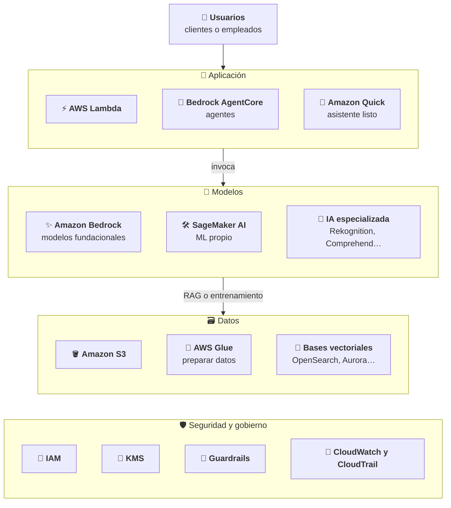
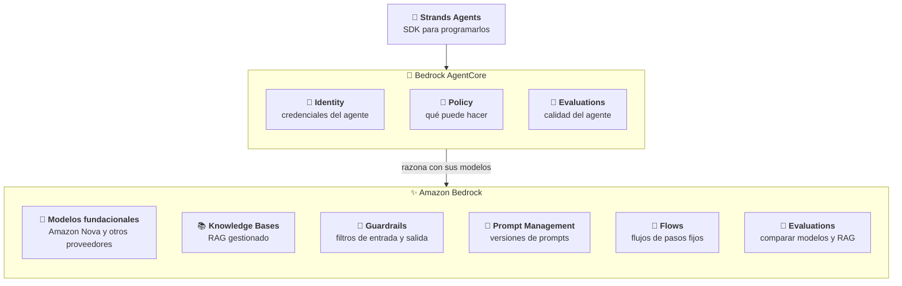
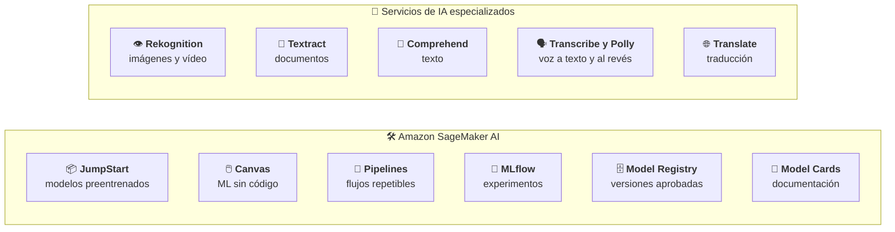
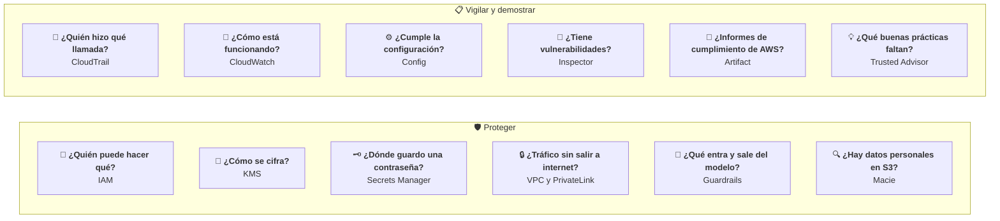

Revisión global de los servicios de AWS que aparecen en el curso: primero, dónde encaja cada uno en una aplicación de IA; después, el detalle por familias y, al final, el cuadro resumen con todos ellos. Pulsa cualquier caja o nombre para ver su ficha, con cuándo usarlo, cuándo no y qué usar en su lugar.

## Dónde encaja cada servicio

Una aplicación de IA típica en AWS, de los datos a la persona que la usa, con la seguridad y el gobierno alrededor de todo:



```nodos
U:
  titulo: Usuarios
  texto: Quien usa la aplicación. Antes de llegar al modelo, la aplicación los autentica y aplica sus permisos.
  seccion: 05-seguridad-gobierno/teoria#consideraciones-de-seguridad-y-privacidad
APP:
  titulo: Aplicación
  texto: El código que recibe la petición y orquesta el resto. Puede ser una función Lambda que llama a un modelo, un agente desplegado en AgentCore o un asistente listo para empleados (Amazon Quick).
LAM:
  concepto: aws-lambda
AGC:
  concepto: amazon-bedrock-agentcore
QK:
  concepto: amazon-quick
MOD:
  titulo: Modelos
  texto: Tres caminos según el caso. Modelos fundacionales por API (Bedrock), un modelo propio entrenado y alojado en SageMaker AI, o un servicio de IA especializado ya entrenado para una tarea concreta.
  seccion: 01-fundamentos-ia-ml/teoria#de-dónde-salen-los-modelos
BR:
  concepto: amazon-bedrock
SM:
  concepto: amazon-sagemaker-ai
IAE:
  titulo: Servicios de IA especializados
  texto: Modelos ya entrenados para una tarea concreta, que se usan por API sin saber de ML. Visión (Rekognition), documentos (Textract), texto (Comprehend), traducción (Translate), voz (Transcribe, Polly), chatbots (Lex) y recomendaciones (Personalize).
  seccion: 01-fundamentos-ia-ml/teoria#servicios-gestionados-de-ia-y-ml-de-aws
DAT:
  titulo: Datos
  texto: Los datos propios, en S3 y preparados con Glue. Alimentan el entrenamiento de un modelo propio (SageMaker AI) o, mediante RAG con Knowledge Bases y una base vectorial, las respuestas de un modelo fundacional.
S3:
  concepto: amazon-s3
GLU:
  concepto: aws-glue
VEC:
  concepto: base-de-datos-vectorial
  seccion: 03-modelos-fundacionales/teoria#bases-de-datos-vectoriales-en-aws
SEG:
  titulo: Seguridad y gobierno
  texto: No son un paso más, sino controles que se aplican en todo el recorrido. Permisos (IAM), cifrado (KMS), filtros del modelo (Guardrails), y monitorización y auditoría (CloudWatch y CloudTrail).
  seccion: 05-seguridad-gobierno/teoria#servicios-para-proteger-sistemas-de-ia
IAM:
  concepto: aws-iam
KMS:
  concepto: aws-kms
GR:
  concepto: amazon-bedrock-guardrails
CW:
  titulo: CloudWatch y CloudTrail
  texto: CloudWatch dice cómo está funcionando el sistema (métricas, registros y alarmas). CloudTrail dice quién hizo qué llamada a la API y cuándo.
  enlaces:
    - {texto: "Amazon CloudWatch", url: "https://docs.aws.amazon.com/AmazonCloudWatch/latest/monitoring/WhatIsCloudWatch.html"}
    - {texto: "AWS CloudTrail", url: "https://docs.aws.amazon.com/awscloudtrail/latest/userguide/cloudtrail-user-guide.html"}
```

## IA generativa: Bedrock y AgentCore

Amazon Bedrock no es una sola cosa. Es el servicio que da acceso a los modelos fundacionales, e incluye las piezas para construir con ellos. AgentCore es aparte, para desplegar y operar agentes.



```nodos
BRK:
  concepto: amazon-bedrock
  seccion: 02-fundamentos-genai/teoria#servicios-de-aws-para-ia-generativa
FM:
  concepto: amazon-nova
  titulo: Modelos fundacionales en Bedrock
  texto: Modelos de varios proveedores y la familia Amazon Nova, por API y sin gestionar infraestructura. Se paga por tokens, por lotes o con capacidad reservada.
KB:
  concepto: amazon-bedrock-knowledge-bases
GRD:
  concepto: amazon-bedrock-guardrails
PM:
  concepto: amazon-bedrock-prompt-management
FL:
  concepto: amazon-bedrock-flows
EV:
  concepto: amazon-bedrock-model-evaluation
AGT:
  concepto: amazon-bedrock-agentcore
ID:
  concepto: agentcore-identity
POL:
  concepto: policy-in-agentcore
AEV:
  concepto: agentcore-evaluations
ST:
  concepto: strands-agents
```

## ML y servicios de IA especializados

SageMaker AI es la plataforma para el ciclo de vida completo de un modelo propio. Los servicios de IA especializados son la alternativa cuando ya existe un modelo entrenado para la tarea.



```nodos
SMK:
  concepto: amazon-sagemaker-ai
  seccion: 01-fundamentos-ia-ml/teoria#servicios-de-aws-por-etapa
JS:
  concepto: amazon-sagemaker-jumpstart
CV:
  concepto: amazon-sagemaker-canvas
PL:
  concepto: amazon-sagemaker-pipelines
MLF:
  concepto: sagemaker-mlflow
MR:
  concepto: amazon-sagemaker-model-registry
MC:
  concepto: amazon-sagemaker-model-cards
ESP:
  titulo: Servicios de IA especializados
  texto: Modelos de AWS ya entrenados para una tarea, que se consumen por API sin saber de ML. Son la primera opción si la tarea encaja; si no, un modelo fundacional (Bedrock) o uno propio (SageMaker AI).
  seccion: 01-fundamentos-ia-ml/teoria#servicios-gestionados-de-ia-y-ml-de-aws
REK:
  concepto: amazon-rekognition
TXT:
  concepto: amazon-textract
CMP:
  concepto: amazon-comprehend
VOZ:
  concepto: amazon-transcribe
  titulo: Amazon Transcribe y Amazon Polly
  texto: Transcribe convierte voz en texto; Polly, texto en voz. Es la pareja que más se confunde en el examen.
TRL:
  concepto: amazon-translate
```

## Seguridad y gobierno: una pregunta, un servicio

Muchas preguntas del examen se resuelven identificando qué pregunta responde cada servicio:



```nodos
PROT:
  titulo: Proteger
  texto: Servicios que impiden accesos, fugas o usos indebidos.
  seccion: 05-seguridad-gobierno/teoria#servicios-para-proteger-sistemas-de-ia
P1:
  concepto: aws-iam
P2:
  concepto: aws-kms
P3:
  concepto: aws-secrets-manager
P4:
  concepto: aws-privatelink
P5:
  concepto: amazon-bedrock-guardrails
P6:
  concepto: amazon-macie
GOB:
  titulo: Vigilar y demostrar
  texto: Servicios que registran, comprueban y documentan, para detectar problemas y demostrar el cumplimiento.
  seccion: 05-seguridad-gobierno/teoria#servicios-para-gobierno-y-cumplimiento
G1:
  concepto: aws-cloudtrail
G2:
  concepto: amazon-cloudwatch
G3:
  concepto: aws-config
G4:
  concepto: amazon-inspector
G5:
  concepto: aws-artifact
G6:
  concepto: aws-trusted-advisor
```
