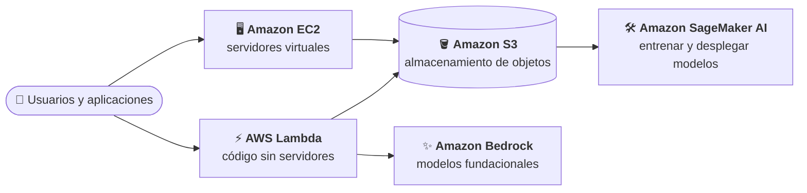
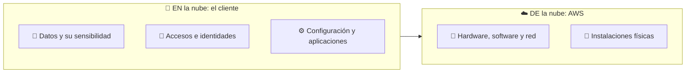

# Base de AWS

Este módulo reúne los conocimientos de AWS que la guía oficial recomienda al candidato antes de abordar los dominios del examen. No evalúa por sí solo ninguna tarea oficial: es el vocabulario común del resto del curso. Se trata al nivel mínimo necesario para reconocer cada concepto en una pregunta.

## Objetivos de aprendizaje

Al terminar el módulo, el estudiante podrá:

- Identificar para qué sirven los servicios centrales de AWS que aparecen en el examen (CP.1).
- Distinguir qué protege AWS y qué protege el cliente según el modelo de responsabilidad compartida (CP.2).
- Explicar cómo IAM autentica y autoriza el acceso a los recursos, y aplicar el criterio de mínimo privilegio (CP.3).
- Reconocer los modelos de precios de AWS y elegir el adecuado para una carga de trabajo (CP.4).

Estos conocimientos proceden de la sección «Recommended AWS knowledge» de la guía y se transcriben en [fuentes/conocimientos-previos.md](../../fuentes/conocimientos-previos.md).

## Mapa de cobertura

| Objetivo | Descripción | Sección |
|---|---|---|
| CP.1 | Servicios centrales de AWS y sus casos de uso | [Servicios centrales](#servicios-centrales) |
| CP.2 | Modelo de responsabilidad compartida | [Responsabilidad compartida](#responsabilidad-compartida) |
| CP.3 | AWS Identity and Access Management (IAM) | [IAM: identidades y permisos](#iam-identidades-y-permisos) |
| CP.4 | Modelos de precios de los servicios de AWS | [Modelos de precios](#modelos-de-precios) |

## Teoría

### Servicios centrales

AWS ofrece servicios que se consumen bajo demanda a través de Regiones. Una **Región** es una ubicación geográfica donde se crean los recursos; al preparar una carga de trabajo conviene elegir una Región que ofrezca los servicios y funcionalidades necesarios y que esté cerca de los usuarios para reducir la latencia, o que cumpla requisitos legales. La disponibilidad de servicios y funcionalidades **varía según la Región**, algo que el examen y los laboratorios de este curso tienen en cuenta (por ejemplo, para Amazon Bedrock).

Los servicios centrales que el examen da por conocidos son estos:

| Servicio | Qué es | Idea clave |
|---|---|---|
| Amazon EC2 | Capacidad de cómputo escalable bajo demanda: servidores virtuales (instancias) | Tú eliges tipo de instancia, red y almacenamiento, y gestionas el sistema operativo invitado |
| Amazon S3 | Almacenamiento de objetos con gran escalabilidad, disponibilidad y seguridad | Casos habituales según la documentación: lagos de datos, sitios web, aplicaciones móviles, copias de seguridad y restauración, y analítica de *big data* |
| AWS Lambda | Cómputo *serverless*: ejecuta código sin aprovisionar ni gestionar servidores | AWS se encarga de la infraestructura, la capacidad, el escalado y los parches |
| Amazon Bedrock | Servicio totalmente gestionado con acceso a modelos fundacionales de varios proveedores para crear aplicaciones de IA generativa | Se estudia a fondo en los módulos 02 y 03 |
| Amazon SageMaker AI | Servicio totalmente gestionado de aprendizaje automático para construir, entrenar y desplegar modelos | Se estudia en los módulos 01 y siguientes. Antes del 3 de diciembre de 2024 se llamaba Amazon SageMaker (ver la nota de abajo) |

> **Nombres de SageMaker.** El 3 de diciembre de 2024 el servicio de ML se renombró a **Amazon SageMaker AI**. Ese mismo día, el nombre **Amazon SageMaker** pasó a designar una plataforma unificada de datos, analítica e IA que *incluye* SageMaker AI (junto con otras capacidades de datos y Amazon Bedrock). En este curso, y en las preguntas del Dominio 1, «SageMaker» se refiere siempre a SageMaker AI.

Otros servicios de apoyo que aparecerán a menudo en el curso, sin necesidad de profundizar ahora:

| Servicio | Para qué sirve, en una frase |
|---|---|
| Amazon VPC | Red virtual privada en la que el cliente lanza sus recursos y controla quién puede llegar a ellos |
| Amazon CloudWatch | Métricas, registros y alarmas: *¿cómo está funcionando?* |
| AWS CloudTrail | Registro de llamadas a la API: *¿quién hizo qué y cuándo?* |



```nodos
U:
  titulo: Usuarios y aplicaciones
  texto: Las personas y los sistemas que usan los servicios de AWS. Para acceder a los recursos necesitan identidades autenticadas y permisos de IAM, con el criterio de mínimo privilegio.
  enlaces:
    - {texto: "Qué es IAM", url: "https://docs.aws.amazon.com/IAM/latest/UserGuide/introduction.html"}
  seccion: 00-base-aws/teoria#iam-identidades-y-permisos
L:
  concepto: aws-lambda
  seccion: 00-base-aws/teoria#servicios-centrales
E:
  concepto: amazon-ec2
  seccion: 00-base-aws/teoria#servicios-centrales
S:
  concepto: amazon-s3
  seccion: 00-base-aws/teoria#servicios-centrales
B:
  concepto: amazon-bedrock
  seccion: 00-base-aws/teoria#servicios-centrales
M:
  concepto: amazon-sagemaker-ai
  seccion: 00-base-aws/teoria#servicios-centrales
```

*Serverless* no significa que no existan servidores, sino que el cliente no los aprovisiona ni los gestiona.

### Responsabilidad compartida

La seguridad y el cumplimiento normativo son una responsabilidad compartida entre AWS y el cliente. El modelo se resume en dos expresiones:

- **Seguridad *de* la nube** (*security of the cloud*): responsabilidad de AWS. Protege la infraestructura que ejecuta los servicios: hardware, software, redes e instalaciones. Auditores independientes verifican periódicamente su eficacia.
- **Seguridad *en* la nube** (*security in the cloud*): responsabilidad del cliente, y **depende del servicio que use**. Incluye la sensibilidad de sus datos, los requisitos de su empresa y las leyes y normativas aplicables.

El reparto cambia con el servicio. Con Amazon EC2, el cliente gestiona el sistema operativo invitado (incluidas actualizaciones y parches), el software de aplicación y la configuración de los grupos de seguridad. Con un servicio gestionado como Amazon Bedrock, AWS asume más tareas operativas, pero el cliente sigue siendo responsable de sus datos, de quién accede a ellos y de cómo usa los resultados del modelo.



```nodos
Cliente:
  titulo: "Seguridad EN la nube: el cliente"
  texto: La responsabilidad del cliente depende del servicio que use. Incluye la sensibilidad de sus datos, los requisitos de su empresa y las leyes y normativas aplicables.
  enlaces:
    - {texto: "Seguridad en Amazon Bedrock y responsabilidad compartida", url: "https://docs.aws.amazon.com/bedrock/latest/userguide/security.html"}
    - {texto: "Responsabilidad compartida (Well-Architected)", url: "https://docs.aws.amazon.com/wellarchitected/latest/security-pillar/shared-responsibility.html"}
  seccion: 00-base-aws/teoria#responsabilidad-compartida
AWS:
  titulo: "Seguridad DE la nube: AWS"
  texto: AWS protege la infraestructura que ejecuta los servicios de la nube de AWS. Auditores independientes prueban y verifican de forma periódica la eficacia de esa seguridad.
  enlaces:
    - {texto: "Seguridad en Amazon Bedrock y responsabilidad compartida", url: "https://docs.aws.amazon.com/bedrock/latest/userguide/security.html"}
    - {texto: "Responsabilidad compartida (Well-Architected)", url: "https://docs.aws.amazon.com/wellarchitected/latest/security-pillar/shared-responsibility.html"}
  seccion: 00-base-aws/teoria#responsabilidad-compartida
D:
  titulo: Datos y su sensibilidad
  texto: El cliente es responsable de la sensibilidad de sus datos y de cumplir las leyes y normativas que les apliquen, con independencia del servicio de AWS que use.
  enlaces:
    - {texto: "Seguridad en Amazon Bedrock", url: "https://docs.aws.amazon.com/bedrock/latest/userguide/security.html"}
  seccion: 00-base-aws/teoria#responsabilidad-compartida
A:
  concepto: aws-iam
  titulo: Accesos e identidades (IAM)
  seccion: 00-base-aws/teoria#iam-identidades-y-permisos
C:
  titulo: Configuración y aplicaciones
  texto: En un servicio como Amazon EC2, el cliente gestiona el sistema operativo invitado (incluidas las actualizaciones y los parches de seguridad), el software de aplicación y la configuración del firewall de grupos de seguridad.
  enlaces:
    - {texto: "Responsabilidad compartida (Well-Architected)", url: "https://docs.aws.amazon.com/wellarchitected/latest/security-pillar/shared-responsibility.html"}
    - {texto: "Amazon EC2", url: "https://docs.aws.amazon.com/AWSEC2/latest/UserGuide/concepts.html"}
  seccion: 00-base-aws/teoria#responsabilidad-compartida
I:
  titulo: Hardware, software y red
  texto: AWS opera, gestiona y controla los componentes desde el sistema operativo del anfitrión y la capa de virtualización hasta la seguridad física de las instalaciones donde funciona el servicio.
  enlaces:
    - {texto: "Responsabilidad compartida (Well-Architected)", url: "https://docs.aws.amazon.com/wellarchitected/latest/security-pillar/shared-responsibility.html"}
  seccion: 00-base-aws/teoria#responsabilidad-compartida
F:
  titulo: Instalaciones físicas
  texto: La seguridad física de las instalaciones donde funciona el servicio es responsabilidad de AWS.
  enlaces:
    - {texto: "Responsabilidad compartida (Well-Architected)", url: "https://docs.aws.amazon.com/wellarchitected/latest/security-pillar/shared-responsibility.html"}
  seccion: 00-base-aws/teoria#responsabilidad-compartida
```

El Dominio 5 retoma este modelo aplicado a los sistemas de IA.

### IAM: identidades y permisos

AWS Identity and Access Management (IAM) es el servicio que controla de forma segura el acceso a los recursos de AWS: quién está **autenticado** (ha iniciado sesión) y quién está **autorizado** (tiene permisos) a usar qué recursos.

- Al crear una cuenta de AWS se empieza con una identidad de inicio de sesión, el **usuario raíz** (*root user*), con acceso completo. AWS recomienda no usarlo en las tareas diarias; para ellas se crean otras identidades (administradores, analistas, desarrolladores) con solo los permisos que necesitan.
- La autenticación asocia las credenciales a una entidad de confianza (*principal*): un usuario de IAM, una entidad federada, un **rol de IAM** o una aplicación. Después, la solicitud se autoriza si las políticas aplicables conceden el permiso.
- **Mínimo privilegio** (*least privilege*): conceder solo los permisos imprescindibles para cada tarea. Es la práctica recomendada central de IAM.
- Otras prácticas recomendadas: exigir **credenciales temporales** a las personas (federación con un proveedor de identidad) y a las cargas de trabajo (roles de IAM), exigir autenticación multifactor (MFA) y revisar y eliminar periódicamente usuarios, roles y permisos sin uso.
- Los permisos se escriben en **políticas** (documentos JSON que permiten o deniegan acciones sobre recursos). Las **basadas en identidad** se asocian a usuarios, grupos o roles; las **basadas en recursos** se asocian al propio recurso (por ejemplo, un bucket de S3). Un **grupo** reúne usuarios que comparten permisos; un **rol** no tiene credenciales permanentes: lo asume quien lo necesita (una persona federada, una función Lambda o un servicio de AWS) y recibe credenciales temporales.
- IAM es **eventualmente consistente**: un cambio de permisos puede tardar un poco en replicarse y no debe formar parte de rutas críticas de una aplicación.

En los sistemas de IA, IAM decide quién puede invocar un modelo, leer los datos de entrenamiento o administrar un endpoint; se profundiza en el módulo 05.

**Ejemplo.** Una función Lambda que resume documentos con Amazon Bedrock no debe llevar claves de acceso en el código: se le asigna un **rol de IAM** cuya política solo permite invocar el modelo concreto que usa (mínimo privilegio) y leer el bucket de S3 de entrada.

### Modelos de precios

AWS factura por el uso de cada servicio, y cada servicio ofrece sus propias opciones. Para el examen basta reconocer la lógica general: **pagar por uso**, **comprometerse a cambio de descuento** o **aprovechar capacidad sobrante**.

| Idea | Ejemplo verificado en la documentación |
|---|---|
| Pago por uso, sin compromiso | Amazon EC2 *On-Demand*: se paga por segundo por las instancias lanzadas |
| Compromiso de uso a 1 o 3 años a cambio de menor coste | Amazon EC2 *Savings Plans* (compromiso en USD por hora) y *Reserved Instances* (configuración concreta) |
| Capacidad sobrante a coste reducido | Amazon EC2 *Spot Instances*: instancias sin usar, con un coste significativamente menor; es una opción rentable si la aplicación es flexible en cuándo se ejecuta y admite interrupciones |
| Elegir la clase de almacenamiento según el patrón de acceso | Amazon S3: clase Standard por defecto y otras clases para datos de acceso infrecuente, raro o cambiante (*Intelligent-Tiering*) |
| Capacidad reservada con facturación por horas | Amazon Bedrock *Provisioned Throughput*: rendimiento fijo, facturado por horas |

#### Cómo se pagan los servicios de IA

Cada familia de servicios de IA tiene su propia unidad de facturación. Reconocerla ayuda a responder preguntas de coste:

| Tipo de servicio | Qué se paga | Ejemplo |
|---|---|---|
| Modelos fundacionales en Amazon Bedrock | *On-demand*: por *tokens* de entrada y de salida, sin compromiso. *Batch*: procesamiento por lotes, con un precio menor que *on-demand* en los modelos que lo admiten. *Provisioned Throughput*: capacidad reservada por horas | Un asistente con tráfico variable usa *on-demand*; uno con tráfico alto y estable, o un modelo personalizado, *Provisioned Throughput* |
| Amazon SageMaker AI | El tiempo de uso de las instancias que se eligen para entrenar y para alojar el modelo | Un *endpoint* en tiempo real factura mientras sus instancias están en marcha, aunque no reciba peticiones |
| Servicios de IA especializados | Por unidad procesada: caracteres (Translate, Polly), unidades de texto (Comprehend), duración del audio (Transcribe), imágenes o páginas | Traducir un millón de caracteres con Translate |
| *Serverless* (AWS Lambda) | Por número de peticiones y duración de la ejecución | No se paga nada mientras no hay invocaciones |

La idea que el examen explota: **lo aprovisionado se paga aunque no se use** (instancias de un *endpoint*, *Provisioned Throughput*), mientras que lo **bajo demanda** se paga solo por uso. La comparación de opciones de Bedrock se desarrolla en los módulos 02 y 03.

#### Controlar el gasto

- **AWS Budgets**: define un presupuesto y avisa cuando el gasto real o previsto lo supera. Es lo primero que conviene configurar antes de un laboratorio.
- **AWS Cost Explorer**: muestra y analiza el gasto histórico por servicio y su tendencia.
- **Capa gratuita (*Free Tier*)**: desde julio de 2025, las cuentas nuevas reciben créditos (100 USD al crearla, ampliables hasta 200 USD) y eligen entre un plan gratuito de hasta seis meses y un plan de pago. Algunos servicios mantienen además una cuota gratuita mensual permanente. Comprueba siempre las condiciones de tu cuenta.

Los precios concretos no se citan en este curso; consúltalos siempre en las páginas oficiales de precios de cada servicio.

## Puntos clave para el examen

- AWS protege la infraestructura (seguridad *de* la nube); el cliente protege sus datos, accesos y configuración (seguridad *en* la nube), y el reparto depende del servicio.
- Cuanto más gestionado es el servicio (por ejemplo, Lambda o Bedrock), menos tareas operativas asume el cliente, pero nunca deja de ser responsable de sus datos y de sus permisos.
- El usuario raíz no se usa en el día a día; se usan identidades con permisos mínimos.
- A las cargas de trabajo se les dan permisos mediante **roles de IAM** (credenciales temporales), no con claves de acceso permanentes.
- *Serverless* quiere decir «sin gestionar servidores», no «sin servidores».
- La disponibilidad de servicios y modelos depende de la Región elegida.
- Pago por uso (*On-Demand*) frente a compromiso (*Savings Plans*, *Reserved Instances*) frente a capacidad sobrante (*Spot*) son las tres lógicas de precio que hay que reconocer. En IA: *tokens* en Bedrock, tiempo de instancia en SageMaker AI y unidades procesadas en los servicios especializados.
- Lo aprovisionado (un *endpoint* encendido, *Provisioned Throughput*) se paga aunque no se use; AWS Budgets avisa antes de que el gasto se dispare.
- Amazon SageMaker AI es el nombre actual del servicio de ML que se llamaba Amazon SageMaker; «Amazon SageMaker» designa ahora una plataforma unificada más amplia.

## Referencias

Documentación oficial consultada el 14 de octubre de 2026:

- Guía del examen AIF-C01, «Recommended AWS knowledge»: <https://docs.aws.amazon.com/aws-certification/latest/ai-practitioner-01/ai-practitioner-01.html>
- Regiones de AWS: <https://docs.aws.amazon.com/global-infrastructure/latest/regions/aws-regions.html>
- Amazon EC2, ¿qué es?: <https://docs.aws.amazon.com/AWSEC2/latest/UserGuide/concepts.html>
- Amazon EC2, opciones de facturación y compra: <https://docs.aws.amazon.com/AWSEC2/latest/UserGuide/instance-purchasing-options.html>
- Amazon S3, ¿qué es?: <https://docs.aws.amazon.com/AmazonS3/latest/userguide/Welcome.html>
- Amazon S3, clases de almacenamiento: <https://docs.aws.amazon.com/AmazonS3/latest/userguide/storage-class-intro.html>
- AWS Lambda, ¿qué es?: <https://docs.aws.amazon.com/lambda/latest/dg/welcome.html>
- Amazon Bedrock, visión general: <https://docs.aws.amazon.com/bedrock/latest/userguide/what-is-bedrock.html>
- Amazon Bedrock, seguridad y modelo de responsabilidad compartida: <https://docs.aws.amazon.com/bedrock/latest/userguide/security.html>
- Amazon Bedrock, Provisioned Throughput: <https://docs.aws.amazon.com/bedrock/latest/userguide/prov-throughput.html>
- Amazon SageMaker AI, ¿qué es?: <https://docs.aws.amazon.com/sagemaker/latest/dg/whatis.html>
- AWS Well-Architected, responsabilidad compartida: <https://docs.aws.amazon.com/wellarchitected/latest/security-pillar/shared-responsibility.html>
- IAM, ¿qué es?: <https://docs.aws.amazon.com/IAM/latest/UserGuide/introduction.html>
- IAM, prácticas recomendadas de seguridad: <https://docs.aws.amazon.com/IAM/latest/UserGuide/best-practices.html>
- IAM, políticas y permisos: <https://docs.aws.amazon.com/IAM/latest/UserGuide/access_policies.html>
- Amazon VPC: <https://docs.aws.amazon.com/vpc/latest/userguide/what-is-amazon-vpc.html>
- Amazon CloudWatch: <https://docs.aws.amazon.com/AmazonCloudWatch/latest/monitoring/WhatIsCloudWatch.html>
- AWS CloudTrail: <https://docs.aws.amazon.com/awscloudtrail/latest/userguide/cloudtrail-user-guide.html>
- Precios de Amazon Bedrock (modos *on-demand*, *batch* y *Provisioned Throughput*): <https://aws.amazon.com/bedrock/pricing/>
- Precios de Amazon SageMaker AI: <https://aws.amazon.com/sagemaker/ai/pricing/>
- Precios de AWS Lambda: <https://aws.amazon.com/lambda/pricing/>
- AWS Budgets: <https://docs.aws.amazon.com/cost-management/latest/userguide/budgets-managing-costs.html>
- AWS Cost Explorer: <https://docs.aws.amazon.com/cost-management/latest/userguide/ce-what-is.html>
- Capa gratuita de AWS: <https://docs.aws.amazon.com/awsaccountbilling/latest/aboutv2/free-tier.html>
