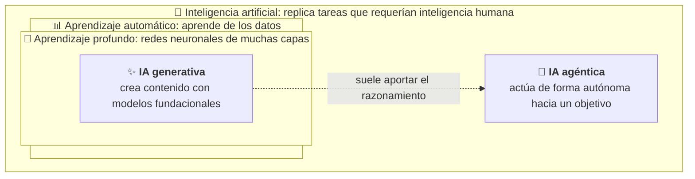
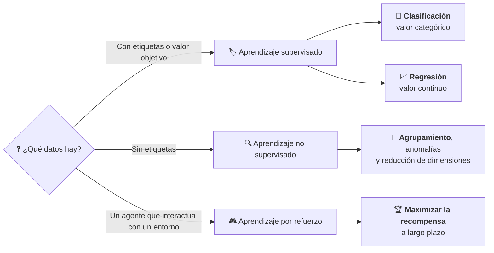
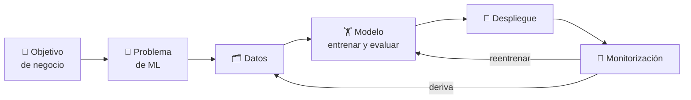

# Fundamentos de IA y ML

Este módulo desarrolla el Dominio 1 del examen AIF-C01 (20 % del contenido puntuable): los conceptos básicos de IA y aprendizaje automático, cuándo aplicarlos y cómo es el ciclo de vida de un modelo. El nivel es *foundational*: hay que saber **qué** técnica o servicio corresponde a cada situación y **por qué**, no cómo programarlo.

## Objetivos de aprendizaje

Los objetivos corresponden a las tres Task Statements del dominio (texto literal en [fuentes/dominio-1.md](../../fuentes/dominio-1.md)).

- **Task 1.1.** Explicar conceptos y terminología básicos de IA: términos, diferencias entre IA, ML, IA generativa, aprendizaje profundo e IA agéntica, tipos de inferencia, de datos y de aprendizaje.
- **Task 1.2.** Identificar casos de uso prácticos: dónde aporta valor la IA, cuándo no es apropiada, qué técnica elegir y qué servicios gestionados de AWS la resuelven.
- **Task 1.3.** Describir el ciclo de vida de desarrollo de IA/ML: etapas del *pipeline*, origen de los modelos, formas de usarlos en producción, servicios por etapa, MLOps y métricas.

## Mapa de cobertura

| Objetivo | Descripción | Sección |
|---|---|---|
| 1.1.1 | Definir términos básicos de IA | [Términos básicos de IA](#términos-básicos-de-ia) |
| 1.1.2 | Similitudes y diferencias entre IA, ML, IA generativa, aprendizaje profundo e IA agéntica | [Cómo se relacionan IA, ML, aprendizaje profundo e IA generativa](#cómo-se-relacionan-ia-ml-aprendizaje-profundo-e-ia-generativa) |
| 1.1.3 | Tipos de inferencia: por lotes, en tiempo real, asíncrona y *serverless* | [Tipos de inferencia](#tipos-de-inferencia) |
| 1.1.4 | Tipos de datos en los modelos de IA | [Tipos de datos](#tipos-de-datos) |
| 1.1.5 | Tipos de aprendizaje: supervisado, no supervisado y por refuerzo | [Tipos de aprendizaje](#tipos-de-aprendizaje) |
| 1.2.1 | Aplicaciones donde la IA/ML aporta valor | [Dónde aporta valor la IA y el ML](#dónde-aporta-valor-la-ia-y-el-ml) |
| 1.2.2 | Cuándo no es apropiada una solución de IA/ML | [Cuándo no usar ML](#cuándo-no-usar-ml) |
| 1.2.3 | Técnica de IA/ML adecuada a cada caso | [Elegir la técnica: regresión, clasificación y agrupamiento](#elegir-la-técnica-regresión-clasificación-y-agrupamiento) |
| 1.2.4 | Ejemplos de aplicaciones reales de IA | [Aplicaciones reales de la IA](#aplicaciones-reales-de-la-ia) |
| 1.2.5 | Capacidades de los servicios gestionados de IA/ML de AWS | [Servicios gestionados de IA y ML de AWS](#servicios-gestionados-de-ia-y-ml-de-aws) |
| 1.2.6 | Modelos de ML tradicionales frente a modelos fundacionales | [ML tradicional frente a modelos fundacionales](#ml-tradicional-frente-a-modelos-fundacionales) |
| 1.3.1 | Componentes de un *pipeline* de IA/ML | [Etapas de un pipeline de IA y ML](#etapas-de-un-pipeline-de-ia-y-ml) |
| 1.3.2 | Fuentes de modelos fundacionales | [De dónde salen los modelos](#de-dónde-salen-los-modelos) |
| 1.3.3 | Métodos para usar un modelo en producción | [Cómo se usa un modelo en producción](#cómo-se-usa-un-modelo-en-producción) |
| 1.3.4 | Servicios y funcionalidades de AWS por etapa del *pipeline* | [Servicios de AWS por etapa](#servicios-de-aws-por-etapa) |
| 1.3.5 | Conceptos fundamentales de MLOps | [MLOps](#mlops) |
| 1.3.6 | Métricas de rendimiento del modelo y métricas de negocio | [Métricas de rendimiento y de negocio](#métricas-de-rendimiento-y-de-negocio) |

## Teoría

### Tarea 1.1: conceptos y terminología

#### Términos básicos de IA

- **Inteligencia artificial (IA).** Describe cualquier sistema capaz de replicar tareas que antes requerían inteligencia humana. La mayoría de los casos de uso de IA buscan un resultado **probabilístico**: una predicción o decisión con un alto grado de certeza, similar al juicio humano.
- **Aprendizaje automático (*machine learning*, ML).** Técnica en la que se usan grandes cantidades de datos para crear y validar una lógica de decisión, que recibe el nombre de **modelo**. Casi todos los sistemas de IA actuales se crean con ML.
- **Algoritmo.** La «receta» con la que se resuelve un tipo de problema. Un mismo algoritmo puede servir para distintos tipos de problemas y un problema puede resolverse con varios algoritmos.
- **Modelo.** El resultado de aplicar un algoritmo a unos datos de entrenamiento: la lógica de decisión que luego se usa para predecir.
- **Entrenamiento e inferencia.** *Entrenar* es ajustar el modelo con un conjunto de datos conocido. *Inferir* es usar el modelo ya entrenado para obtener predicciones sobre datos nuevos.
- **Red neuronal y aprendizaje profundo (*deep learning*).** Método de IA inspirado en el cerebro humano que procesa los datos mediante nodos (neuronas artificiales) interconectados y organizados en capas. Los modelos de aprendizaje profundo son redes neuronales y reconocen patrones complejos en imágenes, texto, sonido y otros datos.
- **Visión por computador (*computer vision*).** Campo de la IA que permite a los ordenadores obtener información útil de imágenes, vídeos y otras entradas visuales.
- **Procesamiento del lenguaje natural (*natural language processing*, NLP).** Tecnología que permite a los ordenadores interpretar, manipular y comprender el lenguaje humano (texto y voz).
- **Modelo de lenguaje de gran tamaño (*large language model*, LLM).** Modelo de aprendizaje profundo muy grande, preentrenado con enormes cantidades de datos, basado en la arquitectura *transformer*.
- **IA generativa (*generative AI*, GenAI).** Conjunto de sistemas y modelos de IA diseñados para **generar contenido** nuevo (texto, código, imágenes, música u otros datos) a partir de patrones aprendidos de datos existentes. Funciona con modelos muy grandes preentrenados con vastos corpus, los **modelos fundacionales** (*foundation models*, FM).
- **IA agéntica (*agentic AI*).** Sistema de IA autónomo que puede actuar de forma independiente para alcanzar objetivos predefinidos, sin una supervisión humana constante. En AWS, un agente orquesta las interacciones entre modelos fundacionales, fuentes de datos, aplicaciones de software y usuarios, y llama a APIs para ejecutar acciones.
- **Sesgo (*bias*) y equidad (*fairness*).** Un sistema se considera sesgado si discrimina a determinadas personas o grupos. Los modelos aprenden de los datos, y estos pueden reflejar desigualdades: por ejemplo, datos con representación insuficiente de grupos demográficos o con etiquetas sesgadas. La **equidad** es la ausencia de ese trato desigual. Se estudia a fondo en el Dominio 4.
- **Ajuste (*fit*).** Indica lo bien que un modelo generaliza a datos nuevos. Un modelo con **sobreajuste** (*overfitting*) acierta con los datos de entrenamiento pero no con datos reales (alta varianza). Un modelo con **subajuste** (*underfitting*) no encuentra una relación significativa entre entradas y salidas y falla incluso con los datos de entrenamiento (alto sesgo). El objetivo es el equilibrio entre ambos.

  *Ejemplo:* un modelo de fraude que acierta el 99 % con los datos de entrenamiento y el 62 % con las operaciones del mes siguiente está **sobreajustado**; uno que acierta el 60 % en ambos casos está **subajustado**.

> «Sesgo» tiene dos sentidos distintos en el examen: el **trato injusto a grupos** (equidad) y el **error sistemático del modelo** (*bias* frente a *variance* en el ajuste). El contexto de la pregunta indica cuál se pide.

#### Cómo se relacionan IA, ML, aprendizaje profundo e IA generativa

Cada concepto está **contenido** en el anterior, como muñecas rusas; no es una secuencia de pasos. La IA agéntica no es un nivel más de la jerarquía, sino una forma de **usar** la IA: suele apoyarse en un modelo fundacional para razonar y decidir.



```nodos
IA:
  concepto: inteligencia-artificial
  seccion: 01-fundamentos-ia-ml/teoria#cómo-se-relacionan-ia-ml-aprendizaje-profundo-e-ia-generativa
ML:
  concepto: aprendizaje-automatico
  seccion: 01-fundamentos-ia-ml/teoria#cómo-se-relacionan-ia-ml-aprendizaje-profundo-e-ia-generativa
DL:
  concepto: aprendizaje-profundo
  seccion: 01-fundamentos-ia-ml/teoria#cómo-se-relacionan-ia-ml-aprendizaje-profundo-e-ia-generativa
GEN:
  concepto: ia-generativa
  seccion: 01-fundamentos-ia-ml/teoria#cómo-se-relacionan-ia-ml-aprendizaje-profundo-e-ia-generativa
AG:
  concepto: ia-agentica
  seccion: 01-fundamentos-ia-ml/teoria#cómo-se-relacionan-ia-ml-aprendizaje-profundo-e-ia-generativa
```

| Concepto | Qué es | Diferencia clave |
|---|---|---|
| IA | Cualquier sistema que replica tareas que requerían inteligencia humana | Es el término más amplio |
| ML | Subconjunto de la IA que aprende patrones a partir de datos | Crea el modelo a partir de datos, en lugar de programar las reglas a mano |
| Aprendizaje profundo | Subconjunto del ML basado en redes neuronales de varias capas | Reconoce patrones complejos en datos como imágenes, texto o sonido |
| IA generativa | Subconjunto del aprendizaje profundo que crea contenido nuevo | Genera (texto, imágenes, código…) en lugar de limitarse a clasificar o predecir |
| IA agéntica | Sistemas que actúan de forma autónoma para alcanzar objetivos | No solo responde: decide, usa herramientas y ejecuta acciones. Suele apoyarse en modelos fundacionales |

La IA «clásica» de clasificación (reconocer algo) y de predicción (anticipar tendencias a partir de datos históricos) se distingue de la generativa, que produce contenido.

**Cómo distinguirlos en un enunciado:**

- «Predecir», «clasificar», «detectar» un valor o una categoría a partir de datos históricos → **ML** (tradicional).
- «Reconocer objetos en imágenes», «entender voz» con grandes volúmenes de datos no estructurados → **aprendizaje profundo**.
- «Redactar», «resumir», «generar» imágenes o código → **IA generativa**.
- «Decidir qué pasos dar», «usar herramientas», «ejecutar acciones» hasta cumplir un objetivo → **IA agéntica**. El detalle de los modelos fundacionales, los *tokens* y los agentes corresponde a los dominios 2 y 3.

#### Tipos de inferencia

Una vez entrenado el modelo, se despliega para obtener predicciones. Según la latencia que exija el caso y el patrón de tráfico, Amazon SageMaker AI ofrece varias opciones:

| Tipo | Cuándo encaja | Idea clave |
|---|---|---|
| En tiempo real (*real-time*) | Cargas interactivas con requisitos de baja latencia | Un *endpoint* permanente y gestionado, con escalado automático |
| *Serverless* | Cargas con periodos de inactividad entre ráfagas de tráfico, que toleran arranques en frío | No se eligen tipos de instancia ni políticas de escalado; se paga por uso |
| Asíncrona (*asynchronous*) | Solicitudes grandes o con tiempos de procesamiento largos y requisitos de latencia casi en tiempo real | Las solicitudes se encolan y se procesan de forma asíncrona; puede escalar a cero cuando no hay solicitudes |
| Por lotes (*batch transform*) | Obtener inferencias de conjuntos de datos grandes sin necesidad de un *endpoint* persistente | Procesa un conjunto de datos completo de una vez |

Matices que ayudan a descartar opciones (documentación de SageMaker AI):

- **Asíncrona**: admite cargas de hasta 1 GB y tiempos de procesamiento de hasta una hora; la petición se deja en Amazon S3 y el resultado vuelve a S3.
- ***Serverless***: escala a cero sin tráfico, pero no admite GPU ni configuración de VPC, y puede sufrir arranques en frío. Si el caso exige GPU o red privada, no es la opción.
- **Tiempo real**: las instancias del *endpoint* se facturan mientras están en marcha, haya o no peticiones.
- **Por lotes**: no hay *endpoint*; se lanza un trabajo, se procesa el conjunto completo y termina.

Los mismos conceptos aparecen con modelos fundacionales: Amazon Bedrock ofrece inferencia bajo demanda (*on-demand*, en tiempo real) e inferencia por lotes (*batch*), más barata para grandes volúmenes que no necesitan respuesta inmediata. Se estudia en los módulos 02 y 03.

#### Tipos de datos

- **Etiquetados y no etiquetados.** Un dato está etiquetado cuando lleva asociado el valor correcto que el modelo debe aprender (por ejemplo, una foto marcada como «contiene un pájaro»). El aprendizaje supervisado necesita datos etiquetados.
- **Estructurados y no estructurados.** Los datos estructurados siguen un formato predefinido, normalmente tabular, con filas y columnas. Los no estructurados no siguen reglas predeterminadas: texto largo, audio, vídeo e imágenes.
- **Tabulares.** Datos estructurados en tablas (por ejemplo, historial de clientes).
- **Series temporales (*time series*).** Datos ordenados en el tiempo, como las lecturas de sensores de IoT o las cotizaciones.
- **Imagen y texto.** Entradas típicas de la visión por computador y del procesamiento del lenguaje natural, respectivamente.

#### Tipos de aprendizaje



```nodos
D:
  titulo: ¿Qué datos hay?
  texto: El tipo de aprendizaje depende de los datos disponibles. Con valores objetivo (etiquetas), el problema es supervisado; sin etiquetas, no supervisado; y si un agente aprende interactuando con un entorno, por refuerzo.
  enlaces:
    - {texto: "Tipos de algoritmos y paradigmas de aprendizaje", url: "https://docs.aws.amazon.com/sagemaker/latest/dg/algorithms-choose.html"}
  seccion: 01-fundamentos-ia-ml/teoria#tipos-de-aprendizaje
S:
  concepto: aprendizaje-supervisado
  seccion: 01-fundamentos-ia-ml/teoria#tipos-de-aprendizaje
U:
  concepto: aprendizaje-no-supervisado
  seccion: 01-fundamentos-ia-ml/teoria#tipos-de-aprendizaje
R:
  concepto: aprendizaje-por-refuerzo
  seccion: 01-fundamentos-ia-ml/teoria#tipos-de-aprendizaje
S1:
  concepto: clasificacion
  seccion: 01-fundamentos-ia-ml/teoria#elegir-la-técnica-regresión-clasificación-y-agrupamiento
S2:
  concepto: regresion
  seccion: 01-fundamentos-ia-ml/teoria#elegir-la-técnica-regresión-clasificación-y-agrupamiento
U1:
  titulo: Agrupamiento, anomalías y reducción de dimensiones
  texto: Problemas típicos del aprendizaje no supervisado. El agrupamiento busca grupos de elementos parecidos; la detección de anomalías identifica elementos que se desvían de lo normal; la reducción de dimensiones simplifica los datos conservando sus propiedades más importantes.
  enlaces:
    - {texto: "Aprendizaje no supervisado en SageMaker AI", url: "https://docs.aws.amazon.com/sagemaker/latest/dg/algorithms-choose.html"}
  seccion: 01-fundamentos-ia-ml/teoria#tipos-de-aprendizaje
R1:
  titulo: Maximizar la recompensa a largo plazo
  texto: El agente aprende por ensayo y error con un entorno dinámico. Equilibra explorar acciones con recompensa incierta y aprovechar las que ya sabe que dan recompensa.
  enlaces:
    - {texto: "Aprendizaje por refuerzo en SageMaker AI", url: "https://docs.aws.amazon.com/sagemaker/latest/dg/algorithms-choose.html"}
  seccion: 01-fundamentos-ia-ml/teoria#tipos-de-aprendizaje
```

- **Aprendizaje supervisado.** Los datos incluyen entradas y los valores objetivo (salidas). Si el objetivo es categórico, es un problema de **clasificación** (binaria, con dos clases, o multiclase); si es un valor continuo, de **regresión**.
- **Aprendizaje no supervisado.** Los datos no tienen etiquetas ni valores objetivo; el modelo descubre patrones, como agrupaciones (*clustering*), anomalías o una representación con menos dimensiones.
- **Aprendizaje por refuerzo (*reinforcement learning*).** Un **agente** aprende un comportamiento por ensayo y error interactuando con un entorno dinámico, con el objetivo de maximizar las recompensas a largo plazo. Ejemplos: robótica, optimización de inventario o rutas, juegos.
- **Aprendizaje autosupervisado (*self-supervised learning*).** Las etiquetas se generan a partir de los propios datos (por ejemplo, ocultar una palabra de una frase y predecirla). Es como se **preentrenan los modelos fundacionales** con enormes volúmenes de datos sin etiquetar. Después, técnicas como el aprendizaje por refuerzo con retroalimentación humana (*reinforcement learning from human feedback*, RLHF) ajustan sus respuestas a las preferencias de las personas.

> Trampa frecuente: «el modelo fundacional se entrenó sin etiquetas humanas» no significa aprendizaje no supervisado (que busca grupos o anomalías), sino **autosupervisado**.

### Tarea 1.2: casos de uso prácticos

#### Dónde aporta valor la IA y el ML

El ML ayuda a resolver problemas de negocio como la predicción de abandono de clientes (*churn*), la detección de fraude y el reconocimiento de imágenes y de voz. Entre los casos habituales en AWS figuran las operaciones de centros de atención telefónica, las recomendaciones personalizadas, la moderación de contenido, el análisis de audio y vídeo y la verificación de identidad.

El valor suele venir de tres ventajas: **asistir la toma de decisiones humanas** (por ejemplo, señalar transacciones sospechosas para su revisión), **escalar** una tarea que una persona no podría hacer con tanto volumen y **automatizar** tareas repetitivas.

#### Cuándo no usar ML

El primer paso del ciclo de vida de ML es plantear el problema de negocio, y esa evaluación incluye determinar si ML es realmente la mejor opción. No lo es cuando:

- **Unas reglas de negocio sencillas resuelven mejor el problema.** Si la lógica se puede escribir de forma explícita y determinista, ML añade complejidad sin ventaja.
- **No hay datos suficientes** para entrenar un modelo.
- **Se necesita un resultado exacto y no una predicción.** Un modelo da un resultado probabilístico: si el negocio exige siempre un valor concreto y comprobable (un cálculo fiscal, por ejemplo), un modelo no es la herramienta.
- **El análisis coste-beneficio no sale.** El valor de negocio debe poder medirse frente a objetivos y criterios de éxito concretos, y el objetivo debe ser alcanzable con un camino claro a producción.

#### Elegir la técnica: regresión, clasificación y agrupamiento

| Pregunta de negocio | Tipo de problema | Técnica |
|---|---|---|
| ¿Cuál será el precio de una vivienda o la demanda de la próxima semana? (valor numérico continuo) | Supervisado | **Regresión** |
| ¿Esta transacción es fraudulenta o legítima? ¿De qué tema trata este documento? (categoría) | Supervisado | **Clasificación** (binaria o multiclase) |
| ¿Qué grupos de clientes se parecen entre sí si no tengo etiquetas? | No supervisado | **Agrupamiento** (*clustering*) |
| ¿Qué observaciones se desvían de lo normal? | No supervisado | **Detección de anomalías** |
| ¿Cuántas unidades venderemos cada semana del próximo trimestre? (valores ordenados en el tiempo) | Supervisado | **Previsión de series temporales** (*forecasting*), un caso particular de regresión |

El criterio práctico: si hay un valor objetivo, el problema es supervisado, y se distingue entre categoría (clasificación) y número (regresión); si no hay etiquetas, se busca estructura en los datos.

> **Pista de redacción:** «¿cuánto?», «¿qué importe?» → regresión; «¿cuál de estas categorías?», «¿sí o no?» → clasificación; «¿qué grupos hay?» sin etiquetas → agrupamiento; «¿qué es raro?» → detección de anomalías. La **detección de fraude** puede ser clasificación (si hay ejemplos etiquetados de fraude) o detección de anomalías (si no los hay).

#### Aplicaciones reales de la IA

| Aplicación | Ejemplo |
|---|---|
| Visión por computador | Analizar imágenes y vídeos, moderar contenido, verificar identidad |
| Procesamiento del lenguaje natural | Extraer entidades, frases clave y opiniones de documentos |
| Reconocimiento del habla | Convertir audio en texto |
| Sistemas de recomendación | Recomendar elementos a los usuarios |
| Detección de fraude | Identificar observaciones anómalas o fraudulentas |
| Previsión (*forecasting*) | Anticipar tendencias a partir de datos históricos |
| Bases de conocimiento | Responder usando información propia de la empresa con *Retrieval Augmented Generation* (RAG), por ejemplo con Amazon Bedrock Knowledge Bases |
| IA agéntica | Agentes que completan acciones a partir de datos de la organización y de la petición del usuario |

#### Servicios gestionados de IA y ML de AWS

Los **servicios de IA especializados** son modelos preentrenados y optimizados para tareas concretas: se pueden integrar en las aplicaciones **sin experiencia en ML**, pero ofrecen una capacidad de personalización limitada. Según la guía de decisión de AWS, normalmente se personalizan los datos de entrada y algunos parámetros, sin acceso al modelo subyacente. Algunos ofrecen además personalizaciones acotadas sin salir del servicio, por ejemplo clasificadores y reconocedores de entidades propios en Comprehend o etiquetas propias en Rekognition (Custom Labels).

| Servicio | Qué hace |
|---|---|
| Amazon Transcribe | Reconocimiento automático del habla: convierte audio en texto |
| Amazon Translate | Traducción de texto bajo demanda, con ML |
| Amazon Comprehend | NLP: extrae entidades, frases clave, idioma y opiniones de los documentos |
| Amazon Lex | Interfaces conversacionales (*chatbots*) por voz y texto, con comprensión del lenguaje natural y reconocimiento del habla |
| Amazon Polly | Convierte texto en voz realista |
| Amazon Rekognition | Análisis de imágenes y vídeo (visión por computador), sin experiencia en ML |
| Amazon Textract | Detecta y analiza texto, incluido el manuscrito, en documentos |
| Amazon Personalize | Servicio de ML totalmente gestionado que genera recomendaciones de elementos para los usuarios |
| Amazon SageMaker AI | Plataforma para **construir, entrenar y desplegar modelos propios**, con la máxima flexibilidad y control sobre el algoritmo |

**Escenarios típicos y su servicio:**

| Escenario de negocio | Servicio |
|---|---|
| Subtitular vídeos o transcribir llamadas de un centro de atención | Amazon Transcribe |
| Leer en voz alta notificaciones o artículos en una aplicación | Amazon Polly |
| Publicar el catálogo de una tienda en cinco idiomas | Amazon Translate |
| Conocer la opinión de miles de reseñas o detectar datos personales en texto | Amazon Comprehend |
| Un *chatbot* de voz o texto para reservar citas | Amazon Lex |
| Moderar fotos subidas por usuarios o detectar objetos en imágenes | Amazon Rekognition |
| Extraer importes y tablas de facturas escaneadas | Amazon Textract |
| «Los clientes que vieron esto también vieron…» | Amazon Personalize |

**Capacidades de SageMaker AI que conviene reconocer** (el examen evalúa *qué* hacen, no cómo se usan):

| Capacidad | Para qué sirve |
|---|---|
| SageMaker Canvas | Crear modelos y obtener predicciones **sin escribir código**: pensado para analistas de negocio |
| SageMaker JumpStart | Partir de modelos preentrenados (incluidos modelos fundacionales de código abierto), ajustarlos y desplegarlos |
| Algoritmos integrados y *frameworks* | Entrenar modelos propios con distintos grados de esfuerzo (ver [De dónde salen los modelos](#de-dónde-salen-los-modelos)) |
| *Endpoints* y transformación por lotes | Desplegar el modelo para inferencia (ver [Tipos de inferencia](#tipos-de-inferencia)) |
| SageMaker Pipelines, Model Registry y MLflow | Automatizar, versionar y registrar experimentos (ver [MLOps](#mlops)) |

Regla de decisión: **servicio gestionado y preentrenado** si resuelve el caso, **SageMaker AI** si hace falta un modelo a medida, e infraestructura y *frameworks* de bajo nivel solo si se necesita aún más control y se asume la gestión.

#### ML tradicional frente a modelos fundacionales

| Criterio | Modelo de ML tradicional o servicio especializado | Modelo fundacional |
|---|---|---|
| Tarea | Tarea concreta y acotada: clasificar, predecir un valor, detectar anomalías | Generar o transformar contenido, conversar, resumir, razonar sobre texto libre |
| Resultado | Predicción o clasificación medible con métricas | Contenido generado, de calidad más difícil de medir |
| Explicabilidad | Más fácil de interpretar si se parte de modelos simples | Más difícil de interpretar |
| Datos | Necesita datos etiquetados propios (salvo servicios preentrenados) | Preentrenado; se adapta con *prompts* o personalización |
| Restricciones operativas | Modelos pequeños: baja latencia y bajo coste por predicción; resultados más estables | Más latencia y coste por petición (según el tamaño del modelo y los *tokens*); respuestas no deterministas y riesgo de alucinaciones |
| Tiempo hasta tener valor | Hay que reunir y etiquetar datos y entrenar (salvo servicios preentrenados) | Rápido de probar con *prompts*, sin datos etiquetados |

Cuando existen **requisitos regulatorios, de explicabilidad o restricciones operativas** (latencia muy baja, coste por predicción, resultado reproducible), un modelo tradicional, más simple y fácil de interpretar, suele ser la opción más defendible. Cuando la tarea es abierta (redactar, resumir, conversar sobre documentos variados) o no hay datos etiquetados, un modelo fundacional suele ser la mejor opción. Una buena práctica de AWS es empezar por un modelo sencillo de interpretar y depurar, e iterar. Los modelos fundacionales se estudian en los dominios 2 y 3.

> Esta tabla es una guía de decisión del curso construida a partir de las guías de decisión de AWS; no es una regla oficial de la certificación.

### Tarea 1.3: ciclo de vida de IA y ML

#### Etapas de un pipeline de IA y ML



```nodos
A:
  titulo: Objetivo de negocio
  texto: Es la fase más importante del ciclo de vida. Hay que tener clara la meta, el valor de negocio esperado y poder medirlo frente a criterios de éxito concretos, con un camino claro hacia producción.
  enlaces:
    - {texto: "Identificación del objetivo de negocio", url: "https://docs.aws.amazon.com/wellarchitected/latest/machine-learning-lens/business-goal-identification.html"}
  seccion: 01-fundamentos-ia-ml/teoria#etapas-de-un-pipeline-de-ia-y-ml
B:
  titulo: Planteamiento del problema de ML
  texto: Se traduce el problema de negocio a ML. Se define qué se observa y qué se quiere predecir, qué métrica se optimizará y, sobre todo, si ML es el enfoque adecuado.
  enlaces:
    - {texto: "Planteamiento del problema de ML", url: "https://docs.aws.amazon.com/wellarchitected/latest/machine-learning-lens/ml-problem-framing.html"}
  seccion: 01-fundamentos-ia-ml/teoria#etapas-de-un-pipeline-de-ia-y-ml
C:
  titulo: Procesamiento de datos
  texto: Los datos (entradas y salidas deseadas) definen el objetivo del sistema y sirven para entrenar el algoritmo que asocia las entradas con las salidas.
  enlaces:
    - {texto: "Procesamiento de datos", url: "https://docs.aws.amazon.com/wellarchitected/latest/machine-learning-lens/data-processing.html"}
  seccion: 01-fundamentos-ia-ml/teoria#etapas-de-un-pipeline-de-ia-y-ml
D:
  titulo: Desarrollo del modelo
  texto: Incluye la construcción, el entrenamiento, el ajuste y la evaluación del modelo.
  enlaces:
    - {texto: "Desarrollo del modelo", url: "https://docs.aws.amazon.com/wellarchitected/latest/machine-learning-lens/model-development.html"}
  seccion: 01-fundamentos-ia-ml/teoria#etapas-de-un-pipeline-de-ia-y-ml
E:
  titulo: Despliegue
  texto: Se lleva el modelo entrenado, ajustado y evaluado a producción para hacer predicciones, con procesos de gobierno y automatización con controles de calidad.
  enlaces:
    - {texto: "Despliegue", url: "https://docs.aws.amazon.com/wellarchitected/latest/machine-learning-lens/deployment.html"}
  seccion: 01-fundamentos-ia-ml/teoria#etapas-de-un-pipeline-de-ia-y-ml
F:
  titulo: Monitorización
  texto: El sistema captura datos, los compara con los de entrenamiento, aplica reglas para detectar problemas y envía alertas. Detecta problemas de calidad de datos, calidad del modelo y deriva.
  enlaces:
    - {texto: "Monitorización", url: "https://docs.aws.amazon.com/wellarchitected/latest/machine-learning-lens/monitoring.html"}
  seccion: 01-fundamentos-ia-ml/teoria#etapas-de-un-pipeline-de-ia-y-ml
```

1. **Identificación del objetivo de negocio.** Es la fase más importante: hay que tener clara la meta, el valor esperado y los criterios de éxito.
2. **Planteamiento del problema de ML.** Se traduce el problema de negocio a ML: qué se observa y qué se quiere predecir (la etiqueta u objetivo), y qué métrica se optimizará. Aquí se decide si ML es el enfoque adecuado.
3. **Procesamiento de datos.** Los datos (entradas y salidas deseadas) definen el objetivo del sistema y sirven para entrenar el algoritmo.
4. **Desarrollo del modelo.** Construcción, entrenamiento, ajuste y evaluación.
5. **Despliegue.** Se lleva el modelo a producción para hacer predicciones, con procesos de gobierno y automatización.
6. **Monitorización.** Se comparan los datos en producción con los de entrenamiento y se detectan problemas de calidad de datos, de calidad del modelo y de deriva.

> La ingeniería de características (*feature engineering*), el ajuste de hiperparámetros y la construcción de *pipelines* están fuera del alcance del examen: basta con reconocer en qué etapa encajan.

Ejemplo aplicado a una empresa de telecomunicaciones que quiere reducir bajas:

1. **Objetivo:** reducir un 10 % las bajas de clientes este año.
2. **Problema de ML:** clasificación binaria, «¿se dará de baja este cliente en los próximos 90 días?», optimizando la exhaustividad para no perder clientes en riesgo.
3. **Datos:** historial de consumo, incidencias y bajas pasadas (etiquetadas), limpiado y preparado.
4. **Modelo:** se entrena y se evalúa con datos que el modelo no ha visto.
5. **Despliegue:** puntuación nocturna por lotes de todos los clientes para la campaña de retención.
6. **Monitorización:** si cambian los hábitos (nueva tarifa de la competencia), aparece deriva y se reentrena.

#### De dónde salen los modelos

- **Modelos preentrenados de código abierto**, por ejemplo con Amazon SageMaker JumpStart, que ofrece modelos preentrenados de código abierto para muchos tipos de problemas; se pueden entrenar de forma incremental y ajustar antes de desplegarlos.
- **Modelos fundacionales de proveedores**, accesibles mediante API con Amazon Bedrock, un servicio totalmente gestionado con acceso a modelos de las principales compañías de IA y a la familia **Amazon Nova**, los modelos fundacionales de Amazon. Estos modelos se pueden personalizar (por ejemplo, con *fine-tuning*) sin entrenarlos desde cero; las técnicas se estudian en el módulo 03.
- **Modelos propios entrenados** con Amazon SageMaker AI. El esfuerzo crece con la personalización: modelos preentrenados (menor esfuerzo), algoritmos integrados (*built-in*), código propio en un *framework* compatible y, por último, una imagen de contenedor propia (mayor esfuerzo).

**Regla de coste y esfuerzo:** usar un modelo preentrenado tal cual < adaptarlo (*prompts*, RAG, *fine-tuning*) < entrenar un modelo propio desde cero. **Preentrenar** un modelo fundacional desde cero exige enormes volúmenes de datos y capacidad de cómputo, y casi nunca es la respuesta correcta en un escenario de negocio.

#### Cómo se usa un modelo en producción

- **API de servicio gestionado.** El cliente invoca un modelo que AWS aloja y opera: los servicios de IA especializados (Rekognition, Transcribe…) y Amazon Bedrock. Se evita gestionar la infraestructura de inferencia.
- **API alojada por el propio cliente** (*self-hosted*). El cliente despliega su modelo en un *endpoint* de Amazon SageMaker AI (con el servicio gestionando el alojamiento) o en instancias de Amazon EC2 o contenedores dentro de su VPC, con control total sobre la red y la configuración, a cambio de más responsabilidad.

| Criterio | API de servicio gestionado | API alojada por el cliente |
|---|---|---|
| Esfuerzo operativo | Mínimo: AWS opera la infraestructura | Mayor: dimensionar, escalar y mantener |
| Modelo | El que ofrece el servicio (o una personalización suya) | Cualquiera, incluido uno propio o de código abierto |
| Control de red y configuración | El que ofrece el servicio (muchos admiten *endpoints* privados de VPC) | Total |
| Coste | Por uso (peticiones, *tokens*, unidades) | Por la infraestructura aprovisionada, se use o no |

En los dos casos el acceso puede quedar dentro de la red privada: la mayoría de los servicios de IA de AWS y Amazon Bedrock admiten *endpoints* de VPC (AWS PrivateLink). La diferencia clave es **quién aloja y opera el modelo**.

#### Servicios de AWS por etapa

| Etapa | Servicios y funcionalidades (ejemplos) |
|---|---|
| Almacenamiento de datos | Amazon S3 (lagos de datos, datos de entrenamiento y artefactos de modelos) |
| Preparación de datos | AWS Glue (integración y ETL *serverless*), AWS Glue DataBrew (limpieza visual sin código) |
| Etiquetado de datos | Amazon SageMaker Ground Truth (cerrado a clientes nuevos) |
| ML sin código | Amazon SageMaker Canvas |
| Desarrollo de modelos propios | Amazon SageMaker AI (algoritmos integrados, *frameworks*, entrenamiento), SageMaker JumpStart |
| Modelos fundacionales y aplicaciones de IA generativa | Amazon Bedrock |
| Agentes | Amazon Bedrock AgentCore: plataforma agéntica para crear, desplegar y operar agentes de forma segura a escala |
| Productividad e IA aplicada | Amazon Quick: servicio con IA para automatizar tareas, analizar datos, crear aplicaciones web e investigar mediante chat |
| Desarrollo asistido | Kiro (entorno de desarrollo con IA basado en especificaciones) |
| Despliegue e inferencia | Endpoints de SageMaker AI (tiempo real, *serverless*, asíncrono) y transformación por lotes |
| Registro y automatización | SageMaker Pipelines, SageMaker Model Registry, MLflow en SageMaker AI |
| Monitorización | SageMaker Model Monitor (cerrado a clientes nuevos) y Amazon CloudWatch |

Kiro se documenta en <https://kiro.dev/> y en la documentación de AWS (por ejemplo, en la [guía de AWS GovCloud](https://docs.aws.amazon.com/govcloud-us/latest/UserGuide/govcloud-kiro.html)): es una plataforma de desarrollo basada en especificaciones, con IDE y CLI.

**Amazon Q.** Aparece como «añadido» en la página de revisiones de la guía pero no figura en la lista vigente de servicios dentro de alcance (ver [servicios-alcance](../../fuentes/servicios-alcance.md)); no se trata como materia evaluable hasta aclararlo.

> **Avisos de disponibilidad.** Amazon SageMaker Model Monitor, Amazon SageMaker Clarify y Amazon SageMaker Ground Truth ya no están abiertos a nuevos clientes, y Amazon Bedrock Agents (ahora *Classic*) tampoco, con Amazon Bedrock AgentCore como alternativa. Los clientes existentes pueden seguir usándolos. SageMaker Experiments es ahora *Experiments Classic* y AWS recomienda MLflow en SageMaker AI. Para el examen basta con saber **para qué sirve** cada capacidad.

#### MLOps

MLOps (*ML Operations*) es la metodología que aplica las prácticas de **DevOps** a las cargas de trabajo de ML. Integra el desarrollo de software, las operaciones, la ingeniería de datos y la ciencia de datos para agilizar la entrega de modelos a lo largo de todo el ciclo de vida, reducir los defectos y aumentar la productividad.

| Concepto | Qué significa | Apoyo en AWS (ejemplos) |
|---|---|---|
| Experimentación | Probar y comparar variantes de modelo de forma registrada | MLflow en SageMaker AI |
| Procesos repetibles | Automatizar los flujos para obtener los mismos resultados | SageMaker Pipelines |
| Sistemas escalables | Que el proceso funcione al crecer el número de modelos y de datos | Servicios gestionados y automatización |
| Gestión de la deuda técnica | Evitar que el código, los datos y los modelos mal documentados o sin versionar frenen el desarrollo | Registro de modelos, trazabilidad (*lineage*) |
| Preparación para producción | Controles de calidad y de gobierno antes del despliegue | Model Registry, proyectos de SageMaker |
| Monitorización del modelo | Vigilar la calidad y la deriva en producción | Model Monitor (cerrado a clientes nuevos), CloudWatch |
| Reentrenamiento | Volver a entrenar cuando el modelo se degrada | *Pipelines* automatizados |

#### Métricas de rendimiento y de negocio

Una **métrica técnica** mide el modelo; una **métrica de negocio** mide el valor que aporta. Hay que definir cómo se relacionan (por ejemplo, la exactitud y las ventas) y que los responsables de negocio las acepten.

| Métrica | Qué mide | Cuándo importa más |
|---|---|---|
| Exactitud (*accuracy*) | Proporción de elementos clasificados correctamente sobre el total de elementos clasificados | Como medida general de aciertos del clasificador |
| Precisión (*precision*) | De todo lo que el modelo predice como positivo, qué parte lo es realmente: VP / (VP + FP) | Cuando un **falso positivo** es caro |
| Exhaustividad (*recall*) | De todos los positivos reales, cuántos detecta el modelo: VP / (VP + FN) | Cuando un **falso negativo** es caro (por ejemplo, detectar una enfermedad) |
| Puntuación F1 (*F1 score*) | Media armónica de precisión y exhaustividad: 2 × (P × R) / (P + R) | Cuando se necesita equilibrio entre ambas |
| AUC | Área bajo la curva ROC: rendimiento del clasificador en todos los umbrales; 1 es perfecto y 0,5 equivale al azar | Comparar clasificadores binarios sin fijar un umbral |

*VP* = verdaderos positivos, *FP* = falsos positivos, *FN* = falsos negativos. En regresión se usan métricas de error como RMSE o MAE, cuyo cálculo queda fuera del alcance.

**Ejemplo con una matriz de confusión.** Un modelo revisa 1.000 transacciones, de las que 20 son fraude:

| | Predice fraude | Predice legítima |
|---|---|---|
| **Es fraude** | 15 (VP) | 5 (FN) |
| **Es legítima** | 10 (FP) | 970 (VN) |

- Exactitud = (15 + 970) / 1.000 = 98,5 %.
- Precisión = 15 / (15 + 10) = 60 %: de cada 10 alertas, 6 son fraude real.
- Exhaustividad = 15 / (15 + 5) = 75 %: se escapa uno de cada cuatro fraudes.

> **Trampa de la exactitud.** Con clases desequilibradas, la exactitud engaña: un modelo que dijera siempre «legítima» tendría un 98 % de exactitud y no detectaría ningún fraude. En esos casos se miran la precisión, la exhaustividad, F1 o AUC.

**Elegir la métrica según el coste del error:**

| Escenario | Error más caro | Métrica que priorizar |
|---|---|---|
| Cribado de una enfermedad grave | No detectar a un enfermo (FN) | Exhaustividad |
| Filtro de *spam* que no debe perder correos legítimos | Mandar un correo bueno a *spam* (FP) | Precisión |
| Detección de fraude con revisión manual limitada | Ambos | F1 |

**Métricas de negocio** habituales: coste por usuario, costes de desarrollo, opiniones de los clientes y retorno de la inversión (*return on investment*, ROI).

| Pregunta de la dirección | Métrica de negocio |
|---|---|
| ¿Compensa lo invertido en el proyecto? | ROI |
| ¿Cuánto cuesta atender a cada cliente con el asistente? | Coste por usuario |
| ¿Cuánto ha costado construirlo? | Costes de desarrollo |
| ¿Están más satisfechos los clientes? | Opiniones de los clientes (encuestas, valoraciones) |

Un modelo con una métrica técnica excelente puede fracasar si no mejora la métrica de negocio acordada (por ejemplo, un recomendador muy preciso que no aumenta las ventas).

## Puntos clave para el examen

- La IA es el término más amplio; el ML aprende de datos y crea un modelo; el aprendizaje profundo usa redes neuronales; la IA generativa crea contenido nuevo con modelos fundacionales; la IA agéntica actúa de forma autónoma hacia un objetivo.
- Con etiquetas o valor objetivo, el aprendizaje es **supervisado** (categoría: clasificación; número: regresión); sin etiquetas, **no supervisado** (agrupamiento, anomalías); un agente que aprende de recompensas es **por refuerzo**.
- Tipo de inferencia: baja latencia interactiva, **tiempo real**; tráfico intermitente, ***serverless***; cargas grandes o largas con encolado, **asíncrona**; conjuntos de datos completos sin *endpoint*, **por lotes**.
- No uses ML si unas reglas simples bastan, si faltan datos, si se exige un resultado exacto y no una predicción, o si no sale el coste-beneficio.
- Si un servicio preentrenado resuelve el caso (Transcribe, Translate, Comprehend, Lex, Polly, Rekognition, Textract, Personalize), es la opción de menor esfuerzo; SageMaker AI es para modelos propios.
- Las etapas del *pipeline* son: objetivo de negocio, planteamiento del problema, datos, desarrollo del modelo, despliegue y monitorización, con ciclo de mejora.
- Precisión importa cuando el falso positivo es caro; exhaustividad, cuando lo es el falso negativo; F1 equilibra ambas. Con clases desequilibradas, la exactitud engaña.
- MLOps es DevOps aplicado a ML: experimentación, procesos repetibles, escalabilidad, monitorización y reentrenamiento.
- Coste y esfuerzo crecientes: servicio preentrenado < modelo fundacional adaptado < modelo propio en SageMaker AI < preentrenar desde cero.
- Sobreajuste: acierta en entrenamiento y falla con datos nuevos; subajuste: falla en ambos.

## Referencias

Documentación oficial consultada el 14 de octubre de 2026:

- Guía del examen AIF-C01, Dominio 1: <https://docs.aws.amazon.com/aws-certification/latest/ai-practitioner-01/ai-practitioner-01-domain1.html>
- Guía de decisión: elegir un servicio de ML de AWS: <https://docs.aws.amazon.com/decision-guides/latest/machine-learning-on-aws-how-to-choose/guide.html>
- Guía de decisión: elegir un servicio de IA generativa: <https://docs.aws.amazon.com/decision-guides/latest/generative-ai-on-aws-how-to-choose/guide.html>
- Amazon SageMaker AI, tipos de algoritmos y paradigmas de aprendizaje: <https://docs.aws.amazon.com/sagemaker/latest/dg/algorithms-choose.html>
- Amazon SageMaker AI, despliegue de modelos para inferencia: <https://docs.aws.amazon.com/sagemaker/latest/dg/deploy-model.html>
- Inferencia en tiempo real: <https://docs.aws.amazon.com/sagemaker/latest/dg/realtime-endpoints.html>
- Inferencia *serverless*: <https://docs.aws.amazon.com/sagemaker/latest/dg/serverless-endpoints.html>
- Inferencia asíncrona: <https://docs.aws.amazon.com/sagemaker/latest/dg/async-inference.html>
- Transformación por lotes: <https://docs.aws.amazon.com/sagemaker/latest/dg/batch-transform.html>
- Amazon SageMaker JumpStart: <https://docs.aws.amazon.com/sagemaker/latest/dg/studio-jumpstart.html>
- Sesgo en los datos previos al entrenamiento (SageMaker Clarify): <https://docs.aws.amazon.com/sagemaker/latest/dg/clarify-detect-data-bias.html>
- Métricas de validación de modelos (Autopilot): <https://docs.aws.amazon.com/sagemaker/latest/dg/autopilot-metrics-validation.html>
- SageMaker Canvas: <https://docs.aws.amazon.com/sagemaker/latest/dg/canvas.html>
- SageMaker Ground Truth: <https://docs.aws.amazon.com/sagemaker/latest/dg/sms.html>
- SageMaker Pipelines: <https://docs.aws.amazon.com/sagemaker/latest/dg/pipelines.html>
- SageMaker Model Registry: <https://docs.aws.amazon.com/sagemaker/latest/dg/model-registry.html>
- MLflow en SageMaker AI: <https://docs.aws.amazon.com/sagemaker/latest/dg/mlflow.html> y Experiments Classic: <https://docs.aws.amazon.com/sagemaker/latest/dg/experiments.html>
- AWS Glue: <https://docs.aws.amazon.com/glue/latest/dg/what-is-glue.html> y AWS Glue DataBrew: <https://docs.aws.amazon.com/databrew/latest/dg/what-is.html>
- Amazon Nova: <https://docs.aws.amazon.com/nova/latest/userguide/what-is-nova.html>
- Servicios que admiten AWS PrivateLink: <https://docs.aws.amazon.com/vpc/latest/privatelink/aws-services-privatelink-support.html>
- Inferencia por lotes en Amazon Bedrock: <https://docs.aws.amazon.com/bedrock/latest/userguide/batch-inference.html>
- Modelos fundacionales y aprendizaje autosupervisado: <https://aws.amazon.com/what-is/foundation-models/> y RLHF: <https://aws.amazon.com/what-is/reinforcement-learning-from-human-feedback/>
- MLOps con Amazon SageMaker AI: <https://docs.aws.amazon.com/sagemaker/latest/dg/mlops.html> y <https://docs.aws.amazon.com/sagemaker/latest/dg/sagemaker-projects-why.html>
- Monitorización de la calidad del modelo (Model Monitor): <https://docs.aws.amazon.com/sagemaker/latest/dg/model-monitor-model-quality-metrics.html>
- Well-Architected Machine Learning Lens, identificación del objetivo de negocio: <https://docs.aws.amazon.com/wellarchitected/latest/machine-learning-lens/business-goal-identification.html>
- Well-Architected Machine Learning Lens, planteamiento del problema: <https://docs.aws.amazon.com/wellarchitected/latest/machine-learning-lens/ml-problem-framing.html>
- Well-Architected Machine Learning Lens, procesamiento de datos: <https://docs.aws.amazon.com/wellarchitected/latest/machine-learning-lens/data-processing.html>
- Well-Architected Machine Learning Lens, desarrollo del modelo: <https://docs.aws.amazon.com/wellarchitected/latest/machine-learning-lens/model-development.html>
- Well-Architected Machine Learning Lens, despliegue: <https://docs.aws.amazon.com/wellarchitected/latest/machine-learning-lens/deployment.html>
- Well-Architected Machine Learning Lens, monitorización: <https://docs.aws.amazon.com/wellarchitected/latest/machine-learning-lens/monitoring.html>
- Amazon Comprehend: <https://docs.aws.amazon.com/comprehend/latest/dg/what-is.html>
- Amazon Transcribe: <https://docs.aws.amazon.com/transcribe/latest/dg/what-is.html>
- Amazon Translate: <https://docs.aws.amazon.com/translate/latest/dg/what-is.html>
- Amazon Polly: <https://docs.aws.amazon.com/polly/latest/dg/what-is.html>
- Amazon Lex V2: <https://docs.aws.amazon.com/lexv2/latest/dg/what-is.html>
- Amazon Rekognition: <https://docs.aws.amazon.com/rekognition/latest/dg/what-is.html>
- Amazon Textract: <https://docs.aws.amazon.com/textract/latest/dg/what-is.html>
- Amazon Personalize: <https://docs.aws.amazon.com/personalize/latest/dg/what-is-personalize.html>
- Amazon Quick: <https://docs.aws.amazon.com/quicksuite/latest/userguide/what-is.html>
- Amazon Bedrock AgentCore: <https://docs.aws.amazon.com/bedrock-agentcore/latest/devguide/what-is-bedrock-agentcore.html>
- Amazon Bedrock Agents: <https://docs.aws.amazon.com/bedrock/latest/userguide/agents.html>
- Amazon Bedrock Knowledge Bases: <https://docs.aws.amazon.com/bedrock/latest/userguide/knowledge-base.html>
- Páginas conceptuales «What is» de AWS (definiciones): [aprendizaje automático](https://aws.amazon.com/what-is/machine-learning/), [aprendizaje profundo](https://aws.amazon.com/what-is/deep-learning/), [redes neuronales](https://aws.amazon.com/what-is/neural-network/), [PLN](https://aws.amazon.com/what-is/nlp/), [visión por computador](https://aws.amazon.com/what-is/computer-vision/), [LLM](https://aws.amazon.com/what-is/large-language-model/), [IA agéntica](https://aws.amazon.com/what-is/agentic-ai/), [sobreajuste](https://aws.amazon.com/what-is/overfitting/), [datos estructurados](https://aws.amazon.com/what-is/structured-data/), [etiquetado de datos](https://aws.amazon.com/what-is/data-labeling/), [bases de datos de series temporales](https://aws.amazon.com/what-is/time-series-database/) y [datos estructurados y no estructurados](https://aws.amazon.com/compare/the-difference-between-structured-data-and-unstructured-data/)
- Kiro: <https://kiro.dev/> y <https://docs.aws.amazon.com/govcloud-us/latest/UserGuide/govcloud-kiro.html>
