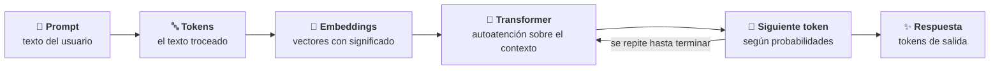
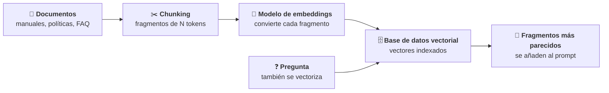
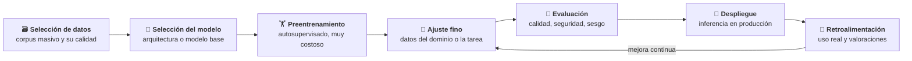
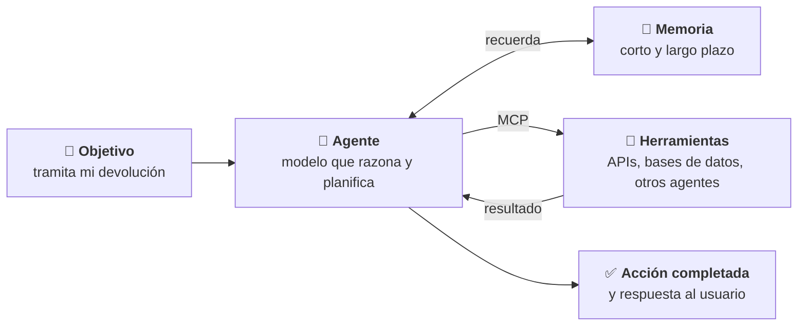
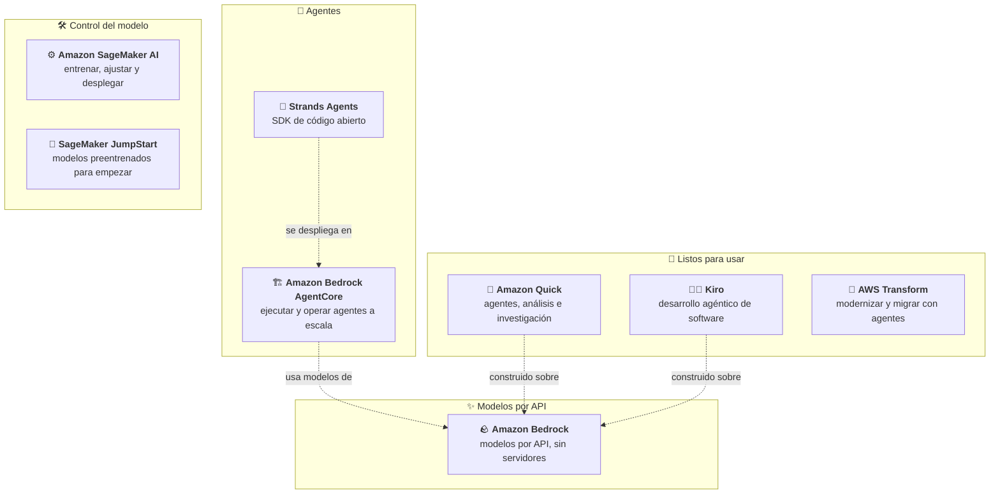

# Fundamentos de IA generativa

Este módulo desarrolla el Dominio 2 del examen AIF-C01 (24 % del contenido puntuable): qué es la IA generativa, cómo funciona por dentro a nivel conceptual (*tokens*, *embeddings*, contexto, agentes), qué puede y qué no puede hacer por un negocio y qué servicios de AWS se usan para construir aplicaciones con ella. El nivel es *foundational*: hay que saber **qué** concepto, modelo o servicio corresponde a cada situación y **por qué**, no cómo programarlo.

Requisito previo: el módulo [01](../01-fundamentos-ia-ml/README.md), en particular la relación entre IA, ML, aprendizaje profundo e IA generativa, y los tipos de inferencia.

## Objetivos de aprendizaje

Los objetivos corresponden a las tres Task Statements del dominio (texto literal en [fuentes/dominio-2.md](../../fuentes/dominio-2.md)).

- **Task 2.1.** Explicar los conceptos básicos de la IA generativa: *tokens*, *chunking*, *embeddings*, vectores, *prompts*, *transformers*, modelos fundacionales, multimodales y de difusión; casos de uso; ciclo de vida del modelo fundacional; precios por *tokens*; ingeniería de contexto y conceptos de IA agéntica.
- **Task 2.2.** Entender las capacidades y limitaciones de la IA generativa para resolver problemas de negocio: ventajas, inconvenientes, criterios para elegir un modelo y métricas de valor de negocio.
- **Task 2.3.** Describir la infraestructura y las tecnologías de AWS para crear aplicaciones de IA generativa: servicios, ventajas, beneficios de la infraestructura y compromisos de coste.

## Mapa de cobertura

| Objetivo | Descripción | Sección |
|---|---|---|
| 2.1.1 | Conceptos fundamentales de la IA generativa | [Conceptos fundamentales](#conceptos-fundamentales) |
| 2.1.2 | Casos de uso de los modelos de IA generativa | [Casos de uso de la IA generativa](#casos-de-uso-de-la-ia-generativa) |
| 2.1.3 | Ciclo de vida del modelo fundacional | [Ciclo de vida de un modelo fundacional](#ciclo-de-vida-de-un-modelo-fundacional) |
| 2.1.4 | Precios por *tokens* y su efecto en el coste y el rendimiento de la inferencia | [Precios por tokens](#precios-por-tokens) |
| 2.1.5 | Papel de la ingeniería de contexto | [Ingeniería de contexto](#ingeniería-de-contexto) |
| 2.1.6 | Conceptos fundamentales de IA agéntica | [Conceptos de IA agéntica](#conceptos-de-ia-agéntica) |
| 2.2.1 | Ventajas de la IA generativa | [Ventajas de la IA generativa](#ventajas-de-la-ia-generativa) |
| 2.2.2 | Inconvenientes de las soluciones de IA generativa | [Inconvenientes y limitaciones](#inconvenientes-y-limitaciones) |
| 2.2.3 | Factores para elegir un modelo de IA generativa | [Cómo elegir un modelo](#cómo-elegir-un-modelo) |
| 2.2.4 | Valor de negocio y métricas | [Valor de negocio y métricas](#valor-de-negocio-y-métricas) |
| 2.3.1 | Servicios y funcionalidades de AWS para desarrollar aplicaciones de IA generativa | [Servicios de AWS para IA generativa](#servicios-de-aws-para-ia-generativa) |
| 2.3.2 | Ventajas de usar los servicios de IA generativa de AWS | [Ventajas de los servicios de AWS](#ventajas-de-los-servicios-de-aws) |
| 2.3.3 | Beneficios de la infraestructura de AWS | [Beneficios de la infraestructura de AWS](#beneficios-de-la-infraestructura-de-aws) |
| 2.3.4 | Compromisos de coste de los servicios de IA generativa de AWS | [Compromisos de coste](#compromisos-de-coste) |

## Teoría

### Tarea 2.1: conceptos básicos de la IA generativa

#### Conceptos fundamentales

La **IA generativa** es un tipo de IA capaz de crear contenido e ideas nuevos (conversaciones, historias, imágenes, vídeos, música o código). Funciona con **modelos fundacionales**: redes neuronales de aprendizaje profundo muy grandes, entrenadas con conjuntos de datos masivos, que sirven de punto de partida para muchas tareas distintas en lugar de desarrollar un modelo desde cero para cada una.

Los términos que el examen da por sabidos:

- ***Token*.** La unidad mínima de texto (o de otro tipo de dato) que procesa un modelo: una palabra, parte de una palabra o un signo. El modelo recibe *tokens* de entrada y genera *tokens* de salida, uno a uno: para cada posición calcula una distribución de probabilidad sobre el siguiente *token* y elige uno. **Cada modelo tokeniza a su manera**, así que el mismo texto puede dar recuentos distintos en modelos distintos. Los *tokens* son también la unidad de **facturación** y de las cuotas (ver [Precios por tokens](#precios-por-tokens)).
- ***Chunking* (fragmentación).** Dividir documentos largos en fragmentos más pequeños (*chunks*) antes de convertirlos en *embeddings*. Es el primer paso para preparar datos propios para RAG. Amazon Bedrock Knowledge Bases ofrece fragmentación por defecto (fragmentos de unos 300 *tokens* que respetan las frases), de tamaño fijo (número de *tokens* por fragmento y porcentaje de solapamiento), jerárquica, semántica o sin fragmentar.
- ***Embedding*.** Representación numérica de un objeto del mundo real (un texto, una imagen, un producto) que los modelos usan para entender su significado. Objetos con significado parecido tienen *embeddings* cercanos.
- **Vector.** La forma que tiene un *embedding*: una lista de valores numéricos que representa la información en un espacio de muchas dimensiones. Comparar vectores permite medir la **similitud semántica**: por eso «devolución» y «reembolso» quedan cerca aunque no compartan letras.
- **Base de datos vectorial.** Almacena e indexa vectores para buscar los más parecidos a uno dado (búsqueda semántica). Es la pieza que usa RAG para encontrar los fragmentos relevantes. Se estudia en el módulo 03.
- ***Prompt* e ingeniería de *prompts* (*prompt engineering*).** El *prompt* es la entrada que se da al modelo (instrucciones, contexto, ejemplos y la pregunta). La ingeniería de *prompts* consiste en redactarlo y refinarlo para que el modelo dé la respuesta deseada sin cambiar el modelo. Las técnicas concretas (*zero-shot*, *few-shot*, cadena de pensamiento) se estudian en el módulo 03.
- ***Transformer* y LLM.** Un modelo de lenguaje de gran tamaño (LLM) es un modelo de aprendizaje profundo muy grande, preentrenado con enormes cantidades de datos, basado en la arquitectura ***transformer***. Su pieza clave es el **mecanismo de autoatención** (*self-attention*): en lugar de procesar el texto palabra a palabra en orden, mira a la vez todas las partes de la secuencia y decide cuáles importan más para cada *token*. Eso le permite captar relaciones a larga distancia y entrenarse de forma eficiente.
- **Modelo fundacional (FM).** Modelo muy grande preentrenado de forma **autosupervisada** (crea las etiquetas a partir de los propios datos) que se adapta a muchas tareas: responder preguntas, resumir, traducir, clasificar, generar código. Un LLM es un modelo fundacional de lenguaje; también los hay de imágenes, de vídeo o multimodales.
- **Modelo multimodal.** Procesa y entiende **varios tipos de entrada a la vez** (texto, imágenes, vídeo, documentos, audio) en una misma petición, y puede generar uno o varios tipos de salida. Por ejemplo, Amazon Nova Lite acepta texto, imágenes, vídeo y documentos y genera texto.
- **Modelo de difusión.** Familia de modelos generativos de **imagen** (y de vídeo) que aprenden a quitar ruido: durante el entrenamiento se añade ruido gaussiano a las imágenes y el modelo aprende el proceso inverso; al generar, parte de ruido y lo va «limpiando» guiado por el texto del *prompt* hasta obtener una imagen. Stable Diffusion es el ejemplo clásico.
- **Ventana de contexto.** La cantidad máxima de *tokens* que el modelo puede manejar en una petición: la entrada (instrucciones, historial, documentos) y, en muchos modelos, también la salida que genera. Es un límite técnico **y** un factor de coste: cuanto más contexto se envía, más *tokens* se pagan.

El recorrido de una petición, de principio a fin:



```nodos
P:
  titulo: "Prompt"
  texto: "La entrada que recibe el modelo: instrucciones, contexto, ejemplos y la pregunta. Se mide y se paga en tokens de entrada."
  enlaces: [{texto: "Ingeniería de prompts (AWS)", url: "https://aws.amazon.com/what-is/prompt-engineering/"}]
  seccion: 02-fundamentos-genai/teoria#conceptos-fundamentales
T:
  concepto: token
  seccion: 02-fundamentos-genai/teoria#conceptos-fundamentales
E:
  concepto: embedding
  seccion: 02-fundamentos-genai/teoria#conceptos-fundamentales
M:
  concepto: transformer
  seccion: 02-fundamentos-genai/teoria#conceptos-fundamentales
S:
  titulo: "Generación token a token"
  texto: "Para cada posición, el modelo calcula una distribución de probabilidad del siguiente token y toma una muestra. Parámetros como la temperatura o top-p cambian esa distribución."
  enlaces: [{texto: "Parámetros de inferencia en Amazon Bedrock", url: "https://docs.aws.amazon.com/bedrock/latest/userguide/inference-parameters.html"}]
  seccion: 02-fundamentos-genai/teoria#inconvenientes-y-limitaciones
R:
  titulo: "Respuesta"
  texto: "Los tokens generados forman la respuesta. Se pagan como tokens de salida, normalmente más caros que los de entrada."
  seccion: 02-fundamentos-genai/teoria#precios-por-tokens
```

Y la preparación de datos propios para que el modelo pueda usarlos (base de RAG, que se desarrolla en el módulo 03):



```nodos
D:
  titulo: "Documentos propios"
  texto: "Información de la empresa que el modelo no conoce porque no estaba en sus datos de entrenamiento o ha cambiado después."
  seccion: 02-fundamentos-genai/teoria#conceptos-fundamentales
C:
  concepto: chunking
  enlaces: [{texto: "Fragmentación en Knowledge Bases", url: "https://docs.aws.amazon.com/bedrock/latest/userguide/kb-chunking.html"}]
  seccion: 02-fundamentos-genai/teoria#conceptos-fundamentales
EM:
  concepto: embedding
  seccion: 02-fundamentos-genai/teoria#conceptos-fundamentales
V:
  concepto: base-de-datos-vectorial
  seccion: 02-fundamentos-genai/teoria#conceptos-fundamentales
Q:
  titulo: "Pregunta del usuario"
  texto: "Se convierte en vector con el mismo modelo de embeddings para poder compararla con los fragmentos."
  seccion: 02-fundamentos-genai/teoria#conceptos-fundamentales
F:
  concepto: rag
  texto: "Los fragmentos recuperados se añaden al prompt como contexto, para que la respuesta se base en información propia y actualizada."
  seccion: 02-fundamentos-genai/teoria#ingeniería-de-contexto
```

**Cómo distinguirlos en un enunciado:**

| Si el enunciado habla de… | Concepto |
|---|---|
| La unidad en que se mide la entrada y la salida, y en la que se factura | *Token* |
| Partir documentos largos antes de indexarlos | *Chunking* |
| Representar el significado como números para buscar por similitud | *Embedding* / vector |
| Almacenar y buscar vectores parecidos | Base de datos vectorial |
| Una sola petición con una foto y una pregunta en texto | Modelo multimodal |
| Generar imágenes partiendo de ruido | Modelo de difusión |
| Arquitectura con autoatención que procesa toda la secuencia a la vez | *Transformer* |

#### Casos de uso de la IA generativa

La IA generativa aporta valor cuando la tarea consiste en **producir o transformar contenido** en lenguaje natural o en otros medios:

| Caso de uso | Ejemplo de negocio |
|---|---|
| Generación de imágenes, vídeo y audio | Variantes de una imagen de producto para campañas; locuciones para formación |
| Resumen | Resumir contratos o la conversación de un caso de soporte antes de pasarlo a otro agente |
| Asistentes de IA | Asistente interno que responde dudas de RR. HH. con la normativa de la empresa |
| Traducción | Adaptar fichas de producto a otros mercados manteniendo el tono de la marca |
| Generación de código | Proponer funciones, pruebas unitarias o documentación a partir de una especificación |
| Agentes de atención al cliente | Resolver una devolución consultando el pedido y lanzando el reembolso |
| Búsqueda | Búsqueda semántica: encontrar documentos por significado, no por palabras exactas |
| Motores de recomendación | Explicar o personalizar recomendaciones en lenguaje natural |

Matices para el examen:

- **Generativa frente a tradicional.** Si la tarea es **predecir un número o una categoría** con datos tabulares (demanda, fraude, abandono), encaja mejor el ML tradicional, que es más barato, explicable y determinista (módulo 01). La generativa destaca con lenguaje, imágenes y contenido abierto.
- **Generativa frente a servicio especializado.** Si existe un servicio de IA preentrenado para una tarea acotada (traducir con Amazon Translate, transcribir con Amazon Transcribe, extraer formularios con Amazon Textract), suele ser la opción de menor esfuerzo y coste. Un modelo fundacional se justifica cuando la tarea es abierta o combina varias capacidades (por ejemplo, traducir **y** adaptar el tono **y** resumir).
- **Recomendaciones.** Para recomendar productos a partir del historial de usuarios, el servicio gestionado es Amazon Personalize; la IA generativa puede **complementarlo** (por ejemplo, redactando el mensaje personalizado).

#### Ciclo de vida de un modelo fundacional

El ciclo de vida de un modelo fundacional sigue las etapas que cita la guía. Quien **crea** el modelo recorre todas; una empresa que **usa** un modelo existente empieza en la selección.



```nodos
DS:
  titulo: "Selección de datos"
  texto: "Elegir y depurar los datos: para preentrenar, corpus enormes y variados; para ajustar, ejemplos del dominio. La calidad de los datos limita la del modelo (sesgos, errores)."
  seccion: 02-fundamentos-genai/teoria#ciclo-de-vida-de-un-modelo-fundacional
MS:
  titulo: "Selección del modelo"
  texto: "Quien usa IA generativa suele empezar aquí: elegir un modelo existente según capacidades, modalidad, latencia, coste y cumplimiento."
  seccion: 02-fundamentos-genai/teoria#cómo-elegir-un-modelo
PT:
  concepto: preentrenamiento
  seccion: 02-fundamentos-genai/teoria#ciclo-de-vida-de-un-modelo-fundacional
FT:
  concepto: fine-tuning
  seccion: 02-fundamentos-genai/teoria#ciclo-de-vida-de-un-modelo-fundacional
EV:
  titulo: "Evaluación"
  texto: "Medir si el modelo cumple: calidad de las respuestas, robustez, toxicidad y sesgo. Amazon Bedrock ofrece evaluaciones de modelos; se estudia en el módulo 03."
  enlaces: [{texto: "Evaluación en Amazon Bedrock", url: "https://docs.aws.amazon.com/bedrock/latest/userguide/evaluation.html"}]
  seccion: 02-fundamentos-genai/teoria#ciclo-de-vida-de-un-modelo-fundacional
DP:
  titulo: "Despliegue"
  texto: "Poner el modelo a disposición de la aplicación: por API en Amazon Bedrock o en un endpoint de SageMaker AI."
  seccion: 02-fundamentos-genai/teoria#compromisos-de-coste
FB:
  titulo: "Retroalimentación"
  texto: "Valoraciones de usuarios, errores detectados y nuevos datos que alimentan nuevas rondas de ajuste o mejoras del prompt y del contexto."
  seccion: 02-fundamentos-genai/teoria#ciclo-de-vida-de-un-modelo-fundacional
```

| Etapa | Qué ocurre | Quién la hace normalmente |
|---|---|---|
| Selección de datos | Reunir y depurar el corpus de entrenamiento | El proveedor del modelo (preentrenamiento) o la empresa (ajuste) |
| Selección del modelo | Elegir arquitectura o modelo base | La empresa que construye la aplicación |
| Preentrenamiento (*pre-training*) | Entrenamiento autosupervisado con datos masivos; meses y enormes recursos | El proveedor del modelo |
| Ajuste fino (*fine-tuning*) | Adaptar el modelo con datos etiquetados de la tarea o del dominio | La empresa, si el *prompt* y el contexto no bastan |
| Evaluación | Comprobar calidad, seguridad y sesgo antes de producción | La empresa |
| Despliegue | Servir el modelo para inferencia | La empresa (o el servicio gestionado) |
| Retroalimentación (*feedback*) | Recoger el uso real para mejorar | La empresa |

*Ejemplo de principio a fin:* una aseguradora quiere un asistente que redacte cartas de respuesta a reclamaciones. **No preentrena** nada: selecciona en Amazon Bedrock un modelo de texto (selección del modelo), prepara 2 000 cartas buenas revisadas por su equipo (selección de datos), las usa para un **ajuste fino** supervisado porque con el *prompt* no consigue el tono legal exigido, **evalúa** el modelo ajustado con 200 casos que no ha visto, lo **despliega** para el equipo de reclamaciones y recoge las correcciones de los tramitadores (**retroalimentación**) para la siguiente ronda.

> El preentrenamiento es la etapa más cara con diferencia. En el examen, «crear un modelo fundacional desde cero» casi nunca es la respuesta para una empresa: lo habitual es partir de uno existente y adaptarlo (*prompt*, RAG, ajuste fino). El orden de coste y esfuerzo de esas técnicas se estudia en el módulo 03.

#### Precios por tokens

En los modelos fundacionales usados como servicio (por ejemplo, Amazon Bedrock en modo bajo demanda), **se paga por *tokens***: por los *tokens* de entrada que se envían y por los *tokens* de salida que genera el modelo, con un precio distinto para cada uno (la salida suele costar varias veces más que la entrada). El precio depende del **modelo**, del **proveedor**, de la **modalidad** y de la **Región**. Los *tokens* de entrada cuentan además para las **cuotas** de *tokens* por minuto y por día; la API `CountTokens` de Bedrock permite contar los *tokens* de una petición antes de enviarla, sin coste, en los modelos que la admiten.

*Ejemplo resuelto* (precios bajo demanda, nivel Standard, de DeepSeek v3.2 en Amazon Bedrock en US East (N. Virginia), consultados el 14 de octubre de 2026: 0,62 USD por millón de *tokens* de entrada y 1,85 USD por millón de salida). Un asistente de soporte atiende **100 000 conversaciones al mes**:

| Diseño | Entrada por conversación | Salida por conversación | Coste de entrada | Coste de salida | Total al mes |
|---|---|---|---|---|---|
| A: *prompt* ajustado con solo los fragmentos relevantes | 1 500 *tokens* | 400 *tokens* | 150 M × 0,62 = 93 USD | 40 M × 1,85 = 74 USD | **167 USD** |
| B: se pega el manual completo en cada petición | 6 000 *tokens* | 400 *tokens* | 600 M × 0,62 = 372 USD | 40 M × 1,85 = 74 USD | **446 USD** |
| C: diseño A pidiendo respuestas de 200 *tokens* como máximo | 1 500 *tokens* | 200 *tokens* | 93 USD | 20 M × 1,85 = 37 USD | **130 USD** |

Conclusiones que el examen explota:

- **Más contexto, más coste y más latencia.** El diseño B cuesta casi el triple sin cambiar de modelo. Enviar solo lo relevante (RAG, resúmenes del historial) reduce coste y tiempo de respuesta.
- **La longitud de la salida importa.** Limitar la longitud máxima de la respuesta reduce coste y latencia, porque el modelo genera *token* a token.
- **El modelo elegido es la palanca principal.** Un modelo más pequeño y barato puede bastar para tareas sencillas; uno más grande cuesta más por *token* y suele responder más despacio.
- **Hay opciones más baratas** para cargas que no necesitan respuesta inmediata (inferencia por lotes, nivel Flex) y para contextos repetidos (*prompt caching*). Se detallan en [Compromisos de coste](#compromisos-de-coste).

> Los precios cambian y dependen de la Región: consulta siempre la [página de precios de Amazon Bedrock](https://aws.amazon.com/bedrock/pricing/). Lo que se evalúa es el **mecanismo** (entrada + salida, por modelo), no las cifras.

#### Ingeniería de contexto

Un modelo fundacional **no tiene memoria entre peticiones**: en cada llamada solo «sabe» lo que aprendió en el entrenamiento y lo que contiene la petición. La **ingeniería de contexto** (*context engineering*) es la disciplina de decidir **qué información llega al modelo en cada llamada, en qué orden y con qué tamaño**, para que tenga lo necesario para responder bien sin desperdiciar *tokens*. Va más allá de redactar un buen *prompt*: gestiona todo lo que rodea a la pregunta.

Piezas del contexto:

- **Instrucciones del sistema** (*system prompt*): rol, tono, reglas y formato de salida.
- **Historial de la conversación** y **memoria**: lo dicho en la sesión (corto plazo) y lo aprendido de sesiones anteriores, como las preferencias del usuario (largo plazo).
- **Conocimiento recuperado**: fragmentos de documentos propios mediante RAG.
- **Herramientas**: la descripción de las herramientas que el modelo puede usar y los resultados que devuelven.
- **Ejemplos**: pares de entrada y salida que muestran lo que se espera (*few-shot*).

Por qué importa:

| Problema | Qué hace la ingeniería de contexto |
|---|---|
| El modelo inventa datos de la empresa | Añadir los fragmentos relevantes recuperados con RAG |
| El usuario tiene que repetir lo que ya dijo | Mantener memoria de corto y largo plazo (por ejemplo, con AgentCore Memory) |
| La conversación crece y se dispara el coste | Resumir o recortar el historial y enviar solo lo relevante |
| El contexto no cabe en la ventana del modelo | Seleccionar y priorizar la información; fragmentar documentos |
| El mismo documento largo se envía en cada pregunta | Colocar el contenido estático al principio y usar *prompt caching* |

*Ejemplo:* un asistente de una agencia de viajes recibe «¿y para mañana?». Sin contexto, la pregunta no tiene sentido. Con ingeniería de contexto, la petición incluye las instrucciones del sistema, el resumen de la conversación («busca vuelos Madrid–Lisboa»), la preferencia guardada del cliente («prefiere ventanilla») y solo las tarifas vigentes recuperadas de la base de conocimiento.

> Ingeniería de *prompts* e ingeniería de contexto no compiten: la primera se centra en **cómo** se pide; la segunda, en **qué información** acompaña a la petición y de dónde sale (memoria, RAG, herramientas).

#### Conceptos de IA agéntica

Un **agente de IA** es un sistema que usa un modelo fundacional para **razonar, planificar y actuar** hacia un objetivo: decide qué pasos dar, llama a herramientas (APIs, bases de datos, otros servicios), observa el resultado y repite hasta terminar. La diferencia con un asistente que solo responde es que el agente **ejecuta acciones**.



```nodos
U:
  titulo: "Objetivo del usuario"
  texto: "El agente recibe una meta, no una instrucción paso a paso. Decide él mismo qué pasos dar."
  seccion: 02-fundamentos-genai/teoria#conceptos-de-ia-agéntica
A:
  concepto: ia-agentica
  seccion: 02-fundamentos-genai/teoria#conceptos-de-ia-agéntica
MEM:
  concepto: memoria-del-agente
  seccion: 02-fundamentos-genai/teoria#conceptos-de-ia-agéntica
H:
  concepto: mcp
  seccion: 02-fundamentos-genai/teoria#conceptos-de-ia-agéntica
R:
  titulo: "Resultado"
  texto: "El agente termina cuando cumple el objetivo (o cuando necesita la intervención de una persona) y responde al usuario."
  seccion: 02-fundamentos-genai/teoria#conceptos-de-ia-agéntica
```

Conceptos que cita la guía:

- **Uso de herramientas (*tool use*).** El modelo no ejecuta nada por sí mismo: decide **qué herramienta** llamar y con qué parámetros, la aplicación o la plataforma la ejecuta y le devuelve el resultado. Así el agente consulta datos actuales o actúa sobre otros sistemas.
- **Model Context Protocol (MCP).** Protocolo **abierto y estándar** que proporciona una capa de comunicación para que los agentes interactúen con datos y servicios externos (y también con otros agentes). En lugar de programar una integración a medida por cada herramienta y cada agente, una herramienta expuesta como servidor MCP puede usarla cualquier agente compatible. AWS contribuye al protocolo, y Strands Agents y Amazon Bedrock AgentCore lo admiten (AgentCore Gateway convierte APIs y funciones Lambda en herramientas compatibles con MCP).
- **Agent-to-Agent (A2A).** Protocolo abierto pensado para la comunicación **entre agentes**: cada agente publica una *Agent Card* (un documento que describe su identidad, capacidades y punto de acceso) para que otros lo descubran, y se intercambian mensajes y tareas. AgentCore Runtime admite tanto servidores MCP como A2A. Regla práctica: **MCP**, agente ↔ herramientas y datos; **A2A**, agente ↔ agente.
- **Memoria.** Sin memoria, el agente trata cada interacción como nueva. La **memoria a corto plazo** guarda los turnos de la sesión actual («¿y para mañana?» se entiende por lo anterior); la **memoria a largo plazo** extrae y conserva entre sesiones datos clave como las preferencias del usuario.
- **Orquestación de flujos (*workflow orchestration*).** Coordinar los pasos, las herramientas y los agentes: en qué orden, qué se hace en paralelo, qué ocurre si algo falla, cuándo se pide aprobación a una persona.
- **Sistemas multiagente.** Varios agentes, cada uno con un rol o especialidad, colaboran en una tarea compleja (por ejemplo, un planificador, un investigador y un revisor). Dividir el trabajo permite usar instrucciones, herramientas y modelos específicos para cada parte.
- **Patrones de comunicación entre agentes.** Las guías de AWS distinguen dos estilos:

| Patrón | Control | Interacción | Encaja con |
|---|---|---|---|
| Flujo con coordinador (*workflow agents*, supervisor) | Centralizado: un agente coordina y delega | Un agente reparte tareas y sigue su ejecución | Procesos de negocio con pasos conocidos |
| Colaboración entre iguales (*multi-agent collaboration*) | Descentralizado, por roles | Los agentes negocian, comparten información y se adaptan; se comunican con memoria compartida, colas de mensajes o encadenando *prompts* | Razonamiento complejo, investigación, exploración |

Strands Agents incluye patrones multiagente como *Swarm*, *Graph* y *Workflow*. Cuando los agentes son de equipos o proveedores distintos, el protocolo A2A les da una forma estándar de descubrirse y hablar entre sí.

*Ejemplo:* una empresa de seguros quiere automatizar la apertura de siniestros. Un agente coordinador recibe el parte; delega en un agente que extrae los datos del documento, en otro que consulta la póliza por una herramienta MCP y en otro que propone la valoración; el coordinador pide aprobación humana si la cuantía supera un umbral.

> Más agentes no es mejor por defecto: cada agente y cada llamada consumen *tokens*, añaden latencia y son un punto más que falla. Si una consulta sencilla al modelo resuelve el caso, no hace falta un agente.

### Tarea 2.2: capacidades y limitaciones para el negocio

#### Ventajas de la IA generativa

| Ventaja | Qué significa | Ejemplo |
|---|---|---|
| Adaptabilidad | Un mismo modelo fundacional sirve para muchas tareas distintas cambiando el *prompt* o el contexto, sin entrenar un modelo por tarea | El mismo modelo resume incidencias, redacta correos y clasifica reseñas |
| Capacidad de respuesta (*responsiveness*) | Responde en segundos y a cualquier hora | Atención al cliente 24/7 con resolución en el primer contacto |
| Capacidades conversacionales | Entiende y responde en lenguaje natural, mantiene el hilo | Un asistente que pide los datos que faltan para tramitar una solicitud |
| Generación de contenido | Crea texto, imágenes, código o audio nuevos | Borradores de fichas de producto o de documentación técnica |

Otros beneficios que cita AWS: acelera la investigación (resumir, explorar alternativas), mejora la experiencia de cliente (personalización) y optimiza procesos de negocio.

#### Inconvenientes y limitaciones

| Limitación | Qué es | Cómo se mitiga (se estudia en los módulos 03 a 05) |
|---|---|---|
| Alucinaciones | Respuestas incorrectas o engañosas presentadas con seguridad. Causas: datos de entrenamiento insuficientes o sesgados, sobreajuste, falta de contexto | RAG con datos fiables, *prompts* más precisos, verificación humana en decisiones críticas, Amazon Bedrock Guardrails |
| Inexactitud | El modelo puede dar datos desactualizados o erróneos: su conocimiento se detiene en los datos de entrenamiento | RAG con información actualizada; citar fuentes |
| Interpretabilidad | Los modelos son «cajas negras»: es difícil explicar por qué dan una respuesta concreta | Elegir modelos más simples cuando la explicación es un requisito; documentar; revisión humana |
| No determinismo | La misma pregunta puede dar respuestas distintas, porque el modelo **muestrea** el siguiente *token* | Temperatura baja, formato de salida estructurado, validación de la respuesta |
| Sesgo y toxicidad | Puede reproducir sesgos o contenido inapropiado de los datos de entrenamiento | Filtrado de datos, evaluación, Guardrails (Dominio 4) |
| Coste y latencia | Modelos grandes, contextos largos y respuestas largas cuestan más y tardan más | Elegir el modelo adecuado, recortar el contexto, lotes, caché |
| Privacidad y propiedad intelectual | Riesgo si se usan datos propios o sensibles sin controles | Controles de acceso y cifrado (Dominio 5) |

**Parámetros de inferencia y no determinismo.** Para cada posición, el modelo calcula una distribución de probabilidad sobre el siguiente *token* y toma una muestra. Algunos parámetros cambian esa distribución:

| Parámetro | Valor bajo | Valor alto |
|---|---|---|
| Temperatura | Favorece los *tokens* más probables: respuestas más deterministas y repetibles | Da más peso a los menos probables: respuestas más variadas y creativas |
| Top-k | Considera solo los *k* candidatos más probables (número fijo) | Considera más candidatos |
| Top-p | Considera solo los candidatos que suman una proporción pequeña de la probabilidad acumulada | Considera una parte mayor de la distribución |
| Longitud máxima / secuencias de parada | Limita la longitud de la respuesta: menos coste y latencia, riesgo de cortarla | Permite respuestas más largas |

*Ejemplo:* para extraer datos de facturas a un formato fijo interesa una **temperatura baja**; para proponer diez eslóganes de una campaña, una temperatura más alta.

> Bajar la temperatura reduce la variabilidad, **no** las alucinaciones: un modelo puede dar la misma respuesta incorrecta de forma consistente. Contra las alucinaciones, el remedio principal es darle información fiable (RAG) y verificar.

#### Cómo elegir un modelo

No existe «el mejor modelo»: se elige el que cumple los requisitos del caso al menor coste. Factores que cita la guía:

| Factor | Pregunta que hay que hacerse | Ejemplo de decisión |
|---|---|---|
| Tipo de modelo y modalidad | ¿Texto, imagen, vídeo, voz, *embeddings*? ¿Varias entradas a la vez? | Analizar fotos de siniestros con una pregunta en texto → modelo multimodal |
| Requisitos de rendimiento | ¿Qué calidad necesita la tarea? ¿Cuántas peticiones por minuto? | Clasificar correos en 5 categorías → un modelo pequeño suele bastar |
| Capacidades | ¿Razonamiento complejo, uso de herramientas, idiomas, ventana de contexto grande? | Analizar contratos de 300 páginas → ventana de contexto grande |
| Restricciones | ¿Disponible en la Región necesaria? ¿Cuotas? ¿Admite ajuste fino? | Si hay que ajustar el modelo, elegir uno que lo admita |
| Cumplimiento | ¿Residencia de datos, normativa sectorial, licencia del modelo? | Datos que no pueden salir de la UE → Región de la UE (o inferencia entre Regiones limitada a la UE) |
| Coste | ¿Precio por *token* de entrada y salida para el volumen previsto? | Millones de peticiones simples → modelo barato |
| Latencia | ¿Respuesta interactiva o puede esperar? | Asistente de voz → modelo rápido; informes nocturnos → lotes |
| Complejidad del modelo | ¿Hace falta un modelo grande o basta uno pequeño, más rápido y barato? | Un modelo más grande no siempre da más valor si la tarea es sencilla |

Reglas prácticas:

- Empieza por el modelo **más pequeño que cumpla** la calidad requerida, evaluándolo con casos reales (Amazon Bedrock permite comparar modelos con evaluaciones).
- En Amazon Bedrock, la API Converse unifica la forma de llamar a los modelos y permite cambiar de modelo modificando un solo parámetro, lo que reduce el riesgo de elegir mal al principio.
- La familia Amazon Nova ilustra la gama: Nova Micro (solo texto, la latencia más baja a muy bajo coste), Nova Lite (multimodal de muy bajo coste), Nova Pro (equilibrio entre exactitud, velocidad y coste) y Nova Premier (la más capaz, para tareas complejas). Amazon Nova 2 añade, entre otros, Nova 2 Lite y Nova Multimodal Embeddings.

#### Valor de negocio y métricas

Una solución de IA generativa se justifica por su impacto en el negocio, no por la calidad técnica del modelo. Métricas que cita la guía:

| Métrica | Qué mide | Ejemplo |
|---|---|---|
| Rendimiento entre dominios (*cross-domain performance*) | Si el modelo mantiene la calidad en tareas o áreas distintas de aquellas para las que se probó | Un asistente probado con preguntas de facturación, ¿responde igual de bien sobre envíos? |
| ROI (retorno de la inversión) | Beneficio obtenido frente al coste total | Ver ejemplo |
| Eficiencia | Tiempo o recursos ahorrados por tarea | Minutos por caso de soporte, casos resueltos por agente y hora |
| Tasa de conversión | Porcentaje de usuarios que completan la acción deseada | Visitas que acaban en compra tras un asistente de compra |
| Ingreso medio por usuario (ARPU) | Ingresos divididos entre el número de usuarios | Sube si las recomendaciones generan compras adicionales |
| Exactitud (*accuracy*) | Proporción de respuestas correctas | Porcentaje de respuestas del asistente validadas como correctas |
| Valor del ciclo de vida del cliente (CLV) | Ingresos esperados de un cliente durante toda su relación con la empresa | Sube si mejora la retención gracias a una mejor atención |

*Ejemplo resuelto de ROI:* un asistente para el equipo de soporte cuesta 3 000 USD al mes (modelo, infraestructura y mantenimiento). Reduce 4 minutos el tiempo medio de 20 000 casos mensuales: 80 000 minutos, unas 1 333 horas. Con un coste de 25 USD por hora de agente, el ahorro es de unos 33 300 USD al mes. ROI = (33 300 − 3 000) / 3 000 ≈ **10,1**, es decir, un 1 010 %. Si además la exactitud baja del umbral acordado y hay que revisar cada respuesta, el ahorro desaparece: por eso se miden a la vez métricas de negocio y de calidad.

> Elige la métrica según el objetivo del enunciado: «vender más» → conversión, ARPU; «fidelizar» → CLV; «reducir costes» → eficiencia y ROI; «respuestas fiables» → exactitud.

### Tarea 2.3: infraestructura y tecnologías de AWS

#### Servicios de AWS para IA generativa



```nodos
APP:
  titulo: "Aplicaciones de IA generativa listas para usar"
  texto: "Para usuarios de negocio o desarrolladores que quieren las capacidades sin construir una aplicación propia."
  seccion: 02-fundamentos-genai/teoria#servicios-de-aws-para-ia-generativa
AGT:
  titulo: "Herramientas para agentes"
  texto: "Un SDK para programar agentes (Strands Agents) y una plataforma gestionada para ejecutarlos y operarlos de forma segura (AgentCore)."
  seccion: 02-fundamentos-genai/teoria#conceptos-de-ia-agéntica
FMS:
  titulo: "Modelos fundacionales gestionados"
  texto: "Acceso a modelos de varios proveedores por API, pagando por uso, sin gestionar infraestructura."
  seccion: 02-fundamentos-genai/teoria#servicios-de-aws-para-ia-generativa
ML:
  titulo: "Plataforma de ML"
  texto: "Para quien necesita entrenar, ajustar a fondo o desplegar modelos con control sobre la infraestructura."
  seccion: 02-fundamentos-genai/teoria#servicios-de-aws-para-ia-generativa
QK:
  concepto: amazon-quick
KI:
  concepto: kiro
TF:
  concepto: aws-transform
ST:
  concepto: strands-agents
AC:
  concepto: amazon-bedrock-agentcore
BR:
  concepto: amazon-bedrock
SM:
  concepto: amazon-sagemaker-ai
JS:
  concepto: amazon-sagemaker-jumpstart
```

| Necesidad | Servicio | Por qué |
|---|---|---|
| Usar modelos fundacionales de varios proveedores por API, sin gestionar infraestructura, pagando por uso | **Amazon Bedrock** | Servicio totalmente gestionado y *serverless*; añade Knowledge Bases (RAG), Guardrails, evaluaciones, personalización de modelos y AgentCore |
| Entrenar o ajustar a fondo modelos propios, abiertos o personalizados, con control sobre infraestructura, coste, rendimiento y latencia | **Amazon SageMaker AI** | Plataforma de ML para construir, entrenar y desplegar modelos a escala |
| Partir de un modelo fundacional preentrenado (público o propietario), probarlo, ajustarlo y desplegarlo en SageMaker AI | **SageMaker JumpStart** | Catálogo de modelos, plantillas y cuadernos de ejemplo dentro de SageMaker AI |
| Dar a los empleados un asistente con agentes que consulte los datos de la empresa, automatice tareas, analice datos e investigue, sin desarrollar | **Amazon Quick** | Servicio gestionado con chat en lenguaje natural; incluye Quick Sight (antes Amazon QuickSight), Flows, Automate, Index, Research y Apps |
| Acelerar el desarrollo de software con un agente que pase de *prompts* a especificaciones, código, documentación y pruebas | **Kiro** | Servicio de programación agéntica, construido sobre Amazon Bedrock, con desarrollo guiado por especificaciones (*specs*), *hooks* de agente y ficheros de *steering* |
| Programar agentes en código con un enfoque centrado en el modelo, con herramientas y MCP | **Strands Agents** | SDK de código abierto publicado inicialmente por AWS; incluye patrones multiagente; funciona con Bedrock y con otros proveedores |
| Desplegar y operar agentes en producción de forma segura y a escala, con cualquier *framework* y modelo | **Amazon Bedrock AgentCore** | Servicios modulares, entre otros: Runtime (admite MCP y A2A), Memory, Gateway (convierte APIs en herramientas MCP), Identity, Policy (reglas que acotan lo que puede hacer el agente), Evaluations, Code Interpreter, Browser, Observability y Harness |
| Modernizar o migrar aplicaciones, código e infraestructura existentes (por ejemplo, mainframes o servidores VMware) con agentes de IA | **AWS Transform** | Servicio de transformación con IA agéntica, especializado en modernización y migración |

Disponibilidad y nombres vigentes (a 14 de octubre de 2026):

- **Amazon Bedrock Agents** se llama ahora *Agents Classic* y no admite clientes nuevos; AWS remite a **Amazon Bedrock AgentCore**.
- **Amazon Q Business** ya no admite clientes nuevos; AWS remite a **Amazon Quick**. Los *plugins* de IDE de **Amazon Q Developer** dejan de tener soporte el 30 de abril de 2027; AWS remite a **Kiro**.
- En la familia **Amazon Nova**, los modelos de generación de imagen (Nova Canvas) y de vídeo (Nova Reel) y Nova Sonic v1 están retirados (fin de vida en septiembre de 2026, según la página de modelos *legacy* de Bedrock). Siguen activos, entre otros, Nova Micro, Lite, Pro y Premier, y la generación Nova 2 (Nova 2 Lite, Nova 2 Sonic y Nova Multimodal Embeddings).
- **Amazon Quick** evolucionó a partir de Amazon QuickSight, que sigue como la funcionalidad Amazon Quick Sight. Se puede contratar sin cuenta de AWS (planes Free y Plus) o desde la consola de AWS con suscripción por usuario.
- **SageMaker AI** es el nombre del servicio de ML desde el 3 de diciembre de 2024; «Amazon SageMaker» designa ahora una plataforma unificada que lo incluye.

**Bedrock frente a SageMaker AI**, según la guía de decisión de AWS (actualizada el 23 de julio de 2026): Bedrock si se quiere una plataforma totalmente gestionada y *serverless* para crear y operar aplicaciones y agentes con modelos de terceros; SageMaker AI si el caso se beneficia de entrenamiento extenso, personalización e inferencia de modelos abiertos, propietarios o propios, o si hay que gestionar el equilibrio entre coste, rendimiento y latencia de la infraestructura. Los modelos entrenados en SageMaker AI pueden desplegarse en *endpoints* de SageMaker AI o importarse a Bedrock para inferencia *serverless*.

#### Ventajas de los servicios de AWS

| Ventaja | Cómo se materializa | Ejemplo |
|---|---|---|
| Accesibilidad | Modelos de muchos proveedores tras una misma API, desde la consola o el SDK | Probar varios modelos en el *playground* de Bedrock en una tarde |
| Menor barrera de entrada | No hace falta experiencia en ML ni infraestructura para empezar | Un equipo de desarrollo sin científicos de datos crea un asistente con Bedrock |
| Eficiencia | Servicios gestionados: AWS se ocupa de servidores, escalado y parches | El equipo dedica su tiempo a la lógica de negocio |
| Rentabilidad | Pago por uso, sin inversión inicial; opciones más baratas para lotes o capacidad reservada | Un piloto cuesta solo los *tokens* consumidos |
| Velocidad de comercialización (*speed to market*) | Componentes listos (RAG, Guardrails, agentes, evaluaciones) | Un prototipo en días en lugar de meses |
| Cumplir los objetivos de negocio | Elegir y cambiar de modelo según calidad y coste, y medir resultados | Cambiar a un modelo más barato cuando la calidad lo permite |

#### Beneficios de la infraestructura de AWS

- **Seguridad y privacidad de los datos.** En Amazon Bedrock, el contenido del cliente **no se usa para mejorar los modelos base ni se comparte con los proveedores de modelos**. Los modelos se despliegan en cuentas operadas por AWS a las que los proveedores no tienen acceso. Los datos se cifran en tránsito y en reposo (opcionalmente con claves propias), y AWS PrivateLink permite conectar desde una VPC sin pasar por internet. Al personalizar un modelo, se trabaja sobre una **copia privada**.
- **Cumplimiento.** Bedrock está dentro del alcance de estándares de cumplimiento como SOC e ISO, es apto para HIPAA (*HIPAA eligible*), tiene la certificación CSA STAR de nivel 2 y se puede usar conforme al RGPD. El contenido procesado se cifra y se almacena en reposo en la Región en la que se usa el servicio.
- **Responsabilidad (modelo de responsabilidad compartida).** AWS protege la infraestructura global; el cliente es responsable de controlar su contenido, configurar los permisos (IAM) y la seguridad de los servicios que usa.
- **Seguridad de uso (*safety*).** Controles para un uso responsable, como Amazon Bedrock Guardrails (filtros de contenido, temas denegados, datos sensibles), y detección automática de abusos.
- **Infraestructura global y hardware especializado.** Regiones y zonas de disponibilidad en todo el mundo, y chips diseñados por AWS: **AWS Trainium**, para entrenar **y** servir (inferencia) modelos de IA a escala con la mejor relación coste-rendimiento, y **AWS Inferentia**, específico para la inferencia de aprendizaje profundo e IA generativa al menor coste en Amazon EC2.

*Ejemplo:* un hospital que construye un asistente clínico con Bedrock no se preocupa de servidores ni de chips (eficiencia); conecta desde su VPC con PrivateLink (privacidad); sabe que sus consultas no entrenan los modelos ni llegan al proveedor (seguridad de los datos); configura con IAM quién puede invocar cada modelo y activa Guardrails para enmascarar datos de pacientes (responsabilidad compartida y *safety*); y comprueba que el servicio es apto para HIPAA (cumplimiento).

> Contraste útil: la privacidad depende del servicio y del plan. Por ejemplo, según su documentación, Kiro puede usar parte del contenido de los usuarios de su capa gratuita y de las suscripciones individuales para mejorar el servicio, mientras que en Amazon Bedrock el contenido del cliente no se usa para mejorar los modelos base.

#### Compromisos de coste

Ninguna opción es la mejor en todo: se paga más por respuesta inmediata, capacidad garantizada o redundancia, y menos si se puede esperar o compartir capacidad. Según la página de precios de Amazon Bedrock, el nivel Priority cuesta un 75 % más que Standard, y el nivel Flex y la inferencia por lotes, un 50 % menos (en los modelos que los ofrecen). Flex y lotes cuestan lo mismo, pero se usan de forma distinta: Flex mantiene las llamadas normales a la API (con herramientas); lotes procesa ficheros en S3 de forma asíncrona.

| Opción (Amazon Bedrock) | Cómo se paga | Encaja cuando | Compromiso |
|---|---|---|---|
| Bajo demanda (*on-demand*), nivel Standard | Por *token* de entrada y de salida, sin compromiso | Tráfico variable o impredecible, pilotos | Comparte cuotas por cuenta y Región |
| Nivel Priority | Precio por *token* con un recargo del 75 % sobre Standard | Aplicaciones críticas de cara al cliente que necesitan la respuesta más rápida sin reservar capacidad | Más caro por *token* |
| Nivel Flex | Precio por *token* con un descuento del 50 % sobre Standard | Cargas que toleran más tiempo de proceso: evaluaciones, resúmenes, flujos agénticos no urgentes | Respuesta más lenta |
| Inferencia por lotes (*batch*) | En los modelos que la admiten, un 50 % menos que bajo demanda | Grandes volúmenes sin respuesta inmediata (resumir 1 millón de reseñas cada noche) | Asíncrona: entrada y salida en Amazon S3; sin llamadas a herramientas |
| Nivel Reserved | Precio fijo por capacidad de *tokens* por minuto, 1 o 3 meses | Aplicaciones críticas que no toleran caídas; objetivo de disponibilidad del 99,5 % | Compromiso y capacidad mínima; se contrata con el equipo de cuenta; si se supera la capacidad reservada, el exceso pasa al nivel Standard |
| *Provisioned Throughput* | Por hora y por unidad de modelo (MU), sin compromiso o con 1 o 6 meses (más descuento cuanto más largo) | Rendimiento alto y constante para un modelo, o un modelo personalizado con capacidad dedicada | Se paga **mientras exista**, se use o no; no se combina con la inferencia entre Regiones |
| Modelos personalizados | Entrenamiento por *tokens* procesados (*tokens* del corpus × épocas) más almacenamiento mensual; inferencia con *Provisioned Throughput* o, en modelos y Regiones compatibles, bajo demanda | El *prompt* y RAG no alcanzan la calidad o el estilo necesarios | Coste de entrenamiento y mantenimiento |
| *Prompt caching* | Reduce el coste de los *tokens* de entrada que se reutilizan y la latencia | Contextos largos y repetidos (el mismo documento en muchas preguntas) | Solo en modelos compatibles; el prefijo debe repetirse igual |
| Inferencia entre Regiones (*cross-Region inference*) | Sin coste adicional de enrutamiento; precio de la Región de origen. La global ahorra aproximadamente un 10 % | Más rendimiento y disponibilidad ante picos | La **geográfica** mantiene los datos dentro de una zona (EE. UU., UE, APAC); la **global** puede procesar en cualquier Región comercial |

Otros factores de coste que cita la guía:

- **Capacidad de respuesta y rendimiento.** Más velocidad cuesta más: modelos grandes, nivel Priority, inferencia optimizada para latencia (en vista previa para algunos modelos).
- **Disponibilidad y redundancia.** Garantizar capacidad (Reserved, *Provisioned Throughput*) o repartir la carga entre Regiones mejora la disponibilidad, a cambio de compromiso o de condiciones sobre la ubicación de los datos.
- **Cobertura regional.** No todos los modelos ni todas las funcionalidades están en todas las Regiones, y el precio puede variar por Región. Un requisito de residencia de datos puede limitar los modelos disponibles.

*Ejemplo de decisión:* una empresa resume cada noche 200 000 reseñas para un informe que se lee por la mañana → **inferencia por lotes**: la mitad de precio y no necesita respuesta inmediata. Su asistente web, con tráfico irregular, sigue **bajo demanda**. Si el asistente se convierte en crítico y con volumen alto y estable, puede estudiar el nivel Reserved o *Provisioned Throughput*.

## Puntos clave para el examen

- Los modelos fundacionales trabajan con ***tokens***; se paga por *tokens* de **entrada y de salida**, con precios distintos por modelo y Región. Más contexto o respuestas más largas, más coste y más latencia.
- ***Chunking*** parte documentos; los ***embeddings*** son vectores que representan el significado; una **base de datos vectorial** busca por similitud. Juntos son la base de RAG.
- *Transformer* = autoatención sobre toda la secuencia; **multimodal** = varias modalidades en una petición; **difusión** = generar imágenes quitando ruido.
- Ciclo de vida del FM: datos → selección del modelo → preentrenamiento → ajuste fino → evaluación → despliegue → retroalimentación. Las empresas casi nunca preentrenan: parten de un modelo existente.
- **Ingeniería de contexto**: decidir qué información (instrucciones, memoria, RAG, herramientas, ejemplos) llega al modelo en cada llamada.
- **Agente** = modelo que razona y **actúa** con herramientas; **MCP** = protocolo abierto que conecta agentes con herramientas y datos externos; **A2A** = protocolo para que los agentes se comuniquen entre sí; memoria a corto y largo plazo; coordinador frente a colaboración entre iguales.
- Ventajas: adaptabilidad, rapidez, conversación, generación de contenido. Inconvenientes: alucinaciones, inexactitud, poca interpretabilidad, no determinismo. La **temperatura baja** reduce la variabilidad, no las alucinaciones.
- Elige el modelo **más pequeño y barato que cumpla** modalidad, calidad, latencia, contexto, Región y cumplimiento.
- Bedrock = modelos por API sin infraestructura; SageMaker AI / JumpStart = control y ajuste profundo; Quick = asistente con agentes para empleados; Kiro = desarrollo agéntico de software nuevo; Transform = modernizar y migrar lo existente; Strands Agents = SDK de agentes; AgentCore = ejecutar y operar agentes. Bedrock Agents (Classic) y Amazon Q Business ya no admiten clientes nuevos.
- Coste: bajo demanda para tráfico variable; **lotes** o **Flex** (50 % menos) si se puede esperar; **Priority** (75 % más) para la respuesta más rápida; *Provisioned Throughput* o Reserved para capacidad garantizada, que **se pagan aunque no se usen**; la inferencia entre Regiones **geográfica** respeta la residencia de datos.

## Referencias

Documentación oficial consultada el 14 de octubre de 2026:

- Guía del examen AIF-C01, Dominio 2: <https://docs.aws.amazon.com/aws-certification/latest/ai-practitioner-01/ai-practitioner-01-domain2.html>
- ¿Qué es la IA generativa?: <https://aws.amazon.com/what-is/generative-ai/>
- Modelos fundacionales: <https://aws.amazon.com/what-is/foundation-models/>
- LLM: <https://aws.amazon.com/what-is/large-language-model/> y *transformers*: <https://aws.amazon.com/what-is/transformers-in-artificial-intelligence/>
- *Embeddings*: <https://aws.amazon.com/what-is/embeddings-in-machine-learning/> y bases de datos vectoriales: <https://aws.amazon.com/what-is/vector-databases/>
- Ingeniería de *prompts*: <https://aws.amazon.com/what-is/prompt-engineering/>
- Ingeniería de contexto (AWS Prescriptive Guidance): <https://docs.aws.amazon.com/prescriptive-guidance/latest/gen-ai-lifecycle-operational-excellence/dev-experimenting-context.html>
- Modelos de difusión (Stable Diffusion): <https://aws.amazon.com/what-is/stable-diffusion/>
- Alucinaciones: <https://aws.amazon.com/what-is/ai-hallucinations/>
- IA agéntica: <https://aws.amazon.com/what-is/agentic-ai/>
- Amazon Bedrock: <https://docs.aws.amazon.com/bedrock/latest/userguide/what-is-bedrock.html>
- Parámetros de inferencia: <https://docs.aws.amazon.com/bedrock/latest/userguide/inference-parameters.html>
- Recuento de *tokens*: <https://docs.aws.amazon.com/bedrock/latest/userguide/count-tokens.html>
- Fragmentación en Knowledge Bases: <https://docs.aws.amazon.com/bedrock/latest/userguide/kb-chunking.html>
- *Prompt caching*: <https://docs.aws.amazon.com/bedrock/latest/userguide/prompt-caching.html>
- Niveles de servicio: <https://docs.aws.amazon.com/bedrock/latest/userguide/service-tiers-inference.html>
- Inferencia por lotes: <https://docs.aws.amazon.com/bedrock/latest/userguide/batch-inference.html>
- *Provisioned Throughput*: <https://docs.aws.amazon.com/bedrock/latest/userguide/prov-throughput.html>
- Inferencia entre Regiones: <https://docs.aws.amazon.com/bedrock/latest/userguide/cross-region-inference.html>
- Inferencia optimizada para latencia: <https://docs.aws.amazon.com/bedrock/latest/userguide/latency-optimized-inference.html>
- Personalización de modelos: <https://docs.aws.amazon.com/bedrock/latest/userguide/custom-models.html> e inferencia de modelos personalizados: <https://docs.aws.amazon.com/bedrock/latest/userguide/model-customization-use.html>
- Protección de datos en Bedrock: <https://docs.aws.amazon.com/bedrock/latest/userguide/data-protection.html>, seguridad y cumplimiento: <https://aws.amazon.com/bedrock/security-compliance/> y preguntas frecuentes: <https://aws.amazon.com/bedrock/faqs/>
- Precios de Amazon Bedrock: <https://aws.amazon.com/bedrock/pricing/>
- Evaluación de modelos en Bedrock: <https://docs.aws.amazon.com/bedrock/latest/userguide/evaluation.html>
- Guía de decisión Bedrock o SageMaker AI: <https://docs.aws.amazon.com/decision-guides/latest/bedrock-or-sagemaker/bedrock-or-sagemaker.html>
- SageMaker JumpStart, modelos fundacionales: <https://docs.aws.amazon.com/sagemaker/latest/dg/jumpstart-foundation-models.html>
- Amazon Nova: <https://docs.aws.amazon.com/nova/latest/userguide/what-is-nova.html> y Amazon Nova 2: <https://docs.aws.amazon.com/nova/latest/nova2-userguide/what-is-nova-2.html>
- Amazon Quick: <https://docs.aws.amazon.com/quick/latest/userguide/what-is.html>
- Kiro: <https://aws.amazon.com/documentation-overview/kiro/>
- AWS Transform: <https://docs.aws.amazon.com/transform/latest/userguide/what-is-service.html>
- A2A en AgentCore Runtime: <https://docs.aws.amazon.com/bedrock-agentcore/latest/devguide/runtime-a2a.html>
- Modelos *legacy* de Amazon Bedrock: <https://docs.aws.amazon.com/bedrock/latest/userguide/model-lifecycle-legacy.html>
- Strands Agents: <https://docs.aws.amazon.com/prescriptive-guidance/latest/agentic-ai-frameworks/strands-agents.html>
- MCP: <https://docs.aws.amazon.com/prescriptive-guidance/latest/agentic-ai-frameworks/getting-started-with-mcp.html>
- Colaboración multiagente: <https://docs.aws.amazon.com/prescriptive-guidance/latest/agentic-ai-patterns/multi-agent-collaboration.html>
- Amazon Bedrock AgentCore: <https://docs.aws.amazon.com/bedrock-agentcore/latest/devguide/what-is-bedrock-agentcore.html>, Memory: <https://docs.aws.amazon.com/bedrock-agentcore/latest/devguide/memory.html> y Gateway: <https://docs.aws.amazon.com/bedrock-agentcore/latest/devguide/gateway.html>
- Amazon Q Business (aviso de cierre a clientes nuevos): <https://docs.aws.amazon.com/amazonq/latest/qbusiness-ug/what-is.html> y Amazon Q Developer (fin de soporte de los *plugins* de IDE): <https://docs.aws.amazon.com/amazonq/latest/qdeveloper-ug/what-is.html>
- AWS Trainium: <https://aws.amazon.com/ai/machine-learning/trainium/> y AWS Inferentia: <https://aws.amazon.com/ai/machine-learning/inferentia/>
