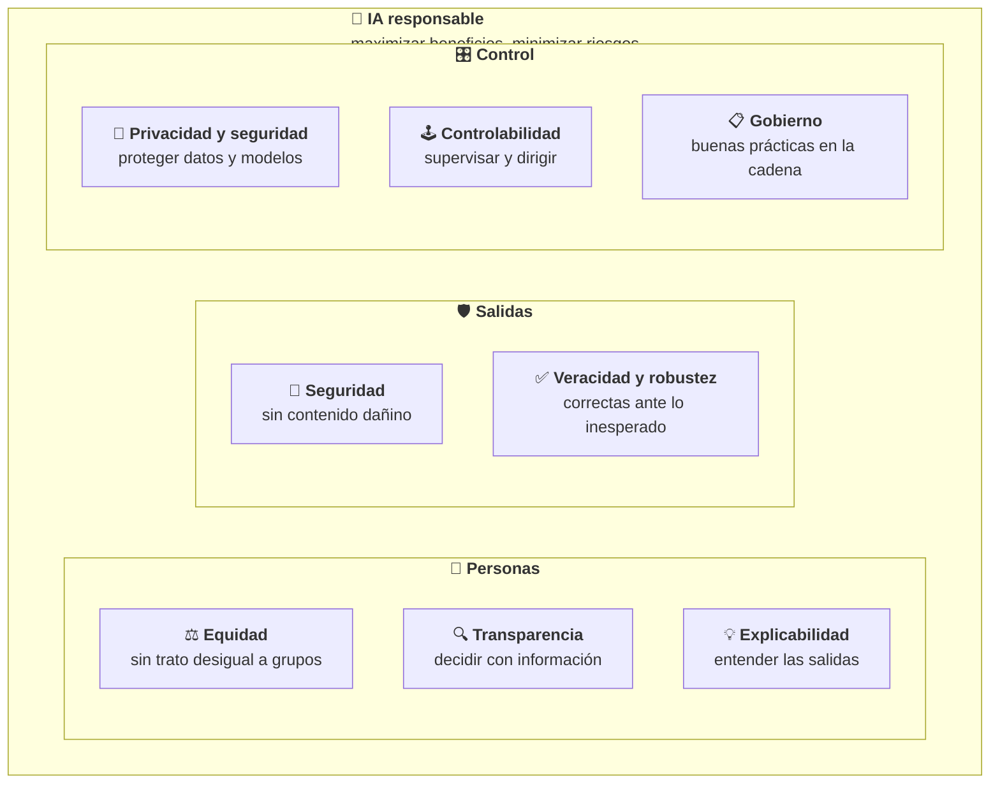
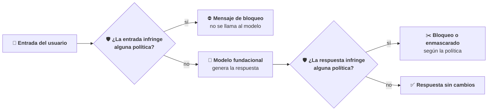
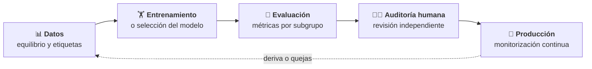
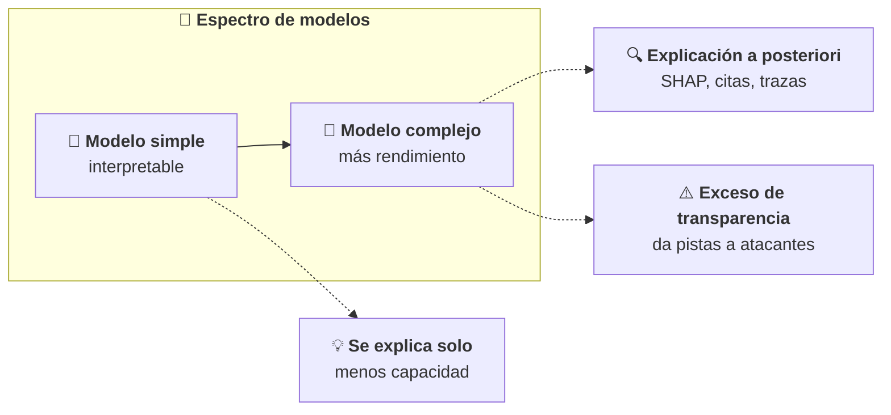
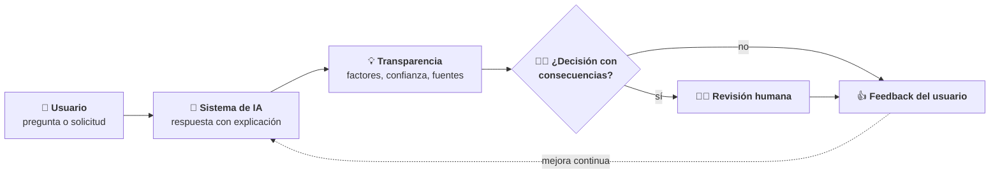

# IA responsable

Este módulo desarrolla el Dominio 4 del examen AIF-C01, que pesa el **14 % del contenido puntuable**. Trata de cómo se construye un sistema de IA que sea justo, seguro, veraz y comprensible: qué rasgos lo definen, qué herramientas de AWS ayudan a conseguirlos, qué riesgos legales tiene la IA generativa, cómo influyen los datos, el sesgo y la varianza, y cómo se hace un modelo transparente y explicable para las personas que lo usan. El nivel es *foundational*: hay que saber **qué** práctica o herramienta corresponde a cada situación y **por qué**, no cómo programarla.

Requisitos previos: el módulo [01](../01-fundamentos-ia-ml/README.md) (sobreajuste, subajuste y métricas de clasificación) y el [03](../03-modelos-fundacionales/README.md) (Amazon Bedrock Guardrails frente a la inyección de *prompts* y Amazon Bedrock Evaluations). Aquí se usan esas piezas desde el punto de vista de la IA responsable. La seguridad, el cumplimiento y el gobierno se tratan en el módulo [05](../05-seguridad-gobierno/README.md).

## Objetivos de aprendizaje

Los objetivos corresponden a las dos Task Statements del dominio (texto literal en [fuentes/dominio-4.md](../../fuentes/dominio-4.md)).

- **Task 4.1.** Explicar el desarrollo de sistemas de IA responsables: rasgos de la IA responsable, herramientas para aplicarlos (Amazon Bedrock Guardrails y otras), selección responsable de modelos, riesgos legales de la IA generativa, características de los conjuntos de datos, efectos del sesgo y la varianza y herramientas para detectar y monitorizar el sesgo, la fiabilidad y la veracidad.
- **Task 4.2.** Reconocer la importancia de los modelos transparentes y explicables: diferencias con los opacos, herramientas (Amazon SageMaker Model Cards, Amazon Bedrock Evaluations, modelos y datos abiertos, licencias), compromisos entre seguridad, transparencia, interpretabilidad y rendimiento, y principios de diseño centrado en las personas.

## Mapa de cobertura

| Objetivo | Descripción | Sección |
|---|---|---|
| 4.1.1 | Rasgos de la IA responsable (sesgo, equidad, inclusividad, robustez, seguridad, veracidad) | [Rasgos de la IA responsable](#rasgos-de-la-ia-responsable) |
| 4.1.2 | Herramientas para aplicar la IA responsable (Amazon Bedrock Guardrails) | [Herramientas para aplicar la IA responsable](#herramientas-para-aplicar-la-ia-responsable) |
| 4.1.3 | Prácticas responsables para elegir un modelo (medio ambiente, sostenibilidad) | [Selección responsable de un modelo](#selección-responsable-de-un-modelo) |
| 4.1.4 | Riesgos legales de la IA generativa | [Riesgos legales de la IA generativa](#riesgos-legales-de-la-ia-generativa) |
| 4.1.5 | Características de los conjuntos de datos | [Características de los conjuntos de datos](#características-de-los-conjuntos-de-datos) |
| 4.1.6 | Efectos del sesgo y la varianza | [Efectos del sesgo y la varianza](#efectos-del-sesgo-y-la-varianza) |
| 4.1.7 | Herramientas para detectar y monitorizar el sesgo, la fiabilidad y la veracidad | [Detección y monitorización del sesgo y la veracidad](#detección-y-monitorización-del-sesgo-y-la-veracidad) |
| 4.2.1 | Diferencias entre modelos transparentes y explicables y modelos que no lo son | [Modelos transparentes frente a modelos opacos](#modelos-transparentes-frente-a-modelos-opacos) |
| 4.2.2 | Herramientas para identificar modelos transparentes y explicables | [Herramientas de transparencia y explicabilidad](#herramientas-de-transparencia-y-explicabilidad) |
| 4.2.3 | Compromisos entre la seguridad y la transparencia del modelo | [Compromisos entre seguridad, transparencia y rendimiento](#compromisos-entre-seguridad-transparencia-y-rendimiento) |
| 4.2.4 | Principios de diseño centrado en las personas para una IA explicable | [Diseño centrado en las personas](#diseño-centrado-en-las-personas) |

## Teoría

### Tarea 4.1: desarrollo de sistemas de IA responsables

#### Rasgos de la IA responsable

AWS define la **IA responsable** (*responsible AI*) como la disciplina de diseñar, desarrollar y usar la IA con el objetivo de **maximizar los beneficios y minimizar los riesgos**, y la concreta en un conjunto de **dimensiones** que revisa a medida que la tecnología evoluciona:

| Dimensión (AWS) | Qué significa | Ejemplo de fallo que evita |
|---|---|---|
| **Equidad** (*fairness*) | Tener en cuenta el impacto en los distintos grupos de personas afectadas | Un modelo de hipotecas que aprueba menos solicitudes de un grupo de edad sin motivo financiero |
| **Explicabilidad** (*explainability*) | Entender y evaluar las salidas del sistema | Nadie sabe decir por qué se rechazó un préstamo |
| **Privacidad y seguridad** (*privacy and security*) | Obtener, usar y proteger adecuadamente los datos y los modelos | El asistente revela datos personales de otro cliente |
| **Seguridad frente a daños** (*safety*) | Evitar salidas dañinas y el mal uso del sistema | El chat da instrucciones peligrosas o insulta al usuario |
| **Controlabilidad** (*controllability*) | Tener mecanismos para supervisar y dirigir el comportamiento del sistema | No hay forma de detener o corregir un agente que actúa mal |
| **Veracidad y robustez** (*veracity and robustness*) | Salidas correctas, incluso ante entradas inesperadas o maliciosas | El modelo inventa una cláusula del contrato o cambia de respuesta por una errata |
| **Gobierno** (*governance*) | Incorporar buenas prácticas en toda la cadena de suministro de la IA, de proveedores a implantadores | Nadie revisa qué modelo se usa ni con qué datos se ajustó |
| **Transparencia** (*transparency*) | Permitir que las personas decidan con información sobre su relación con un sistema de IA | El cliente no sabe que habla con una IA ni qué limitaciones tiene |

La guía del examen añade términos que conviene situar en esa tabla:

- **Sesgo** (*bias*) en el sentido ético: el sistema discrimina a personas o grupos. Es lo contrario de la equidad. No hay que confundirlo con el sesgo como error del modelo (ver [Efectos del sesgo y la varianza](#efectos-del-sesgo-y-la-varianza)).
- **Inclusividad** (*inclusivity*): el sistema funciona bien para todos los grupos que lo van a usar, incluidos los minoritarios y las personas con necesidades de accesibilidad. Empieza por datos que los representen.
- **Robustez** (*robustness*): la salida sigue siendo correcta ante variaciones de la entrada (erratas, sinónimos, otro idioma) o ataques.
- **Seguridad** (*safety*): ausencia de salidas dañinas (odio, violencia, consejos peligrosos).
- **Veracidad** (*veracity*): salidas factualmente correctas; su enemigo principal en la IA generativa son las **alucinaciones**.



```nodos
RAI:
  concepto: ia-responsable
  seccion: 04-ia-responsable/teoria#rasgos-de-la-ia-responsable
PER:
  titulo: "Dimensiones centradas en las personas"
  texto: "Cómo trata el sistema a los distintos grupos y cuánto pueden entender y decidir las personas sobre él."
  seccion: 04-ia-responsable/teoria#rasgos-de-la-ia-responsable
SAL:
  titulo: "Dimensiones de las salidas"
  texto: "Que lo que genera el sistema no haga daño y sea correcto, también ante entradas inesperadas o maliciosas."
  seccion: 04-ia-responsable/teoria#rasgos-de-la-ia-responsable
CTL:
  titulo: "Dimensiones de control"
  texto: "Protección de datos y modelos, capacidad de supervisar y dirigir el sistema y buenas prácticas en toda la cadena de suministro de la IA. Se amplían en el módulo 05."
  enlaces: [{texto: "Dimensiones de la IA responsable", url: "https://aws.amazon.com/ai/responsible-ai/"}]
EQ:
  concepto: sesgo-y-equidad
  seccion: 04-ia-responsable/teoria#rasgos-de-la-ia-responsable
TR:
  concepto: transparencia
  seccion: 04-ia-responsable/teoria#modelos-transparentes-frente-a-modelos-opacos
EX:
  concepto: explicabilidad
  seccion: 04-ia-responsable/teoria#modelos-transparentes-frente-a-modelos-opacos
SE:
  titulo: "Seguridad frente a daños (safety)"
  texto: "Evitar salidas dañinas y el mal uso. En AWS se apoya en Amazon Bedrock Guardrails y en las evaluaciones de nocividad y toxicidad."
  enlaces: [{texto: "Amazon Bedrock Guardrails", url: "https://docs.aws.amazon.com/bedrock/latest/userguide/guardrails.html"}]
  seccion: 04-ia-responsable/teoria#herramientas-para-aplicar-la-ia-responsable
VR:
  concepto: veracidad
  seccion: 04-ia-responsable/teoria#detección-y-monitorización-del-sesgo-y-la-veracidad
PS:
  titulo: "Privacidad y seguridad"
  texto: "Obtener, usar y proteger adecuadamente los datos y los modelos: permisos, cifrado, filtros de datos personales. Se desarrolla en el módulo 05."
  enlaces: [{texto: "Protección de datos en Amazon Bedrock", url: "https://docs.aws.amazon.com/bedrock/latest/userguide/data-protection.html"}]
CO:
  concepto: controlabilidad
  seccion: 04-ia-responsable/teoria#diseño-centrado-en-las-personas
GO:
  titulo: "Gobierno"
  texto: "Incorporar buenas prácticas en la cadena de suministro de la IA, incluidos proveedores e implantadores: documentación, revisiones y políticas. Se desarrolla en el módulo 05."
  enlaces: [{texto: "Responsible AI Lens", url: "https://docs.aws.amazon.com/wellarchitected/latest/responsible-ai-lens/responsible-ai-lens.html"}]
```

**La política de IA responsable de AWS** (*AWS Responsible AI Policy*) completa el cuadro con dos ideas que el examen puede plantear como escenario:

- Si los servicios de IA se usan para **decisiones con consecuencias** (*consequential decisions*) sobre derechos, salud o seguridad de las personas (diagnóstico médico, procedimientos judiciales, acceso a vivienda, prestaciones, empleo, crédito o asesoramiento legal, financiero o médico), el cliente **debe evaluar los riesgos e implantar supervisión humana**, pruebas y salvaguardas.
- La salida de un modelo es **probabilística** y puede ser inexacta: el cliente y sus usuarios son responsables de las decisiones que tomen con ella y de cumplir las leyes aplicables, incluidas las específicas de IA como el Reglamento de IA de la UE (*EU AI Act*).

*Ejemplo de negocio:* un banco quiere un asistente que preaprueba préstamos personales. Equidad: comprobar que la tasa de aprobación no cambia sin motivo entre grupos. Explicabilidad: el gestor ve los factores que pesaron en cada decisión. Seguridad: el asistente no da consejos de inversión ilegales. Veracidad: las condiciones que cita salen de la documentación vigente. Controlabilidad y supervisión humana: un gestor revisa los rechazos, porque es una decisión con consecuencias. Transparencia: el cliente sabe que interviene una IA.

#### Herramientas para aplicar la IA responsable

**Amazon Bedrock Guardrails** proporciona **salvaguardas configurables** para detectar y filtrar contenido no deseado y proteger información sensible en las entradas de los usuarios y en las respuestas de los modelos. Es la herramienta que la guía cita como ejemplo y la que más aparece en el examen. Sus salvaguardas (también llamadas filtros o políticas):

| Salvaguarda | Qué hace | Ejemplo |
|---|---|---|
| **Filtros de contenido** (*content filters*) | Detectan contenido dañino en texto o imágenes por categorías predefinidas (odio, insultos, sexual, violencia, conducta indebida y ataque de *prompt*), con una **intensidad** configurable por categoría | Un chat de atención al cliente que bloquea insultos en las preguntas y en las respuestas |
| **Temas denegados** (*denied topics*) | Bloquean temas que el cliente define en lenguaje natural como no deseados para su aplicación | Un banco que no quiere que su asistente dé consejos de inversión |
| **Filtros de palabras** (*word filters*) | Bloquean palabras o frases exactas: blasfemias (lista predefinida) o términos propios | Bloquear los nombres de la competencia |
| **Filtros de información sensible** (*sensitive information filters*) | Detectan datos personales (PII) y patrones propios (expresiones regulares) y **bloquean** el mensaje o **enmascaran** el dato | Un resumen de llamadas que sustituye el número de teléfono del cliente por una etiqueta |
| **Comprobación de *grounding* contextual** (*contextual grounding checks*) | Detectan alucinaciones: respuestas **no basadas** en la fuente de referencia o **irrelevantes** para la pregunta, con umbrales configurables | Un RAG que bloquea respuestas que añaden datos que no están en los documentos recuperados |
| ***Automated Reasoning checks*** | Validan la respuesta con **lógica formal** contra reglas que el cliente define, explican por qué es correcta o no y señalan supuestos no declarados | Un asistente de RR. HH. cuyas respuestas sobre permisos se comprueban contra la normativa interna |

Cómo funciona un *guardrail* en una llamada al modelo:



```nodos
IN:
  titulo: "Entrada del usuario"
  texto: "El guardrail evalúa primero la entrada con todas las políticas configuradas, en paralelo para reducir la latencia."
  enlaces: [{texto: "Cómo funciona Guardrails", url: "https://docs.aws.amazon.com/bedrock/latest/userguide/guardrails-how.html"}]
  seccion: 04-ia-responsable/teoria#herramientas-para-aplicar-la-ia-responsable
CE:
  concepto: amazon-bedrock-guardrails
  titulo: "Evaluación de la entrada"
  seccion: 04-ia-responsable/teoria#herramientas-para-aplicar-la-ia-responsable
BL1:
  titulo: "Bloqueo de la entrada"
  texto: "Si la entrada infringe una política, se devuelve el mensaje de bloqueo configurado y no se invoca el modelo: solo se paga la evaluación del guardrail."
  enlaces: [{texto: "Cómo se cobra Guardrails", url: "https://docs.aws.amazon.com/bedrock/latest/userguide/guardrails-how.html"}]
  seccion: 04-ia-responsable/teoria#herramientas-para-aplicar-la-ia-responsable
FM:
  concepto: modelo-fundacional
  seccion: 02-fundamentos-genai/teoria#conceptos-fundamentales
CS:
  titulo: "Evaluación de la respuesta"
  texto: "La respuesta del modelo se evalúa con las mismas políticas. Las comprobaciones de grounding y Automated Reasoning actúan sobre la respuesta."
  seccion: 04-ia-responsable/teoria#herramientas-para-aplicar-la-ia-responsable
BL2:
  titulo: "Bloqueo o enmascarado"
  texto: "La respuesta se sustituye por el mensaje de bloqueo o, si la política de información sensible está en modo enmascarar, se sustituyen solo los datos detectados."
  seccion: 04-ia-responsable/teoria#herramientas-para-aplicar-la-ia-responsable
OK:
  titulo: "Respuesta sin cambios"
  texto: "Si no hay ninguna infracción, la respuesta llega a la aplicación tal cual."
  seccion: 04-ia-responsable/teoria#herramientas-para-aplicar-la-ia-responsable
```

Matices que separan opciones parecidas en el examen (fuente: guía de usuario de Bedrock):

- **Dos formas de usarlo:** al invocar un modelo de Bedrock, indicando el identificador y la versión del *guardrail*, o con la API **`ApplyGuardrail`**, que evalúa un texto **sin invocar un modelo**. Con `ApplyGuardrail` se aplican las mismas políticas a modelos alojados fuera de Bedrock. Funciona también con Amazon Bedrock Knowledge Bases y con los agentes de Bedrock.
- **Lo que no cubre:** los modelos de *embeddings*, de reordenación y de generación de imágenes no admiten *guardrails*; los filtros de contenido no evalúan los resultados de las herramientas en el uso de herramientas. Automated Reasoning checks solo admite inglés (EE. UU.), no admite *streaming* y no protege contra la inyección de *prompts* (para eso, los filtros de contenido).
- **La comprobación de *grounding*** está pensada para resúmenes, paráfrasis y preguntas y respuestas sobre una fuente; los casos de chat conversacional no están admitidos. Necesita tres piezas: la fuente, la pregunta y la respuesta. Los umbrales van de 0 a 0,99: con 0,7, se bloquea toda respuesta con puntuación de *grounding* o de relevancia inferior a 0,7.
- **Niveles** (*safeguard tiers*) para los filtros de contenido, los ataques de *prompt* y los temas denegados: el nivel **Classic** admite inglés, francés y español; el **Standard** es más robusto, admite muchos más idiomas, protege también el contenido dentro de código y detecta la fuga de *prompt*, y requiere la inferencia entre Regiones.
- **Versiones:** se trabaja sobre un borrador (*working draft*), se prueba en la ventana de prueba de la consola y se publica una **versión** inmutable para producción.
- **Precio** (página de precios de Bedrock, consultada el 15 de octubre de 2026): se paga por **unidad de texto** (hasta 1 000 caracteres) y por salvaguarda usada; por ejemplo, 0,15 USD por cada 1 000 unidades en filtros de contenido y temas denegados, 0,10 USD en información sensible y en *grounding*; los filtros de palabras y las expresiones regulares no tienen coste.

*Ejemplo resuelto de coste:* un asistente recibe 50 000 preguntas al mes. Cada pregunta tiene unos 400 caracteres (1 unidad de texto) y cada respuesta unos 2 300 (3 unidades): 4 unidades por interacción, 200 000 al mes. Con filtros de contenido (0,15 USD) e información sensible (0,10 USD): 200 × (0,15 + 0,10) = **50 USD al mes**. Si además se añadieran temas denegados, serían 200 × 0,40 = 80 USD.

Otras herramientas de AWS para la IA responsable, que también aparecen en la guía o en la página de IA responsable de AWS:

| Herramienta | Para qué | Estado (a 16 de octubre de 2026) |
|---|---|---|
| **Amazon Bedrock Evaluations** | Comparar modelos y aplicaciones con métricas de **robustez** y **toxicidad** (evaluación programática) y de **nocividad**, **estereotipos** y **rechazo** (evaluación con un modelo juez), además de evaluación humana | Disponible; es la vía gestionada para modelos fundacionales |
| **Amazon SageMaker Clarify** | Detectar sesgo en los datos y en las predicciones de modelos de ML clásico y explicarlas con SHAP | **Cerrado a clientes nuevos**. AWS indica como sustituto calcular las mismas métricas con bibliotecas abiertas y SHAP dentro de sus soluciones de referencia, y Bedrock Evaluations para modelos fundacionales |
| **Amazon SageMaker Model Monitor** | Detectar deriva de calidad, de sesgo y de atribución de características en producción | **Cerrado a clientes nuevos**. Sustituto: soluciones abiertas de monitorización publicadas por AWS, con Amazon CloudWatch y paneles de Amazon QuickSight |
| **Amazon Augmented AI (A2I)** | Revisión humana de predicciones con baja confianza | **Cerrado a clientes nuevos** |
| **Amazon SageMaker Ground Truth** | Etiquetado y *feedback* humano | **Cerrado a clientes nuevos** |
| **Amazon SageMaker Model Cards** | Documentar el uso previsto, el riesgo y la evaluación de un modelo | Disponible (ver [Herramientas de transparencia y explicabilidad](#herramientas-de-transparencia-y-explicabilidad)) |

| Escenario | Herramienta |
|---|---|
| Bloquear insultos y temas no deseados en un chat con un modelo de Bedrock | **Bedrock Guardrails** (filtros de contenido y temas denegados) |
| Enmascarar datos personales en los resúmenes que genera un modelo | **Bedrock Guardrails** (información sensible en modo enmascarar) |
| Aplicar las mismas políticas a un modelo alojado fuera de Bedrock | **Bedrock Guardrails** con la API `ApplyGuardrail` |
| Detectar respuestas de un RAG que no se basan en los documentos | **Bedrock Guardrails** (*contextual grounding check*) |
| Demostrar que una respuesta cumple reglas de negocio complejas | **Automated Reasoning checks** |
| Elegir el modelo que menos estereotipos genera para un caso | **Bedrock Evaluations** (métrica de estereotipos o conjunto de sesgo) |

#### Selección responsable de un modelo

Elegir un modelo de forma responsable no es solo elegir el más capaz. La guía pide tener en cuenta el **medio ambiente** y la **sostenibilidad**, y las buenas prácticas de AWS (*Generative AI Lens* y pilar de sostenibilidad del *Well-Architected Framework*) se resumen así:

- **Preguntarse si la IA generativa es la solución adecuada.** Si un buscador, una regla o un modelo de ML clásico resuelven el problema, consumen muchos menos recursos que un modelo generativo.
- **Elegir el modelo del tamaño justo:** el más pequeño que cumple los requisitos de calidad. Un modelo más grande consume más energía en cada inferencia.
- **Personalizar de forma eficiente:** *prompt engineering* y RAG antes que ajustar o entrenar; la destilación produce un modelo pequeño para la inferencia.
- **Usar recursos que se ajustan a la demanda:** servicios *serverless* y autoescalado, para no tener capacidad ociosa. Los chips de AWS diseñados para ML también ayudan: AWS indica que las instancias Inf2 (AWS Inferentia2) ofrecen hasta un 50 % más de rendimiento por vatio que instancias EC2 comparables.
- **Reutilizar antes que entrenar:** un modelo preentrenado evita la enorme huella de un preentrenamiento propio.

Además de la sostenibilidad, una selección responsable revisa:

- **Uso previsto y limitaciones del modelo:** las **AWS AI Service Cards** de los modelos de Amazon y las fichas de los proveedores indican para qué está pensado y para qué no.
- **Resultados en las dimensiones responsables:** evaluar los candidatos con **Bedrock Evaluations** (toxicidad, estereotipos, robustez) con datos del propio caso.
- **Licencia y origen:** qué permite la licencia (uso comercial, modificación) y qué se sabe de los datos de entrenamiento.
- **Residencia de los datos:** si el modelo está disponible en la Región que exige la normativa.

*Ejemplo de negocio:* una aseguradora quiere clasificar 2 millones de correos al mes en 8 categorías. Un modelo grande de razonamiento acierta un 96 %; uno pequeño, un 95 %, con una fracción del coste y del consumo. La opción responsable y rentable es el pequeño, salvo que ese punto de diferencia tenga un impacto relevante en el negocio.

#### Riesgos legales de la IA generativa

| Riesgo | Ejemplo | Cómo se mitiga |
|---|---|---|
| **Reclamaciones por infracción de propiedad intelectual** (*intellectual property infringement claims*) | Una imagen o un texto generados se parecen a una obra protegida | Revisión humana del contenido publicado, filtros, elección de proveedores con indemnización y uso responsable de las entradas |
| **Resultados sesgados** (*biased model outputs*) | Un filtro de currículos generado con IA perjudica a un grupo | Datos representativos, evaluación por subgrupos, supervisión humana en decisiones con consecuencias |
| **Pérdida de confianza de los clientes** (*loss of customer trust*) | Un chat insulta a un cliente o filtra datos de otro y el caso se hace público | Guardrails, pruebas antes del lanzamiento y transparencia sobre el uso de IA |
| **Riesgo para el usuario final** (*end user risk*) | Un asistente da un consejo médico o financiero erróneo y alguien actúa en consecuencia | Limitar el caso de uso, temas denegados, avisos claros y supervisión humana |
| **Alucinaciones** (*hallucinations*) | El asistente promete una condición comercial que no existe | RAG con citas, *contextual grounding check*, Automated Reasoning checks y revisión humana |

**Indemnización de propiedad intelectual:** según las preguntas frecuentes de Amazon Bedrock, AWS ofrece una **indemnización sin límite** frente a reclamaciones de terceros por **derechos de autor** sobre la salida generada por los modelos de Amazon y por otros servicios de IA generativa que enumeran las condiciones de servicio (*Service Terms*, sección 50.10). Exige un uso responsable: por ejemplo, no introducir datos que infrinjan derechos ni desactivar los filtros del servicio. No cubre cualquier modelo de cualquier proveedor: hay que comprobar qué servicios incluye.

*Ejemplo de negocio:* una agencia de marketing genera textos de campañas. Para reducir el riesgo legal elige un servicio con indemnización, no introduce material de terceros sin derechos, mantiene los filtros activos y hace que un editor revise cada texto antes de publicarlo.

#### Características de los conjuntos de datos

Un modelo aprende lo que hay en sus datos. Las características que la guía pide reconocer:

- **Inclusividad** (*inclusivity*): el conjunto incluye a todos los grupos que usarán el sistema.
- **Diversidad** (*diversity*): variedad de situaciones, estilos, idiomas, acentos, condiciones de captura (luz, ruido) y casos límite.
- **Fuentes curadas** (*curated data sources*): datos de origen conocido, revisados, con licencia y sin contenido inadecuado.
- **Conjuntos equilibrados** (*balanced datasets*): cada grupo y cada clase tienen suficientes ejemplos para aprender y para medir.

Las buenas prácticas del *Responsible AI Lens* de AWS añaden: comprobar que el conjunto es **representativo** del uso real (si se evalúa con datos que no se parecen al uso real, el sistema parece mejor o peor de lo que es); cubrir los huecos recogiendo más datos o con **muestreo estratificado** (se divide la población en subgrupos y se toma una muestra de cada uno); preferir etiquetas demográficas **declaradas por las personas** a las inferidas; y documentar cada conjunto en una **ficha de datos** (*datasheet*) con su uso previsto, su origen, su forma de recogida y sus sesgos conocidos.

*Ejemplo resuelto:* un conjunto de 10 000 solicitudes de préstamo tiene 8 000 de personas de 30 a 55 años (grupo *a*) y 2 000 de otras edades (grupo *d*). El **desequilibrio de clases** (*class imbalance*, CI) que define AWS es (n_a − n_d) / (n_a + n_d) = (8 000 − 2 000) / 10 000 = **0,6**. Un valor cercano a 0 indica grupos equilibrados; 0,6 avisa de que el modelo puede ajustarse peor al grupo pequeño. Si además se aprobó al 70 % del grupo *a* y al 50 % del *d*, la **diferencia en las proporciones de etiquetas** (DPL) es 0,70 − 0,50 = **0,2**: el modelo tenderá a reproducir esa diferencia.

#### Efectos del sesgo y la varianza

En ML, «sesgo» tiene **dos sentidos** que el examen mezcla a propósito:

1. **Sesgo ético** (*bias* en el sentido de equidad): trato desigual a personas o grupos.
2. **Sesgo estadístico** frente a **varianza** (*bias-variance*): dos tipos de error del modelo.

| Situación | Error con datos de entrenamiento | Error con datos nuevos | Diagnóstico |
|---|---|---|---|
| **Alto sesgo** (*underfitting*, subajuste) | Alto | Alto | El modelo es demasiado simple o se entrenó poco: no capta la relación |
| **Alta varianza** (*overfitting*, sobreajuste) | Bajo | Alto | El modelo memoriza los datos de entrenamiento, ruido incluido, y no generaliza |
| **Equilibrio** | Bajo | Bajo, parecido al de entrenamiento | El modelo generaliza |

*Ejemplo resuelto:* tres modelos para detectar fraude, con exactitud en entrenamiento y en prueba: A, 62 % y 60 % (subajuste: falla en los dos); B, 99 % y 71 % (sobreajuste: 28 puntos de diferencia); C, 91 % y 89 % (equilibrado). Se elige C.

Efectos que pide la guía:

- **Sobre los grupos demográficos:** un grupo con pocos ejemplos se aprende peor. AWS pone el ejemplo de un modelo que predice el rendimiento académico entrenado solo con alumnos de una universidad privada de rentas altas: su exactitud cae con alumnos de universidades públicas.
- **Inexactitud** (*inaccuracy*): con alto sesgo el modelo se equivoca con todos; con alta varianza, con todo lo que no se parece a lo que vio.
- **Sobreajuste** (*overfitting*): se detecta comparando el error en entrenamiento y en prueba; se reduce con más datos y más diversos, menos complejidad o regularización y validación cruzada.
- **Subajuste** (*underfitting*): se corrige con un modelo más capaz, mejores características o más tiempo de entrenamiento.

Relación con la equidad: el desequilibrio de clases hace que el modelo se ajuste mejor al grupo grande y tenga más error, o se sobreajuste, con el pequeño. Un mismo modelo puede estar bien ajustado en promedio y sobreajustado para un subgrupo.

#### Detección y monitorización del sesgo y la veracidad

La guía cita tres prácticas como ejemplo: **analizar la calidad de las etiquetas**, **auditorías humanas** y **análisis por subgrupos**. Encajan en el ciclo de vida así:



```nodos
D:
  concepto: calidad-de-etiquetas
  texto: "Antes de entrenar: equilibrio entre grupos (CI), diferencia de resultados por grupo en las etiquetas (DPL) y calidad de las etiquetas humanas o sintéticas."
  seccion: 04-ia-responsable/teoria#características-de-los-conjuntos-de-datos
T:
  titulo: "Entrenamiento o selección"
  texto: "Se entrena, se ajusta o se elige un modelo fundacional. La selección también es una decisión responsable."
  seccion: 04-ia-responsable/teoria#selección-responsable-de-un-modelo
E:
  concepto: analisis-por-subgrupos
  seccion: 04-ia-responsable/teoria#detección-y-monitorización-del-sesgo-y-la-veracidad
A:
  concepto: auditoria-humana
  seccion: 04-ia-responsable/teoria#detección-y-monitorización-del-sesgo-y-la-veracidad
P:
  titulo: "Monitorización en producción"
  texto: "Los datos reales cambian y el sesgo puede aparecer después del despliegue. Para proyectos nuevos, AWS recomienda sus soluciones abiertas de monitorización con CloudWatch; Model Monitor ya no admite clientes nuevos."
  enlaces: [{texto: "Sustituto de Model Monitor", url: "https://docs.aws.amazon.com/sagemaker/latest/dg/model-monitor-availability-change.html"}]
  seccion: 04-ia-responsable/teoria#detección-y-monitorización-del-sesgo-y-la-veracidad
```

- **Calidad de las etiquetas:** formar a los anotadores, medir cuánto coinciden entre sí (acuerdo entre anotadores), meter ejemplos con respuesta conocida para detectar a quien no sigue las instrucciones, buscar anotadores que etiqueten distinto a un grupo y comparar las etiquetas sintéticas con el juicio humano.
- **Auditorías humanas:** que un equipo independiente, sin interés en el proyecto, evalúe con sus propios datos las cuestiones críticas o subjetivas (seguridad, sesgo, experiencia de usuario) y que se investiguen las discrepancias antes de lanzar.
- **Análisis por subgrupos:** calcular las mismas métricas (exactitud, precisión, *recall*, tasa de aprobación) **por grupo** y comparar con un umbral aceptable, incluidos los grupos que combinan varias características (interseccionales).
- **Fiabilidad y veracidad en IA generativa:** *contextual grounding check* y Automated Reasoning checks de Guardrails; métricas de corrección, fidelidad (*faithfulness*) y robustez de Bedrock Evaluations; citas de las fuentes en RAG.
- **Monitorización continua:** el sesgo también aparece **después** del despliegue si los datos reales cambian (por ejemplo, otra población de clientes). Hay que medirlo periódicamente y alertar si supera un umbral.

*Ejemplo resuelto de análisis por subgrupos:* un modelo de préstamos aprueba al 60 % de las personas de 30 a 55 años y al 45 % del resto. El **impacto dispar** (*disparate impact*, DI) que define AWS es la proporción de resultados positivos del grupo desfavorecido entre la del favorecido: 0,45 / 0,60 = **0,75**. Un valor de 1 indica paridad; por debajo de 1, el grupo *d* recibe menos resultados positivos. Si además la exactitud es del 92 % en un grupo y del 78 % en el otro, la diferencia de exactitud (*accuracy difference*) es de 14 puntos: el modelo se equivoca más con el segundo grupo y merece una revisión antes de usarlo.

Estas métricas (CI, DPL, DI y diferencia de exactitud, entre otras) son las que calcula SageMaker Clarify para sus clientes actuales. Para proyectos nuevos, AWS indica calcularlas con bibliotecas de código abierto dentro de sus soluciones de referencia, porque son fórmulas estándar.

### Tarea 4.2: modelos transparentes y explicables

#### Modelos transparentes frente a modelos opacos

| Concepto | Qué significa | Ejemplo |
|---|---|---|
| **Transparencia** | Información sobre el sistema para que las personas decidan con conocimiento: que se usa IA, con qué datos, para qué está pensado y qué limitaciones tiene | Una ficha que explica el uso previsto y los límites de un modelo |
| **Explicabilidad** | Entender y evaluar por qué el sistema dio una salida concreta, aunque el modelo sea complejo | «Se rechazó por la ratio de endeudamiento y la antigüedad laboral» |
| **Interpretabilidad** | Entender cómo funciona el modelo por dentro, sin herramientas adicionales | En una regresión lineal, cada coeficiente dice cuánto pesa cada variable |

| | Modelo transparente y explicable | Modelo opaco (*black box*) |
|---|---|---|
| Ejemplos | Regresión lineal o logística, árbol de decisión pequeño; o un modelo complejo documentado y con explicaciones | Red neuronal profunda o modelo fundacional sin documentación ni explicaciones |
| Por qué decide | Se puede seguir o explicar | No se ve; solo hay entradas y salidas |
| Confianza y auditoría | Fácil de justificar ante clientes, auditores y reguladores | Difícil de justificar; más riesgo en decisiones con consecuencias |
| Rendimiento | A menudo menor en problemas complejos | A menudo mayor en problemas complejos (lenguaje, imagen) |
| Depuración | Se ve qué variable causa un error | Cuesta encontrar por qué falla |

Las explicaciones pueden ser **globales** (qué variables pesan en el modelo en general) o **locales** (por qué se dio **esta** predicción concreta). Para los modelos complejos se usan **explicaciones a posteriori** como **SHAP** (valores de Shapley, de la teoría de juegos cooperativos, que asignan a cada variable su contribución a una predicción) o LIME. La guía prescriptiva de AWS advierte de que esas importancias pueden **engañar** y conviene validarlas con expertos del negocio.

En IA generativa, la explicabilidad toma otras formas: **citas** a las fuentes en RAG, **trazas** que muestran los pasos y herramientas de un agente, razonamiento paso a paso (*chain-of-thought*) y puntuaciones de confianza.

*Ejemplo de negocio:* una financiera tiene que explicar a cada cliente por qué se rechazó su préstamo. Con un modelo interpretable, la explicación sale del propio modelo; con uno complejo, necesita una herramienta de explicación local (por ejemplo, SHAP) y validar que las explicaciones son coherentes.

#### Herramientas de transparencia y explicabilidad

| Herramienta | Qué aporta a la transparencia o la explicabilidad |
|---|---|
| **Amazon SageMaker Model Cards** | Documenta en un único sitio el **uso previsto** (y el no previsto), la **calificación de riesgo** (desconocido, bajo, medio o alto), los detalles de entrenamiento, las métricas y los resultados de evaluación. Cada cambio crea una **versión inmutable**; se exporta a PDF para compartirla y se integra con el SageMaker Model Registry para auditoría |
| **AWS AI Service Cards** | Fichas que publica AWS sobre sus servicios y modelos (por ejemplo, Amazon Nova o Bedrock Guardrails): casos de uso previstos, limitaciones, decisiones de diseño responsable y buenas prácticas |
| **Amazon Bedrock Evaluations** | Resultados comparables de exactitud, robustez, toxicidad, estereotipos o nocividad que se pueden publicar y documentar |
| **Modelos de código abierto** | Pesos y arquitectura visibles: se puede inspeccionar, auditar y desplegar el modelo con control propio (por ejemplo, desde SageMaker JumpStart) |
| **Datos** | Conocer y documentar los datos de entrenamiento (fichas de datos, linaje) explica muchos comportamientos del modelo |
| **Licencias** | Dicen qué se puede hacer con el modelo (uso comercial, modificación, redistribución) y son parte de la transparencia del proveedor |
| **Explicaciones de predicciones** | SHAP y gráficos de dependencia parcial (PDP), que SageMaker Clarify ofrece a sus clientes actuales; para proyectos nuevos, la biblioteca SHAP directamente. En agentes, las **trazas** de Bedrock y AgentCore |

| Escenario | Herramienta |
|---|---|
| El comité de riesgos pide un documento con el uso previsto, el nivel de riesgo y las métricas de cada modelo | **SageMaker Model Cards** |
| Antes de adoptar un servicio de IA de AWS, se quiere conocer su uso previsto y sus limitaciones | **AWS AI Service Cards** |
| Se necesita inspeccionar y auditar los pesos del modelo | **Modelo de código abierto** |
| Se quiere comparar la toxicidad de tres modelos candidatos con datos propios | **Bedrock Evaluations** |

*Nota de disponibilidad:* Model Cards sigue disponible. SageMaker Clarify ya no admite clientes nuevos (ver [Herramientas para aplicar la IA responsable](#herramientas-para-aplicar-la-ia-responsable)).

#### Compromisos entre seguridad, transparencia y rendimiento

La guía pide identificar los **compromisos** (*tradeoffs*) entre la seguridad del modelo y su transparencia, por ejemplo midiendo la interpretabilidad frente al rendimiento. Los principales:



```nodos
ESP:
  concepto: interpretabilidad
  seccion: 04-ia-responsable/teoria#compromisos-entre-seguridad-transparencia-y-rendimiento
S:
  titulo: "Modelo simple"
  texto: "Regresión lineal, árbol de decisión: se entiende cómo decide sin herramientas adicionales, pero puede rendir menos en problemas complejos."
  enlaces: [{texto: "Guía de interpretabilidad de AWS", url: "https://docs.aws.amazon.com/prescriptive-guidance/latest/ml-model-interpretability/overview.html"}]
  seccion: 04-ia-responsable/teoria#modelos-transparentes-frente-a-modelos-opacos
C:
  titulo: "Modelo complejo"
  texto: "Redes profundas y modelos fundacionales: más rendimiento en lenguaje, imagen o patrones complejos, pero su lógica interna no se ve."
  seccion: 04-ia-responsable/teoria#modelos-transparentes-frente-a-modelos-opacos
I1:
  titulo: "Explicación directa"
  texto: "La explicación sale del propio modelo (coeficientes, ramas del árbol). Útil cuando un regulador exige justificar cada decisión."
  seccion: 04-ia-responsable/teoria#compromisos-entre-seguridad-transparencia-y-rendimiento
I2:
  concepto: shap
  seccion: 04-ia-responsable/teoria#modelos-transparentes-frente-a-modelos-opacos
R:
  titulo: "Riesgo de revelar demasiado"
  texto: "Publicar las instrucciones del sistema, las reglas de los filtros o detalles de los datos ayuda a quien quiere saltárselos o extraer información."
  seccion: 04-ia-responsable/teoria#compromisos-entre-seguridad-transparencia-y-rendimiento
```

- **Interpretabilidad frente a rendimiento.** Un modelo simple se explica solo pero puede acertar menos; uno complejo acierta más pero necesita explicaciones a posteriori, que son aproximaciones. Se decide **midiendo las dos cosas** en el caso concreto: si el modelo interpretable cumple el mínimo de rendimiento, suele ser la opción preferible en decisiones reguladas.
- **Transparencia frente a seguridad.** Contar demasiado sobre el sistema (instrucciones del sistema, reglas exactas de los filtros, datos de entrenamiento) puede ayudar a quien quiere **saltarse las salvaguardas** o **extraer información**. Se publica lo que necesitan los usuarios para decidir (uso previsto, limitaciones, que hay IA) sin exponer los detalles que facilitan un ataque.
- **Privacidad frente a explicabilidad y exactitud.** Las protecciones de privacidad (por ejemplo, quitar datos personales) pueden reducir la exactitud o hacer más difícil explicar una decisión. El *Responsible AI Lens* recomienda fijar **mínimos aceptables** para cada criterio (por ejemplo, un 85 % de exactitud y un 90 % de protección de la privacidad) en lugar de maximizar uno a costa de otro.
- **Seguridad frente a utilidad.** Un *guardrail* muy estricto bloquea más contenido dañino pero también respuestas legítimas (falsos positivos). Se ajusta la intensidad de los filtros y se prueba con casos reales.

*Ejemplo de negocio:* una aseguradora compara un árbol de decisión (exactitud del 86 %, cada decisión se explica con sus ramas) con una red profunda (90 %, necesita SHAP). Su requisito regulatorio es explicar cada rechazo y su mínimo de exactitud es el 85 %: elige el árbol. Si el mínimo fuera el 88 %, tendría que usar la red y validar sus explicaciones.

#### Diseño centrado en las personas

El **diseño centrado en las personas** (*human-centered design*) para una IA explicable parte de quién usa el sistema y qué necesita entender para confiar en él, o para no hacerlo. Principios que cita la guía y que desarrolla el *Responsible AI Lens*:

- **Mecanismos de *feedback* de los usuarios** (*user-feedback mechanisms*): botones de valoración, notificación de errores o de contenido inadecuado, y un circuito que lleve ese *feedback* a mejoras del sistema (ajustar *guardrails*, *prompts* o datos) con revisiones periódicas.
- **Transparencia de las decisiones de la IA** (*AI decision transparency*): avisar de que interviene una IA; mostrar los factores que pesaron, la confianza de la predicción o las fuentes citadas; y explicar cuándo conviene comprobar o ignorar la recomendación.
- **Supervisión humana donde importa:** poner revisión humana en los puntos donde un error tiene consecuencias graves o donde la experiencia humana aporta más, con la información que el revisor necesita (explicación, confianza, casos parecidos).
- **Explicaciones adaptadas al usuario:** un resumen sencillo para el cliente y el detalle técnico para el analista o el auditor.
- **Accesibilidad e inclusión:** identificar los requisitos de accesibilidad de cada grupo de usuarios.
- **Control del usuario:** permitir corregir, deshacer o escalar a una persona.



```nodos
U:
  titulo: "Usuario"
  texto: "El diseño empieza por quién usa el sistema, qué necesita entender y qué requisitos de accesibilidad tiene."
  enlaces: [{texto: "Responsible AI Lens: impacto en el flujo de trabajo", url: "https://docs.aws.amazon.com/wellarchitected/latest/responsible-ai-lens/raiuc04-bp02.html"}]
  seccion: 04-ia-responsable/teoria#diseño-centrado-en-las-personas
IA:
  titulo: "Sistema de IA"
  texto: "Genera la respuesta junto con la información que la hace comprensible."
  seccion: 04-ia-responsable/teoria#diseño-centrado-en-las-personas
X:
  concepto: transparencia
  texto: "Avisar de que interviene una IA y mostrar los factores, la confianza o las fuentes de cada respuesta."
  seccion: 04-ia-responsable/teoria#diseño-centrado-en-las-personas
H:
  titulo: "¿Decisión con consecuencias?"
  texto: "La política de IA responsable de AWS exige supervisión humana en las decisiones sobre derechos, salud o seguridad de las personas."
  enlaces: [{texto: "AWS Responsible AI Policy", url: "https://aws.amazon.com/ai/responsible-ai/policy/"}]
  seccion: 04-ia-responsable/teoria#rasgos-de-la-ia-responsable
R:
  concepto: supervision-humana
  seccion: 04-ia-responsable/teoria#diseño-centrado-en-las-personas
F:
  concepto: mecanismo-de-feedback
  seccion: 04-ia-responsable/teoria#diseño-centrado-en-las-personas
```

*Ejemplo de negocio:* una aseguradora usa IA para proponer la tramitación de siniestros. El tramitador ve la propuesta con los tres factores principales y la confianza; si la confianza es baja o el importe es alto, decide una persona. El cliente sabe que interviene una IA y puede pedir revisión humana. Cada corrección del tramitador se registra y se revisa cada mes para mejorar el sistema.

## Puntos clave para el examen

- Las **dimensiones de AWS**: equidad, explicabilidad, privacidad y seguridad, seguridad frente a daños, controlabilidad, veracidad y robustez, gobierno y transparencia. Inclusividad, diversidad y datos equilibrados son la base de la equidad.
- **Amazon Bedrock Guardrails** es la herramienta de referencia: filtros de contenido (incluido el ataque de *prompt*), temas denegados, filtros de palabras, información sensible (bloquear o enmascarar), *contextual grounding check* y Automated Reasoning checks. Con `ApplyGuardrail` se usa sin invocar un modelo de Bedrock.
- **Alucinaciones en un RAG** → *contextual grounding check*; **demostrar que una respuesta cumple reglas** → Automated Reasoning checks; **datos personales** → filtro de información sensible.
- **Selección responsable:** el modelo más pequeño que cumple, comprobar si la IA generativa hace falta, *serverless* y chips eficientes, AI Service Cards, evaluaciones de toxicidad y estereotipos, licencia y Región.
- **Riesgos legales:** propiedad intelectual (AWS indemniza sin límite por derechos de autor en sus modelos y servicios cubiertos), resultados sesgados, pérdida de confianza, riesgo para el usuario final y alucinaciones. Las decisiones con consecuencias exigen supervisión humana.
- **Sesgo alto** = subajuste (falla en entrenamiento y en prueba); **varianza alta** = sobreajuste (bien en entrenamiento, mal en prueba). Un grupo con pocos datos se aprende peor.
- **Detección del sesgo:** calidad de etiquetas, auditorías humanas independientes y análisis por subgrupos (CI, DPL, DI, diferencia de exactitud), también en producción.
- **SageMaker Model Cards** documenta uso previsto, riesgo y evaluación; **AI Service Cards** son las fichas de AWS sobre sus servicios. Clarify, Model Monitor, Ground Truth y A2I ya no admiten clientes nuevos.
- **Interpretabilidad frente a rendimiento** y **transparencia frente a seguridad** son compromisos: se miden y se fijan mínimos, no se maximiza uno a costa del resto.
- **Diseño centrado en las personas:** *feedback* de los usuarios, transparencia de las decisiones, supervisión humana donde hay consecuencias y explicaciones adaptadas.

## Referencias

- Guía oficial, Dominio 4: <https://docs.aws.amazon.com/aws-certification/latest/ai-practitioner-01/ai-practitioner-01-domain4.html>
- IA responsable en AWS (dimensiones y herramientas): <https://aws.amazon.com/ai/responsible-ai/>
- AWS Responsible AI Policy: <https://aws.amazon.com/ai/responsible-ai/policy/>
- AWS AI Service Cards: <https://aws.amazon.com/ai/responsible-ai/resources/>
- Responsible AI Lens (Well-Architected): <https://docs.aws.amazon.com/wellarchitected/latest/responsible-ai-lens/responsible-ai-lens.html>
- Generative AI Lens, IA responsable: <https://docs.aws.amazon.com/wellarchitected/latest/generative-ai-lens/responsible-ai.html>
- Generative AI Lens, sostenibilidad: <https://docs.aws.amazon.com/wellarchitected/latest/generative-ai-lens/sustainability.html>
- Amazon Bedrock Guardrails: <https://docs.aws.amazon.com/bedrock/latest/userguide/guardrails.html>
- Cómo funciona Guardrails: <https://docs.aws.amazon.com/bedrock/latest/userguide/guardrails-how.html>
- Niveles de Guardrails: <https://docs.aws.amazon.com/bedrock/latest/userguide/guardrails-tiers.html>
- *Contextual grounding check*: <https://docs.aws.amazon.com/bedrock/latest/userguide/guardrails-contextual-grounding-check.html>
- Automated Reasoning checks: <https://docs.aws.amazon.com/bedrock/latest/userguide/guardrails-automated-reasoning-checks.html>
- Filtros de información sensible: <https://docs.aws.amazon.com/bedrock/latest/userguide/guardrails-sensitive-filters.html>
- Métricas de Bedrock Evaluations: <https://docs.aws.amazon.com/bedrock/latest/userguide/model-evaluation-metrics.html>
- Precios de Amazon Bedrock: <https://aws.amazon.com/bedrock/pricing/>
- Preguntas frecuentes de Amazon Bedrock (indemnización de propiedad intelectual): <https://aws.amazon.com/bedrock/faqs/>
- SageMaker Clarify: <https://docs.aws.amazon.com/sagemaker/latest/dg/clarify-configure-processing-jobs.html>
- Cambio de disponibilidad de Clarify: <https://docs.aws.amazon.com/sagemaker/latest/dg/clarify-availability-change.html>
- Métricas de sesgo previas al entrenamiento: <https://docs.aws.amazon.com/sagemaker/latest/dg/clarify-measure-data-bias.html>
- Impacto dispar (DI): <https://docs.aws.amazon.com/sagemaker/latest/dg/clarify-post-training-bias-metric-di.html>
- Explicabilidad con Clarify (SHAP): <https://docs.aws.amazon.com/sagemaker/latest/dg/clarify-model-explainability.html>
- Cambio de disponibilidad de Model Monitor: <https://docs.aws.amazon.com/sagemaker/latest/dg/model-monitor-availability-change.html>
- Amazon Augmented AI: <https://docs.aws.amazon.com/sagemaker/latest/dg/a2i-use-augmented-ai-a2i-human-review-loops.html>
- SageMaker Model Cards: <https://docs.aws.amazon.com/sagemaker/latest/dg/model-cards.html>
- Interpretabilidad de modelos de ML (guía prescriptiva): <https://docs.aws.amazon.com/prescriptive-guidance/latest/ml-model-interpretability/introduction.html>
- Sobreajuste y subajuste: <https://aws.amazon.com/what-is/overfitting/>
- AWS Inferentia: <https://aws.amazon.com/ai/machine-learning/inferentia/>
