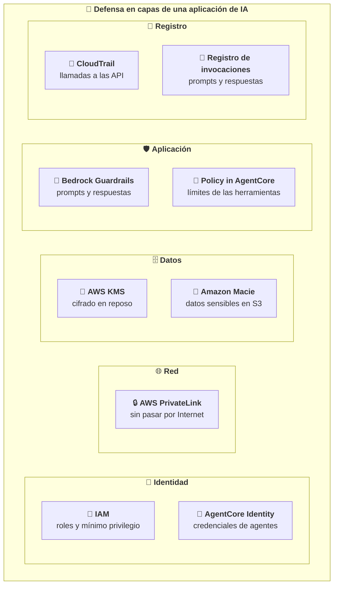
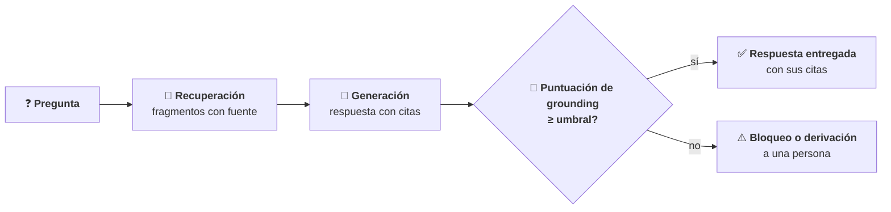
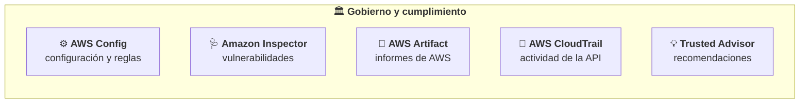
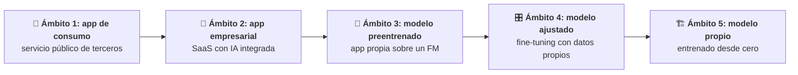

# Seguridad, cumplimiento y gobierno

Este módulo desarrolla el Dominio 5 del examen AIF-C01, que pesa el **14 % del contenido puntuable**. Trata de cómo se protege un sistema de IA (identidades, cifrado, red, datos, *prompts* y registros), de cómo se documenta el origen de los datos, de cómo se detectan las alucinaciones y de qué servicios y procesos ayudan a cumplir la normativa y a gobernar la IA. El nivel es *foundational*: hay que saber **qué** servicio o práctica corresponde a cada situación y **por qué**. Implantar protocolos de seguridad o marcos de gobierno queda fuera del alcance del examen.

Requisitos previos: el módulo [00](../00-base-aws/README.md) (modelo de responsabilidad compartida, IAM, mínimo privilegio, CloudTrail y CloudWatch) y el [04](../04-ia-responsable/README.md) (Amazon Bedrock Guardrails y SageMaker Model Cards). Aquí se usan esas piezas desde el punto de vista de la seguridad y el gobierno.

## Objetivos de aprendizaje

Los objetivos corresponden a las dos Task Statements del dominio (texto literal en [fuentes/dominio-5.md](../../fuentes/dominio-5.md)).

- **Task 5.1.** Explicar los métodos para proteger los sistemas de IA: servicios y funcionalidades de seguridad de AWS, citación de fuentes y documentación del origen de los datos, buenas prácticas de ingeniería de datos segura, consideraciones de seguridad y privacidad, y detección de alucinaciones y técnicas de *grounding*.
- **Task 5.2.** Reconocer la normativa de gobierno y cumplimiento de los sistemas de IA: servicios de AWS que ayudan a cumplirla, estrategias de gobierno de datos y procesos para seguir los protocolos de gobierno.

## Mapa de cobertura

| Objetivo | Descripción | Sección |
|---|---|---|
| 5.1.1 | Servicios y funcionalidades de AWS para proteger sistemas de IA | [Servicios para proteger sistemas de IA](#servicios-para-proteger-sistemas-de-ia) |
| 5.1.2 | Citación de fuentes y documentación del origen de los datos | [Citación de fuentes y origen de los datos](#citación-de-fuentes-y-origen-de-los-datos) |
| 5.1.3 | Buenas prácticas de ingeniería de datos segura | [Ingeniería de datos segura](#ingeniería-de-datos-segura) |
| 5.1.4 | Consideraciones de seguridad y privacidad de los sistemas de IA | [Consideraciones de seguridad y privacidad](#consideraciones-de-seguridad-y-privacidad) |
| 5.1.5 | Detección de alucinaciones y técnicas de *grounding* | [Detección de alucinaciones y grounding](#detección-de-alucinaciones-y-grounding) |
| 5.2.1 | Servicios de AWS para el gobierno y el cumplimiento normativo | [Servicios para gobierno y cumplimiento](#servicios-para-gobierno-y-cumplimiento) |
| 5.2.2 | Estrategias de gobierno de datos | [Estrategias de gobierno de datos](#estrategias-de-gobierno-de-datos) |
| 5.2.3 | Procesos para seguir los protocolos de gobierno | [Procesos de gobierno](#procesos-de-gobierno) |

## Teoría

### Tarea 5.1: métodos para proteger sistemas de IA

#### Servicios para proteger sistemas de IA

**El modelo de responsabilidad compartida** se aplica también a la IA: AWS protege **la nube** (centros de datos, *hardware*, red, servicios gestionados) y el cliente protege lo que pone **en la nube** (sus datos, quién accede, la configuración, sus aplicaciones). Cuánto le toca al cliente depende del servicio:

| Cómo se usa el modelo | Qué gestiona AWS | Qué gestiona el cliente |
|---|---|---|
| **Amazon Bedrock** (servicio gestionado por API) | Infraestructura, alojamiento del modelo y cuentas de despliegue | Permisos IAM, cifrado con sus claves, red, datos que envía, *guardrails*, registros, uso responsable |
| **SageMaker AI** (*endpoint* gestionado) | Infraestructura y plataforma | Lo anterior más el modelo, el contenedor, el tamaño del *endpoint* y su configuración |
| **Amazon EC2** (modelo autoalojado) | Infraestructura física y virtualización | Lo anterior más el sistema operativo invitado, sus parches y el cortafuegos (grupos de seguridad) |

Cuanto más gestionado es el servicio, menos tareas de seguridad recaen en el cliente; nunca desaparecen las de los datos y los permisos.

**Privacidad de los datos en Amazon Bedrock** (preguntas frecuentes y guía de usuario):

- Las entradas y salidas **no se comparten con los proveedores de modelos**, y ni AWS ni los proveedores las usan para **entrenar** modelos. Los modelos se despliegan en cuentas de Bedrock a las que los proveedores no tienen acceso.
- Para la detección de abusos, algunos modelos concretos retienen el tráfico hasta 30 días (lo detalla la página de detección de abusos); para el resto no cambia nada. Además, el cliente puede fijar por Región, mediante la API, un modo de **retención cero** (*zero data retention*): con él, Bedrock rechaza los modelos que exigen retener datos.

Servicios y funcionalidades que cita la guía:

| Servicio o funcionalidad | Qué aporta a la seguridad de un sistema de IA |
|---|---|
| **IAM: roles, políticas y permisos** | Quién puede invocar qué modelo, crear qué *Knowledge Base* o borrar qué *guardrail*. Bedrock usa **roles de servicio** para acceder a datos en nombre del cliente (por ejemplo, una Knowledge Base lee S3). Principio de **mínimo privilegio** |
| **Cifrado** | En tránsito con TLS (Bedrock exige TLS 1.2 y recomienda 1.3). En reposo con **AWS KMS** y claves del cliente para modelos personalizados, trabajos de ajuste, agentes, ingesta de Knowledge Bases y evaluaciones |
| **Amazon Macie** | Descubre datos sensibles (PII, credenciales) en los *buckets* de S3 con ML y patrones, y avisa de *buckets* expuestos. Útil antes de usar un *bucket* para ajustar un modelo o como fuente de una Knowledge Base |
| **AWS PrivateLink** | *Endpoints* de interfaz de VPC para llegar a Bedrock (`bedrock`, `bedrock-runtime`, `bedrock-mantle`, `bedrock-agent`, `bedrock-agent-runtime`) **sin pasar por Internet**, sin pasarela de Internet ni NAT, con políticas de *endpoint* para limitar el acceso |
| **Modelo de responsabilidad compartida** | Delimita qué protege AWS y qué protege el cliente |
| **Amazon Bedrock AgentCore Identity** | Gestión de identidades y credenciales **para agentes**: los agentes y sus herramientas acceden a recursos de AWS y de terceros **en nombre de los usuarios**, con autenticación, autorización y trazas de auditoría |
| **Policy in AgentCore** | Políticas **deterministas** (en lenguaje Cedar o redactadas en lenguaje natural) que se evalúan en el AgentCore Gateway **antes** de permitir que un agente use una herramienta: qué puede hacer cada agente y con qué límites |
| **Amazon Bedrock Guardrails** | Filtra ataques de *prompt*, contenido dañino y datos personales en entradas y respuestas (módulo 04) |
| **AWS Secrets Manager** | Guarda y rota claves de API y credenciales que usan las herramientas de un agente, en lugar de escribirlas en el código |



```nodos
CAP:
  titulo: "Defensa en capas"
  texto: "Ninguna medida basta sola: se combinan controles de identidad, red, datos, aplicación y registro. El Generative AI Lens de AWS pide controles de acceso completos, flujos de datos protegidos, supervisión de los límites de seguridad y control del comportamiento de la IA."
  enlaces: [{texto: "Generative AI Lens: seguridad", url: "https://docs.aws.amazon.com/wellarchitected/latest/generative-ai-lens/security.html"}]
  seccion: 05-seguridad-gobierno/teoria#servicios-para-proteger-sistemas-de-ia
ID:
  titulo: "Identidad"
  texto: "Quién (persona, aplicación o agente) puede hacer qué. Mínimo privilegio en todos los componentes."
  seccion: 05-seguridad-gobierno/teoria#servicios-para-proteger-sistemas-de-ia
IAM:
  concepto: aws-iam
  seccion: 05-seguridad-gobierno/teoria#servicios-para-proteger-sistemas-de-ia
ACI:
  concepto: agentcore-identity
  seccion: 05-seguridad-gobierno/teoria#servicios-para-proteger-sistemas-de-ia
NET:
  titulo: "Red"
  texto: "El tráfico entre la VPC y Bedrock puede no salir a Internet."
  seccion: 05-seguridad-gobierno/teoria#servicios-para-proteger-sistemas-de-ia
PL:
  concepto: aws-privatelink
  enlaces: [{texto: "Bedrock con endpoints de VPC", url: "https://docs.aws.amazon.com/bedrock/latest/userguide/vpc-interface-endpoints.html"}]
  seccion: 05-seguridad-gobierno/teoria#servicios-para-proteger-sistemas-de-ia
DAT:
  titulo: "Datos"
  texto: "Cifrado en reposo y en tránsito, y saber dónde hay datos sensibles antes de usarlos con un modelo."
  seccion: 05-seguridad-gobierno/teoria#ingeniería-de-datos-segura
KMS:
  concepto: aws-kms
  enlaces: [{texto: "Cifrado de datos en Bedrock", url: "https://docs.aws.amazon.com/bedrock/latest/userguide/data-encryption.html"}]
  seccion: 05-seguridad-gobierno/teoria#servicios-para-proteger-sistemas-de-ia
MAC:
  concepto: amazon-macie
  seccion: 05-seguridad-gobierno/teoria#servicios-para-proteger-sistemas-de-ia
APP:
  titulo: "Aplicación"
  texto: "Controles específicos de la IA: qué entra y sale del modelo y qué puede hacer un agente."
  seccion: 05-seguridad-gobierno/teoria#consideraciones-de-seguridad-y-privacidad
GR:
  concepto: amazon-bedrock-guardrails
  seccion: 04-ia-responsable/teoria#herramientas-para-aplicar-la-ia-responsable
POL:
  concepto: policy-in-agentcore
  seccion: 05-seguridad-gobierno/teoria#servicios-para-proteger-sistemas-de-ia
AUD:
  titulo: "Registro y auditoría"
  texto: "Quién hizo qué y cuándo, y qué se preguntó y respondió."
  seccion: 05-seguridad-gobierno/teoria#consideraciones-de-seguridad-y-privacidad
CT:
  concepto: aws-cloudtrail
  seccion: 05-seguridad-gobierno/teoria#servicios-para-gobierno-y-cumplimiento
LOG:
  concepto: registro-de-invocaciones
  seccion: 05-seguridad-gobierno/teoria#consideraciones-de-seguridad-y-privacidad
```

| Escenario | Servicio o funcionalidad |
|---|---|
| Las aplicaciones de una VPC sin salida a Internet deben llamar a Bedrock | **AWS PrivateLink** (*endpoint* de interfaz) |
| Hay que saber si un *bucket* que se usará para ajustar un modelo contiene datos personales | **Amazon Macie** |
| El modelo ajustado debe cifrarse con una clave que controla la empresa | **AWS KMS** (clave administrada por el cliente) |
| Un agente debe leer el calendario del usuario en un servicio externo con los permisos de ese usuario | **AgentCore Identity** |
| Un agente de reembolsos no debe poder aprobar importes superiores a 500 € | **Policy in AgentCore** |
| Solo el equipo de RR. HH. puede invocar el modelo ajustado con datos de nóminas | **IAM** (políticas con mínimo privilegio) |

#### Citación de fuentes y origen de los datos

Saber **de dónde sale** una respuesta o un modelo es una exigencia de seguridad, de auditoría y de confianza:

- **Citación de fuentes** (*source citation*): la respuesta indica de qué documentos sale. Amazon Bedrock Knowledge Bases devuelve **citas** con los fragmentos y documentos de origen, lo que permite comprobar la respuesta y detectar alucinaciones.
- **Linaje de los datos** (*data lineage*): el recorrido de los datos y de los artefactos desde su origen hasta el modelo desplegado: qué conjunto de datos, qué versión, qué trabajo de entrenamiento y qué *endpoint*. **SageMaker ML Lineage Tracking** registra esa información para reproducir el flujo y auditarlo; **MLflow en SageMaker AI** registra los experimentos y sus artefactos.
- **Catalogación de datos** (*data cataloging*): un inventario de los conjuntos de datos con su ubicación, esquema y metadatos. **AWS Glue Data Catalog** es el catálogo central de metadatos en AWS, y **AWS Lake Formation** gobierna el acceso a esos datos.
- **Amazon SageMaker Model Cards**: documenta, entre otras cosas, los datos y el entrenamiento de un modelo, con versiones inmutables (módulo 04).
- **Fichas de datos** (*datasheets*): documentan el origen, la recogida y los sesgos conocidos de cada conjunto (módulo 04).

| Necesidad | Herramienta |
|---|---|
| El usuario debe poder comprobar de qué documento sale cada respuesta | **Citas de Knowledge Bases** |
| Un auditor pregunta con qué versión de los datos se entrenó el modelo en producción | **Linaje** (SageMaker ML Lineage Tracking o MLflow) |
| Los analistas deben encontrar qué conjuntos de datos existen y su esquema | **AWS Glue Data Catalog** |
| El comité de riesgos quiere el uso previsto y los datos de entrenamiento de un modelo | **SageMaker Model Cards** |

*Ejemplo de negocio:* un banco recibe una reclamación sobre una decisión de su modelo de riesgo. Gracias al linaje sabe que la versión 7 se entrenó con el conjunto de marzo; el catálogo indica de qué sistemas salió ese conjunto; la Model Card recoge su uso previsto y su evaluación. Puede reconstruir y justificar la decisión.

#### Ingeniería de datos segura

Las buenas prácticas que cita la guía:

| Práctica | Qué significa | En AWS |
|---|---|---|
| **Evaluar la calidad de los datos** | Comprobar que son completos, correctos, coherentes y actuales antes de usarlos | **AWS Glue Data Quality** (reglas y puntuación de calidad, detección de anomalías); **AWS Glue DataBrew** (perfilado visual) |
| **Tecnologías de mejora de la privacidad** (*privacy-enhancing technologies*) | Usar los datos protegiendo a las personas: minimización, anonimización, seudonimización o tokenización, enmascarado, privacidad diferencial y datos sintéticos | Filtros de información sensible de Guardrails, Macie para localizar PII; AWS Clean Rooms existe pero está fuera del alcance del examen |
| **Control de acceso a los datos** | Cada persona o sistema accede solo a los datos que necesita | **IAM**, políticas de *bucket* de S3 y **Lake Formation** (permisos por columna, fila y celda) |
| **Integridad de los datos** | Los datos no se alteran sin control: versiones, registros y protección frente al **envenenamiento** | Versionado de S3, CloudTrail, permisos de escritura mínimos |

*Ejemplo resuelto de minimización y seudonimización* (adaptado del *Responsible AI Lens*): el registro «Juan Pérez, diabético, calle Mayor 12» se transforma en «Paciente_2384, afección_tipo_2, zona_14». Mantiene el valor analítico (tipo de afección, zona) y reduce mucho la posibilidad de identificar a la persona. Ojo: según el RGPD, los datos seudonimizados siguen siendo datos personales; solo los anonimizados de forma irreversible dejan de serlo.

Una idea que conviene llevar al examen: **es más seguro no meter datos personales en el modelo** que intentar sacarlos después. La guía de AWS sobre la *AI Security Scoping Matrix* recuerda que la única forma totalmente eficaz de eliminar un dato de un modelo es quitarlo del conjunto de entrenamiento y entrenar una versión nueva; por eso recomienda añadir los datos personales o cambiantes **en la inferencia** (RAG o agentes con permisos) en lugar de ajustarlos dentro del modelo.

#### Consideraciones de seguridad y privacidad

La guía enumera las consideraciones que hay que reconocer. Las de la columna izquierda son clásicas; las específicas de la IA están marcadas.

| Consideración | Qué se protege | Medidas típicas en AWS |
|---|---|---|
| Seguridad de las aplicaciones | La aplicación que llama al modelo | Autenticación de usuarios, validación de entradas, mínimo privilegio |
| Detección de amenazas | Actividad sospechosa en la cuenta | Servicios de detección de amenazas como Amazon GuardDuty (fuera del alcance del examen: basta reconocerlo) |
| Gestión de vulnerabilidades | *Software* con fallos conocidos | **Amazon Inspector** (EC2, imágenes de contenedores, Lambda) |
| Protección de la infraestructura | Red y recursos | VPC, grupos de seguridad, **PrivateLink** |
| **Inyección de *prompts*** (IA) | Que el usuario o un documento cambien las instrucciones del modelo | Filtro de ataques de *prompt* de Guardrails, separar instrucciones y datos, mínimo privilegio para los agentes |
| Cifrado en reposo y en tránsito | Datos almacenados y en movimiento | **KMS** y TLS |
| **Prevención de fugas de datos** (IA) | Que el modelo revele datos que no debe | Filtros de información sensible, controles de acceso **antes** de añadir datos al contexto, no entrenar con PII |
| **Filtrado y validación de la salida** (IA) | Que la respuesta sea segura y tenga el formato esperado | Guardrails, validación de formato y de reglas de negocio |
| **Registro y auditoría de las interacciones** (IA) | Saber qué se preguntó, qué se respondió y quién lo hizo | **CloudTrail** (llamadas a la API) y **registro de invocaciones de Bedrock** (*prompts* y respuestas) en CloudWatch Logs o S3 |
| **Toxicidad** (IA) | Contenido ofensivo o dañino | Filtros de contenido de Guardrails, evaluaciones de toxicidad |

Matices que separan opciones parecidas:

- **CloudTrail frente al registro de invocaciones.** CloudTrail registra **quién llamó a qué API y cuándo**. Bedrock registra `InvokeModel` y `Converse` como eventos de administración, que aparecen en el historial de eventos sin configurar nada; en cambio, las consultas a Knowledge Bases (`Retrieve`, `RetrieveAndGenerate`), a agentes (`InvokeAgent`), a flujos (`InvokeFlow`) y `ApplyGuardrail` son **eventos de datos**: solo se registran con un *trail* configurado con selectores avanzados, y tienen coste. El **registro de invocaciones de modelos** de Bedrock guarda **el contenido**: la petición, la respuesta y sus metadatos, en CloudWatch Logs o S3. Está **desactivado por defecto**.
- **Los modelos fundacionales no tienen control de acceso a los datos que contienen o reciben.** La *AI Security Scoping Matrix* lo subraya: el control de acceso se aplica **antes** de añadir datos al contexto de la petición, en la capa de aplicación (por ejemplo, filtrando por permisos en el RAG).
- **Tipos de inyección de *prompts*** que describe la guía prescriptiva de AWS: cambio de personaje, extracción de la plantilla del *prompt*, ignorar la plantilla, alternar idiomas o caracteres de escape, extraer el historial de la conversación o aumentar la plantilla con instrucciones nuevas.
- **El enmascarado de PII de Guardrails no llega a los registros.** Solo se aplica a lo que entra al modelo y a lo que devuelve. El campo de entrada del registro de invocaciones en CloudWatch Logs guarda la petición original, y la traza de Guardrails devuelve el valor detectado. Para proteger los registros se usa la protección de datos de CloudWatch Logs y se limita el acceso a ellos.
- **Agentes con exceso de autonomía** (*excessive agency*): un agente con más permisos de los necesarios multiplica el daño de una inyección. Se limita con mínimo privilegio, Policy in AgentCore y aprobación humana para acciones sensibles.

#### Detección de alucinaciones y grounding

Una **alucinación** es una respuesta plausible pero falsa o no respaldada. Las técnicas que cita la guía:

- ***Grounding* con RAG:** el modelo responde a partir de documentos recuperados, con **citas**, en lugar de su memoria.
- **Comprobación de *grounding* contextual** de Guardrails: está pensada para resúmenes, paráfrasis y preguntas y respuestas sobre una fuente (no para chat conversacional) y necesita tres piezas: la fuente, la pregunta y la respuesta.
- **Validación de la salida:** comprobar la respuesta antes de usarla: contra la fuente (*contextual grounding check*), contra reglas lógicas (**Automated Reasoning checks**), contra un formato o esquema esperado, o con revisión humana.
- **Puntuación de confianza** (*confidence scoring*): asignar a cada respuesta una puntuación y actuar según un umbral (entregar, avisar, derivar a una persona o no responder). La comprobación de *grounding* de Guardrails da puntuaciones de *grounding* y de relevancia; muchos servicios de IA de AWS (Textract, Comprehend, Rekognition) devuelven una confianza con cada predicción.



```nodos
Q:
  titulo: "Pregunta del usuario"
  texto: "La comprobación de grounding necesita la pregunta para medir la relevancia de la respuesta."
  seccion: 05-seguridad-gobierno/teoria#detección-de-alucinaciones-y-grounding
R:
  concepto: rag
  seccion: 03-modelos-fundacionales/teoria#rag-y-amazon-bedrock-knowledge-bases
G:
  titulo: "Respuesta con citas"
  texto: "Knowledge Bases puede generar la respuesta con citas a los documentos de origen."
  enlaces: [{texto: "Probar una Knowledge Base", url: "https://docs.aws.amazon.com/bedrock/latest/userguide/kb-test-retrieve-generate.html"}]
  seccion: 05-seguridad-gobierno/teoria#citación-de-fuentes-y-origen-de-los-datos
V:
  concepto: contextual-grounding-check
  seccion: 05-seguridad-gobierno/teoria#detección-de-alucinaciones-y-grounding
OK:
  titulo: "Respuesta entregada"
  texto: "Supera los umbrales de grounding y relevancia: llega al usuario con sus fuentes."
  seccion: 05-seguridad-gobierno/teoria#detección-de-alucinaciones-y-grounding
NOK:
  concepto: alucinacion
  texto: "Por debajo del umbral, la respuesta se bloquea o se deriva a una persona."
  seccion: 05-seguridad-gobierno/teoria#detección-de-alucinaciones-y-grounding
```

*Ejemplo resuelto:* un asistente de seguros tiene la comprobación de *grounding* con umbrales de 0,7 en *grounding* y en relevancia. Tres respuestas obtienen: A, 0,92 y 0,88 → se entrega; B, 0,55 y 0,90 → se bloquea porque **no se basa** en la fuente aunque sea pertinente; C, 0,85 y 0,40 → se bloquea porque es **irrelevante** para la pregunta aunque esté en la fuente. Subir el umbral bloquea más alucinaciones y también más respuestas válidas.

| Escenario | Técnica |
|---|---|
| El asistente inventa datos que no están en los documentos internos | **RAG con citas** y *contextual grounding check* |
| Las respuestas sobre elegibilidad deben cumplir reglas de negocio complejas | **Automated Reasoning checks** |
| La aplicación espera un JSON con campos concretos | **Validación del formato** de la salida |
| Las respuestas con poca confianza deben revisarse antes de enviarse | **Puntuación de confianza** con umbral y revisión humana |

### Tarea 5.2: gobierno y cumplimiento

#### Servicios para gobierno y cumplimiento

| Servicio | Qué hace | Ejemplo en un sistema de IA |
|---|---|---|
| **AWS Config** | Inventario de la configuración de los recursos, su historial y su evaluación con **reglas** (y paquetes de conformidad) | Comprobar que los *buckets* con datos de entrenamiento están cifrados y no son públicos, y ver cuándo cambió una configuración |
| **Amazon Inspector** | **Gestión de vulnerabilidades**: escanea de forma continua EC2, imágenes de contenedores en ECR y funciones Lambda | Detectar una biblioteca vulnerable en el contenedor de inferencia |
| **AWS Artifact** | Descarga bajo demanda de **informes de cumplimiento de AWS** (SOC, ISO, PCI) y gestión de acuerdos | Entregar al auditor el informe SOC de la infraestructura de AWS |
| **AWS CloudTrail** | Registro de **la actividad de la API**: quién hizo qué, cuándo y desde dónde. El historial de eventos guarda 90 días de eventos de administración; los eventos de datos y la conservación más larga requieren un *trail* | Saber quién borró un *guardrail* o quién invocó un modelo |
| **AWS Trusted Advisor** | **Recomendaciones** para ahorrar costes, mejorar el rendimiento y la disponibilidad y cerrar brechas de seguridad. El plan de soporte Basic incluye los límites de servicio y algunas comprobaciones de seguridad y tolerancia a fallos | Avisar de un *bucket* con permisos abiertos o de una cuota a punto de agotarse |
| **Amazon CloudWatch** | Métricas, registros y alarmas | Alarma si sube la tasa de errores o de bloqueos de un *guardrail* |
| **AWS Well-Architected Tool** | Revisar una carga de trabajo frente a las buenas prácticas y a las lentes del catálogo oficial de AWS | Revisar un asistente de IA generativa con la lente correspondiente |
| **AWS Audit Manager** | Recopila evidencias para auditorías con marcos predefinidos | **Ya no admite clientes nuevos**; no es la respuesta para un proyecto nuevo |
| **Gobierno de ML en SageMaker AI** | Model Cards y Model Dashboard (visión centralizada de los modelos; sus métricas de monitorización dependen de Model Monitor). Role Manager **ya no admite clientes nuevos**: AWS remite a roles y políticas de IAM, IAM Identity Center e infraestructura como código | Documentar y localizar los modelos de la cuenta |



```nodos
GOB:
  titulo: "Servicios de gobierno y cumplimiento"
  texto: "Los cinco que cita la guía del examen. Cada uno responde a una pregunta distinta: cómo está configurado, qué es vulnerable, qué certifica AWS, quién hizo qué y qué se puede mejorar."
  seccion: 05-seguridad-gobierno/teoria#servicios-para-gobierno-y-cumplimiento
CFG:
  concepto: aws-config
  seccion: 05-seguridad-gobierno/teoria#servicios-para-gobierno-y-cumplimiento
INS:
  concepto: amazon-inspector
  seccion: 05-seguridad-gobierno/teoria#servicios-para-gobierno-y-cumplimiento
ART:
  concepto: aws-artifact
  seccion: 05-seguridad-gobierno/teoria#servicios-para-gobierno-y-cumplimiento
CTR:
  concepto: aws-cloudtrail
  seccion: 05-seguridad-gobierno/teoria#servicios-para-gobierno-y-cumplimiento
TA:
  concepto: aws-trusted-advisor
  seccion: 05-seguridad-gobierno/teoria#servicios-para-gobierno-y-cumplimiento
```

| Pregunta del auditor | Servicio |
|---|---|
| «¿Qué configuración tenía este *bucket* el mes pasado y cumple vuestra regla de cifrado?» | **AWS Config** |
| «¿Qué vulnerabilidades tiene el *software* de vuestro *endpoint* de inferencia?» | **Amazon Inspector** |
| «¿Qué certificaciones de seguridad tiene la infraestructura de AWS?» | **AWS Artifact** |
| «¿Quién modificó la configuración del *guardrail* y cuándo?» | **AWS CloudTrail** |
| «¿Qué mejoras de seguridad y coste recomienda AWS para vuestra cuenta?» | **AWS Trusted Advisor** |

#### Estrategias de gobierno de datos

| Estrategia | Qué decide | Ejemplo en AWS |
|---|---|---|
| **Ciclo de vida** (*data lifecycle*) | Qué pasa con los datos desde que se crean hasta que se borran | **S3 Lifecycle**: mover a una clase más barata (por ejemplo, las clases de archivo S3 Glacier) y borrar al vencer el plazo |
| **Registro** (*logging*) | Qué se registra de cada acceso y cada interacción | CloudTrail, registro de invocaciones de Bedrock |
| **Residencia** (*residency*) | En qué Región o geografía se almacenan y procesan los datos | Elegir la Región; con inferencia entre Regiones, los perfiles **geográficos** mantienen el procesamiento dentro de una geografía (EE. UU., UE…), mientras que el **global** puede usar cualquier Región comercial admitida |
| **Monitorización** (*monitoring*) | Qué métricas se vigilan y con qué alarmas | CloudWatch |
| **Observación** (*observation*) | Ver qué hace el sistema por dentro: trazas de agentes, pasos y herramientas | Observabilidad de AgentCore, trazas de agentes |
| **Retención** (*retention*) | Cuánto tiempo se guardan los datos y los registros | Retención de los grupos de CloudWatch Logs (**indefinida por defecto**), expiración de S3, modos de retención de datos de Bedrock |

*Ejemplo resuelto de ciclo de vida:* una aseguradora guarda los registros de invocación de su asistente en S3. Su política dice: 90 días en S3 Standard para investigar incidencias, después a S3 Glacier hasta cumplir 5 años por la normativa y luego borrado. Con una regla de S3 Lifecycle de transición a los 90 días y de expiración a los 1 825 días (5 × 365), el cumplimiento es automático y no depende de que alguien se acuerde.

Otras ideas que el examen puede plantear:

- **Derecho de supresión** (RGPD): si los datos de una persona se usaron para ajustar un modelo, borrarlos puede obligar a reentrenar. Es otro motivo para usar RAG con datos personales en lugar de ajustar.
- **Clasificación del modelo:** la *AI Security Scoping Matrix* recomienda clasificar un modelo ajustado con el **nivel de sensibilidad más alto** de los datos usados para entrenarlo y limitar quién puede invocarlo.
- **El registro de invocaciones de Bedrock** envía registros mientras exista su configuración; cuánto se conservan lo decide la retención del destino (CloudWatch Logs, indefinida por defecto, o S3 Lifecycle).

#### Procesos de gobierno

Los procesos que cita la guía:

- **Políticas:** uso aceptable de la IA, clasificación de datos, qué casos de uso requieren aprobación y qué proveedores y modelos están autorizados.
- **Cadencia de revisión** (*review cadence*): revisiones periódicas de los sistemas en producción. El *Responsible AI Lens* pone como ejemplo comprobaciones diarias de incidencias, análisis semanal de tendencias y revisión mensual de patrones, y reevaluar en cada cambio del sistema.
- **Estrategias de revisión** (*review strategies*): aprobación del caso de uso antes de empezar, revisión independiente de las evaluaciones críticas, revisión técnica, legal y de seguridad antes de lanzar, y pruebas adversarias.
- **Marcos de gobierno:** la **Generative AI Security Scoping Matrix** de AWS (ahora publicada como *AI Security Scoping Matrix*), además de marcos y normas externos como el NIST AI RMF, la ISO/IEC 42001 o el Reglamento de IA de la UE.
- **Estándares de transparencia:** documentar los sistemas (Model Cards, AI Service Cards, fichas de datos) e informar a los usuarios de que interviene una IA.
- **Requisitos de formación de los equipos:** que quienes desarrollan, aprueban o usan la IA conozcan las políticas, los riesgos y el uso responsable.

**La *Generative AI Security Scoping Matrix*** clasifica cada caso de uso según **cuánto controla la organización el modelo y sus datos**, del 1 (menos) al 5 (más). Cuanto mayor es el ámbito, más responsabilidades de seguridad asume la organización:



```nodos
S1:
  titulo: "Ámbito 1: aplicación de consumo"
  texto: "Un servicio público de IA generativa de terceros, gratuito o de pago. No se ven ni se controlan el modelo ni sus datos. Prioridad: no introducir datos propietarios, porque el proveedor podría usarlos."
  enlaces: [{texto: "AI Security Scoping Matrix", url: "https://aws.amazon.com/ai/generative-ai/security/scoping-matrix/"}]
  seccion: 05-seguridad-gobierno/teoria#procesos-de-gobierno
S2:
  titulo: "Ámbito 2: aplicación empresarial"
  texto: "Una aplicación empresarial de terceros con IA integrada y contrato con el proveedor. Prioridad: protecciones contractuales y opciones para que los datos no se usen para entrenar."
  seccion: 05-seguridad-gobierno/teoria#procesos-de-gobierno
S3:
  titulo: "Ámbito 3: modelo preentrenado"
  texto: "Aplicación propia que usa un modelo fundacional de terceros por API, por ejemplo un chatbot con RAG sobre Amazon Bedrock."
  seccion: 05-seguridad-gobierno/teoria#procesos-de-gobierno
S4:
  titulo: "Ámbito 4: modelo ajustado"
  texto: "Se ajusta un modelo de terceros con datos propios. El modelo resultante se clasifica con la sensibilidad más alta de sus datos de entrenamiento."
  seccion: 05-seguridad-gobierno/teoria#procesos-de-gobierno
S5:
  titulo: "Ámbito 5: modelo entrenado desde cero"
  texto: "La organización entrena su propio modelo con sus datos y controla todos sus aspectos, con todas las responsabilidades."
  seccion: 05-seguridad-gobierno/teoria#procesos-de-gobierno
```

La matriz cruza esos ámbitos con cinco disciplinas de seguridad: **gobierno y cumplimiento**, **aspectos legales y privacidad**, **gestión de riesgos**, **controles** y **resiliencia**. Por ejemplo: en los ámbitos 1 y 2 hay que revisar los términos de servicio y evitar datos propietarios; en los 3 a 5, hacer modelado de amenazas centrado en la inyección de *prompts*; en el 4 y el 5, evitar datos personales en el entrenamiento.

*Ejemplo de negocio:* un hospital clasifica sus casos: los médicos que usan un asistente público para redactar textos generales están en el ámbito 1 (política: nunca datos de pacientes); el asistente de citas con RAG sobre Amazon Bedrock está en el 3 (modelado de amenazas, Guardrails, permisos); un modelo ajustado con informes clínicos estaría en el 4 (clasificado como datos de salud, acceso muy limitado). Cada ámbito tiene sus controles y su revisión.

## Puntos clave para el examen

- **Responsabilidad compartida:** AWS protege la nube; el cliente, sus datos, permisos y configuración. Cuanto más gestionado el servicio (Bedrock frente a EC2), menos tareas del cliente.
- **Bedrock no comparte las entradas y salidas con los proveedores de modelos ni las usa para entrenar modelos.** El cliente controla el cifrado (KMS), la red (PrivateLink), los permisos (IAM) y la retención de datos.
- **PrivateLink** = llegar a Bedrock sin Internet; **Macie** = encontrar datos sensibles en S3; **KMS** = claves de cifrado; **Secrets Manager** = credenciales de las herramientas.
- **AgentCore Identity** = credenciales e identidad de los agentes para actuar en nombre del usuario; **Policy in AgentCore** = límites deterministas de lo que un agente puede hacer con sus herramientas.
- **Citas** (Knowledge Bases) para comprobar respuestas; **linaje** para saber con qué datos se entrenó un modelo; **catálogo** (Glue Data Catalog) para saber qué datos existen.
- **Alucinaciones:** RAG con citas, *contextual grounding check* (umbrales de *grounding* y relevancia), Automated Reasoning checks, validación de la salida y puntuación de confianza.
- **CloudTrail** registra quién llamó a la API; el **registro de invocaciones de Bedrock** guarda los *prompts* y las respuestas y está desactivado por defecto.
- **Config** = configuración y reglas; **Inspector** = vulnerabilidades; **Artifact** = informes de cumplimiento de AWS; **Trusted Advisor** = recomendaciones. Audit Manager ya no admite clientes nuevos.
- **Gobierno de datos:** ciclo de vida (S3 Lifecycle), registro, residencia (Región, inferencia entre Regiones geográfica frente a global), monitorización, observación y retención.
- **Generative AI Security Scoping Matrix:** cinco ámbitos (consumo, empresarial, preentrenado, ajustado, propio) y cinco disciplinas; a más control del modelo, más responsabilidades.

## Referencias

- Guía oficial, Dominio 5: <https://docs.aws.amazon.com/aws-certification/latest/ai-practitioner-01/ai-practitioner-01-domain5.html>
- Modelo de responsabilidad compartida: <https://aws.amazon.com/compliance/shared-responsibility-model/>
- Protección de datos en Amazon Bedrock: <https://docs.aws.amazon.com/bedrock/latest/userguide/data-protection.html>
- Cifrado de datos en Bedrock: <https://docs.aws.amazon.com/bedrock/latest/userguide/data-encryption.html>
- Bedrock con AWS PrivateLink: <https://docs.aws.amazon.com/bedrock/latest/userguide/vpc-interface-endpoints.html>
- Retención de datos en Bedrock: <https://docs.aws.amazon.com/bedrock/latest/userguide/data-retention.html>
- Detección de abusos en Bedrock: <https://docs.aws.amazon.com/bedrock/latest/userguide/abuse-detection.html>
- Preguntas frecuentes de Amazon Bedrock: <https://aws.amazon.com/bedrock/faqs/>
- Registro de invocaciones de modelos: <https://docs.aws.amazon.com/bedrock/latest/userguide/model-invocation-logging.html>
- Bedrock y CloudTrail: <https://docs.aws.amazon.com/bedrock/latest/userguide/logging-using-cloudtrail.html>
- Amazon Macie: <https://docs.aws.amazon.com/macie/latest/user/what-is-macie.html>
- AWS KMS: <https://docs.aws.amazon.com/kms/latest/developerguide/overview.html>
- AWS Secrets Manager: <https://docs.aws.amazon.com/secretsmanager/latest/userguide/intro.html>
- AgentCore Identity: <https://docs.aws.amazon.com/bedrock-agentcore/latest/devguide/identity.html>
- Policy in AgentCore: <https://docs.aws.amazon.com/bedrock-agentcore/latest/devguide/policy.html>
- SageMaker ML Lineage Tracking: <https://docs.aws.amazon.com/sagemaker/latest/dg/lineage-tracking.html>
- Gobierno de modelos en SageMaker AI: <https://docs.aws.amazon.com/sagemaker/latest/dg/governance.html>
- AWS Glue Data Catalog: <https://docs.aws.amazon.com/glue/latest/dg/catalog-and-crawler.html>
- AWS Glue Data Quality: <https://docs.aws.amazon.com/glue/latest/dg/glue-data-quality.html>
- AWS Lake Formation: <https://docs.aws.amazon.com/lake-formation/latest/dg/what-is-lake-formation.html>
- Responsible AI Lens, privacidad: <https://docs.aws.amazon.com/wellarchitected/latest/responsible-ai-lens/raisp02-bp02.html>
- Ataques comunes de inyección de *prompts* (guía prescriptiva): <https://docs.aws.amazon.com/prescriptive-guidance/latest/llm-prompt-engineering-best-practices/common-attacks.html>
- Generative AI Lens, seguridad: <https://docs.aws.amazon.com/wellarchitected/latest/generative-ai-lens/security.html>
- *Contextual grounding check*: <https://docs.aws.amazon.com/bedrock/latest/userguide/guardrails-contextual-grounding-check.html>
- AWS Config: <https://docs.aws.amazon.com/config/latest/developerguide/WhatIsConfig.html>
- Amazon Inspector: <https://docs.aws.amazon.com/inspector/latest/user/what-is-inspector.html>
- AWS Artifact: <https://docs.aws.amazon.com/artifact/latest/ug/what-is-aws-artifact.html>
- AWS CloudTrail: <https://docs.aws.amazon.com/awscloudtrail/latest/userguide/cloudtrail-user-guide.html>
- AWS Trusted Advisor: <https://docs.aws.amazon.com/awssupport/latest/user/trusted-advisor.html>
- AWS Audit Manager: <https://docs.aws.amazon.com/audit-manager/latest/userguide/what-is.html>
- Lentes en AWS Well-Architected Tool: <https://docs.aws.amazon.com/wellarchitected/latest/userguide/lenses.html>
- S3 Lifecycle: <https://docs.aws.amazon.com/AmazonS3/latest/userguide/object-lifecycle-mgmt.html>
- Retención en CloudWatch Logs: <https://docs.aws.amazon.com/AmazonCloudWatch/latest/logs/Working-with-log-groups-and-streams.html>
- Inferencia entre Regiones: <https://docs.aws.amazon.com/bedrock/latest/userguide/cross-region-inference.html>
- AI Security Scoping Matrix: <https://aws.amazon.com/ai/generative-ai/security/scoping-matrix/>
- Responsible AI Lens: <https://docs.aws.amazon.com/wellarchitected/latest/responsible-ai-lens/responsible-ai-lens.html>
