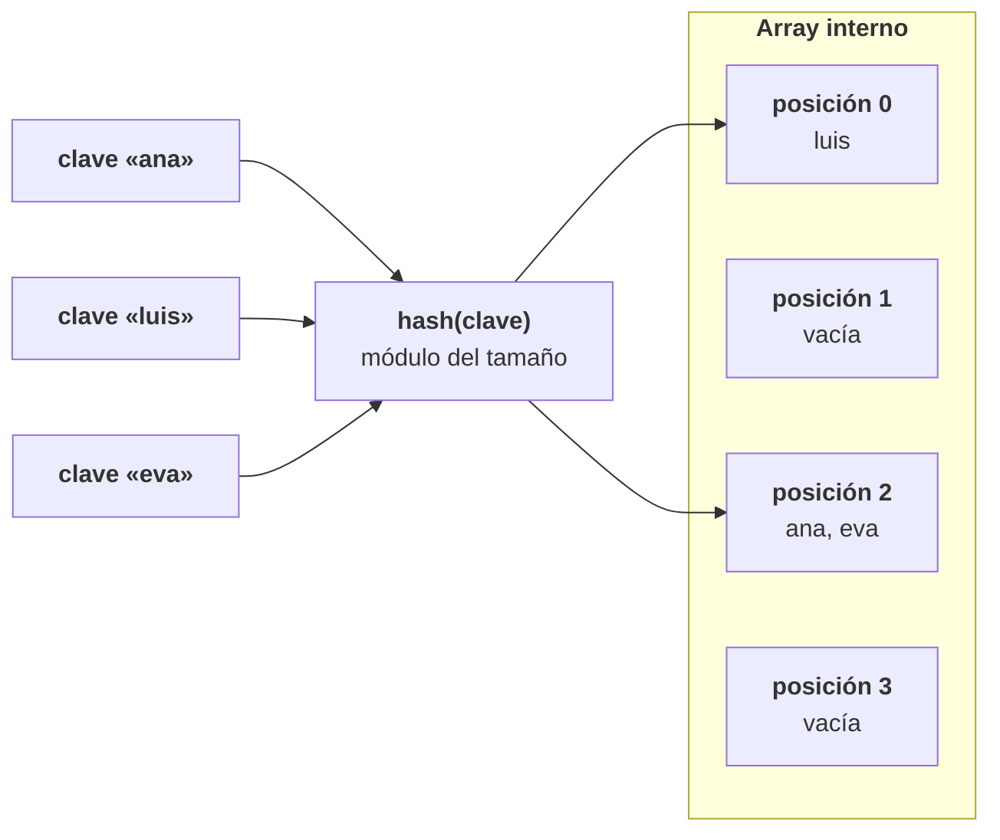
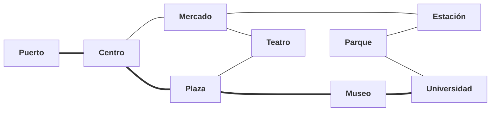

# titulo: Algoritmos y estructuras de datos


# Complejidad

## Objetivos de aprendizaje

- **1.1** Explicar qué mide la notación O.
- **1.2** Reconocer las clases de complejidad habituales.
- **1.3** Estimar la complejidad de un fragmento de código y comprobarla midiendo.

Las mediciones del tema se han hecho con **Python 3.15.2** (`timeit`) y **Java 25** en un mismo equipo. Los valores absolutos dependen de la máquina; lo que importa es **cómo crecen**.

## Qué mide la notación O

La **notación O** describe cómo crece el coste de un algoritmo cuando crece la entrada (`n`), ignorando constantes y detalles. No dice «cuánto tarda», sino «qué pasa si los datos se multiplican por 10».

Buscar un elemento que no está, en una lista y en un conjunto:

```text
n=    1,000: lista       3.8 µs | conjunto  0.03 µs
n=   10,000: lista      37.9 µs | conjunto  0.05 µs
n=  100,000: lista     382.3 µs | conjunto  0.02 µs
n=1,000,000: lista    3942.2 µs | conjunto  0.04 µs
```

- En la lista, `x in lista` compara uno a uno: con 10 veces más datos, tarda 10 veces más. Es **O(n)**, lineal.
- En el conjunto, `x in conjunto` calcula el hash y va directo: el tiempo **no cambia** con el tamaño. Es **O(1)** de media.

## Clases habituales

| Clase | Nombre | Ejemplo | Si n se multiplica por 10 |
|---|---|---|---|
| O(1) | Constante | Acceso por índice, búsqueda en un conjunto | Igual |
| O(log n) | Logarítmica | Búsqueda binaria | Unos pasos más |
| O(n) | Lineal | Recorrer una lista | ×10 |
| O(n log n) | Casi lineal | Ordenar | Algo más de ×10 |
| O(n²) | Cuadrática | Comparar todos con todos | ×100 |
| O(2ⁿ) | Exponencial | Fibonacci recursivo ingenuo | Inviable muy pronto |

## Estimar y medir

Buscar duplicados comparando cada elemento con todos los demás (dos bucles anidados) frente a recordar los vistos en un conjunto:

```python
def dup_cuadratico(xs):
    for i in range(len(xs)):
        for j in range(i + 1, len(xs)):
            if xs[i] == xs[j]:
                return True
    return False

def dup_lineal(xs):
    vistos = set()
    for x in xs:
        if x in vistos:
            return True
        vistos.add(x)
    return False
```

```text
n=1000: cuadrático     5.3 ms | lineal  0.02 ms
n=2000: cuadrático    25.8 ms | lineal  0.04 ms
n=4000: cuadrático   107.6 ms | lineal  0.07 ms
```

Al **duplicar** `n`, la cuadrática tarda unas **cuatro veces** más y la lineal, el doble. Con un millón de elementos, la cuadrática pasaría de horas; la lineal, milisegundos.

Reglas para estimar:

- Un bucle sobre `n` elementos: O(n). Dos anidados sobre los mismos datos: O(n²).
- Cuidado con las operaciones **ocultas**: un `x in lista` o un `lista.index()` dentro de un bucle convierte un O(n) en O(n²).
- Se queda el término que más crece: O(n² + n) es O(n²).

Y medir: la notación O dice cómo escala, pero para datos pequeños una constante grande puede importar más. Con 20 elementos, cualquier algoritmo es rápido.

## Puntos clave

- La notación O describe cómo crece el coste, no cuánto tarda.
- O(1), O(log n), O(n), O(n log n), O(n²), O(2ⁿ): de mejor a peor.
- Lista frente a conjunto: 3,9 ms frente a 0,04 µs con un millón de elementos.
- Duplicar `n` multiplica por 4 un algoritmo cuadrático.
- Busca bucles anidados y operaciones lineales ocultas dentro de bucles.

## Referencias

- Wikipedia, [Big O notation](https://en.wikipedia.org/wiki/Big_O_notation).
- Python Wiki, [Time complexity](https://wiki.python.org/moin/TimeComplexity).

# Estructuras lineales

## Objetivos de aprendizaje

- **2.1** Conocer el coste de las operaciones de una lista dinámica.
- **2.2** Explicar el coste amortizado de añadir al final.
- **2.3** Usar pilas y colas con la estructura adecuada.

## Listas dinámicas

Una `list` de Python o un `ArrayList` de Java guardan los elementos **seguidos en memoria**:

| Operación | Coste | Por qué |
|---|---|---|
| Acceso por índice `l[i]` | O(1) | Se calcula la posición directamente |
| Añadir al final `append` | O(1) amortizado | Suele haber hueco reservado |
| Insertar o borrar al principio | O(n) | Hay que desplazar todos los demás |
| Buscar un valor `x in l` | O(n) | Se recorre |

## Coste amortizado

La lista reserva **más capacidad** de la que usa. Midiendo cuándo cambia su tamaño en memoria al ir añadiendo elementos:

```text
la lista crece al llegar a: [1, 5, 9, 17, 25, 33, 41, 53]
```

Al llenarse, reserva un bloque mayor y **copia** todos los elementos (O(n)), pero eso pasa cada vez menos a menudo. Repartido entre todas las inserciones, añadir al final cuesta O(1): es el **coste amortizado**.

## Pilas y colas

- **Pila** (LIFO, el último que entra sale primero): el historial de «deshacer», las llamadas a funciones. Con una lista: `append` y `pop()` del final, ambas O(1).
- **Cola** (FIFO, el primero que entra sale primero): tareas pendientes, recorrido en anchura. Aquí la lista **falla**: sacar del principio (`pop(0)`) desplaza todo.

Vaciar una cola de `n` elementos:

```text
n=10,000:  lista      2.1 ms | deque   0.20 ms
n=100,000: lista    214.2 ms | deque   1.94 ms
```

Con diez veces más elementos, la lista tarda **cien veces** más (O(n) por cada `pop(0)`, O(n²) en total); `collections.deque` (cola doble) saca por los dos extremos en O(1). En Java, `ArrayDeque` cumple ese papel.

## Listas enlazadas

Una **lista enlazada** guarda cada elemento en un nodo con un puntero al siguiente. Insertar o borrar en un punto ya localizado es O(1), pero el acceso por índice es O(n), cada nodo ocupa memoria extra y, al estar dispersos, aprovechan peor la caché del procesador. Por eso `ArrayList` y `ArrayDeque` son la opción habitual en Java, y `LinkedList` se reserva para casos muy concretos.

## Puntos clave

- Lista dinámica: acceso por índice y `append` en O(1); insertar, borrar al principio o buscar, O(n).
- `append` es O(1) amortizado: la lista reserva capacidad y copia de vez en cuando.
- Pila con una lista; cola con `deque` (o `ArrayDeque`), nunca con `pop(0)`.
- `pop(0)` sobre 100 000 elementos: 214 ms frente a 1,9 ms con `deque`.
- Las listas enlazadas tienen usos muy concretos; lo habitual son las estructuras sobre arrays.

## Referencias

- Python Wiki, [Time complexity](https://wiki.python.org/moin/TimeComplexity).
- Python, [collections.deque](https://docs.python.org/3/library/collections.html#collections.deque).
- Python, [Data structures](https://docs.python.org/3/tutorial/datastructures.html).
- Java, [ArrayList](https://docs.oracle.com/en/java/javase/25/docs/api/java.base/java/util/ArrayList.html).

# Tablas hash

## Objetivos de aprendizaje

- **3.1** Explicar cómo una tabla hash consigue búsquedas en O(1) de media.
- **3.2** Respetar el contrato de `equals` y `hashCode` en Java.
- **3.3** Evitar claves mutables.

## Cómo funcionan

`dict` y `set` en Python, `HashMap` y `HashSet` en Java son **tablas hash**:

1. Se calcula el **hash** de la clave: un número derivado de su contenido.
2. El hash indica una **posición** en un array interno.
3. Si dos claves caen en la misma posición (**colisión**), se guardan juntas y se distinguen comparándolas con `equals` (o `==` en Python).



```nodos
K1:
  titulo: Clave
  texto: Cualquier valor cuyo hash dependa solo de su contenido. Las posiciones de este dibujo son un ejemplo.
K2:
  titulo: Clave
  texto: Su hash la lleva a una posición libre.
K3:
  titulo: Clave
  texto: Cae en la misma posición que «ana». Es una colisión.
H:
  titulo: Función hash
  texto: Convierte la clave en un número y este, en una posición del array. Buscar es calcularla e ir directo, O(1) de media.
ARR:
  concepto: tabla-hash
C0:
  titulo: Posición ocupada
  texto: Una sola clave.
C1:
  titulo: Posición vacía
  texto: Un buen hash reparte las claves para que haya pocas colisiones.
C2:
  titulo: Colisión
  texto: Dos claves en la misma posición se distinguen comparándolas con equals (o == en Python). Con muchas colisiones, la búsqueda empeora.
  seccion: 03-tablas-hash/teoria#el-contrato-de-equals-y-hashcode
C3:
  titulo: Posición vacía
  texto: El array crece cuando se llena demasiado.
```

Buscar es calcular el hash e ir a su posición: **O(1) de media**, sin importar el tamaño (lección 1: 0,04 µs con un millón de elementos). En el peor caso, con muchas colisiones, empeora; por eso importa que el hash reparta bien.

## El contrato de equals y hashCode

Para que funcionen, **dos objetos iguales deben tener el mismo hash**. En Java, si una clase redefine `equals`, debe redefinir `hashCode` de forma coherente. Probado con Java 25:

```java
static class PuntoSinEquals { int x, y; ... }       // sin equals ni hashCode
record Punto(int x, int y) {}                        // el record los genera

a.add(new PuntoSinEquals(1, 2));
a.contains(new PuntoSinEquals(1, 2));   // false
b.add(new Punto(1, 2));
b.contains(new Punto(1, 2));            // true
```

Sin `equals` ni `hashCode`, dos puntos con las mismas coordenadas son objetos **distintos**: el conjunto no encuentra el segundo. Los records (y las dataclasses de Python con `frozen=True`) generan los dos métodos a partir de sus campos.

## Claves mutables

Si se modifica un campo que interviene en el hash **después** de guardar el objeto, queda en la posición equivocada:

```java
PuntoMutable p = new PuntoMutable(1, 2);
c.add(p);
p.x = 99;
// contains(p)=false, size=1, iterando la encuentra=true
```

El objeto **sigue dentro** (tamaño 1, se encuentra al recorrer), pero `contains` lo busca en la posición del hash nuevo y no lo encuentra. Ni se puede borrar con `remove`. Por eso las claves deben ser **inmutables**: `String`, `Integer`, records. Python lo impone: una `list` no es *hashable* y no puede ser clave de un `dict` (Python 3.14 responde `TypeError: cannot use 'list' as a dict key (unhashable type: 'list')`); una `tuple` sí.

## Cuándo usarlas

- **Pertenencia** (`¿está x?`): conjunto en lugar de lista.
- **Índice por clave** (`cliente por id`): diccionario o mapa.
- **Contar** (`collections.Counter`, `Map.merge`).
- **Eliminar duplicados** conservando el orden: `dict.fromkeys(lista)` en Python; `LinkedHashSet` en Java.

No conservan un **orden** por clave (ni rangos): para eso, árboles (lección siguiente). Los `dict` de Python y `LinkedHashMap` mantienen el orden de inserción, no el de las claves.

## Puntos clave

- Hash → posición: búsqueda, inserción y borrado en O(1) de media.
- Objetos iguales, mismo hash: sin `equals` y `hashCode`, `contains` devolvió `false`.
- Records y dataclasses congeladas cumplen el contrato solos.
- Una clave modificada tras guardarla queda perdida dentro de la tabla: usa claves inmutables.
- Para pertenencia, índices y conteos, tablas hash; para orden y rangos, árboles.

## Referencias

- Wikipedia, [Hash table](https://en.wikipedia.org/wiki/Hash_table).
- Java, [Object (equals y hashCode)](https://docs.oracle.com/en/java/javase/25/docs/api/java.base/java/lang/Object.html).
- Java, [HashMap](https://docs.oracle.com/en/java/javase/25/docs/api/java.base/java/util/HashMap.html).
- Python Wiki, [Time complexity](https://wiki.python.org/moin/TimeComplexity).

# Árboles y montículos

## Objetivos de aprendizaje

- **4.1** Explicar los árboles de búsqueda equilibrados y sus operaciones por orden.
- **4.2** Usar un montículo como cola de prioridad.
- **4.3** Obtener los k mayores sin ordenar todo.

## Árboles de búsqueda

En un **árbol binario de búsqueda**, cada nodo tiene a su izquierda las claves menores y a su derecha las mayores. Buscar es bajar comparando: tantos pasos como **altura** tenga el árbol. Si se **equilibra** (como los árboles rojo-negro), la altura es O(log n): con un millón de claves, unos 20 niveles.

`TreeMap` de Java es un árbol rojo-negro. Su documentación garantiza **log(n)** para `containsKey`, `get`, `put` y `remove`, y además mantiene las claves **ordenadas**:

```java
TreeMap<String, Integer> stock = new TreeMap<>(Map.of("pera", 3, "kiwi", 7, "uva", 1, "manzana", 5));
stock                    // {kiwi=7, manzana=5, pera=3, uva=1}
stock.ceilingKey("n")    // pera          (la primera clave >= "n")
stock.subMap("k", "p")   // {kiwi=7, manzana=5}   (rango [k, p))
```

Frente a una tabla hash (O(1) de media pero sin orden), un árbol cuesta O(log n) y a cambio permite **recorrer en orden, buscar el siguiente o el anterior y consultar rangos**. Es lo que hacen los índices de las bases de datos (árboles B).

En Python no hay un árbol ordenado en la biblioteca estándar: para pocos datos, una lista ordenada con `bisect` (lección 5); para muchos, paquetes como `sortedcontainers`.

## Montículos

Un **montículo** (*heap*) es un árbol guardado en un array en el que cada padre es menor que sus hijos. No está ordenado del todo, pero el **mínimo** siempre está arriba:

| Operación | Coste |
|---|---|
| Ver el mínimo | O(1) |
| Insertar | O(log n) |
| Extraer el mínimo | O(log n) |

Es la estructura de una **cola de prioridad**: atender primero lo más urgente. En Java, `PriorityQueue` (su documentación indica O(log n) para `offer` y `poll`); en Python, el módulo `heapq` sobre una lista.

```java
PriorityQueue<int[]> tareas = new PriorityQueue<>(Comparator.comparingInt(t -> t[0]));
// se añaden prioridades 3, 1, 2 → salen en el orden 10 20 30 (prioridad 1, 2, 3)
```

## Los k mayores

Para quedarse con los 5 valores mayores de un millón no hace falta ordenarlo todo:

```text
sorted()[-5:]: 152 ms | nlargest: 7 ms
```

`heapq.nlargest(5, datos)` recorre los datos una vez manteniendo un montículo de solo 5 elementos: O(n log k) en lugar de O(n log n). Útil para «los 10 productos más vendidos» o «las 100 peticiones más lentas».

## Puntos clave

- Un árbol de búsqueda equilibrado da O(log n) y mantiene el orden: siguiente, anterior y rangos.
- `TreeMap` es un árbol rojo-negro; los índices de bases de datos son árboles B.
- Un montículo da el mínimo en O(1) y lo extrae en O(log n): colas de prioridad.
- Para los k mayores, `heapq.nlargest`: 7 ms frente a 152 ms de ordenar un millón.

## Referencias

- Java, [TreeMap](https://docs.oracle.com/en/java/javase/25/docs/api/java.base/java/util/TreeMap.html).
- Java, [PriorityQueue](https://docs.oracle.com/en/java/javase/25/docs/api/java.base/java/util/PriorityQueue.html).
- Python, [heapq](https://docs.python.org/3/library/heapq.html).

# Búsqueda, ordenación, recursión y grafos

## Objetivos de aprendizaje

- **5.1** Usar la búsqueda binaria sobre datos ordenados.
- **5.2** Ordenar con claves y aprovechar la estabilidad.
- **5.3** Evitar recálculos en recursiones con memoización.
- **5.4** Encontrar el camino más corto en un grafo con búsqueda en anchura.

## Búsqueda binaria

En una secuencia **ordenada**, se mira el elemento central y se descarta la mitad que no puede contener el valor. Con un millón de elementos, unos **20 pasos** (log₂ de un millón):

```text
index(): 24.28 ms | bisect: 0.81 µs | pasos binaria ≈ 20
```

`bisect.bisect_left` en Python y `Collections.binarySearch` o `Arrays.binarySearch` en Java la implementan. Solo funciona si los datos **están ordenados**; ordenarlos cuesta O(n log n), así que compensa cuando se busca muchas veces sobre los mismos datos. Si solo hace falta saber si algo está, un conjunto es más sencillo.

## Ordenación

Las ordenaciones de las bibliotecas estándar son O(n log n) y están muy optimizadas: no escribas la tuya. Lo que sí se decide es la **clave**:

```python
pedidos = [("ana", 3), ("luis", 1), ("eva", 3), ("juan", 2), ("bea", 1)]
sorted(pedidos, key=lambda p: p[1])
# [('luis', 1), ('bea', 1), ('juan', 2), ('ana', 3), ('eva', 3)]
```

La ordenación de Python es **estable**: los elementos con la misma clave conservan su orden original (luis antes que bea, ana antes que eva). Eso permite ordenar por varios criterios en pasadas sucesivas, de menos a más importante. En Java, `Collections.sort` y `List.sort` también son estables para objetos; con `Comparator.comparing(...).thenComparing(...)` se encadenan criterios.

## Recursión y memoización

Una función **recursiva** se llama a sí misma con un problema más pequeño. Fibonacci tal cual se define:

```python
def fib(n):
    return n if n < 2 else fib(n - 1) + fib(n - 2)
```

```text
fib(30)=832040 sin memo: 2,692,537 llamadas, 76 ms
```

Calcula los mismos valores una y otra vez: el número de llamadas crece de forma **exponencial**. Con **memoización**, cada valor se calcula una vez:

```python
from functools import cache

@cache
def fibm(n):
    return n if n < 2 else fibm(n - 1) + fibm(n - 2)
```

```text
con @cache: 31 valores calculados, 8 µs
```

De 2,7 millones de llamadas a 31. Es la idea de la **programación dinámica**: resolver cada subproblema una vez. Ojo con la profundidad: Python limita la recursión (1 000 niveles por defecto); para problemas muy profundos, una versión iterativa.

## Grafos y búsqueda en anchura

Un **grafo** son nodos unidos por aristas: estaciones y vías, personas y amistades, servicios y dependencias. Se representa a menudo como **lista de adyacencia** (un diccionario de nodo a vecinos). Con una red de ejemplo:

```python
red = {
    "Centro": ["Mercado", "Plaza", "Puerto"],
    "Mercado": ["Centro", "Teatro", "Estación"],
    "Plaza": ["Centro", "Teatro", "Museo"],
    "Teatro": ["Mercado", "Plaza", "Parque"],
    "Parque": ["Teatro", "Estación", "Universidad"],
    "Estación": ["Mercado", "Parque"],
    "Museo": ["Plaza", "Universidad"],
    "Universidad": ["Museo", "Parque"],
    "Puerto": ["Centro"],
}
```

La **búsqueda en anchura** (BFS) explora por niveles con una **cola**: primero los vecinos, luego los vecinos de los vecinos. Así, la primera vez que llega al destino lo hace por el camino con **menos aristas**:

```python
def camino_mas_corto(grafo, origen, destino):
    previo = {origen: None}
    cola = deque([origen])
    while cola:
        actual = cola.popleft()
        if actual == destino:
            camino = []
            while actual is not None:
                camino.append(actual)
                actual = previo[actual]
            return camino[::-1]
        for vecino in grafo[actual]:
            if vecino not in previo:
                previo[vecino] = actual
                cola.append(vecino)
```

```text
Puerto → Universidad: ['Puerto', 'Centro', 'Plaza', 'Museo', 'Universidad']
Estación → Museo:     ['Estación', 'Parque', 'Universidad', 'Museo']
```



```nodos
PUE:
  titulo: Origen
  texto: BFS empieza aquí y visita primero sus vecinos (nivel 1), luego los vecinos de estos (nivel 2), y así sucesivamente.
CEN:
  titulo: Centro
  texto: Nivel 1 desde Puerto.
MER:
  titulo: Mercado
  texto: Nivel 2. El camino por aquí hasta Universidad tiene 5 aristas.
PLA:
  titulo: Plaza
  texto: Nivel 2, en el camino más corto.
TEA:
  titulo: Teatro
  texto: Nivel 3.
EST:
  titulo: Estación
  texto: Nivel 3.
MUS:
  titulo: Museo
  texto: Nivel 3, en el camino más corto.
PAR:
  titulo: Parque
  texto: Nivel 4.
UNI:
  concepto: bfs
```

Reúne lo visto: una `deque` como cola (lección 2) y un diccionario para lo visitado (lección 3). Es O(nodos + aristas). Si las aristas tienen **pesos** (minutos entre estaciones), hace falta el algoritmo de Dijkstra, que usa un montículo (lección 4).

## Puntos clave

- Búsqueda binaria: unos 20 pasos en un millón de datos ordenados (0,8 µs frente a 24 ms).
- Ordena con las funciones estándar y una clave; la estabilidad permite ordenar por varios criterios.
- Memoización: `fib(30)` pasó de 2,7 millones de llamadas a 31 valores.
- BFS con una cola encuentra el camino con menos aristas; con pesos, Dijkstra.

## Referencias

- Python, [bisect](https://docs.python.org/3/library/bisect.html).
- Python, [Sorting techniques](https://docs.python.org/3/howto/sorting.html).
- Python, [functools.cache](https://docs.python.org/3/library/functools.html#functools.cache).
- Wikipedia, [Binary search](https://en.wikipedia.org/wiki/Binary_search) y [Breadth-first search](https://en.wikipedia.org/wiki/Breadth-first_search).
