# titulo: Patrones de diseño esenciales


# Qué son los patrones de diseño

## Objetivos de aprendizaje

- **1.1** Explicar qué es un patrón de diseño y qué partes lo describen.
- **1.2** Situar el catálogo de la «banda de los cuatro» y sus tres categorías.
- **1.3** Aplicar los dos principios generales del libro: programar contra interfaces y preferir la composición.

## Qué es un patrón

Un **patrón de diseño** es una solución probada a un problema de diseño que se repite. No es código para copiar: es una **plantilla** que se adapta a cada caso. Cada patrón se describe con cuatro elementos:

| Elemento | Qué aporta |
|---|---|
| **Nombre** | Un vocabulario común: decir «aquí va un Decorator» resume un párrafo de explicación |
| **Problema** | Cuándo aplicarlo y en qué contexto |
| **Solución** | Los elementos, sus relaciones y responsabilidades, sin fijar una implementación concreta |
| **Consecuencias** | Lo que se gana y lo que se paga: flexibilidad, complejidad, rendimiento |

El valor más subestimado es el **nombre**. En una revisión de código, «esto es un Strategy» comunica la intención al instante.

## El catálogo de la GoF

En 1994, Erich Gamma, Richard Helm, Ralph Johnson y John Vlissides publicaron *Design Patterns: Elements of Reusable Object-Oriented Software*. Por ser cuatro autores se les conoce como la **banda de los cuatro** (*Gang of Four*, GoF). El libro recoge **23 patrones** en tres categorías:

| Categoría | Trata de | Patrones (en negrita, los de este tema) |
|---|---|---|
| **Creacionales** (5) | Cómo se crean los objetos | Abstract Factory, **Builder**, **Factory Method**, Prototype, **Singleton** |
| **Estructurales** (7) | Cómo se combinan clases y objetos | **Adapter**, Bridge, Composite, **Decorator**, **Facade**, Flyweight, **Proxy** |
| **De comportamiento** (11) | Cómo se reparten responsabilidades y se comunican los objetos | Chain of Responsibility, **Command**, Interpreter, Iterator, Mediator, Memento, **Observer**, State, **Strategy**, **Template Method**, Visitor |

Este tema se centra en los que más aparecen en el código actual. Algunos de los demás están tan integrados en los lenguajes que apenas se escriben a mano (Iterator está en el `for` de Java y Python).

## Los dos principios del libro

El primer capítulo del libro propone dos principios que atraviesan todo el catálogo:

1. **«Programa contra una interfaz, no contra una implementación».** El cliente depende de un tipo abstracto (`Descuento`, `Fuente`), así que se le puede pasar cualquier implementación sin cambiarlo. Es la misma idea que la inversión de dependencias de SOLID.
2. **«Prefiere la composición de objetos a la herencia de clases».** La herencia fija el comportamiento al compilar y acopla la subclase a los detalles de la base. La composición permite combinar piezas y cambiarlas en tiempo de ejecución.

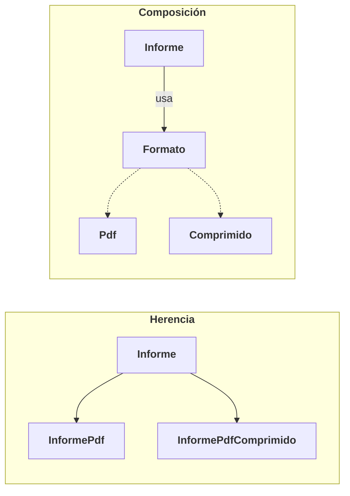

```nodos
HER:
  titulo: Herencia
  texto: Cada combinación de comportamientos necesita una subclase. Con tres formatos y dos opciones de compresión ya son seis clases.
B:
  titulo: Clase base
  texto: Las subclases dependen de sus detalles internos.
S1:
  titulo: Subclase
  texto: Fija el comportamiento al compilar.
S2:
  titulo: Subclase combinada
  texto: Aparece una por cada combinación; es la explosión de subclases.
COM:
  concepto: composicion-sobre-herencia
I:
  titulo: Objeto que compone
  texto: Recibe sus colaboradores y los usa a través de una interfaz.
F:
  titulo: Interfaz del colaborador
  texto: Es el punto donde se enchufan las variantes, como en Strategy o Decorator.
P:
  titulo: Variante
  texto: Una implementación de la interfaz.
Z:
  concepto: decorator
  texto: Una variante que envuelve a otra y añade comportamiento; se combinan apilándolas.
```

## Puntos clave

- Un patrón es una solución probada a un problema que se repite: nombre, problema, solución y consecuencias.
- El nombre del patrón es un vocabulario común que acelera la comunicación.
- La GoF publicó en 1994 un catálogo de 23 patrones: 5 creacionales, 7 estructurales y 11 de comportamiento.
- «Programa contra una interfaz» y «prefiere la composición a la herencia» son los dos principios del libro.
- Algunos patrones ya vienen integrados en los lenguajes, como Iterator.

## Referencias

- Wikipedia, [Design Patterns](https://en.wikipedia.org/wiki/Design_Patterns).
- Wikipedia, [Composition over inheritance](https://en.wikipedia.org/wiki/Composition_over_inheritance).
- Refactoring.Guru, [catálogo de patrones](https://refactoring.guru/design-patterns).

# Patrones creacionales

## Objetivos de aprendizaje

- **2.1** Usar Factory Method para que el cliente no decida qué clase concreta crear.
- **2.2** Usar Builder para construir objetos con muchos atributos opcionales y validarlos.
- **2.3** Explicar qué decide Singleton y por qué se considera un antipatrón.
- **2.4** Sustituirlo por una instancia única inyectada y, si no hay más remedio, escribirlo de forma segura.
- **2.5** Decidir dónde encaja una instancia única y en qué ámbito es única de verdad.

> **Patrones creacionales de esta lección:** cómo se crean los objetos.
>
> | Patrón | Problema que resuelve | Idea en una línea | Hoy |
> |---|---|---|---|
> | [Factory Method](#factory-method) | Qué clase concreta crear depende de un dato, y esa decisión no debe repartirse por el código | Un método decide qué crear y devuelve el tipo abstracto | Muy usado, sobre todo como método estático (`List.of`, `Path.of`) |
> | [Builder](#builder) | Un objeto con muchos atributos opcionales y reglas de validez entre ellos | Un objeto auxiliar acumula los datos y construye el resultado al final, validándolo | Útil con muchos opcionales; con pocos, basta un record o un constructor |
> | [Singleton](#singleton-una-sola-instancia-sí-acceso-global-no) | Que haya una sola instancia de algo compartido | La clase se crea a sí misma y se alcanza con `getInstance()` | Se evita el patrón; se usa una instancia única inyectada (ámbito singleton de Spring) |
>
> Los otros dos creacionales de la GoF, Abstract Factory y Prototype, quedan fuera de este tema.

## Factory Method

**Problema:** el cliente necesita un objeto, pero qué clase concreta crear depende de un dato (un formato, una configuración), y no quieres repartir esa decisión por todo el código.

**Solución:** un método decide qué crear y devuelve el tipo abstracto.

**Estructura genérica** (la del libro de la GoF):

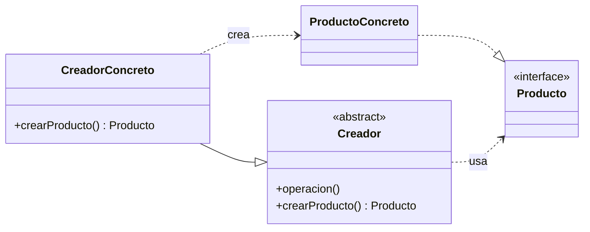

```nodos
Creador:
  concepto: factory-method
CreadorConcreto:
  titulo: Creador concreto
  texto: Sobrescribe crearProducto() y decide qué clase concreta se instancia. Es el único que la conoce.
Producto:
  titulo: Producto
  texto: El tipo abstracto con el que trabaja el creador y el resto del código. En el ejemplo, Exportador.
ProductoConcreto:
  titulo: Producto concreto
  texto: Una implementación de Producto. En el ejemplo, el exportador a CSV o el de JSON.
```

En el ejemplo de abajo no hay subclases: el método estático `exportadorPara` hace a la vez de creador y de creador concreto.

```java
interface Exportador { String exportar(Map<String, Integer> datos); }

static Exportador exportadorPara(String formato) {
    return switch (formato) {
        case "csv" -> d -> String.join("\n",
                d.entrySet().stream().map(e -> e.getKey() + "," + e.getValue()).toList());
        case "json" -> d -> d.toString();
        default -> throw new IllegalArgumentException("Formato desconocido: " + formato);
    };
}
```

El `switch` sigue existiendo, pero **en un solo sitio**. El resto del código pide `exportadorPara(formato)` y trabaja con `Exportador`. En el libro de la GoF, Factory Method es un método que las subclases sobrescriben; hoy se usa mucho la variante de **método de fábrica estático** que se ve aquí (`List.of`, `Optional.of` en Java son ejemplos).

## Builder

**Problema:** un objeto tiene muchos atributos, varios opcionales, y reglas de validez entre ellos. Un constructor con siete parámetros es ilegible (`new Pedido("ana", lineas, true, null, null, false, "x")`) y propenso a errores.

**Solución:** un objeto auxiliar acumula los datos paso a paso y construye el resultado al final, **validándolo**.

**Estructura genérica:**

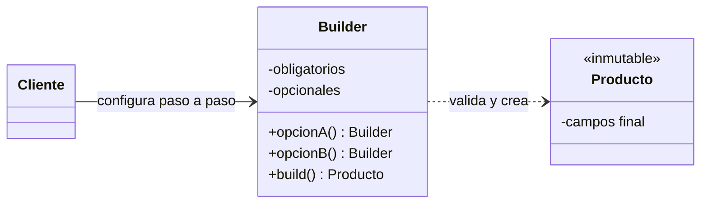

```nodos
Cliente:
  titulo: Cliente
  texto: Encadena las llamadas que necesita y termina con build(). No ve el constructor de Producto.
Builder:
  concepto: builder
Producto:
  titulo: Producto
  texto: Se crea de una vez, ya validado, y por eso puede ser inmutable. En el ejemplo, Pedido.
```

Es la variante «fluida» que se usa hoy. El libro de la GoF añade un **director** que sabe en qué orden llamar a los pasos, y builders intercambiables que producen representaciones distintas.

Así se usa y así se escribe:

```java
Pedido p = Pedido.para("ana")
        .linea("libro")
        .urgente()
        .build();               // ana [libro] URGENTE

Pedido.para("luis").build();    // IllegalStateException: un pedido necesita al menos una línea
```

```java
static final class Builder {
    private final String cliente;
    private final List<String> lineas = new ArrayList<>();
    private boolean urgente;
    private String nota;

    Builder linea(String l) { lineas.add(l); return this; }
    Builder urgente() { urgente = true; return this; }
    Builder nota(String n) { nota = n; return this; }

    Pedido build() {
        if (lineas.isEmpty()) throw new IllegalStateException("Un pedido necesita al menos una línea");
        return new Pedido(this);
    }
}
```

El objeto resultante (`Pedido`) puede ser **inmutable**: todos sus campos son `final` y se rellenan en un solo paso. Con pocos atributos obligatorios, un `record` o un constructor normal es mejor que un Builder.

## Singleton: una sola instancia sí, acceso global no

**Intención:** garantizar que una clase tiene **una sola instancia** con un punto de acceso global (`Configuracion.getInstance()`).

**Estructura genérica:**

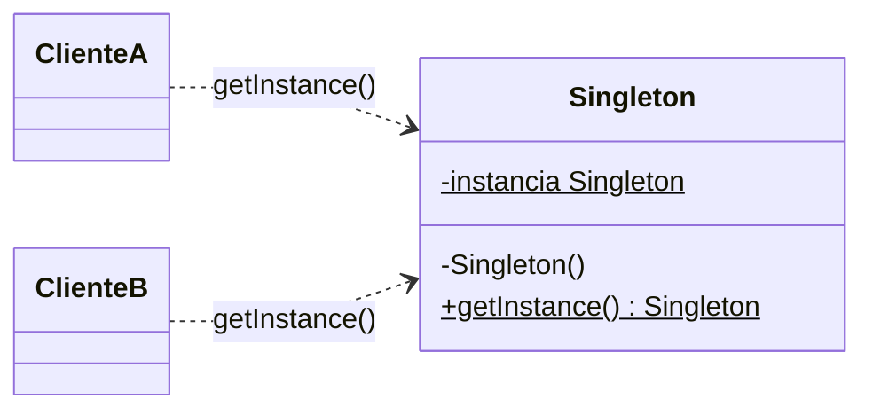

```nodos
ClienteA:
  titulo: Un cliente
  texto: Llega a la instancia por un método estático, así que la dependencia no aparece en su constructor ni en su firma.
ClienteB:
  titulo: Otro cliente
  texto: Comparte la misma instancia y su estado. Lo que cambie uno lo ve el otro, también entre pruebas.
Singleton:
  concepto: singleton
```

El constructor es privado y la instancia es un atributo estático (subrayado en el diagrama).

### Tres decisiones en una sola clase

Singleton se suele resumir como «el antipatrón», pero eso esconde lo interesante. La clase toma **tres decisiones distintas** a la vez, y no todas son malas:

| Decisión | Qué dice Singleton | ¿Es el problema? |
|---|---|---|
| **Cardinalidad**: cuántas instancias hay | Una | No. Un pool de conexiones, un cliente HTTP o una caché compartida deben ser únicos, y eso es una decisión de diseño legítima |
| **Ciclo de vida**: quién la crea y cuándo | La propia clase, la primera vez que alguien la pide | Sí. La clase decide algo que depende de la aplicación que la usa, no de ella |
| **Acceso**: cómo llega a ella quien la usa | Un método estático, desde cualquier sitio | Sí. Es una variable global con otro nombre |

Lo que se critica no es que haya **una** instancia, sino que la clase se encargue de serlo y que cualquiera pueda alcanzarla sin declararlo. Lo que se propone hoy conserva la primera decisión y saca las otras dos de la clase.

### Por qué se considera un antipatrón

Todos estos problemas se han reproducido en un laboratorio con OpenJDK 25.0.5:

| Problema | Qué pasa | En el laboratorio |
|---|---|---|
| Dependencias ocultas | El constructor de `Pedidos` no dice que usa pagos, reloj o configuración; hay que leer todo su código para saberlo | Un método `vencida()` que llama a `LocalDate.now()` da un resultado distinto según el día en que se ejecute la prueba |
| Estado global compartido | Lo que cambia una parte del programa lo ve el resto, también de una prueba a la siguiente. El orden de las pruebas pasa a importar | — |
| Pruebas difíciles | No se puede pasar un doble: `getInstance()` siempre devuelve el real | Con un `Clock` inyectado, la misma comprobación da `false` el 30 de noviembre y `true` el 1 de diciembre, siempre |
| Concurrencia | La inicialización perezosa sin sincronizar crea varias instancias | Con 8 hilos a la vez, 321, 345 y 319 de 1000 rondas acabaron con más de una instancia (hasta 8) |
| No es tan único como parece | La garantía es «una por cargador de clases», y la reflexión salta el constructor privado | Dos cargadores dieron dos instancias distintas; `setAccessible(true)` creó una segunda |
| Mezcla responsabilidades | La clase hace su trabajo y además controla cuántas copias de sí misma existen | — |

La concurrencia es el riesgo más traicionero, porque no falla siempre:

```java
static Perezoso getInstance() {
    if (instancia == null) instancia = new Perezoso();   // dos hilos pueden ver null a la vez
    return instancia;
}
```

Sin ninguna pausa artificial, falló en un tercio de las rondas. Con una pausa de 1 ms en el constructor, que simula una inicialización que lee un fichero o abre una conexión, falló en las 1000.

### Lo que se propone: una instancia única gestionada desde fuera

La alternativa es **inyección de dependencias** con una **raíz de composición**. La raíz es el único lugar del programa que crea los objetos y los conecta: el `main`, o en Spring una clase `@Configuration`. Crea **una** instancia y se la **pasa** por el constructor a quien la necesita, a través de una interfaz.

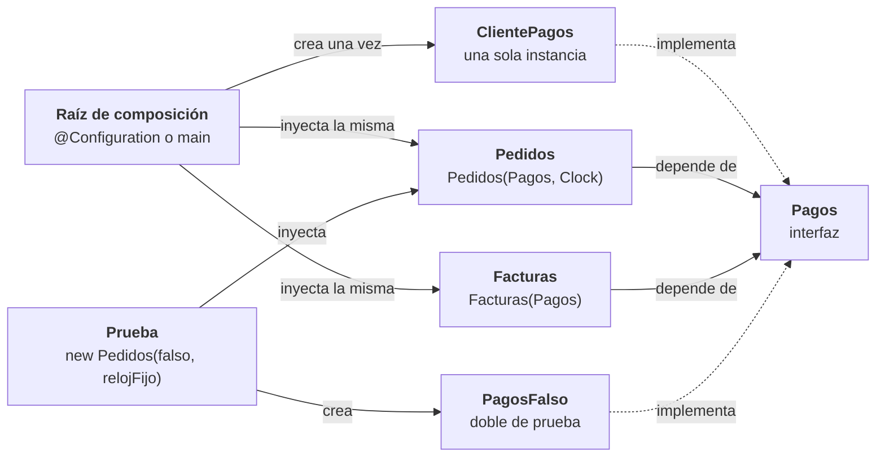

```nodos
RAIZ:
  concepto: raiz-de-composicion
INST:
  titulo: La instancia única
  texto: Sigue habiendo una sola, pero es una clase normal, con constructor público y sin nada estático. Que sea única lo decide la raíz, no ella.
INT:
  titulo: La interfaz
  texto: Pedidos y Facturas dependen de ella, no de ClientePagos. Es lo que permite cambiar la implementación sin tocarlos.
PED:
  titulo: Un cliente con la dependencia a la vista
  texto: Su constructor dice exactamente qué necesita. No puede usar nada que no le hayan pasado.
FAC:
  titulo: Otro cliente
  texto: Recibe la misma instancia que Pedidos. En el laboratorio, Spring creó ClientePagos una sola vez para los dos.
PRU:
  titulo: La prueba
  texto: Construye Pedidos a mano con lo que quiere. No necesita Spring ni reiniciar ningún estado global.
FAL:
  titulo: El doble
  texto: Una implementación falsa de Pagos que no cobra de verdad y registra qué se le pidió.
```

En Spring, un *bean* es único por defecto (ámbito `singleton`), pero la clase no sabe nada de eso.

#### El mismo caso, antes y después, en Spring Boot

**Antes: Singleton clásico.**

```java
public class ClientePagos {
    private static final ClientePagos INSTANCIA = new ClientePagos();
    private ClientePagos() { }                                  // nadie más puede crearlo
    public static ClientePagos getInstance() { return INSTANCIA; }

    public void cobrar(String pedido, BigDecimal importe) { /* llama a la pasarela real */ }
}

public class ServicioPedidos {
    public void confirmar(String pedido, BigDecimal importe) {
        ClientePagos.getInstance().cobrar(pedido, importe);     // dependencia escondida
    }
}
```

Desde fuera, nada dice que `ServicioPedidos` cobre. En una prueba no hay forma de evitar el cobro real, porque `getInstance()` siempre devuelve el cliente de verdad. Y cualquier clase del programa puede llamar a `ClientePagos.getInstance()`.

**Después: Spring Boot con inyección por constructor.**

```java
public interface Pagos {                                        // 1. una interfaz
    void cobrar(String pedido, BigDecimal importe);
}

@Component                                                      // 2. Spring crea UNA instancia
public class ClientePagos implements Pagos {
    public void cobrar(String pedido, BigDecimal importe) { /* pasarela real */ }
}

@Service
public class ServicioPedidos {
    private final Pagos pagos;

    public ServicioPedidos(Pagos pagos) {                       // 3. la recibe por el constructor
        this.pagos = pagos;
    }

    public void confirmar(String pedido, BigDecimal importe) {
        pagos.cobrar(pedido, importe);
    }
}

@Service
public class ServicioDevoluciones {
    private final Pagos pagos;

    public ServicioDevoluciones(Pagos pagos) {                  // recibe la MISMA instancia
        this.pagos = pagos;
    }
}
```

Al arrancar, Spring ve `@Component` en `ClientePagos` y crea **una** instancia, porque el ámbito por defecto es `singleton`. Después ve que `ServicioPedidos` y `ServicioDevoluciones` piden un `Pagos` en su constructor y les pasa **esa misma**. Con un solo constructor no hace falta `@Autowired`. `ClientePagos` es una clase normal: no tiene nada estático ni constructor privado. Que sea única lo decide Spring, no ella.

Lo que se gana es la prueba, que no necesita Spring y no cobra de verdad:

```java
class ServicioPedidosTest {

    @Test
    void confirmarCobraElImporte() {
        var pagosFalso = new PagosFalso();
        var servicio = new ServicioPedidos(pagosFalso);         // sin Spring, sin getInstance()

        servicio.confirmar("P-1", new BigDecimal("25.00"));

        assertEquals(List.of("P-1:25.00"), pagosFalso.cobros);
    }

    static class PagosFalso implements Pagos {
        final List<String> cobros = new ArrayList<>();
        public void cobrar(String pedido, BigDecimal importe) { cobros.add(pedido + ":" + importe); }
    }
}
```

Con Spring Boot 4.2.0, la aplicación del laboratorio informó al arrancar, y la prueba pasó (`Tests run: 1, Failures: 0`):

```text
ClientePagos creados: 1
Pedidos y Devoluciones comparten la instancia: true
Ámbito de ClientePagos: singleton
```

| | Singleton clásico | Spring Boot |
|---|---|---|
| ¿Cuántas instancias? | Una | Una |
| ¿Quién la crea? | La propia clase | Spring |
| ¿Cómo llega a quien la usa? | `getInstance()`, desde cualquier sitio | Por el constructor, a la vista en la firma |
| ¿Se puede sustituir en una prueba? | No | Sí: se pasa otra implementación |

Cuando la clase no es tuya y no puedes anotarla (un cliente de una biblioteca, un `Clock`), se declara con un método `@Bean` en una clase `@Configuration`. El efecto es el mismo:

```java
@Configuration
class Config {
    @Bean Clock reloj() { return Clock.systemUTC(); }
    @Bean @Scope("prototype") Carrito carrito() { return new Carrito(); }
}
```

La unicidad es ahora **configuración**: cambiar `Carrito` de una instancia única a una nueva cada vez es cambiar su ámbito, sin tocar la clase. En otro laboratorio con Spring Framework 7.1.0, dos peticiones de `Carrito` dieron dos instancias distintas, y `new ClientePagos()` seguía permitido fuera del contenedor.

| Ámbito de Spring | Instancias | Uso típico |
|---|---|---|
| `singleton` (por defecto) | Una por contenedor | Servicios sin estado, clientes de otros sistemas, pools |
| `prototype` | Una cada vez que se pide | Objetos con estado propio de quien los usa |
| `request`, `session` | Una por petición HTTP o por sesión | Datos de la petición o del usuario en aplicaciones web |

Un *bean* `singleton` lo comparten todos los hilos que atienden peticiones. Por eso tiene que **no tener estado mutable** o protegerlo: un campo `usuarioActual` en un servicio único mezcla los datos de dos peticiones simultáneas. Es el mismo error del Singleton clásico, ahora dentro del contenedor.

Sin *framework* es lo mismo, escrito a mano en el `main`. El tema **Arquitectura hexagonal** desarrolla la raíz de composición, y **Principios SOLID**, la inversión de dependencias.

### Dos cosas distintas con el mismo nombre

Hay dos «singleton», y la confusión es habitual porque Spring usa la misma palabra:

| | Patrón Singleton | Ámbito singleton |
|---|---|---|
| Otros nombres | Singleton de la GoF, Singleton clásico | *Bean* singleton (Spring), *singleton lifetime* (.NET), estilo de vida Singleton |
| Qué es | Un patrón de diseño: la clase se encarga de ser única | Una opción de configuración del contenedor: cuántas instancias crea de un componente |
| Quién garantiza la unicidad | La propia clase, con constructor privado y campo estático | El contenedor de inyección de dependencias |
| Única por | Cargador de clases | Contenedor y definición de *bean* |
| Cómo se llega a ella | `getInstance()`, desde cualquier sitio | Inyectada por el constructor |
| Valoración | Se evita salvo en los casos de la tabla de abajo | Es lo normal: el ámbito por defecto en Spring |

La documentación de Spring lo dice expresamente: su concepto de *bean* singleton **es distinto** del patrón Singleton de la GoF. El patrón fija en el código que haya una sola instancia por cargador de clases; el ámbito singleton de Spring es «por contenedor y por *bean*». La de .NET va más allá y recomienda no implementar el patrón Singleton y dejar que el contenedor gestione el ciclo de vida.

«Por *bean*» quiere decir por **definición**, no por clase. En el laboratorio, dos métodos `@Bean` que devuelven la misma clase dieron dos instancias, las dos de ámbito singleton:

```java
@Configuration
class Clientes {
    @Bean ClienteHttp europa() { return new ClienteHttp("https://eu.ejemplo"); }
    @Bean ClienteHttp america() { return new ClienteHttp("https://us.ejemplo"); }
}
```

```text
Dos beans singleton de ClienteHttp, misma instancia: false
europa pedido dos veces, misma instancia: true
```

Para hablar sin ambigüedad: **«patrón Singleton»** para el de `getInstance()`, que es el que se critica, y **«ámbito singleton»** o **«*bean* singleton»** para la instancia única que crea e inyecta el contenedor. Cuando alguien dice «evita los Singleton», se refiere al primero. Cuando dice «los servicios de Spring son singleton», se refiere al segundo, y es la solución recomendada.

### Si de verdad hace falta un Singleton clásico

A veces no hay contenedor ni `main` propio: una biblioteca, un agente de la JVM o un recurso del proceso que tiene que estar disponible antes que nada. Entonces conviene escribirlo bien:

```java
// 1. Enum: la forma que recomienda Joshua Bloch en «Effective Java»
enum Registro {
    INSTANCIA;
    void anotar(String s) { /* ... */ }
}

// 2. Holder: perezoso y seguro con hilos, sin sincronizar a mano
final class Configuracion {
    private Configuracion() { }
    private static class Holder { static final Configuracion INSTANCIA = new Configuracion(); }
    static Configuracion getInstance() { return Holder.INSTANCIA; }
}
```

| Variante | Perezosa | Segura con hilos | Resiste la reflexión |
|---|---|---|---|
| `if (instancia == null)` sin sincronizar | Sí | **No**: hasta 8 instancias en el laboratorio | No |
| Campo `static final` inicializado al cargar la clase | No: se crea al usar la clase por primera vez, la pida o no | Sí | No |
| Holder | Sí | Sí: 1 instancia con 8 hilos en todas las pruebas | No |
| Enum | No | Sí | Sí: `IllegalArgumentException: Cannot reflectively create enum objects` |
| Doble comprobación con `volatile` | Sí | Sí, solo con `volatile` | No |

El holder funciona porque la JVM garantiza que **inicializa cada clase una sola vez**, aunque varios hilos la usen a la vez, y la clase interna no se carga hasta la primera llamada a `getInstance()`. La doble comprobación (`if` fuera y dentro de un `synchronized`) solo es correcta con `volatile` en el campo; sin él, otro hilo puede ver la referencia antes de que el objeto esté construido del todo. Con el holder disponible, no hace falta.

Aun bien escrito, sigue siendo acceso global. Hay que usarlo solo donde ese acceso no hace daño.

### Dónde encaja y dónde no

La pregunta útil no es «¿Singleton sí o no?», sino **qué tiene la instancia** y **quién necesita cambiarla**:

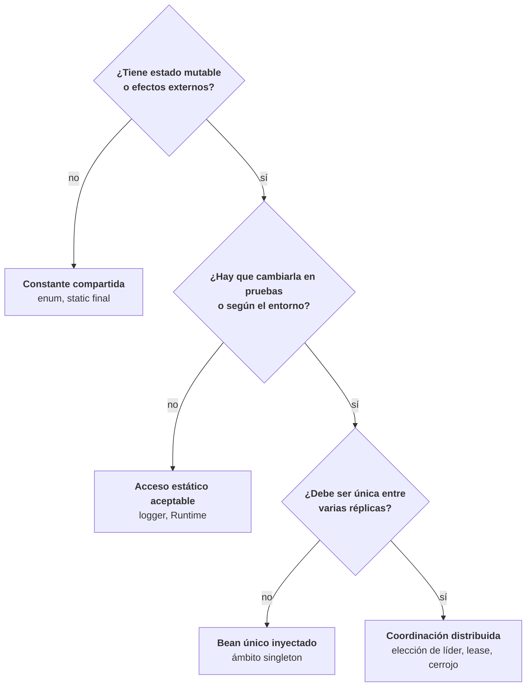

```nodos
P1:
  titulo: Estado y efectos
  texto: Un objeto inmutable y sin efectos se puede compartir sin riesgo. Un estado global que nadie puede cambiar es solo una constante.
C1:
  titulo: Constante compartida
  texto: Comparator.naturalOrder(), List.of() vacío o un enum de estrategias sin estado. Que sean únicos solo ahorra memoria.
P2:
  titulo: ¿Hay que sustituirla?
  texto: Si una prueba necesita un doble, o producción y desarrollo usan implementaciones distintas, el acceso estático estorba.
C2:
  concepto: inyeccion-de-dependencias
C3:
  titulo: Acceso estático aceptable
  texto: Infraestructura transversal cuyo comportamiento se configura fuera del código y no cambia los resultados de negocio, como el logger.
P3:
  titulo: ¿Única en qué ámbito?
  texto: Un bean singleton es único en su contenedor. Con tres réplicas del servicio hay tres instancias.
C4:
  titulo: Coordinación distribuida
  texto: Si una tarea debe ejecutarse una sola vez en todo el sistema, la unicidad no la da ningún patrón de código. Hace falta un líder o un cerrojo compartido.
```

| Encaja | Por qué |
|---|---|
| Objetos inmutables y sin estado: `Comparator.naturalOrder()`, `Collections.emptyList()`, un enum de estrategias | No hay estado que se arrastre entre pruebas ni que se corrompa con hilos |
| Recursos que **son** únicos en el proceso: `Runtime.getRuntime()` | Representan algo que existe una vez por JVM; el JDK los expone así |
| Registro (*logging*): `private static final Logger log = LoggerFactory.getLogger(...)` | Es transversal, se configura fuera y no cambia el resultado del programa. Es la excepción más aceptada |
| Bibliotecas y agentes sin raíz de composición propia | No controlan cómo se arranca la aplicación que las usa. Mejor con enum u holder |

| No encaja | Qué hacer |
|---|---|
| Configuración de negocio leída desde cualquier sitio | Un objeto de configuración inyectado (en Spring, `@ConfigurationProperties`) |
| Repositorios, clientes de otros servicios, colas | *Beans* únicos inyectados por interfaz |
| La fecha y la hora | Inyectar un `Clock`, como en el laboratorio |
| Usuario actual, *tenant* o datos de la petición | Ámbito `request` o pasarlos como parámetro; nunca un campo de un objeto compartido |
| Cachés con estado | Un *bean* inyectado, con su política de caducidad y su seguridad con hilos |
| Algo que debe ser único entre varias instancias del servicio | Coordinación distribuida; el Singleton no llega |

### La visión de arquitecto: ¿única en qué ámbito?

«Una sola instancia» siempre es relativo a algo. El laboratorio lo muestra en dos niveles, y en producción hay más:

| Ámbito | Instancias reales | Ejemplo |
|---|---|---|
| Cargador de clases | Una por cargador | Dos cargadores dieron dos `Registro` distintos. Pasa en servidores de aplicaciones y en sistemas de plugins |
| Contenedor de Spring | Una por contexto | Dos contextos dieron dos `Pagos`. Pasa en pruebas que levantan varios contextos |
| Proceso (JVM) | Una por proceso | Lo que suele imaginarse al decir «Singleton» |
| Réplica | Una por réplica | Con 3 pods en Kubernetes, 3 instancias |
| Sistema | Una en todo el despliegue | Solo con coordinación entre réplicas |

El fallo clásico al escalar: una tarea programada que envía las facturas del día vive en un *bean* único, y funciona mientras hay una réplica. Al pasar a tres, **se envían tres veces**. El código no ha cambiado; ha cambiado el ámbito en el que «único» era cierto.

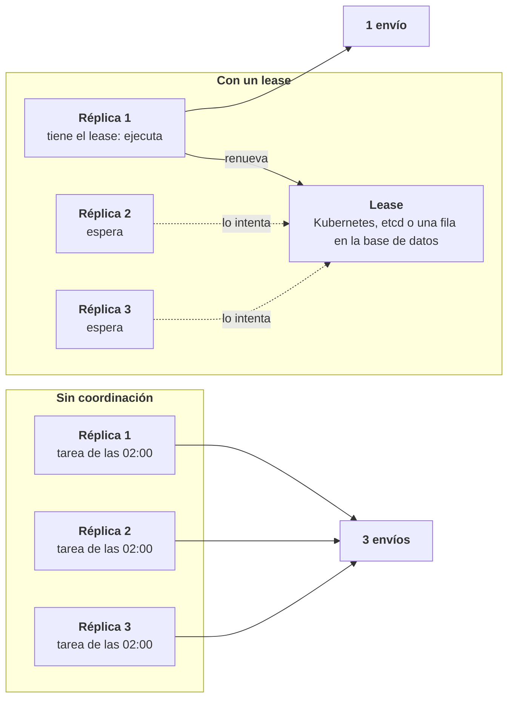

```nodos
R1:
  titulo: Cada réplica tiene su bean
  texto: El bean es único en su contenedor, y cada réplica tiene el suyo. Las tres ejecutan la tarea.
SIN:
  titulo: Sin coordinación
  texto: Lo que pasa al escalar un servicio que confiaba en que su bean era único.
R2:
  titulo: Segunda réplica
  texto: Misma imagen, mismo código y su propio bean. No sabe que existen las otras.
R3:
  titulo: Tercera réplica
  texto: También ejecuta la tarea a la misma hora.
CON:
  titulo: Con un lease
  texto: Las réplicas compiten por un mismo lease y solo la que lo tiene ejecuta la tarea.
L3:
  titulo: Otra réplica en espera
  texto: Intenta tomar el lease periódicamente. Mientras el líder lo renueve, no lo consigue.
ENV:
  titulo: El efecto duplicado
  texto: Tres envíos de las mismas facturas. Ningún patrón de código lo evita, porque las tres réplicas no comparten memoria.
LEASE:
  titulo: El lease
  texto: Un derecho con caducidad que solo puede tener una réplica a la vez y que hay que renovar. Si su dueño cae, caduca y lo toma otra.
L1:
  titulo: El líder
  texto: Solo quien tiene el lease ejecuta la tarea. Kubernetes ofrece el objeto Lease para elegir líder entre réplicas.
L2:
  titulo: Las demás réplicas
  texto: Siguen atendiendo peticiones normales y solo esperan para la tarea. Si el líder cae, una de ellas toma el relevo.
UNO:
  titulo: Un solo envío
  texto: Aun así, la tarea debe ser idempotente; un líder que pierde el lease a mitad de la ejecución puede dejarla a medias.
```

La unicidad en todo el sistema es un problema de **sistemas distribuidos**, no de diseño de clases: elección de líder, *leases* y cerrojos con caducidad. El tema **Sistemas distribuidos** los explica con un clúster de etcd. Incluso con líder, la tarea debe ser **idempotente**, porque un líder que se queda aislado puede seguir creyendo que lo es durante unos segundos.

| Requisito | Solución |
|---|---|
| Un objeto compartido dentro de un proceso | *Bean* `singleton` inyectado |
| Una sola instancia en una biblioteca sin contenedor | Enum u holder |
| Una tarea que se ejecuta una sola vez entre réplicas | Elección de líder o cerrojo distribuido con caducidad, y tarea idempotente |
| Un dato que todas las réplicas deben ver igual | Un almacén compartido (base de datos, Redis), no memoria del proceso |

## Puntos clave

- Factory Method concentra en un sitio la decisión de qué clase concreta crear; el cliente usa el tipo abstracto.
- La variante de método de fábrica estático (`List.of`) es la más común hoy.
- Builder construye paso a paso objetos con muchos opcionales y valida al final; el resultado puede ser inmutable.
- Para pocos atributos obligatorios, un record o un constructor es mejor que un Builder.
- Singleton mezcla tres decisiones: cuántas instancias, quién las crea y cómo se llega a ellas. La primera es legítima; las otras dos son el problema.
- Su acceso estático oculta dependencias, comparte estado entre pruebas y no deja sustituirlo por un doble.
- Sin sincronizar, la inicialización perezosa creó varias instancias en un tercio de las rondas con 8 hilos.
- La alternativa es una instancia única creada en la raíz de composición e inyectada por interfaz; en Spring Boot, un @Component o @Service recibido por el constructor.
- «Patrón Singleton» (la clase se hace única y se alcanza con getInstance()) y «ámbito singleton» (el contenedor crea una instancia por bean y la inyecta) son cosas distintas: el primero se evita y el segundo es lo recomendado.
- Si hace falta un Singleton clásico, enum u holder; la doble comprobación solo es correcta con volatile.
- Encaja en objetos inmutables, recursos únicos del proceso y el logger; no en configuración, repositorios, reloj ni datos del usuario.
- «Único» es por cargador, contenedor, proceso o réplica. Para que algo ocurra una vez en todo el sistema hace falta un líder o un cerrojo distribuido, y una tarea idempotente.

## Referencias

- Refactoring.Guru, [Factory Method](https://refactoring.guru/design-patterns/factory-method), [Builder](https://refactoring.guru/design-patterns/builder) y [Singleton](https://refactoring.guru/design-patterns/singleton).
- Wikipedia, [Anti-pattern](https://en.wikipedia.org/wiki/Anti-pattern), [Initialization-on-demand holder idiom](https://en.wikipedia.org/wiki/Initialization-on-demand_holder_idiom) y [Double-checked locking](https://en.wikipedia.org/wiki/Double-checked_locking).
- Spring Framework, [Bean Scopes](https://docs.spring.io/spring-framework/reference/core/beans/factory-scopes.html), con la diferencia entre el *bean* singleton y el patrón de la GoF.
- Microsoft, [Service lifetimes](https://learn.microsoft.com/en-us/dotnet/core/extensions/dependency-injection/service-lifetimes) en la inyección de dependencias de .NET.
- Oracle, [The Java Language Specification, 12.4.2 Detailed Initialization Procedure](https://docs.oracle.com/javase/specs/jls/se25/html/jls-12.html#jls-12.4.2) y [java.time.Clock](https://docs.oracle.com/en/java/javase/25/docs/api/java.base/java/time/Clock.html).
- Kubernetes, [Leases](https://kubernetes.io/docs/concepts/architecture/leases/).

# Patrones estructurales

## Objetivos de aprendizaje

- **3.1** Usar Adapter para integrar una interfaz incompatible.
- **3.2** Usar Decorator para añadir comportamientos combinables sin subclases.
- **3.3** Usar Facade para simplificar un subsistema y Proxy para controlar el acceso a un objeto.
- **3.4** Distinguir patrones estructurales que se parecen (Adapter, Decorator, Proxy y Facade).

> **Patrones estructurales de esta lección:** cómo se combinan clases y objetos.
>
> | Patrón | Problema que resuelve | Idea en una línea | Misma interfaz que lo que envuelve |
> |---|---|---|---|
> | [Adapter](#adapter) | Un componente cuya interfaz no encaja con la que espera tu código | Una clase que implementa la interfaz esperada y traduce las llamadas | No: ofrece otra |
> | [Decorator](#decorator) | Comportamientos opcionales que se quieren combinar sin una subclase por combinación | Objetos que envuelven a otro con su misma interfaz y se apilan como capas | Sí |
> | [Facade](#facade) | Un subsistema con muchas clases y pasos, del que casi todos necesitan una sola operación | Una clase con la operación simple que coordina el subsistema por dentro | No: ofrece una más simple |
> | [Proxy](#proxy) | Controlar el acceso a un objeto (carga perezosa, permisos, caché, remoto) sin que el cliente lo note | Un sustituto con la misma interfaz que decide cuándo y cómo delegar | Sí |
>
> Al final, [Parecidos razonables](#parecidos-razonables) compara los cuatro. Bridge, Composite y Flyweight quedan fuera de este tema.

## Adapter

**Problema:** tienes que usar un componente cuya interfaz no encaja con la que espera tu código, y no puedes cambiarlo (es de un tercero o es antiguo).

**Solución:** una clase que implementa la interfaz que esperas y traduce las llamadas al componente.

**Estructura genérica:**

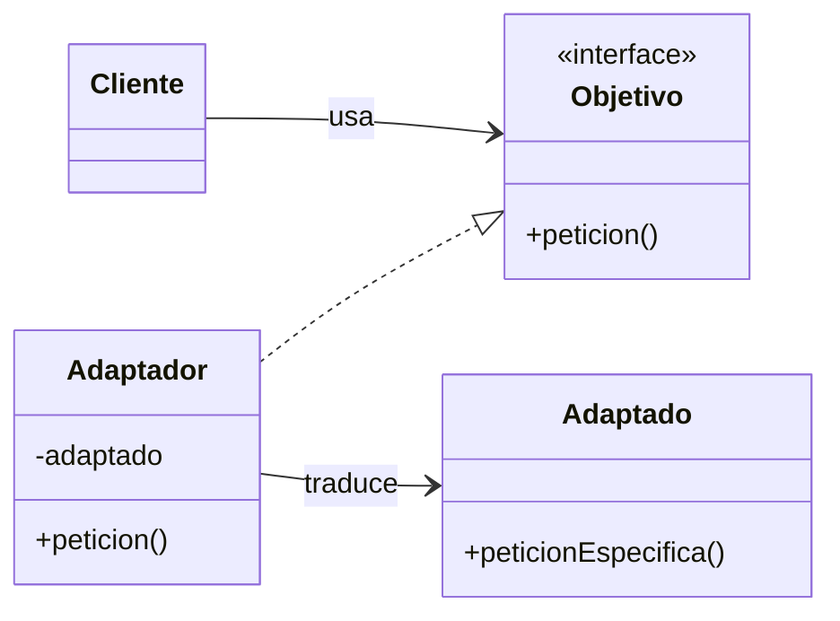

```nodos
Cliente:
  titulo: Cliente
  texto: Solo conoce la interfaz Objetivo. No sabe que detrás hay un componente con otra interfaz.
Objetivo:
  titulo: Objetivo
  texto: La interfaz que espera tu código. En el ejemplo, Termometro.
Adaptador:
  concepto: adapter
Adaptado:
  titulo: Adaptado
  texto: El componente que no puedes cambiar, con una interfaz incompatible. En el ejemplo, ApiMeteoAntigua.
```

Así queda con un caso concreto:

```java
class ApiMeteoAntigua {                 // de un tercero: Fahrenheit y como texto
    String tempF(String ciudad) { return "68.0"; }
}

interface Termometro { double celsius(String ciudad); }   // lo que espera tu código

class AdaptadorMeteo implements Termometro {
    private final ApiMeteoAntigua api;
    AdaptadorMeteo(ApiMeteoAntigua api) { this.api = api; }

    public double celsius(String ciudad) {
        return (Double.parseDouble(api.tempF(ciudad)) - 32) * 5 / 9;   // 68 °F → 20.0 °C
    }
}
```

Los adaptadores de la arquitectura hexagonal son esta misma idea aplicada a toda una frontera.

## Decorator

**Problema:** quieres añadir comportamientos opcionales (registro, caché, compresión, validación) que se pueden combinar. Una subclase por combinación no escala.

**Solución:** cada comportamiento es un objeto que **implementa la misma interfaz** y **envuelve** a otro. Se apilan como capas.

**Estructura genérica:**

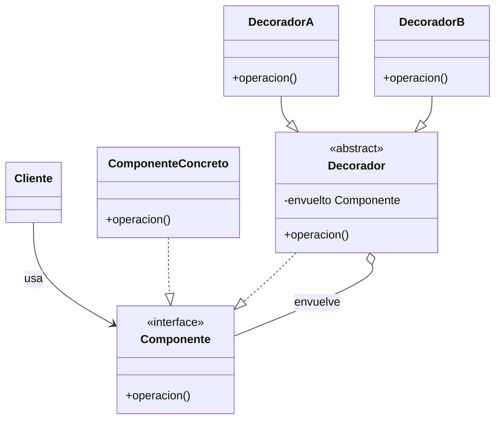

```nodos
Cliente:
  titulo: Cliente
  texto: Trabaja con un Componente. Le da igual recibir el objeto original o el original envuelto en varias capas.
Componente:
  titulo: Componente
  texto: La interfaz común a todas las capas. En el ejemplo, Fuente.
ComponenteConcreto:
  titulo: Componente concreto
  texto: El objeto original que se decora. En el ejemplo, Texto.
Decorador:
  concepto: decorator
DecoradorA:
  titulo: Un decorador concreto
  texto: Llama al envuelto y añade su comportamiento antes o después. En el ejemplo, Mayusculas.
DecoradorB:
  titulo: Otro decorador concreto
  texto: Se combina con los demás en cualquier orden. En el ejemplo, Recortado.
```

La clave está en las dos flechas que salen de `Decorador`: **es** un `Componente` y **tiene** un `Componente`. Por eso un decorador puede envolver a otro decorador. Con `record` no hace falta la clase abstracta:

```java
interface Fuente { String leer(); }
record Texto(String t) implements Fuente { public String leer() { return t; } }
record Mayusculas(Fuente f) implements Fuente { public String leer() { return f.leer().toUpperCase(); } }
record Recortado(Fuente f) implements Fuente { public String leer() { return f.leer().strip(); } }

new Mayusculas(new Recortado(new Texto("  hola  "))).leer();   // "HOLA"
```

El ejemplo más conocido está en la propia biblioteca de Java: `new BufferedReader(new InputStreamReader(new FileInputStream(f)))` apila decoradores sobre un flujo de bytes.

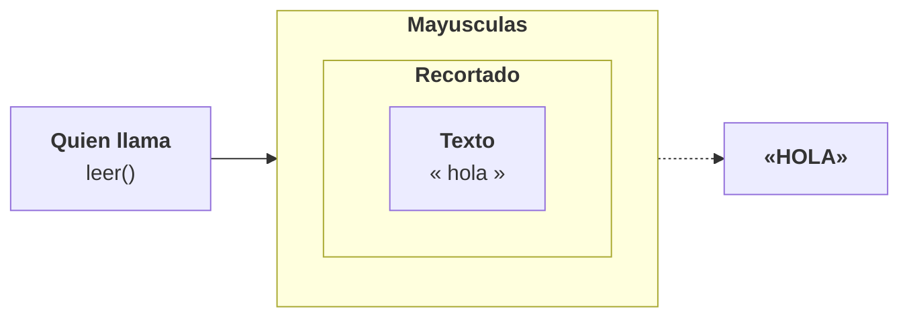

```nodos
CLI:
  titulo: Quien llama
  texto: Solo ve una Fuente. No sabe cuántas capas hay ni en qué orden.
M:
  concepto: decorator
R:
  titulo: Recortado
  texto: Implementa Fuente, envuelve a otra y le quita los espacios a lo que devuelve.
T:
  titulo: Texto
  texto: El objeto original, en el centro de las capas.
RES:
  titulo: Resultado
  texto: Cada capa añade su comportamiento al de la que envuelve. En Java, BufferedReader sobre InputStreamReader sobre FileInputStream es lo mismo.
```

## Facade

**Problema:** un subsistema tiene muchas clases y pasos (validar, reservar *stock*, cobrar, enviar), y la mayoría de los clientes solo necesitan una operación de alto nivel.

**Solución:** una clase que ofrece esa operación simple y coordina el subsistema por dentro.

**Estructura genérica:**

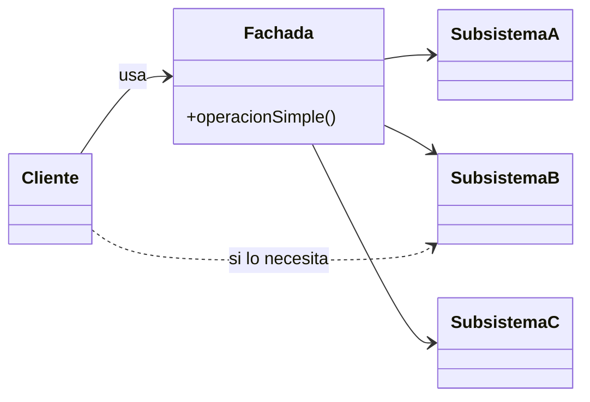

```nodos
Cliente:
  titulo: Cliente
  texto: Para el caso habitual le basta con una llamada a la fachada.
Fachada:
  concepto: facade
SubsistemaA:
  titulo: Una clase del subsistema
  texto: En el ejemplo, el inventario. No sabe que existe la fachada.
SubsistemaB:
  titulo: Otra clase del subsistema
  texto: En el ejemplo, los pagos. Un cliente con necesidades especiales la puede seguir usando directamente (flecha discontinua).
SubsistemaC:
  titulo: Otra clase del subsistema
  texto: En el ejemplo, los envíos.
```

Con un caso concreto:

```java
class TiendaFacade {
    Confirmacion comprar(Carrito carrito, Tarjeta tarjeta) {
        inventario.reservar(carrito);
        pagos.cobrar(tarjeta, carrito.total());
        envios.programar(carrito);
        return new Confirmacion(...);
    }
}
```

La fachada no impide usar el subsistema directamente cuando hace falta; solo ofrece un camino cómodo para el caso habitual. Si crece hasta saberlo todo, se convierte en un objeto dios.

## Proxy

**Problema:** quieres controlar el acceso a un objeto (cargarlo solo cuando se use, comprobar permisos, guardar resultados en caché o llamar a un objeto remoto) sin que el cliente lo note.

**Solución:** un sustituto con **la misma interfaz** que se pone delante del objeto real y decide cuándo y cómo delegar.

**Estructura genérica:**

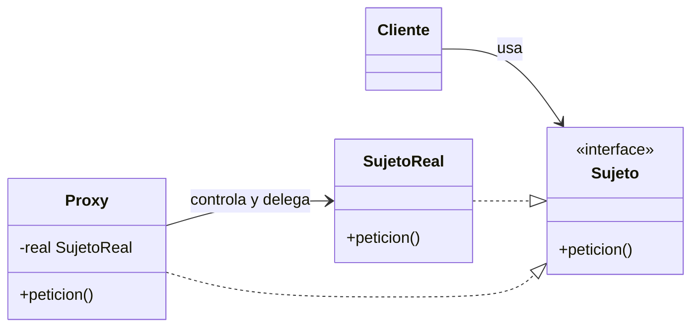

```nodos
Cliente:
  titulo: Cliente
  texto: Usa un Sujeto y no sabe si le han dado el objeto real o el proxy.
Sujeto:
  titulo: Sujeto
  texto: La interfaz común. Que el proxy la comparta es lo que lo hace transparente.
SujetoReal:
  titulo: Sujeto real
  texto: El objeto que hace el trabajo. Puede ser caro de crear, remoto o protegido.
Proxy:
  concepto: proxy
```

La estructura es casi la de Decorator. Lo que cambia es que el *proxy* suele crear o localizar él mismo el objeto real, en lugar de recibir cualquier `Sujeto` para envolverlo. Muchos frameworks generan *proxies* automáticamente: Spring envuelve los *beans* con `@Transactional` en un *proxy* que abre y cierra la transacción, y JPA usa *proxies* para la carga perezosa de relaciones.

## Parecidos razonables

| Patrón | Misma interfaz que el envuelto | Para qué |
|---|---|---|
| **Adapter** | No: ofrece **otra** interfaz | Hacer encajar algo incompatible |
| **Decorator** | Sí | **Añadir** comportamiento, combinable |
| **Proxy** | Sí | **Controlar el acceso** (perezoso, permisos, remoto, caché) |
| **Facade** | No: ofrece una interfaz **más simple** a un conjunto | Simplificar un subsistema |

Decorator y Proxy tienen una estructura casi idéntica; los distingue la **intención**: el decorador añade funcionalidad que el cliente elige apilar; el *proxy* gestiona el acceso al objeto, a menudo de forma transparente.

## Puntos clave

- Adapter traduce una interfaz incompatible a la que espera el cliente.
- Decorator envuelve un objeto con la misma interfaz para añadir comportamiento; los decoradores se apilan.
- Facade ofrece una operación simple sobre un subsistema complejo.
- Proxy se pone delante de un objeto con su misma interfaz para controlar el acceso.
- Decorator y Proxy se parecen en la forma y se distinguen por la intención.

## Referencias

- Refactoring.Guru, [Adapter](https://refactoring.guru/design-patterns/adapter), [Decorator](https://refactoring.guru/design-patterns/decorator), [Facade](https://refactoring.guru/design-patterns/facade) y [Proxy](https://refactoring.guru/design-patterns/proxy).

# Patrones de comportamiento

## Objetivos de aprendizaje

- **4.1** Usar Strategy para elegir un algoritmo en tiempo de ejecución.
- **4.2** Usar Observer para notificar cambios sin acoplar el origen a quien reacciona.
- **4.3** Usar Command para convertir operaciones en objetos que se pueden deshacer o encolar.
- **4.4** Comparar Template Method con Strategy.

> **Patrones de comportamiento de esta lección:** cómo se reparten las responsabilidades y se comunican los objetos.
>
> | Patrón | Problema que resuelve | Idea en una línea | Ejemplo en Java |
> |---|---|---|---|
> | [Strategy](#strategy) | Varias formas de hacer lo mismo, y se elige una según el caso | Cada algoritmo implementa una interfaz común y el cliente recibe el que toca | `Comparator` en `lista.sort(...)` |
> | [Observer](#observer) | Varias partes deben reaccionar a un cambio sin que el origen dependa de ellas | El origen guarda una lista de suscriptores y les notifica | Escuchadores de eventos |
> | [Command](#command) | Tratar una operación como un dato: deshacerla, encolarla o registrarla | Cada operación es un objeto con `ejecutar()` y, si hace falta, `deshacer()` | `Runnable` enviado a un `Executor` |
> | [Template Method](#template-method-frente-a-strategy) | Un algoritmo con un esqueleto fijo y algunos pasos que varían | Una clase base fija el orden y las subclases rellenan los pasos | `setUp` y `tearDown` alrededor de cada prueba |
>
> Los otros siete de la GoF (Chain of Responsibility, Interpreter, Iterator, Mediator, Memento, State y Visitor) quedan fuera de este tema.

## Strategy

**Problema:** hay varias formas de hacer lo mismo (calcular un descuento, un impuesto, una ruta) y se elige una según el caso.

**Solución:** cada algoritmo implementa una interfaz común y el cliente recibe el que toque. Es el patrón que se usó en SOLID para el principio abierto/cerrado (`Descuento`).

**Estructura genérica:**

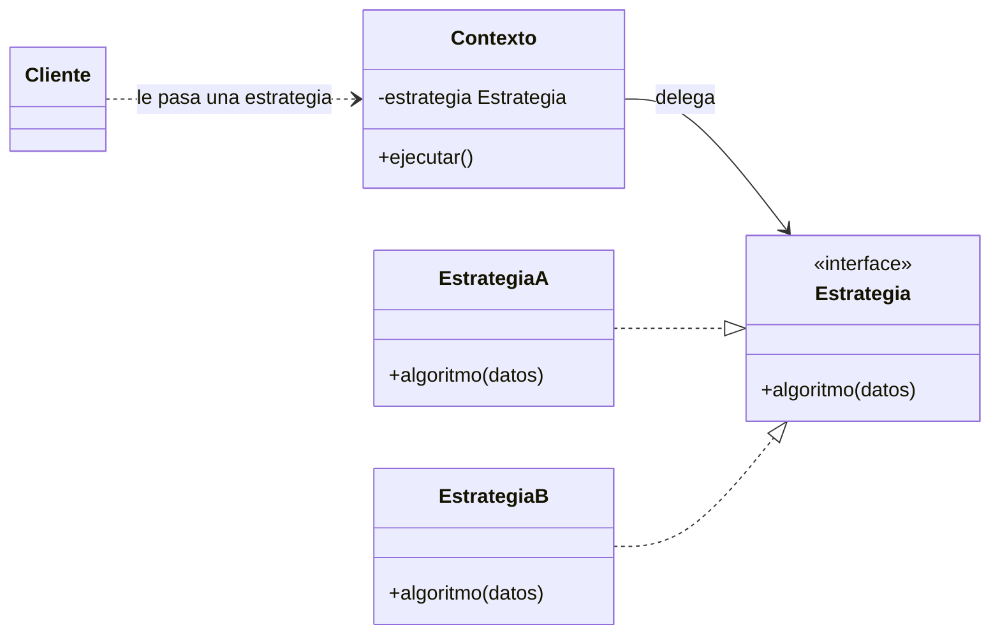

```nodos
Cliente:
  titulo: Cliente
  texto: Elige la estrategia en tiempo de ejecución y se la pasa al contexto.
Contexto:
  titulo: Contexto
  texto: Hace su trabajo y delega en la estrategia la parte que varía. No sabe cuál le han dado. En el ejemplo de SOLID, total(), que la recibe como parámetro en lugar de guardarla.
Estrategia:
  concepto: strategy
EstrategiaA:
  titulo: Una estrategia concreta
  texto: Un algoritmo. En el ejemplo de SOLID, Porcentaje.
EstrategiaB:
  titulo: Otra estrategia concreta
  texto: Otro algoritmo intercambiable. Añadir uno nuevo no obliga a tocar el contexto.
```

En Java y Python modernos, una estrategia de un solo método suele ser **una función**:

```java
BiFunction<BigDecimal, BigDecimal, BigDecimal> iva = (base, tipo) -> base.multiply(tipo);
iva.apply(new BigDecimal("100"), new BigDecimal("0.21"));   // 21.00
```

`Comparator` es la estrategia más usada de la biblioteca de Java: `lista.sort(Comparator.comparing(Persona::edad))`.

## Observer

**Problema:** cuando algo cambia, varias partes tienen que reaccionar (avisar, recalcular, registrar), y no quieres que el origen dependa de todas ellas.

**Solución:** el origen mantiene una lista de suscriptores y les notifica el cambio.

**Estructura genérica:**

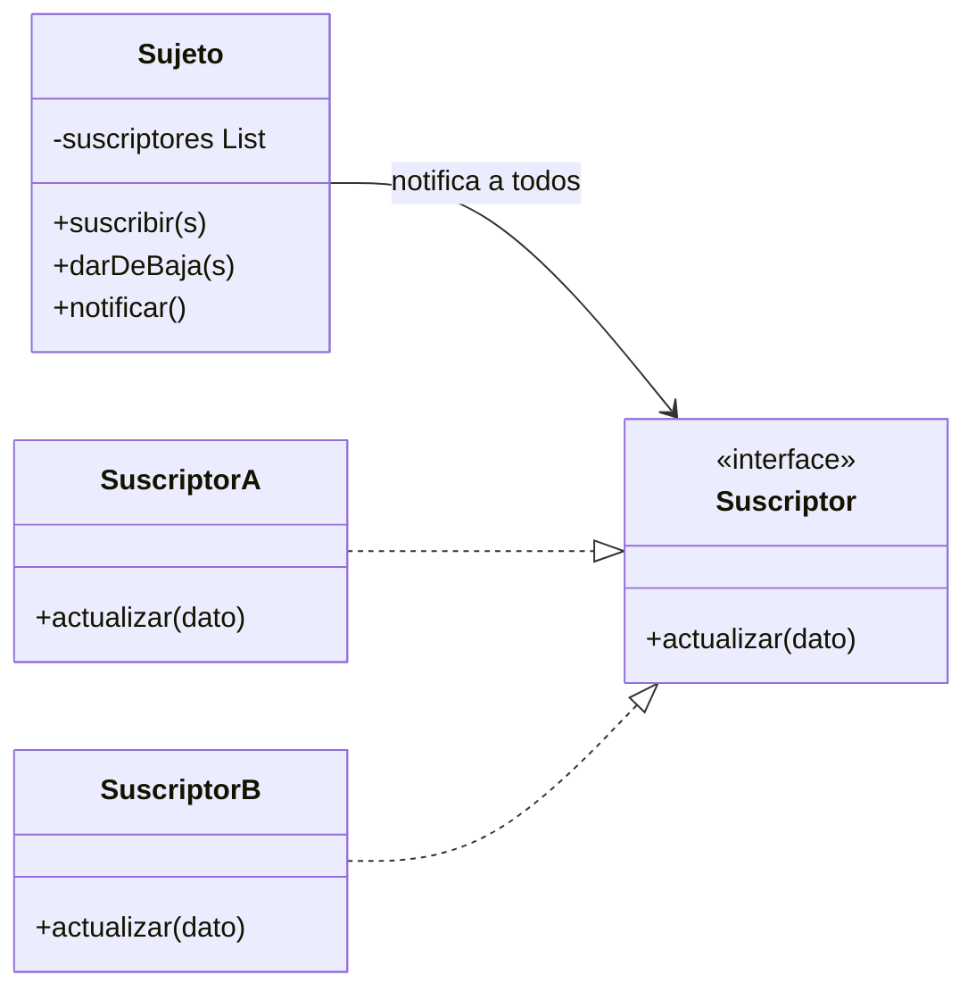

```nodos
Sujeto:
  concepto: observer
Suscriptor:
  titulo: Suscriptor
  texto: La interfaz que conoce el sujeto. Es lo único de los suscriptores de lo que depende. En el ejemplo, Consumer de Integer.
SuscriptorA:
  titulo: Un suscriptor concreto
  texto: Reacciona al cambio. En el ejemplo, la lambda que avisa de reponer.
SuscriptorB:
  titulo: Otro suscriptor concreto
  texto: Se pueden añadir más sin tocar el sujeto, que no sabe cuántos hay ni qué hacen.
```

Con un caso concreto:

```java
class Stock {
    private final List<Consumer<Integer>> oyentes = new ArrayList<>();
    private int unidades;

    Stock(int u) { unidades = u; }

    void suscribir(Consumer<Integer> o) { oyentes.add(o); }
    void retirar(int n) { unidades -= n; oyentes.forEach(o -> o.accept(unidades)); }
}

Stock s = new Stock(10);
s.suscribir(u -> { if (u < 5) System.out.println("Reponer: quedan " + u); });
s.retirar(3);   // quedan 7: no imprime nada
s.retirar(4);   // quedan 3: «Reponer: quedan 3»
```

El `Stock` no sabe quién escucha. Cuidado con dos riesgos: los suscriptores que nadie da de baja (fugas de memoria) y las cadenas de notificaciones difíciles de seguir. A escala de sistema, la misma idea es la **publicación-suscripción** con colas de mensajes y eventos.

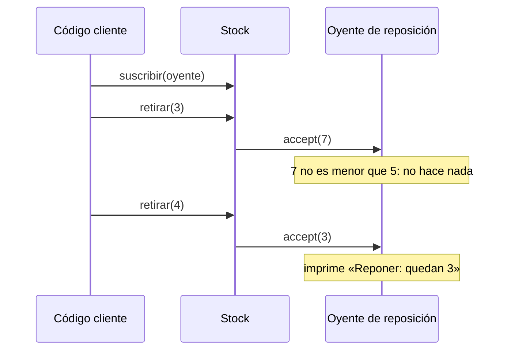

```nodos
C:
  titulo: Código cliente
  texto: Registra los oyentes y usa el stock.
S:
  concepto: observer
O:
  titulo: Oyente
  texto: El Stock no sabe quién es. Si nadie lo da de baja, puede provocar una fuga de memoria.
```

## Command

**Problema:** quieres tratar una operación como un dato: guardarla en un historial para deshacerla, encolarla para ejecutarla después o registrarla.

**Solución:** cada operación es un objeto con `ejecutar()` (y, si hace falta, `deshacer()`).

**Estructura genérica:**

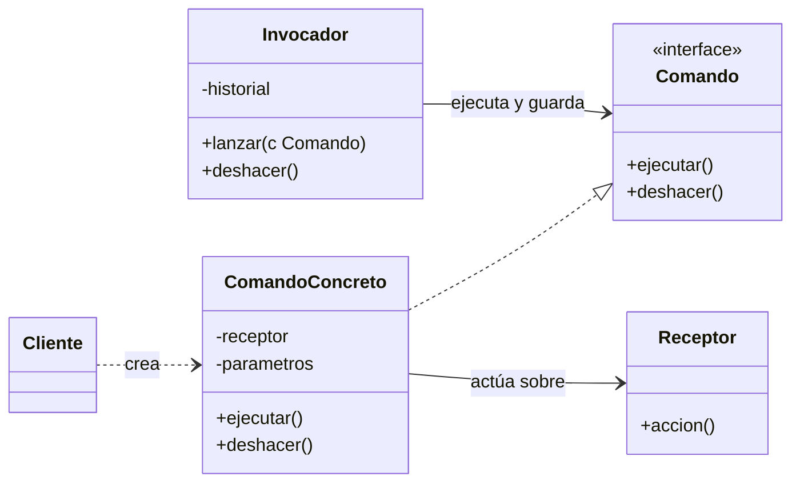

```nodos
Cliente:
  titulo: Cliente
  texto: Crea el comando con su receptor y sus parámetros y se lo entrega al invocador.
Invocador:
  titulo: Invocador
  texto: Ejecuta comandos sin saber qué hacen y los guarda en el historial para deshacerlos o repetirlos.
Comando:
  concepto: command
ComandoConcreto:
  titulo: Comando concreto
  texto: Guarda todo lo necesario para ejecutar la operación y para deshacerla. En el ejemplo, la clase anónima que añade un texto.
Receptor:
  titulo: Receptor
  texto: El objeto que de verdad hace el trabajo. En el ejemplo, el StringBuilder del editor.
```

En el ejemplo, `Editor` hace a la vez de cliente y de invocador:

```java
interface Comando { void ejecutar(); void deshacer(); }

class Editor {
    final StringBuilder texto = new StringBuilder();
    final Deque<Comando> historial = new ArrayDeque<>();

    void escribir(String s) {
        Comando c = new Comando() {
            public void ejecutar() { texto.append(s); }
            public void deshacer() { texto.setLength(texto.length() - s.length()); }
        };
        c.ejecutar();
        historial.push(c);
    }

    void deshacer() { if (!historial.isEmpty()) historial.pop().deshacer(); }
}
// escribir("Hola"); escribir(" mundo"); deshacer();  →  texto = "Hola"
```

El historial es una **pila**: se deshace primero lo último que se hizo.

## Template Method frente a Strategy

**Template Method:** una clase base fija el esqueleto del algoritmo y deja **pasos** para que los rellenen las subclases.

**Estructura genérica:**

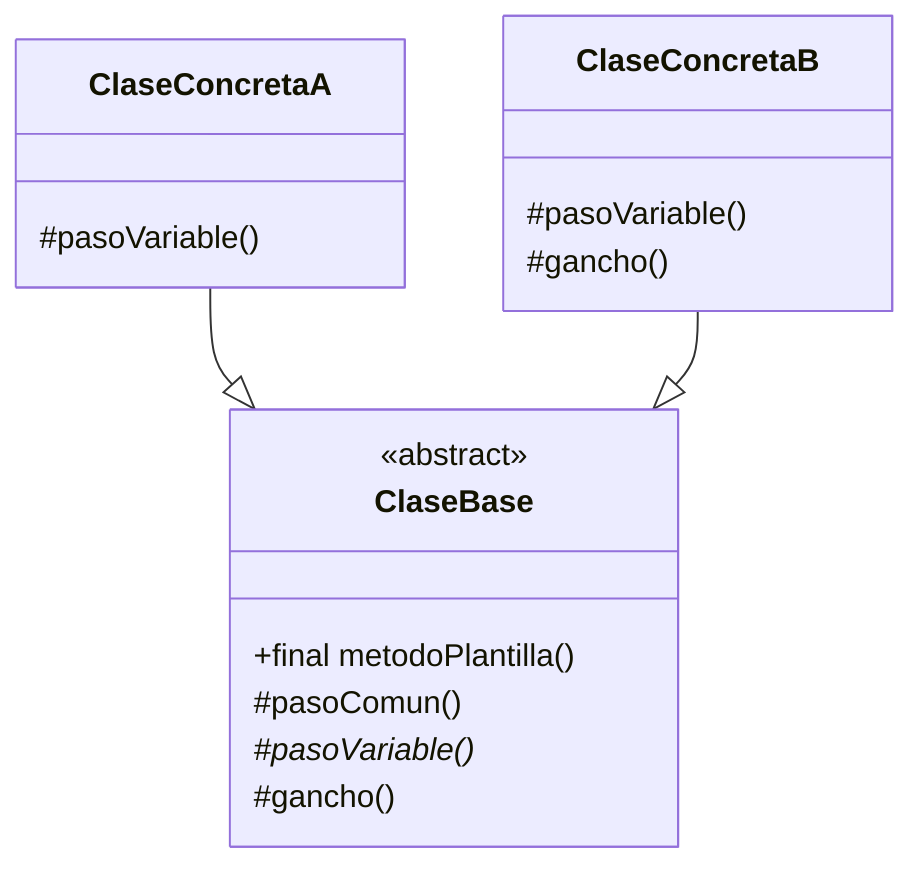

```nodos
ClaseBase:
  concepto: template-method
ClaseConcretaA:
  titulo: Una subclase
  texto: Implementa solo el paso abstracto. En el ejemplo, InformeVentas con cuerpo().
ClaseConcretaB:
  titulo: Otra subclase
  texto: Implementa el paso abstracto y además sobrescribe un gancho, un paso con comportamiento por defecto (en el ejemplo, cabecera o pie).
```

En el diagrama, el método en cursiva es abstracto. Con un caso concreto:

```java
abstract class Informe {
    final String generar() { return cabecera() + "\n" + cuerpo() + "\n" + pie(); }
    String cabecera() { return "== Informe =="; }
    abstract String cuerpo();
    String pie() { return "-- fin --"; }
}

class InformeVentas extends Informe { String cuerpo() { return "Ventas: 42"; } }
```

`generar()` es `final`: las subclases no pueden cambiar el orden, solo los pasos.

| | Template Method | Strategy |
|---|---|---|
| Mecanismo | Herencia | Composición |
| Qué varía | Pasos de un algoritmo fijo | El algoritmo completo |
| Se elige | Al compilar (qué subclase) | En tiempo de ejecución (qué objeto se pasa) |
| Combinar variaciones | Difícil: una subclase por combinación | Fácil: se pasan varias estrategias |

Por la preferencia de la composición, Strategy suele ser más flexible; Template Method sigue siendo útil en frameworks que fijan un flujo (por ejemplo, los métodos `setUp` y `tearDown` alrededor de cada prueba).

## Puntos clave

- Strategy encapsula algoritmos intercambiables; con una sola operación, una función basta.
- Observer desacopla el origen de un cambio de quienes reaccionan; vigila las suscripciones sin baja.
- Command convierte una operación en un objeto que se puede deshacer, encolar o registrar.
- Template Method fija el esqueleto con herencia; Strategy cambia el algoritmo entero con composición.

## Referencias

- Refactoring.Guru, [Strategy](https://refactoring.guru/design-patterns/strategy), [Observer](https://refactoring.guru/design-patterns/observer), [Command](https://refactoring.guru/design-patterns/command) y [Template Method](https://refactoring.guru/design-patterns/template-method).

# Patrones con criterio

## Objetivos de aprendizaje

- **5.1** Reconocer cuándo una característica del lenguaje sustituye a un patrón.
- **5.2** Detectar el abuso de patrones y los antipatrones más comunes.
- **5.3** Introducir un patrón a partir de un problema real, mediante refactorización.

## El lenguaje se come patrones

En 1996, Peter Norvig mostró que **16 de los 23 patrones** de la GoF se simplifican o desaparecen en lenguajes como Lisp o Dylan, que tienen funciones de primera clase, macros o tipado dinámico. Un patrón es, a menudo, la forma de suplir algo que el lenguaje no ofrece. Desde entonces, Java y Python han incorporado muchas de esas características:

| Patrón | Característica que lo simplifica | Ejemplo |
|---|---|---|
| Strategy, Command | Funciones de primera clase y lambdas | `Comparator.comparing(...)`, `lambda i: i * 0.9` |
| Iterator | Bucles `for-each` y generadores | `for x in coleccion`, `yield` |
| Observer | Funciones como suscriptores, flujos reactivos | `List<Consumer<T>>` |
| Template Method | Funciones pasadas como parámetro | Un método que recibe el paso variable como lambda |
| Singleton | Módulos (Python) o contenedores de inyección | Una variable de módulo, un *bean* de Spring |
| Decorator (de funciones) | Decoradores de Python | `@functools.cache` |

Conocer el patrón sigue siendo útil para **reconocerlo y nombrarlo**, aunque se escriba en dos líneas.

## Abuso de patrones

| Síntoma | Por qué es un problema |
|---|---|
| `FabricaDeFabricasDeEstrategias` para una sola variante | Complejidad sin variación que la justifique (YAGNI) |
| Singleton para tener acceso global cómodo | Estado global, dependencias ocultas, pruebas difíciles |
| Patrones aplicados «porque sí» en el primer día | Se diseña para problemas imaginarios |
| Un patrón distinto en cada clase para practicar | El código se vuelve difícil de leer para el equipo |

Un **antipatrón** es una solución que parece buena pero suele empeorar las cosas. Algunos clásicos: el **objeto dios** (una clase que lo sabe y lo hace todo), el **código espagueti**, el **martillo de oro** (usar la misma herramienta o patrón para todo) y el uso indiscriminado de **Singleton**.

## Llegar al patrón refactorizando

El camino recomendable no es empezar por el patrón, sino por el **problema**:

1. Escribe la solución directa.
2. Cuando aparezca un síntoma (un `switch` repetido, una subclase por combinación, una interfaz incompatible), identifica el patrón que lo resuelve.
3. Refactoriza hacia él con pruebas que protejan el comportamiento.

Así, cada patrón del código tiene una razón visible, y el equipo entiende por qué está ahí.

## Puntos clave

- Norvig mostró en 1996 que 16 de los 23 patrones se simplifican o desaparecen en lenguajes más expresivos.
- Lambdas, `for-each`, generadores y decoradores de Python absorben buena parte del catálogo.
- Conocer el patrón sigue sirviendo para reconocerlo y nombrarlo.
- Los patrones aplicados sin un problema real son sobreingeniería; Singleton es el abuso más común.
- Lo recomendable es llegar al patrón refactorizando desde un síntoma concreto.

## Referencias

- Peter Norvig, [Design Patterns in Dynamic Languages](https://norvig.com/design-patterns/) (1996).
- Wikipedia, [Anti-pattern](https://en.wikipedia.org/wiki/Anti-pattern).
- Martin Fowler, [Yagni](https://martinfowler.com/bliki/Yagni.html).
