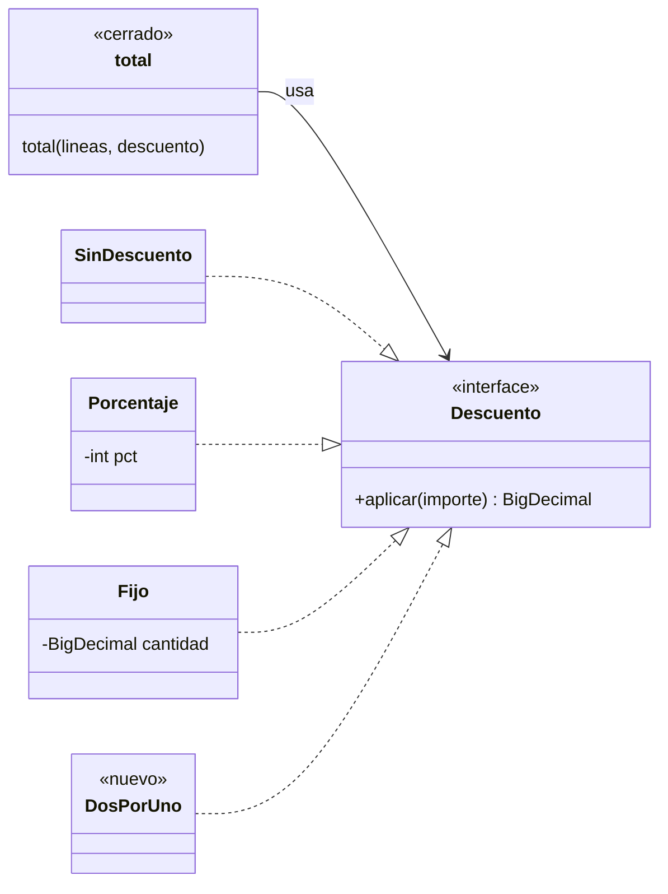
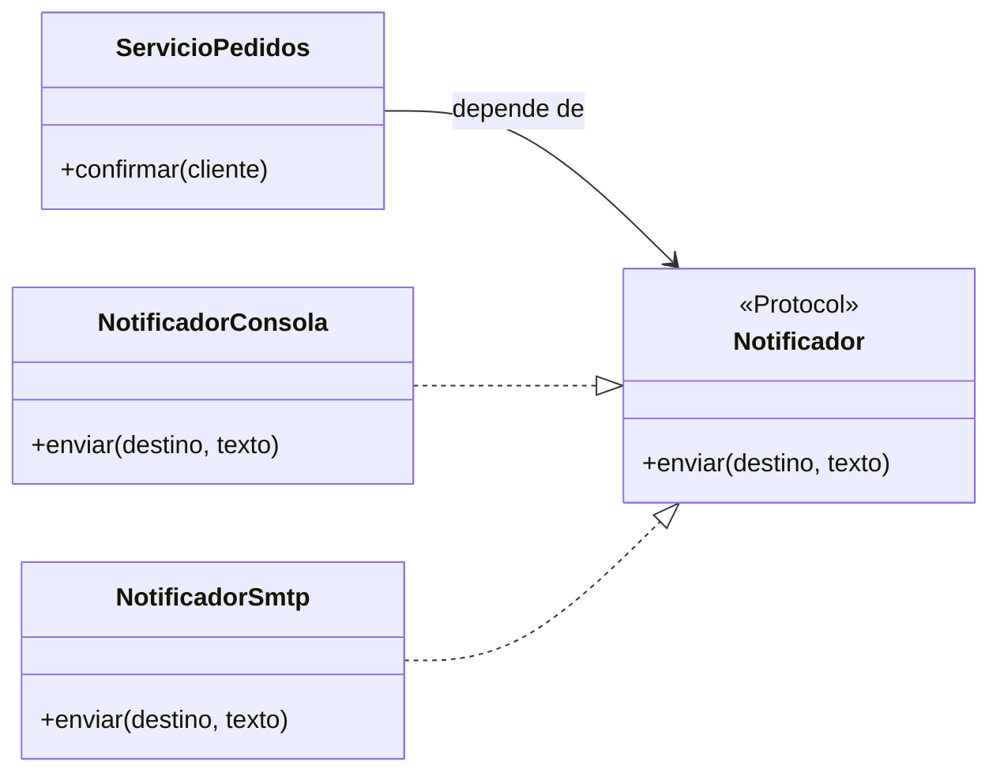

# titulo: Principios SOLID


# Qué es SOLID y responsabilidad única

## Objetivos de aprendizaje

- **1.1** Situar el origen de SOLID y el problema que intenta resolver.
- **1.2** Enunciar el principio de responsabilidad única en términos de actores y razones para cambiar.
- **1.3** Detectar una clase con varias responsabilidades y separarlas.

## De dónde sale SOLID

Robert C. Martin reunió estos principios en su artículo *Design Principles and Design Patterns* (2000), que trata de cómo se «pudre» el software. Con cada cambio, el código se vuelve **rígido** (cuesta cambiarlo), **frágil** (se rompe en sitios inesperados), **inmóvil** (no se puede reutilizar) y **viscoso** (es más fácil hacer las cosas mal que bien). Hacia 2004, Michael Feathers ordenó las iniciales y acuñó el acrónimo **SOLID**:

| Letra | Principio | En una frase |
|---|---|---|
| **S** | Responsabilidad única (*Single Responsibility*) | Un módulo cambia por un solo motivo |
| **O** | Abierto/cerrado (*Open/Closed*) | Se amplía sin modificar lo que ya funciona |
| **L** | Sustitución de Liskov (*Liskov Substitution*) | Un subtipo se puede usar donde se espera el tipo base |
| **I** | Segregación de interfaces (*Interface Segregation*) | Nadie depende de métodos que no usa |
| **D** | Inversión de dependencias (*Dependency Inversion*) | Lo importante no depende de los detalles |

Los cinco persiguen lo mismo: **bajo acoplamiento y alta cohesión**, para que cambiar una parte del sistema no obligue a cambiar las demás. No son leyes: son heurísticas que se aplican cuando el coste de no hacerlo aparece.

## Responsabilidad única

La formulación clásica es: **un módulo debe tener una, y solo una, razón para cambiar**. «Hacer una sola cosa» es una lectura demasiado vaga (¿qué es «una cosa»?). Martin lo precisó en 2014: el principio va de **personas**. Las peticiones de cambio de un módulo deberían venir de **un único actor**: una persona o un grupo con una misma función de negocio.

Su ejemplo es una clase `Employee` con tres métodos:

- `calculatePay()`: lo especifica el departamento financiero.
- `reportHours()`: lo usan las operaciones.
- `save()`: lo decide el equipo técnico (la base de datos).

Tres actores, tres razones para cambiar en la misma clase. Si contabilidad pide cambiar cómo se cuentan las horas extra y ese cálculo se comparte con el informe de horas, el informe de operaciones cambia sin que nadie lo haya pedido.

## Un ejemplo: la factura que hace de todo

```java
class Factura {
    BigDecimal calcularTotal() { ... }        // reglas fiscales: las define Administración
    String generarPdf() { ... }               // diseño del documento: lo pide Marketing
    void guardar(Connection conexion) { ... } // persistencia: la decide el equipo técnico
}
```

Cada método cambia por un motivo distinto y a petición de gente distinta. Un cambio en el logotipo del PDF obliga a recompilar, probar y desplegar el cálculo de impuestos. Separado:

| Clase | Responsabilidad | Quién pide los cambios |
|---|---|---|
| `Factura` | Datos y reglas de cálculo del total | Administración |
| `FacturaPdf` | Representar la factura como PDF | Marketing |
| `RepositorioFacturas` | Guardar y leer facturas | Equipo técnico |

## Cómo detectarlo

- **El nombre necesita una «y»:** `ValidarYGuardarPedido`, `GestorFacturasEImpuestos`.
- **Los cambios vienen de reuniones distintas:** si dos peticiones de áreas diferentes tocan la misma clase, hay dos responsabilidades.
- **Imports de mundos distintos:** una clase que importa a la vez la biblioteca de PDF, JDBC y las reglas fiscales.
- **Pruebas difíciles:** para probar el cálculo hay que preparar una base de datos.

Responsabilidad única **no** significa una clase por método. Agrupar lo que cambia junto también es el principio: es la otra cara, la **cohesión**.

## Puntos clave

- Robert C. Martin reunió los principios en 2000; Michael Feathers acuñó el acrónimo SOLID hacia 2004.
- Los cinco buscan bajo acoplamiento y alta cohesión, frente a un código rígido, frágil, inmóvil y viscoso.
- Responsabilidad única: un módulo tiene una sola razón para cambiar.
- La «razón para cambiar» es un actor: la persona o grupo que pide los cambios.
- Se detecta por nombres con «y», cambios pedidos por áreas distintas e imports de mundos distintos.
- No es «una clase por método»: lo que cambia junto debe estar junto.

## Referencias

- Robert C. Martin, [The Single Responsibility Principle](https://blog.cleancoder.com/uncle-bob/2014/05/08/SingleReponsibilityPrinciple.html) (2014).
- Robert C. Martin, [Solid Relevance](https://blog.cleancoder.com/uncle-bob/2020/10/18/Solid-Relevance.html) (2020).
- Wikipedia, [SOLID](https://en.wikipedia.org/wiki/SOLID).

# Abierto/cerrado

## Objetivos de aprendizaje

- **2.1** Enunciar el principio abierto/cerrado y su origen.
- **2.2** Usar el polimorfismo para añadir comportamiento sin modificar el código existente.
- **2.3** Reconocer cuándo merece la pena abrir un punto de extensión.

## El principio

Bertrand Meyer lo formuló en 1988, en *Object-Oriented Software Construction*: un módulo debe estar **abierto a la extensión** (se le puede añadir comportamiento) y **cerrado a la modificación** (lo que ya funciona no se toca). Meyer lo planteaba con la herencia; la lectura actual, la de Martin, usa **interfaces y polimorfismo**.

La motivación: cada vez que se modifica código que funciona, se puede romper. Si el comportamiento nuevo se añade escribiendo **código nuevo**, el riesgo se concentra en lo nuevo.

## El síntoma: un switch que no para de crecer

```java
BigDecimal aplicarDescuento(String tipo, BigDecimal importe) {
    switch (tipo) {
        case "NINGUNO":    return importe;
        case "PORCENTAJE": return importe.multiply(new BigDecimal("0.90"));
        case "FIJO":       return importe.subtract(new BigDecimal("15"));
        // cada descuento nuevo añade un case aquí… y en el informe, y en la validación
        default: throw new IllegalArgumentException(tipo);
    }
}
```

Cada tipo de descuento nuevo obliga a modificar esta función y, normalmente, otros `switch` repartidos por el código que preguntan por el mismo `tipo`. Ese `switch` repetido es un *code smell* clásico.

## La solución: un punto de extensión

```java
interface Descuento {
    BigDecimal aplicar(BigDecimal importe);
}

record SinDescuento() implements Descuento {
    public BigDecimal aplicar(BigDecimal i) { return i; }
}

record Porcentaje(int pct) implements Descuento {
    public BigDecimal aplicar(BigDecimal i) {
        return i.subtract(i.multiply(BigDecimal.valueOf(pct)).divide(BigDecimal.valueOf(100)));
    }
}

record Fijo(BigDecimal cantidad) implements Descuento {
    public BigDecimal aplicar(BigDecimal i) { return i.subtract(cantidad).max(BigDecimal.ZERO); }
}

static BigDecimal total(List<BigDecimal> lineas, Descuento d) {
    return d.aplicar(lineas.stream().reduce(BigDecimal.ZERO, BigDecimal::add));
}
```

`total` está **cerrado**: no cambia cuando aparece un descuento nuevo. El sistema está **abierto**: un «2×1» es una clase nueva que implementa `Descuento`. Con líneas de 40 y 60 euros, `total` devuelve 100 sin descuento, 90 con un 10 % y 0 con un descuento fijo de 150 (el `max` evita totales negativos).



```nodos
total:
  titulo: total()
  texto: Cerrado a la modificación. No cambia aunque aparezcan descuentos nuevos.
Descuento:
  concepto: ocp
SinDescuento:
  titulo: SinDescuento
  texto: Devuelve el importe tal cual. Con líneas de 40 y 60 euros, 100.
Porcentaje:
  titulo: Porcentaje
  texto: Con un 10 %, el total de 100 pasa a 90.
Fijo:
  titulo: Fijo
  texto: Resta una cantidad sin bajar de cero. Con 150 de descuento, el total es 0.
DosPorUno:
  titulo: Un descuento nuevo
  texto: Abierto a la extensión. El 2×1 es una clase nueva que implementa Descuento.
```

En Python, la misma idea se expresa con una clase abstracta o con un protocolo:

```python
from typing import Protocol
from decimal import Decimal


class Descuento(Protocol):
    def aplicar(self, importe: Decimal) -> Decimal: ...
```

## Cuándo abrir un punto de extensión

Ningún código está cerrado a **todos** los cambios: hay que elegir contra cuáles protegerse. Martin lo llama cierre **estratégico**.

| Situación | ¿Abrir? |
|---|---|
| Ya hay tres variantes y el negocio pide otra cada mes | Sí |
| Hay un `switch` sobre el mismo tipo en varios sitios | Sí |
| Solo hay una variante y nadie ha pedido otra | No: aplica YAGNI y espera a la segunda |
| Las variantes cambian la estructura de datos, no solo el comportamiento | Con cuidado: quizá el modelo no es el adecuado |

Una regla práctica: **la primera vez, escríbelo directo; cuando llegue la segunda o tercera variante, extrae el punto de extensión**.

## Puntos clave

- Abierto a la extensión, cerrado a la modificación: lo formuló Bertrand Meyer en 1988.
- Hoy se aplica con interfaces y polimorfismo, no solo con herencia.
- Un `switch` sobre un tipo repetido en varios sitios es la señal clásica.
- El comportamiento nuevo va en código nuevo (una clase más), sin tocar el que funciona.
- El cierre es estratégico: se abre donde la variación es real, no en todas partes.

## Referencias

- Robert C. Martin, [The Open Closed Principle](https://blog.cleancoder.com/uncle-bob/2014/05/12/TheOpenClosedPrinciple.html) (2014).
- Wikipedia, [Open–closed principle](https://en.wikipedia.org/wiki/Open%E2%80%93closed_principle).
- Martin Fowler, [Yagni](https://martinfowler.com/bliki/Yagni.html).

# Sustitución de Liskov

## Objetivos de aprendizaje

- **3.1** Enunciar el principio de sustitución de Liskov y su origen.
- **3.2** Explicar por qué el cuadrado que hereda de rectángulo lo incumple.
- **3.3** Aplicar las reglas de precondiciones y postcondiciones a un subtipo.

## El principio

Barbara Liskov lo presentó en 1987, en la conferencia *Data abstraction and hierarchy*, y lo formalizó con Jeannette Wing en 1994. En palabras sencillas: **si S es un subtipo de T, cualquier propiedad que se pueda demostrar de los objetos de T debe cumplirse también para los de S**. Es decir, un código que funciona con un `T` debe seguir funcionando si recibe un `S`.

Es un principio **de comportamiento**, no de sintaxis. El compilador comprueba que `Cuadrado` tiene los métodos de `Rectangulo`; no comprueba que se comporte como uno.

## El ejemplo clásico: cuadrado y rectángulo

En geometría, un cuadrado **es un** rectángulo. En código:

```java
static class Rectangulo {
    protected int ancho, alto;
    void setAncho(int a) { ancho = a; }
    void setAlto(int a) { alto = a; }
    int area() { return ancho * alto; }
}

static class Cuadrado extends Rectangulo {
    @Override void setAncho(int a) { ancho = a; alto = a; }
    @Override void setAlto(int a) { ancho = a; alto = a; }
}

static int probar(Rectangulo r) {
    r.setAncho(5);
    r.setAlto(4);
    return r.area();
}
```

`probar(new Rectangulo())` devuelve 20, como espera quien escribió `probar`. `probar(new Cuadrado())` devuelve **16**: al fijar el alto, el cuadrado cambia también el ancho. El código cliente asumía algo razonable de un rectángulo («cambiar el alto no cambia el ancho») que el subtipo no respeta. **El subtipo no es sustituible.**

La moraleja no es que la geometría esté mal, sino que **la relación «es un» del mundo real no garantiza un subtipo correcto**. Lo que importa es el comportamiento que esperan los clientes. Soluciones habituales: que ambos implementen una interfaz `Figura` con `area()` sin heredar uno del otro, o hacerlos inmutables (sin *setters*, un cuadrado sí es un rectángulo válido).

## Reglas para un subtipo correcto

| Regla | Qué significa | Ejemplo de incumplimiento |
|---|---|---|
| **Precondiciones no más fuertes** | El subtipo no puede exigir más que el tipo base | La base acepta cualquier importe positivo; el subtipo rechaza los mayores de 1000 |
| **Postcondiciones no más débiles** | El subtipo debe garantizar al menos lo mismo | La base garantiza devolver una lista ordenada; el subtipo la devuelve sin ordenar |
| **Invariantes conservados** | Lo que siempre es cierto en la base sigue siéndolo | El ancho y el alto son independientes en el rectángulo, pero no en el cuadrado |
| **Sin excepciones nuevas inesperadas** | No lanza errores que el cliente de la base no espera | Un subtipo que lanza `UnsupportedOperationException` en un método de la base |

### Un caso real en Java

`List.of(1, 2)` devuelve una lista **inmutable**: llamar a `add` lanza `UnsupportedOperationException`. La documentación de `java.util.List` declara `add` como operación **opcional**, así que el contrato del tipo base ya avisa de que puede fallar: no es una violación formal. Pero muestra el coste del diseño: quien recibe un `List` no sabe si puede añadir elementos sin mirar de dónde viene. Por eso conviene que los contratos digan claramente lo que garantizan.

## Cómo detectarlo

- Comprobaciones de tipo en el cliente: `if (figura instanceof Cuadrado) …`. Si hay que preguntar el tipo concreto, el subtipo no es sustituible.
- Métodos sobrescritos que no hacen nada o lanzan «no soportado».
- Pruebas escritas para el tipo base que fallan con el subtipo.

## Puntos clave

- Liskov lo presentó en 1987 y lo formalizó con Wing en 1994.
- Un subtipo debe poder usarse donde se espera el tipo base sin romper el programa.
- Es un principio de comportamiento: el compilador no lo comprueba.
- «Es un» en el mundo real no basta; importa lo que esperan los clientes.
- Un subtipo no endurece precondiciones, no debilita postcondiciones y conserva los invariantes.
- `instanceof` en el cliente y métodos que lanzan «no soportado» son señales de alarma.

## Referencias

- Wikipedia, [Liskov substitution principle](https://en.wikipedia.org/wiki/Liskov_substitution_principle).
- Documentación de Java, [interfaz `List`](https://docs.oracle.com/en/java/javase/21/docs/api/java.base/java/util/List.html) (operaciones opcionales y listas inmodificables).

# Segregación de interfaces

## Objetivos de aprendizaje

- **4.1** Enunciar el principio de segregación de interfaces.
- **4.2** Dividir una interfaz grande según lo que usa cada cliente.
- **4.3** Distinguir segregación de interfaces de responsabilidad única.

## El principio

**Ningún cliente debe verse obligado a depender de métodos que no usa.** Cuando una interfaz es grande y general, cada cambio en ella afecta a todos sus clientes, aunque no usen el método que ha cambiado, y quien la implementa tiene que escribir métodos que no le corresponden.

## El ejemplo de la impresora multifunción

```java
interface Maquina {
    void imprimir(String doc);
    String escanear();
    void enviarFax(String numero, String doc);
}

class ImpresoraBasica implements Maquina {
    public void imprimir(String d) { System.out.println("Imprimiendo " + d); }
    public String escanear() { throw new UnsupportedOperationException(); }        // no sabe escanear
    public void enviarFax(String n, String d) { throw new UnsupportedOperationException(); }
}
```

La impresora básica se ve obligada a «implementar» métodos que no puede cumplir, lo que además incumple el principio de Liskov: un cliente de `Maquina` no puede fiarse de `escanear()`. Separando por capacidades:

```java
interface Impresora { void imprimir(String doc); }
interface Escaner { String escanear(); }

class Multifuncion implements Impresora, Escaner {
    public void imprimir(String d) { System.out.println("Imprimiendo " + d); }
    public String escanear() { return "escaneado"; }
}

class ImpresoraBasica implements Impresora {
    public void imprimir(String d) { System.out.println("Imprimiendo " + d); }
}
```

Ahora el código que solo imprime recibe una `Impresora`, y cualquier máquina que imprima sirve. Un cambio en la interfaz de escaneo no afecta a quien solo imprime.

## Cómo dividir

Se divide **según los clientes**, no según la implementación:

| Señal | Qué hacer |
|---|---|
| Implementaciones que lanzan «no soportado» o dejan métodos vacíos | Separar la capacidad en otra interfaz |
| Cada cliente usa un subconjunto distinto de métodos | Una interfaz por grupo de uso |
| Un cambio en un método obliga a recompilar o revisar clientes que no lo usan | Separar ese método |

En Python el principio se aplica igual con protocolos pequeños: una función que solo necesita `leer()` debería pedir un protocolo con `leer()`, no una clase entera.

## Segregación de interfaces frente a responsabilidad única

Se parecen, pero miran desde lados distintos:

- **Responsabilidad única** mira la **clase**: ¿cuántos actores piden cambios en ella?
- **Segregación de interfaces** mira a los **clientes**: ¿cada uno depende solo de lo que usa?

Una clase con una sola responsabilidad puede ofrecer varias interfaces a clientes distintos (por ejemplo, una de lectura y otra de escritura sobre el mismo repositorio).

## Puntos clave

- Ningún cliente debe depender de métodos que no usa.
- Las interfaces grandes obligan a implementar métodos imposibles y propagan cambios innecesarios.
- Se divide según el uso de los clientes, en interfaces pequeñas por capacidad.
- Métodos que lanzan «no soportado» son la señal más clara (y suelen romper también Liskov).
- Responsabilidad única mira la clase; segregación de interfaces, a sus clientes.

## Referencias

- Wikipedia, [Interface segregation principle](https://en.wikipedia.org/wiki/Interface_segregation_principle).
- Python, [typing.Protocol](https://docs.python.org/3/library/typing.html#typing.Protocol).

# Inversión de dependencias

## Objetivos de aprendizaje

- **5.1** Enunciar las dos partes del principio de inversión de dependencias.
- **5.2** Invertir una dependencia de un módulo de alto nivel hacia uno de bajo nivel.
- **5.3** Distinguir inversión de dependencias, inyección de dependencias y contenedores de inyección.

## El principio

Tiene dos partes:

1. **Los módulos de alto nivel no deben depender de los de bajo nivel. Ambos deben depender de abstracciones.**
2. **Las abstracciones no deben depender de los detalles. Los detalles deben depender de las abstracciones.**

«Alto nivel» es la política: las reglas de negocio, lo que hace valioso al sistema. «Bajo nivel» son los detalles: la base de datos, el correo, el sistema de ficheros.

## Antes: el negocio depende del detalle

```java
class ServicioPedidos {
    private final SmtpMailer mailer = new SmtpMailer("smtp.empresa.com"); // detalle concreto

    void confirmar(String cliente) {
        // … reglas del pedido …
        mailer.enviar(cliente, "Pedido confirmado");
    }
}
```

Para probar `confirmar` hay que tener un servidor SMTP; cambiar el correo por un SMS obliga a modificar el servicio de pedidos. La política depende del detalle.

## Después: ambos dependen de una abstracción

```python
from typing import Protocol


class Notificador(Protocol):
    def enviar(self, destino: str, texto: str) -> None: ...


class NotificadorConsola:
    def enviar(self, destino: str, texto: str) -> None:
        print(f"[{destino}] {texto}")


class ServicioPedidos:
    def __init__(self, notificador: Notificador) -> None:
        self._notificador = notificador

    def confirmar(self, cliente: str) -> None:
        self._notificador.enviar(cliente, "Pedido confirmado")


ServicioPedidos(NotificadorConsola()).confirmar("ana@example.com")
# [ana@example.com] Pedido confirmado
```

La flecha de dependencia se ha **invertido**: el servicio depende de `Notificador`, y el detalle (consola, SMTP, SMS) también depende de `Notificador` porque lo implementa. Lo importante es **quién es dueño de la abstracción**: `Notificador` pertenece al lado del negocio y se escribe con sus palabras (segunda parte del principio). Si la interfaz copiara la API de la biblioteca de correo, seguiría dependiendo del detalle.



```nodos
ServicioPedidos:
  titulo: ServicioPedidos
  texto: El negocio. Recibe el notificador en el constructor y no sabe si escribe en consola, por correo o por SMS.
Notificador:
  concepto: dip
NotificadorConsola:
  titulo: NotificadorConsola
  texto: Un detalle. Depende de Notificador porque lo implementa. Por eso la flecha apunta ahora hacia la abstracción.
NotificadorSmtp:
  titulo: Otra implementación
  texto: Cambiar de canal es añadir una clase, sin tocar ServicioPedidos.
```

Es la idea en la que se apoya la **arquitectura hexagonal**: los puertos de salida son abstracciones que define la aplicación y que implementan los adaptadores.

## Inversión, inyección y contenedores

Tres conceptos que se confunden a menudo:

| Concepto | Qué es | En el ejemplo |
|---|---|---|
| **Inversión de dependencias** (principio) | Hacia dónde apuntan las dependencias del código | `ServicioPedidos` depende de `Notificador`, no de `NotificadorConsola` |
| **Inyección de dependencias** (técnica) | Pasar los colaboradores desde fuera en lugar de crearlos | El notificador llega por el constructor |
| **Contenedor de inyección** (herramienta) | Un framework que crea los objetos y los conecta | Spring, Guice o, en Python, bibliotecas como *dependency-injector* |

Se puede inyectar sin invertir (pasar por constructor un `SmtpMailer` concreto) y se puede invertir sin contenedor (conectar a mano en el `main`). El contenedor es cómodo, pero no es el principio.

## Puntos clave

- Alto nivel (política) y bajo nivel (detalles) dependen de abstracciones; los detalles dependen de las abstracciones.
- La abstracción pertenece al lado del negocio y usa su vocabulario.
- Invertir permite probar la política sin detalles y cambiar un detalle sin tocar la política.
- Es la base de la arquitectura hexagonal (puertos de salida).
- Inversión es el principio; inyección, la técnica; el contenedor, una herramienta opcional.

## Referencias

- Wikipedia, [Dependency inversion principle](https://en.wikipedia.org/wiki/Dependency_inversion_principle).
- Wikipedia, [Dependency injection](https://en.wikipedia.org/wiki/Dependency_injection).
- Python, [typing.Protocol](https://docs.python.org/3/library/typing.html#typing.Protocol).

# Usar SOLID con criterio

## Objetivos de aprendizaje

- **6.1** Reconocer la sobreingeniería que provoca aplicar SOLID por adelantado.
- **6.2** Usar los principios como respuesta a problemas concretos (code smells).
- **6.3** Relacionar SOLID con la programación funcional y con la arquitectura.

## SOLID no es una lista de comprobación

Los principios describen **cómo** estructurar el código cuando aparece un problema de cambio; no dicen que haya que crear interfaces y fábricas para todo desde el primer día. Aplicados sin necesidad, producen el problema contrario:

| Exceso | Síntoma |
|---|---|
| Una interfaz por clase, con una sola implementación que no va a cambiar | Saltos de navegación constantes, sin beneficio |
| Puntos de extensión para variaciones que nunca llegan | Código «flexible» que nadie extiende |
| Clases diminutas por un SRP mal entendido | Un cambio pequeño toca diez ficheros |
| Jerarquías profundas para «reutilizar» | Liskov se rompe en cuanto llega un caso especial |

El contrapeso es **YAGNI** (*You Aren't Gonna Need It*): no añadir flexibilidad hasta que haga falta. Martin Fowler insiste en que YAGNI no significa descuidar el diseño, sino mantener el código **fácil de cambiar** para poder añadir la flexibilidad cuando llegue la necesidad real.

## Del síntoma al principio

Una forma práctica de aplicar SOLID es partir del *code smell*:

| Síntoma en el código | Principio que ayuda |
|---|---|
| Una clase cambia por peticiones de áreas distintas | Responsabilidad única |
| El mismo `switch` sobre un tipo aparece en varios sitios | Abierto/cerrado |
| `instanceof` en los clientes o métodos que lanzan «no soportado» | Sustitución de Liskov |
| Implementaciones con métodos vacíos | Segregación de interfaces |
| No se pueden probar las reglas sin base de datos o red | Inversión de dependencias |

## ¿Sigue vigente?

Martin defendió en 2020 (*Solid Relevance*) que los principios siguen siendo útiles aunque hayan cambiado los lenguajes y las modas, porque tratan de **cómo gestionar las dependencias**, no de una tecnología. En lenguajes con funciones de primera clase se aplican igual con otras herramientas:

- Abierto/cerrado y la inversión de dependencias, con funciones pasadas como parámetro (una lambda `Descuento`).
- Segregación de interfaces, con tipos de función pequeños o protocolos.

A escala de sistema, las mismas ideas reaparecen: la inversión de dependencias es la base de la arquitectura hexagonal, y la responsabilidad única ayuda a trazar los límites entre módulos y servicios.

## Puntos clave

- SOLID responde a problemas de cambio; aplicarlo por adelantado lleva a la sobreingeniería.
- YAGNI equilibra: flexibilidad cuando haga falta, con código fácil de cambiar mientras tanto.
- Partir del *code smell* indica qué principio aplicar.
- Los principios tratan de dependencias y siguen vigentes en lenguajes con funciones de primera clase.
- A escala de arquitectura, la inversión de dependencias sostiene la arquitectura hexagonal.

## Referencias

- Martin Fowler, [Yagni](https://martinfowler.com/bliki/Yagni.html).
- Martin Fowler, [Code Smell](https://martinfowler.com/bliki/CodeSmell.html).
- Robert C. Martin, [Solid Relevance](https://blog.cleancoder.com/uncle-bob/2020/10/18/Solid-Relevance.html) (2020).
