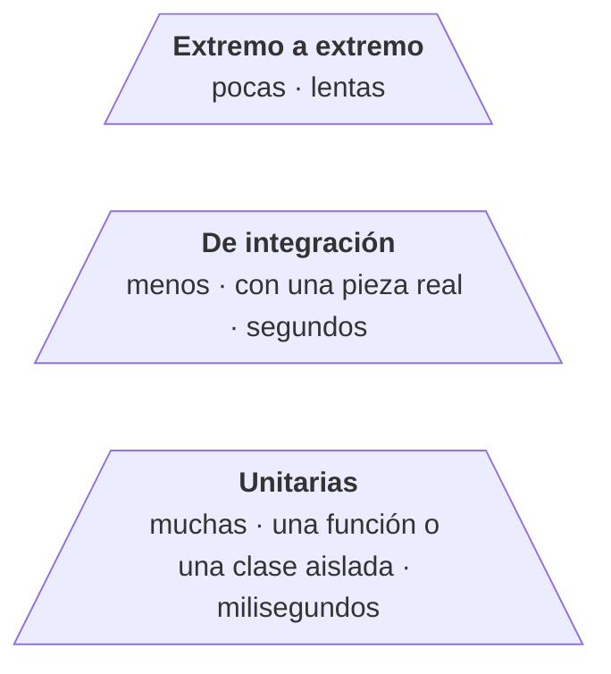
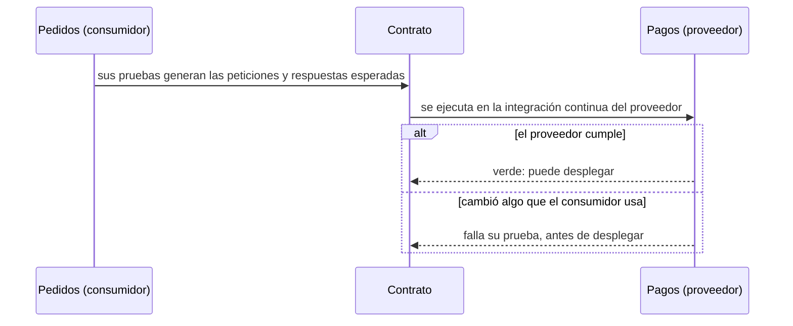
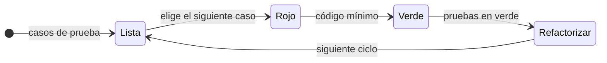

# Pruebas: unitarias, de integración y de contrato


# Qué y cómo probar

## Objetivos de aprendizaje

- **1.1** Explicar para qué sirven las pruebas automáticas.
- **1.2** Repartir las pruebas según la pirámide de pruebas.
- **1.3** Estructurar una prueba con preparar, actuar y comprobar.
- **1.4** Probar el comportamiento y no los detalles de implementación.

Los ejemplos del tema se han ejecutado con **pytest 9.2** y Python 3.12.

## Para qué sirven

Las pruebas automáticas permiten **cambiar el código con confianza**: si una refactorización o una función nueva rompe algo que funcionaba, una prueba falla antes de que llegue a producción. También documentan, con ejemplos ejecutables, qué hace el código.

## La pirámide de pruebas

La **pirámide de pruebas** la popularizó Mike Cohn en *Succeeding with Agile* (2009). Propone muchas pruebas pequeñas y rápidas en la base, y menos según se sube:

| Nivel | Qué prueba | Velocidad | Cuántas |
|---|---|---|---|
| **Unitarias** | Una función o una clase, aislada | Milisegundos | Muchas |
| **De integración** | El código con una pieza real: base de datos, ficheros, otro servicio | Segundos | Menos |
| **De extremo a extremo** | El sistema completo, como lo usa el usuario | Lentas y frágiles | Pocas |

Las de arriba dan más confianza en que todo está conectado, pero son más lentas, más caras de mantener y, cuando fallan, cuesta más encontrar el motivo. Que la definición exacta de «unitaria» varíe entre equipos importa menos que la idea: **muchas pruebas rápidas y pocas lentas**.



```nodos
E2E:
  titulo: De extremo a extremo
  texto: El sistema completo, como lo usa el usuario. Dan confianza en que todo está conectado, pero cuesta encontrar el motivo cuando fallan.
INT:
  concepto: prueba-de-integracion
UNI:
  concepto: prueba-unitaria
```

## Preparar, actuar y comprobar

Una buena prueba tiene tres partes claras:

```python
def test_total_suma_las_lineas(carrito):
    # Preparar
    carrito.anadir("lampara", Decimal("15"))
    # Actuar
    total = carrito.total()
    # Comprobar
    assert total == Decimal("55")
```

Y cumple algunas propiedades:

| Propiedad | Por qué |
|---|---|
| **Rápida** | Si tarda, nadie la ejecuta a menudo |
| **Aislada** | No depende de otras pruebas ni del orden en que se ejecutan |
| **Repetible** | Da el mismo resultado siempre: sin depender de la hora, del azar ni de la red |
| **Un motivo para fallar** | Cuando falla, el nombre y la aserción dicen qué se ha roto |

## Comportamiento, no implementación

Prueba **lo que hace** el código (sus entradas y salidas, sus efectos visibles), no **cómo lo hace**. Una prueba que comprueba qué métodos privados se llaman y en qué orden se rompe con cualquier refactorización, aunque el comportamiento no cambie: genera trabajo y desconfianza.

Prioriza los casos que importan: los **límites** (el cupón que se aplica a partir de 50 €: ¿qué pasa con 49,99 y con 50?), los **errores** esperados y las reglas de negocio.

## Puntos clave

- Las pruebas permiten cambiar el código con confianza y documentan su comportamiento.
- Pirámide de pruebas (Mike Cohn, 2009): muchas unitarias, menos de integración, pocas de extremo a extremo.
- Estructura cada prueba en preparar, actuar y comprobar.
- Las buenas pruebas son rápidas, aisladas y repetibles, y fallan por un solo motivo.
- Prueba el comportamiento, no la implementación, y céntrate en límites, errores y reglas.

## Referencias

- Martin Fowler, [Test Pyramid](https://martinfowler.com/bliki/TestPyramid.html).
- Ham Vocke, [The Practical Test Pyramid](https://martinfowler.com/articles/practical-test-pyramid.html).
- [pytest](https://docs.pytest.org/en/stable/).

# Pruebas unitarias con pytest

## Objetivos de aprendizaje

- **2.1** Escribir pruebas con `assert` y comprobar excepciones.
- **2.2** Compartir la preparación con fixtures.
- **2.3** Probar varios casos con la parametrización.
- **2.4** Ejecutar y filtrar las pruebas.

## El código que se prueba

```python
@dataclass
class Carrito:
    lineas: dict[str, tuple[Decimal, int]] = field(default_factory=dict)

    def anadir(self, producto: str, precio: Decimal, cantidad: int = 1) -> None:
        if cantidad <= 0:
            raise ErrorDeCarrito("La cantidad debe ser positiva")
        _, actual = self.lineas.get(producto, (precio, 0))
        self.lineas[producto] = (precio, actual + cantidad)

    def total(self) -> Decimal:
        return sum((p * c for p, c in self.lineas.values()), Decimal("0"))

    def total_con_descuento(self, cupon: str | None) -> Decimal:
        total = self.total()
        if cupon == "DESCUENTO10" and total >= Decimal("50"):
            return (total * Decimal("0.9")).quantize(Decimal("0.01"))
        return total
```

## assert y excepciones

pytest descubre las funciones que empiezan por `test_` en ficheros `test_*.py` y usa el `assert` normal de Python: si falla, muestra los valores que intervienen.

```python
def test_cantidad_no_positiva_se_rechaza(carrito):
    with pytest.raises(ErrorDeCarrito, match="positiva"):
        carrito.anadir("libro", Decimal("20"), 0)
```

`pytest.raises` comprueba que se lanza la excepción esperada y, con `match`, que el mensaje contiene un texto.

## Fixtures

Una **fixture** prepara lo que una prueba necesita y se lo entrega como parámetro:

```python
@pytest.fixture
def carrito():
    c = Carrito()
    c.anadir("libro", Decimal("20"), 2)
    return c
```

Cada prueba que declara `carrito` recibe **uno nuevo** (por defecto, el alcance es la función), así que las pruebas no se influyen entre sí. Con `yield` en lugar de `return`, el código posterior se ejecuta al terminar, para limpiar. Con `scope="module"` o `scope="session"` se comparte entre varias pruebas, útil para recursos caros como una base de datos.

## Parametrización

Para probar el mismo comportamiento con varios datos, en lugar de copiar la prueba:

```python
@pytest.mark.parametrize("cupon, esperado", [
    (None, Decimal("40")),
    ("DESCUENTO10", Decimal("40")),     # por debajo de 50: sin descuento
    ("OTRO", Decimal("40")),
])
def test_cupon_por_debajo_del_minimo(carrito, cupon, esperado):
    assert carrito.total_con_descuento(cupon) == esperado
```

Cada tupla es un caso independiente: si falla uno, los demás se siguen ejecutando y el informe dice cuál falló.

## Ejecutar

| Orden | Para qué |
|---|---|
| `pytest` | Ejecuta todas las pruebas |
| `pytest -q` | Salida resumida |
| `pytest tests/test_carrito.py::test_total_suma_las_lineas` | Una prueba concreta |
| `pytest -k cupon` | Solo las pruebas cuyo nombre contiene «cupon» |
| `pytest -x` | Se detiene en el primer fallo |
| `pytest --lf` | Repite solo las que fallaron la última vez |

Con los ficheros de este tema, `pytest -q` ejecutó 12 pruebas (unitarias, con dobles y una de integración) en menos de 4 segundos.

## Puntos clave

- pytest usa el `assert` de Python y descubre `test_*` automáticamente.
- `pytest.raises` comprueba excepciones y su mensaje.
- Las fixtures preparan dependencias; por defecto, una nueva por prueba. `yield` permite limpiar.
- `@pytest.mark.parametrize` convierte una prueba en varios casos independientes.
- `-k`, `-x` y `--lf` agilizan el día a día.

## Referencias

- pytest, [How to write and report assertions](https://docs.pytest.org/en/stable/how-to/assert.html).
- pytest, [How to use fixtures](https://docs.pytest.org/en/stable/how-to/fixtures.html).
- pytest, [How to parametrize](https://docs.pytest.org/en/stable/how-to/parametrize.html).

# Dobles de prueba y mocks

## Objetivos de aprendizaje

- **3.1** Elegir el tipo de doble de prueba adecuado.
- **3.2** Escribir un fake a mano y usar `Mock` para verificar interacciones.
- **3.3** Sustituir dependencias con `patch` en el sitio correcto.
- **3.4** Evitar el abuso de mocks.

## Cuándo hace falta un doble

Una prueba unitaria no debe enviar correos, cobrar ni depender de la red. Las dependencias así se sustituyen por **dobles de prueba**. Martin Fowler, siguiendo a Gerard Meszaros, distingue:

| Tipo | Qué hace |
|---|---|
| *Dummy* | Se pasa, pero no se usa |
| *Stub* | Devuelve respuestas preparadas |
| *Spy* | Un stub que además registra cómo se le llamó |
| *Mock* | Se le programan las llamadas esperadas y comprueba que ocurren |
| *Fake* | Una implementación que funciona, con un atajo (en memoria) |

## Un fake escrito a mano

Si el código recibe sus dependencias (inyección por constructor), un doble es una clase sencilla:

```python
class NotificadorFalso:
    def __init__(self):
        self.enviados = []

    def enviar(self, destino, texto):
        self.enviados.append((destino, texto))


def test_confirmar_notifica_con_fake():
    carrito = Carrito()
    carrito.anadir("libro", Decimal("20"))
    falso = NotificadorFalso()
    ServicioPedidos(falso).confirmar("ana@example.com", carrito)
    assert falso.enviados == [("ana@example.com", "Pedido confirmado: 20 EUR")]
```

La prueba comprueba el **resultado** (qué se envió), y se lee sin conocer ninguna biblioteca.

## Mock

`unittest.mock.Mock` crea un objeto que acepta cualquier llamada y la registra:

```python
def test_confirmar_notifica_con_mock():
    notificador = Mock()
    ...
    ServicioPedidos(notificador).confirmar("ana@example.com", carrito)
    notificador.enviar.assert_called_once_with("ana@example.com", "Pedido confirmado: 20 EUR")
```

Cómodo, pero acepta **cualquier** llamada, incluidas las de métodos que no existen en el objeto real. `Mock(spec=ClaseReal)` o `create_autospec` limitan el doble a la interfaz real.

## patch: sustituir donde se busca

Cuando el código crea su dependencia dentro (aquí, `smtplib.SMTP`), se sustituye temporalmente con `patch`:

```python
# notificaciones.py
import smtplib

def avisar_pedido(correo, total):
    with smtplib.SMTP("smtp.empresa.com") as smtp:
        smtp.sendmail("tienda@empresa.com", [correo], f"Pedido de {total} EUR")

# prueba
def test_avisar_pedido_sin_servidor_smtp():
    with patch("notificaciones.smtplib.SMTP") as smtp:
        avisar_pedido("ana@example.com", 20)
    smtp.return_value.__enter__.return_value.sendmail.assert_called_once()
```

La regla de la documentación de Python: **parchea donde se busca el objeto, no donde se define**. Si el módulo hiciera `from smtplib import SMTP`, el nombre que usa es `notificaciones.SMTP`, y habría que parchear ese.

Que la prueba necesite una línea como `smtp.return_value.__enter__.return_value.sendmail` es una señal: el código está muy acoplado a la biblioteca. Inyectar un notificador, como en el ejemplo del fake, deja pruebas más simples.

## No abuses de los mocks

| Síntoma | Problema |
|---|---|
| Cada prueba programa muchos `assert_called_with` | La prueba fija la implementación; cualquier refactorización la rompe |
| Se mockean objetos de valor o del propio dominio | Se pierde la comprobación de que el código real funciona |
| Se mockea lo que no es tuyo (la API de una biblioteca) | La prueba pasa aunque uses mal la biblioteca |

Regla práctica: dobles en los **bordes** (red, correo, reloj, base de datos en las unitarias), código real dentro. Y comprobar el estado final antes que cada interacción.

## Puntos clave

- Dobles: dummy, stub, spy, mock y fake.
- Un fake a mano y la inyección de dependencias dan pruebas legibles.
- `Mock` registra llamadas; `spec` o `create_autospec` evitan que acepte métodos inexistentes.
- `patch` sustituye un nombre temporalmente; parchea donde se busca, no donde se define.
- Dobles en los bordes y código real dentro; mejor comprobar resultados que interacciones.

## Referencias

- Python, [unittest.mock](https://docs.python.org/3/library/unittest.mock.html) y [Where to patch](https://docs.python.org/3/library/unittest.mock.html#where-to-patch).
- Martin Fowler, [Test Double](https://martinfowler.com/bliki/TestDouble.html).

# Pruebas de integración y de contrato

## Objetivos de aprendizaje

- **4.1** Probar contra una base de datos real con Testcontainers.
- **4.2** Gestionar el estado de las pruebas de integración.
- **4.3** Explicar qué resuelven las pruebas de contrato entre servicios.

## Por qué probar contra la pieza real

Un fake en memoria no comprueba que el SQL sea correcto, que las restricciones de la base de datos funcionen o que los tipos se conviertan bien. Para eso hay que probar contra **la tecnología real**. Usar un motor distinto en las pruebas (SQLite en lugar de PostgreSQL) esconde diferencias de sintaxis y de comportamiento.

## Testcontainers

**Testcontainers** arranca contenedores Docker desechables desde las propias pruebas. Hay versiones para Java, Python, Go, .NET y otros lenguajes. En Python:

```python
import psycopg
import pytest
from testcontainers.community.postgres import PostgresContainer


@pytest.fixture(scope="module")
def bd():
    with PostgresContainer("postgres:17-alpine", driver=None) as pg:
        with psycopg.connect(pg.get_connection_url()) as c:
            c.execute("CREATE TABLE stock (producto text PRIMARY KEY, "
                      "unidades int NOT NULL CHECK (unidades >= 0))")
            c.commit()
            yield c


def test_no_se_puede_dejar_el_stock_en_negativo(bd):
    bd.execute("INSERT INTO stock VALUES ('libro', 1)")
    bd.commit()
    with pytest.raises(psycopg.errors.CheckViolation):
        bd.execute("UPDATE stock SET unidades = unidades - 2 WHERE producto = 'libro'")
    bd.rollback()
```

Al ejecutarla, Testcontainers descargó la imagen, arrancó PostgreSQL 17 en un puerto libre, la prueba pasó y el contenedor se eliminó al terminar, todo en menos de dos segundos con la imagen ya descargada. En las versiones recientes de la biblioteca para Python, el módulo de PostgreSQL está en `testcontainers.community.postgres`; la ruta antigua `testcontainers.postgres` sigue funcionando, pero avisa de que está obsoleta.

## Estado entre pruebas

Compartir el contenedor entre pruebas (alcance `module` o `session`) ahorra tiempo, pero las pruebas no deben depender de los datos que dejan otras. Opciones:

| Técnica | Cómo |
|---|---|
| Transacción por prueba | Cada prueba trabaja en una transacción que se deshace al final |
| Limpiar al empezar | Vaciar las tablas (`TRUNCATE`) en una fixture |
| Datos únicos | Cada prueba crea sus propios datos con identificadores únicos |

## Pruebas de contrato

Con varios servicios, la pregunta es: si el equipo de pagos cambia su API, ¿se rompe el servicio de pedidos? Las pruebas de extremo a extremo lo detectan, pero son lentas y exigen desplegarlo todo junto. Las **pruebas de contrato** lo comprueban por separado:

1. El **consumidor** (pedidos) define, en sus pruebas, las peticiones que hace y las respuestas que espera. Eso es el **contrato**.
2. El **proveedor** (pagos) ejecuta ese contrato contra su código en su propia integración continua.
3. Si el proveedor cambia algo que el consumidor usa, falla **su** prueba antes de desplegar.



```nodos
PED:
  titulo: Consumidor
  texto: Define en sus pruebas qué peticiones hace y qué respuestas espera.
CON:
  concepto: prueba-de-contrato
PAG:
  titulo: Proveedor
  texto: Comprueba el contrato contra su código sin desplegar el consumidor. Herramienta habitual, Pact.
```

La herramienta más conocida para este enfoque guiado por el consumidor es **Pact**. Martin Fowler describe además las pruebas que comprueban que un doble de un servicio externo sigue comportándose como el servicio real.

## Puntos clave

- Prueba la persistencia contra el motor real; otro motor esconde diferencias.
- Testcontainers arranca contenedores desechables desde las pruebas; en Python, `testcontainers.community.postgres`.
- Si compartes el contenedor, aísla los datos: transacción por prueba, limpieza o datos únicos.
- Las pruebas de contrato comprueban que consumidor y proveedor siguen de acuerdo sin desplegarlos juntos; Pact es la herramienta más conocida.

## Referencias

- [Testcontainers](https://testcontainers.com/) y su [documentación para Python](https://testcontainers-python.readthedocs.io/en/latest/).
- Martin Fowler, [Contract Test](https://martinfowler.com/bliki/ContractTest.html).
- [Pact](https://docs.pact.io/).

# TDD y cobertura

## Objetivos de aprendizaje

- **5.1** Aplicar el ciclo rojo, verde y refactorizar.
- **5.2** Interpretar la cobertura de código y sus límites.
- **5.3** Usar las pruebas de mutación para medir la calidad de las pruebas.

## TDD

El **desarrollo guiado por pruebas** (TDD) lo desarrolló Kent Beck a finales de los noventa, como parte de la Programación Extrema. Repite tres pasos en ciclos cortos:

1. **Rojo:** escribe una prueba para el siguiente trozo de funcionalidad. Falla, porque aún no existe.
2. **Verde:** escribe el código mínimo para que pase.
3. **Refactorizar:** mejora la estructura del código nuevo y del anterior, con las pruebas en verde como red de seguridad.

Martin Fowler añade un paso previo que se olvida a menudo: **escribir primero una lista de casos de prueba** y elegir en cada ciclo el que más haga avanzar el diseño.



```nodos
Lista:
  titulo: Lista de casos
  texto: El paso previo que propone Fowler. En cada ciclo se elige el caso que más haga avanzar el diseño.
Rojo:
  titulo: Rojo
  texto: Una prueba nueva que falla porque la funcionalidad aún no existe.
Verde:
  titulo: Verde
  texto: El código mínimo para que la prueba pase, sin adelantarse.
Refactorizar:
  concepto: tdd
```

Ventajas: el código nace con pruebas, el diseño tiende a ser más fácil de probar (dependencias inyectadas) y cada paso es pequeño. No sustituye a pensar el diseño: es una forma de hacerlo en pasos verificables.

## Cobertura

La **cobertura** mide qué parte del código ejecutan las pruebas. Con `pytest-cov`:

```bash
pytest --cov=. --cov-report=term-missing
```

En este tema, la batería alcanzó el **100 %** en `carrito.py` y `notificaciones.py`. Útil para **encontrar código sin probar**, pero engañosa como objetivo. Experimento: se cambió el descuento del 10 % al **50 %** (un error) y se ejecutó solo esta prueba:

```python
def test_sin_comprobar_nada():
    c = Carrito()
    c.anadir("libro", Decimal("60"))
    c.total_con_descuento("DESCUENTO10")   # ejecuta el descuento, pero no comprueba el resultado
```

**La prueba pasó** y `carrito.py` quedó al **89 %** de cobertura, con la línea del descuento contada como cubierta. Ejecutar una línea no es comprobarla. Fowler lo resume citando a Brian Marick: si la cobertura se convierte en un objetivo, es demasiado fácil alcanzarla con pruebas de poca calidad, y el caso extremo son las pruebas sin aserciones.

Usa la cobertura como **linterna** (qué no está probado) y no como **meta** (un porcentaje obligatorio).

## Pruebas de mutación

Las **pruebas de mutación** miden si las pruebas **detectan errores**: una herramienta introduce pequeños cambios en el código (cambiar `>=` por `>`, `0.9` por otro valor, borrar una línea) y ejecuta las pruebas con cada **mutante**.

- Si alguna prueba falla, el mutante queda **eliminado**: las pruebas detectan ese error.
- Si todas pasan, el mutante **sobrevive**: hay un error que las pruebas no ven.

En el experimento anterior, el cambio al 50 % es exactamente un mutante que la prueba sin aserción deja sobrevivir, y que `test_cupon_aplica_a_partir_de_50` elimina. En Python existen herramientas como *mutmut*; en Java, *PIT*. Son lentas (ejecutan la batería muchas veces), así que se suelen aplicar al código más crítico.

## Puntos clave

- TDD: rojo, verde, refactorizar, en ciclos cortos y empezando por una lista de casos.
- La cobertura dice qué código se ejecuta, no si se comprueba.
- Una prueba sin aserciones puede dar cobertura a un error.
- Usa la cobertura para encontrar huecos, no como objetivo numérico.
- Las pruebas de mutación miden si las pruebas detectan cambios en el código.

## Referencias

- Martin Fowler, [Test Driven Development](https://martinfowler.com/bliki/TestDrivenDevelopment.html).
- Martin Fowler, [Test Coverage](https://martinfowler.com/bliki/TestCoverage.html).
- [pytest-cov](https://pytest-cov.readthedocs.io/en/latest/).
- Wikipedia, [Mutation testing](https://en.wikipedia.org/wiki/Mutation_testing).
