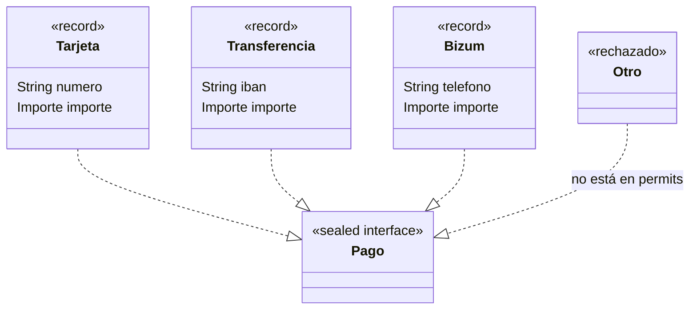
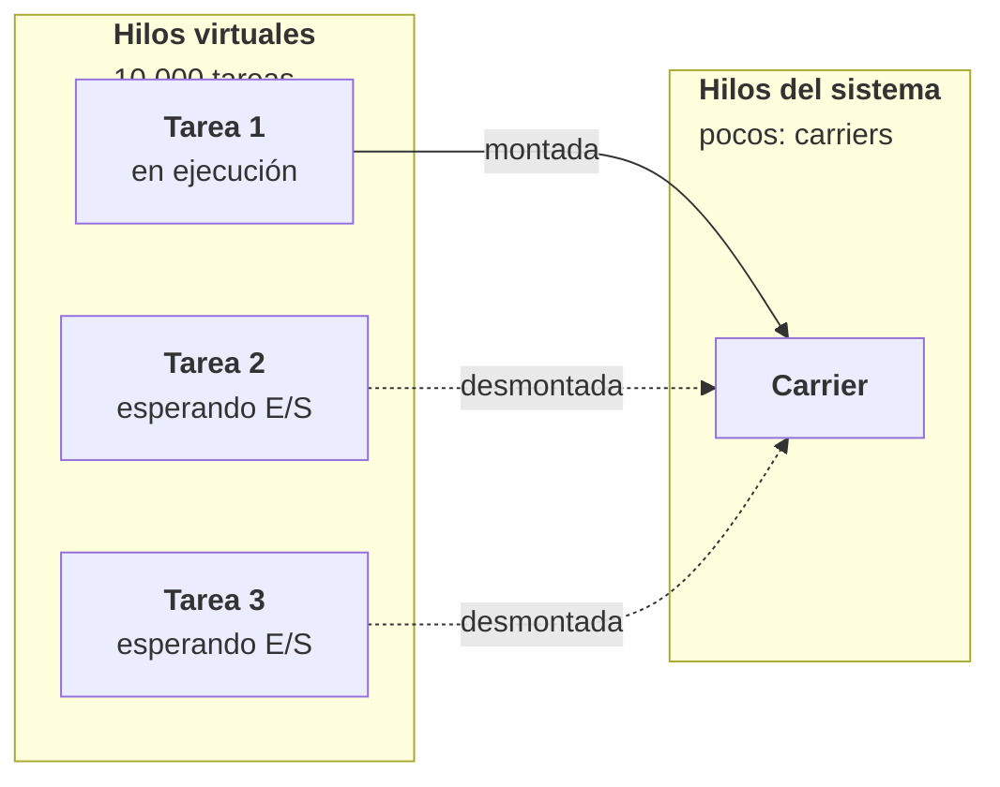

# titulo: Java moderno (17 a 25)


# Versiones, LTS y JEP

## Objetivos de aprendizaje

- **1.1** Explicar la cadencia de versiones de Java y qué es una LTS.
- **1.2** Seguir las novedades a través de los JEP.
- **1.3** Distinguir una característica definitiva de una preliminar.
- **1.4** Escribir un programa con un fichero fuente compacto.

Todo el código del tema se ha compilado y ejecutado con **OpenJDK 25.0.5** (Temurin).

## Una versión cada seis meses

Desde Java 10 (2018), sale una versión nueva **cada seis meses**, en marzo y septiembre. Algunas son **LTS** (*Long-Term Support*), con soporte durante años; las demás se sustituyen por la siguiente a los seis meses.

Según la hoja de ruta de Oracle:

| Versión | Publicación | Tipo |
|---|---|---|
| 17 | Septiembre de 2021 | LTS |
| 21 | Septiembre de 2023 | LTS |
| 22 a 24 | Marzo de 2024 a marzo de 2025 | No LTS |
| 25 | Septiembre de 2025 | LTS |
| 26, 27 | Marzo y septiembre de 2026 | No LTS |
| 29 | Septiembre de 2027 (prevista) | LTS |

Las LTS son 8, 11, 17, 21 y 25, y Oracle prevé una nueva **cada dos años**. Para producción, lo habitual es quedarse en una LTS y actualizar de LTS en LTS.

## Los JEP

Cada cambio importante se describe en un **JEP** (*JDK Enhancement Proposal*) numerado en openjdk.org: su motivación, su diseño y la versión en que se entregó. Los de este tema:

| JEP | Característica | Versión definitiva |
|---|---|---|
| 286 | `var` | 10 |
| 361 | Expresiones switch | 14 |
| 378 | Bloques de texto | 15 |
| 394, 395 | `instanceof` con patrón, records | 16 |
| 409 | Clases selladas | 17 |
| 431, 440, 441, 444 | Colecciones secuenciadas, patrones de record, patrones en switch, hilos virtuales | 21 |
| 456 | Variables y patrones sin nombre (`_`) | 22 |
| 485 | Stream gatherers | 24 |
| 506, 511, 512, 513 | Valores con ámbito, importación de módulos, ficheros compactos, constructores flexibles | 25 |

## Características preliminares

Una **característica preliminar** (*preview*, JEP 12) está completa, pero **no es definitiva**: se publica para recoger opiniones y puede cambiar o desaparecer. Hay que activarla al compilar y al ejecutar con `--enable-preview`. Muchas de las de este tema pasaron por varias versiones preliminares antes de ser definitivas. En código de producción, usa solo características definitivas.

## Un programa sin clase

Con los **ficheros fuente compactos** (JEP 512, Java 25), un programa pequeño no necesita declarar la clase ni un `main` estático:

```java
void main() {
    var nombres = List.of("Ana", "Luis");
    for (var n : nombres) {
        IO.println("Hola, " + n);
    }
}
```

`java Hola.java` lo compila y ejecuta directamente, e imprime «Hola, Ana» y «Hola, Luis». La clase `IO` ofrece entrada y salida sencillas, y en estos ficheros los paquetes de `java.base` (como `java.util`) están disponibles sin importarlos. Es útil para aprender y para *scripts*; una aplicación sigue usando clases normales.

## Puntos clave

- Java publica cada seis meses; las LTS (8, 11, 17, 21 y 25) llegan cada dos años.
- Cada novedad se describe en un JEP con la versión en que se entregó.
- Las características preliminares exigen `--enable-preview` y pueden cambiar: no las uses en producción.
- Java 25 permite programas sin clase con `void main()` y la clase `IO`.

## Referencias

- Oracle, [Java SE Support Roadmap](https://www.oracle.com/java/technologies/java-se-support-roadmap.html).
- OpenJDK, [JEP 0: JEP index](https://openjdk.org/jeps/0) y [JEP 12: Preview Features](https://openjdk.org/jeps/12).
- OpenJDK, [JEP 512: Compact Source Files and Instance Main Methods](https://openjdk.org/jeps/512).
- OpenJDK, [JDK 25](https://openjdk.org/projects/jdk/25/).

# Records y clases selladas

## Objetivos de aprendizaje

- **2.1** Modelar datos inmutables con records y validarlos en el constructor compacto.
- **2.2** Restringir una jerarquía con clases selladas.
- **2.3** Combinar records y clases selladas para modelar alternativas.

## Records

Un **record** (JEP 395, Java 16) es una clase para **datos inmutables**. A partir de sus componentes, el compilador genera el constructor, los accesores (`centimos()`, no `getCentimos()`), `equals`, `hashCode` y `toString`:

```java
record Importe(long centimos, String moneda) {
    Importe {                                   // constructor compacto
        if (centimos < 0) throw new IllegalArgumentException("Importe negativo");
        Objects.requireNonNull(moneda);
    }
    Importe sumar(Importe otro) { return new Importe(centimos + otro.centimos, moneda); }
}
```

Al ejecutarlo:

```text
diez.sumar(diez)                                   →  Importe[centimos=2000, moneda=EUR]
diez.equals(new Importe(1000, "EUR"))              →  true
new Importe(-1, "EUR")                             →  IllegalArgumentException: Importe negativo
```

- El **constructor compacto** valida sin repetir las asignaciones: así no existe ningún `Importe` inválido.
- Dos records con los mismos componentes son **iguales**: son objetos valor.
- Sus campos son `final`. Pueden tener métodos, métodos estáticos e implementar interfaces, pero **no** extender otra clase.

Encajan como objetos valor del dominio, mensajes y DTO. No sirven para entidades con estado que cambia, ni como entidades JPA (que exigen constructor vacío y campos modificables).

## Clases selladas

Una clase o interfaz **sellada** (JEP 409, Java 17) declara **quién puede extenderla**:

```java
sealed interface Pago permits Tarjeta, Transferencia, Bizum {}
record Tarjeta(String numero, Importe importe) implements Pago {}
record Transferencia(String iban, Importe importe) implements Pago {}
record Bizum(String telefono, Importe importe) implements Pago {}
```

Si otro tipo intenta implementarla, el compilador lo rechaza:

```text
error: class is not allowed to extend sealed class: Pago (as it is not listed in its 'permits' clause)
```

Las subclases deben ser `final`, `sealed` o `non-sealed` (los records son implícitamente `final`).

## Records + selladas: tipos de datos algebraicos

La combinación modela **«uno de estos casos, cada uno con sus datos»**: un pago es una tarjeta, una transferencia o un Bizum, y nada más. El compilador conoce todos los casos, y eso permite que un `switch` compruebe que se han tratado todos (lección siguiente). Frente a una jerarquía abierta con métodos sobrescritos, es una alternativa clara cuando los casos son fijos y las operaciones se añaden a menudo.



```nodos
Pago:
  concepto: sealed
Tarjeta:
  concepto: record
Transferencia:
  titulo: Transferencia
  texto: Otro caso con sus propios datos. Los records son implícitamente final.
Bizum:
  titulo: Bizum
  texto: El último caso permitido. Como el compilador conoce todos, un switch puede comprobar que se tratan todos.
  seccion: 03-patrones/teoria#exhaustividad
Otro:
  titulo: Un tipo no permitido
  texto: "El compilador lo rechaza: class is not allowed to extend sealed class."
```

## Puntos clave

- Un record es una clase de datos inmutable con constructor, accesores, `equals`, `hashCode` y `toString` generados.
- El constructor compacto valida sin repetir asignaciones.
- Records para objetos valor, mensajes y DTO; no para entidades mutables ni JPA.
- Una clase sellada fija la lista de subtipos con `permits`; el compilador rechaza el resto.
- Record + sellada modela un conjunto cerrado de casos con sus datos.

## Referencias

- OpenJDK, [JEP 395: Records](https://openjdk.org/jeps/395).
- OpenJDK, [JEP 409: Sealed Classes](https://openjdk.org/jeps/409).

# Coincidencia de patrones

## Objetivos de aprendizaje

- **3.1** Usar `instanceof` con patrón para comprobar y convertir en un paso.
- **3.2** Escribir expresiones switch con patrones de tipo, de record y guardas.
- **3.3** Aprovechar la exhaustividad con tipos sellados.
- **3.4** Usar `_` para lo que no se necesita.

## instanceof con patrón

Antes había que comprobar el tipo y luego convertir. Con el JEP 394 (Java 16), el patrón declara la variable:

```java
static int longitud(Object o) {
    if (o instanceof String s && !s.isBlank()) return s.length();
    return 0;
}
// longitud("hola") → 4, longitud("   ") → 0, longitud(42) → 0
```

La variable `s` solo existe donde el patrón se cumple, incluso en el resto de la condición con `&&`.

## switch con patrones

Las **expresiones switch** (JEP 361, Java 14) devuelven un valor, usan `case … ->` y no tienen caídas entre casos. Con los **patrones en switch** (JEP 441) y los **patrones de record** (JEP 440), ambos de Java 21, cada caso comprueba el tipo y **descompone** el record:

```java
static String describir(Pago pago) {
    return switch (pago) {
        case Tarjeta(var numero, var importe) when importe.centimos() > 100_000 -> "Tarjeta con importe alto";
        case Tarjeta(var numero, var _) -> "Tarjeta acabada en " + numero.substring(numero.length() - 4);
        case Transferencia t -> "Transferencia a " + t.iban();
        case Bizum(var telefono, var _) -> "Bizum a " + telefono;
    };
}
```

Salida con cuatro pagos de prueba:

```text
Tarjeta acabada en 1111
Tarjeta con importe alto
Transferencia a ES9121000418450200051332
Bizum a 600123123
```

- `when` añade una **guarda**: el caso solo se elige si la condición es cierta. Los casos se prueban **en orden**, así que el más específico va primero.
- `case Transferencia t` es un patrón de tipo; `case Bizum(var telefono, var _)` es un patrón de record.

## Exhaustividad

`Pago` es sellado, así que el compilador sabe que solo hay tres casos y **no hace falta `default`**. Si falta uno, no compila. Al quitar el caso `Bizum`:

```text
error: the switch expression does not cover all possible input values
```

Es una gran ventaja frente a `default`: al añadir un nuevo tipo de pago, el compilador señala **cada switch** que hay que actualizar. Con un `default`, el caso nuevo caería en él sin avisar.

## Variables sin nombre

Con el JEP 456 (Java 22), `_` indica una variable o un componente que **no se usa**: `case Bizum(var telefono, var _)` deja claro que el importe no importa en ese caso. También sirve en `catch (Exception _)` o en lambdas.

## Puntos clave

- `instanceof` con patrón comprueba y convierte en un paso.
- Las expresiones switch devuelven valor, usan `->` y no tienen caídas.
- Los patrones de tipo y de record descomponen los datos; `when` añade guardas y el orden importa.
- Con tipos sellados, el switch es exhaustivo sin `default`, y el compilador avisa de los casos que faltan.
- `_` marca lo que no se usa.

## Referencias

- OpenJDK, [JEP 394: Pattern Matching for instanceof](https://openjdk.org/jeps/394).
- OpenJDK, [JEP 361: Switch Expressions](https://openjdk.org/jeps/361).
- OpenJDK, [JEP 441: Pattern Matching for switch](https://openjdk.org/jeps/441) y [JEP 440: Record Patterns](https://openjdk.org/jeps/440).
- OpenJDK, [JEP 456: Unnamed Variables & Patterns](https://openjdk.org/jeps/456).

# Hilos virtuales

## Objetivos de aprendizaje

- **4.1** Explicar qué problema resuelven los hilos virtuales.
- **4.2** Ejecutar muchas tareas concurrentes con un ejecutor de hilos virtuales.
- **4.3** Saber cuándo no usarlos.
- **4.4** Conocer los valores con ámbito como alternativa a `ThreadLocal`.

## El problema

Un servidor que atiende cada petición en un hilo del sistema operativo (*platform thread*) está limitado por cuántos hilos puede tener: cada uno reserva memoria para su pila y cuesta crearlo. Cuando las peticiones pasan la mayor parte del tiempo **esperando** (a la base de datos, a otra API), los hilos están ocupados sin hacer nada. La alternativa clásica era la programación asíncrona (`CompletableFuture`, frameworks reactivos), más difícil de escribir, leer y depurar.

## Hilos virtuales

Los **hilos virtuales** (JEP 444, Java 21) son hilos ligeros que gestiona la JVM. Cuando un hilo virtual se bloquea esperando E/S, la JVM lo **desmonta** de su hilo del sistema (el *carrier*), que queda libre para otro hilo virtual. Así, una sola JVM puede tener **millones**, con código síncrono y bloqueante normal.

```java
Instant inicio = Instant.now();
try (var ejecutor = Executors.newVirtualThreadPerTaskExecutor()) {
    IntStream.range(0, 10_000).forEach(i -> ejecutor.submit(() -> {
        Thread.sleep(Duration.ofSeconds(1));
        return i;
    }));
}
System.out.println(Duration.between(inicio, Instant.now()).toMillis() / 1000.0 + " s");
```

Con JDK 25, **10 000 tareas que esperan 1 segundo cada una terminaron en 1,035 segundos**: todas esperaron a la vez. El `try` con recursos espera a que acaben todas antes de cerrar el ejecutor.



```nodos
VT:
  concepto: hilos-virtuales
V1:
  titulo: Hilo virtual montado
  texto: Ocupa el carrier solo mientras calcula.
V2:
  titulo: Hilo virtual esperando
  texto: Al bloquearse en E/S, la JVM lo desmonta y el carrier queda libre para otro. El código sigue siendo síncrono y bloqueante normal.
V3:
  titulo: Hilo virtual esperando
  texto: Con JDK 25, 10 000 tareas que esperan 1 segundo terminaron en 1,035 s, porque todas esperaron a la vez.
CAR:
  titulo: Hilos del sistema
  texto: Caros de crear y con memoria reservada para su pila. Antes, cada petición ocupaba uno aunque solo estuviera esperando.
  seccion: 04-hilos-virtuales/teoria#el-problema
C1:
  titulo: Carrier
  texto: El hilo del sistema sobre el que la JVM monta los hilos virtuales que tienen trabajo.
```

En Spring Boot, la propiedad `spring.threads.virtual.enabled=true` activa los hilos virtuales; su documentación indica que requieren Java 21 y recomienda Java 24 o posterior.

## Cuándo no

La documentación de Oracle es clara:

| Situación | ¿Hilos virtuales? |
|---|---|
| Muchas tareas que pasan la mayor parte del tiempo bloqueadas en E/S (peticiones HTTP, consultas) | Sí |
| Cálculos largos intensivos de CPU | No: no hay esperas que aprovechar; el límite son los núcleos |
| Código ya escrito en estilo asíncrono con `CompletableFuture` | Apenas ganan; su ventaja es poder escribir en estilo síncrono |
| Reunirlos en un *pool* | No: son baratos, se crea uno por tarea |

Un hilo virtual queda **anclado** (*pinned*) a su *carrier*, y no se puede desmontar, cuando ejecuta código nativo o una función externa. El anclaje no produce errores, pero limita la escalabilidad. Hasta Java 23, también ocurría dentro de bloques `synchronized`; el **JEP 491** (Java 24) eliminó casi todos esos casos.

## Valores con ámbito

`ThreadLocal` guarda un valor por hilo (el usuario de la petición, un identificador de traza). Con millones de hilos virtuales, y valores mutables que pueden quedarse olvidados, resulta costoso y propenso a errores. Los **valores con ámbito** (`ScopedValue`, JEP 506, definitivos en Java 25) comparten un valor **inmutable** solo durante la ejecución de un bloque y sus llamadas:

```java
static final ScopedValue<String> USUARIO = ScopedValue.newInstance();

ScopedValue.where(USUARIO, "ana").run(() -> procesar());   // dentro de procesar(), USUARIO.get() es "ana"
```

## Puntos clave

- Los hilos virtuales (Java 21) permiten millones de tareas concurrentes con código bloqueante normal.
- 10 000 tareas de 1 segundo terminaron en 1,035 segundos con un ejecutor de hilos virtuales.
- Encajan en tareas que esperan E/S; no en cálculos intensivos de CPU ni en pools.
- El anclaje limita la escalabilidad; desde Java 24, `synchronized` ya casi no lo provoca.
- `ScopedValue` (Java 25) comparte valores inmutables por ámbito, como alternativa a `ThreadLocal`.

## Referencias

- Oracle, [Virtual Threads](https://docs.oracle.com/en/java/javase/25/core/virtual-threads.html).
- OpenJDK, [JEP 444: Virtual Threads](https://openjdk.org/jeps/444).
- OpenJDK, [JEP 491: Synchronize Virtual Threads without Pinning](https://openjdk.org/jeps/491).
- OpenJDK, [JEP 506: Scoped Values](https://openjdk.org/jeps/506).
- Spring Boot, [Virtual threads](https://docs.spring.io/spring-boot/reference/features/spring-application.html).

# API y comodidad

## Objetivos de aprendizaje

- **5.1** Usar `var` y bloques de texto con criterio.
- **5.2** Usar las colecciones secuenciadas.
- **5.3** Agrupar elementos de un stream con gatherers.
- **5.4** Validar argumentos antes de llamar al constructor de la superclase.

## var

`var` (JEP 286, Java 10) deduce el tipo de una variable local a partir de su valor inicial: `var pagos = new ArrayList<Pago>();`. Úsalo cuando el tipo es evidente en la misma línea; evítalo cuando oculta información (`var x = servicio.procesar();` no dice qué es `x`). Solo vale para variables locales, no para campos ni parámetros.

## Bloques de texto

Un **bloque de texto** (JEP 378, Java 15) escribe cadenas de varias líneas sin concatenaciones ni `\n`:

```java
String json = """
        {"pedido": 42,
         "estado": "PAGADO"}
        """;
```

La sangría común se elimina, según la posición de las comillas de cierre. Útil para JSON, SQL o HTML en pruebas y consultas.

## Colecciones secuenciadas

Antes, obtener el último elemento dependía del tipo: `lista.get(lista.size() - 1)`, `deque.getLast()`, `sortedSet.last()`. Las **colecciones secuenciadas** (JEP 431, Java 21) unifican el acceso a las colecciones con orden:

```java
List<String> etapas = new ArrayList<>(List.of("creado", "pagado", "enviado"));
etapas.getFirst();   // "creado"
etapas.getLast();    // "enviado"
etapas.reversed();   // [enviado, pagado, creado]  (una vista, no una copia)
```

También ofrecen `addFirst`, `addLast`, `removeFirst` y `removeLast`, en `List`, `Deque`, `LinkedHashSet` o `LinkedHashMap` (en los mapas, `firstEntry` y similares).

## Stream gatherers

Los **gatherers** (JEP 485, Java 24) añaden operaciones intermedias personalizadas a los streams. `Gatherers` trae algunas ya hechas:

```java
IntStream.rangeClosed(1, 7).boxed()
        .gather(Gatherers.windowFixed(3))
        .toList();   // [[1, 2, 3], [4, 5, 6], [7]]
```

`windowFixed` agrupa en bloques de tamaño fijo (el último puede ser menor): útil para procesar por lotes. Hay otros, como `windowSliding` (ventanas que se solapan) o `scan` (acumulados).

## Cuerpos de constructor flexibles

Antes, `super(...)` tenía que ser la **primera** sentencia del constructor, así que validar un argumento antes exigía trucos con métodos estáticos. Con el JEP 513 (Java 25) se pueden poner sentencias antes, siempre que no usen `this`:

```java
static class Cliente extends Base {
    Cliente(String nombre) {
        if (nombre == null || nombre.isBlank()) throw new IllegalArgumentException("Nombre vacío");
        super(nombre.strip());
    }
}
// new Cliente("  Ana ").nombre → "Ana"; new Cliente(" ") → IllegalArgumentException
```

## Importar un módulo entero

El JEP 511 (Java 25) permite `import module java.base;` para importar de golpe todos los paquetes que exporta un módulo. Es cómodo en *scripts* y ejemplos; en una aplicación, las importaciones explícitas siguen dejando más claro qué se usa.

## Puntos clave

- `var` cuando el tipo es evidente; nunca cuando lo oculta.
- Los bloques de texto escriben JSON o SQL de varias líneas sin concatenar.
- `getFirst`, `getLast` y `reversed` funcionan igual en las colecciones con orden (Java 21).
- `Gatherers.windowFixed` agrupa un stream en lotes (Java 24).
- En Java 25 se puede validar antes de `super(...)` e importar módulos completos.

## Referencias

- OpenJDK, [JEP 286](https://openjdk.org/jeps/286), [JEP 378](https://openjdk.org/jeps/378), [JEP 431](https://openjdk.org/jeps/431).
- OpenJDK, [JEP 485: Stream Gatherers](https://openjdk.org/jeps/485).
- OpenJDK, [JEP 513: Flexible Constructor Bodies](https://openjdk.org/jeps/513) y [JEP 511: Module Import Declarations](https://openjdk.org/jeps/511).
