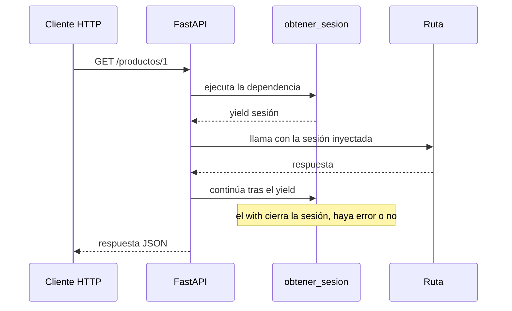
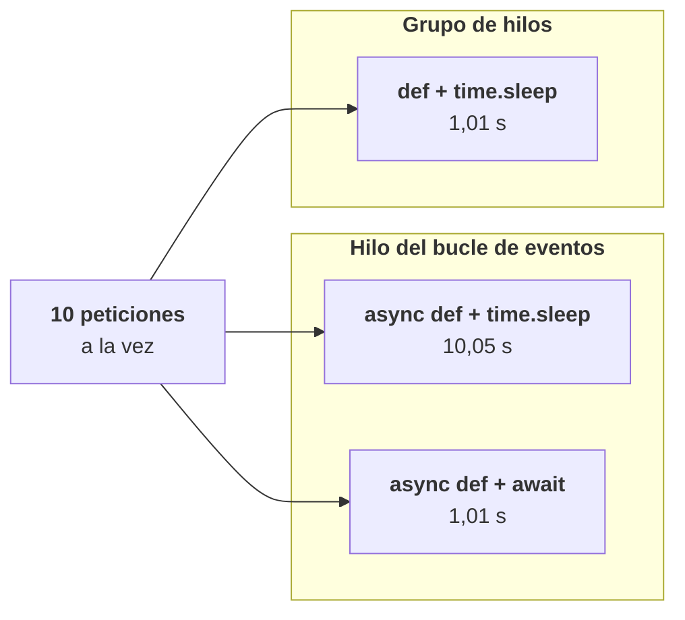

# titulo: Python para backend


# Un proyecto moderno

## Objetivos de aprendizaje

- **1.1** Conocer el ciclo de versiones de Python.
- **1.2** Crear y gestionar un proyecto con uv y `pyproject.toml`.
- **1.3** Reproducir el mismo entorno con el fichero de bloqueo.
- **1.4** Revisar el código con ruff y mypy.

Todo el código del tema se ha ejecutado con **Python 3.15.2**, uv 0.13, FastAPI 0.165, Pydantic 2.14 y SQLAlchemy 2.1.

## Versiones de Python

Sale una versión nueva **cada año, en octubre** (PEP 602). Cada una pasa por fases: dos años de correcciones de errores, después solo correcciones de seguridad, y fin de vida **cinco años** después de publicarse.

| Versión | Publicación | Fin de vida |
|---|---|---|
| 3.12 | Octubre de 2023 | Octubre de 2028 |
| 3.13 | Octubre de 2024 | Octubre de 2029 |
| 3.14 | Octubre de 2025 | Octubre de 2030 |
| 3.15 | Octubre de 2026 | Octubre de 2031 |

A diferencia de Java, no hay versiones LTS: todas tienen el mismo ciclo. Para un servicio nuevo, elige una versión reciente cuyas dependencias ya la soporten.

## uv y pyproject.toml

**uv** reúne en una herramienta lo que antes hacían `pip`, `venv`, `pip-tools` y `pyenv`: instala la versión de Python, crea el entorno y gestiona las dependencias.

```bash
uv init --app --name tienda --python 3.15 .
uv add fastapi pydantic-settings sqlalchemy uvicorn
uv add --dev pytest httpx ruff mypy
uv run pytest
```

Las dependencias quedan en **`pyproject.toml`**, el fichero estándar del proyecto:

```toml
[project]
name = "tienda"
requires-python = ">=3.15"
dependencies = [
    "fastapi>=0.165.0",
    "pydantic-settings>=2.16.3",
    "sqlalchemy>=2.1.9",
    "uvicorn>=0.54.0",
]

[dependency-groups]
dev = ["httpx>=0.28.1", "mypy>=2.4.1", "pytest>=9.2.0", "ruff>=0.17.6"]
```

Las herramientas de desarrollo van en un **grupo aparte** (`dev`) y no se instalan en producción.

## El fichero de bloqueo

`pyproject.toml` dice qué versiones se **aceptan** (`>=0.165.0`); **`uv.lock`** fija las versiones **exactas** de todas las dependencias, también las indirectas. Se sube al repositorio, y así el portátil, la CI y la imagen de producción instalan lo mismo.

`uv run` y `uv sync` actualizan el bloqueo si ha quedado desfasado. En la CI y al construir la imagen se usa **`--locked`**: si el bloqueo no coincide con `pyproject.toml`, uv da un error en lugar de cambiarlo.

## ruff y mypy

- **ruff** analiza el estilo y los errores comunes, y formatea. En el ejemplo detectó los imports sin ordenar (`I001`) y los corrigió con `ruff check --fix`.
- **mypy** comprueba los **tipos** sin ejecutar el código. Python no comprueba las anotaciones al ejecutar; mypy sí.

Ambos se ejecutan en la CI: un error de tipos o de estilo detiene la integración, igual que una prueba que falla.

## Puntos clave

- Python publica una versión cada octubre, con soporte durante cinco años; no hay LTS.
- uv crea el proyecto, instala Python y gestiona las dependencias en `pyproject.toml`.
- `uv.lock` fija las versiones exactas; en la CI, `--locked` impide que cambie sin querer.
- Las herramientas de desarrollo van en el grupo `dev`.
- ruff revisa y formatea; mypy comprueba los tipos.

## Referencias

- Python, [Status of Python versions](https://devguide.python.org/versions/).
- uv, [Projects](https://docs.astral.sh/uv/concepts/projects/) y [Locking and syncing](https://docs.astral.sh/uv/concepts/projects/sync/).
- Python Packaging, [Writing your pyproject.toml](https://packaging.python.org/en/latest/guides/writing-pyproject-toml/).
- [Ruff](https://docs.astral.sh/ruff/) y [mypy](https://mypy.readthedocs.io/en/stable/).

# Lenguaje y tipos

## Objetivos de aprendizaje

- **2.1** Escribir genéricos y alias de tipo con la sintaxis de Python 3.12 en adelante.
- **2.2** Modelar datos con dataclasses inmutables y `match`.
- **2.3** Usar las novedades de Python 3.14 y 3.15 que importan en un servicio.

## Genéricos y alias

Desde el PEP 695 (Python 3.12), los genéricos se declaran entre corchetes, sin `TypeVar`:

```python
type Id = int

class Repositorio[T]:
    def __init__(self) -> None:
        self.datos: dict[Id, T] = {}

    def guardar(self, id: Id, x: T) -> None:
        self.datos[id] = x

    def buscar(self, id: Id) -> T | None:
        return self.datos.get(id)
```

`T | None` indica que puede no haber resultado, y mypy obliga a tratar ese caso antes de usar el valor.

## Dataclasses y match

```python
@dataclass(frozen=True)
class Importe:
    centimos: int
    moneda: str = "EUR"

def describir(x: object) -> str:
    match x:
        case Importe(centimos=c) if c > 100_000:
            return "importe alto"
        case Importe(centimos=c, moneda=m):
            return f"{c / 100:.2f} {m}"
        case {"tipo": "bizum", "telefono": tel}:
            return f"Bizum a {tel}"
        case _:
            return "desconocido"
```

Salida:

```text
19.99 EUR | importe alto | Bizum a 600123123 | desconocido
```

- `@dataclass(frozen=True)` genera constructor, `__eq__` y `__repr__`, e impide modificar los campos: es el equivalente de un record de Java.
- `match` (PEP 634, Python 3.10) compara la **forma** de los datos: clases con sus atributos, diccionarios con sus claves, con guardas `if`. Los casos se prueban en orden, y `case _` recoge el resto.

## Novedades de 3.14 y 3.15

| Versión | Novedad | Para qué |
|---|---|---|
| 3.14 | Evaluación diferida de anotaciones (PEP 649) | Las anotaciones se evalúan solo cuando se piden; las referencias a clases definidas más abajo funcionan sin comillas |
| 3.14 | Plantillas `t"…"` (PEP 750) | Como una f-string, pero devuelve un objeto `Template` con las partes separadas, para escapar valores de forma segura (SQL, HTML) |
| 3.15 | `lazy import` (PEP 810) | El módulo no se carga hasta que se usa: arranques más rápidos |
| 3.15 | `frozendict` (PEP 814) | Diccionario inmutable incorporado |

Probado con Python 3.15.2:

```python
lazy import json
print("json" in sys.modules)   # False
json.dumps({})
print("json" in sys.modules)   # True

config = frozendict(moneda="EUR", iva=21)
config["iva"] = 10             # TypeError: 'frozendict' object does not support item assignment

nombre = "Ana"
plantilla = t"Hola, {nombre}"  # Template; strings ('Hola, ', ''), valores ['Ana']
```

mypy también detecta la asignación al `frozendict` sin ejecutar el código.

## Puntos clave

- `class Repositorio[T]` y `type Id = int` sustituyen a `TypeVar` y a los alias antiguos.
- `T | None` obliga a tratar la ausencia de valor.
- `@dataclass(frozen=True)` crea objetos valor inmutables.
- `match` descompone datos por su forma, con guardas y en orden.
- Python 3.14 trae anotaciones diferidas y plantillas `t"…"`; 3.15, `lazy import` y `frozendict`.

## Referencias

- PEP 695, [Type Parameter Syntax](https://peps.python.org/pep-0695/).
- PEP 636, [Structural Pattern Matching: Tutorial](https://peps.python.org/pep-0636/).
- Python, [What's new in Python 3.14](https://docs.python.org/3/whatsnew/3.14.html) y [What's new in Python 3.15](https://docs.python.org/3.15/whatsnew/3.15.html).
- PEP 750, [Template Strings](https://peps.python.org/pep-0750/); PEP 810, [Explicit lazy imports](https://peps.python.org/pep-0810/); PEP 814, [frozendict](https://peps.python.org/pep-0814/).

# Validación con Pydantic

## Objetivos de aprendizaje

- **3.1** Declarar modelos de entrada y salida con restricciones.
- **3.2** Escribir validadores propios.
- **3.3** Cargar la configuración desde el entorno con pydantic-settings.
- **3.4** Saber cómo se serializan los datos a JSON.

## Modelos

**Pydantic** usa las anotaciones de tipo para **convertir y validar** la entrada. Al contrario que Python solo, aquí los tipos sí se aplican al ejecutar:

```python
class NuevoProducto(BaseModel):
    nombre: Annotated[str, Field(min_length=1, max_length=80)]
    precio: Annotated[Decimal, Field(gt=0, decimal_places=2)]
    etiquetas: list[str] = []

    @field_validator("nombre")
    @classmethod
    def sin_espacios_sobrantes(cls, v: str) -> str:
        v = v.strip()
        if not v:
            raise ValueError("el nombre no puede estar vacío")
        return v
```

- `Field` añade restricciones: longitud, mínimos y máximos, decimales.
- Un **validador** (`@field_validator`) aplica reglas propias y puede **transformar** el valor: aquí quita los espacios sobrantes, así que `"  libro "` se guarda como `"libro"`.
- Pydantic **convierte** cuando tiene sentido: el texto `"20"` pasa a `Decimal("20")`. Si no puede, da un error.

Con `{"nombre": "   ", "precio": -1}`, Pydantic devolvió **todos** los errores a la vez, cada uno con su ubicación:

```text
[{'type': 'value_error', 'loc': ['body', 'nombre'], 'msg': 'Value error, el nombre no puede estar vacío', ...},
 {'type': 'greater_than', 'loc': ['body', 'precio'], 'msg': 'Input should be greater than 0', ...}]
```

## Modelos de salida

El modelo de salida se separa del de entrada y de la tabla:

```python
class ProductoLeido(BaseModel):
    model_config = ConfigDict(from_attributes=True)

    id: int
    nombre: str
    precio: Decimal
```

`from_attributes=True` permite crearlo desde un objeto de SQLAlchemy con `ProductoLeido.model_validate(producto)`. Solo los campos declarados salen en la respuesta.

## Serialización

Al convertir a JSON, Pydantic serializó el `Decimal` como **cadena**: la respuesta fue `{"id": 1, "nombre": "libro", "precio": "20"}`. Así no se pierde precisión, porque un número JSON se lee normalmente como coma flotante. El cliente debe saberlo, y la documentación OpenAPI lo refleja.

## Configuración con pydantic-settings

```python
class Ajustes(BaseSettings):
    model_config = SettingsConfigDict(env_prefix="TIENDA_", env_file=".env")

    url_bd: str = "sqlite:///./tienda.db"
    envio_gratis_desde: Decimal = Field(default=Decimal("50"), ge=0)
```

`Ajustes()` lee `TIENDA_URL_BD` y `TIENDA_ENVIO_GRATIS_DESDE` del entorno (o de `.env`), con los mismos tipos y validaciones que un modelo. Un valor inválido falla al arrancar, no en la primera petición. Es el equivalente de `@ConfigurationProperties` en Spring.

## Puntos clave

- Pydantic aplica los tipos al ejecutar: convierte y valida.
- `Field` declara restricciones; `@field_validator` añade reglas y transformaciones.
- Devuelve todos los errores juntos, con su ubicación.
- Modelos de entrada y salida separados; `from_attributes` crea la salida desde el ORM.
- `Decimal` se serializa como cadena para no perder precisión.
- `BaseSettings` carga y valida la configuración desde el entorno.

## Referencias

- Pydantic, [Models](https://docs.pydantic.dev/latest/concepts/models/) y [Validators](https://docs.pydantic.dev/latest/concepts/validators/).
- Pydantic, [Serialization](https://docs.pydantic.dev/latest/concepts/serialization/).
- Pydantic, [Settings management](https://docs.pydantic.dev/latest/concepts/pydantic_settings/).

# APIs con FastAPI

## Objetivos de aprendizaje

- **4.1** Declarar rutas cuyos parámetros y respuestas se validan por sus tipos.
- **4.2** Inyectar una sesión de base de datos con dependencias.
- **4.3** Devolver errores y conocer la respuesta 422.
- **4.4** Persistir con SQLAlchemy 2.

## Rutas

```python
app = FastAPI(title="Tienda")

SesionDep = Annotated[Session, Depends(obtener_sesion)]

@app.post("/productos", status_code=status.HTTP_201_CREATED)
def crear(nuevo: NuevoProducto, sesion: SesionDep) -> ProductoLeido:
    producto = Producto(nombre=nuevo.nombre, precio=nuevo.precio)
    sesion.add(producto)
    sesion.commit()
    return ProductoLeido.model_validate(producto)

@app.get("/productos/{producto_id}")
def leer(producto_id: int, sesion: SesionDep) -> ProductoLeido:
    producto = sesion.get(Producto, producto_id)
    if producto is None:
        raise HTTPException(status_code=404, detail=f"No existe el producto {producto_id}")
    return ProductoLeido.model_validate(producto)
```

FastAPI lee las **anotaciones**:

- Un parámetro de tipo `BaseModel` (`nuevo`) es el **cuerpo** JSON, validado con Pydantic.
- Un parámetro que aparece en la ruta (`producto_id: int`) se toma de ella y se convierte a `int`.
- Un parámetro simple que no está en la ruta (`menos_de: float = 30`) es un parámetro de consulta (`?menos_de=30`).
- El tipo de **retorno** filtra y documenta la respuesta.

Con todo eso genera la documentación **OpenAPI**, navegable en `/docs`.

## Errores

- Si la entrada no valida, FastAPI responde **422** (*Unprocessable Content*) con la lista de errores de Pydantic, sin ejecutar la función.
- Los errores propios se lanzan con `HTTPException`. En la prueba, `GET /productos/99` devolvió `404` con `{"detail": "No existe el producto 99"}`.

FastAPI usa **422** para la validación, y no el 400 de Spring: conviene saberlo al escribir clientes y pruebas.

## Dependencias

Una **dependencia** es una función que FastAPI ejecuta antes de la ruta para obtener algo que necesita. La sesión de base de datos es el caso típico:

```python
def obtener_sesion() -> Iterator[Session]:
    with fabrica() as sesion:
        yield sesion
```

Con `yield`, el código posterior se ejecuta **cuando la ruta ha terminado**: aquí, el `with` cierra la sesión siempre, haya error o no. Las dependencias se pueden encadenar (el usuario actual depende del token, que depende de la cabecera) y, sobre todo, **sustituir en pruebas** (lección siguiente).



```nodos
CLI:
  titulo: Cliente HTTP
  texto: Un navegador, otro servicio o el cliente de pruebas.
FA:
  concepto: fastapi
DEP:
  concepto: dependencia-fastapi
RUTA:
  titulo: La ruta
  texto: Recibe la sesión como parámetro y no sabe de dónde sale. En las pruebas se sustituye la dependencia por otra.
```

## SQLAlchemy 2

```python
class Producto(Base):
    __tablename__ = "productos"

    id: Mapped[int] = mapped_column(primary_key=True)
    nombre: Mapped[str] = mapped_column(String(80))
    precio: Mapped[Decimal] = mapped_column(Numeric(10, 2))
```

El estilo de SQLAlchemy 2 declara las columnas con `Mapped[...]`, que mypy entiende. Las consultas se escriben con `select`:

```python
sesion.scalars(select(Producto).where(Producto.precio < menos_de).order_by(Producto.precio))
```

## Puntos clave

- FastAPI deduce de las anotaciones el cuerpo, la ruta, la consulta y la respuesta, y genera OpenAPI en `/docs`.
- La validación fallida da 422 sin ejecutar la función; `HTTPException` devuelve los errores propios.
- Las dependencias con `yield` abren y cierran recursos por petición.
- SQLAlchemy 2 usa `Mapped[...]` y `select(...)`, compatibles con mypy.

## Referencias

- FastAPI, [Dependencies](https://fastapi.tiangolo.com/tutorial/dependencies/) y [Dependencies with yield](https://fastapi.tiangolo.com/tutorial/dependencies/dependencies-with-yield/).
- FastAPI, [Handling errors](https://fastapi.tiangolo.com/tutorial/handling-errors/).
- SQLAlchemy, [ORM Quick Start](https://docs.sqlalchemy.org/en/21/orm/quickstart.html).

# Asincronía y pruebas

## Objetivos de aprendizaje

- **5.1** Explicar cómo funciona el bucle de eventos de asyncio.
- **5.2** Elegir entre `async def` y `def` en FastAPI sin bloquear el servidor.
- **5.3** Probar la API con `TestClient` y sustituir dependencias.

## El bucle de eventos

**asyncio** ejecuta **corrutinas** (`async def`) en **un solo hilo**. Cuando una corrutina espera con `await` (una respuesta de red, un temporizador), cede el control al **bucle de eventos**, que avanza otra. Así, un proceso atiende muchas esperas a la vez sin un hilo por petición.

La condición es que **nadie bloquee el hilo**. Una llamada bloqueante (`time.sleep`, `requests.get`, un controlador de base de datos síncrono) dentro de una corrutina detiene el bucle, y con él **todas** las peticiones.

## La prueba

Tres rutas que esperan un segundo, servidas con uvicorn, y 10 peticiones simultáneas a cada una con `httpx.AsyncClient` y `asyncio.gather`:

```python
@app.get("/async-bloqueante")
async def async_bloqueante() -> str:
    time.sleep(1)            # bloquea el bucle de eventos
    return "ok"

@app.get("/async-correcto")
async def async_correcto() -> str:
    await asyncio.sleep(1)   # cede el control mientras espera
    return "ok"

@app.get("/sync")
def sync() -> str:
    time.sleep(1)            # FastAPI lo ejecuta en un hilo aparte
    return "ok"
```

```text
10 peticiones a /async-bloqueante: 10.05 s
10 peticiones a /async-correcto: 1.01 s
10 peticiones a /sync: 1.01 s
```

- `async def` con una llamada bloqueante es **el peor caso**: las peticiones se atienden una detrás de otra.
- `async def` con `await` sobre una biblioteca asíncrona (`httpx.AsyncClient`, `asyncpg`, SQLAlchemy asíncrono) escala.
- `def` normal también funciona: FastAPI la ejecuta en un **grupo de hilos** externo para no bloquear el bucle.



```nodos
P:
  titulo: La prueba
  texto: Tres rutas que esperan un segundo, y 10 peticiones simultáneas a cada una con httpx.AsyncClient.
HILO:
  concepto: bucle-eventos
BL:
  titulo: El peor caso
  texto: La llamada bloqueante detiene el bucle, y con él todas las peticiones, que se atienden una detrás de otra.
OK:
  concepto: corrutina
POOL:
  titulo: Grupo de hilos
  texto: FastAPI ejecuta las rutas declaradas con def en hilos aparte para no bloquear el bucle.
SY:
  titulo: def normal
  texto: La opción correcta si usas bibliotecas síncronas, como la sesión de SQLAlchemy del tema.
```

La regla práctica: usa `async def` **solo** si todo lo que espera dentro es asíncrono; si usas bibliotecas síncronas, declara la ruta con `def`. La aplicación del tema usa `def` porque su sesión de SQLAlchemy es síncrona.

## Pruebas

`TestClient` (requiere `httpx`) lanza peticiones a la aplicación sin servidor real, y **`app.dependency_overrides`** sustituye dependencias. Aquí, la base de datos de cada prueba es SQLite en memoria:

```python
@pytest.fixture
def cliente():
    fabrica = crear_fabrica("sqlite://")      # en memoria, con StaticPool

    def sesion_de_prueba():
        with fabrica() as s:
            yield s

    app.dependency_overrides[obtener_sesion] = sesion_de_prueba
    with TestClient(app) as c:
        yield c
    app.dependency_overrides.clear()


def test_404(cliente):
    r = cliente.get("/productos/99")
    assert r.status_code == 404
```

- La **fixture** de pytest prepara el cliente y, tras el `yield`, limpia. Cada prueba tiene su base de datos vacía.
- SQLite en memoria crea una base **por conexión**; con `StaticPool` todas las sesiones comparten una. Sin él, la primera versión de las pruebas falló con `OperationalError`: la tabla no existía en la conexión de la petición.
- Las 3 pruebas pasaron, y `ruff` y `mypy` no encontraron errores.

SQLite sirve para pruebas rápidas, pero no se comporta igual que PostgreSQL. Para probar consultas o transacciones de verdad, usa la misma base que en producción con Testcontainers (tema de pruebas).

## Puntos clave

- asyncio atiende muchas esperas en un hilo, siempre que nadie bloquee el bucle.
- `async def` con `time.sleep` serializó 10 peticiones (10,05 s); con `await asyncio.sleep` o con `def`, 1,01 s.
- Usa `async def` solo con bibliotecas asíncronas; con síncronas, `def`.
- `TestClient` y `dependency_overrides` prueban la API con dependencias sustituidas.
- SQLite en memoria necesita `StaticPool`, y no sustituye a la base de producción en pruebas de integración.

## Referencias

- Python, [asyncio](https://docs.python.org/3/library/asyncio.html) y [Coroutines and tasks](https://docs.python.org/3/library/asyncio-task.html).
- FastAPI, [Concurrency and async / await](https://fastapi.tiangolo.com/async/).
- FastAPI, [Testing](https://fastapi.tiangolo.com/tutorial/testing/) y [Testing dependencies with overrides](https://fastapi.tiangolo.com/advanced/testing-dependencies/).
- pytest, [How to use fixtures](https://docs.pytest.org/en/stable/how-to/fixtures.html).
