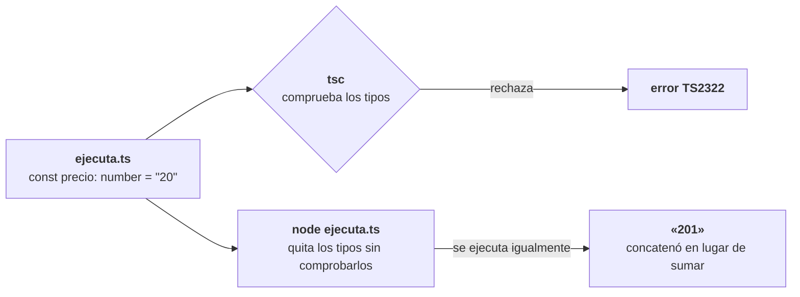
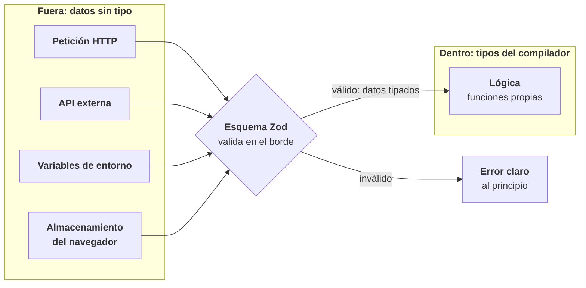

# titulo: TypeScript


# Qué es TypeScript

## Objetivos de aprendizaje

- **1.1** Explicar qué añade TypeScript a JavaScript y qué pasa con los tipos al ejecutar.
- **1.2** Entender el tipado estructural.
- **1.3** Distinguir `any` de `unknown`.
- **1.4** Conocer TypeScript 7 y los valores por defecto modernos.

Todo el código del tema se ha comprobado con **TypeScript 7.0.2** y ejecutado con **Node.js 26.13** (LTS desde octubre de 2026).

## Tipos que se borran

TypeScript es **JavaScript con tipos**. El compilador comprueba los tipos y después los **borra**: lo que se ejecuta es JavaScript normal. Consecuencias:

- Los errores de tipos se detectan **antes** de ejecutar, en el editor o con `tsc`.
- En ejecución **no queda ningún tipo**: no se pueden consultar ni sirven para validar datos que llegan de fuera (lección 4).

Node.js 26 ejecuta ficheros `.ts` directamente quitando los tipos, **sin comprobarlos**. Con este fichero:

```typescript
const precio: number = "20";
console.log("se ejecutó igualmente:", precio + 1);
```

`tsc` lo rechaza (`error TS2322: Type 'string' is not assignable to type 'number'`), pero `node ejecuta.ts` imprime `se ejecutó igualmente: 201`. Concatenó en lugar de sumar. Por eso `tsc` debe ejecutarse siempre en la CI.



```nodos
TS:
  titulo: El fichero
  texto: Asigna un texto a una variable declarada como number.
TSC:
  concepto: tsc
NODE:
  concepto: type-stripping
E:
  titulo: Error de tipos
  texto: Type 'string' is not assignable to type 'number'. Se detecta antes de ejecutar.
R:
  titulo: El resultado en ejecución
  texto: "Imprime «se ejecutó igualmente: 201». Por eso tsc debe ejecutarse siempre en la CI."
```

## Tipado estructural

En Java, una clase es compatible con una interfaz si la **declara** (`implements`). En TypeScript basta con que tenga **la misma forma**:

```typescript
interface ConNombre { nombre: string }

const producto = { id: 1, nombre: "libro", precio: 20 };
const n: ConNombre = producto;   // válido: tiene nombre: string
```

Es el **tipado estructural**: lo que importa son las propiedades, no el nombre del tipo. Encaja con JavaScript, donde los objetos se crean sin clases.

Hay una excepción útil: si escribes el **literal** directamente, TypeScript rechaza las propiedades que sobran, porque probablemente son un error de escritura:

```typescript
const literal: ConNombre = { nombre: "libro", precio: 20 };
// error TS2353: Object literal may only specify known properties, and 'precio' does not exist in type 'ConNombre'.
```

## any y unknown

- `any` **desactiva** la comprobación: se puede hacer cualquier cosa con el valor, y los errores reaparecen al ejecutar.
- `unknown` dice «no sé qué es» y **obliga a comprobarlo** antes de usarlo.

```typescript
function procesar(x: unknown) {
  x.toUpperCase();                 // error: 'x' is of type 'unknown'
  if (typeof x === "string") {
    x.toUpperCase();               // válido: aquí x es string
  }
}
```

Para datos de origen desconocido, usa `unknown`, nunca `any`.

## TypeScript 7 y los valores por defecto

- **TypeScript 7** (2026) es un compilador **nativo escrito en Go**. Según su anuncio, compila entre 8 y 12 veces más rápido: el proyecto de VS Code pasa de 125,7 s a 10,6 s. Se instala igual (`npm install -D typescript`) y su comportamiento es el de la versión anterior.
- **TypeScript 6** cambió valores por defecto, y la 7 los mantiene: **`strict` vale `true`** si no se indica, `module` es `esnext` y `types` es `[]` (los paquetes `@types` hay que declararlos).

En el proyecto del tema, sin `"strict"` en el `tsconfig.json`, `function doble(x) { … }` dio el error `TS7006: Parameter 'x' implicitly has an 'any' type`: el modo estricto estaba activo.

## Puntos clave

- TypeScript comprueba tipos al compilar y los borra; en ejecución no existen.
- Node 26 ejecuta `.ts` sin comprobar tipos: `tsc` es imprescindible en la CI.
- El tipado es estructural: cuenta la forma, no el nombre.
- `unknown` obliga a comprobar; `any` desactiva la comprobación.
- TypeScript 7 es nativo y unas 10 veces más rápido; desde la 6, `strict` está activo por defecto.

## Referencias

- Microsoft, [Announcing TypeScript 7.0](https://devblogs.microsoft.com/typescript/announcing-typescript-7-0/).
- Microsoft, [Announcing TypeScript 6.0](https://devblogs.microsoft.com/typescript/announcing-typescript-6-0/).
- TypeScript, [Type compatibility](https://www.typescriptlang.org/docs/handbook/type-compatibility.html).
- TypeScript, [Everyday types](https://www.typescriptlang.org/docs/handbook/2/everyday-types.html).
- Node.js, [Modules: TypeScript](https://nodejs.org/api/typescript.html).

# Uniones y estrechamiento

## Objetivos de aprendizaje

- **2.1** Usar tipos unión y tipos literales.
- **2.2** Estrechar tipos con comprobaciones.
- **2.3** Modelar casos con uniones discriminadas y comprobar la exhaustividad con `never`.
- **2.4** Tratar `null` y `undefined` con el modo estricto.

## Uniones

Un **tipo unión** admite uno de varios tipos: `string | number | null`. Los **tipos literales** restringen a valores concretos: `"EUR" | "USD"`. Juntos sustituyen a muchos enumerados.

## Estrechamiento

Dentro de un `if`, TypeScript **estrecha** el tipo según la comprobación:

```typescript
function longitud(x: string | number | null): number {
  if (x === null) return 0;                 // aquí x es null
  if (typeof x === "string") return x.length;  // aquí x es string
  return x.toString().length;               // aquí solo queda number
}
// longitud("hola") → 4, longitud(12345) → 5, longitud(null) → 0
```

Comprobaciones que estrechan: `typeof`, `===`, `instanceof`, `in` y las funciones de guarda (`x is Tipo`).

## Uniones discriminadas

El equivalente de las clases selladas de Java: un objeto por caso, con una propiedad literal común que indica cuál es.

```typescript
type Pago =
  | { tipo: "tarjeta"; numero: string; centimos: number }
  | { tipo: "transferencia"; iban: string; centimos: number }
  | { tipo: "bizum"; telefono: string; centimos: number };

function describir(pago: Pago): string {
  switch (pago.tipo) {
    case "tarjeta":
      return `Tarjeta acabada en ${pago.numero.slice(-4)}`;   // aquí pago tiene numero
    case "transferencia":
      return `Transferencia a ${pago.iban}`;
    case "bizum":
      return `Bizum a ${pago.telefono}`;
    default: {
      const imposible: never = pago;   // comprobación de exhaustividad
      return imposible;
    }
  }
}
```

En cada `case`, TypeScript sabe qué propiedades tiene `pago`. Salida: `Tarjeta acabada en 1111` y `Bizum a 600123123`.

## Exhaustividad con never

`never` es el tipo **sin valores**. Si se han tratado todos los casos, en el `default` no queda nada y la asignación a `never` es válida. Si falta uno, sobra ese caso y el compilador avisa. Al quitar el `case "bizum"`:

```text
error TS2322: Type '{ tipo: "bizum"; telefono: string; centimos: number; }' is not assignable to type 'never'.
```

El error dice exactamente qué caso falta. Al añadir un tipo de pago nuevo, cada `switch` que no lo trate dejará de compilar.

## null y undefined

Con el modo estricto (activo por defecto), `null` y `undefined` **no** caben en cualquier tipo: `string` no admite `null`, hay que escribir `string | null` y comprobarlo antes de usarlo. Ayudan `?.` (`cliente?.direccion?.ciudad`) y `??` (`nombre ?? "anónimo"`).

## Puntos clave

- Las uniones y los tipos literales describen exactamente los valores posibles.
- `typeof`, `===`, `in` e `instanceof` estrechan el tipo dentro de cada rama.
- Una unión discriminada modela casos con sus datos, como una jerarquía sellada.
- Asignar a `never` en el `default` hace que el compilador detecte los casos olvidados.
- En modo estricto, `null` y `undefined` deben declararse y comprobarse.

## Referencias

- TypeScript, [Narrowing](https://www.typescriptlang.org/docs/handbook/2/narrowing.html).
- TypeScript, [Everyday types](https://www.typescriptlang.org/docs/handbook/2/everyday-types.html).

# Genéricos y tipos utilitarios

## Objetivos de aprendizaje

- **3.1** Escribir funciones genéricas con restricciones.
- **3.2** Derivar tipos con `Partial`, `Pick`, `Omit`, `Record` y `Readonly`.
- **3.3** Usar `as const` y `satisfies` para conservar la información de los valores.

## Genéricos

```typescript
function primero<T>(lista: readonly T[]): T | undefined {
  return lista[0];
}

function campo<T, K extends keyof T>(obj: T, clave: K): T[K] {
  return obj[clave];
}
```

- `T` se deduce de lo que se pasa: `primero(["a", "b"])` devuelve `string | undefined`.
- `K extends keyof T` **restringe** la clave a las propiedades de `T`; `campo(libro, "nombre")` devuelve `string`, y `campo(libro, "color")` no compila.
- `T[K]` es el tipo de esa propiedad.

## Tipos utilitarios

TypeScript incluye tipos que **derivan** uno nuevo de otro, sin repetir definiciones:

```typescript
interface Producto { id: number; nombre: string; precio: number; etiquetas: string[] }

type NuevoProducto = Omit<Producto, "id">;                              // sin id
type CambioProducto = Partial<Pick<Producto, "nombre" | "precio">>;     // nombre y precio, opcionales

function aplicar(p: Readonly<Producto>, cambio: CambioProducto): Producto {
  return { ...p, ...cambio };
}
// aplicar(libro, { precio: 18 }) → { id: 1, nombre: 'libro', precio: 18, etiquetas: [] }
```

| Tipo | Resultado |
|---|---|
| `Partial<T>` | Todas las propiedades opcionales |
| `Pick<T, K>` | Solo las propiedades `K` |
| `Omit<T, K>` | Todas salvo `K` |
| `Record<K, V>` | Objeto con claves `K` y valores `V` |
| `Readonly<T>` | Propiedades de solo lectura |

Con `Readonly`, `p.precio = 1` da `TS2540: Cannot assign to 'precio' because it is a read-only property`. Solo lo comprueba el compilador: el objeto sigue siendo modificable al ejecutar.

## as const y satisfies

`as const` fija un valor como **literal e inmutable**, y de él se puede derivar un tipo:

```typescript
const MONEDAS = ["EUR", "USD", "GBP"] as const;
type Moneda = (typeof MONEDAS)[number];     // "EUR" | "USD" | "GBP"
const m: Moneda = "JPY";                   // error TS2322
```

`satisfies` (TypeScript 4.9) **comprueba** que un valor cumple un tipo **sin cambiar** el tipo deducido:

```typescript
const IVA = { general: 21, reducido: 10, superreducido: 4 } satisfies Record<string, number>;
IVA.reducido;        // 10, y el editor conoce las tres claves
```

Si se hubiera declarado `const IVA: Record<string, number>`, cualquier clave sería válida y `IVA.otro` compilaría. Con `satisfies`, en cambio, una clave inexistente da error (`TS2339: Property 'superreducido' does not exist…` en una versión sin esa clave).

## Puntos clave

- Los genéricos deducen tipos de los argumentos; `extends` los restringe y `keyof` da las claves.
- `Partial`, `Pick`, `Omit`, `Record` y `Readonly` derivan tipos sin repetir definiciones.
- `Readonly` solo actúa al compilar.
- `as const` crea literales inmutables de los que se derivan uniones.
- `satisfies` comprueba un valor sin perder su tipo exacto.

## Referencias

- TypeScript, [Generics](https://www.typescriptlang.org/docs/handbook/2/generics.html) y [Keyof type operator](https://www.typescriptlang.org/docs/handbook/2/keyof-types.html).
- TypeScript, [Utility types](https://www.typescriptlang.org/docs/handbook/utility-types.html).
- TypeScript, [TypeScript 4.9: the satisfies operator](https://www.typescriptlang.org/docs/handbook/release-notes/typescript-4-9.html).

# Validar en los bordes

## Objetivos de aprendizaje

- **4.1** Explicar por qué los tipos no protegen de los datos externos.
- **4.2** Validar datos con un esquema de Zod.
- **4.3** Deducir el tipo estático del esquema con `z.infer`.

## El problema

Los tipos se borran al ejecutar. Cuando los datos llegan de fuera (una petición HTTP, un fichero, una variable de entorno, `localStorage`), el compilador **no puede saber** qué contienen. `JSON.parse` devuelve `any`, y una anotación no cambia nada:

```typescript
const desdeRed: Producto = JSON.parse('{"id": "uno", "nombre": 3}');
console.log(typeof desdeRed.id, desdeRed.precio);   // string undefined
```

Compila sin errores y, al ejecutar, `id` es un texto y `precio` no existe. El tipo **miente**, y el fallo aparecerá lejos de su origen.

La regla: **valida en los bordes**. Todo dato que entra al sistema se comprueba una vez al llegar; a partir de ahí, los tipos son fiables.

## Zod

**Zod** define un **esquema** que se comprueba al ejecutar:

```typescript
import { z } from "zod";

const NuevoProductoSchema = z.object({
  nombre: z.string().trim().min(1, "el nombre no puede estar vacío"),
  precio: z.number().positive(),
  etiquetas: z.array(z.string()).default([]),
});

type NuevoProducto = z.infer<typeof NuevoProductoSchema>;
```

`z.infer` **deduce el tipo** del esquema: hay una sola definición, y el tipo y la validación no se pueden desincronizar.

Dos formas de validar, probadas con Zod 4.6:

```typescript
NuevoProductoSchema.parse({ nombre: "  libro ", precio: 20 });
// → { nombre: 'libro', precio: 20, etiquetas: [] }   (recorta, y aplica el valor por defecto)

const r = NuevoProductoSchema.safeParse({ nombre: "   ", precio: -1 });
if (!r.success) r.error.issues.map((i) => `${i.path.join(".")}: ${i.message}`);
// → [ 'nombre: el nombre no puede estar vacío', 'precio: Too small: expected number to be >0' ]
```

- `parse` devuelve el dato validado (y transformado) o **lanza** un error.
- `safeParse` devuelve `{ success, data }` o `{ success, error }`, **sin lanzar**: cómodo para responder un 400 con todos los problemas.

Es el equivalente de Pydantic en Python o de Bean Validation en Java. Otras bibliotecas parecidas son Valibot o ArkType.

## Dónde validar

| Borde | Qué validar |
|---|---|
| Cuerpo y parámetros de una petición | Con el esquema, antes de llegar a la lógica |
| Respuesta de una API externa | Su forma, porque puede cambiar sin avisar |
| Variables de entorno | Al arrancar, para fallar pronto |
| Datos guardados en el navegador | Al leerlos, porque pueden ser de una versión antigua |

Dentro del sistema, entre funciones propias, los tipos del compilador bastan.



```nodos
FUERA:
  titulo: Fuera del programa
  texto: Los tipos de TypeScript se borran al compilar, así que no protegen lo que llega de fuera.
  seccion: 01-que-es-typescript/teoria#tipos-que-se-borran
REQ:
  titulo: Cuerpo y parámetros
  texto: Se validan con el esquema antes de llegar a la lógica.
API:
  titulo: Respuesta de una API externa
  texto: Su forma puede cambiar sin avisar.
ENV:
  titulo: Variables de entorno
  texto: Se validan al arrancar, para fallar pronto.
LS:
  titulo: Datos del navegador
  texto: Pueden venir de una versión antigua de la aplicación.
Z:
  concepto: zod
DENTRO:
  titulo: Dentro del sistema
  texto: Entre funciones propias, los tipos del compilador bastan.
LOG:
  titulo: Lógica
  texto: Trabaja con datos cuya forma ya está garantizada, así que no repite comprobaciones.
ERR:
  titulo: Error claro
  texto: Un dato con la forma equivocada se rechaza en el borde, no a mitad de la lógica.
```

## Puntos clave

- Los tipos no comprueban nada al ejecutar; `JSON.parse` devuelve `any`.
- Valida todo dato externo al entrar; dentro, confía en los tipos.
- Zod define un esquema que valida y transforma; `z.infer` deduce el tipo de él.
- `parse` lanza el error; `safeParse` lo devuelve junto con todos los problemas.

## Referencias

- Zod, [Intro](https://zod.dev/) y [Basic usage](https://zod.dev/basics).
- Zod, [Defining schemas](https://zod.dev/api).

# Proyecto y herramientas

## Objetivos de aprendizaje

- **5.1** Configurar `tsconfig.json` para un proyecto de Node.
- **5.2** Ejecutar TypeScript con Node 26 y conocer sus límites.
- **5.3** Probar con `node:test` y comprobar los tipos en la CI.

## tsconfig.json

El proyecto del tema:

```json
{
  "compilerOptions": {
    "module": "nodenext",
    "noEmit": true,
    "noUncheckedIndexedAccess": true,
    "erasableSyntaxOnly": true,
    "verbatimModuleSyntax": true,
    "allowImportingTsExtensions": true,
    "types": ["node"]
  },
  "include": ["src"]
}
```

| Opción | Para qué |
|---|---|
| `module: nodenext` | Módulos como los resuelve Node (ESM con `"type": "module"` en `package.json`) |
| `noEmit` | `tsc` solo comprueba; quien ejecuta es Node |
| `noUncheckedIndexedAccess` | `lista[3]` puede ser `undefined`: obliga a comprobar que existe |
| `erasableSyntaxOnly` | Prohíbe la sintaxis que Node no puede borrar, como `enum` |
| `verbatimModuleSyntax` | Obliga a marcar con `import type` lo que solo es un tipo |
| `allowImportingTsExtensions` | Permite `import … from "./pagos.ts"`, como necesita Node |
| `types: ["node"]` | Desde TypeScript 6, `types` vale `[]`: hay que declarar `@types/node` |

`strict` no aparece porque ya vale `true` por defecto.

Con `noUncheckedIndexedAccess`:

```typescript
const nombres: string[] = ["Ana"];
const n: string = nombres[3];
// error TS2322: Type 'string | undefined' is not assignable to type 'string'.
```

Sin esa opción, compilaría y `n` valdría `undefined` al ejecutar.

## Ejecutar con Node

Node 26 ejecuta `node src/demo.ts` **quitando los tipos**: sustituye la sintaxis de tipos por espacios. Límites, según su documentación:

- **No comprueba tipos**: `tsc --noEmit` sigue siendo necesario.
- Solo admite sintaxis **borrable**. Un `enum` genera código, y falló así:

  ```text
  SyntaxError [ERR_UNSUPPORTED_TYPESCRIPT_SYNTAX]: TypeScript enum is not supported in strip-only mode
  ```

  En su lugar, una unión de literales o un objeto `as const`. `erasableSyntaxOnly` hace que `tsc` lo avise antes (`TS1294`).
- **Ignora `tsconfig.json`**: nada de alias de rutas (`paths`) ni conversión a JavaScript antiguo.
- Las importaciones llevan la extensión `.ts`.

Para una aplicación web con empaquetador (Vite y similares), el empaquetador quita los tipos y `tsc` comprueba.

## Pruebas y CI

`node:test` viene con Node y ejecuta pruebas escritas en TypeScript:

```typescript
import { test } from "node:test";
import assert from "node:assert/strict";

test("rechaza un producto sin nombre", () => {
  assert.throws(() => leerProducto('{"nombre":"","precio":1}'));
});
```

```text
✔ describe una transferencia
✔ rechaza un producto sin nombre
ℹ pass 2
ℹ fail 0
```

En la CI, como mínimo: `tsc --noEmit` (tipos) y `node --test` (pruebas). Para proyectos mayores, Vitest ofrece más funciones (simulaciones, cobertura, modo vigilancia).

## Puntos clave

- `module: nodenext`, `noEmit` y `types: ["node"]` para un proyecto de Node que se ejecuta sin compilar.
- `noUncheckedIndexedAccess` obliga a comprobar los accesos por índice.
- Node 26 ejecuta `.ts` sin comprobar tipos, sin `enum` y sin leer `tsconfig.json`; `erasableSyntaxOnly` lo refleja en `tsc`.
- `node:test` prueba sin dependencias; en la CI, `tsc --noEmit` y las pruebas.

## Referencias

- TypeScript, [TSConfig reference](https://www.typescriptlang.org/tsconfig/).
- Node.js, [Modules: TypeScript](https://nodejs.org/api/typescript.html).
- Node.js, [Test runner](https://nodejs.org/api/test.html).
- Node.js, [Releases](https://nodejs.org/en/about/previous-releases).
