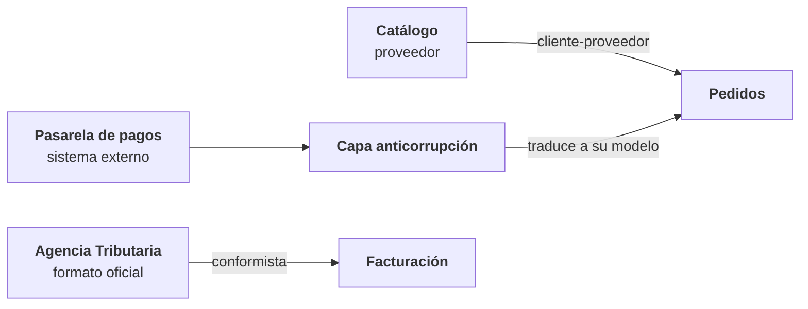
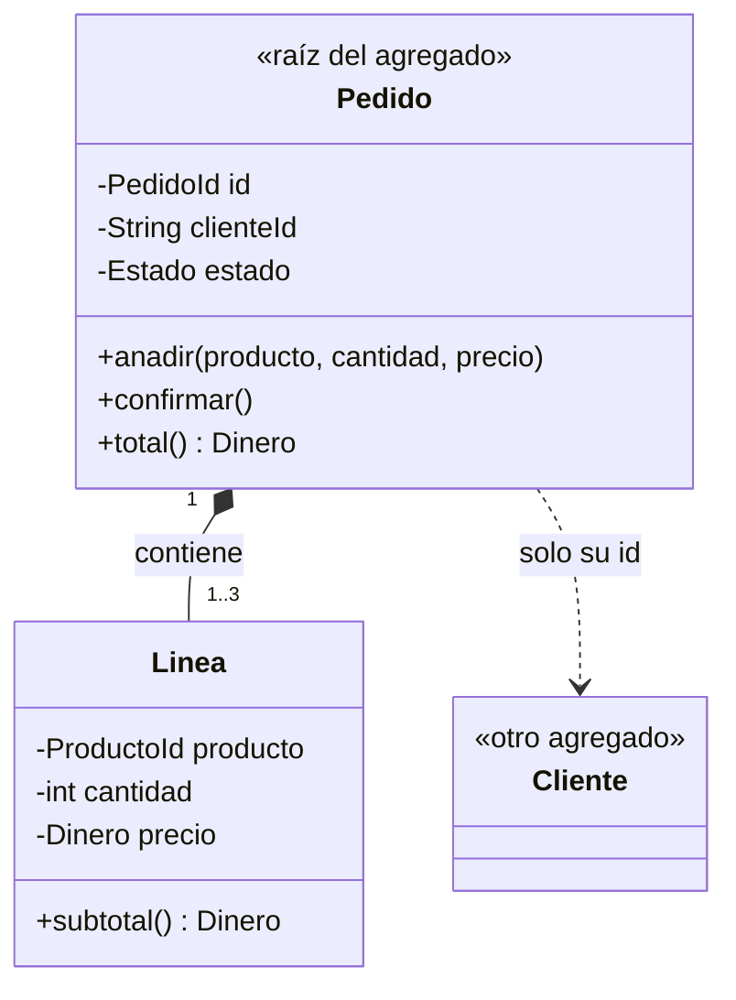

# titulo: Domain-Driven Design táctico y estratégico


# Por qué DDD

## Objetivos de aprendizaje

- **1.1** Explicar el problema que aborda DDD y cuándo compensa.
- **1.2** Construir un lenguaje ubicuo con los expertos del negocio.
- **1.3** Distinguir el dominio central de los subdominios de soporte y genéricos.
- **1.4** Diferenciar el diseño estratégico del táctico.

## El problema

En muchos sistemas, la dificultad no está en la tecnología sino en el **negocio**: reglas de precios con excepciones, plazos legales, estados que dependen unos de otros. Cuando el código no refleja esas reglas con claridad, cada cambio es arriesgado y cada conversación con negocio necesita traducción.

**Domain-Driven Design** (DDD), propuesto por Eric Evans en su libro de 2004, pone el **modelo del dominio** en el centro: un modelo construido **con** los expertos del negocio, que vive en el código y evoluciona con lo que se aprende.

DDD **no compensa** en todo: un CRUD de datos maestros, una integración simple o un prototipo no lo necesitan. Encaja cuando el dominio es **complejo** y es lo que diferencia al producto.

## Lenguaje ubicuo

El **lenguaje ubicuo** es el vocabulario común, preciso, que usan **igual** los expertos y los desarrolladores: en las conversaciones, en los documentos y en el código.

| Sin lenguaje ubicuo | Con lenguaje ubicuo |
|---|---|
| `procesarRegistro(datos)`, `estado = 3` | `pedido.confirmar()`, `Estado.CONFIRMADO` |
| «El flag de bloqueo del maestro de terceros» | «El cliente está suspendido» |

Si negocio dice «confirmar un pedido» y el código dice `updateStatus`, alguien traduce, y en la traducción se pierden reglas. Cuando una palabra resulta ambigua en una conversación, se **precisa** y se refleja en el código.

## Subdominios

No todo el negocio merece el mismo esfuerzo:

| Subdominio | Qué es | Cómo tratarlo |
|---|---|---|
| **Central** (*core*) | Lo que diferencia a la empresa: el motor de precios de una aerolínea | El mejor equipo y el modelado más cuidadoso |
| **De soporte** | Necesario y propio, pero no diferencia: la gestión de devoluciones | Diseño correcto y sencillo |
| **Genérico** | Igual en todas las empresas: autenticación, facturación electrónica | Comprar o usar algo existente (Keycloak, un servicio de pagos) |

Aplicar DDD táctico en profundidad al subdominio genérico es desperdicio; no aplicarlo al central es perder la ventaja.

## Estratégico y táctico

- **Diseño estratégico**: cómo se reparte el sistema en **contextos delimitados** y cómo se relacionan (lecciones 2 y 5). Es lo que más impacto tiene.
- **Diseño táctico**: los bloques para modelar **dentro** de un contexto: entidades, objetos valor (tema de hexagonal), agregados, eventos de dominio, repositorios y servicios (lecciones 3 y 4).

Empezar por el táctico (poner *Aggregate* y *Repository* en los nombres) sin el estratégico es el error más común.

## Puntos clave

- DDD centra el diseño en un modelo del dominio construido con los expertos; compensa en dominios complejos.
- El lenguaje ubicuo es el mismo en las conversaciones y en el código.
- Dominio central, de soporte y genérico: el esfuerzo se concentra en el central.
- Diseño estratégico (contextos) antes que táctico (agregados, eventos).

## Referencias

- Eric Evans, [DDD Reference](https://www.domainlanguage.com/ddd/reference/).
- Martin Fowler, [Domain Driven Design](https://martinfowler.com/bliki/DomainDrivenDesign.html).
- Martin Fowler, [Ubiquitous Language](https://martinfowler.com/bliki/UbiquitousLanguage.html).

# Contextos delimitados

## Objetivos de aprendizaje

- **2.1** Explicar qué es un contexto delimitado y por qué un modelo único no funciona.
- **2.2** Encontrar los límites entre contextos.
- **2.3** Dibujar un mapa de contextos con sus relaciones.

## Un modelo para todo no funciona

Intentar un único modelo de «Producto» para toda la empresa acaba en una clase enorme que nadie entiende:

| Contexto | Qué es un producto para él |
|---|---|
| **Catálogo** | Nombre, descripción, fotos, categorías, atributos para buscar |
| **Almacén** | Ubicación, peso, dimensiones, existencias por almacén |
| **Facturación** | Precio, tipo de IVA, código contable |
| **Envíos** | Bultos, si es frágil o peligroso |

Cada uno necesita datos y reglas distintos, y cambia por motivos distintos. Un **contexto delimitado** es el límite dentro del cual un modelo y su lenguaje son **coherentes**. Dentro, «producto» significa una sola cosa; fuera, puede significar otra. Los contextos comparten un **identificador** (el código del producto), no el modelo.

## Encontrar los límites

Pistas de que hay un límite:

- La misma palabra significa cosas distintas para grupos distintos («cliente» para comercial y para facturación).
- Equipos u organizaciones distintos, con ritmos de cambio distintos.
- Procesos de negocio que pueden funcionar con cierta independencia.
- Datos que unos crean y otros solo consultan.

Un contexto delimitado suele corresponder a **un equipo** y a una unidad desplegable (un módulo de un monolito modular o un servicio). No es lo mismo que un subdominio: el subdominio está en el **problema** (el negocio); el contexto, en la **solución** (el software). Lo ideal es que coincidan, pero no siempre pasa, sobre todo con sistemas heredados.

## Mapa de contextos

Un **mapa de contextos** muestra los contextos y cómo se relacionan. Las relaciones de DDD:

| Relación | Qué significa |
|---|---|
| **Socios** (*partnership*) | Dos equipos coordinan su evolución y fallan o aciertan juntos |
| **Núcleo compartido** (*shared kernel*) | Comparten una pequeña parte del modelo, que solo cambian de acuerdo |
| **Cliente-proveedor** | El de arriba (proveedor) tiene en cuenta las necesidades del de abajo |
| **Conformista** | El de abajo adopta el modelo del de arriba tal cual, sin poder influir |
| **Capa anticorrupción** | El de abajo traduce el modelo ajeno al suyo para protegerse (lección 5) |
| **Servicio de host abierto** y **lenguaje publicado** | El de arriba ofrece una API estable y documentada para todos |
| **Caminos separados** | No se integran: cada uno resuelve lo suyo |

Por ejemplo: Pedidos es **cliente** de Catálogo; Pedidos se integra con el proveedor de pagos externo mediante una **capa anticorrupción**; Facturación es **conformista** con el formato de la Agencia Tributaria.



```nodos
CAT:
  titulo: Catálogo
  texto: Contexto de arriba (upstream). Como proveedor, tiene en cuenta lo que necesita Pedidos.
PED:
  concepto: contexto-delimitado
PAG:
  titulo: Pasarela de pagos
  texto: Modelo ajeno que Pedidos no controla.
ACL:
  concepto: capa-anticorrupcion
FAC:
  titulo: Facturación
  texto: Adopta tal cual el modelo de la Agencia Tributaria, porque no puede influir en él.
AEAT:
  titulo: Agencia Tributaria
  texto: "Define el formato y no negocia: el contexto de abajo se conforma."
```

## Puntos clave

- Un modelo único para toda la empresa se vuelve inmanejable.
- Un contexto delimitado es el límite de coherencia de un modelo y su lenguaje; entre contextos se comparten identificadores.
- Los límites se ven en palabras con significados distintos, equipos distintos y procesos independientes.
- El mapa de contextos documenta relaciones como cliente-proveedor, conformista o capa anticorrupción.

## Referencias

- Martin Fowler, [Bounded Context](https://martinfowler.com/bliki/BoundedContext.html).
- DDD Crew, [Context Mapping](https://github.com/ddd-crew/context-mapping).
- DDD Crew, [Bounded Context Canvas](https://github.com/ddd-crew/bounded-context-canvas).
- Eric Evans, [DDD Reference](https://www.domainlanguage.com/ddd/reference/).

# Agregados

## Objetivos de aprendizaje

- **3.1** Explicar qué es un agregado y su raíz.
- **3.2** Proteger las invariantes sin exponer el estado interno.
- **3.3** Diseñar agregados pequeños que se referencian por identificador.
- **3.4** Detectar modificaciones concurrentes con versiones.

El código de esta lección y de las siguientes se ha ejecutado con **Java 25**.

## Qué es un agregado

Un **agregado** es un grupo de objetos que se trata como **una unidad**: un pedido con sus líneas. Uno de ellos es la **raíz** (`Pedido`), el único punto de acceso desde fuera: nadie modifica una línea sin pasar por el pedido. Así, la raíz puede garantizar las **invariantes**: reglas que se cumplen siempre.

Según Fowler, los agregados son la unidad de carga y guardado (se leen y se guardan enteros) y las transacciones no deberían cruzar sus límites.

```java
static final class Pedido {
    static final int MAX_LINEAS = 3;
    static final Dinero LIMITE = new Dinero(new BigDecimal("1000"));
    private final PedidoId id;
    private final String clienteId;              // otro agregado: solo su identificador
    private final List<Linea> lineas = new ArrayList<>();
    private Estado estado = Estado.BORRADOR;

    void anadir(ProductoId p, int cantidad, Dinero precio) {
        if (estado != Estado.BORRADOR) throw new IllegalStateException("Pedido ya confirmado");
        if (lineas.size() == MAX_LINEAS) throw new IllegalStateException("Máximo " + MAX_LINEAS + " líneas");
        Linea nueva = new Linea(p, cantidad, precio);
        if (total().mas(nueva.subtotal()).importe().compareTo(LIMITE.importe()) > 0)
            throw new IllegalStateException("Supera el límite de " + LIMITE.importe() + " €");
        lineas.add(nueva);
    }
}
```

```text
añadir 2 x 300 €: ok
añadir 1 x 500 € (total 1100): IllegalStateException - Supera el límite de 1000 €
añadir cantidad 0: IllegalArgumentException - Cantidad no positiva
añadir 1 x 40 €: ok
total: 640 €, líneas: 2
añadir tras confirmar: IllegalStateException - Pedido ya confirmado
```

Las reglas viven **en el agregado**, no en un servicio externo: es imposible crear un pedido que las incumpla. Lo contrario, objetos con solo getters y setters y la lógica fuera, es el **modelo anémico**.



```nodos
Pedido:
  concepto: agregado
Linea:
  titulo: Línea
  texto: Solo se crea o cambia a través del pedido. Por eso el pedido puede vigilar el máximo de 3 líneas y el límite de 1000 €.
Cliente:
  titulo: Otro agregado
  texto: El pedido guarda solo el identificador del cliente, no el objeto. Las transacciones no cruzan los límites de un agregado.
```

## No exponer el estado

Una fuga habitual: devolver la lista interna.

```java
List<Linea> lineas()    { return List.copyOf(lineas); }   // copia inmutable
List<Linea> lineasMal() { return lineas; }                // ¡la lista interna!
```

```text
modificar la copia de lineas(): UnsupportedOperationException
tras usar la lista expuesta: total 5640 € (límite 1000 saltado)
```

Con la lista interna, cualquiera añade líneas **sin pasar por `anadir`**, y la invariante de 1000 € se rompe. La raíz solo protege lo que no deja tocar directamente.

## Agregados pequeños

Las reglas de Vaughn Vernon (*Effective Aggregate Design*) resumen el consenso:

- **Modela invariantes reales**: el límite del agregado es lo que debe ser consistente **en la misma transacción**.
- **Diseña agregados pequeños**: un `Cliente` con todos sus pedidos dentro sería enorme, lento de cargar y fuente de conflictos.
- **Referencia otros agregados por identificador**: `Pedido` guarda `clienteId`, no un objeto `Cliente`.
- **Consistencia eventual entre agregados**: si al confirmar un pedido hay que actualizar los puntos del cliente, se hace en otra transacción, con un evento (lección 4).

## Concurrencia

Dos personas editan el mismo pedido a la vez. Con una **versión** que se comprueba al guardar (concurrencia optimista):

```text
usuario A guarda con versión 1: ok
usuario B guarda con versión 1: ConcurrentModificationException - El pedido cambió (versión 2, leída 1)
```

B leyó la versión 1, pero A ya la había convertido en la 2: B debe recargar y repetir. JPA lo hace con `@Version`. Como el agregado es la unidad de consistencia, la versión va en la raíz.

## Puntos clave

- Un agregado es una unidad de consistencia con una raíz que protege sus invariantes.
- Las reglas viven en el agregado: el límite de 1000 € y el estado confirmado se comprobaron dentro.
- No expongas el estado interno: la lista devuelta tal cual permitió llegar a 5640 €.
- Agregados pequeños, referencias por identificador y consistencia eventual entre ellos.
- Una versión en la raíz detecta las modificaciones concurrentes.

## Referencias

- Martin Fowler, [DDD Aggregate](https://martinfowler.com/bliki/DDD_Aggregate.html).
- Vaughn Vernon, [Effective Aggregate Design](https://www.dddcommunity.org/library/vernon_2011/).
- Martin Fowler, [Anemic Domain Model](https://martinfowler.com/bliki/AnemicDomainModel.html).

# Eventos, servicios y repositorios

## Objetivos de aprendizaje

- **4.1** Emitir eventos de dominio desde un agregado.
- **4.2** Decidir cuándo una operación es un servicio de dominio.
- **4.3** Diseñar un repositorio por agregado.

## Eventos de dominio

Un **evento de dominio** es un **hecho del negocio que ya ha ocurrido**, con nombre en pasado y en el lenguaje ubicuo: `PedidoConfirmado`, `PagoRechazado`. El agregado lo **registra** al cambiar de estado, y la aplicación lo publica después de guardar:

```java
record PedidoConfirmado(PedidoId pedido, String cliente, Dinero total) implements EventoPedido {}

void confirmar() {
    if (lineas.isEmpty()) throw new IllegalStateException("Pedido vacío");
    if (estado == Estado.CONFIRMADO) return;          // idempotente
    estado = Estado.CONFIRMADO;
    eventos.add(new PedidoConfirmado(id, clienteId, total()));
}
```

```text
confirmar: ok
confirmar otra vez: ok
eventos: [PedidoConfirmado[pedido=PedidoId[valor=…], cliente=cliente-7, total=Dinero[importe=640]]]
```

Confirmar dos veces generó **un solo** evento. Para qué sirven:

- **Entre agregados** del mismo contexto: actualizar los puntos del cliente (consistencia eventual, lección 3).
- **Entre contextos**: Envíos prepara el paquete, Facturación emite la factura (lección 5).
- Como **registro** de lo que ha pasado en el negocio.

Para publicarlos sin perderlos si el proceso cae entre guardar y enviar, se usa el patrón **outbox** (tema de arquitectura dirigida por eventos).

## Servicios de dominio

Algunas operaciones del dominio no pertenecen de forma natural a ninguna entidad: transferir dinero entre dos cuentas, calcular el precio con reglas que dependen del cliente, del producto y de la campaña. Un **servicio de dominio** las aloja, con nombre del lenguaje ubicuo (`CalculadoraDePrecios`), **sin estado** y en la capa de dominio.

No confundir con los **servicios de aplicación** (casos de uso del tema de hexagonal): estos orquestan (cargar el agregado, llamar al dominio, guardar, publicar eventos), pero **no contienen reglas de negocio**. Si un servicio de aplicación tiene un `if` sobre el importe máximo, esa regla se ha escapado del dominio.

## Repositorios

Un **repositorio** da acceso a los agregados como si fueran una colección en memoria:

```java
interface Pedidos {
    Optional<Pedido> porId(PedidoId id);
    void guardar(Pedido pedido);
}
```

- **Uno por agregado**, y solo para raíces: no hay repositorio de `Linea`.
- Carga y guarda el **agregado entero**, con su versión (lección 3).
- La interfaz es del dominio (un puerto, en términos hexagonales); la implementación con JPA o SQL es infraestructura.
- Métodos con significado de negocio (`pendientesDeEnvio()`), no un `findBy` genérico para todo.

Las **fábricas** completan el conjunto: cuando crear un agregado válido es complejo, un método de fábrica o una clase lo encapsula.

## Puntos clave

- Un evento de dominio es un hecho pasado del negocio; el agregado lo registra y la aplicación lo publica tras guardar.
- Confirmar dos veces generó un solo evento: las operaciones idempotentes evitan duplicados.
- Servicio de dominio: lógica del negocio que no encaja en una entidad. Servicio de aplicación: orquesta, sin reglas.
- Un repositorio por agregado, que carga y guarda el agregado entero.

## Referencias

- Martin Fowler, [Domain Event](https://martinfowler.com/eaaDev/DomainEvent.html).
- Microsoft, [Domain events: design and implementation](https://learn.microsoft.com/en-us/dotnet/architecture/microservices/microservice-ddd-cqrs-patterns/domain-events-design-implementation).
- Eric Evans, [DDD Reference](https://www.domainlanguage.com/ddd/reference/).

# Integrar contextos

## Objetivos de aprendizaje

- **5.1** Proteger el modelo propio con una capa anticorrupción.
- **5.2** Integrar contextos mediante eventos y APIs publicadas.
- **5.3** Elegir cómo desplegar los contextos.

## Capa anticorrupción

Un proveedor de pagos externo envía sus confirmaciones con **su** modelo:

```java
record PagoExterno(String txn_ref, int amt_cents, String st, String ord) {}
// PagoExterno[txn_ref=TX-99812, amt_cents=64000, st=00, ord=6f1c…]
```

Códigos de estado `"00"`, `"05"`, `"51"`, importes en céntimos, nombres crípticos. Si ese modelo se usa tal cual en Pedidos, los `"00"` y los `amt_cents` acaban repartidos por el dominio, y un cambio del proveedor obliga a tocarlo todo. La **capa anticorrupción** traduce en el borde:

```java
enum EstadoPago { COBRADO, RECHAZADO, PENDIENTE }
record Pago(PedidoId pedido, Dinero importe, EstadoPago estado) {}

static Pago traducir(PagoExterno e) {
    EstadoPago estado = switch (e.st()) {
        case "00", "APPROVED" -> EstadoPago.COBRADO;
        case "05", "51", "DECLINED" -> EstadoPago.RECHAZADO;
        default -> EstadoPago.PENDIENTE;
    };
    return new Pago(new PedidoId(UUID.fromString(e.ord())),
                    new Dinero(BigDecimal.valueOf(e.amt_cents(), 2)), estado);
}
```

```text
traducido: Pago[pedido=PedidoId[valor=6f1c…], importe=Dinero[importe=640.00], estado=COBRADO]
rechazo '51': RECHAZADO
```

El dominio solo conoce `Pago`, `Dinero` y `EstadoPago`, en su lenguaje. Si mañana se cambia de proveedor, se escribe otra traducción. En hexagonal, la capa anticorrupción vive en el **adaptador**. Un estado desconocido se trata como `PENDIENTE`, no como cobrado: ante la duda, el lado seguro.

## Eventos entre contextos

Entre contextos, los eventos son **contratos públicos**:

- Publica un **evento de integración** pensado para otros (con los datos que necesitan y versionado), no el objeto interno del agregado, para poder cambiar el modelo sin romper a nadie.
- Los consumidores lo traducen a su modelo: `PedidoConfirmado` es, para Envíos, «hay un paquete que preparar».
- Es la forma natural de mantener los contextos **desacoplados en el tiempo**: si Facturación está caído, procesará los eventos al volver (tema de mensajería).

## Cómo desplegar los contextos

Un contexto delimitado **no exige** un microservicio:

| Opción | Ventajas | Coste |
|---|---|---|
| **Monolito modular**: un módulo por contexto, con límites comprobados | Despliegue y transacciones sencillos; refactorizar límites es barato | Un solo despliegue y escala conjunta |
| **Servicios separados**: uno o varios por contexto | Despliegue y escala independientes por equipo | Red, consistencia eventual, observabilidad y operación |

Empezar con un monolito modular bien delimitado y separar un contexto cuando haya una razón concreta (escala distinta, equipo independiente, ritmo de despliegue) es lo más prudente. Equivocarse en un límite dentro de un monolito se corrige con una refactorización; entre servicios, con una migración.

## Puntos clave

- La capa anticorrupción traduce el modelo ajeno (`st="00"`, `amt_cents`) al propio (`COBRADO`, `Dinero`) en el borde.
- Ante un estado desconocido, el lado seguro: `PENDIENTE`, no `COBRADO`.
- Entre contextos, eventos de integración versionados, no los objetos internos.
- Un contexto delimitado no es necesariamente un microservicio; el monolito modular es un buen punto de partida.

## Referencias

- Microsoft, [Anti-corruption layer pattern](https://learn.microsoft.com/en-us/azure/architecture/patterns/anti-corruption-layer).
- Microsoft, [Using domain analysis to model microservices](https://learn.microsoft.com/en-us/azure/architecture/microservices/model/domain-analysis).
- DDD Crew, [Context Mapping](https://github.com/ddd-crew/context-mapping).
