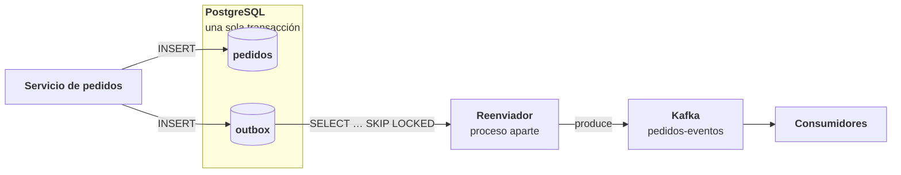
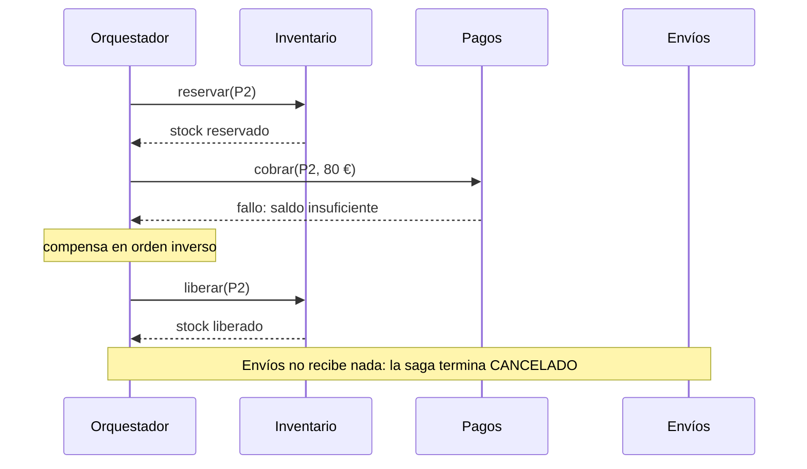
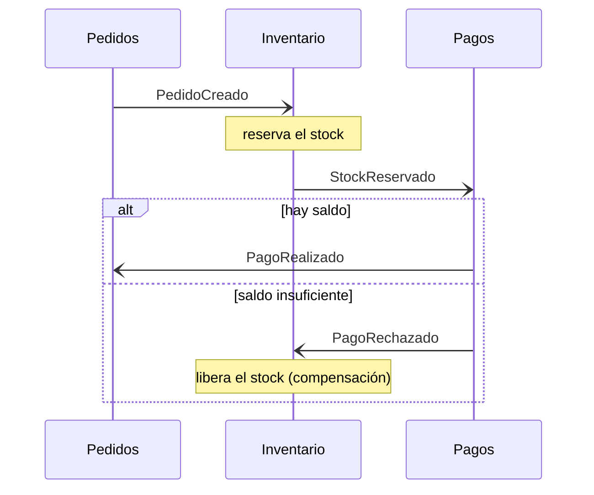
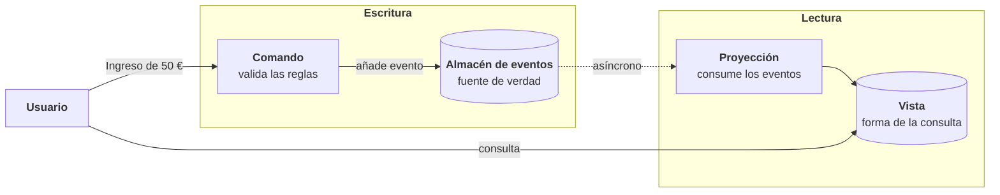

# titulo: Arquitectura dirigida por eventos


# Qué significa «dirigido por eventos»

## Objetivos de aprendizaje

- **1.1** Distinguir un evento de un comando.
- **1.2** Reconocer los cuatro patrones que suelen llamarse «dirigidos por eventos».
- **1.3** Elegir entre notificación y transferencia de estado según el caso.

## Eventos y comandos

| | Evento | Comando |
|---|---|---|
| Qué es | Un hecho que **ya ha ocurrido** | Una **petición** de que algo ocurra |
| Nombre | En pasado: `PedidoConfirmado`, `PagoRechazado` | En imperativo: `ReservarStock`, `CobrarPedido` |
| Destinatarios | Cualquiera que esté interesado; el emisor no los conoce | Un destinatario concreto |
| ¿Se puede rechazar? | No: ya pasó | Sí: el destinatario puede negarse |

Mezclarlos causa acoplamiento: un «evento» llamado `EnviarCorreoDeConfirmacion` es en realidad un comando disfrazado, y obliga al emisor a saber qué tiene que hacer otro.

## Cuatro patrones con el mismo nombre

Martin Fowler escribió en 2017 *What do you mean by "Event-Driven"?* tras ver que, en un taller de Thoughtworks, «dirigido por eventos» significaba cosas muy distintas para cada equipo. Distinguió cuatro patrones:

| Patrón | Idea | Ventaja | Riesgo |
|---|---|---|---|
| **Notificación de eventos** | El emisor avisa de un cambio con un evento pequeño y no espera respuesta | Desacopla mucho | Cuesta ver el flujo completo; si el receptor necesita datos, vuelve a llamar al emisor |
| **Transferencia de estado en el evento** | El evento lleva los datos que cambiaron; el receptor mantiene su copia | El receptor no depende de que el emisor esté disponible | Datos duplicados y consistencia eventual |
| **Event sourcing** | Cada cambio de estado se guarda como evento y el estado se reconstruye con ellos | Historial completo y auditable | Complejidad (lección 4) |
| **CQRS** | Modelos distintos para escribir y para leer | Optimizar cada lado | Fowler avisa de que en la mayoría de los sistemas añade complejidad arriesgada |

Fowler señala que CQRS ni siquiera requiere eventos, pero se suele combinar con los anteriores.

## Notificación o transferencia de estado

El servicio de clientes cambia la dirección de Ana. Envíos necesita la dirección para preparar paquetes.

- Con **notificación**, el evento es `ClienteModificado {id: 42}`. Envíos llama a clientes para obtener la dirección nueva. Si clientes está caído, envíos no puede seguir.
- Con **transferencia de estado**, el evento es `DireccionCambiada {id: 42, direccion: "…"}`. Envíos guarda su copia y no vuelve a llamar.

La segunda desacopla más en el tiempo; la primera evita copiar datos y es más simple si el receptor rara vez necesita los detalles.

## Puntos clave

- Un evento es un hecho pasado, sin destinatario concreto; un comando es una petición que se puede rechazar.
- Nombra los eventos en pasado y no disfraces comandos de eventos.
- «Dirigido por eventos» abarca cuatro patrones: notificación, transferencia de estado, event sourcing y CQRS (Fowler, 2017).
- La notificación desacopla, pero el receptor puede depender del emisor para los detalles; la transferencia de estado copia datos para no depender.

## Referencias

- Martin Fowler, [What do you mean by "Event-Driven"?](https://martinfowler.com/articles/201701-event-driven.html) (2017).
- [CloudEvents](https://cloudevents.io/), especificación para describir eventos de forma común.

# Publicar eventos de forma fiable

## Objetivos de aprendizaje

- **2.1** Explicar el problema de la doble escritura.
- **2.2** Implementar el patrón outbox con una tabla y un proceso de reenvío.
- **2.3** Comparar el reenvío por consulta con la captura de cambios (CDC).
- **2.4** Combinar outbox con consumidores idempotentes.

Lo que se describe aquí se ha probado con PostgreSQL 17, Kafka 4.1 y Python (psycopg y confluent-kafka).

## El problema de la doble escritura

Un servicio guarda un pedido y publica `PedidoCreado`:

```python
db.guardar(pedido)          # 1. base de datos
broker.publicar(evento)     # 2. broker
```

Son dos sistemas distintos y no hay una transacción que los cubra a la vez:

- Si el paso 2 falla (el broker está caído), el pedido existe pero **nadie se entera**.
- Si se publica primero y luego falla la base de datos, se anuncia un pedido **que no existe**.

Las transacciones distribuidas (*two-phase commit*) no suelen ser una opción: muchos brokers no las soportan y acoplan el servicio a ambos sistemas.

## El patrón outbox

La solución de microservices.io: el servicio **guarda el mensaje en la base de datos, dentro de la misma transacción** que el cambio de negocio, en una tabla *outbox*. Un **proceso aparte** lee esa tabla y publica en el broker.



```nodos
SRV:
  titulo: Servicio de pedidos
  texto: Hace el cambio de negocio y guarda el evento en la misma transacción. No habla con el broker.
BD:
  titulo: Una sola transacción
  texto: El pedido y su evento se confirman juntos o ninguno. Así desaparece el problema de la doble escritura.
  seccion: 02-publicar-de-forma-fiable/teoria#el-problema-de-la-doble-escritura
P:
  titulo: Tabla pedidos
  texto: El estado de negocio que se quiere cambiar.
O:
  concepto: outbox
REL:
  titulo: Reenviador (relay)
  texto: Lee las filas pendientes en orden, las publica y las marca como enviadas. Con FOR UPDATE SKIP LOCKED pueden correr varias instancias sin publicar lo mismo.
K:
  titulo: Kafka
  texto: Recibe los eventos con la clave del agregado, que mantiene el orden por pedido.
CON:
  titulo: Consumidores
  texto: Pueden recibir un evento más de una vez (si el reenviador cae entre publicar y marcar), así que deben ser idempotentes.
  seccion: 02-publicar-de-forma-fiable/teoria#al-menos-una-vez-otra-vez
```

```python
def crear_pedido(cliente, total):
    pid = uuid.uuid4()
    with psycopg.connect(DSN) as c, c.transaction():
        c.execute("INSERT INTO pedidos VALUES (%s, %s, %s)", (pid, cliente, total))
        c.execute("INSERT INTO outbox (agregado, tipo, carga) VALUES (%s, 'PedidoCreado', %s)",
                  (pid, json.dumps({"pedido": str(pid), "cliente": cliente, "total": str(total)})))
    return pid
```

El pedido y su evento se confirman **juntos o ninguno**. En la prueba, un pedido con total negativo violó la restricción `CHECK` y **no dejó ni pedido ni evento**.

El proceso de reenvío (*relay*):

```python
filas = c.execute("SELECT id, agregado, tipo, carga FROM outbox "
                  "WHERE NOT enviado ORDER BY id FOR UPDATE SKIP LOCKED").fetchall()
for oid, agregado, tipo, carga in filas:
    productor.produce("pedidos-eventos", key=str(agregado), value=json.dumps(carga),
                      headers={"tipo": tipo, "id-evento": str(oid)})
productor.flush(10)
c.execute("UPDATE outbox SET enviado = true WHERE id = ANY(%s)", ([f[0] for f in filas],))
```

- `ORDER BY id` publica en el orden en que se crearon; la clave del agregado mantiene el orden por pedido en Kafka.
- `FOR UPDATE SKIP LOCKED` permite tener varias instancias del reenviador sin que publiquen las mismas filas.

## Al menos una vez, otra vez

En la prueba se simuló que el reenviador se caía **después de publicar y antes de marcar** las filas como enviadas. La siguiente ejecución volvió a publicar el mismo evento: el consumidor recibió **2 mensajes** del mismo pedido. El outbox garantiza **al menos una vez**, no exactamente una vez.

Por eso el consumidor debe ser **idempotente**. El de la prueba crea la factura con `INSERT … ON CONFLICT (pedido) DO NOTHING`: recibió 2 mensajes y creó **1 factura**. Incluir un identificador de evento (aquí, la cabecera `id-evento`) facilita descartar duplicados.

## Consultar la tabla o leer el registro de la base de datos

| Forma de reenviar | Cómo | A favor | En contra |
|---|---|---|---|
| **Consulta periódica** (*polling*) | Un proceso consulta la tabla cada poco | Sencillo, solo SQL | Latencia del intervalo y carga de consultas |
| **Captura de cambios** (CDC) | Una herramienta como Debezium lee el registro de transacciones de la base de datos y publica cada fila nueva de la outbox | Latencia baja, sin consultas | Otra pieza de infraestructura que operar |

Debezium incluye un enrutador específico para tablas outbox.

## Puntos clave

- Escribir en la base de datos y publicar en el broker por separado deja datos incoherentes si falla uno de los dos.
- Outbox: el evento se guarda en una tabla en la misma transacción que el cambio; otro proceso lo publica.
- Si la transacción se deshace, no queda evento.
- El reenvío puede repetir mensajes: el consumidor debe ser idempotente.
- El reenvío puede ser por consulta periódica o con captura de cambios (Debezium).

## Referencias

- microservices.io, [Pattern: Transactional outbox](https://microservices.io/patterns/data/transactional-outbox.html).
- Debezium, [Outbox Event Router](https://debezium.io/documentation/reference/stable/transformations/outbox-event-router.html).

# Sagas

## Objetivos de aprendizaje

- **3.1** Explicar por qué un proceso entre servicios no puede ser una transacción ACID.
- **3.2** Diseñar una saga con transacciones locales y compensaciones.
- **3.3** Comparar coreografía y orquestación.

## El problema

Crear un pedido implica reservar stock (servicio de inventario), cobrar (pagos) y programar el envío (envíos). Cada servicio tiene **su propia base de datos**. No hay una transacción ACID que abarque los tres, y bloquear recursos de varios servicios mientras dura el proceso sería lento y frágil.

## La idea: transacciones locales y compensaciones

Hector Garcia-Molina y Kenneth Salem propusieron las **sagas** en 1987 (*Sagas*, ACM SIGMOD) para transacciones de larga duración: dividirlas en una **secuencia de transacciones locales**, cada una confirmada por separado. Si un paso falla, los anteriores se deshacen con **transacciones compensatorias**.

| Paso | Acción | Compensación |
|---|---|---|
| 1 | Reservar stock | Liberar el stock |
| 2 | Cobrar | Devolver el cobro |
| 3 | Programar el envío | — (último paso) |

Una compensación **no es un `ROLLBACK`**: el paso ya se confirmó y otros pudieron verlo. Es una operación de negocio nueva que deshace su efecto (una devolución, no un cobro que «nunca existió»).

## Orquestación

Un **orquestador** dice a cada servicio qué hacer y, si algo falla, ejecuta las compensaciones en orden inverso:

```python
def saga_crear_pedido(pedido, importe, inventario, pagos, envios):
    pasos = [
        (lambda: inventario.reservar(pedido), lambda: inventario.liberar(pedido)),
        (lambda: pagos.cobrar(pedido, importe), lambda: pagos.devolver(pedido, importe)),
        (lambda: envios.programar(pedido), None),
    ]
    hechos = []
    for accion, compensacion in pasos:
        try:
            accion()
            hechos.append(compensacion)
        except Exception as e:
            for comp in reversed(hechos):
                if comp:
                    comp()
            return "CANCELADO"
    return "CONFIRMADO"
```

Ejecutado con un saldo de 100 €:

```text
pedido P1 de 60 EUR:
  stock reservado para P1
  cobrados 60 EUR
  envío programado para P1
 -> CONFIRMADO
pedido P2 de 80 EUR:
  stock reservado para P2
  fallo: saldo insuficiente para P2; compensando
  stock liberado para P2
 -> CANCELADO
```

Al final quedó reservado solo P1 y el saldo era 40 €: P2 no dejó rastro. En un sistema real, cada paso es un comando a otro servicio y el estado de la saga se guarda en la base de datos, para retomarla si el orquestador se reinicia.



```nodos
O:
  concepto: orquestacion
I:
  titulo: Inventario
  texto: Paso 1. Su compensación es liberar el stock reservado.
P:
  titulo: Pagos
  texto: Paso 2. Aquí falla P2 por saldo insuficiente, así que se compensan los pasos ya confirmados.
E:
  titulo: Envíos
  texto: Paso 3, el último. No tiene compensación porque, si se llega a él, la saga ya ha terminado bien.
```

## Coreografía

Sin coordinador central: cada servicio **reacciona a los eventos** de los demás. Pedidos publica `PedidoCreado`; inventario reserva y publica `StockReservado`; pagos cobra y publica `PagoRealizado` o `PagoRechazado`; ante `PagoRechazado`, inventario libera el stock.



```nodos
PE:
  titulo: Pedidos
  texto: Publica PedidoCreado y no sabe quién reaccionará. Cada flecha es un evento publicado en el broker, no una llamada.
IN:
  titulo: Inventario
  texto: Reacciona a PedidoCreado reservando stock y a PagoRechazado liberándolo.
PA:
  concepto: coreografia
```

| | Orquestación | Coreografía |
|---|---|---|
| Dónde está el flujo | En el orquestador, en un solo sitio | Repartido entre los servicios |
| Acoplamiento | Los servicios dependen del orquestador | Cada servicio depende de los eventos de otros |
| Entender y depurar | Más fácil: el flujo está escrito | Más difícil al crecer el número de pasos |
| Encaja en | Procesos con muchos pasos o reglas | Procesos cortos, de dos o tres pasos |

## Diseñar compensaciones

- Cada paso necesita su compensación **antes** de escribir la saga.
- Las compensaciones deben ser **idempotentes** y poder reintentarse: se ejecutan después de fallos.
- Algunos pasos no se pueden compensar (un correo enviado). Ponlos al **final** de la saga, cuando ya no puede fallar nada.
- Durante la saga, otros pueden ver estados intermedios (el pedido «pendiente»): falta el aislamiento de ACID y hay que diseñarlo, por ejemplo con estados explícitos.

## Puntos clave

- Un proceso entre varios servicios no cabe en una transacción ACID.
- Una saga es una secuencia de transacciones locales con compensaciones (Garcia-Molina y Salem, 1987).
- Una compensación es una operación de negocio que deshace el efecto, no un `ROLLBACK`.
- Orquestación: un coordinador con el flujo escrito. Coreografía: servicios que reaccionan a eventos.
- Las compensaciones deben ser idempotentes; lo que no se puede compensar va al final.

## Referencias

- Hector Garcia-Molina y Kenneth Salem, [Sagas](https://www.cs.cornell.edu/andru/cs711/2002fa/reading/sagas.pdf) (ACM, 1987).
- microservices.io, [Pattern: Saga](https://microservices.io/patterns/data/saga.html).
- Microsoft, [Compensating Transaction pattern](https://learn.microsoft.com/en-us/azure/architecture/patterns/compensating-transaction) y [Saga pattern](https://learn.microsoft.com/en-us/azure/architecture/patterns/saga).

# Event sourcing y CQRS

## Objetivos de aprendizaje

- **4.1** Reconstruir el estado a partir de eventos.
- **4.2** Conocer las ventajas y los costes del event sourcing.
- **4.3** Explicar CQRS y las proyecciones.
- **4.4** Decidir cuándo no usar estos patrones.

## Event sourcing

Normalmente se guarda el **estado actual** (el saldo de una cuenta). Con **event sourcing** se guardan los **hechos** que llevaron a él, y el estado se **calcula**:

```python
eventos = [("CuentaAbierta", {"titular": "ana"}),
           ("Ingreso", {"importe": 100}),
           ("Retirada", {"importe": 30}),
           ("Ingreso", {"importe": 50})]

def aplicar(estado, evento):
    tipo, datos = evento
    if tipo == "CuentaAbierta":
        return {"titular": datos["titular"], "saldo": 0, "movimientos": 0}
    if tipo == "Ingreso":
        return {**estado, "saldo": estado["saldo"] + datos["importe"], "movimientos": estado["movimientos"] + 1}
    if tipo == "Retirada":
        return {**estado, "saldo": estado["saldo"] - datos["importe"], "movimientos": estado["movimientos"] + 1}

reduce(aplicar, eventos, None)       # {'titular': 'ana', 'saldo': 120, 'movimientos': 3}
reduce(aplicar, eventos[:3], None)   # {'titular': 'ana', 'saldo': 70, 'movimientos': 2}
```

Fowler lo describe así: cada cambio de estado se registra como un evento y el estado se puede reconstruir en cualquier momento reprocesándolos; el **almacén de eventos** es la fuente de verdad. La segunda línea muestra una ventaja: el estado **en cualquier punto del pasado** se obtiene aplicando solo los eventos hasta ese momento.

| Ventajas | Costes |
|---|---|
| Historial completo y auditable, sin perder nada | Consultar el estado actual exige reconstruirlo o mantener proyecciones |
| Reconstruir el estado de cualquier fecha | Los eventos son para siempre: cambiar su formato exige versionarlos |
| Nuevas vistas a partir de eventos antiguos | Más difícil de entender y de operar que un CRUD |
| Encaja con la publicación de eventos | Con muchos eventos por entidad, hacen falta instantáneas (*snapshots*) |

## CQRS

**CQRS** (*Command Query Responsibility Segregation*) usa **un modelo para escribir y otro para leer**. Fowler lo atribuye a Greg Young. El lado de escritura valida y aplica las reglas; el de lectura tiene **proyecciones** con la forma justa para cada consulta (una tabla desnormalizada para el listado de pedidos, un índice de búsqueda para el catálogo).

Con event sourcing, las proyecciones se construyen consumiendo los eventos. Y como se alimentan de forma asíncrona, **las lecturas pueden ir un poco por detrás** de las escrituras: el usuario guarda un cambio y, durante un instante, el listado aún no lo muestra. Hay que diseñar la interfaz para eso.



```nodos
U:
  titulo: Usuario
  texto: Escribe con comandos y lee de las vistas. Justo después de escribir, la vista puede no mostrar aún el cambio.
ESC:
  titulo: Lado de escritura
  texto: Valida y aplica las reglas de negocio.
LEC:
  concepto: cqrs
CMD:
  concepto: comando
ES:
  concepto: event-sourcing
PR:
  concepto: proyeccion
V:
  titulo: Vista de lectura
  texto: Tabla desnormalizada o índice con la forma justa para cada consulta. Se puede tirar y reconstruir desde los eventos.
```

## Cuándo no

Fowler es tajante con CQRS: para la mayoría de los sistemas **añade una complejidad arriesgada**, y conviene aplicarlo solo a partes concretas que lo necesiten, nunca a todo el sistema. Lo mismo vale para event sourcing:

| Situación | ¿Event sourcing o CQRS? |
|---|---|
| Un CRUD de fichas de clientes | No |
| Una contabilidad o un sistema financiero que exige auditoría completa | Puede encajar event sourcing |
| Lecturas con una forma muy distinta de las escrituras y mucha más carga | Puede encajar CQRS en esa parte |
| «Porque es moderno» | No |

## Puntos clave

- Event sourcing guarda los hechos y calcula el estado; el almacén de eventos es la fuente de verdad.
- Permite reconstruir el estado de cualquier momento y crear vistas nuevas con eventos antiguos.
- Cuesta: proyecciones, versiones de eventos, instantáneas y más complejidad.
- CQRS separa los modelos de escritura y de lectura; las proyecciones pueden ir por detrás.
- Fowler advierte que CQRS añade complejidad arriesgada en la mayoría de los sistemas: aplícalo solo donde haga falta.

## Referencias

- Martin Fowler, [Event Sourcing](https://martinfowler.com/eaaDev/EventSourcing.html).
- Martin Fowler, [CQRS](https://martinfowler.com/bliki/CQRS.html).
- microservices.io, [Event sourcing](https://microservices.io/patterns/data/event-sourcing.html) y [CQRS](https://microservices.io/patterns/data/cqrs.html).
