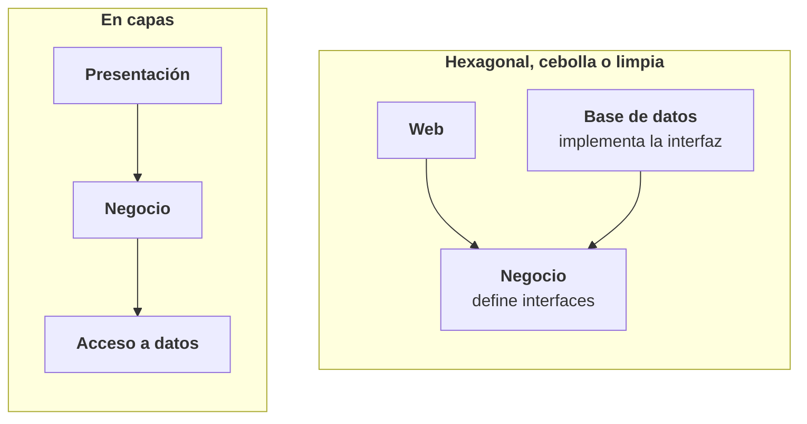
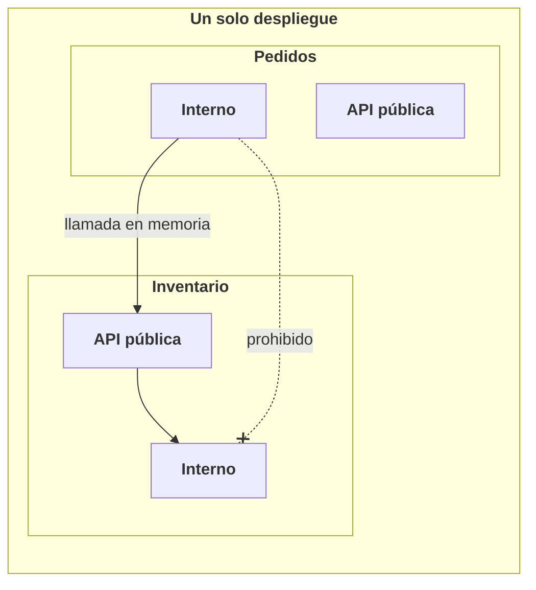

# titulo: Estilos de arquitectura comparados


# Qué es un estilo de arquitectura

## Objetivos de aprendizaje

- **1.1** Definir un estilo de arquitectura por sus reglas de dependencia.
- **1.2** Relacionar los estilos con los atributos de calidad que favorecen.
- **1.3** Distinguir la estructura del código de la forma de desplegarlo.

## Reglas sobre dependencias

Un **estilo de arquitectura** es un conjunto de reglas sobre cómo se reparten las responsabilidades y, sobre todo, **en qué dirección pueden ir las dependencias**. Las preguntas que responde cada estilo:

- ¿Qué parte del sistema es la más importante y debe estar más protegida?
- ¿Quién puede conocer a quién?
- ¿Qué cambia junto y qué debe poder cambiar por separado?

Las diferencias entre estilos (capas, hexagonal, cebolla, limpia) son menores de lo que sugieren sus diagramas; lo esencial es **adónde apuntan las flechas**.

## Atributos de calidad

Ningún estilo es mejor en todo. Cada uno favorece unos **atributos de calidad** a costa de otros. La norma ISO/IEC 25010 define nueve características de calidad del producto, entre ellas la adecuación funcional, la eficiencia de desempeño, la compatibilidad, la capacidad de interacción y la mantenibilidad. Para los estilos de este tema, la que más pesa es la **mantenibilidad**: lo fácil que es entender, probar y cambiar el sistema.

| Estilo | Favorece | A cambio de |
|---|---|---|
| Capas | Sencillez, familiaridad | El negocio depende de la persistencia |
| Hexagonal, cebolla, limpia | Probar y cambiar el dominio sin la tecnología | Más interfaces y traducciones |
| Monolito modular | Modularidad con un solo despliegue | Escalar y desplegar todo junto |
| Microservicios | Despliegue y escala independientes por equipo | Red, consistencia eventual, operación |
| Dirigida por eventos | Desacoplamiento en el tiempo | Flujos difíciles de seguir, consistencia eventual |

Elegir un estilo es elegir **qué compromisos aceptar**, según lo que importa en el sistema concreto.

## Estructura y despliegue

Conviene separar dos ejes que se mezclan a menudo:

- **Estructura interna**: cómo se organiza el código y adónde apuntan las dependencias (capas, hexagonal, limpia).
- **Despliegue**: en cuántas unidades se ejecuta (monolito, monolito modular, microservicios).

Son independientes. Un microservicio puede ser hexagonal por dentro, y un monolito modular puede tener cada módulo en capas. Los temas de arquitectura hexagonal, DDD, microservicios y arquitectura dirigida por eventos tratan cada pieza a fondo; este tema las compara.

## Puntos clave

- Un estilo es, sobre todo, un conjunto de reglas sobre la dirección de las dependencias.
- Cada estilo favorece unos atributos de calidad a costa de otros: elegir es aceptar compromisos.
- Estructura interna y despliegue son ejes distintos y combinables.

## Referencias

- Martin Fowler, [Software Architecture Guide](https://martinfowler.com/architecture/).
- ISO 25000, [ISO/IEC 25010](https://iso25000.com/en/iso-25000-standards/iso-25010).

# Capas

## Objetivos de aprendizaje

- **2.1** Describir la arquitectura en capas y su regla de dependencia.
- **2.2** Reconocer sus problemas habituales.
- **2.3** Comprobar automáticamente las reglas entre capas.

## Presentación, dominio y datos

La forma más extendida de organizar una aplicación: capas horizontales, como describe Fowler en *PresentationDomainDataLayering*:

- **Presentación**: atiende HTTP y muestra resultados.
- **Lógica de negocio** (dominio): validaciones y cálculos.
- **Acceso a datos**: la base de datos y los servicios remotos.

La regla: cada capa solo depende de las de **debajo**. La presentación llama al negocio, el negocio al acceso a datos, nunca al revés. Es sencilla, conocida por todos y suficiente para muchas aplicaciones.

## Problemas habituales

- **El negocio depende de la base de datos**: como el acceso a datos está debajo, las reglas de negocio importan clases de persistencia (entidades JPA, sesiones). Probar el negocio exige la base de datos, y cambiar de tecnología toca el núcleo. Es el problema que resuelven hexagonal, cebolla y limpia invirtiendo esa dependencia (lección 3).
- **Capas que solo pasan datos**: peticiones que atraviesan la capa de negocio sin que esta haga nada, solo para llegar a los datos. Si casi todo es así, quizá la aplicación sea un CRUD y no necesite más.
- **Saltarse capas o ir hacia arriba**: un repositorio que llama a un controlador, o un servicio que conoce la web. Pasa poco a poco, sin que nadie lo decida.

## Comprobar las reglas

Las reglas que no se comprueban se erosionan. **import-linter** comprueba contratos sobre las importaciones en Python:

```ini
[importlinter:contract:capas]
name = Capas: web -> aplicacion -> dominio
type = layers
layers =
    web
    aplicacion
    dominio
containers = tienda

[importlinter:contract:dominio-puro]
name = El dominio no depende de la infraestructura
type = forbidden
source_modules = tienda.dominio
forbidden_modules = tienda.infraestructura
```

Con el código correcto:

```text
Capas: web -> aplicacion -> dominio KEPT
El dominio no depende de la infraestructura KEPT
Contracts: 2 kept, 0 broken.
```

Después se introdujeron dos atajos: el dominio guarda directamente con el repositorio SQL y la aplicación importa la web:

```text
tienda.aplicacion is not allowed to import tienda.web:
- tienda.aplicacion.crear_pedido -> tienda.web.api (l.3)

tienda.dominio is not allowed to import tienda.infraestructura:
-   tienda.dominio.pedido -> tienda.infraestructura.repo_sql (l.1)

Contracts: 0 kept, 2 broken.
```

Cada violación con su fichero y su línea. Ejecutado en la CI, el atajo no llega a la rama principal. En Java, **ArchUnit** hace lo mismo con pruebas de JUnit. Son **funciones de aptitud**: comprobaciones automáticas de una característica de la arquitectura.

## Puntos clave

- Capas: presentación, negocio y datos; cada una depende solo de las de debajo.
- Su problema principal: el negocio depende de la persistencia.
- Las capas que solo pasan datos indican que quizá basta un CRUD.
- import-linter (Python) y ArchUnit (Java) convierten las reglas en pruebas: las dos violaciones se detectaron con fichero y línea.

## Referencias

- Martin Fowler, [Presentation Domain Data Layering](https://martinfowler.com/bliki/PresentationDomainDataLayering.html).
- [import-linter](https://import-linter.readthedocs.io/en/stable/) y sus [tipos de contrato](https://import-linter.readthedocs.io/en/stable/contract_types/).
- [ArchUnit User Guide](https://www.archunit.org/userguide/html/000_Index.html).
- Thoughtworks, [Architectural fitness function](https://www.thoughtworks.com/radar/techniques/architectural-fitness-function).

# Hexagonal, cebolla y limpia

## Objetivos de aprendizaje

- **3.1** Explicar la idea común: el dominio en el centro y las dependencias hacia dentro.
- **3.2** Comparar el vocabulario de hexagonal, cebolla y limpia.
- **3.3** Decidir cuándo compensan.

## La idea común

Las tres corrigen el problema de las capas: en lugar de que el negocio dependa de la base de datos, **la base de datos depende del negocio**. El dominio define lo que necesita (una interfaz) y la infraestructura lo implementa: **inversión de dependencias**.



```nodos
CAP:
  concepto: arquitectura-capas
P1:
  titulo: Presentación
  texto: Depende del negocio, que está debajo.
N1:
  titulo: Negocio en capas
  texto: Depende del acceso a datos. Cambiar la base de datos o probar sin ella obliga a tocar el negocio.
D1:
  titulo: Acceso a datos
  texto: La capa de abajo, de la que acaba dependiendo todo.
INV:
  concepto: regla-dependencia
P2:
  titulo: Web
  texto: Adaptador de entrada. Depende del negocio.
N2:
  titulo: Negocio en el centro
  texto: No depende de nada exterior. Declara lo que necesita (un puerto o interfaz) y la infraestructura lo implementa. Es la inversión de dependencias.
D2:
  titulo: Base de datos
  texto: Ahora la flecha apunta hacia dentro, al negocio. Se puede sustituir por una implementación en memoria en las pruebas.
```

- **Hexagonal** (Alistair Cockburn, puertos y adaptadores): la aplicación en el centro, con **puertos** que los **adaptadores** implementan o usan. Tiene su propio tema.
- **Cebolla** (Jeffrey Palermo, 2008): capas concéntricas con el modelo de dominio en el centro. Su regla: el código puede depender de capas **más centrales**, nunca de las exteriores; todo el acoplamiento va hacia el centro.
- **Limpia** (Robert C. Martin, 2012): círculos de **entidades**, **casos de uso**, **adaptadores de interfaz** y **frameworks y drivers**. Su **regla de dependencia**: las dependencias del código fuente solo apuntan hacia dentro.

## Mismo fondo, distinto vocabulario

| | Hexagonal | Cebolla | Limpia |
|---|---|---|---|
| Centro | Aplicación y dominio | Modelo de dominio | Entidades |
| Lógica de aplicación | Detrás de los puertos de entrada | Servicios de aplicación | Casos de uso |
| Traducción con el exterior | Adaptadores | Infraestructura e interfaz | Adaptadores de interfaz |
| Tecnología | Fuera de los adaptadores | Anillo exterior | Frameworks y drivers |
| Regla | El dominio no conoce los adaptadores | Acoplamiento hacia el centro | Dependencias hacia dentro |

En la práctica son **la misma idea** con nombres distintos. Discutir cuál usar sirve de poco; lo que importa es cumplir la regla de dependencia, y comprobarla (lección 2).

## Cuándo compensan

Compensan cuando hay **lógica de negocio** que proteger y que probar sin infraestructura, y cuando la tecnología puede cambiar (otra base de datos, otro proveedor). Cuestan más interfaces, más objetos y más traducciones.

No compensan en un CRUD sin reglas, un *script* o un prototipo: ahí unas capas sencillas, o incluso una sola, son más claras. Se puede empezar simple y extraer puertos cuando aparezca la necesidad.

## Puntos clave

- Hexagonal, cebolla y limpia invierten la dependencia de las capas: la infraestructura depende del dominio.
- Cebolla: acoplamiento hacia el centro. Limpia: la regla de dependencia apunta hacia dentro.
- Son la misma idea con distinto vocabulario: lo importante es cumplir y comprobar la regla.
- Compensan con lógica de negocio que proteger; en un CRUD, sobran.

## Referencias

- Alistair Cockburn, [Hexagonal Architecture](https://alistair.cockburn.us/hexagonal-architecture).
- Jeffrey Palermo, [The Onion Architecture, part 1](https://jeffreypalermo.com/2008/07/the-onion-architecture-part-1/).
- Robert C. Martin, [The Clean Architecture](https://blog.cleancoder.com/uncle-bob/2012/08/13/the-clean-architecture.html).

# Monolito modular

## Objetivos de aprendizaje

- **4.1** Describir un monolito modular y sus ventajas.
- **4.2** Separar la API pública de un módulo de sus detalles internos.
- **4.3** Verificar la estructura modular con Spring Modulith.

## Qué es

Un **monolito modular** se **despliega como una unidad**, pero está dividido en **módulos por capacidad de negocio** (los contextos delimitados de DDD): Pedidos, Inventario, Pagos. Cada módulo:

- tiene una **API pública** pequeña, que es lo único que ven los demás;
- **oculta** sus detalles internos;
- no forma **ciclos** con otros módulos.

Reúne ventajas de los dos extremos: la sencillez de un despliegue, de las transacciones locales y de las llamadas en memoria, con la modularidad que permite a varios equipos trabajar sin pisarse. Y si un módulo necesita separarse más adelante, sus límites ya están claros. Por eso es el punto de partida recomendado en los temas de DDD y microservicios.



```nodos
MON:
  concepto: monolito-modular
MP:
  titulo: Módulo Pedidos
  texto: Un módulo por capacidad de negocio, como un contexto delimitado de DDD.
MI:
  titulo: Módulo Inventario
  texto: Solo expone su API pública. Si algún día se separa como servicio, ese límite ya está claro.
PA:
  titulo: API pública de Pedidos
  texto: Lo único de Pedidos que pueden usar los demás módulos.
PI:
  titulo: Interno de Pedidos
  texto: Su implementación. Llama a otros módulos solo a través de sus APIs públicas.
IA:
  titulo: API pública de Inventario
  texto: La puerta de entrada del módulo. Al ser llamadas en memoria dentro del mismo proceso, sirven las transacciones locales.
II:
  titulo: Interno de Inventario
  texto: Oculto. Herramientas como Spring Modulith o import-linter hacen fallar la compilación o las pruebas si otro módulo lo usa.
  seccion: 04-monolito-modular/teoria#spring-modulith
```

El riesgo: sin comprobaciones, los módulos se van usando por dentro hasta que el monolito modular vuelve a ser un monolito enredado.

## Spring Modulith

**Spring Modulith** trata cada paquete directo bajo el de la aplicación como un módulo, y verifica sus reglas. Probado con **Spring Modulith 2.1.2** y Spring Boot 4.1.2:

```text
tienda
├── TiendaApplication.java
├── inventario
│   ├── Inventario.java            ← API pública del módulo
│   └── interno
│       └── Almacen.java           ← detalle interno
└── pedidos
    └── Pedidos.java
```

Basta una prueba:

```java
@Test
void estructuraModular() {
    ApplicationModules modulos = ApplicationModules.of(TiendaApplication.class);
    modulos.verify();
}
```

Si `Pedidos` usa directamente `Almacen`, del interior de inventario:

```text
MODULO inventario -> paquete tienda.inventario
MODULO pedidos -> paquete tienda.pedidos
org.springframework.modulith.core.Violations:
- Module 'pedidos' depends on non-exposed type tienda.inventario.interno.Almacen within module 'inventario'!
Method <tienda.pedidos.Pedidos.crear(java.lang.String, int)> calls method
<tienda.inventario.interno.Almacen.unidades(java.lang.String)> in (Pedidos.java:6)
```

Cambiado para usar la API pública (`Inventario.hayStock`), la prueba **pasa**. Y si después `Inventario` importa `Pedidos`:

```text
- Cycle detected: Slice inventario ->
                Slice pedidos ->
                Slice inventario
```

Las dos erosiones típicas, usar el interior de otro módulo y crear ciclos, se detectan en la CI. Spring Modulith ofrece además eventos entre módulos con publicación fiable y documentación generada de la estructura. En otros entornos, ArchUnit (Java) o import-linter (Python) comprueban reglas equivalentes.

## Puntos clave

- Monolito modular: un despliegue, módulos por capacidad de negocio con API pública e interior oculto.
- Une la sencillez del monolito con la modularidad; es un buen punto de partida.
- Sin comprobaciones, los límites se erosionan.
- Spring Modulith detectó el uso de un tipo interno de otro módulo y un ciclo entre módulos.

## Referencias

- Spring Modulith, [Fundamentals](https://docs.spring.io/spring-modulith/reference/fundamentals.html).
- Spring Modulith, [Verifying application module structure](https://docs.spring.io/spring-modulith/reference/verification.html).
- Martin Fowler, [Monolith First](https://martinfowler.com/bliki/MonolithFirst.html).

# Elegir y documentar

## Objetivos de aprendizaje

- **5.1** Comparar los estilos según la situación.
- **5.2** Combinar estilos de estructura y de despliegue.
- **5.3** Documentar las decisiones con registros de decisión de arquitectura (ADR).

## Comparación

| Estilo | Encaja cuando | Cuidado con |
|---|---|---|
| Capas | Aplicaciones sencillas, CRUD, equipos pequeños | Negocio acoplado a la persistencia |
| Hexagonal, cebolla, limpia | Lógica de negocio rica que probar y proteger | Estructura excesiva en un CRUD |
| Monolito modular | Varios equipos o contextos, un despliegue manejable | Límites sin comprobar que se erosionan |
| Microservicios | Equipos independientes, escala muy distinta, despliegue autónomo | Red, consistencia eventual, operación |
| Dirigida por eventos | Reacciones desacopladas en el tiempo, integración entre contextos | Flujos difíciles de seguir, duplicados |

Preguntas que ayudan:

- ¿Cuánta **lógica de negocio** hay? Poca: capas. Mucha: hexagonal o limpia.
- ¿Cuántos **equipos**, y necesitan desplegar por separado? Uno: monolito. Varios coordinados: monolito modular. Varios autónomos con motivos: microservicios.
- ¿Qué **atributos de calidad** importan más? Mantenibilidad, escala, disponibilidad, rapidez de entrega.
- ¿Qué sabe operar el equipo **hoy**?

## Combinar

Los estilos de estructura y de despliegue se combinan (lección 1). Una combinación frecuente y sensata:

- Un **monolito modular** con módulos por contexto delimitado.
- Dentro de los módulos con lógica rica, **hexagonal**; los módulos sencillos, en **capas**.
- **Eventos** entre módulos para las reacciones que no necesitan respuesta inmediata.
- Y, si un módulo lo justifica, extraerlo como **servicio**: sus límites, su API y sus eventos ya existen.

No hace falta usar el mismo estilo en todas partes.

## Registros de decisión de arquitectura

Dentro de dos años nadie recordará **por qué** se eligió un monolito modular o Kafka. Un **ADR** (*Architecture Decision Record*), propuesto por Michael Nygard en 2011, es un documento breve por decisión, guardado en el repositorio junto al código (`docs/adr/0007-monolito-modular.md`), con estas partes:

```markdown
# 7. Monolito modular con Spring Modulith

## Estado
Aceptada (2026-11-19)

## Contexto
Tres equipos, cuatro contextos (pedidos, inventario, pagos, envíos), un solo
entorno de producción y poca experiencia operando sistemas distribuidos.

## Decisión
Un único despliegue con un módulo por contexto, verificado con Spring Modulith
en la CI. Eventos entre módulos para envíos y facturación.

## Consecuencias
Un despliegue y transacciones locales. Escala conjunta. Si pagos necesita
escalar aparte, se podrá extraer: sus límites y eventos ya existen.
```

- Se escribe **cuando se decide**, con el contexto de ese momento.
- No se borra: si cambia la decisión, se escribe otro ADR que la **sustituye**, y el anterior queda con ese estado.
- Explica también lo **descartado** y por qué.

Una decisión documentada y una regla comprobada en la CI (funciones de aptitud) son la diferencia entre una arquitectura que se mantiene y una que solo existe en un diagrama.

## Puntos clave

- Elige por la lógica de negocio, los equipos, los atributos de calidad y lo que se sabe operar.
- Combina estilos: monolito modular, hexagonal donde hay lógica, eventos entre módulos.
- No hace falta el mismo estilo en todos los módulos.
- Documenta cada decisión en un ADR con contexto, decisión, estado y consecuencias, junto al código.
- Las decisiones documentadas y comprobadas en la CI son las que perduran.

## Referencias

- Michael Nygard, [Documenting Architecture Decisions](https://www.cognitect.com/blog/2011/11/15/documenting-architecture-decisions).
- [Architectural Decision Records](https://adr.github.io/).
- Thoughtworks, [Architectural fitness function](https://www.thoughtworks.com/radar/techniques/architectural-fitness-function).
- Martin Fowler, [Software Architecture Guide](https://martinfowler.com/architecture/).
