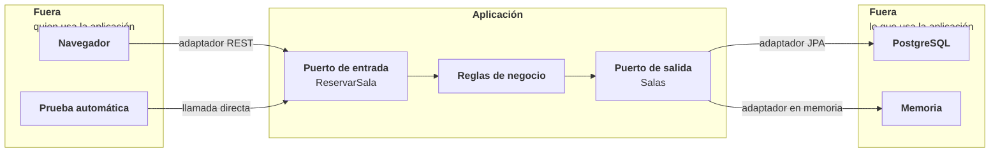
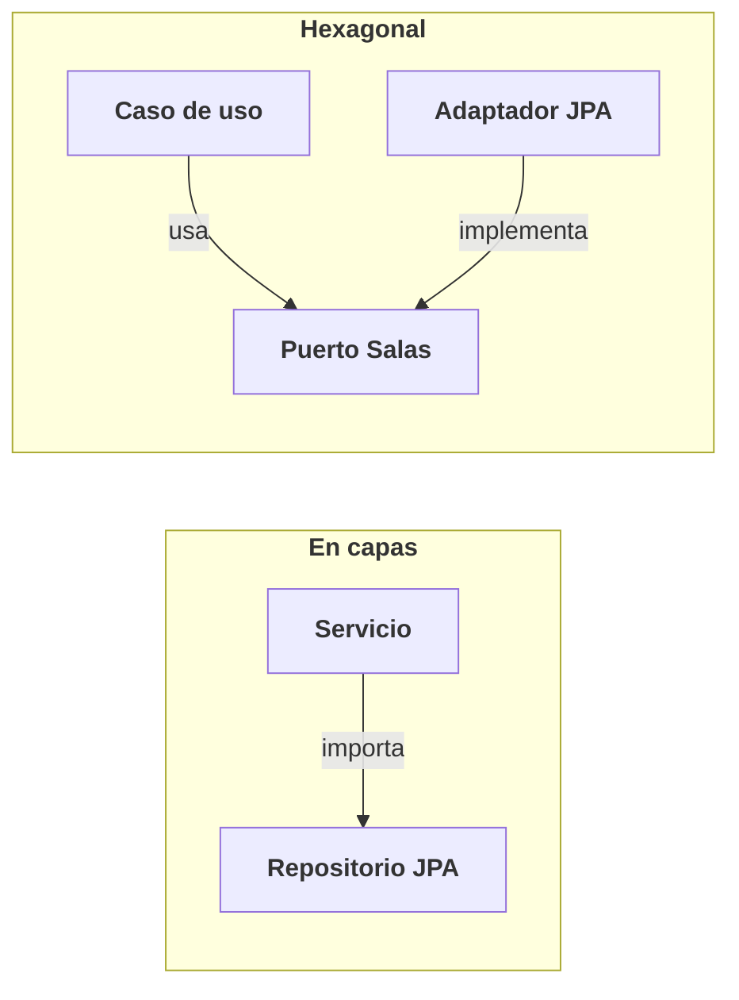
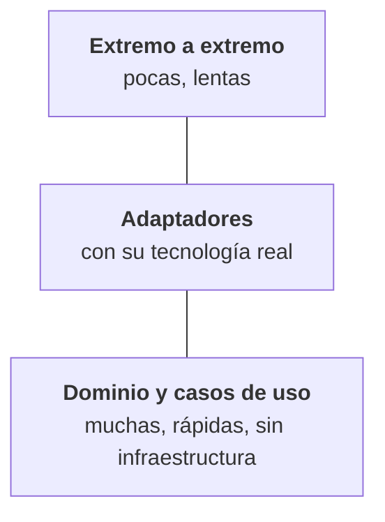
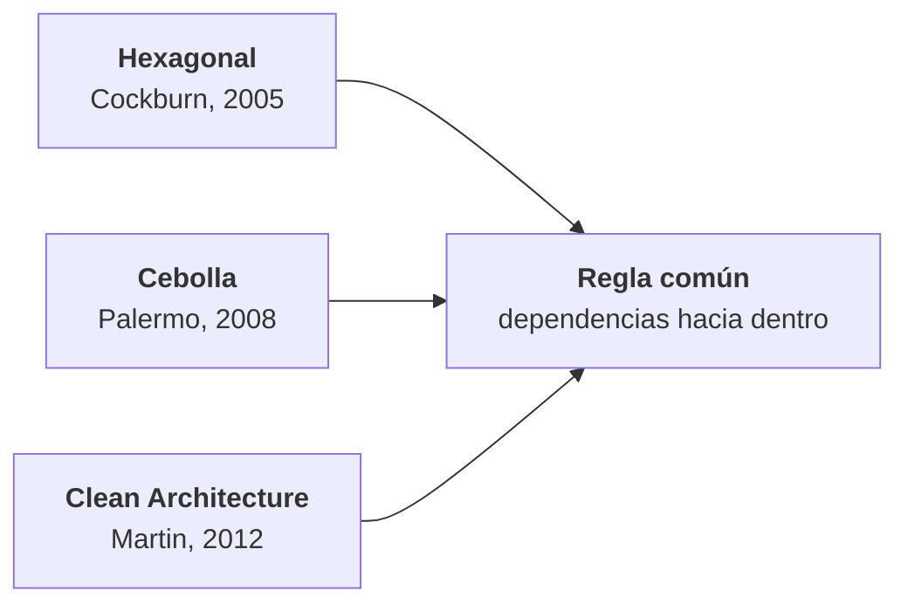

# titulo: Arquitectura hexagonal (puertos y adaptadores)


# El problema y la idea

## Objetivos de aprendizaje

- **1.1** Explicar qué problema resuelve la arquitectura hexagonal.
- **1.2** Describir la idea de puertos y adaptadores con un ejemplo.
- **1.3** Distinguir actores primarios y secundarios, y puertos de entrada y de salida.
- **1.4** Explicar por qué se llama «hexagonal» y por qué el número seis no importa.

## El problema: la lógica de negocio se filtra hacia fuera

Alistair Cockburn publicó la arquitectura hexagonal en 2005, en su artículo *Hexagonal (Ports & Adapters) Architecture*. Parte de una observación: uno de los grandes males del software es que **la lógica de negocio se mezcla con el código de la interfaz de usuario** (y, añade, con el de la base de datos). Cuando ocurre, aparecen tres problemas:

1. **No se puede probar de forma automática**, porque parte de la lógica depende de detalles visuales que cambian a menudo.
2. **No se puede pasar de un uso humano a un proceso por lotes**, porque la lógica está atada a la pantalla.
3. **No se puede dejar que otro programa use la aplicación**, por el mismo motivo.

Un ejemplo típico: un controlador web que valida la petición, comprueba en SQL si la sala está libre, decide si cabe la gente y guarda la reserva. Todo junto. Para probar «no se puede reservar una sala ocupada» hay que levantar un servidor web y una base de datos.

## La idea: puertos y adaptadores

La intención del patrón, en palabras de Cockburn: permitir que una aplicación funcione **igual si la usan personas, otros programas, pruebas automáticas o scripts por lotes**, y que se pueda desarrollar y probar **aislada de los dispositivos y bases de datos** con los que funcionará en producción.

Para conseguirlo, la aplicación se rodea de dos tipos de piezas:

| Pieza | Qué es | Quién la escribe | Ejemplo |
|---|---|---|---|
| **Puerto** | Una conversación con un propósito: «reservar una sala», «guardar salas», «avisar al usuario». Es una interfaz en el idioma del negocio | La aplicación | `ReservarSala`, `Salas`, `Notificaciones` |
| **Adaptador** | La traducción entre ese puerto y una tecnología concreta | La infraestructura | Un controlador REST, un repositorio JPA, un cliente de correo |

Cuando llega un evento del exterior a un puerto, un adaptador específico de la tecnología lo convierte en una llamada que la aplicación entiende. Cuando la aplicación tiene que enviar algo fuera, lo envía por un puerto a un adaptador, que lo convierte en lo que necesita la tecnología receptora. La aplicación **no sabe qué hay al otro lado** de cada adaptador.



```nodos
EXT1:
  titulo: Actores primarios
  texto: Ponen en marcha a la aplicación. Entran por los puertos de entrada.
APP:
  concepto: arquitectura-hexagonal
WEB:
  titulo: Navegador
  texto: Un usuario que llega por HTTP. Un adaptador REST traduce su petición a una llamada al puerto.
TEST:
  titulo: Prueba automática
  texto: Usa el mismo puerto que el navegador, sin servidor web. Es la ventaja principal del patrón.
PE:
  concepto: puerto-de-entrada
NUC:
  concepto: dominio
PS:
  concepto: puerto-de-salida
EXT2:
  titulo: Actores secundarios
  texto: La aplicación los pone en marcha. Se alcanzan por los puertos de salida.
BD:
  titulo: PostgreSQL
  texto: Base de datos real, a la que se llega con un adaptador JPA.
MEM:
  titulo: Memoria
  texto: Implementación en memoria del mismo puerto, útil en pruebas y en desarrollo.
```

Fíjate en la simetría: el navegador y la prueba usan **el mismo puerto de entrada**; PostgreSQL y la memoria implementan **el mismo puerto de salida**. Cambiar uno por otro no toca las reglas de negocio.

## Actores primarios y secundarios

Cockburn toma estos términos de los casos de uso:

- Un **actor primario** pone en marcha a la aplicación para que haga una de sus funciones: un usuario, otro programa, una prueba. Usa los **puertos de entrada** (en inglés se les llama *driving ports*, «los que conducen»).
- Un **actor secundario** es al que la aplicación pone en marcha, para obtener una respuesta o solo para avisarle: una base de datos, un servicio de correo, otro microservicio. Se alcanza por los **puertos de salida** (*driven ports*, «los conducidos»).

La diferencia está en **quién empieza la conversación**, no en la dirección de los datos. Una consulta a la base de datos devuelve datos a la aplicación, pero es la aplicación quien la inicia: es un puerto de salida.

| Situación | ¿Quién inicia? | Tipo de puerto |
|---|---|---|
| Un usuario pide reservar una sala por la web | El usuario | Entrada |
| Llega un mensaje de una cola con un pedido nuevo | El sistema que publica en la cola | Entrada |
| La aplicación lee las reservas existentes de la base de datos | La aplicación | Salida |
| La aplicación envía un correo de confirmación | La aplicación | Salida |
| La aplicación consulta el tipo de cambio a una API externa | La aplicación | Salida |

## Por qué un hexágono

El hexágono **no es un hexágono porque el número seis importe**. Cockburn lo eligió por dos razones:

- Para **romper con el dibujo de capas apiladas**, que sugiere un arriba (la interfaz) y un abajo (la base de datos) distintos. En hexagonal, todo lo de fuera se trata de forma simétrica: dentro está la aplicación y fuera, todo lo demás.
- Para **dejar sitio en el dibujo** a los puertos y adaptadores que hagan falta. En su experiencia, una aplicación tiene pocos puertos: dos, tres o cuatro.

Por eso el nombre alternativo, y más descriptivo, es **puertos y adaptadores**.

## Puntos clave

- La arquitectura hexagonal (Cockburn, 2005) separa la aplicación de su entorno con puertos y adaptadores.
- Su objetivo es que la aplicación funcione igual con personas, programas, pruebas o scripts, y que se pueda probar sin su infraestructura real.
- Un puerto es una interfaz con un propósito, escrita por la aplicación en el idioma del negocio.
- Un adaptador traduce entre un puerto y una tecnología. Un puerto puede tener varios adaptadores.
- Los actores primarios inician la conversación (puertos de entrada); los secundarios la reciben (puertos de salida).
- Lo que distingue entrada de salida es quién inicia la conversación, no hacia dónde van los datos.
- El seis no importa: el hexágono solo sirve para dibujar un dentro y un fuera simétricos.

## Referencias

- Alistair Cockburn, [Hexagonal architecture](https://alistair.cockburn.us/hexagonal-architecture/) (artículo original de 2005).
- Martin Fowler, [Presentation Domain Data Layering](https://martinfowler.com/bliki/PresentationDomainDataLayering.html), sobre las capas clásicas.

# El dominio

## Objetivos de aprendizaje

- **2.1** Explicar qué pertenece al dominio y qué no puede contener.
- **2.2** Distinguir entidades y objetos valor.
- **2.3** Colocar las reglas de negocio en el dominio y reconocer un modelo anémico.
- **2.4** Mantener el dominio independiente del reloj, los identificadores y los frameworks.

## Qué es el dominio

El **dominio** es el centro del hexágono: el código que representa los conceptos y las reglas del negocio. En un servicio de reservas, el dominio sabe qué es una sala, qué es una franja horaria y por qué no se puede reservar una sala ocupada.

Lo que define al dominio en esta arquitectura es lo que **no** contiene:

| No contiene | Por qué | Dónde va |
|---|---|---|
| Anotaciones de persistencia (`@Entity`, `@Table`) | Atarían el modelo a JPA y a la forma de las tablas | Modelos propios del adaptador de persistencia |
| Anotaciones de serialización (`@JsonProperty`) | El formato de la API cambia por motivos distintos que el negocio | Modelos propios del adaptador de entrada |
| HTTP, SQL o colas | Son tecnologías del exterior | Adaptadores |
| Lectura del reloj del sistema o generación de UUID | Hacen el código imprevisible y difícil de probar | Puertos de salida (reloj, generador de ids) |
| Variables de entorno o configuración | El dominio no sabe dónde se ejecuta | Raíz de composición |

El dominio sí puede usar la **biblioteca estándar** del lenguaje (`java.time.LocalDateTime`, colecciones, `record`): no es una tecnología de infraestructura.

## Entidades y objetos valor

| | Entidad | Objeto valor |
|---|---|---|
| Se identifica por | Una identidad que no cambia | Sus atributos |
| ¿Cambia con el tiempo? | Sí: su estado evoluciona | No: es inmutable; si cambia, es otro valor |
| Igualdad | Dos entidades son la misma si tienen el mismo identificador | Dos valores son iguales si tienen los mismos datos |
| Ejemplo | Una sala, un pedido, un cliente | Una franja horaria, un importe con su moneda, un correo electrónico |

Un objeto valor **se valida al crearse**, así que en el resto del código nunca existe uno inválido. En Java, un `record` con constructor compacto encaja muy bien:

```java
public record FranjaHoraria(LocalDateTime inicio, LocalDateTime fin) {
    public FranjaHoraria {
        if (inicio == null || fin == null || !fin.isAfter(inicio)) {
            throw new IllegalArgumentException("La franja debe terminar después de empezar");
        }
    }

    public boolean seSolapaCon(FranjaHoraria otra) {
        return inicio.isBefore(otra.fin) && otra.inicio.isBefore(fin);
    }
}
```

La regla de solape vive en el propio valor: dos franjas se solapan si cada una empieza antes de que termine la otra. Así, una franja de 9:00 a 10:00 y otra de 10:00 a 11:00 **no** se solapan, y esa decisión está escrita una sola vez.

## Las reglas, dentro del dominio

La entidad `Sala` decide si una reserva es válida:

```java
public class Sala {
    private final String nombre;
    private final int aforo;
    private final List<Reserva> reservas = new ArrayList<>();

    public Reserva reservar(ReservaId id, FranjaHoraria franja, String usuario, int asistentes) {
        if (asistentes > aforo) {
            throw new ReservaRechazada("La sala " + nombre + " admite " + aforo + " personas");
        }
        if (reservas.stream().anyMatch(r -> r.franja().seSolapaCon(franja))) {
            throw new ReservaRechazada("La sala " + nombre + " ya está reservada en esa franja");
        }
        Reserva nueva = new Reserva(id, nombre, franja, usuario);
        reservas.add(nueva);
        return nueva;
    }
}
```

`ReservaRechazada` es una **excepción del dominio**: expresa un motivo de negocio, no un error técnico. El adaptador REST la traducirá después a un código HTTP (por ejemplo, 409), pero el dominio no sabe nada de HTTP.

### El modelo anémico

Martin Fowler llama **modelo anémico** al antipatrón contrario: clases del dominio con solo atributos, *getters* y *setters*, y toda la lógica en servicios.

```java
// Anémico: la sala no sabe nada; un servicio decide por ella.
sala.getReservas().add(new Reserva(...));   // ¿quién comprueba el aforo y los solapes?
```

Con un modelo anémico, cualquier código que tenga una `Sala` puede dejarla en un estado inválido, y las reglas se repiten (o se olvidan) en cada servicio que la toca. Fowler lo considera un antipatrón porque se paga el coste de tener un modelo de dominio sin obtener su beneficio.

## Reloj e identificadores

`Sala.reservar` recibe el identificador (`ReservaId`) en lugar de generarlo con `UUID.randomUUID()`. Del mismo modo, si una regla dependiera de «ahora» (por ejemplo, «no se puede reservar en el pasado»), el instante actual llegaría como parámetro o mediante un puerto `Reloj`, nunca con `LocalDateTime.now()` dentro del dominio.

El motivo es la **previsibilidad**: una prueba puede fijar el identificador y la hora y comprobar el resultado exacto. Con `now()` dentro del dominio, la misma prueba daría resultados distintos según el momento en que se ejecute.

## Puntos clave

- El dominio contiene los conceptos y las reglas del negocio, y nada de frameworks, persistencia, HTTP, reloj ni configuración.
- Las entidades tienen identidad y cambian; los objetos valor se definen por sus datos y son inmutables.
- Un objeto valor se valida al construirse: no existe uno inválido.
- Las reglas viven en el dominio, no en servicios que manipulan datos sueltos.
- Un modelo anémico (solo datos) es un antipatrón: reparte y duplica las reglas.
- Las excepciones del dominio expresan motivos de negocio; los adaptadores las traducen a su tecnología.
- La hora actual y los identificadores nuevos entran desde fuera, para que el dominio sea previsible y fácil de probar.

## Referencias

- Martin Fowler, [Value Object](https://martinfowler.com/bliki/ValueObject.html).
- Martin Fowler, [Anemic Domain Model](https://martinfowler.com/bliki/AnemicDomainModel.html).
- Alistair Cockburn, [Hexagonal architecture](https://alistair.cockburn.us/hexagonal-architecture/).

# Puertos y casos de uso

## Objetivos de aprendizaje

- **3.1** Definir puertos de entrada y de salida con el vocabulario del negocio.
- **3.2** Explicar por qué la aplicación define los puertos y la infraestructura los implementa (inversión de dependencias).
- **3.3** Escribir un caso de uso que orquesta sin decidir las reglas.
- **3.4** Elegir la granularidad de los puertos.

## Dónde viven los puertos

Entre el dominio y los adaptadores hay una capa de **aplicación**. Contiene los casos de uso y los puertos. Una estructura de paquetes habitual:

```text
reservas/
├── dominio/                    Sala, Reserva, FranjaHoraria, ReservaRechazada
├── aplicacion/
│   ├── puertos/entrada/        ReservarSala
│   ├── puertos/salida/         Salas, GeneradorDeIds, Notificaciones
│   └── ServicioReservas        implementa ReservarSala
├── infraestructura/            adaptadores: REST, JPA, correo…
└── arranque/                   crea los adaptadores y los conecta
```

## Puerto de entrada

Un **puerto de entrada** describe lo que la aplicación ofrece. Lo usan los adaptadores de entrada y lo implementa un caso de uso:

```java
public interface ReservarSala {
    ReservaId reservar(Solicitud solicitud);

    record Solicitud(String sala, FranjaHoraria franja, String usuario, int asistentes) {}
}
```

La `Solicitud` es un tipo propio del puerto: el adaptador REST convierte su JSON en una `Solicitud`, y un consumidor de cola convierte su mensaje en otra. El caso de uso no ve ni JSON ni mensajes.

## Puertos de salida

Un **puerto de salida** describe lo que la aplicación necesita del exterior. Se nombra con el **lenguaje del negocio, no con el de la tecnología**:

```java
public interface Salas {
    Optional<Sala> buscar(String nombre);
    void guardar(Sala sala);
}

public interface Notificaciones {
    void reservaConfirmada(Reserva reserva);
}
```

| Nombre tecnológico (evitar) | Nombre de negocio (preferir) | Por qué |
|---|---|---|
| `SalaJpaRepository` | `Salas` | El caso de uso no debe saber que hay JPA |
| `EmailSender.send(to, subject, body)` | `Notificaciones.reservaConfirmada(reserva)` | La aplicación expresa qué pasó; el adaptador decide si es un correo, un SMS o un mensaje |
| `KafkaProducer` | `EventosDeReserva` | Cambiar de Kafka a otra cola no debe tocar la aplicación |

## Inversión de dependencias

En una arquitectura en capas clásica, el servicio de negocio **importa** la clase de la capa de datos: la flecha de dependencia va del negocio hacia la base de datos. En hexagonal se **invierte**: la aplicación define la interfaz `Salas` y es el adaptador JPA quien la implementa e importa a la aplicación.



```nodos
CAPAS:
  concepto: arquitectura-en-capas
S1:
  titulo: Servicio de la capa de negocio
  texto: Depende del repositorio concreto; un cambio de persistencia le afecta.
R1:
  titulo: Repositorio JPA
  texto: Clase de la capa de datos que el negocio importa directamente.
HEX:
  concepto: inversion-de-dependencias
S2:
  concepto: caso-de-uso
P2:
  concepto: puerto-de-salida
A2:
  concepto: adaptador-de-salida
```

Así se cumple la **regla de dependencias**: todo apunta hacia dentro. La aplicación compila y se prueba sin la infraestructura; la infraestructura no puede compilar sin la aplicación.

## El caso de uso orquesta, el dominio decide

```java
public class ServicioReservas implements ReservarSala {
    private final Salas salas;
    private final GeneradorDeIds ids;
    private final Notificaciones notificaciones;

    public ServicioReservas(Salas salas, GeneradorDeIds ids, Notificaciones notificaciones) {
        this.salas = salas;
        this.ids = ids;
        this.notificaciones = notificaciones;
    }

    @Override
    public ReservaId reservar(Solicitud s) {
        Sala sala = salas.buscar(s.sala())
                .orElseThrow(() -> new ReservaRechazada("No existe la sala " + s.sala()));
        Reserva reserva = sala.reservar(ids.nuevo(), s.franja(), s.usuario(), s.asistentes());
        salas.guardar(sala);
        notificaciones.reservaConfirmada(reserva);
        return reserva.id();
    }
}
```

El caso de uso sigue siempre el mismo guion: **cargar**, pedir al dominio que **decida**, **guardar** y **publicar** o notificar. No contiene ningún `if` de negocio: las comprobaciones de aforo y solape están en `Sala`. Si mañana la reserva llega por otra vía, las reglas se cumplen igual porque no dependen de quién llama.

La gestión de **transacciones** (que guardar y notificar sean coherentes) es una preocupación del caso de uso, pero su mecanismo (`@Transactional`, una transacción manual) se resuelve en la infraestructura o en la raíz de composición, no en el dominio.

## Granularidad de los puertos

- **Puertos de entrada:** lo más habitual es **un puerto por caso de uso** (`ReservarSala`, `CancelarReserva`, `ConsultarDisponibilidad`). Cada adaptador depende solo de lo que usa y cada caso de uso se prueba por separado. Agruparlos en una interfaz grande (`GestionReservas` con diez métodos) es aceptable en servicios pequeños, pero crece mal.
- **Puertos de salida:** se agrupan por **necesidad de la aplicación**, no por tabla. `Salas` puede guardar la sala con sus reservas aunque en la base de datos sean dos tablas.

## Puntos clave

- La capa de aplicación contiene los casos de uso y los puertos; el dominio queda dentro y los adaptadores fuera.
- Un puerto de entrada describe lo que la aplicación ofrece; uno de salida, lo que necesita.
- Los puertos tienen nombres de negocio (`Salas`, `Notificaciones`), nunca de tecnología.
- La aplicación define los puertos de salida y la infraestructura los implementa: es la inversión de dependencias.
- El caso de uso orquesta (carga, el dominio decide, guarda, notifica) y no contiene reglas de negocio.
- Lo habitual es un puerto de entrada por caso de uso, y puertos de salida agrupados por necesidad.

## Referencias

- Robert C. Martin, [The Clean Architecture](https://blog.cleancoder.com/uncle-bob/2012/08/13/the-clean-architecture.html) (regla de dependencias).
- Alistair Cockburn, [Hexagonal architecture](https://alistair.cockburn.us/hexagonal-architecture/).

# Adaptadores

## Objetivos de aprendizaje

- **4.1** Escribir un adaptador de entrada que solo traduce y delega.
- **4.2** Escribir un adaptador de salida que implementa un puerto con una tecnología.
- **4.3** Mantener modelos propios en cada adaptador y convertir en el borde.
- **4.4** Traducir errores del dominio y aislar a los proveedores externos.

Los ejemplos usan Spring Boot y JPA. El código de esta lección se ha compilado y probado con Spring Boot 3.4 y Java 21; las mismas API existen en versiones posteriores.

## Adaptador de entrada: un controlador REST

Un **adaptador de entrada** recibe la petición en su tecnología, la traduce a la solicitud del puerto, llama al puerto y traduce la respuesta. **No contiene reglas de negocio.**

```java
@RestController
@RequestMapping("/reservas")
class ReservaController {
    private final ReservarSala reservarSala;          // el puerto, no la implementación

    ReservaController(ReservarSala reservarSala) {
        this.reservarSala = reservarSala;
    }

    record PeticionReserva(String sala, LocalDateTime inicio, LocalDateTime fin, int asistentes) {}
    record RespuestaReserva(String id) {}

    @PostMapping
    @ResponseStatus(HttpStatus.CREATED)
    RespuestaReserva reservar(@RequestBody PeticionReserva p) {
        var solicitud = new ReservarSala.Solicitud(
                p.sala(), new FranjaHoraria(p.inicio(), p.fin()), "ana", p.asistentes());
        ReservaId id = reservarSala.reservar(solicitud);
        return new RespuestaReserva(id.valor().toString());
    }

    @ExceptionHandler(ReservaRechazada.class)
    ProblemDetail rechazada(ReservaRechazada e) {
        return ProblemDetail.forStatusAndDetail(HttpStatus.CONFLICT, e.getMessage());
    }

    @ExceptionHandler(IllegalArgumentException.class)
    ProblemDetail invalida(IllegalArgumentException e) {
        return ProblemDetail.forStatusAndDetail(HttpStatus.BAD_REQUEST, e.getMessage());
    }
}
```

Fíjate en tres cosas:

- **Modelos propios.** `PeticionReserva` y `RespuestaReserva` son el contrato de la API. Pueden cambiar (añadir un campo, renombrarlo para el *frontend*) sin tocar el dominio.
- **Traducción de errores.** `ReservaRechazada` se convierte en un 409 *Conflict* y una franja inválida en un 400, con un cuerpo [*problem details*](https://docs.spring.io/spring-framework/reference/web/webmvc/mvc-ann-rest-exceptions.html) (RFC 9457). Solo este adaptador sabe de códigos HTTP.
- **El usuario.** En un servicio real, el usuario sale de la autenticación (por ejemplo, el *token*). El adaptador lo traduce a un dato propio (`"ana"`, o un `UsuarioId`) y la autorización («¿puede esta persona reservar?») se decide dentro, en el caso de uso o en el dominio, para que se aplique entre por donde entre la petición.

Otros adaptadores de entrada siguen el mismo esquema: un consumidor de mensajes que lee de una cola, una tarea programada, una línea de comandos o una prueba automática. Todos llaman al mismo puerto.

## Adaptador de salida: persistencia con JPA

El **adaptador de salida** implementa el puerto `Salas`. Tiene sus propias clases JPA, distintas de las del dominio:

```java
@Entity
class SalaJpa {
    @Id
    String nombre;
    int aforo;
    @OneToMany(cascade = CascadeType.ALL, orphanRemoval = true)
    List<ReservaJpa> reservas = new ArrayList<>();

    protected SalaJpa() {}   // JPA exige un constructor sin argumentos
}

interface SalaJpaRepository extends JpaRepository<SalaJpa, String> {}

@Component
class SalasJpa implements Salas {
    private final SalaJpaRepository repositorio;

    SalasJpa(SalaJpaRepository repositorio) {
        this.repositorio = repositorio;
    }

    @Override
    @Transactional(readOnly = true)
    public Optional<Sala> buscar(String nombre) {
        return repositorio.findById(nombre).map(SalasJpa::aDominio);
    }

    @Override
    @Transactional
    public void guardar(Sala sala) {
        repositorio.save(aJpa(sala));
    }

    private static Sala aDominio(SalaJpa s) {
        var reservas = s.reservas.stream()
                .map(r -> new Reserva(new ReservaId(r.id), s.nombre,
                        new FranjaHoraria(r.inicio, r.fin), r.usuario))
                .toList();
        return new Sala(s.nombre, s.aforo, reservas);
    }

    // aJpa(sala) hace la conversión inversa, campo a campo.
}
```

`SalaJpaRepository` es un detalle **interno** del adaptador: es de Spring Data y solo lo ve `SalasJpa`. Las clases JPA y el repositorio son de visibilidad de paquete (sin `public`), así que el resto del código no puede usarlos por error.

## Convertir en el borde

| Dónde | Modelo | Lo usa |
|---|---|---|
| API REST | `PeticionReserva`, `RespuestaReserva` | El adaptador REST |
| Aplicación | `ReservarSala.Solicitud`, `ReservaId` | Puertos y casos de uso |
| Dominio | `Sala`, `Reserva`, `FranjaHoraria` | Todo lo de dentro |
| Base de datos | `SalaJpa`, `ReservaJpa` | El adaptador JPA |

Escribir las conversiones parece repetitivo, pero cada modelo cambia por motivos distintos: la API por sus clientes, la base de datos por el rendimiento o las migraciones, y el dominio por el negocio. Sin conversiones, un cambio en uno arrastra a los demás. Las conversiones pueden escribirse a mano (como aquí) o con una biblioteca de mapeo; lo importante es que vivan en el adaptador.

## Proveedores externos: el adaptador como frontera

Cuando el puerto de salida habla con un tercero (una pasarela de pago, una API de mapas), el adaptador además **protege al dominio del modelo del proveedor**: traduce sus códigos de error, sus nombres de campos y sus tiempos de espera a lo que la aplicación entiende. Si el proveedor cambia su API, o se cambia de proveedor, solo cambia el adaptador. Toda llamada externa lleva un tiempo de espera, y las operaciones que cambian estado deben poder repetirse sin efectos duplicados (idempotencia).

## Puntos clave

- Un adaptador de entrada traduce la petición, llama al puerto y traduce la respuesta; no decide nada del negocio.
- Un adaptador de salida implementa un puerto con una tecnología y oculta sus detalles (Spring Data, SQL, clientes HTTP).
- Cada adaptador tiene sus propios modelos; las conversiones viven en el adaptador.
- Las excepciones del dominio se traducen a la tecnología del adaptador (por ejemplo, 409 en HTTP).
- La identidad del usuario se traduce en el adaptador; la autorización se decide dentro.
- Con proveedores externos, el adaptador es una frontera que aísla al dominio de su modelo, sus errores y sus cambios.

## Referencias

- Spring Framework, [Error responses](https://docs.spring.io/spring-framework/reference/web/webmvc/mvc-ann-rest-exceptions.html) (`ProblemDetail`).
- Spring Framework, [Dependency injection](https://docs.spring.io/spring-framework/reference/core/beans/dependencies/factory-collaborators.html).
- Alistair Cockburn, [Hexagonal architecture](https://alistair.cockburn.us/hexagonal-architecture/).

# Composición y pruebas

## Objetivos de aprendizaje

- **5.1** Conectar adaptadores y casos de uso en una única raíz de composición.
- **5.2** Probar el dominio y los casos de uso sin infraestructura, con dobles de los puertos.
- **5.3** Elegir el tipo de doble de prueba adecuado (stub, spy, mock o fake).
- **5.4** Probar los adaptadores con su tecnología real y repartir las pruebas por capas.

## Una sola raíz de composición

Alguien tiene que crear el `ServicioReservas` y pasarle un `Salas`, un `GeneradorDeIds` y unas `Notificaciones`. Ese sitio es la **raíz de composición**: el **único** lugar del programa que conoce a la vez la aplicación y los adaptadores concretos.

Sin framework, es un `main`:

```java
SalasEnMemoria salas = new SalasEnMemoria();
ReservarSala reservar = new ServicioReservas(
        salas,
        () -> new ReservaId(UUID.randomUUID()),
        reserva -> System.out.println("Confirmada: " + reserva.sala()));
```

Con Spring Boot, es una clase de configuración con métodos `@Bean` en el paquete `arranque`:

```java
@Configuration
class Configuracion {

    @Bean
    GeneradorDeIds generadorDeIds() {
        return () -> new ReservaId(UUID.randomUUID());
    }

    @Bean
    ReservarSala reservarSala(Salas salas, GeneradorDeIds ids, Notificaciones notificaciones) {
        return new ServicioReservas(salas, ids, notificaciones);
    }
}
```

Así **`ServicioReservas` no lleva ninguna anotación de Spring**: es una clase Java normal que recibe sus dependencias por el constructor. Spring encuentra el adaptador `SalasJpa` (anotado con `@Component`) y lo pasa como `Salas`. Si en desarrollo quieres otro adaptador, cambias solo la configuración.

Anotar los casos de uso con `@Service` es una alternativa práctica y muy extendida, a cambio de que la aplicación dependa de Spring. Es una decisión de equipo; lo importante es que el dominio siga sin anotaciones.

## Probar por dentro sin infraestructura

La recompensa del patrón es que el dominio y los casos de uso **se prueban sin servidor web ni base de datos**, en milisegundos:

```java
class ServicioReservasTest {
    static final ReservaId ID = new ReservaId(UUID.fromString("00000000-0000-0000-0000-000000000001"));
    static final LocalDateTime NUEVE = LocalDateTime.of(2026, 12, 1, 9, 0);

    SalasEnMemoria salas = new SalasEnMemoria();          // fake: implementación real, en memoria
    List<Reserva> notificadas = new ArrayList<>();        // spy: registra las llamadas
    ReservarSala reservar = new ServicioReservas(salas, () -> ID, notificadas::add);

    @BeforeEach
    void sala() {
        salas.guardar(new Sala("Atlas", 8, List.of()));
    }

    @Test
    void reservaGuardaYNotifica() {
        var franja = new FranjaHoraria(NUEVE, NUEVE.plusHours(1));

        ReservaId id = reservar.reservar(new Solicitud("Atlas", franja, "ana", 5));

        assertThat(id).isEqualTo(ID);
        assertThat(salas.buscar("Atlas").orElseThrow().reservas()).hasSize(1);
        assertThat(notificadas).extracting(Reserva::usuario).containsExactly("ana");
    }

    @Test
    void noNotificaSiSeRechaza() {
        var franja = new FranjaHoraria(NUEVE, NUEVE.plusHours(1));

        assertThatThrownBy(() -> reservar.reservar(new Solicitud("Atlas", franja, "ana", 9)))
                .isInstanceOf(ReservaRechazada.class);
        assertThat(notificadas).isEmpty();
    }
}
```

El identificador fijo (`() -> ID`) hace que el resultado sea exacto y repetible. No hace falta ninguna biblioteca de *mocks*: los puertos son interfaces pequeñas y una lambda o una clase en memoria bastan.

## Tipos de dobles de prueba

Martin Fowler, siguiendo a Gerard Meszaros, distingue varios **dobles de prueba**:

| Tipo | Qué hace | Ejemplo en reservas |
|---|---|---|
| *Dummy* | Se pasa pero no se usa | Unas `Notificaciones` vacías en una prueba que no las mira |
| *Stub* | Devuelve respuestas preparadas | `() -> ID` como generador de identificadores |
| *Spy* | Un *stub* que además registra cómo se le llamó | `notificadas::add`, para comprobar qué se notificó |
| *Mock* | Se programa con las llamadas que espera y falla si no ocurren | Un mock de Mockito con `verify(...)` |
| *Fake* | Una implementación que funciona, pero con un atajo no apto para producción | `SalasEnMemoria` |

En hexagonal, los *fakes* de los puertos de salida son especialmente útiles: el mismo `SalasEnMemoria` sirve para muchas pruebas y para arrancar la aplicación en local sin base de datos.

## Probar los adaptadores con su tecnología

Los adaptadores sí se prueban **contra la tecnología real** o una equivalente:

- **Adaptador de persistencia:** contra una base de datos real (por ejemplo, en un contenedor) para comprobar el mapeo, las consultas y las restricciones.
- **Adaptador REST:** con el contexto web de Spring y el puerto sustituido por un doble, para comprobar rutas, JSON y códigos de error.
- **Prueba de extremo a extremo:** unas pocas que levanten la aplicación completa (`@SpringBootTest`) y recorran el camino entero. Para la lección anterior se usó una así: la primera reserva devuelve 201 y la repetida, 409.



```nodos
E2E:
  titulo: Pruebas de extremo a extremo
  texto: Arrancan la aplicación completa. Dan confianza en que todo está conectado, pero son lentas y frágiles; bastan unas pocas.
  enlaces:
    - {texto: "Testing Spring Boot applications", url: "https://docs.spring.io/spring-boot/reference/testing/spring-boot-applications.html"}
ADP:
  concepto: adaptador
  texto: Cada adaptador se prueba contra su tecnología (base de datos, HTTP) para comprobar la traducción.
NUC:
  concepto: doble-de-prueba
  texto: El grueso de las pruebas, con dobles de los puertos. Cubren las reglas de negocio sin esperar a la infraestructura.
```

Es la idea de la pirámide de pruebas aplicada al hexágono: muchas pruebas rápidas dentro, menos en los bordes y muy pocas de extremo a extremo.

## Puntos clave

- La raíz de composición es el único lugar que conecta casos de uso con adaptadores concretos.
- En Spring Boot puede ser una clase `@Configuration` con métodos `@Bean`; así los casos de uso no necesitan anotaciones.
- El dominio y los casos de uso se prueban sin infraestructura, con dobles de los puertos.
- Los dobles son *dummy*, *stub*, *spy*, *mock* y *fake*; con puertos pequeños, a menudo basta una lambda o un *fake* en memoria.
- Fijar el reloj y los identificadores hace que las pruebas sean exactas y repetibles.
- Los adaptadores se prueban con su tecnología real; unas pocas pruebas recorren la aplicación completa.

## Referencias

- Martin Fowler, [Test Double](https://martinfowler.com/bliki/TestDouble.html) y [Mocks Aren't Stubs](https://martinfowler.com/articles/mocksArentStubs.html).
- Ham Vocke, [The Practical Test Pyramid](https://martinfowler.com/articles/practical-test-pyramid.html).
- Spring Framework, [Using the @Bean annotation](https://docs.spring.io/spring-framework/reference/core/beans/java/bean-annotation.html).
- Spring Boot, [Testing Spring Boot applications](https://docs.spring.io/spring-boot/reference/testing/spring-boot-applications.html).
- [JUnit 5 User Guide](https://junit.org/junit5/docs/current/user-guide/).

# Cuándo usarla y con qué se compara

## Objetivos de aprendizaje

- **6.1** Comparar la arquitectura hexagonal con la arquitectura en capas.
- **6.2** Relacionar hexagonal con la arquitectura cebolla y con Clean Architecture.
- **6.3** Decidir cuándo compensa y cuándo no.
- **6.4** Distinguir hexagonal de microservicios y de DDD.

## Hexagonal frente a capas

La **arquitectura en capas** clásica apila presentación, negocio y datos. Cada capa usa la de debajo, así que el negocio **depende** de la capa de datos. Martin Fowler señala que lo valioso de esa separación es distinguir presentación, dominio y datos; hexagonal conserva esa separación, pero cambia la dirección de las dependencias.

| | En capas (clásica) | Hexagonal |
|---|---|---|
| Forma | Pila vertical: arriba la interfaz, abajo los datos | Un dentro (aplicación) y un fuera simétrico |
| Dependencia del negocio | Hacia la capa de datos | Hacia nada: la infraestructura depende de la aplicación |
| Quién define la interfaz de persistencia | La capa de datos | La aplicación (puerto de salida) |
| Probar el negocio sin base de datos | Difícil: hay que sustituir clases de la capa inferior | Natural: se pasa un doble del puerto |
| Interfaz y base de datos | Conceptos distintos (arriba y abajo) | Ambas son «el exterior», con puertos y adaptadores |

Una arquitectura en capas en la que el negocio define interfaces y la capa de datos las implementa ya se parece mucho a hexagonal: la diferencia esencial es **la inversión de dependencias**.

## Cebolla y Clean Architecture

Tras hexagonal (2005) aparecieron otras propuestas con la misma idea central: **el negocio en el centro y las dependencias apuntando hacia dentro**.

- **Arquitectura cebolla** (*Onion Architecture*, Jeffrey Palermo, 2008): anillos concéntricos con el modelo de dominio en el centro, servicios de dominio y de aplicación alrededor, y la infraestructura y la interfaz en el anillo exterior.
- **Clean Architecture** (Robert C. Martin, 2012): sintetiza hexagonal, cebolla y otras en círculos concéntricos (entidades, casos de uso, adaptadores de interfaz, frameworks y controladores) y formula la **regla de dependencias**: el código fuente solo puede depender hacia dentro.



```nodos
H:
  concepto: arquitectura-hexagonal
O:
  concepto: arquitectura-cebolla
C:
  concepto: clean-architecture
R:
  concepto: regla-de-dependencias
```

En la práctica, las tres llevan a un código muy parecido. Hexagonal pone el acento en los **puertos y la simetría** entre entradas y salidas; cebolla y Clean Architecture, en los **anillos** de dentro del núcleo (entidades frente a casos de uso). Muchos equipos usan los nombres casi como sinónimos.

## Cuándo compensa

Hexagonal tiene un coste: más tipos (puertos, modelos por adaptador), conversiones entre ellos y una estructura que hay que explicar al equipo. Compensa cuando ese coste se recupera:

| Situación | ¿Hexagonal? | Por qué |
|---|---|---|
| Reglas de negocio con peso (reservas, precios, permisos) que vivirán años | Sí | Las reglas se protegen y se prueban rápido |
| Varias entradas para las mismas operaciones (API, cola, tareas programadas) | Sí | Un adaptador por entrada, un solo caso de uso |
| Proveedores o infraestructura que pueden cambiar | Sí | El cambio se queda en un adaptador |
| CRUD fino: guardar y leer formularios sin reglas | Normalmente no | Las conversiones no aportan; basta una arquitectura simple |
| Script de un solo uso o prototipo que se va a tirar | No | El coste no se recupera |
| Servicio que solo transforma datos entre dos sistemas | Depende | Si no hay reglas propias, el «dominio» queda vacío |

Se puede aplicar **de forma gradual**: empezar con la regla de dependencias y puertos solo donde hay infraestructura que aislar, y añadir piezas cuando hagan falta.

## Qué no es hexagonal

- **No es microservicios.** Es una forma de organizar el código de **una** aplicación. Un monolito puede ser hexagonal, y un microservicio puede no serlo.
- **No es DDD.** *Domain-Driven Design* trata de modelar el negocio (lenguaje ubicuo, contextos delimitados, agregados). Hexagonal trata de aislar ese modelo de la tecnología. Se combinan muy bien, porque hexagonal deja al modelo de DDD un sitio limpio donde vivir, pero son independientes.
- **No impone carpetas.** Los nombres `dominio`, `aplicacion` e `infraestructura` son una convención. Lo que define la arquitectura son las dependencias, no los nombres de los paquetes.

## Puntos clave

- Frente a la arquitectura en capas, hexagonal invierte la dependencia entre el negocio y la persistencia, y trata la interfaz y la base de datos como «exterior» por igual.
- Cebolla (2008) y Clean Architecture (2012) comparten con hexagonal (2005) la regla de que las dependencias apuntan hacia dentro.
- Compensa con reglas de negocio con peso, varias entradas o infraestructura que puede cambiar.
- No compensa en un CRUD fino, un script o un prototipo desechable.
- Se puede adoptar de forma gradual.
- No es microservicios ni DDD, aunque combina bien con ambos.

## Referencias

- Martin Fowler, [Presentation Domain Data Layering](https://martinfowler.com/bliki/PresentationDomainDataLayering.html).
- Jeffrey Palermo, [The Onion Architecture, part 1](https://jeffreypalermo.com/2008/07/the-onion-architecture-part-1/).
- Robert C. Martin, [The Clean Architecture](https://blog.cleancoder.com/uncle-bob/2012/08/13/the-clean-architecture.html).
- Martin Fowler, [Bounded Context](https://martinfowler.com/bliki/BoundedContext.html) (un concepto de DDD).
