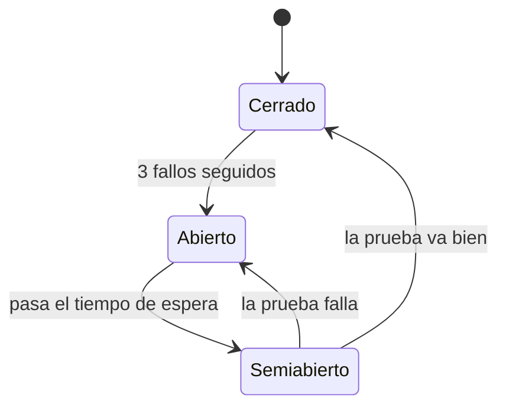
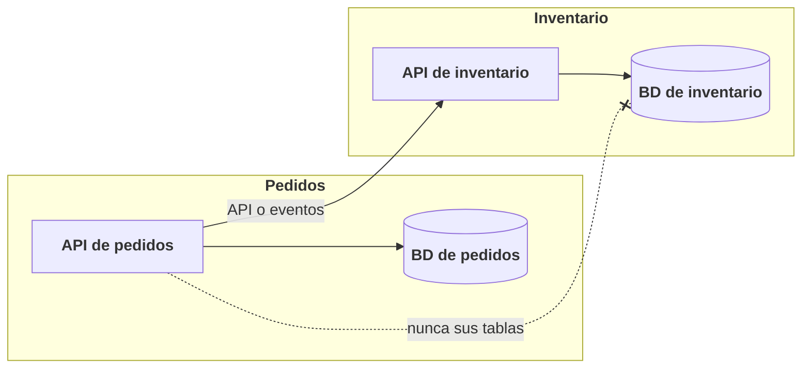

# Microservicios: límites, integración y datos


# Qué son y cuándo compensan

## Objetivos de aprendizaje

- **1.1** Definir la arquitectura de microservicios.
- **1.2** Valorar sus ventajas y sus costes.
- **1.3** Decidir entre monolito modular y microservicios.

## Definición

Según el artículo de James Lewis y Martin Fowler, el estilo de microservicios desarrolla **una aplicación como un conjunto de servicios pequeños**, cada uno:

- en **su propio proceso**, comunicándose por mecanismos ligeros (a menudo HTTP);
- organizado alrededor de una **capacidad de negocio**;
- **desplegable de forma independiente**, con despliegue automatizado;
- con una gestión centralizada mínima, así que puede usar su propio lenguaje y su propio almacenamiento.

La palabra clave es **independiente**: un equipo cambia, prueba y despliega su servicio sin coordinarse con los demás.

## Ventajas y costes

| Ventaja | A cambio de |
|---|---|
| Despliegue independiente por equipo | Contratos entre servicios que no se pueden romper |
| Escalar cada servicio según su carga | Red: latencia, fallos parciales, *timeouts* (lección 3) |
| Aislar fallos | Consistencia eventual entre servicios (lección 4) |
| Libertad tecnológica por servicio | Operación: despliegues, observabilidad, seguridad entre servicios |

Fowler llama **prima de los microservicios** a ese coste extra, que solo compensa con sistemas y organizaciones lo bastante grandes. Antes de plantearlos, enumera unos **requisitos previos**: poder crear entornos en horas, monitorización básica y despliegue rápido y automatizado.

## Monolito primero

La recomendación de Fowler, **monolito primero**: casi todos los casos de éxito con microservicios empezaron como un monolito que creció y se partió; y empezar con microservicios suele acabar mal, porque los límites correctos aún no se conocen.

Un buen punto de partida es el **monolito modular**: un solo despliegue, con módulos por contexto delimitado (tema de DDD) y límites comprobados (tema de estilos de arquitectura). Cuando un módulo tiene un motivo concreto para separarse (escala distinta, equipo independiente, ritmo de despliegue), se extrae.

Lo peor de ambos mundos es el **monolito distribuido**: servicios tan acoplados que hay que desplegarlos juntos. Tiene la complejidad de la red sin la independencia.

## Puntos clave

- Microservicios: servicios pequeños, por capacidad de negocio, desplegables de forma independiente.
- La independencia se paga con red, consistencia eventual y operación: la prima de los microservicios.
- Requisitos previos: entornos rápidos, monitorización y despliegue automatizado.
- Monolito primero, mejor modular; extrae servicios con motivos concretos.
- Evita el monolito distribuido: si hay que desplegar todo junto, no son microservicios.

## Referencias

- James Lewis y Martin Fowler, [Microservices](https://martinfowler.com/articles/microservices.html).
- Martin Fowler, [Microservice Premium](https://martinfowler.com/bliki/MicroservicePremium.html).
- Martin Fowler, [Monolith First](https://martinfowler.com/bliki/MonolithFirst.html).
- Martin Fowler, [Microservice Prerequisites](https://martinfowler.com/bliki/MicroservicePrerequisites.html).

# Límites

## Objetivos de aprendizaje

- **2.1** Trazar los límites de los servicios por capacidades de negocio.
- **2.2** Reconocer los síntomas de unos límites equivocados.
- **2.3** Alinear servicios y equipos.

## Por capacidades, no por capas

La forma más habitual de equivocarse es partir por **capas técnicas**: un servicio de «base de datos», otro de «lógica» y otro de «API». Cualquier funcionalidad atraviesa los tres, y cualquier cambio obliga a tocarlos y desplegarlos juntos.

Los límites buenos siguen **capacidades de negocio**, que suelen coincidir con los **contextos delimitados** de DDD: Catálogo, Pedidos, Pagos, Envíos. Cada uno contiene sus datos, sus reglas y su API, de punta a punta.

Ni demasiado grandes ni demasiado pequeños: un servicio por entidad (`servicio-cliente`, `servicio-direccion`) multiplica las llamadas y el acoplamiento. El tamaño adecuado es el que un equipo puede **entender y evolucionar** por sí solo.

## Síntomas de límites equivocados

- Casi todos los cambios tocan **varios servicios** a la vez.
- Una petición del usuario provoca **cadenas largas** de llamadas síncronas (A → B → C → D).
- Dos servicios **leen o escriben las mismas tablas**.
- Hay que **desplegar juntos** varios servicios (monolito distribuido).
- Un servicio necesita conocer el modelo interno de otro para funcionar.

Cuando aparecen, lo que se mezcla en un servicio o se reparte entre varios suele ser un único contexto. Corregirlo es caro: por eso conviene descubrir los límites dentro de un monolito modular.

## Servicios y equipos

La **ley de Conway**: las organizaciones diseñan sistemas que copian su estructura de comunicación. Fowler la explica con un ejemplo: si un solo equipo escribe un compilador, saldrá de una pasada; si el equipo se divide en dos, de dos pasadas. Aplicado a los microservicios:

- Un servicio debe tener **un equipo dueño** que lo desarrolla y lo opera.
- Si un servicio lo cambian a la vez tres equipos, hay un problema de límites o de organización.
- La «maniobra inversa de Conway» consiste en organizar los equipos según la arquitectura que se quiere obtener.

## Puntos clave

- Límites por capacidades de negocio (contextos delimitados), no por capas técnicas.
- Ni un servicio por entidad ni uno enorme: el que un equipo puede entender y evolucionar solo.
- Síntomas de malos límites: cambios en varios servicios, cadenas largas de llamadas, tablas compartidas y despliegues conjuntos.
- Ley de Conway: alinea servicios y equipos; cada servicio con un equipo dueño.

## Referencias

- James Lewis y Martin Fowler, [Microservices](https://martinfowler.com/articles/microservices.html).
- Martin Fowler, [Conway's Law](https://martinfowler.com/bliki/ConwaysLaw.html).
- Microsoft, [Using domain analysis to model microservices](https://learn.microsoft.com/en-us/azure/architecture/microservices/model/domain-analysis).

# Comunicación resiliente

## Objetivos de aprendizaje

- **3.1** Elegir entre comunicación síncrona y asíncrona.
- **3.2** Proteger las llamadas con tiempos de espera e interruptores.
- **3.3** Reintentar con espera exponencial sin duplicar operaciones.

Las mediciones de esta lección salen de dos servicios FastAPI reales, `pedidos` y `inventario`, en `127.0.0.1`.

## Síncrona o asíncrona

- **Síncrona** (HTTP/REST, gRPC): el que llama espera la respuesta. Sencilla, pero **acopla en el tiempo**: si el otro está caído o lento, el que llama también.
- **Asíncrona** (mensajes, eventos): se publica y se sigue. Desacopla en el tiempo, a cambio de consistencia eventual (temas de mensajería y de arquitectura dirigida por eventos).

Regla práctica: síncrona para **consultas** que necesitan respuesta ya; asíncrona para **avisar** de hechos y para procesos largos.

## Tiempos de espera

`inventario` se vuelve lento (5 s por respuesta). `pedidos` lo llama **sin tiempo de espera**:

```text
inventario sano, sin timeout:   0.10 s, {200: 20}
inventario lento, sin timeout:  5.09 s, {200: 20}
```

Cada petición de `pedidos` queda **retenida** 5 s, ocupando conexiones y memoria. Con tráfico real, se agotan y `pedidos` deja de atender **todo**, también lo que no necesita inventario: un **fallo en cascada**. Toda llamada por red necesita un **tiempo de espera**, ajustado a lo que el que llama puede permitirse.

## Interruptor

Con un tiempo de espera de 0,5 s y un **interruptor** (*circuit breaker*) que se abre tras 3 fallos:

```text
inventario lento, protegido (1):  0.52 s, {504: 5}
inventario lento, protegido (2):  0.02 s, {503: 20}
inventario lento, protegido (3):  0.02 s, {503: 20}
```

Las primeras peticiones esperan 0,5 s y fallan (504). Con 3 fallos, el interruptor se **abre**: las siguientes fallan **al instante** (503), sin llamar a `inventario`. Así no se gastan recursos esperando y se deja respirar al servicio enfermo. Pasado un tiempo, el interruptor pasa a **semiabierto** y deja pasar una prueba: si va bien, se cierra.



```nodos
Cerrado:
  titulo: Cerrado
  texto: Estado normal. Las llamadas pasan y se cuentan los fallos (aquí, tiempos de espera de 0,5 s).
Abierto:
  concepto: circuit-breaker
Semiabierto:
  titulo: Semiabierto
  texto: Deja pasar una llamada de prueba. Si va bien, el interruptor se cierra. Si falla, vuelve a abrirse.
```

Fallar rápido permite **degradar**: mostrar el producto con «disponibilidad no confirmada» en vez de no mostrar nada.

## Reintentos e idempotencia

Muchos fallos son **transitorios**, y un reintento los supera. Pero hay que reintentar con cuidado:

- **Espera exponencial con variación aleatoria** (*backoff* con *jitter*): 100 ms, 200 ms, 400 ms… con algo de azar, para no sincronizar a miles de clientes contra un servicio que se recupera.
- **Límite** de intentos, y reintentar solo errores transitorios (no un 400).
- **Solo operaciones idempotentes**.

Un *timeout* no significa que la operación **no** se hiciera: quizá se hizo y la respuesta se perdió. `inventario` cobra y tarda 1 s en responder; el cliente espera 0,3 s y reintenta:

```text
== reintento tras timeout sin clave de idempotencia
  intento 1: timeout, se reintenta
  intento 2: timeout, se reintenta
  intento 3: timeout, se reintenta
  cobros realizados: 3
```

**Tres cobros** por una compra. Con una **clave de idempotencia**: el cliente genera un identificador único por operación, lo envía en una cabecera y lo repite en cada reintento; el servidor guarda el resultado por clave y, si la ve otra vez, lo devuelve sin repetir la operación:

```text
== reintento con Idempotency-Key
  intento 1: timeout, se reintenta con la misma clave
  respuesta {'cobro': 4}
  cobros realizados: 1
```

La cabecera `Idempotency-Key` se está estandarizando en un borrador del IETF (grupo httpapi) y la usan ya muchas APIs de pagos.

## Puntos clave

- Síncrona para consultas inmediatas; asíncrona para avisar de hechos y procesos largos.
- Sin tiempo de espera, un servicio lento retuvo cada petición 5 s: es el inicio de un fallo en cascada.
- El interruptor abierto hizo fallar en 0,02 s en vez de 0,5 s, sin cargar al servicio enfermo.
- Reintenta con espera exponencial y variación, con límite, y solo lo transitorio.
- Un *timeout* no implica que no se hiciera: sin clave de idempotencia hubo 3 cobros; con ella, 1.

## Referencias

- Martin Fowler, [Circuit Breaker](https://martinfowler.com/bliki/CircuitBreaker.html).
- Microsoft, [Circuit Breaker pattern](https://learn.microsoft.com/en-us/azure/architecture/patterns/circuit-breaker) y [Retry pattern](https://learn.microsoft.com/en-us/azure/architecture/patterns/retry).
- AWS Builders' Library, [Timeouts, retries and backoff with jitter](https://aws.amazon.com/builders-library/timeouts-retries-and-backoff-with-jitter/).
- IETF, [The Idempotency-Key HTTP Header Field](https://datatracker.ietf.org/doc/draft-ietf-httpapi-idempotency-key-header/).
- gRPC, [Introduction](https://grpc.io/docs/what-is-grpc/introduction/).

# Datos

## Objetivos de aprendizaje

- **4.1** Aplicar el patrón de base de datos por servicio.
- **4.2** Mantener la consistencia entre servicios sin transacciones distribuidas.
- **4.3** Resolver consultas que necesitan datos de varios servicios.

## Base de datos por servicio

Cada servicio es **dueño** de sus datos: solo él lee y escribe su base de datos; los demás los obtienen por su **API** o por sus **eventos**. Puede ser un esquema propio en el mismo servidor de PostgreSQL; lo que importa es que nadie más lo toque.



```nodos
SP:
  concepto: microservicio
SI:
  concepto: bd-por-servicio
AP:
  titulo: API de pedidos
  texto: Necesita datos del inventario y los obtiene por su API o escuchando sus eventos.
AI:
  titulo: API de inventario
  texto: La única puerta a los datos de inventario. Es donde se aplican sus reglas.
BP:
  titulo: BD de pedidos
  texto: Solo la toca el servicio de pedidos. Puede ser un esquema propio en el mismo PostgreSQL.
BI:
  titulo: BD de inventario
  texto: Si pedidos leyera estas tablas, un cambio de esquema le rompería sin aviso y los servicios ya no se podrían desplegar por separado. Es la vía rápida al monolito distribuido.
  seccion: 01-que-son-y-cuando/teoria#ventajas-y-costes
```

Compartir tablas entre servicios parece cómodo, pero:

- Un cambio de esquema rompe a otros servicios **sin que nadie se entere** hasta producción.
- Los servicios ya no se pueden desplegar ni escalar de forma independiente.
- Las reglas del dueño se pueden saltar escribiendo directamente en sus tablas.

Es la vía más rápida al monolito distribuido.

## Consistencia sin transacciones distribuidas

Sin base de datos común, una operación que afecta a varios servicios (crear el pedido, reservar stock, cobrar) **no cabe en una transacción**. Las transacciones distribuidas (2PC) bloquean recursos y dependen de que todos estén disponibles, así que en microservicios se evitan. En su lugar:

- **Sagas**: una secuencia de transacciones locales, cada una en su servicio, con **acciones compensatorias** si algo falla (cancelar la reserva si el cobro es rechazado).
- **Outbox**: guardar el cambio y el evento en la misma transacción local, y publicarlo después, para no perder eventos.
- **Consumidores idempotentes**, porque los eventos pueden llegar más de una vez.

Las tres técnicas se practican con PostgreSQL y Kafka en el tema de arquitectura dirigida por eventos. El precio es la **consistencia eventual**: durante un momento, el pedido existe y el cobro aún no.

## Consultas entre servicios

«Pedidos de un cliente con el estado de su envío» necesita datos de Pedidos, Clientes y Envíos. Dos patrones:

- **Composición de APIs**: un componente (la pasarela o un servicio) llama a los tres y combina. Sencillo, pero suma latencias y falla si falla cualquiera.
- **Vista de lectura (CQRS)**: un servicio se suscribe a los eventos de los otros y mantiene **su propia copia** de lo que necesita, ya combinada para esa consulta. Rápido y disponible, pero con datos **eventualmente** al día.

Duplicar datos entre servicios es **normal** en esta arquitectura, siempre que haya un único **dueño** y los demás tengan copias derivadas.

## Puntos clave

- Cada servicio es dueño de sus datos; nadie más accede a su base de datos.
- Compartir tablas rompe la independencia y lleva al monolito distribuido.
- Sin transacciones distribuidas: sagas con compensaciones, outbox y consumidores idempotentes.
- Consultas entre servicios: composición de APIs o vistas de lectura alimentadas por eventos.
- Copias de datos sí, pero con un único dueño.

## Referencias

- Chris Richardson, [Database per service](https://microservices.io/patterns/data/database-per-service.html).
- Chris Richardson, [API composition](https://microservices.io/patterns/data/api-composition.html).
- James Lewis y Martin Fowler, [Microservices](https://martinfowler.com/articles/microservices.html).

# Operar y evolucionar

## Objetivos de aprendizaje

- **5.1** Usar una pasarela de API y localizar servicios.
- **5.2** Evolucionar las APIs sin romper a los consumidores.
- **5.3** Probar la integración con contratos en lugar de entornos completos.
- **5.4** Exigir la observabilidad mínima.

## Pasarela y descubrimiento

Con decenas de servicios, los clientes no deben conocerlos todos:

- Una **pasarela de API** (*API gateway*) es el punto de entrada único: enruta las peticiones y concentra lo común (autenticación con OIDC, límites de peticiones, TLS).
- Un **BFF** (*Backend for Frontend*) es una pasarela específica para un tipo de cliente (la aplicación móvil, la web), que agrega lo que esa interfaz necesita.
- La pasarela **no** debe contener lógica de negocio: se convertiría en un monolito en la puerta.

Para que un servicio encuentre a otro sin direcciones fijas, se usa el **descubrimiento de servicios**. En Kubernetes lo da un `Service`: un nombre DNS estable (`inventario.tienda.svc`) que reparte entre las réplicas sanas.

## Evolucionar las APIs

La independencia exige que un servicio pueda cambiar **sin romper** a quien lo usa:

- Cambios **compatibles** siempre que se pueda: añadir campos opcionales o endpoints nuevos, nunca quitar ni cambiar el significado de lo existente.
- Los consumidores deben **tolerar** campos que no conocen.
- Para un cambio incompatible, una **versión nueva** (`/v2/…`) conviviendo con la antigua mientras los consumidores migran, y luego retirar la vieja.
- Lo mismo con los eventos: esquemas versionados.

## Contratos en lugar de entornos completos

Probar la integración levantando todos los servicios a la vez es lento y frágil, y vuelve a acoplar los despliegues. Las **pruebas de contrato dirigidas por el consumidor** (Pact, por ejemplo) lo resuelven:

1. El consumidor escribe, en sus pruebas, qué peticiones hará y qué respuesta espera: el **contrato**.
2. El proveedor **verifica** en su CI que cumple todos los contratos de sus consumidores.
3. Si un cambio del proveedor rompe un contrato, su CI falla **antes** de desplegar.

Cada servicio se prueba por separado y se despliega solo.

## Observabilidad, condición necesaria

Un fallo que cruza cinco servicios es imposible de diagnosticar sin:

- **Trazas distribuidas** que propaguen `traceparent` entre servicios.
- **Logs estructurados** con el `trace_id`.
- **Métricas RED** por servicio y alertas por SLO.

Todo ello está en el tema de observabilidad. Sin esto, no conviene tener microservicios en producción.

## Puntos clave

- Pasarela de API como entrada única, sin lógica de negocio; BFF por tipo de cliente.
- En Kubernetes, un `Service` da un nombre estable para localizar a otro servicio.
- APIs con cambios compatibles; versiones nuevas que conviven con las viejas para los incompatibles.
- Pruebas de contrato dirigidas por el consumidor en lugar de entornos completos.
- Trazas, logs correlacionados y métricas: sin observabilidad, no hay microservicios operables.

## Referencias

- Chris Richardson, [API gateway](https://microservices.io/patterns/apigateway.html).
- Microsoft, [Backends for Frontends pattern](https://learn.microsoft.com/en-us/azure/architecture/patterns/backends-for-frontends).
- Kubernetes, [Service](https://kubernetes.io/docs/concepts/services-networking/service/).
- [Pact](https://docs.pact.io/).
