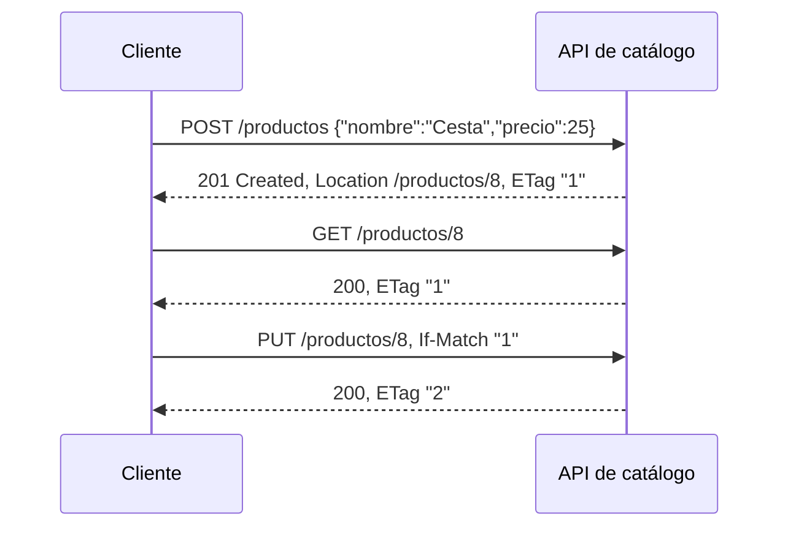
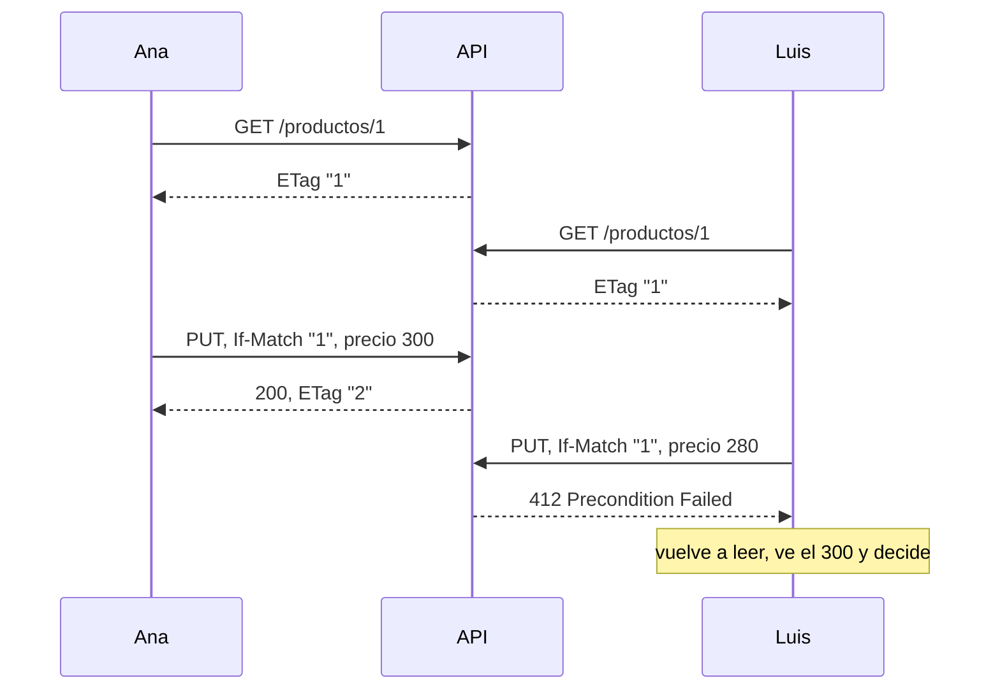
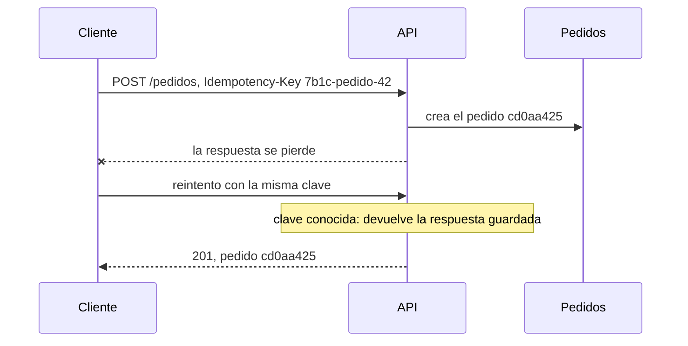
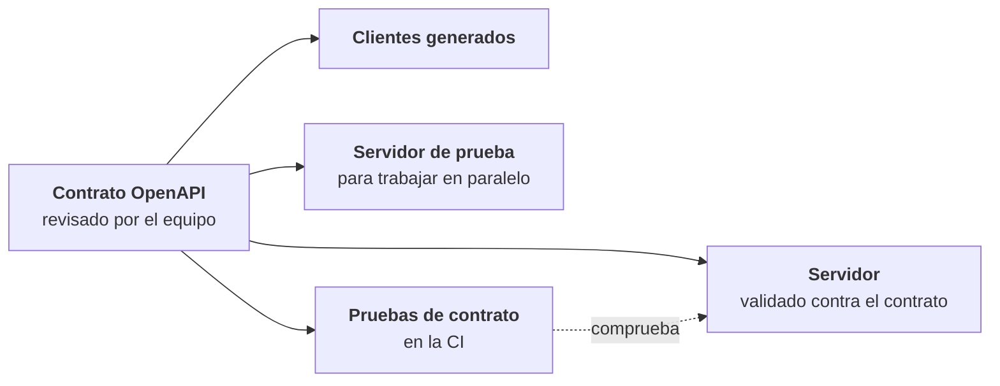
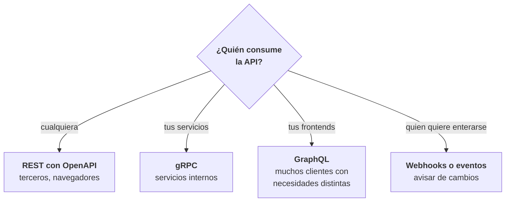

# titulo: Diseño de APIs


# Recursos y REST

## Objetivos de aprendizaje

- **1.1** Explicar qué es REST y qué es una API HTTP «a la REST» en la práctica.
- **1.2** Modelar una API como recursos con URI estables.
- **1.3** Usar los métodos y los códigos de estado con su semántica.
- **1.4** Situar una API en el modelo de madurez de Richardson.

Los ejemplos son de una API de catálogo en **Spring Boot 4.2** con Java 25, arrancada en local y probada con curl. El código del controlador está al final de la lección.

## REST y las API HTTP

**REST** es un estilo de arquitectura que Roy Fielding describió en su tesis doctoral (2000) a partir del diseño de la web. Sus restricciones principales:

| Restricción | Qué pide |
|---|---|
| Cliente-servidor | Separar la interfaz del almacenamiento |
| Sin estado | Cada petición lleva todo lo necesario para entenderla |
| Cacheable | Las respuestas indican si se pueden guardar |
| Interfaz uniforme | Recursos identificados por URI, manipulados mediante representaciones, con mensajes autodescriptivos y enlaces |
| Sistema en capas | Puede haber intermediarios (proxies, cachés) sin que el cliente lo sepa |

Casi ninguna API que se llama «REST» cumple todas, en especial la de los enlaces (hipermedia). En la práctica, «API REST» suele significar una **API HTTP bien diseñada**: recursos, métodos con su significado y códigos de estado correctos. Es lo que trata este tema.

## Recursos y URI

Un **recurso** es cualquier cosa con identidad propia: un producto, un pedido, la colección de pedidos de un cliente. Se identifica con una URI, y la acción la dice el **método**, no la URI:

| Bien | Mal | Por qué |
|---|---|---|
| `GET /productos/8` | `GET /obtenerProducto?id=8` | La URI nombra el recurso; el método, la acción |
| `POST /productos` | `POST /productos/crear` | Crear en una colección es un POST a la colección |
| `DELETE /productos/8` | `GET /productos/8/borrar` | Un GET no debe cambiar estado |
| `GET /clientes/42/pedidos` | `GET /pedidosDeCliente?c=42` | La relación se expresa con la jerarquía |
| `POST /pedidos/7/cancelacion` | `POST /cancelarPedido` | Una acción que no encaja en CRUD se modela como un recurso nuevo |

Convenciones habituales: sustantivos en plural para las colecciones, minúsculas con guiones (`/lineas-de-pedido`), identificadores estables (no el nombre, que cambia) y los filtros en la consulta (`/productos?categoria=bicis`).

## Métodos y códigos

Las respuestas reales de la API de prueba:

```text
GET    /productos?limite=3        → 200 con una página de productos
POST   /productos                 → 201 Created, Location: /productos/8, ETag: "1"
POST   /productos (datos malos)   → 400, Content-Type: application/problem+json
PUT    /productos/1 sin If-Match  → 428 Precondition Required
GET    /productos/99              → 404
```



```nodos
C:
  titulo: Cliente
  texto: Sigue la cabecera Location para encontrar el recurso creado y guarda el ETag para modificarlo después sin pisar a nadie.
API:
  concepto: recurso
```

| Método | Uso en una API | Respuesta típica |
|---|---|---|
| `GET` | Leer un recurso o una colección | `200`, `404` |
| `POST` | Crear en una colección, o lanzar una acción | `201` con `Location`, `202` si es asíncrono |
| `PUT` | Sustituir el recurso entero | `200` o `204` |
| `PATCH` | Cambiar parte del recurso | `200` o `204` |
| `DELETE` | Borrar | `204` |

`201 Created` con `Location` dice al cliente dónde está el recurso nuevo. `202 Accepted` indica que la operación se hará después (por ejemplo, un informe que tarda minutos) y suele devolver dónde consultar su estado.

## El modelo de madurez de Richardson

Leonard Richardson propuso, y Martin Fowler popularizó, una escala para valorar una API HTTP:

| Nivel | Qué tiene | Ejemplo |
|---|---|---|
| 0 | Un único punto de entrada; HTTP como transporte | `POST /api` con `{"accion":"obtenerProducto","id":8}` |
| 1 | Recursos | `POST /productos/8` para todo |
| 2 | Métodos y códigos de HTTP | `GET /productos/8` → `200`; `DELETE` → `204` |
| 3 | Hipermedia: la respuesta enlaza las acciones posibles | `{"id":8, "enlaces": {"cancelar": "/pedidos/8/cancelacion"}}` |

La API de prueba está en el **nivel 2**, como la mayoría de las API públicas. El nivel 3 ayuda a clientes genéricos, pero la mayoría de los clientes se escriben contra una documentación concreta y no lo aprovechan.

## El controlador

Las partes del controlador de Spring Boot que producen las respuestas anteriores:

```java
@PostMapping("/productos")
public ResponseEntity<Producto> crear(@Valid @RequestBody NuevoProducto nuevo) {
    long id;
    synchronized (this) { id = ++secuencia; }
    Producto p = new Producto(id, nuevo.nombre(), nuevo.precio(), 1);
    productos.put(id, p);
    return ResponseEntity.created(URI.create("/productos/" + id)).eTag("\"1\"").body(p);
}

@GetMapping("/productos/{id}")
public ResponseEntity<Producto> obtener(@PathVariable long id) {
    Producto p = Optional.ofNullable(productos.get(id))
            .orElseThrow(() -> new ResponseStatusException(HttpStatus.NOT_FOUND, "No existe el producto " + id));
    return ResponseEntity.ok().eTag("\"" + p.version() + "\"").body(p);
}
```

## Puntos clave

- REST es un estilo con restricciones precisas; en la práctica, «API REST» suele significar una API HTTP con recursos, métodos y códigos bien usados.
- La URI nombra el recurso y el método dice la acción: nada de verbos en la ruta.
- Las acciones que no encajan en CRUD se modelan como recursos (`/pedidos/7/cancelacion`).
- Crear devuelve `201` con `Location`; una operación asíncrona, `202`.
- El modelo de Richardson va del nivel 0 (un único punto de entrada) al 3 (hipermedia); la mayoría de las API están en el 2.

## Referencias

- Roy T. Fielding, [Architectural Styles and the Design of Network-based Software Architectures, capítulo 5: REST](https://ics.uci.edu/~fielding/pubs/dissertation/rest_arch_style.htm).
- Martin Fowler, [Richardson Maturity Model](https://martinfowler.com/articles/richardsonMaturityModel.html).
- IETF, [RFC 9110: HTTP Semantics](https://www.rfc-editor.org/rfc/rfc9110.html).

# Errores y concurrencia

## Objetivos de aprendizaje

- **2.1** Devolver los errores con Problem Details (RFC 9457) y elegir bien el código de estado.
- **2.2** Dar al cliente información útil sin filtrar detalles internos.
- **2.3** Evitar que dos clientes se pisen los cambios con ETag e `If-Match`.
- **2.4** Configurar Problem Details en Spring Boot.

Los resultados son de la API de catálogo de la lección anterior, en Spring Boot 4.2.

## Un formato para los errores

Cada API que inventa su propio formato de error obliga a cada cliente a aprender uno nuevo. El **RFC 9457** (*Problem Details for HTTP APIs*, que sustituye al RFC 7807) define uno común, con el tipo de contenido `application/problem+json`:

| Campo | Contenido |
|---|---|
| `type` | URI que identifica el tipo de problema y, si se puede, lleva a su documentación |
| `title` | Resumen del tipo de problema, igual para todos los casos de ese tipo |
| `status` | El código de estado HTTP |
| `detail` | Explicación de este caso concreto |
| `instance` | URI de esta ocurrencia del problema |

A esos se añaden los **miembros de extensión** que necesite cada tipo de problema. Con `spring.mvc.problemdetails.enabled=true`, un producto sin nombre y con precio negativo devolvió:

```text
HTTP/1.1 400
Content-Type: application/problem+json
{"detail":"Invalid request content.","status":400,"title":"Bad Request"}
```

Es válido, pero no dice **qué** está mal. Con un manejador propio que añade un `type` y la lista de errores:

```json
{
  "type": "https://tienda.example/problemas/validacion",
  "title": "Datos no válidos",
  "status": 400,
  "detail": "Hay campos no válidos",
  "errores": [
    {"campo": "nombre", "motivo": "must not be blank"},
    {"campo": "precio", "motivo": "must be greater than 0"}
  ]
}
```

El cliente puede marcar cada campo del formulario, y el `type` le permite distinguir este problema de otros con el mismo código 400.

## El código correcto

| Situación | Código |
|---|---|
| Petición mal formada (JSON roto) o datos que no cumplen las reglas | `400` (o `422` si el cuerpo se entiende pero su contenido no es válido) |
| Sin credenciales válidas | `401`, con `WWW-Authenticate` |
| Autenticado, pero sin permiso | `403` |
| El recurso no existe | `404` |
| Conflicto con el estado actual (por ejemplo, un nombre duplicado) | `409` |
| La versión que leíste ya no es la actual | `412` |
| Hace falta una condición (`If-Match`) y no se envió | `428` |
| Demasiadas peticiones | `429`, con `Retry-After` |
| Error inesperado del servidor | `500` |
| El servidor no puede atender ahora | `503`, con `Retry-After` |

Dos reglas para el contenido:

- **Nada de detalles internos** en `detail`: ni trazas de pila, ni consultas SQL, ni rutas de ficheros. Van al registro del servidor, con un identificador que el cliente pueda citar.
- **Un 404 en lugar de un 403** cuando el usuario no debe ni saber que el recurso existe, por ejemplo el pedido de otro cliente.

## Concurrencia optimista con If-Match

Ana y Luis abren a la vez el mismo producto, versión 1. Ana guarda el precio 300; después Luis guarda el 280 con los datos que leyó antes. Sin control, el cambio de Ana desaparece: es una **actualización perdida**.

La solución en HTTP es la **concurrencia optimista**: cada respuesta lleva el **ETag** de la versión, y para modificar, el cliente lo envía en **`If-Match`**.



```nodos
A:
  titulo: Ana
  texto: Su cambio se aplica porque envía el ETag de la versión actual.
API:
  concepto: concurrencia-optimista-http
L:
  titulo: Luis
  texto: Recibe 412 porque leyó la versión 1, que ya no es la actual. Su cambio no pisa el de Ana.
```

Las respuestas reales de la API de prueba:

```text
PUT /productos/1 sin If-Match              → 428 Precondition Required
PUT /productos/1 con If-Match: "1"         → 200, ETag: "2"
PUT /productos/1 con If-Match: "1" otra vez → 412 {"detail":"El producto ha cambiado desde que lo leíste"}
```

Exigir `If-Match` (con `428` si falta) obliga a todos los clientes a pensar en la concurrencia. Es la misma idea que el bloqueo optimista de una base de datos con una columna de versión, llevada hasta el cliente.

## Problem Details en Spring Boot

| Pieza | Qué hace |
|---|---|
| `spring.mvc.problemdetails.enabled=true` | Las excepciones de Spring MVC se responden como Problem Details |
| `ResponseStatusException(HttpStatus.NOT_FOUND, "…")` | Lanza un error con su código; el texto va en `detail` |
| `ProblemDetail.forStatusAndDetail(…)` y `setProperty(…)` | Construye uno a medida, con miembros de extensión |
| `@RestControllerAdvice` con `@ExceptionHandler` | Traduce excepciones a Problem Details en un solo sitio |

Un detalle que costó encontrar: el manejador propio no se aplicaba, porque el que registra Spring Boot al activar la propiedad atendía antes la misma excepción. Hubo que anotar el propio con `@Order(Ordered.HIGHEST_PRECEDENCE)`:

```java
@RestControllerAdvice
@Order(Ordered.HIGHEST_PRECEDENCE)
public class Errores {
    @ExceptionHandler(MethodArgumentNotValidException.class)
    public ProblemDetail validacion(MethodArgumentNotValidException e) {
        ProblemDetail p = ProblemDetail.forStatusAndDetail(HttpStatus.BAD_REQUEST, "Hay campos no válidos");
        p.setType(URI.create("https://tienda.example/problemas/validacion"));
        p.setTitle("Datos no válidos");
        p.setProperty("errores", e.getBindingResult().getFieldErrors().stream()
                .map(f -> Map.of("campo", f.getField(), "motivo", String.valueOf(f.getDefaultMessage())))
                .toList());
        return p;
    }
}
```

## Puntos clave

- Usa Problem Details (`application/problem+json`): `type`, `title`, `status`, `detail` e `instance`, más los miembros que necesites.
- El `type` distingue problemas con el mismo código; los miembros de extensión dan el detalle (qué campos fallan).
- El código de estado dice la clase de error: 400 datos, 401 credenciales, 403 permiso, 404, 409 conflicto, 412 versión, 429 límite.
- No pongas trazas ni datos internos en la respuesta.
- ETag más `If-Match` evita las actualizaciones perdidas: 412 si la versión cambió, 428 si falta la condición.
- En Spring Boot, activa `spring.mvc.problemdetails.enabled` y centraliza los errores en un `@RestControllerAdvice` con prioridad.

## Referencias

- IETF, [RFC 9457: Problem Details for HTTP APIs](https://www.rfc-editor.org/rfc/rfc9457.html).
- IETF, [RFC 9110, sección 13: peticiones condicionales](https://www.rfc-editor.org/rfc/rfc9110.html#section-13) y [RFC 6585: código 428](https://www.rfc-editor.org/rfc/rfc6585.html).
- Spring Framework, [Error Responses](https://docs.spring.io/spring-framework/reference/web/webmvc/mvc-ann-rest-exceptions.html).

# Paginación e idempotencia

## Objetivos de aprendizaje

- **3.1** Elegir entre paginación por desplazamiento y por cursor.
- **3.2** Diseñar filtros, ordenación y tamaños de página.
- **3.3** Hacer seguro el reintento de un POST con una clave de idempotencia.
- **3.4** Decidir qué hace el servidor cuando la clave se reutiliza.

Los resultados son de la API de catálogo en Spring Boot 4.2 y de una simulación en Python.

## Desplazamiento o cursor

| | Desplazamiento (`?pagina=3&tamano=20`) | Cursor (`?cursor=Mw&limite=20`) |
|---|---|---|
| Cómo avanza | Salta N elementos | Continúa tras el último elemento visto |
| Saltar a la página 37 | Sí | No |
| Si la colección cambia entre páginas | Se saltan o se repiten elementos | Ni se salta ni se repite nada |
| Coste en la base de datos | `OFFSET` recorre lo que salta: más lento cuanto más lejos | Un rango sobre un índice: constante |

El problema del desplazamiento, simulado con diez elementos y páginas de tres, cuando alguien borra el elemento 2 entre la primera y la segunda página:

```text
desplazamiento: [1, 2, 3] [5, 6, 7] → se salta el [4]
cursor:         [1, 2, 3] [4, 5, 6] → continúa tras el 3
```

La API de prueba pagina por cursor. Cada página devuelve el cursor de la siguiente, codificado en Base64 para que el cliente lo trate como **opaco** y no construya cursores por su cuenta:

```text
GET /productos?limite=3
{"datos":[{"id":1,…},{"id":2,…},{"id":3,…}],"siguiente":"Mw"}

GET /productos?limite=3&cursor=Mw
{"datos":[{"id":4,…},{"id":5,…},{"id":6,…}],"siguiente":"Ng"}
```

Cuando no hay más páginas, `siguiente` es `null`. Otra opción es la cabecera estándar `Link` con `rel="next"` (RFC 8288).

## Filtros, orden y límites

- **Filtros en la consulta:** `/productos?categoria=bicis&precio_max=500`.
- **Orden explícito y estable:** `?orden=-precio`, y siempre un desempate único (el id). Sin él, dos elementos con el mismo precio pueden cambiar de página entre peticiones.
- **Límite por defecto y máximo:** sin límite, un cliente puede pedir un millón de filas. La API de prueba usa 3 por defecto; en una real se elige un máximo y se rechaza o se recorta lo que lo supera.
- **Total opcional:** calcular el total exacto (`COUNT(*)`) es caro en tablas grandes. Muchas API no lo dan, o lo dan aparte.

## Reintentar un POST sin duplicar

Un cliente envía `POST /pedidos` y la conexión se corta antes de la respuesta. ¿Se creó el pedido? Si reintenta, puede crear dos. POST no es idempotente (tema de HTTP).

La solución es una **clave de idempotencia**: el cliente genera un identificador único por operación y lo envía en la cabecera `Idempotency-Key`. El servidor guarda la respuesta asociada a la clave y, si la clave vuelve a llegar, devuelve **la misma respuesta** sin repetir la operación.



```nodos
C:
  titulo: Cliente
  texto: Genera una clave nueva por operación (un UUID) y la reutiliza en todos los reintentos de esa operación.
API:
  concepto: clave-idempotencia
BD:
  titulo: Pedidos
  texto: Tras los dos envíos, la API de prueba tenía un solo pedido.
```

En la prueba, dos envíos con la misma clave devolvieron el mismo pedido y el total de pedidos siguió en uno:

```text
POST /pedidos  Idempotency-Key: 7b1c-pedido-42  {"producto":1,"cantidad":2}  → 201 {"id":"cd0aa425",…}
POST /pedidos  Idempotency-Key: 7b1c-pedido-42  {"producto":1,"cantidad":2}  → 201 {"id":"cd0aa425",…}
GET  /pedidos/total                                                           → 1
```

## Cuando la clave se reutiliza mal

La cabecera `Idempotency-Key` se está normalizando en el IETF: a noviembre de 2026, el borrador del grupo de trabajo HTTPAPI va por la versión 08 y aún no es RFC. Propone estas respuestas:

| Situación | Respuesta |
|---|---|
| El recurso exige la clave y no llega | `400 Bad Request` |
| La clave ya se usó con **otra** petición distinta | `422 Unprocessable Content` |
| Llega la misma clave mientras la primera petición se está procesando | `409 Conflict` |

En la prueba, la misma clave con otra cantidad:

```text
POST /pedidos  Idempotency-Key: 7b1c-pedido-42  {"producto":1,"cantidad":5}
→ 422 {"detail":"La clave ya se usó con otra petición","status":422,"title":"Unprocessable Content"}
```

En producción, la clave y su respuesta se guardan en un almacén compartido (la base de datos, Redis) con una caducidad, por ejemplo de 24 horas. Si la API tiene varias instancias, un mapa en memoria como el de la prueba no sirve. La comprobación y la creación deben ser atómicas, para que dos reintentos simultáneos no creen dos pedidos.

## Puntos clave

- El desplazamiento permite saltar de página, pero salta o repite elementos si la colección cambia, y se vuelve lento cuanto más lejos.
- El cursor continúa tras el último elemento visto: estable y barato. Trátalo como opaco.
- Ordena siempre con un desempate único y pon un límite máximo de tamaño.
- Una clave de idempotencia hace seguro reintentar un POST: la misma clave devuelve la misma respuesta.
- Misma clave con otra petición: `422`; sin clave cuando se exige: `400`; en curso: `409`.
- Guarda las claves en un almacén compartido y con caducidad, y compruébalas de forma atómica.

## Referencias

- IETF, [The Idempotency-Key HTTP Header Field (borrador)](https://datatracker.ietf.org/doc/draft-ietf-httpapi-idempotency-key-header/).
- IETF, [RFC 8288: Web Linking](https://www.rfc-editor.org/rfc/rfc8288.html).
- IETF, [RFC 9110, sección 9.2.2: métodos idempotentes](https://www.rfc-editor.org/rfc/rfc9110.html#section-9.2.2).

# Contrato y evolución

## Objetivos de aprendizaje

- **4.1** Describir una API con OpenAPI y usar el contrato para encontrar errores.
- **4.2** Comparar el contrato primero con el contrato generado desde el código.
- **4.3** Distinguir los cambios compatibles de los incompatibles.
- **4.4** Versionar y retirar una API avisando a los clientes.

La API de catálogo usa springdoc-openapi 3.2.1, que genera el contrato desde el código en `/v3/api-docs`.

## OpenAPI

**OpenAPI** es un formato estándar, en YAML o JSON, para describir una API HTTP: rutas, parámetros, cuerpos, respuestas y esquemas de datos. La especificación vigente es la **3.2** (3.2.1 en noviembre de 2026); springdoc generó un documento **3.1.0**:

```text
openapi 3.1.0
paths: /pedidos, /pedidos/total, /productos, /productos/{id}, /v1/productos/{id}
schemas: NuevoProducto, Producto, NuevoPedido, Pedido, Pagina
```

Con el contrato se generan documentación, clientes en otros lenguajes, servidores de prueba (*mocks*) y validadores de peticiones.

Leerlo con atención encontró un error real. El esquema de entrada, generado a partir de las anotaciones de validación, era:

```json
"NuevoProducto": {
  "type": "object",
  "properties": {
    "nombre": {"type": "string", "minLength": 1},
    "precio": {"type": "number", "exclusiveMinimum": 0}
  },
  "required": ["nombre"]
}
```

`precio` **no era obligatorio**, porque `@Positive` admite nulos. Y en efecto:

```text
POST /productos {"nombre":"Sin precio"}  →  201 {"id":8,"nombre":"Sin precio","precio":null,"version":1}
```

Faltaba `@NotNull` en el código. El contrato lo mostraba a simple vista.

## Contrato primero o código primero

| | Código primero (generado) | Contrato primero |
|---|---|---|
| Cómo | Se escribe el código y una herramienta genera el contrato | Se escribe y se revisa el contrato; el código se genera o se valida contra él |
| Ventaja | Rápido; el contrato no se desincroniza del código | El diseño se discute antes de programar; otros equipos trabajan en paralelo con un servidor de prueba |
| Riesgo | El contrato refleja lo que hace el código, errores incluidos | Hace falta comprobar que la implementación lo cumple |

El contrato generado de la prueba mostró los límites del enfoque de código primero: para `GET /productos/{id}` solo documentaba la respuesta `200`, con el tipo de contenido `*/*`. **No aparecían** el `404`, el `412` ni el `428` que la API devuelve. Para que el contrato sea útil hay que anotar esas respuestas en el código, o escribir el contrato primero.



```nodos
C:
  concepto: contract-first
S:
  titulo: Servidor
  texto: Se genera el esqueleto desde el contrato o se valida cada petición y respuesta contra él.
CL:
  concepto: openapi
M:
  titulo: Servidor de prueba
  texto: Responde según los ejemplos del contrato. El frontend avanza sin esperar al backend.
PR:
  titulo: Pruebas de contrato
  texto: Comprueban en la CI que la implementación sigue cumpliendo el contrato, también tras cada cambio.
```

## Cambios compatibles e incompatibles

| Compatible (no rompe a nadie) | Incompatible (rompe a clientes) |
|---|---|
| Añadir un campo opcional a la respuesta | Quitar o renombrar un campo |
| Añadir un parámetro opcional | Hacer obligatorio un parámetro o un campo de entrada |
| Añadir un recurso o un método nuevo | Cambiar el tipo de un campo (`precio` de número a texto) |
| Aceptar más valores en la entrada | Aceptar menos valores, o cambiar el significado de uno |
| Añadir un valor a un enumerado… si los clientes lo toleran | Cambiar los códigos de estado o las URI |

Añadir campos solo es seguro si los clientes son **lectores tolerantes**: leen lo que necesitan e ignoran lo desconocido. Un cliente que valida la respuesta contra un esquema cerrado, o que falla con un valor de enumerado nuevo, se rompe con un cambio «compatible».

Para un cambio incompatible, la técnica **expandir y contraer** evita romper: se añade lo nuevo junto a lo viejo (`precio_centimos` además de `precio`), se migran los clientes y, cuando nadie usa lo viejo, se retira.

## Versionar y retirar

| Estrategia | Ejemplo | Comentario |
|---|---|---|
| En la ruta | `/v1/productos/8` | La más visible y fácil de enrutar y de cachear |
| En una cabecera | `Api-Version: 2026-11-01` | URI estables; menos visible |
| En el tipo de contenido | `Accept: application/vnd.tienda.v2+json` | Fiel a HTTP; incómodo de usar |

Lo importante no es dónde va la versión, sino **subirla lo menos posible**: casi todo se puede evolucionar con cambios compatibles. Cuando una versión se retira, se avisa en cada respuesta con cabeceras estándar:

```text
GET /v1/productos/2
Deprecation: @1798761600                          ← obsoleta desde el 1-1-2027 (RFC 9745)
Sunset: Sat, 01 May 2027 00:00:00 GMT             ← dejará de responder ese día (RFC 8594)
Link: </productos/2>; rel="successor-version"
```

`Deprecation` lleva una marca de tiempo Unix precedida de `@`; `Sunset`, una fecha HTTP. Los clientes pueden registrar avisos al verlas, y las métricas dicen quién sigue usando la versión antigua antes de apagarla.

## Puntos clave

- OpenAPI describe la API en un formato que leen personas y herramientas: documentación, clientes, servidores de prueba y validación.
- Leer el contrato encuentra errores: el de la prueba mostraba `precio` como opcional, y la API aceptaba productos sin precio.
- El contrato generado refleja el código, errores incluidos, y le faltan las respuestas no anotadas; el contrato primero obliga a diseñar antes.
- Añadir es compatible si los clientes son lectores tolerantes; quitar, renombrar o cambiar tipos rompe.
- Expandir y contraer permite hacer cambios incompatibles sin romper a nadie.
- Versiona poco; al retirar, avisa con `Deprecation`, `Sunset` y un enlace a la sucesora.

## Referencias

- OpenAPI Initiative, [OpenAPI Specification](https://spec.openapis.org/oas/latest.html).
- [springdoc-openapi](https://springdoc.org/).
- Martin Fowler, [Tolerant Reader](https://martinfowler.com/bliki/TolerantReader.html).
- IETF, [RFC 9745: The Deprecation HTTP Response Header Field](https://www.rfc-editor.org/rfc/rfc9745.html) y [RFC 8594: The Sunset HTTP Header Field](https://www.rfc-editor.org/rfc/rfc8594.html).

# gRPC y alternativas

## Objetivos de aprendizaje

- **5.1** Describir gRPC: contrato con Protocol Buffers, HTTP/2 y tipos de llamada.
- **5.2** Evolucionar un esquema de Protocol Buffers sin romper a los clientes.
- **5.3** Situar GraphQL y los webhooks frente a REST y gRPC.
- **5.4** Elegir el estilo de API según quién la consume.

El ejemplo de gRPC se ha ejecutado con grpcio 1.85 en Python: un servidor y un cliente en el mismo proceso. Python se usa aquí porque el ejemplo es más corto; en Java, el plugin de `protoc` genera el código equivalente.

## gRPC

**gRPC** es un marco de llamadas a procedimiento remoto. En lugar de recursos y métodos HTTP, se definen **servicios con métodos**, y el contrato se escribe en un fichero `.proto` de **Protocol Buffers**:

```protobuf
syntax = "proto3";

package tienda;

service Catalogo {
  rpc ObtenerProducto (PeticionProducto) returns (Producto);
  rpc VigilarPrecios (PeticionProducto) returns (stream Producto);
}

message PeticionProducto {
  int64 id = 1;
}

message Producto {
  int64 id = 1;
  string nombre = 2;
  int64 precio_centimos = 3;
}
```

`protoc` genera el código del cliente y del servidor en cada lenguaje. El cliente llama a `ObtenerProducto` como a una función local. La ejecución:

```text
unaria: Bicicleta 30000
bytes en protobuf: 17 | en JSON: 53
stream: 30000
stream: 29000
stream: 27500
error: NOT_FOUND | No existe el producto 9
```

| Rasgo | Qué aporta |
|---|---|
| **Protocol Buffers** | Formato binario compacto: el mismo producto ocupó 17 bytes, frente a 53 en JSON |
| **HTTP/2** | Muchas llamadas multiplexadas en una conexión |
| **Streaming** | Llamadas unarias, streaming del servidor (como `VigilarPrecios`), del cliente o en los dos sentidos |
| **Códigos de estado propios** | `NOT_FOUND`, `DEADLINE_EXCEEDED`, `UNAVAILABLE`… |
| **Plazos** (*deadlines*) | El cliente fija cuánto está dispuesto a esperar y el plazo viaja con la llamada |

El precio: no se puede probar con curl, los navegadores no hablan gRPC directamente (hace falta gRPC-Web y un proxy) y el binario no se lee a simple vista.

## Evolucionar un .proto

En el formato binario, los campos no se identifican por su nombre sino por su **número** (`= 1`, `= 2`). De ahí salen las reglas para no romper a nadie:

| Cambio | ¿Seguro? |
|---|---|
| Añadir un campo con un número nuevo | Sí: los clientes antiguos lo ignoran |
| Renombrar un campo manteniendo el número | En binario sí; en la representación JSON, no |
| Quitar un campo | Sí, si su número se marca como `reserved` |
| Reutilizar el número de un campo borrado | No: los clientes antiguos leerían el valor nuevo con el significado viejo |
| Cambiar el tipo de un campo | En general, no |

```protobuf
message Producto {
  reserved 3;                    // fue precio_centimos: no reutilizar
  int64 id = 1;
  string nombre = 2;
  int64 precio_con_iva = 4;
}
```

## Otras alternativas

**GraphQL.** Un único punto de entrada y un esquema tipado. El cliente pide **exactamente los campos** que necesita, de varios tipos relacionados, en una consulta:

```graphql
query {
  producto(id: 8) {
    nombre
    precio
    resenas(ultimas: 3) { nota texto }
  }
}
```

Encaja con muchos clientes distintos (web, móvil) que necesitan formas diferentes de los mismos datos. A cambio, todo va por POST a un mismo punto, así que la caché HTTP no ayuda; hay que limitar la complejidad de las consultas, y es fácil provocar el problema de N+1 consultas en el servidor.

**Webhooks.** La API llama al cliente cuando ocurre algo (`pedido.pagado`), en lugar de que el cliente pregunte una y otra vez. El receptor debe verificar la firma de cada llamada y ser idempotente, porque las entregas se reintentan. La especificación abierta **Standard Webhooks** propone firmas HMAC sobre el identificador, la marca de tiempo y el cuerpo, y un identificador por evento que se mantiene en los reintentos.



```nodos
Q:
  titulo: El consumidor manda
  texto: La misma organización suele combinar estilos, por ejemplo REST hacia fuera, gRPC entre servicios y eventos para lo asíncrono.
PUB:
  concepto: rest
INT:
  concepto: grpc
VAR:
  titulo: GraphQL
  texto: El cliente elige los campos. Útil con muchos frontends; la caché HTTP y el control del coste de las consultas son más difíciles.
EV:
  titulo: Webhooks y eventos
  texto: Avisar en lugar de que pregunten. El receptor verifica la firma y tolera duplicados.
```

## Elegir

| Criterio | REST | gRPC | GraphQL |
|---|---|---|---|
| Consumidores externos y navegadores | Muy bien | Con gRPC-Web y un proxy | Bien |
| Rendimiento y tamaño de los mensajes | Bueno | Muy bueno (binario, HTTP/2) | Bueno |
| Streaming | Limitado (SSE, WebSocket) | Nativo, en los dos sentidos | Suscripciones |
| Caché HTTP | Nativa | No | Difícil |
| Herramientas para probar | curl, navegador | grpcurl, clientes generados | Consolas de GraphQL |
| Contrato | OpenAPI | `.proto`, obligatorio | Esquema, obligatorio |

## Puntos clave

- gRPC define servicios en un `.proto`, genera el código y viaja en binario sobre HTTP/2.
- Admite llamadas unarias y streaming en cualquier sentido, con códigos y plazos propios.
- En protobuf los campos se identifican por su número: no lo reutilices, márcalo como `reserved`.
- GraphQL deja al cliente elegir los campos; a cambio, la caché y el coste de las consultas son más difíciles.
- Los webhooks avisan de cambios; el receptor verifica la firma y es idempotente.
- REST hacia fuera, gRPC entre servicios internos y eventos para lo asíncrono es una combinación habitual.

## Referencias

- gRPC, [Introduction to gRPC](https://grpc.io/docs/what-is-grpc/introduction/) y [Core concepts](https://grpc.io/docs/what-is-grpc/core-concepts/).
- Protocol Buffers, [Language Guide (proto 3)](https://protobuf.dev/programming-guides/proto3/).
- GraphQL, [Learn](https://graphql.org/learn/).
- [Standard Webhooks](https://www.standardwebhooks.com/), especificación abierta de firmas, identificadores y reintentos de webhooks.
