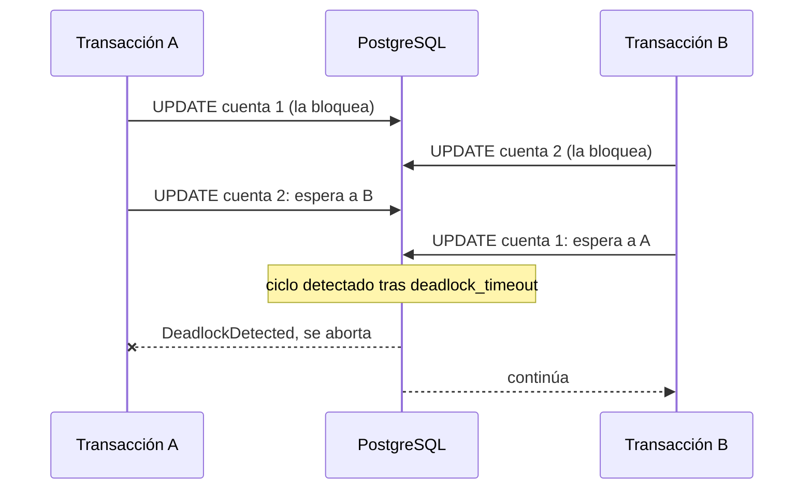
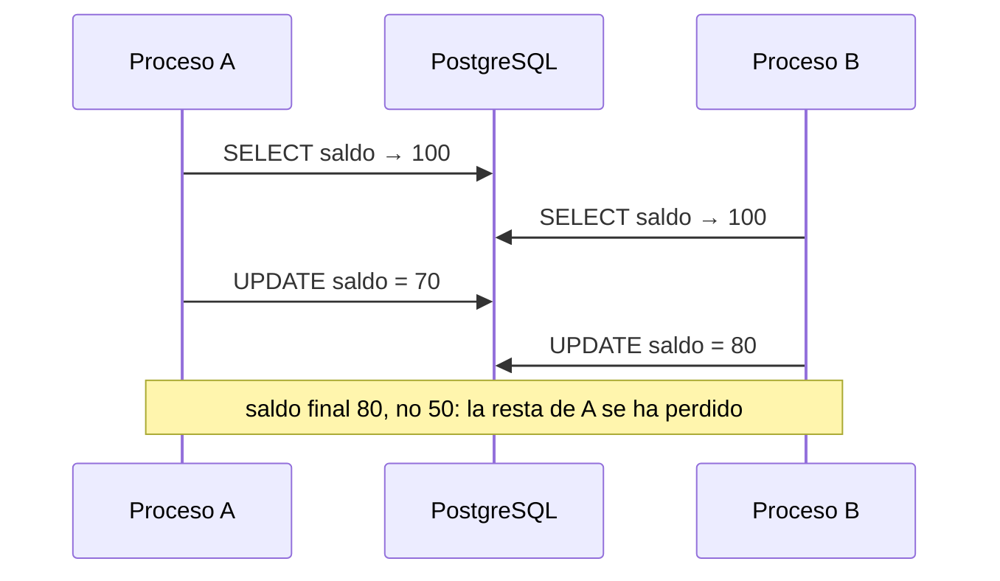

# titulo: Transacciones, aislamiento y concurrencia


# Transacciones y ACID

## Objetivos de aprendizaje

- **1.1** Delimitar una transacción con BEGIN, COMMIT y ROLLBACK.
- **1.2** Explicar las cuatro garantías ACID.
- **1.3** Comprobar la atomicidad ante un fallo a mitad de la transacción.

Todos los resultados de este tema se han obtenido en **PostgreSQL 17**, con dos conexiones simultáneas desde Python (psycopg) para reproducir cada situación.

## Qué es una transacción

Una **transacción** agrupa varias operaciones para que la base de datos las trate como una sola:

```sql
BEGIN;
UPDATE cuentas SET saldo = saldo + 200 WHERE id = 2;   -- abonar a Luis
UPDATE cuentas SET saldo = saldo - 200 WHERE id = 1;   -- cargar a Ana
COMMIT;                                                 -- o ROLLBACK para deshacer
```

Sin `BEGIN`, PostgreSQL ejecuta cada orden en su propia transacción (modo *autocommit*). Las bibliotecas y los frameworks suelen abrir la transacción por ti (en Spring, `@Transactional`).

## ACID

| Garantía | Qué significa | Cómo lo consigue PostgreSQL |
|---|---|---|
| **Atomicidad** | Todo o nada: si algo falla, no queda nada a medias | Si la transacción no se confirma, sus cambios no son visibles para nadie |
| **Consistencia** | Tras la transacción, los datos cumplen las reglas definidas (restricciones, claves) | Las restricciones se comprueban y una violación aborta la transacción |
| **Aislamiento** | Las transacciones concurrentes no ven estados intermedios de las demás | Niveles de aislamiento y MVCC (lecciones siguientes) |
| **Durabilidad** | Lo confirmado sobrevive a una caída | El registro de escritura anticipada (WAL) se guarda en disco antes de confirmar |

La **consistencia** de ACID es la de las reglas que la base de datos conoce. Si una regla de negocio no está expresada como restricción, la base de datos no puede protegerla: queda en manos de la aplicación y del nivel de aislamiento.

## La atomicidad, comprobada

La tabla tiene `CHECK (saldo >= 0)`. Ana tiene 100 € y Luis, 50 €. Se intenta transferir 200 €: primero se abona a Luis y después se carga a Ana, que se quedaría en negativo.

```text
transferencia fallida: CheckViolation
saldos tras fallo: [(1, 100), (2, 50)]
```

El abono a Luis **ya se había ejecutado**, pero al fallar el cargo la transacción entera se deshizo: Luis no recibió dinero que no salió de ningún sitio. Sin transacción, Luis tendría 250 € y Ana seguiría con 100 €.

## Transacciones cortas

Mientras una transacción está abierta, mantiene los bloqueos de las filas que ha modificado (lección 3). Una transacción que espera a un servicio externo o a que el usuario pulse un botón **bloquea a los demás** durante ese tiempo. La regla: **nada de llamadas de red ni esperas de usuario dentro de una transacción**.

## Puntos clave

- Una transacción es una unidad de trabajo: `COMMIT` la confirma y `ROLLBACK` la deshace.
- ACID: atomicidad, consistencia, aislamiento y durabilidad.
- La base de datos solo protege las reglas que conoce; exprésalas como restricciones.
- La durabilidad se apoya en el WAL.
- Mantén las transacciones cortas y sin esperas externas.

## Referencias

- PostgreSQL, [Transactions](https://www.postgresql.org/docs/current/tutorial-transactions.html).
- PostgreSQL, [Write-Ahead Logging](https://www.postgresql.org/docs/current/wal-intro.html).
- Wikipedia, [ACID](https://en.wikipedia.org/wiki/ACID).

# Anomalías y niveles de aislamiento

## Objetivos de aprendizaje

- **2.1** Reconocer las anomalías de concurrencia.
- **2.2** Relacionar cada nivel de aislamiento con las anomalías que evita.
- **2.3** Explicar las particularidades de PostgreSQL.
- **2.4** Elegir un nivel de aislamiento y gestionar sus errores.

## Las anomalías

| Anomalía | Qué pasa |
|---|---|
| **Lectura sucia** | Lees datos que otra transacción aún no ha confirmado |
| **Lectura no repetible** | Lees dos veces la misma fila y cambia, porque otra transacción la modificó y confirmó entre medias |
| **Lectura fantasma** | Repites una consulta y aparecen o desaparecen filas |
| **Actualización perdida** | Dos transacciones leen, calculan en la aplicación y escriben; una escritura borra la otra |
| **Write skew** (anomalía de serialización) | Cada transacción lee lo mismo, decide y escribe filas distintas; juntas incumplen una regla |

## Niveles de aislamiento

El estándar SQL define cuatro niveles. En **PostgreSQL** hay **tres efectivos**: READ UNCOMMITTED se comporta como READ COMMITTED. El predeterminado es **READ COMMITTED**.

| Nivel | Lectura sucia | No repetible | Fantasma | Write skew |
|---|---|---|---|---|
| READ COMMITTED | No | **Sí** | **Sí** | **Sí** |
| REPEATABLE READ | No | No | No (en PostgreSQL) | **Sí** |
| SERIALIZABLE | No | No | No | No |

PostgreSQL da en REPEATABLE READ más de lo que exige el estándar: no permite lecturas fantasma.

## Lo que se vio con dos sesiones

**Lectura no repetible.** La transacción A lee el saldo de Luis (50); B lo cambia a 999 y confirma; A vuelve a leer.

| Nivel de A | Primera lectura | Segunda lectura |
|---|---|---|
| READ COMMITTED | 50 | **999** |
| REPEATABLE READ | 50 | 50 |

En READ COMMITTED, **cada orden** ve lo confirmado hasta ese momento. En REPEATABLE READ, toda la transacción ve una **instantánea** tomada al empezar.

**Actualización concurrente en REPEATABLE READ.** A y B leen el saldo de Ana; A lo actualiza y confirma; B intenta actualizarlo después:

```text
SerializationFailure: could not serialize access due to concurrent update
```

En lugar de pisar el cambio de A, PostgreSQL aborta B. La aplicación **debe repetir la transacción**: la documentación advierte de que quien use este nivel tiene que estar preparado para reintentar.

**Write skew: los médicos de guardia.** Regla: siempre debe haber al menos un médico de guardia. Alicia y Bruno lo están. Cada uno, en su transacción, comprueba que hay 2 de guardia y se quita:

| Nivel | Lo que ve cada uno | Resultado | Médicos de guardia al final |
|---|---|---|---|
| REPEATABLE READ | 2 | Las dos transacciones confirman | **0** (regla rota) |
| SERIALIZABLE | 2 | Alicia confirma; Bruno recibe **SerializationFailure** | 1 |

REPEATABLE READ no detecta este caso porque **cada transacción escribe una fila distinta**. SERIALIZABLE garantiza que el resultado equivale a ejecutar las transacciones una detrás de otra, y aborta la que lo impediría.

## Elegir

- **READ COMMITTED** (por defecto) basta para la mayoría de las operaciones, **si** se escriben de forma segura (lección 4).
- **REPEATABLE READ** para informes y lecturas que deben ser coherentes en el tiempo.
- **SERIALIZABLE** cuando hay reglas que dependen de varias filas y no se pueden expresar como restricciones, con **reintentos** en la aplicación.

## Puntos clave

- Anomalías: lectura sucia, no repetible, fantasma, actualización perdida y write skew.
- PostgreSQL tiene tres niveles efectivos; READ COMMITTED es el predeterminado y no evita lecturas no repetibles.
- REPEATABLE READ usa una instantánea de toda la transacción; en PostgreSQL evita los fantasmas pero no el write skew.
- SERIALIZABLE evita todas las anomalías a cambio de errores de serialización.
- En REPEATABLE READ y SERIALIZABLE, la aplicación debe reintentar al recibir un error de serialización.

## Referencias

- PostgreSQL, [Transaction isolation](https://www.postgresql.org/docs/current/transaction-iso.html).
- Wikipedia, [Isolation (database systems)](https://en.wikipedia.org/wiki/Isolation_(database_systems)).

# MVCC y bloqueos

## Objetivos de aprendizaje

- **3.1** Explicar cómo MVCC permite leer sin bloquear.
- **3.2** Identificar cuándo una escritura espera a otra.
- **3.3** Bloquear filas al leer con SELECT … FOR UPDATE.
- **3.4** Reconocer y evitar los interbloqueos.

## MVCC: varias versiones de cada fila

PostgreSQL usa **control de concurrencia multiversión** (MVCC): al modificar una fila no la sobrescribe, sino que crea una **versión nueva**. Cada transacción lee la versión que corresponde a su **instantánea**. Consecuencia práctica:

- **Las lecturas no bloquean a las escrituras** y **las escrituras no bloquean a las lecturas**.
- Lo que sí se bloquea es **escribir la misma fila**: dos transacciones no pueden modificar la misma fila a la vez.

Las versiones antiguas que ya nadie necesita las limpia el proceso **VACUUM** (normalmente, *autovacuum*).

## Escrituras que esperan

En la prueba, A ejecutó `UPDATE cuentas SET saldo = saldo - 30 WHERE id = 1` sin confirmar. B intentó `UPDATE cuentas SET saldo = saldo - 20 WHERE id = 1`:

- B **quedó esperando** (el hilo seguía vivo medio segundo después).
- Al confirmar A, B continuó. En READ COMMITTED, B **vuelve a leer la fila ya modificada** antes de aplicar su cambio, así que el saldo final fue **50** (100 − 30 − 20): ninguna resta se perdió.

## SELECT … FOR UPDATE

Cuando la aplicación necesita **leer un valor, decidir y luego escribir**, puede bloquear la fila al leerla:

```sql
BEGIN;
SELECT saldo FROM cuentas WHERE id = 1 FOR UPDATE;   -- bloquea la fila
-- la aplicación decide con el saldo leído
UPDATE cuentas SET saldo = :nuevo WHERE id = 1;
COMMIT;
```

En la prueba, A hizo el `SELECT … FOR UPDATE` y B intentó lo mismo: B esperó hasta que A confirmó y entonces **leyó 70** (el valor ya actualizado por A), no 100. El saldo final fue 50. Sin `FOR UPDATE`, B habría leído 100 y su escritura habría borrado la de A (lección siguiente).

Variantes útiles: `FOR SHARE` (bloqueo compartido, para leer impidiendo cambios), `NOWAIT` (falla en lugar de esperar) y `SKIP LOCKED` (salta las filas bloqueadas, útil para colas de trabajo).

## Interbloqueos

A actualiza la cuenta 1 y B la cuenta 2. Después, A intenta actualizar la 2 (bloqueada por B) y B la 1 (bloqueada por A). Ninguna puede avanzar: es un **interbloqueo**. PostgreSQL lo detecta (comprueba si hay ciclo tras esperar `deadlock_timeout`, 1 segundo por defecto) y **aborta una de las transacciones**:



```nodos
A:
  titulo: Transacción A
  texto: La abortada. La aplicación debe tratar el error como uno de serialización y reintentarla.
  seccion: 04-patrones-en-la-aplicacion/teoria#reintentar
BD:
  concepto: interbloqueo
B:
  titulo: Transacción B
  texto: Sigue adelante cuando PostgreSQL aborta a A. Si las dos hubieran bloqueado las cuentas en el mismo orden (id ascendente), no habría ciclo.
```

```text
interbloqueo: {'a': 'DeadlockDetected', 'b': 'ok'}
```

Cómo evitarlos:

- **Acceder a las filas siempre en el mismo orden** (por ejemplo, por id ascendente). En una transferencia, bloquear primero la cuenta de id menor, sea origen o destino.
- Transacciones cortas.
- Tratar el error como uno de serialización: **reintentar** la transacción abortada.

## Puntos clave

- MVCC guarda versiones: leer no bloquea escribir, ni al revés.
- Dos escrituras sobre la misma fila se serializan: la segunda espera.
- En READ COMMITTED, un `UPDATE` que esperó vuelve a leer la fila actualizada.
- `SELECT … FOR UPDATE` bloquea la fila al leerla; `SKIP LOCKED` y `NOWAIT` cambian la espera.
- PostgreSQL detecta los interbloqueos y aborta una transacción; evítalos accediendo en el mismo orden.

## Referencias

- PostgreSQL, [Introduction to MVCC](https://www.postgresql.org/docs/current/mvcc-intro.html).
- PostgreSQL, [Explicit locking](https://www.postgresql.org/docs/current/explicit-locking.html).
- PostgreSQL, [SELECT](https://www.postgresql.org/docs/current/sql-select.html) (cláusula de bloqueo).
- PostgreSQL, [Lock management](https://www.postgresql.org/docs/current/runtime-config-locks.html) (`deadlock_timeout`).

# Patrones en la aplicación

## Objetivos de aprendizaje

- **4.1** Evitar la actualización perdida con escrituras relativas en SQL.
- **4.2** Aplicar el bloqueo pesimista o el optimista según el caso.
- **4.3** Reintentar transacciones ante errores de serialización e interbloqueos.
- **4.4** Combinar transacciones con llamadas externas sin perder coherencia.

## El fallo clásico: leer, calcular y escribir

```python
saldo = db.execute("SELECT saldo FROM cuentas WHERE id = 1").fetchone()[0]
db.execute("UPDATE cuentas SET saldo = %s WHERE id = 1", (saldo - 30,))
```

Con dos procesos haciendo esto a la vez en READ COMMITTED (uno resta 30 y otro 20, con un saldo inicial de 100), el resultado en la prueba fue **80**, no 50: la segunda escritura **borró** la primera. Es la **actualización perdida**, y READ COMMITTED no la evita porque la base de datos no sabe que el valor escrito dependía de una lectura anterior.



```nodos
A:
  titulo: Proceso A
  texto: Lee 100, resta 30 en la aplicación y escribe 70.
BD:
  concepto: nivel-de-aislamiento
B:
  concepto: actualizacion-perdida
```

## Las soluciones

| Solución | Cómo | Cuándo |
|---|---|---|
| **Escritura relativa** | `UPDATE cuentas SET saldo = saldo - 30 WHERE id = 1`, con la regla como restricción (`CHECK (saldo >= 0)`) | Siempre que el cálculo se pueda expresar en SQL. Es la más simple: dio 50 en la prueba |
| **Bloqueo pesimista** | `SELECT … FOR UPDATE` y después escribir | La decisión necesita lógica de la aplicación y los conflictos son frecuentes |
| **Bloqueo optimista** | Columna `version`: `UPDATE … SET …, version = version + 1 WHERE id = 1 AND version = :leida` | Conflictos poco frecuentes, o lecturas y escrituras separadas por la interacción del usuario |
| **SERIALIZABLE** con reintentos | La base de datos detecta cualquier anomalía | Reglas sobre varias filas que no caben en una restricción |

### Bloqueo optimista

No bloquea al leer: detecta el conflicto al escribir. Cada fila lleva un número de versión, y el `UPDATE` solo se aplica si la versión no ha cambiado desde que se leyó:

```sql
UPDATE cuentas SET saldo = 70, version = version + 1
WHERE id = 1 AND version = 0;
```

En la prueba, dos procesos leyeron la versión 0 y escribieron con esta condición: el primero actualizó **1 fila** y el segundo **0 filas**. Cero filas significa «alguien cambió esto antes que tú»: la aplicación vuelve a leer y decide, o avisa al usuario. JPA lo implementa con la anotación `@Version`.

Es el patrón natural cuando entre la lectura y la escritura pasa el tiempo de un usuario editando un formulario: no se puede tener una transacción abierta y una fila bloqueada mientras tanto.

## Reintentar

Los errores de serialización (`SerializationFailure`) y los interbloqueos (`DeadlockDetected`) **no son fallos del programa**: son la forma en que la base de datos protege la coherencia. La respuesta correcta es **repetir la transacción entera** desde el principio, releyendo los datos:

```python
for intento in range(3):
    try:
        with conexion.transaction():
            reservar(conexion, ...)
        break
    except (psycopg.errors.SerializationFailure, psycopg.errors.DeadlockDetected):
        if intento == 2:
            raise
```

Solo es seguro reintentar si la transacción **no ha hecho nada fuera de la base de datos** (enviar un correo, cobrar).

## Transacciones y efectos externos

La base de datos no puede deshacer un correo enviado ni un cobro hecho. Patrones habituales:

- **Primero la base de datos, después el efecto externo**, y que el efecto sea **idempotente** (repetirlo no cambia nada; por ejemplo, con una clave de idempotencia en la pasarela de pago).
- **Patrón *outbox***: en la misma transacción que cambia los datos, se inserta una fila en una tabla de mensajes pendientes; otro proceso la lee y envía el mensaje. Se estudia en el tema de arquitectura dirigida por eventos.

## Puntos clave

- Leer, calcular en la aplicación y escribir pierde actualizaciones en READ COMMITTED.
- Lo más simple es la escritura relativa en SQL, con la regla como restricción.
- Pesimista (`FOR UPDATE`) cuando hay conflictos frecuentes; optimista (columna de versión) cuando son raros o hay usuarios de por medio.
- Ante errores de serialización o interbloqueos, repite la transacción entera.
- Los efectos externos van después de confirmar, de forma idempotente, o con el patrón *outbox*.

## Referencias

- PostgreSQL, [Transaction isolation](https://www.postgresql.org/docs/current/transaction-iso.html).
- PostgreSQL, [Explicit locking](https://www.postgresql.org/docs/current/explicit-locking.html).
- Wikipedia, [Optimistic concurrency control](https://en.wikipedia.org/wiki/Optimistic_concurrency_control).
