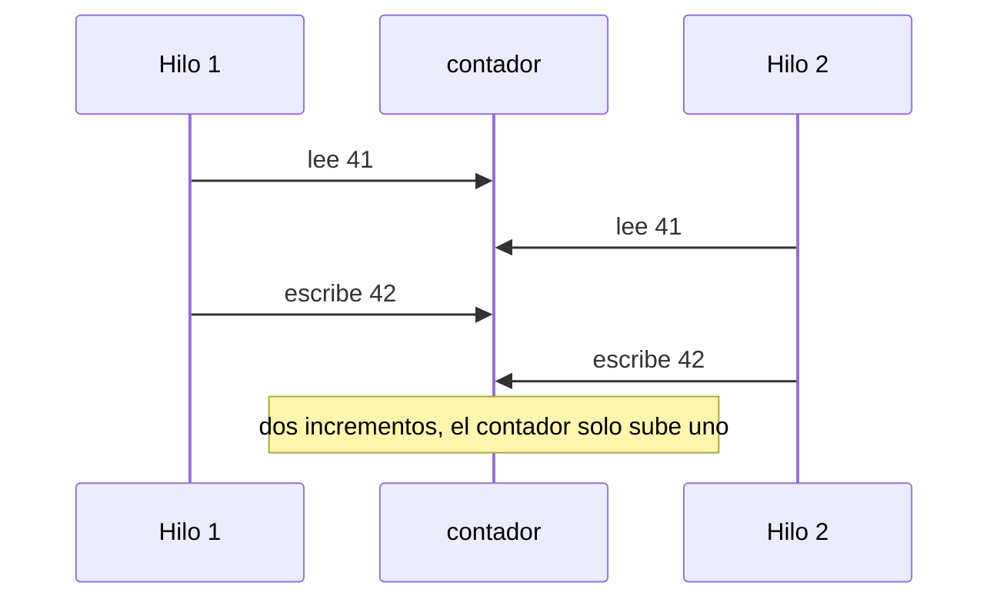
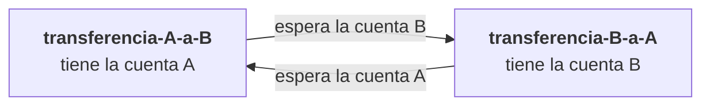
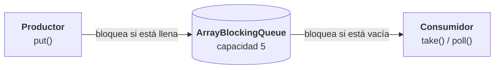
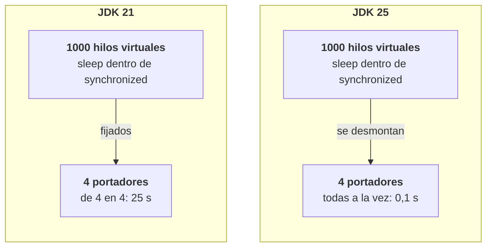
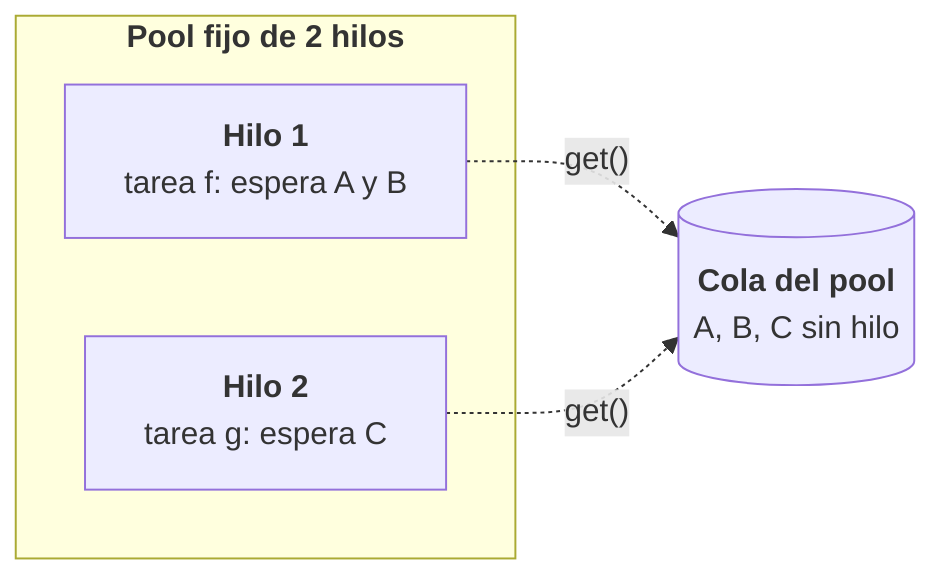

# titulo: Concurrencia en Java


# Hilos y memoria

## Objetivos de aprendizaje

- **1.1** Explicar por qué `contador++` no es seguro entre hilos.
- **1.2** Reconocer un problema de visibilidad y corregirlo con `volatile`.
- **1.3** Usar la relación «ocurre antes» del modelo de memoria de Java para razonar sobre el código concurrente.
- **1.4** Explicar por qué una prueba que «sale bien» no demuestra que el código sea correcto.

Todo se ha ejecutado con **JDK 25.0.5** (Eclipse Temurin, en Docker) como programas de un solo fichero (`java Carrera.java`).

## La condición de carrera

Cuatro hilos incrementan un `int` compartido un millón de veces cada uno:

```java
static int contador = 0;
// en cada uno de los 4 hilos:
for (int i = 0; i < 1_000_000; i++) contador++;
```

```text
intento 1 sin sincronizar: 3,809,830 de 4,000,000
intento 2 sin sincronizar: 4,000,000 de 4,000,000
intento 3 sin sincronizar: 4,000,000 de 4,000,000
```

`contador++` son **tres pasos**: leer el valor, sumar uno y escribirlo. Si dos hilos leen el mismo valor antes de que el otro escriba, se pierde un incremento. En el primer intento se perdieron 190 170.



```nodos
H1:
  titulo: Hilo 1
  texto: Lee, suma y escribe en pasos separados que otro hilo puede intercalar.
M:
  concepto: condicion-de-carrera
H2:
  titulo: Hilo 2
  texto: Leyó el valor antes de que el hilo 1 escribiera, y su escritura borra el incremento del otro.
```

## Que funcione no prueba nada

Los intentos 2 y 3 dieron el resultado correcto. No es que el código funcione: el compilador JIT optimizó el bucle, y la ventana en la que los hilos se pisan casi desapareció **en esa ejecución**. Con otra carga, otro equipo u otra versión de la JVM, vuelve a fallar.

Esa es la dificultad de la concurrencia: **los fallos son intermitentes**. Una prueba que pasa no demuestra que el código sea correcto; hay que razonarlo con el modelo de memoria.

## Visibilidad

Un hilo espera a que otro le avise con una variable:

```java
static boolean parar = false;             // sin volatile
static volatile boolean pararV = false;   // con volatile
// hilo: while (!parar) n++;
```

```text
hilo con volatile terminó
tras 3 s: sin volatile vivo=true, con volatile vivo=false
```

El hilo sin `volatile` **no se paró nunca**, aunque el principal había puesto `parar = true`. Sin ninguna garantía de visibilidad, el JIT puede leer la variable una sola vez y convertir el bucle en `while (true)`. Es legal según el modelo de memoria.

## El modelo de memoria: ocurre antes

El modelo de memoria de Java (JLS, capítulo 17) define cuándo un hilo ve lo que escribió otro con la relación **ocurre antes** (*happens-before*). Algunas de las que la crean:

| Acción en el hilo A | Acción en el hilo B | Garantía |
|---|---|---|
| Escribir una variable `volatile` | Leer esa misma variable | B ve lo que A escribió antes de la escritura |
| Liberar un cerrojo (salir de `synchronized`) | Tomar el mismo cerrojo | B ve todo lo que A hizo dentro y antes |
| `thread.start()` | El código del hilo arrancado | El hilo ve lo anterior al `start` |
| El código del hilo | `thread.join()` en otro hilo | Quien hace `join` ve lo que hizo el hilo |

Sin una de estas relaciones, no hay garantía. `volatile` resuelve la **visibilidad**, pero no la **atomicidad**: `contador++` sobre un `volatile int` sigue perdiendo incrementos, porque siguen siendo tres pasos. Para eso están los cerrojos y los atómicos (lección 2).

## Puntos clave

- `contador++` son tres pasos; dos hilos pueden pisarse y perder incrementos.
- Una prueba concurrente que sale bien no demuestra nada: los fallos son intermitentes.
- Sin `volatile` ni sincronización, un hilo puede no ver nunca el cambio de otro.
- El modelo de memoria garantiza la visibilidad solo con relaciones «ocurre antes»: `volatile`, cerrojos, `start` y `join`.
- `volatile` da visibilidad, no atomicidad.

## Referencias

- Oracle, [The Java Language Specification, capítulo 17: Threads and Locks](https://docs.oracle.com/javase/specs/jls/se25/html/jls-17.html).

# Cerrojos y atómicos

## Objetivos de aprendizaje

- **2.1** Proteger una sección crítica con `synchronized` o `ReentrantLock`.
- **2.2** Usar las variables atómicas y saber cuándo compensa `LongAdder`.
- **2.3** Explicar cómo se produce un interbloqueo y cómo evitarlo.
- **2.4** Elegir entre cerrojo, atómico o no compartir el estado.

Ejecutado con JDK 25.0.5, cuatro hilos haciendo un millón de incrementos cada uno.

## synchronized y ReentrantLock

Un **cerrojo** deja entrar a un solo hilo a la vez en la sección que protege, y además crea la relación «ocurre antes» de la lección 1:

```java
static final Object cerrojo = new Object();
synchronized (cerrojo) { conLock++; }
```

| | `synchronized` | `ReentrantLock` |
|---|---|---|
| Liberación | Automática al salir del bloque, también con excepción | Manual, en un `finally` |
| Intentar con plazo | No | `tryLock(1, SECONDS)` |
| Interrumpir la espera | No | `lockInterruptibly()` |
| Equidad (por orden de llegada) | No | Opcional |
| Condiciones de espera | `wait`/`notify` | Varias `Condition` |

Usa `synchronized` por defecto y `ReentrantLock` cuando necesites esperar con plazo o poder interrumpir. Con `ReentrantLock`, el patrón es siempre:

```java
cerrojo.lock();
try {
    // sección crítica
} finally {
    cerrojo.unlock();
}
```

Protege siempre el mismo dato con el **mismo** cerrojo, y mantén la sección crítica corta: nada de llamadas de red dentro.

## Atómicos

Para un contador, un cerrojo es demasiado. Las clases de `java.util.concurrent.atomic` hacen la operación en un paso indivisible:

```text
synchronized:  4,000,000 en 195 ms
AtomicLong:    4,000,000 en 52 ms
LongAdder:     4,000,000 en 67 ms
```

Los tres dan el total exacto. `AtomicLong` usa una instrucción de comparar e intercambiar del procesador. `LongAdder` reparte la suma en varias celdas para que los hilos no compitan por la misma, y está pensado para **mucha contención**; con solo cuatro hilos, en la prueba fue algo más lento que `AtomicLong`. Úsalo para contadores muy disputados (métricas) que se leen poco, porque `sum()` recorre todas las celdas y no es una instantánea exacta mientras se escribe.

## Interbloqueos

Dos transferencias, una de A a B y otra de B a A, toman los cerrojos de las cuentas en orden contrario:

```java
// transferencia-A-a-B                // transferencia-B-a-A
synchronized (cuentaA) {              synchronized (cuentaB) {
    synchronized (cuentaB) { … }          synchronized (cuentaA) { … }
}                                     }
```

```text
transferencia-A-a-B espera java.lang.Object@2a5c8d3f, que tiene transferencia-B-a-A
transferencia-B-a-A espera java.lang.Object@b3ca52e, que tiene transferencia-A-a-B
```



```nodos
T1:
  concepto: interbloqueo-java
T2:
  titulo: El otro hilo
  texto: Tiene la cuenta B y espera la A. Ninguno de los dos avanzará nunca, y Java no lo resuelve solo.
```

Java **no deshace** un interbloqueo: los dos hilos quedan parados para siempre. Se detecta con `ThreadMXBean.findDeadlockedThreads()`, que dio el resultado anterior, o con `jstack` (lección 5). Formas de evitarlo:

- **Orden global de cerrojos:** tomarlos siempre en el mismo orden, por ejemplo por número de cuenta, sea origen o destino.
- **`tryLock` con plazo:** si no se consigue el segundo cerrojo a tiempo, soltar el primero y reintentar.
- **Menos cerrojos anidados:** cada cerrojo dentro de otro es una oportunidad de interbloqueo.

## Elegir

| Situación | Herramienta |
|---|---|
| Un contador o una referencia que cambia sola | `AtomicLong`, `AtomicReference` |
| Contador muy disputado, de lectura ocasional | `LongAdder` |
| Varios datos que deben cambiar juntos | `synchronized` o `ReentrantLock` |
| Esperar el cerrojo con plazo | `ReentrantLock.tryLock` |
| Datos que se pueden no compartir | Objetos inmutables o confinados a un hilo: no necesitan nada |

La mejor sincronización es la que no hace falta: los `record` inmutables y el estado local de cada tarea eliminan el problema de raíz.

## Puntos clave

- Un cerrojo da exclusión mutua y visibilidad; usa `synchronized` por defecto y `ReentrantLock` para plazos e interrupciones.
- Con `ReentrantLock`, `unlock()` siempre en un `finally`.
- Los atómicos hacen operaciones indivisibles sin cerrojo; en la prueba, `AtomicLong` tardó 52 ms frente a 195 de `synchronized`.
- `LongAdder` compensa con mucha contención; con poca, `AtomicLong` basta.
- Un interbloqueo no se resuelve solo; evítalo con un orden global de cerrojos o con `tryLock` y plazo.
- Lo inmutable y lo no compartido no necesitan sincronización.

## Referencias

- Oracle, [The Java Language Specification, capítulo 17](https://docs.oracle.com/javase/specs/jls/se25/html/jls-17.html).
- Oracle, [LongAdder](https://docs.oracle.com/en/java/javase/25/docs/api/java.base/java/util/concurrent/atomic/LongAdder.html) y [ThreadMXBean](https://docs.oracle.com/en/java/javase/25/docs/api/java.management/java/lang/management/ThreadMXBean.html).

# java.util.concurrent

## Objetivos de aprendizaje

- **3.1** Ejecutar tareas con un `ExecutorService` y cerrarlo correctamente.
- **3.2** Componer operaciones asíncronas con `CompletableFuture`, con plazos y valores por defecto.
- **3.3** Usar `ConcurrentHashMap` sin caer en «comprobar y luego actuar».
- **3.4** Coordinar productores y consumidores con una cola bloqueante acotada.

Ejecutado con JDK 25.0.5.

## Ejecutores

Crear un `Thread` por tarea a mano no escala ni se controla bien. Un **`ExecutorService`** recibe tareas y las reparte entre hilos:

| Ejecutor | Para qué |
|---|---|
| `Executors.newFixedThreadPool(n)` | Tareas de cálculo: tantos hilos como núcleos, más o menos |
| `Executors.newVirtualThreadPerTaskExecutor()` | Tareas que esperan E/S: un hilo virtual por tarea (lección 4) |
| `Executors.newScheduledThreadPool(n)` | Tareas periódicas o con retraso |

Desde JDK 19, `ExecutorService` es `AutoCloseable`: con `try` con recursos, al salir del bloque espera a que terminen las tareas.

```java
try (var ex = Executors.newFixedThreadPool(4)) {
    for (int h = 0; h < 4; h++) ex.submit(tarea);
}   // aquí ya han terminado todas
```

## CompletableFuture

**`CompletableFuture`** representa un resultado que llegará, y permite combinarlo sin bloquear. Tres llamadas a la vez, una de ellas demasiado lenta:

```java
var usuario = CompletableFuture.supplyAsync(() -> lento("ana", 200), ex);
var pedidos = CompletableFuture.supplyAsync(() -> lento("3 pedidos", 300), ex);
var stock   = CompletableFuture.supplyAsync(() -> lento("stock", 5000), ex)
        .completeOnTimeout("stock desconocido", 500, TimeUnit.MILLISECONDS);

String r = usuario.thenCombine(pedidos, (u, p) -> u + ", " + p)
                  .thenCombine(stock, (x, s) -> x + ", " + s)
                  .join();
```

```text
ana, 3 pedidos, stock desconocido en 509 ms
```

Las tres corrieron en paralelo: el total fue el del plazo (500 ms), no la suma. `completeOnTimeout` dio un valor por defecto al servicio lento en lugar de esperar cinco segundos.

| Método | Para qué |
|---|---|
| `thenApply` | Transformar el resultado |
| `thenCompose` | Encadenar otra operación asíncrona que depende del resultado |
| `thenCombine` | Combinar dos resultados independientes |
| `allOf` / `anyOf` | Esperar a todos o al primero |
| `completeOnTimeout` / `orTimeout` | Valor por defecto o error si tarda demasiado |
| `exceptionally` / `handle` | Recuperarse de un error |

`exceptionally` convirtió un fallo en un valor por defecto: `valor por defecto (caído)`.

## ConcurrentHashMap: comprobar y luego actuar

Cada operación de `ConcurrentHashMap` es atómica, pero **una secuencia de operaciones no**. Ocho hilos cuentan visitas, cien mil veces cada uno:

```java
Integer v = m.get("visitas"); m.put("visitas", v == null ? 1 : v + 1);   // get + put
b.merge("visitas", 1, Integer::sum);                                        // merge
```

```text
get + put: 659,004   merge: 800,000   (esperado 800.000)
get + put: 618,918   merge: 800,000
get + put: 570,188   merge: 800,000
```

Entre el `get` y el `put`, otro hilo puede escribir, y su valor se pierde. Es la misma condición de carrera de la lección 1, en otra forma. Las operaciones compuestas atómicas son `merge`, `compute`, `computeIfAbsent` y `putIfAbsent`.

## Productor y consumidor

Una **cola bloqueante** acotada desacopla a quien produce trabajo de quien lo consume y frena al productor si el consumidor no da abasto:



```nodos
P:
  titulo: Productor
  texto: Con la cola llena, put espera. En la prueba quedó en estado WAITING con 5 elementos en la cola.
Q:
  concepto: cola-bloqueante
C:
  titulo: Consumidor
  texto: Cuando retira elementos, el productor sigue. Al vaciar la cola, el productor terminó.
```

```text
con el consumidor parado, la cola tiene 5 y el productor está WAITING
consumidos todos; productor TERMINATED
```

Una cola **sin límite** (`LinkedBlockingQueue` sin capacidad) no frena nada: si el consumidor es más lento, crece hasta agotar la memoria.

## Puntos clave

- Usa ejecutores en lugar de hilos a mano; con `try` con recursos, se espera a que terminen las tareas.
- `CompletableFuture` combina resultados sin bloquear; con `completeOnTimeout` y `exceptionally`, el servicio lento o caído no arrastra al resto.
- En `ConcurrentHashMap`, `get` y después `put` pierde actualizaciones; usa `merge`, `compute` o `putIfAbsent`.
- Una cola bloqueante acotada frena al productor; una sin límite puede agotar la memoria.

## Referencias

- Oracle, [java.util.concurrent](https://docs.oracle.com/en/java/javase/25/docs/api/java.base/java/util/concurrent/package-summary.html).
- Oracle, [CompletableFuture](https://docs.oracle.com/en/java/javase/25/docs/api/java.base/java/util/concurrent/CompletableFuture.html), [ConcurrentHashMap](https://docs.oracle.com/en/java/javase/25/docs/api/java.base/java/util/concurrent/ConcurrentHashMap.html) y [ExecutorService](https://docs.oracle.com/en/java/javase/25/docs/api/java.base/java/util/concurrent/ExecutorService.html).

# Hilos virtuales y concurrencia estructurada

## Objetivos de aprendizaje

- **4.1** Saber cuándo compensan los hilos virtuales y cuándo no.
- **4.2** Explicar el *pinning* y por qué JDK 24 cambió el consejo sobre `synchronized`.
- **4.3** Lanzar subtareas con concurrencia estructurada y entender qué pasa si una falla.
- **4.4** Compartir datos con un ámbito acotado con `ScopedValue` en lugar de `ThreadLocal`.

Las pruebas usan JDK 21 y JDK 25 en Docker, con 4 procesadores. Los hilos virtuales se presentan en el tema de Java moderno; aquí se ven sus límites y lo que ha cambiado desde Java 21.

## Cuándo compensan

Un **hilo virtual** se desmonta de su hilo portador (*carrier*) cuando espera E/S, y el portador queda libre para otro. Compensa cuando las tareas **esperan** (red, base de datos, disco), no cuando calculan.

| Tarea | ¿Hilos virtuales? |
|---|---|
| Servidor que atiende muchas peticiones que esperan a la base de datos | Sí |
| Llamar en paralelo a varias API | Sí |
| Calcular sobre la CPU (comprimir, cifrar mucho, procesar imágenes) | No: un pool fijo del tamaño de los núcleos |
| Limitar cuántas conexiones se abren a una base de datos | El pool de conexiones o un `Semaphore` lo limita, no el número de hilos |

No se reutilizan ni se meten en un pool: se crea uno por tarea.

## Pinning: de JDK 21 a JDK 25

Hasta JDK 23, un hilo virtual que esperaba **dentro de un bloque `synchronized`** no podía desmontarse: quedaba **fijado** (*pinned*) a su portador. Mil tareas que esperan 100 ms dentro de `synchronized`, cada una con su propio cerrojo, con 4 portadores:

```text
Java 21, 4 procesadores: 1000 tareas de 100 ms dentro de synchronized en 25053 ms
Java 25, 4 procesadores: 1000 tareas de 100 ms dentro de synchronized en 115 ms
```



```nodos
J21:
  titulo: JDK 21
  texto: El hilo virtual que espera dentro de synchronized ocupa su portador. Con 4 portadores, las 1000 esperas de 100 ms se hacen de 4 en 4.
V1:
  titulo: Tareas en JDK 21
  texto: El consejo era cambiar synchronized por ReentrantLock en el código que esperaba E/S.
C1:
  concepto: pinning
J25:
  titulo: JDK 24 en adelante
  texto: El JEP 491 permitió desmontar los hilos virtuales dentro de synchronized.
V2:
  titulo: Tareas en JDK 25
  texto: El mismo código, sin cambios.
C2:
  titulo: Portadores libres
  texto: Las 1000 esperas se solapan y el total es poco más de una.
```

El **JEP 491** (JDK 24) eliminó ese fijado. Con JDK 24 o posterior ya no hace falta cambiar `synchronized` por `ReentrantLock` para usar hilos virtuales. Quedan casos raros de fijado, como las llamadas a código nativo.

## Concurrencia estructurada

Con `CompletableFuture` o con un ejecutor, si una subtarea falla, las demás siguen corriendo aunque su resultado ya no sirva. La **concurrencia estructurada** agrupa las subtareas en un ámbito: empiezan y terminan juntas, y si una falla, se cancelan las demás.

A noviembre de 2026 sigue en **preview**: quinta en JDK 25 (JEP 505), sexta en JDK 26 y séptima en JDK 27. Hace falta `--enable-preview`, y la API puede cambiar.

```java
try (var scope = StructuredTaskScope.open()) {
    Subtask<String> u = scope.fork(() -> usuario());   // tarda 300 ms
    Subtask<String> p = scope.fork(() -> pedidos());   // falla a los 100 ms
    scope.join();
    return u.get() + " " + p.get();
} catch (StructuredTaskScope.FailedException e) {
    // …
}
```

```text
falló en 112 ms: pedidos no responde; la otra subtarea terminó=false
```

El ámbito no esperó a `usuario()`: al fallar `pedidos()`, la canceló y salió a los 112 ms. Además, al terminar el bloque no queda ninguna subtarea suelta, y en un volcado de hilos se ve qué subtareas pertenecen a qué tarea.

## Valores con ámbito

`ThreadLocal` guarda un valor por hilo, por ejemplo el usuario de la petición. Con millones de hilos virtuales es caro, es mutable y, en pools, se queda con valores de tareas anteriores si no se limpia. **`ScopedValue`**, definitivo desde **JDK 25** (JEP 506), comparte un valor inmutable con todo lo que se llama dentro de un ámbito, también con las subtareas de la concurrencia estructurada:

```java
static final ScopedValue<String> USUARIO = ScopedValue.newInstance();

ScopedValue.where(USUARIO, "ana").run(() -> servicio.procesar());
// dentro de procesar() y de lo que llame: USUARIO.get() devuelve "ana"
```

Al salir de `run`, el valor deja de existir. No hay que limpiarlo.

## Puntos clave

- Los hilos virtuales compensan con tareas que esperan E/S, no con cálculo; se crea uno por tarea.
- Para limitar recursos (conexiones), usa el pool o un `Semaphore`, no el número de hilos.
- Hasta JDK 23, esperar dentro de `synchronized` fijaba el hilo; en la prueba, 25 s con JDK 21 frente a 0,1 s con JDK 25.
- Desde JDK 24 (JEP 491) no hace falta cambiar `synchronized` por `ReentrantLock` para usar hilos virtuales.
- La concurrencia estructurada cancela las subtareas hermanas si una falla; en noviembre de 2026 sigue en preview.
- `ScopedValue`, definitivo en JDK 25, sustituye a `ThreadLocal` para compartir datos inmutables en un ámbito.

## Referencias

- OpenJDK, [JEP 491: Synchronize Virtual Threads without Pinning](https://openjdk.org/jeps/491).
- OpenJDK, [JEP 505: Structured Concurrency (Fifth Preview)](https://openjdk.org/jeps/505) y [JEP 533 (Seventh Preview)](https://openjdk.org/jeps/533).
- OpenJDK, [JEP 506: Scoped Values](https://openjdk.org/jeps/506).
- Oracle, [Virtual Threads](https://docs.oracle.com/en/java/javase/25/core/virtual-threads.html).

# Errores y diagnóstico

## Objetivos de aprendizaje

- **5.1** Evitar que las excepciones de las tareas se pierdan.
- **5.2** Reconocer el agotamiento de un pool cuyas tareas esperan a otras del mismo pool.
- **5.3** Diagnosticar interbloqueos y bloqueos con un volcado de hilos.
- **5.4** Aplicar una lista de comprobación al revisar código concurrente.

Ejecutado con JDK 25.0.5 en Docker; los volcados se obtuvieron con `jstack`.

## Excepciones que nadie ve

Con `submit`, la excepción de una tarea se guarda en su `Future` y **no aparece en ningún sitio** hasta que alguien llama a `get()`:

```java
Future<?> f = ex.submit(() -> { throw new IllegalStateException("falló el cálculo"); });
```

```text
con submit no se ve nada hasta llamar a get()
get(): java.lang.IllegalStateException: falló el cálculo
```

Si nadie llama a `get()`, el fallo pasa inadvertido: ni traza, ni registro. Formas de evitarlo:

- Llamar siempre a `get()` o `join()` y tratar la excepción.
- Con `CompletableFuture`, terminar la cadena con `exceptionally` o `whenComplete` que registre el error.
- Con concurrencia estructurada, el fallo se propaga solo al ámbito (lección 4).
- Con `execute` en lugar de `submit`, la excepción llega al manejador de excepciones no capturadas del hilo, que por defecto la imprime.

## Un pool que se espera a sí mismo

Un pool fijo de 2 hilos. Dos tareas lanzan subtareas en el **mismo pool** y esperan su resultado con `get()`:

```text
tras 2 s, sin resultado: los 2 hilos del pool esperan subtareas que no tienen hilo donde ejecutarse
```



```nodos
POOL:
  concepto: executor
H1:
  titulo: Hilo 1
  texto: Ocupado esperando el resultado de A y B, que están en la cola.
H2:
  titulo: Hilo 2
  texto: Ocupado esperando el resultado de C.
COLA:
  titulo: Subtareas en cola
  texto: Necesitan un hilo libre del mismo pool, y no lo habrá nunca. No es un interbloqueo de cerrojos, así que jstack no lo detecta como tal.
```

Es un **agotamiento del pool** (*thread starvation deadlock*): no hay cerrojos, así que `jstack` no lo marca como interbloqueo, pero nada avanza. Se evita **no bloqueando** dentro de un pool en espera de tareas del mismo pool: componiendo con `thenCompose`, usando otro ejecutor para las subtareas o, con hilos virtuales, un hilo por tarea.

## Volcados de hilos

Un **volcado de hilos** (*thread dump*) muestra qué hace cada hilo y qué cerrojos tiene o espera. `jstack PID` lo obtiene, y detecta los interbloqueos de cerrojos:

```text
Found one Java-level deadlock:
=============================
"transferencia-A-a-B":
  waiting to lock monitor 0x000071bbd0001810 (object 0x000000029fc0fed8, a java.lang.Object),
  which is held by "transferencia-B-a-A"
"transferencia-B-a-A":
  waiting to lock monitor 0x000071bbc4000f40 (object 0x000000029fc0fec8, a java.lang.Object),
  which is held by "transferencia-A-a-B"
```

| Herramienta | Para qué |
|---|---|
| `jstack PID` | Volcado de los hilos de plataforma, con detección de interbloqueos |
| `jcmd PID Thread.dump_to_file -format=json fichero` | Volcado que incluye los hilos virtuales |
| `ThreadMXBean.findDeadlockedThreads()` | Detectar interbloqueos desde la propia aplicación, por ejemplo en una comprobación de salud |

Pon **nombre** a los hilos (`new Thread(r, "transferencia-A-a-B")`, `Thread.ofVirtual().name(…)`): en un volcado con cientos de hilos, `Thread-17` no dice nada. Haz dos o tres volcados separados unos segundos: un hilo que aparece siempre en el mismo sitio está atascado ahí.

## Lista de comprobación

| Pregunta | Si la respuesta es no |
|---|---|
| ¿Cada dato compartido está protegido por un cerrojo, es atómico, es inmutable o está confinado a un hilo? | Condición de carrera |
| ¿Las secuencias «comprobar y luego actuar» son una sola operación (`merge`, `compute`)? | Actualizaciones perdidas |
| ¿Los cerrojos anidados se toman siempre en el mismo orden? | Interbloqueo |
| ¿Hay alguna espera de red o de disco dentro de un cerrojo? | Todo el servicio en cola |
| ¿Alguien lee el resultado o la excepción de cada tarea? | Fallos silenciosos |
| ¿Las tareas de un pool esperan a otras del mismo pool? | Agotamiento del pool |
| ¿Las colas tienen límite? | Memoria agotada |
| ¿Los hilos tienen nombre? | Volcados ilegibles |

## Puntos clave

- Con `submit`, una excepción queda en el `Future` y nadie la ve si no se llama a `get()`.
- Termina las cadenas de `CompletableFuture` tratando el error, o usa concurrencia estructurada.
- Una tarea que espera a otra del mismo pool fijo puede bloquear el pool entero sin que `jstack` lo marque como interbloqueo.
- `jstack` muestra los interbloqueos de cerrojos; `jcmd … Thread.dump_to_file` incluye los hilos virtuales.
- Pon nombre a los hilos y haz varios volcados seguidos para ver qué está atascado.
- Revisa el código concurrente con la lista de comprobación, porque las pruebas no garantizan nada.

## Referencias

- Oracle, [jstack](https://docs.oracle.com/en/java/javase/25/docs/specs/man/jstack.html) y [ThreadMXBean](https://docs.oracle.com/en/java/javase/25/docs/api/java.management/java/lang/management/ThreadMXBean.html).
- Oracle, [ExecutorService](https://docs.oracle.com/en/java/javase/25/docs/api/java.base/java/util/concurrent/ExecutorService.html).
- Oracle, [Virtual Threads](https://docs.oracle.com/en/java/javase/25/core/virtual-threads.html), sección sobre volcados de hilos.
