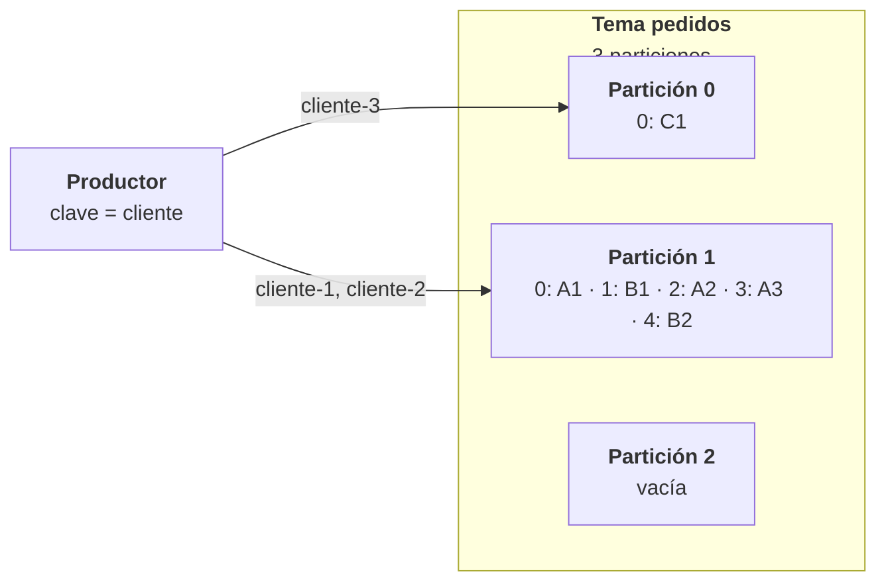
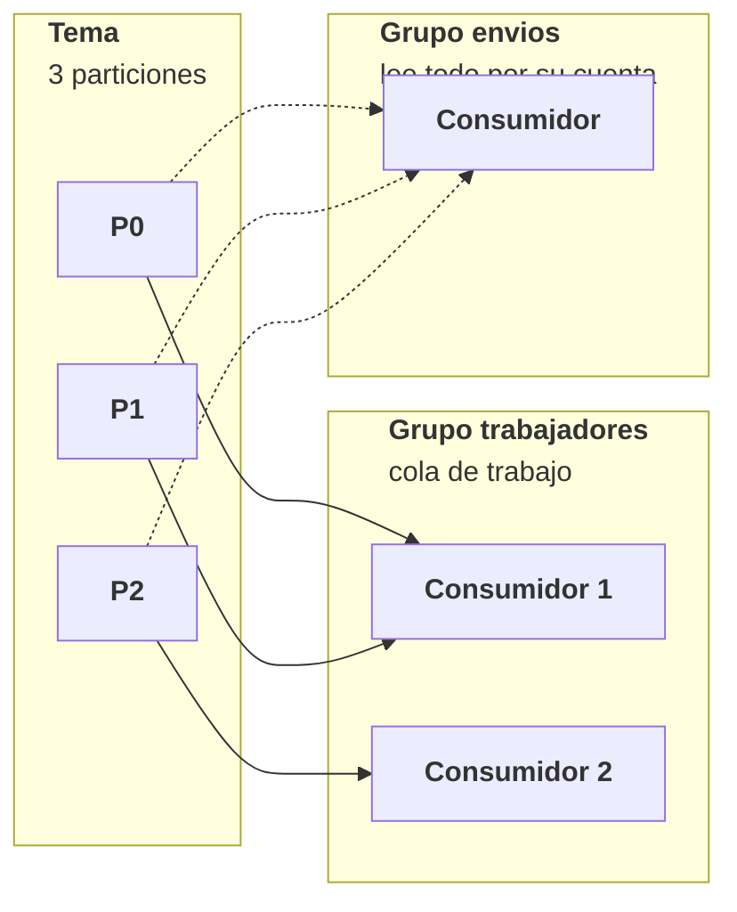
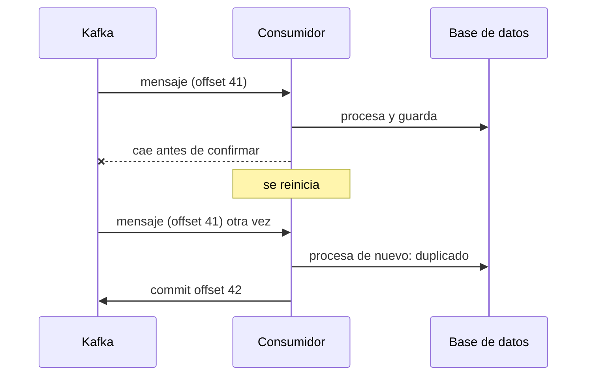

# Mensajería: colas y Kafka


# Mensajería asíncrona

## Objetivos de aprendizaje

- **1.1** Explicar qué aporta la comunicación asíncrona con mensajes frente a las llamadas directas.
- **1.2** Distinguir el canal punto a punto de la publicación-suscripción.
- **1.3** Situar Kafka y RabbitMQ y elegir entre ellos.

## Llamar o avisar

Cuando el servicio de pedidos confirma una compra, varios sistemas tienen que enterarse: facturación, envíos, el correo al cliente. Si pedidos **llama directamente** a cada uno:

- Si envíos está caído, la compra falla o hay que reintentar a mano.
- Pedidos tiene que conocer a cada destinatario y cambiar cada vez que aparece uno nuevo.
- El cliente espera a que respondan todos.

Con **mensajería asíncrona**, pedidos publica un mensaje («pedido confirmado») en un **broker** y sigue con su trabajo. Cada interesado lo recibe cuando puede. Se gana:

| Ventaja | Qué significa |
|---|---|
| **Desacoplamiento** | El productor no conoce a los consumidores; añadir uno nuevo no lo cambia |
| **Tolerancia a fallos** | Si un consumidor está caído, el mensaje espera en el broker |
| **Absorber picos** | Los consumidores procesan a su ritmo aunque lleguen muchos mensajes de golpe |

A cambio, hay que asumir la **consistencia eventual** (los sistemas se ponen al día con un pequeño retraso), mensajes duplicados o desordenados según el caso, y una pieza más que operar y vigilar.

## Dos tipos de canal

El libro *Enterprise Integration Patterns* (Gregor Hohpe y Bobby Woolf, 2003) dio nombre a los patrones de mensajería. Los dos canales básicos:

| Canal | Cada mensaje lo recibe | Para qué |
|---|---|---|
| **Punto a punto** (cola) | **Un** consumidor, aunque haya varios escuchando | Repartir trabajo: generar facturas entre varios procesos |
| **Publicación-suscripción** | **Todos** los suscriptores | Difundir eventos: facturación, envíos y correo se enteran de cada pedido |

## Kafka y RabbitMQ

| | RabbitMQ | Apache Kafka |
|---|---|---|
| Modelo | Broker de colas (AMQP): el mensaje se entrega y se borra cuando se confirma | **Registro** de eventos: se guardan durante un periodo de retención, se consuman o no |
| Releer mensajes antiguos | No es su modelo habitual | Sí: cada consumidor elige desde dónde leer |
| Enrutado | Muy flexible (intercambios, claves de enrutado) | Por tema y partición |
| Encaja en | Colas de trabajo, enrutado complejo, peticiones con respuesta | Flujos de eventos de alto volumen, varios consumidores independientes, reprocesar historia |

Kafka combina los dos canales con los **grupos de consumidores** (lección 3): dentro de un grupo, cada mensaje se reparte como en una cola; entre grupos, cada uno recibe todo, como en publicación-suscripción.

## Puntos clave

- La mensajería asíncrona desacopla productores y consumidores, tolera caídas y absorbe picos.
- El precio: consistencia eventual, posibles duplicados y una pieza más que operar.
- Punto a punto reparte trabajo; publicación-suscripción difunde eventos.
- RabbitMQ es un broker de colas; Kafka, un registro de eventos que se conservan y se pueden releer.
- Kafka hace de cola dentro de un grupo y de publicación-suscripción entre grupos.

## Referencias

- Gregor Hohpe y Bobby Woolf, [Enterprise Integration Patterns: messaging](https://www.enterpriseintegrationpatterns.com/patterns/messaging/).
- Apache Kafka, [Introduction](https://kafka.apache.org/41/getting-started/introduction/).
- RabbitMQ, [AMQP 0-9-1 model explained](https://www.rabbitmq.com/tutorials/amqp-concepts).

# Temas, particiones y claves

## Objetivos de aprendizaje

- **2.1** Describir un tema de Kafka como un registro particionado.
- **2.2** Explicar cómo la clave del mensaje decide la partición y qué orden se garantiza.
- **2.3** Configurar la retención y entender que consumir no borra.

Todo lo de este tema se ha probado con **Apache Kafka 4.1** en un contenedor, con las herramientas de línea de comandos que trae.

## Un tema es un registro particionado

Un **tema** (*topic*) es un flujo de eventos con nombre, como `pedidos`. Se divide en **particiones**: registros **ordenados** a los que solo se añade al final. Cada evento recibe un **offset**, su posición dentro de la partición (0, 1, 2…).

```bash
kafka-topics.sh --bootstrap-server localhost:9092 \
  --create --topic pedidos --partitions 3 --replication-factor 1
```

Las particiones permiten **repartir** el tema entre varios brokers y **leerlo en paralelo**. En producción, cada partición se **replica** en varios brokers (`--replication-factor 3` es lo habitual) para no perder datos si uno cae.

Desde la versión 4.0, Kafka funciona solo en modo **KRaft**, gestionando sus metadatos sin ZooKeeper.

## La clave decide la partición

Cada evento puede llevar una **clave**. Los eventos con la **misma clave van a la misma partición**, y Kafka garantiza que quien lee una partición recibe sus eventos **en el mismo orden en que se escribieron**.

Se enviaron seis pedidos con el cliente como clave y se leyeron indicando partición y offset:

| Partición | Offset | Clave | Valor |
|---|---|---|---|
| 0 | 0 | cliente-3 | pedido-C1 |
| 1 | 0 | cliente-1 | pedido-A1 |
| 1 | 1 | cliente-2 | pedido-B1 |
| 1 | 2 | cliente-1 | pedido-A2 |
| 1 | 3 | cliente-1 | pedido-A3 |
| 1 | 4 | cliente-2 | pedido-B2 |

Los tres pedidos de `cliente-1` están en la misma partición y en orden (A1, A2, A3). En la partición 1 hay además pedidos de `cliente-2`: varias claves pueden compartir partición, y la partición 2 se quedó vacía, porque el reparto depende del *hash* de cada clave.



```nodos
PROD:
  titulo: Productor
  texto: Envía cada pedido con el cliente como clave. El hash de la clave decide la partición.
TEMA:
  concepto: tema-kafka
P0:
  concepto: particion
P1:
  titulo: Partición 1
  texto: Aquí acaban cliente-1 y cliente-2. Los pedidos de cliente-1 (A1, A2, A3) quedan en orden, intercalados con los de cliente-2. El número antes de cada evento es su offset.
  seccion: 02-temas-particiones-y-claves/teoria#la-clave-decide-la-partición
P2:
  titulo: Partición 2
  texto: Ninguna de las tres claves cayó aquí. El reparto depende del hash, no de que las particiones se llenen por igual.
```

Consecuencias:

- **El orden solo se garantiza dentro de una partición.** Entre particiones, no hay orden global.
- Si el orden importa **por entidad** (los eventos de un pedido, de una cuenta), usa su identificador como clave.
- Sin clave, los eventos se reparten entre particiones y se pierde ese orden.
- Aumentar después el número de particiones cambia a qué partición va cada clave, y rompe el orden para los eventos nuevos frente a los antiguos. Conviene elegir bien el número desde el principio.

## Consumir no borra

A diferencia de una cola tradicional, en Kafka **los eventos no se borran al consumirlos**. Se conservan según la **retención** del tema, y cada grupo de consumidores lee a su ritmo y puede volver atrás. En la prueba, el tema `pedidos` tenía `cleanup.policy=delete` y, por defecto, el broker guarda los eventos **168 horas** (7 días, `log.retention.hours`), aunque ya se hayan leído.

| Configuración | Efecto |
|---|---|
| `retention.ms` (o `log.retention.hours` en el broker) | Cuánto tiempo se conservan los eventos |
| `retention.bytes` | Tamaño máximo por partición |
| `cleanup.policy=compact` | Conserva solo el **último** evento de cada clave: útil para guardar el estado actual de cada entidad |

## Puntos clave

- Un tema se divide en particiones: registros ordenados donde solo se añade; cada evento tiene un offset.
- Misma clave, misma partición; el orden solo se garantiza dentro de cada partición.
- Usa como clave el identificador de la entidad cuyo orden importa.
- Kafka 4.0 y posteriores funcionan solo con KRaft, sin ZooKeeper.
- Consumir no borra: los eventos se conservan según la retención (por defecto, 7 días); la compactación guarda el último por clave.

## Referencias

- Apache Kafka, [Introduction](https://kafka.apache.org/41/getting-started/introduction/).
- Apache Kafka, [Design](https://kafka.apache.org/41/design/design/).
- Apache Kafka, [Broker configs](https://kafka.apache.org/41/configuration/broker-configs/).
- Apache Kafka, [Upgrading](https://kafka.apache.org/41/getting-started/upgrade/) (KRaft en Kafka 4.0).

# Grupos de consumidores

## Objetivos de aprendizaje

- **3.1** Explicar cómo se reparten las particiones dentro de un grupo de consumidores.
- **3.2** Usar grupos distintos para que varios sistemas lean el mismo tema.
- **3.3** Seguir el progreso con offsets y lag, y volver a procesar.
- **3.4** Dimensionar el número de consumidores según las particiones.

## Reparto dentro de un grupo

La documentación de Kafka lo resume: cada partición la consume **exactamente un consumidor** de cada grupo suscrito en cada momento. Así, el estado de un grupo es muy pequeño: un **offset por partición**, el del siguiente evento que debe leer.

En la prueba, dos consumidores del grupo `trabajadores` se unieron a un tema de 3 particiones y se enviaron 30 eventos con claves distintas:

| Consumidor | Particiones | Eventos |
|---|---|---|
| 1 | 0 y 1 | 9 + 12 |
| 2 | 2 | 9 |

Ningún evento se procesó dos veces: el grupo funciona como una **cola de trabajo**. Si un consumidor se va, sus particiones pasan a los demás (**reequilibrio**).

## Varios grupos, el mismo tema

Cada **grupo** lleva sus propios offsets. En la prueba:

| Lectura | Eventos recibidos |
|---|---|
| Grupo `facturacion`, primera vez desde el principio | 6 |
| Grupo `facturacion`, otra vez | 0 (ya había confirmado sus offsets) |
| Grupo `envios`, desde el principio | 6 |

Facturación y envíos leen **todo** el tema de forma independiente: entre grupos, Kafka funciona como **publicación-suscripción**.



```nodos
TEMA:
  concepto: tema-kafka
P0:
  concepto: particion
P1:
  concepto: particion
P2:
  concepto: particion
GT:
  concepto: grupo-de-consumidores
C1:
  titulo: Consumidor 1
  texto: Recibió las particiones 0 y 1. Con tres particiones y dos consumidores, el reparto no puede ser exacto.
C2:
  titulo: Consumidor 2
  texto: Recibió la partición 2. Ningún evento llega a los dos consumidores del mismo grupo. Si uno se va, el otro hereda sus particiones (reequilibrio).
  seccion: 03-grupos-de-consumidores/teoria#reparto-dentro-de-un-grupo
GE:
  titulo: Otro grupo
  texto: Cada grupo lleva sus propios offsets y lee todo el tema. Entre grupos, Kafka funciona como publicación-suscripción.
  seccion: 03-grupos-de-consumidores/teoria#varios-grupos-el-mismo-tema
E1:
  titulo: Consumidor de envíos
  texto: Único miembro de su grupo, así que recibe las tres particiones.
```

## Offsets, lag y reprocesar

```bash
kafka-consumer-groups.sh --bootstrap-server localhost:9092 --describe --group facturacion
```

| Partición | Offset actual | Offset final | Lag |
|---|---|---|---|
| 0 | 1 | 1 | 0 |
| 1 | 5 | 5 | 0 |
| 2 | 0 | 0 | 0 |

El **lag** (offset final menos offset del grupo) es lo que falta por procesar. Vigilarlo es la forma básica de saber si los consumidores dan abasto.

Para **volver a procesar** (corregir un error y repetir), se mueven los offsets del grupo:

```bash
kafka-consumer-groups.sh --bootstrap-server localhost:9092 --group facturacion \
  --topic pedidos --reset-offsets --to-earliest --execute
```

Tras el reinicio, el grupo volvió a recibir los 6 eventos. Se hace con el grupo parado.

## Cuántos consumidores

Como cada partición la lee un solo consumidor del grupo, **el número de particiones es el máximo de paralelismo**:

- Con 3 particiones y 2 consumidores, uno lee dos particiones.
- Con 3 particiones y 3 consumidores, cada uno lee una.
- Con 3 particiones y 5 consumidores, **dos se quedan sin trabajo**.

Para escalar el consumo, primero hacen falta particiones suficientes.

## Puntos clave

- En un grupo, cada partición la lee un solo consumidor: el grupo reparte el trabajo como una cola.
- Cada grupo tiene sus offsets: grupos distintos leen todo el tema, como en publicación-suscripción.
- El lag indica cuánto falta por procesar; vigílalo.
- `--reset-offsets` permite reprocesar, con el grupo parado.
- El número de particiones limita el paralelismo de un grupo.

## Referencias

- Apache Kafka, [Design](https://kafka.apache.org/41/design/design/) (posición del consumidor y grupos).
- Apache Kafka, [Introduction](https://kafka.apache.org/41/getting-started/introduction/).

# Garantías de entrega

## Objetivos de aprendizaje

- **4.1** Distinguir las entregas como máximo una vez, al menos una vez y exactamente una vez.
- **4.2** Configurar el productor para no perder ni duplicar mensajes al escribir.
- **4.3** Confirmar los offsets en el momento correcto y escribir consumidores idempotentes.
- **4.4** Tratar los mensajes que no se pueden procesar.

## Tres garantías

La documentación de Kafka las define así:

| Garantía | Qué pasa |
|---|---|
| **Como máximo una vez** | Los mensajes pueden perderse, pero nunca se entregan dos veces |
| **Al menos una vez** | Nunca se pierden, pero pueden entregarse más de una vez |
| **Exactamente una vez** | Cada mensaje se procesa una sola vez |

Y añade que el problema tiene **dos mitades**: la durabilidad al **publicar** y la garantía al **consumir**.

## Al publicar

Dos opciones del productor, con sus valores por defecto en Kafka 4.1:

| Opción | Por defecto | Qué hace |
|---|---|---|
| `acks` | `all` | El líder espera a que las réplicas sincronizadas tengan el mensaje antes de confirmarlo. Con `0` no espera nada y se pueden perder mensajes |
| `enable.idempotence` | `true` | Los reintentos por fallos del broker no escriben copias duplicadas del mensaje |

Con los valores por defecto, un productor ni pierde mensajes confirmados por las réplicas ni los duplica al reintentar. Las **transacciones** de Kafka amplían esto para escribir en varios temas y particiones de forma atómica, que es la base de su modo exactamente una vez en flujos que leen y escriben en Kafka.

## Al consumir: cuándo confirmar el offset

El consumidor confirma (*commit*) el offset para indicar «hasta aquí he procesado». El momento decide la garantía:

| Momento | Si el consumidor cae entre medias | Garantía |
|---|---|---|
| Confirmar **antes** de procesar | El mensaje se da por leído sin haberse procesado: se pierde | Como máximo una vez |
| Confirmar **después** de procesar | El mensaje se vuelve a entregar al reiniciar | Al menos una vez |

Lo habitual es **al menos una vez**, y por tanto el consumidor tiene que soportar **duplicados**.



```nodos
K:
  concepto: kafka
C:
  concepto: al-menos-una-vez
BD:
  titulo: Efectos del consumidor
  texto: Como el mensaje llega dos veces, el procesamiento debe ser idempotente (por ejemplo, guardando el id del mensaje procesado).
  seccion: 04-garantias-de-entrega/teoria#consumidores-idempotentes
```

## Consumidores idempotentes

Un **receptor idempotente** (patrón de *Enterprise Integration Patterns*) puede recibir el mismo mensaje varias veces sin efectos repetidos. Técnicas:

- Guardar el **identificador de cada mensaje procesado** (en la misma transacción que el efecto) y descartar los repetidos.
- Diseñar operaciones que no cambian al repetirse: «fijar el estado del pedido a ENVIADO» en lugar de «sumar uno al contador de envíos».
- Usar la clave natural con una restricción `UNIQUE`: un segundo `INSERT` de la misma factura falla y se ignora.

Fuera de Kafka (una base de datos, una API), el exactamente una vez de Kafka no llega: la combinación que funciona es **al menos una vez más un consumidor idempotente**.

## Mensajes que no se pueden procesar

Un mensaje con datos corruptos que falla siempre puede **bloquear** su partición si el consumidor lo reintenta sin fin. El patrón **canal de mensajes muertos** (*dead letter channel*) lo saca del camino: tras varios intentos, se envía a un tema aparte (por ejemplo, `pedidos.dlq`) con la información del error, el consumidor sigue con el resto, y alguien revisa ese tema después.

## Puntos clave

- Como máximo una vez puede perder; al menos una vez puede duplicar; exactamente una vez requiere cooperación de todo el sistema.
- En Kafka 4.1, el productor usa por defecto `acks=all` y `enable.idempotence=true`.
- Confirmar el offset después de procesar da al menos una vez.
- Con al menos una vez, el consumidor debe ser idempotente.
- Los mensajes que fallan siempre van a un canal de mensajes muertos para no bloquear la partición.

## Referencias

- Apache Kafka, [Design](https://kafka.apache.org/41/design/design/) (semántica de entrega).
- Apache Kafka, [Producer configs](https://kafka.apache.org/41/configuration/producer-configs/).
- Enterprise Integration Patterns, [Idempotent Receiver](https://www.enterpriseintegrationpatterns.com/patterns/messaging/IdempotentReceiver.html) y [Dead Letter Channel](https://www.enterpriseintegrationpatterns.com/patterns/messaging/DeadLetterChannel.html).
