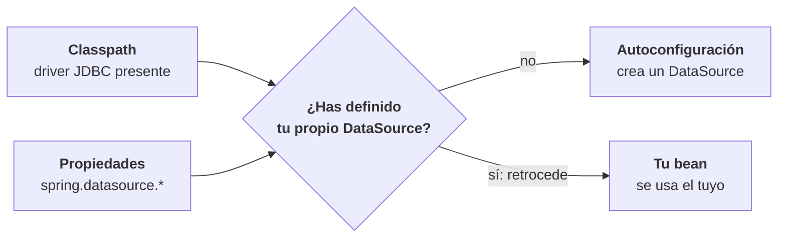
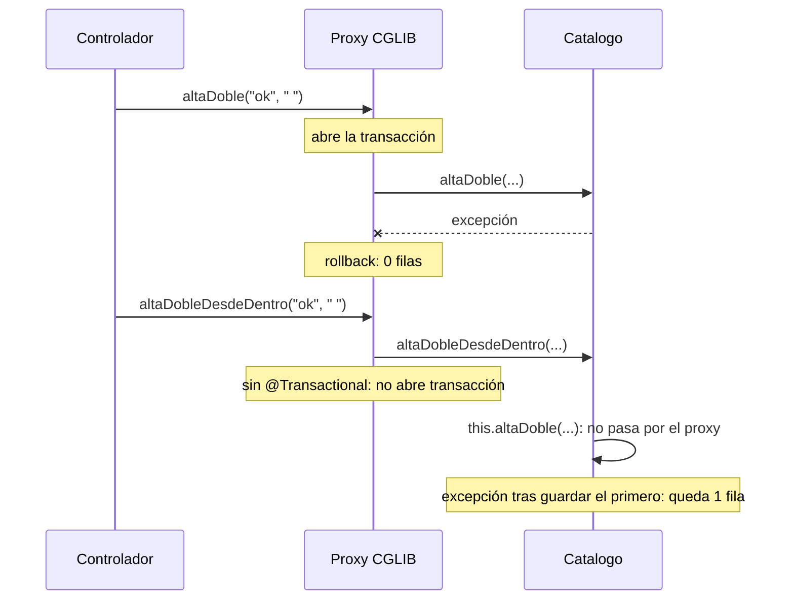

# titulo: Spring Boot en profundidad


# Cómo funciona Spring Boot

## Objetivos de aprendizaje

- **1.1** Explicar qué añade Spring Boot a Spring.
- **1.2** Elegir los starters de Spring Boot 4 y sus compañeros de pruebas.
- **1.3** Entender la autoconfiguración y consultar el informe de condiciones.
- **1.4** Describir el arranque de una aplicación.

Los ejemplos del tema forman una aplicación compilada y probada con **Spring Boot 4.1.2** y **Java 25**.

## Spring y Spring Boot

**Spring** es el framework: inyección de dependencias, web, datos, transacciones. **Spring Boot** lo hace práctico:

- **Starters**: una dependencia por tecnología, con versiones compatibles entre sí.
- **Autoconfiguración**: configura lo habitual según lo que encuentra.
- **Servidor integrado**: la aplicación es un JAR ejecutable con Tomcat dentro.
- **Funciones de operación**: salud, métricas y configuración externa (Actuator).

## Starters en Spring Boot 4

Spring Boot 4 **modularizó** el proyecto: cada tecnología tiene su starter y su **starter de pruebas**, y sus clases están en paquetes `org.springframework.boot.<módulo>`. Algunos starters cambiaron de nombre; los antiguos siguen funcionando, pero están obsoletos:

| Antes | Spring Boot 4 | Pruebas |
|---|---|---|
| `spring-boot-starter-web` | `spring-boot-starter-webmvc` | `spring-boot-starter-webmvc-test` |
| `spring-boot-starter-data-jpa` | (igual) | `spring-boot-starter-data-jpa-test` |
| `spring-boot-starter-oauth2-resource-server` | `spring-boot-starter-security-oauth2-resource-server` | — |

La aplicación del tema usa `webmvc`, `validation`, `data-jpa` y `actuator`, con sus starters de pruebas. Para migrar rápido una aplicación existente hay *classic starters*, aunque la guía de migración recomienda abandonarlos con el tiempo.

## Autoconfiguración

Spring Boot mira el **classpath** y las **propiedades** y configura lo que falta: si hay un controlador de base de datos y no has definido un `DataSource`, crea uno; si hay Spring MVC, configura el servidor web. Cada autoconfiguración tiene **condiciones** (`@ConditionalOnClass`, `@ConditionalOnMissingBean`…), y la regla clave es que **retrocede si defines tu propio bean**.



```nodos
CP:
  titulo: Classpath
  texto: Lo que traen los starters. "@ConditionalOnClass" comprueba que una clase esté presente.
PROP:
  titulo: Propiedades
  texto: application.properties, variables de entorno o argumentos. Ajustan lo que se autoconfigura.
COND:
  titulo: Condición
  texto: "@ConditionalOnMissingBean: la autoconfiguración retrocede si ya existe un bean de ese tipo. Arranca con --debug para ver el informe de condiciones."
AUTO:
  concepto: autoconfiguracion
TUYO:
  titulo: Tu configuración manda
  texto: Definir el bean tú mismo es la forma normal de sustituir lo que Spring Boot habría creado.
```

Para ver qué se ha aplicado y por qué, arranca con `--debug`:

```text
CONDITIONS EVALUATION REPORT
Positive matches:
   DataSourceAutoConfiguration matched:
   ...
Negative matches:
   ...
```

## El arranque

```java
@SpringBootApplication
@ConfigurationPropertiesScan
public class TiendaApplication {
    public static void main(String[] args) {
        SpringApplication.run(TiendaApplication.class, args);
    }
}
```

`@SpringBootApplication` combina tres cosas: marcar la clase como configuración, activar la autoconfiguración y **buscar componentes** (`@Service`, `@RestController`…) en su paquete y subpaquetes. Por eso la clase principal va en el paquete raíz. Al arrancar el JAR:

```text
 :: Spring Boot ::                (v4.1.2)
Tomcat started on port 8080 (http) with context path '/'
Started TiendaApplication in 2.172 seconds
```

## Puntos clave

- Spring Boot añade starters, autoconfiguración, servidor integrado y funciones de operación sobre Spring.
- En Boot 4 cada tecnología tiene su starter y su starter de pruebas; `spring-boot-starter-web` pasa a `spring-boot-starter-webmvc`.
- La autoconfiguración depende del classpath y las propiedades, y retrocede si defines tu propio bean.
- `--debug` muestra el informe de condiciones.
- `@SpringBootApplication` busca componentes en su paquete y subpaquetes.

## Referencias

- Spring Boot, [Auto-configuration](https://docs.spring.io/spring-boot/reference/using/auto-configuration.html).
- Spring Boot, [Build systems](https://docs.spring.io/spring-boot/reference/using/build-systems.html) (starters).
- Spring Boot, [Spring Boot 4.0 Migration Guide](https://github.com/spring-projects/spring-boot/wiki/Spring-Boot-4.0-Migration-Guide).

# Configuración

## Objetivos de aprendizaje

- **2.1** Inyectar dependencias por constructor.
- **2.2** Agrupar propiedades en un record con `@ConfigurationProperties` y validarlas.
- **2.3** Cambiar la configuración por entorno con perfiles, variables y argumentos.

## Inyección por constructor

Spring crea los objetos (**beans**) y les pasa sus dependencias. La forma recomendada es **por constructor**:

```java
@Service
public class Catalogo {
    private final ProductoRepository repositorio;
    private final TiendaProperties propiedades;

    public Catalogo(ProductoRepository repositorio, TiendaProperties propiedades) {
        this.repositorio = repositorio;
        this.propiedades = propiedades;
    }
}
```

Con un solo constructor no hace falta `@Autowired`. Las dependencias son `final`, visibles en la firma y fáciles de sustituir en pruebas, sin Spring.

## Propiedades tipadas

```yaml
# application.yml
tienda:
  moneda: EUR
  envio-gratis-desde: 50
```

```java
@Validated
@ConfigurationProperties("tienda")
public record TiendaProperties(@NotBlank String moneda, @PositiveOrZero BigDecimal envioGratisDesde) {}
```

Con `@ConfigurationPropertiesScan` en la clase principal, Spring crea el record con los valores de `tienda.*`. El nombre `envio-gratis-desde` se vincula a `envioGratisDesde` (vinculación flexible). Ventajas frente a `@Value("${…}")` repartido: tipos reales, un solo sitio y **validación al arrancar**. En la prueba, arrancar con `--tienda.envio-gratis-desde=-1` detuvo la aplicación:

```text
APPLICATION FAILED TO START

Binding to target tienda.TiendaProperties failed:

    Property: tienda.envioGratisDesde
    Value: "-1"
    Origin: "tienda.envio-gratis-desde" from property source "commandLineArgs"
    Reason: must be greater than or equal to 0
```

Mejor fallar al arrancar con un mensaje claro que fallar en producción con un valor absurdo.

## Configuración externa

La misma aplicación se configura distinto en cada entorno **sin recompilar**. Spring Boot lee propiedades de muchas fuentes, y las más específicas ganan a las generales. Simplificando, de menos a más prioridad:

| Fuente | Ejemplo |
|---|---|
| `application.yml` dentro del JAR | Valores por defecto |
| `application-{perfil}.yml` | `application-prod.yml` con el perfil `prod` activo |
| Variables de entorno | `TIENDA_ENVIOGRATISDESDE=100` |
| Argumentos de línea de órdenes | `--tienda.envio-gratis-desde=100` |

Los **perfiles** se activan con `spring.profiles.active` (o `SPRING_PROFILES_ACTIVE`). Los secretos (contraseñas, claves) llegan por variables de entorno o un gestor de secretos, **nunca** en el `application.yml` del repositorio.

## Puntos clave

- Inyección por constructor: dependencias `final`, explícitas y fáciles de probar.
- `@ConfigurationProperties` en un record agrupa propiedades con tipos reales.
- Con `@Validated` y anotaciones de validación, una propiedad inválida detiene el arranque con un mensaje claro.
- Los argumentos y las variables de entorno ganan al `application.yml`; los perfiles separan entornos.
- Los secretos nunca van en el `application.yml` del repositorio.

## Referencias

- Spring Boot, [Externalized configuration](https://docs.spring.io/spring-boot/reference/features/external-config.html).
- Spring Boot, [Profiles](https://docs.spring.io/spring-boot/reference/features/profiles.html).

# APIs REST

## Objetivos de aprendizaje

- **3.1** Escribir un controlador REST con DTO en forma de record.
- **3.2** Validar los cuerpos de las peticiones.
- **3.3** Devolver errores en formato Problem Details (RFC 9457).

## Controlador

```java
@RestController
@RequestMapping("/productos")
public class ProductoController {
    private final Catalogo catalogo;

    public ProductoController(Catalogo catalogo) { this.catalogo = catalogo; }

    public record NuevoProducto(@NotBlank String nombre, @NotNull @DecimalMin("0.01") BigDecimal precio) {}
    public record ProductoDto(Long id, String nombre, BigDecimal precio) {}

    @PostMapping
    @ResponseStatus(HttpStatus.CREATED)
    public ProductoDto crear(@Valid @RequestBody NuevoProducto nuevo) { ... }

    @GetMapping("/{id}")
    public ProductoDto buscar(@PathVariable long id) { ... }
}
```

- El controlador **solo traduce HTTP**: recibe, valida y delega en el servicio (`Catalogo`). La lógica de negocio no va aquí.
- Entrada y salida son **DTO** en forma de record, distintos de la entidad JPA: el contrato de la API no cambia si cambia la tabla, y no se exponen campos internos.

Con la aplicación arrancada:

```text
POST /productos {"nombre":"libro","precio":20}  →  201 {"id":1,"nombre":"libro","precio":20}
GET  /productos/1                                →  200 {"id":1,"nombre":"libro","precio":20.00}
```

## Validación

`@Valid` aplica las anotaciones de **Bean Validation** del record (`@NotBlank`, `@DecimalMin`…) antes de entrar al método. Si fallan, Spring responde **400** sin ejecutar el código del controlador.

## Errores con Problem Details

El **RFC 9457** define un formato JSON estándar para los errores de una API, con el tipo de contenido `application/problem+json` y campos como `title`, `status`, `detail` e `instance`. Con `spring.mvc.problemdetails.enabled=true`, Spring MVC lo usa para sus propios errores, y los nuestros se devuelven con `ProblemDetail`:

```java
@ExceptionHandler(ProductoNoEncontrado.class)
public ProblemDetail noEncontrado(ProductoNoEncontrado e) {
    return ProblemDetail.forStatusAndDetail(HttpStatus.NOT_FOUND, e.getMessage());
}
```

Respuestas reales de la prueba:

```text
400  application/problem+json  {"detail":"Invalid request content.","instance":"/productos","status":400,"title":"Bad Request"}
404  application/problem+json  {"detail":"No existe el producto 99","instance":"/productos/99","status":404,"title":"Not Found"}
```

El servicio lanza una excepción de dominio (`ProductoNoEncontrado`) que no sabe nada de HTTP; el controlador la traduce a 404. Si el manejador debe servir a varios controladores, se lleva a una clase con `@RestControllerAdvice`. Nunca devuelvas la traza de la excepción al cliente: da pistas a un atacante y no ayuda al usuario.

## Puntos clave

- El controlador traduce HTTP y delega; la lógica va en el servicio.
- DTO en forma de record, separados de la entidad.
- `@Valid` rechaza con 400 los cuerpos inválidos antes de ejecutar el método.
- Problem Details (RFC 9457) es el formato estándar de error; Spring lo genera con `ProblemDetail`.
- Las excepciones de dominio se traducen a códigos HTTP en el borde, sin trazas para el cliente.

## Referencias

- Spring Boot, [Servlet web applications](https://docs.spring.io/spring-boot/reference/web/servlet.html).
- Spring Framework, [Error responses](https://docs.spring.io/spring-framework/reference/web/webmvc/mvc-ann-rest-exceptions.html).
- IETF, [RFC 9457: Problem Details for HTTP APIs](https://www.rfc-editor.org/rfc/rfc9457).
- Spring Boot, [Validation](https://docs.spring.io/spring-boot/reference/io/validation.html).

# Datos y transacciones

## Objetivos de aprendizaje

- **4.1** Definir repositorios con Spring Data JPA y consultas derivadas.
- **4.2** Delimitar transacciones con `@Transactional`.
- **4.3** Explicar por qué la autoinvocación salta el proxy.

## Repositorios

Con **Spring Data JPA** basta declarar una interfaz; la implementación se genera al arrancar:

```java
public interface ProductoRepository extends JpaRepository<Producto, Long> {
    List<Producto> findByPrecioLessThanOrderByPrecioAsc(BigDecimal precio);
}
```

`JpaRepository` aporta `save`, `findById`, `findAll`, `deleteById`, `count`… y el nombre del método **se traduce a la consulta**: «buscar por precio menor que, ordenado por precio ascendente». En la prueba, con productos de 35, 20 y 2 €, `findByPrecioLessThanOrderByPrecioAsc(30)` devolvió `[boli, libro]`. Para consultas más complejas, `@Query` con JPQL o SQL. Si el nombre del método se vuelve ilegible, es la señal para pasar a `@Query`.

La entidad JPA necesita un constructor sin argumentos (puede ser `protected`) y un `@Id`; por eso es una clase normal y no un record.

## Transacciones

```java
@Transactional
public void altaDoble(String a, String b) {
    repositorio.save(new Producto(a, BigDecimal.ONE));
    if (b.isBlank()) throw new IllegalArgumentException("Nombre vacío");
    repositorio.save(new Producto(b, BigDecimal.ONE));
}
```

`@Transactional` abre una transacción al entrar al método y la confirma al salir; si sale con una excepción **no comprobada** (`RuntimeException`), la **deshace**. En la prueba, `altaDoble("ok", " ")` lanzó la excepción y en la tabla quedaron **0 filas**: el primer `save` se deshizo.

Por defecto, las excepciones **comprobadas** (`Exception` que no es `RuntimeException`) **no** deshacen la transacción; si lo necesitas, usa `@Transactional(rollbackFor = …)`. Las transacciones van en la capa de servicio, que es la que sabe qué operaciones forman una unidad.

## La trampa del proxy

Spring aplica `@Transactional` con un **proxy**: el bean que se inyecta no es tu clase, sino una subclase generada que abre la transacción y luego llama a tu método. En la prueba, `catalogo.getClass()` era:

```text
tienda.Catalogo$$SpringCGLIB$$0
```

El proxy solo intercepta las llamadas **que llegan desde fuera**. Si un método del propio bean llama a otro, la llamada va directa al objeto y **no hay transacción**:

```java
public void altaDobleDesdeDentro(String a, String b) {
    altaDoble(a, b);     // this.altaDoble: no pasa por el proxy
}
```

Con la misma entrada, `altaDobleDesdeDentro("ok", " ")` dejó **1 fila**: el primer producto se guardó y nada lo deshizo. La documentación de Spring lo advierte: en el modo proxy, la autoinvocación no produce una transacción aunque el método invocado lleve `@Transactional`, y el código puede parecer que funciona hasta que se prueba un fallo.



```nodos
CTL:
  titulo: Quien llama
  texto: Recibe inyectado el proxy, no la clase Catalogo.
PRX:
  concepto: proxy-spring
CAT:
  concepto: autoinvocacion
```

Soluciones: anotar el método que se llama desde fuera, o mover el método transaccional a otro bean. Lo mismo vale para `@Async`, `@Cacheable` o la seguridad por métodos.

## Puntos clave

- Spring Data JPA genera repositorios a partir de interfaces; los nombres de método se traducen a consultas.
- `@Transactional` deshace la transacción ante una `RuntimeException`; las comprobadas no la deshacen por defecto.
- Las transacciones se delimitan en la capa de servicio.
- `@Transactional` funciona con un proxy: la autoinvocación lo salta y no hay transacción.
- Prueba los caminos de fallo: ahí es donde se ve si la transacción existe.

## Referencias

- Spring Data JPA, [Query methods](https://docs.spring.io/spring-data/jpa/reference/jpa/query-methods.html).
- Spring Framework, [Using @Transactional](https://docs.spring.io/spring-framework/reference/data-access/transaction/declarative/annotations.html).
- Spring Framework, [Rolling back a declarative transaction](https://docs.spring.io/spring-framework/reference/data-access/transaction/declarative/rolling-back.html).

# Pruebas y producción

## Objetivos de aprendizaje

- **5.1** Elegir entre pruebas por capa y pruebas con todo el contexto.
- **5.2** Probar controladores con `MockMvcTester` y `@MockitoBean`.
- **5.3** Exponer solo los endpoints de Actuator necesarios.

## Pruebas por capa

Levantar toda la aplicación para cada prueba es lento. Spring Boot ofrece **pruebas por capa** (*test slices*) que arrancan solo lo necesario:

| Anotación | Qué arranca | Para probar |
|---|---|---|
| `@WebMvcTest(ProductoController.class)` | Spring MVC y ese controlador | Rutas, validación, códigos y JSON |
| `@DataJpaTest` | JPA, los repositorios y una base de datos de prueba; cada prueba se deshace al terminar | Consultas y mapeos |
| `@SpringBootTest` | Toda la aplicación | Integración: configuración, transacciones, flujos completos |

En Spring Boot 4 estas anotaciones están en los módulos de prueba de cada tecnología, por ejemplo `org.springframework.boot.webmvc.test.autoconfigure.WebMvcTest` y `org.springframework.boot.data.jpa.test.autoconfigure.DataJpaTest`. Con la aplicación del tema, las 8 pruebas (3 de controlador, 1 de repositorio y 4 de integración) pasaron.

## Probar un controlador

```java
@WebMvcTest(ProductoController.class)
class ProductoControllerTest {
    @Autowired MockMvcTester mvc;
    @MockitoBean Catalogo catalogo;

    @Test
    void productoInexistenteDa404() {
        given(catalogo.buscar(99)).willThrow(new ProductoNoEncontrado(99));
        assertThat(mvc.get().uri("/productos/99")).hasStatus(HttpStatus.NOT_FOUND);
    }
}
```

- `@MockitoBean` sustituye el servicio por un doble de Mockito en el contexto de la prueba, así que solo se prueba la capa web.
- **`MockMvcTester`** lanza peticiones sin servidor real y ofrece aserciones de AssertJ, como `.bodyJson().extractingPath("$.nombre")`.

La prueba de integración con `@SpringBootTest` es la que detectó la trampa de la autoinvocación de la lección anterior: con dobles, nunca se habría visto.

## Actuator

**Actuator** añade endpoints de operación. Por web, Spring Boot solo expone `health` por defecto, y conviene ampliar con cuidado:

```yaml
management:
  endpoints:
    web:
      exposure:
        include: health,info
```

```text
GET /actuator/health  →  {"groups":["liveness","readiness"],"status":"UP"}
GET /actuator/env     →  404 (no expuesto)
```

Los grupos `liveness` y `readiness` encajan con las sondas de Kubernetes (`/actuator/health/liveness` y `/actuator/health/readiness`). Endpoints como `env`, `heapdump` o `configprops` revelan configuración y memoria: si se exponen, que sea solo en una red interna y con autenticación.

## Puntos clave

- `@WebMvcTest` y `@DataJpaTest` prueban una capa rápido; `@SpringBootTest`, la integración.
- En Spring Boot 4, las anotaciones de prueba viven en el módulo de cada tecnología.
- `@MockitoBean` sustituye beans en la prueba; `MockMvcTester` prueba controladores sin servidor.
- Los dobles no detectan problemas de proxies ni de transacciones: hace falta alguna prueba de integración.
- Expón solo los endpoints de Actuator necesarios; `health` tiene grupos para las sondas de Kubernetes.

## Referencias

- Spring Boot, [Testing Spring Boot applications](https://docs.spring.io/spring-boot/reference/testing/spring-boot-applications.html).
- Spring Framework, [MockMvc AssertJ integration](https://docs.spring.io/spring-framework/reference/testing/mockmvc/assertj.html).
- Spring Boot, [Actuator endpoints](https://docs.spring.io/spring-boot/reference/actuator/endpoints.html).
