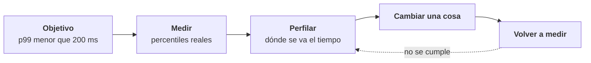
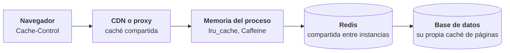
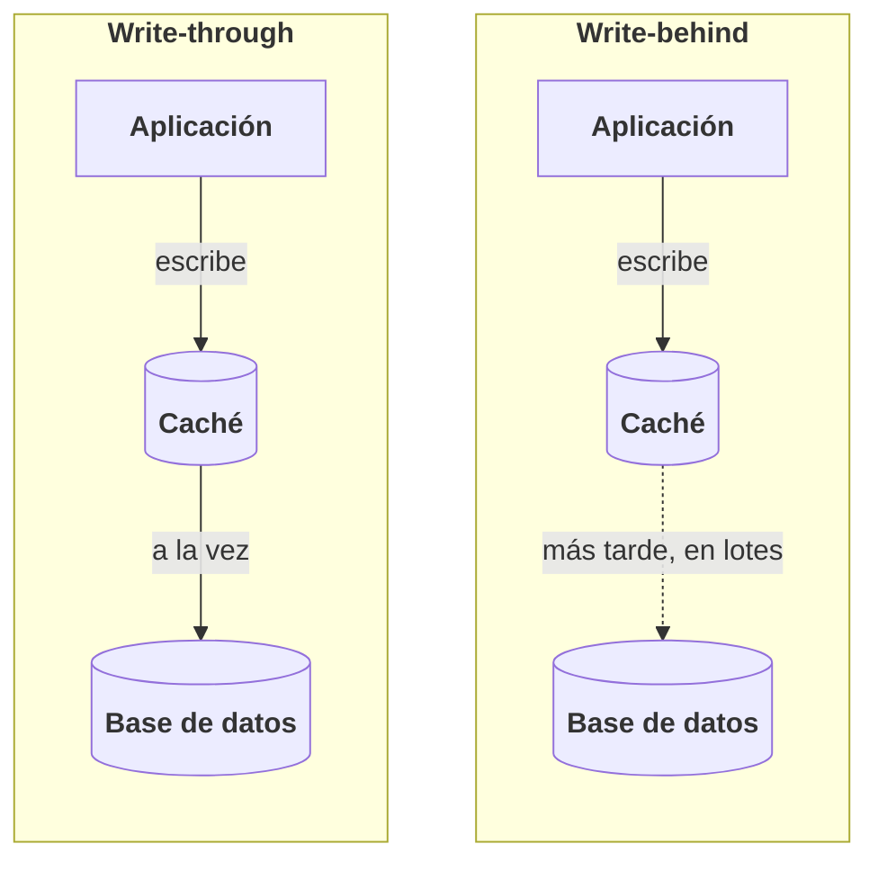
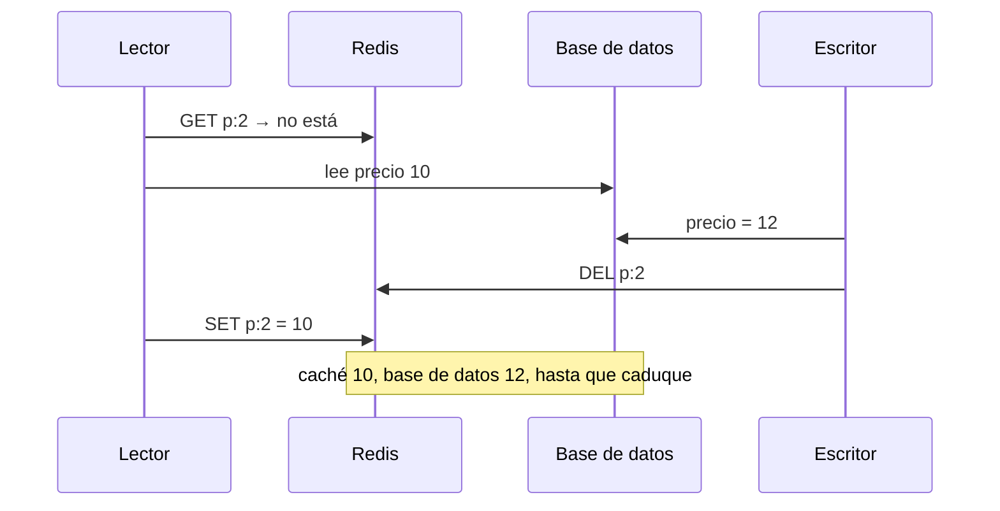
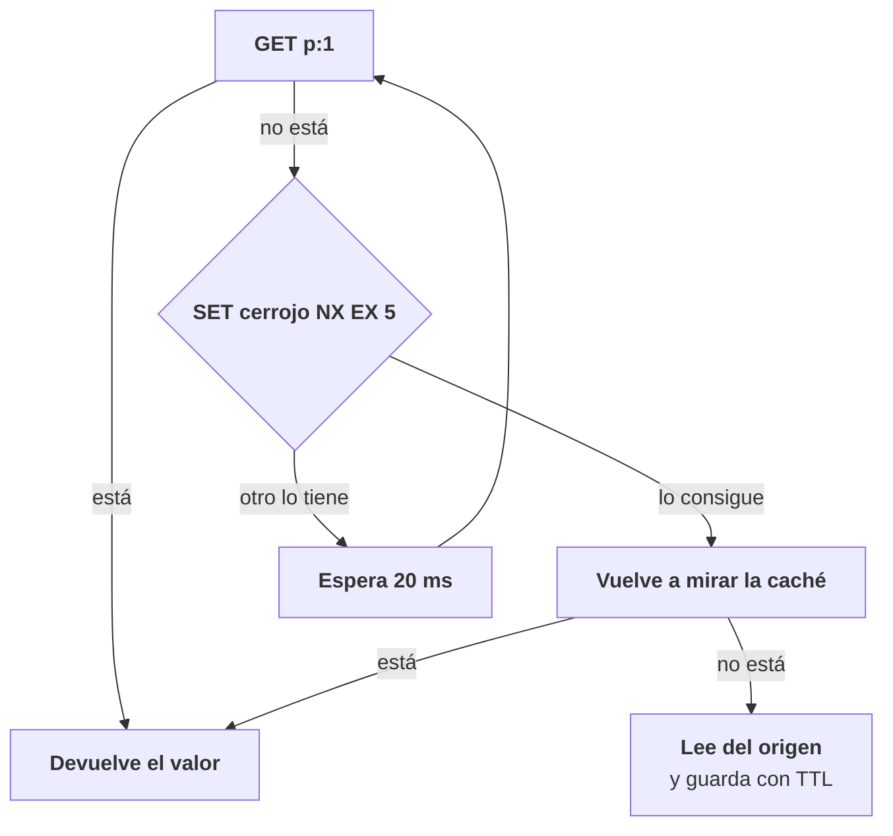

# titulo: Caché y rendimiento


# Medir antes de optimizar

## Objetivos de aprendizaje

- **1.1** Describir la latencia con percentiles y explicar por qué la media engaña.
- **1.2** Encontrar con un perfilador dónde se va el tiempo de verdad.
- **1.3** Fijar un objetivo de rendimiento antes de optimizar.
- **1.4** Saber cuándo una caché es la respuesta y cuándo no.

Los resultados son de Python 3.12 en un equipo de sobremesa.

## La media engaña

Un origen que tarda casi siempre 20 ms y, de vez en cuando, 400 ms. Doscientas consultas:

```text
media 35.3 ms | p50 20.1 | p95 20.2 | p99 400.1 | máximo 400.1
```

La media, 35 ms, describe una consulta que **no ocurre nunca**: ninguna tardó 35 ms. Los **percentiles** cuentan lo que pasa de verdad:

| Medida | Qué dice | En la prueba |
|---|---|---|
| p50 (mediana) | La mitad de las peticiones tarda menos | 20,1 ms |
| p95 | El 5 % tarda más | 20,2 ms |
| p99 | El 1 % tarda más | 400,1 ms |

Un p99 de 400 ms con 1000 peticiones por segundo son **10 usuarios cada segundo** esperando casi medio segundo. Y si una página hace 30 llamadas independientes, la probabilidad de que al menos una caiga en ese 1 % es 1 − 0,99³⁰, un 26 %: una de cada cuatro páginas. El p99 de las piezas acaba siendo la experiencia habitual del usuario. Por eso el libro de SRE de Google recomienda vigilar la distribución, no la media.

## Perfilar

Antes de optimizar hay que saber **dónde** se va el tiempo. Un informe que carga 20 000 pedidos, los serializa a JSON y busca los clientes VIP con una búsqueda en una lista, la sospechosa de siempre:

```text
   ncalls  tottime  cumtime  function
        1    0.000    0.026  informe
        1    0.013    0.013  json.encoder.iterencode
        1    0.008    0.008  clientes_vip
        1    0.005    0.005  cargar_pedidos
```

El perfilador (`cProfile`) mostró que la mitad del tiempo era **serializar el JSON** (13 ms), no la búsqueda en la lista (8 ms). Optimizar lo que se sospecha, sin medir, habría mejorado lo de menos.



```nodos
O:
  titulo: Objetivo
  texto: Sin un objetivo concreto, no se sabe cuándo parar. Suele expresarse como un SLO sobre un percentil.
M:
  concepto: percentil
P:
  concepto: perfilador
C:
  titulo: Cambiar una cosa
  texto: Un cambio cada vez, para saber cuál ha tenido efecto.
V:
  titulo: Volver a medir
  texto: Con la misma carga y en las mismas condiciones. Si no mejora, se deshace el cambio.
```

## Objetivos antes que optimizaciones

Optimizar sin objetivo no termina nunca. Se fija primero, como un **SLO** sobre un percentil (tema de observabilidad): «el p99 de `GET /productos/{id}` es menor que 200 ms en el 99,9 % de los minutos». Después se mide, se perfila, se cambia **una cosa** y se vuelve a medir.

## ¿Es una caché la respuesta?

Una caché ayuda cuando:

- el mismo dato se lee **muchas veces** más de las que cambia;
- obtenerlo es **caro** (una consulta lenta, una llamada a otro servicio);
- se tolera que esté **algo desactualizado** durante un tiempo.

No ayuda, o empeora, cuando:

- los datos cambian casi tanto como se leen, y la tasa de aciertos es baja;
- la lentitud está en el propio cálculo de cada petición, distinto cada vez;
- hace falta el valor exacto al instante, como el saldo antes de un cargo;
- el problema real es una consulta sin índice: arreglarla resuelve la causa, y una caché solo la tapa.

## Puntos clave

- La media de la latencia describe una petición que puede no existir; usa p50, p95 y p99.
- El p99 de las piezas acaba siendo la experiencia habitual cuando una página hace muchas llamadas.
- Perfila antes de optimizar: en la prueba, lo lento era el JSON, no la búsqueda sospechosa.
- Fija un objetivo sobre un percentil y cambia una cosa cada vez, midiendo antes y después.
- Una caché compensa con muchas lecturas, datos caros de obtener y algo de tolerancia a datos antiguos.

## Referencias

- Google, [Site Reliability Engineering: Monitoring Distributed Systems](https://sre.google/sre-book/monitoring-distributed-systems/) y [Service Level Objectives](https://sre.google/sre-book/service-level-objectives/).
- Python, [The Python Profilers](https://docs.python.org/3/library/profile.html).

# Dónde cachear

## Objetivos de aprendizaje

- **2.1** Recorrer las capas donde se puede cachear, del navegador a la base de datos.
- **2.2** Comparar el coste de leer de cada capa con datos medidos.
- **2.3** Elegir entre una caché en el proceso y una compartida como Redis.
- **2.4** Diseñar las claves de caché y medir la tasa de aciertos.

Los tiempos son de Python 3.12 y Redis 8.10 en el mismo equipo (Redis en Docker).

## Capas

Un dato puede guardarse en muchos sitios entre el usuario y la base de datos. Cuanto más cerca del usuario, menos viaje, pero más difícil de invalidar:



```nodos
N:
  titulo: Navegador
  texto: Se controla con Cache-Control y ETag. Es la caché más barata, pero no se puede invalidar desde el servidor.
  seccion: 01-medir-antes-de-optimizar/teoria#es-una-caché-la-respuesta
CDN:
  titulo: CDN o proxy inverso
  texto: Comparte respuestas entre muchos usuarios. Nunca debe guardar respuestas que dependan del usuario.
APP:
  titulo: Memoria del proceso
  texto: La más rápida (decenas de nanosegundos), pero cada instancia tiene su copia y se pierde al reiniciar.
R:
  titulo: Redis
  texto: Una sola copia para todas las instancias, a un viaje de red. Es la opción habitual para datos de aplicación.
BD:
  titulo: Base de datos
  texto: Ya guarda en memoria las páginas que más se leen. Una consulta bien indexada sobre datos calientes puede ser más rápida de lo que se cree.
```

Las cachés HTTP (navegador y CDN) se ven en el tema de HTTP y la web. Este tema se centra en la caché de la aplicación.

## Lo que cuesta cada capa

El mismo producto, leído de tres sitios:

```text
lru_cache en el proceso:       0.06 µs
Redis en local:              280.1 µs
origen (consulta simulada): 20107 µs
```

Cada capa está a **órdenes de magnitud** de la siguiente: unos 60 nanosegundos frente a unos 280 microsegundos, frente a 20 milisegundos. La lectura de Redis incluye el viaje por la red de Docker y deserializar el JSON. En una red real entre máquinas, súmale la latencia de la red.

## En el proceso o compartida

| | En el proceso (`lru_cache`, Caffeine en Java) | Compartida (Redis) |
|---|---|---|
| Velocidad | Nanosegundos | Cientos de microsegundos a milisegundos |
| Copias | Una por instancia: 10 instancias, 10 copias | Una sola |
| Invalidación | Hay que avisar a todas las instancias | Un `DEL` basta |
| Reinicio | Se pierde | Sobrevive al reinicio de la aplicación |
| Memoria | La del propio proceso | La de Redis |

Combinarlas es habitual: una caché **pequeña y de vida corta en el proceso** para las claves muy calientes, delante de Redis. El precio es que, durante esa vida corta, cada instancia puede tener una versión distinta.

## Claves y tasa de aciertos

- **Claves con espacio de nombres y versión:** `producto:v2:7`. Al cambiar el formato de lo que se guarda, se sube la versión y las claves antiguas caducan solas.
- **Todo lo que cambia la respuesta va en la clave:** el idioma, la moneda, los permisos. Si la respuesta depende del usuario, la clave también.
- **Mide los aciertos:** `functools.lru_cache` los cuenta solo. Tras 2000 lecturas del mismo producto:

```text
CacheInfo(hits=2000, misses=1, maxsize=1000, currsize=1)
```

En Redis, `INFO stats` da `keyspace_hits` y `keyspace_misses`. Una tasa de aciertos baja significa que la caché añade trabajo sin ahorrar casi nada.

## Puntos clave

- Se puede cachear en el navegador, una CDN, la memoria del proceso, Redis y la propia base de datos; más cerca es más rápido y más difícil de invalidar.
- En la prueba: 0,06 µs en memoria, 280 µs en Redis y 20 ms en el origen.
- La caché en el proceso es la más rápida, pero hay una copia por instancia; Redis da una sola copia compartida.
- Una caché pequeña en el proceso delante de Redis sirve para las claves muy calientes.
- Pon en la clave todo lo que cambia la respuesta, con espacio de nombres y versión.
- Mide la tasa de aciertos: si es baja, la caché sobra o está mal diseñada.

## Referencias

- Python, [functools.lru_cache](https://docs.python.org/3/library/functools.html).
- Redis, [Keys and values](https://redis.io/docs/latest/develop/use/keyspace/).
- Spring Framework, [Cache Abstraction](https://docs.spring.io/spring-framework/reference/integration/cache.html).

# Patrones de caché

## Objetivos de aprendizaje

- **3.1** Distinguir los patrones de lectura: cache-aside y read-through.
- **3.2** Distinguir los patrones de escritura: write-through y write-behind, con sus riesgos.
- **3.3** Fijar caducidades con variación aleatoria y cachear también lo que no existe.
- **3.4** Servir datos algo antiguos mientras se refrescan, con stale-while-revalidate.

Las pruebas usan Python 3.12 y Redis 8.10. El patrón cache-aside se presenta en el tema de bases de datos NoSQL; aquí se compara con los demás.

## Patrones de lectura

| Patrón | Quién va al origen en un fallo | Comentario |
|---|---|---|
| **Cache-aside** | La aplicación: mira la caché, si no está lee del origen y la guarda | El más común. La caché no sabe nada del origen |
| **Read-through** | La propia caché, que sabe cargar el dato | La aplicación solo habla con la caché; lo ofrecen bibliotecas como Caffeine o la abstracción de caché de Spring |

En Spring, `@Cacheable("productos")` sobre un método aplica cache-aside sin escribir el código de la caché.

## Patrones de escritura



```nodos
WT:
  concepto: write-through
A1:
  titulo: Aplicación
  texto: La escritura termina cuando están al día la caché y la base de datos.
C1:
  titulo: Caché al día
  texto: Nunca tiene una versión más antigua que la base de datos, a costa de escrituras más lentas.
B1:
  titulo: Base de datos
  texto: Recibe cada escritura al momento.
WB:
  concepto: write-behind
A2:
  titulo: Aplicación
  texto: La escritura termina en cuanto la caché la acepta; es muy rápida.
C2:
  titulo: Caché como intermediaria
  texto: Acumula los cambios y los lleva al origen en lotes.
B2:
  titulo: Base de datos por detrás
  texto: Si la caché cae antes de escribir, esos cambios se pierden. Solo encaja con datos que se pueden perder, como contadores de visitas.
```

| Patrón | Ventaja | Riesgo |
|---|---|---|
| **Write-through** | La caché siempre está al día | Escrituras más lentas; se cachea lo que quizá nadie leerá |
| **Write-behind** | Escrituras muy rápidas, en lotes | Pérdida de datos si la caché cae; el origen va por detrás |
| **Escribir en el origen y borrar de la caché** | Sencillo; la siguiente lectura recarga | Ventanas de inconsistencia (lección 4) |

Lo más habitual en aplicaciones de negocio es cache-aside para leer y **escribir en el origen y borrar la entrada** para escribir.

## Caducidad con variación y caché negativa

Una función de cache-aside completa, probada contra Redis:

```python
AUSENTE = "__no_existe__"

def obtener_producto(pid, ttl=300):
    clave = f"producto:v1:{pid}"
    v = r.get(clave)
    if v is not None:
        return None if v.decode() == AUSENTE else json.loads(v)
    dato = consultar_bd(pid)
    if dato is None:
        r.set(clave, AUSENTE, ex=30)                                           # caché negativa, corta
    else:
        r.set(clave, json.dumps(dato), ex=ttl + random.randint(0, ttl // 10))  # caducidad con variación
    return dato
```

```text
10 lecturas (5 de un producto, 5 de uno inexistente) → consultas a la BD: 2
TTL del producto: 317 s | TTL del inexistente: 30 s
1000 claves creadas a la vez caducan entre 300 y 330 s, en 31 segundos distintos
```

- **Variación aleatoria:** si mil claves se cargan a la vez con el mismo TTL, caducan a la vez y todas van al origen en el mismo segundo. Con un 10 % de variación, se reparten en 31 segundos.
- **Caché negativa:** sin ella, cada petición de un producto que **no existe** llega a la base de datos, y alguien puede provocarlo a propósito con identificadores inventados. Se guarda un marcador con un TTL corto.
- **Siempre TTL:** aunque haya invalidación, el TTL limita el tiempo que puede vivir un dato equivocado.

## stale-while-revalidate

En lugar de que el primero que encuentra la clave caducada espere al origen, se le sirve la versión **antigua** y se refresca en segundo plano. En HTTP es la directiva `stale-while-revalidate` (RFC 5861):

```text
Cache-Control: max-age=60, stale-while-revalidate=300
```

Durante 60 segundos la respuesta es fresca; los 300 siguientes se puede servir mientras se obtiene la nueva. En una caché de aplicación se consigue guardando el instante de la carga y refrescando en otro hilo cuando se acerca la caducidad.

## Puntos clave

- Cache-aside (la aplicación carga) es el patrón de lectura más común; read-through delega la carga en la caché.
- Write-through mantiene la caché al día a costa de escrituras más lentas; write-behind es rápido pero puede perder datos.
- Lo habitual: escribir en el origen y borrar la entrada de la caché.
- Pon siempre TTL, con variación aleatoria para que no caduque todo a la vez.
- Cachea también los «no existe», con un TTL corto, para proteger el origen.
- stale-while-revalidate sirve lo antiguo mientras se refresca, y nadie espera al origen.

## Referencias

- Spring Framework, [Cache Abstraction](https://docs.spring.io/spring-framework/reference/integration/cache.html).
- Redis, [SET](https://redis.io/docs/latest/commands/set/), opciones `EX` y `NX`.
- IETF, [RFC 5861: HTTP Cache-Control Extensions for Stale Content](https://www.rfc-editor.org/rfc/rfc5861.html).

# Invalidación

## Objetivos de aprendizaje

- **4.1** Explicar por qué invalidar una caché es difícil.
- **4.2** Reproducir la carrera que deja un dato obsoleto con cache-aside.
- **4.3** Elegir entre borrar y actualizar la entrada al escribir.
- **4.4** Combinar TTL, versiones y eventos para limitar el tiempo de inconsistencia.

Las pruebas usan Python 3.12 con dos hilos y Redis 8.10.

## La parte difícil

Martin Fowler recoge una frase de Phil Karlton: «solo hay dos cosas difíciles en informática: invalidar cachés y poner nombres». Una caché es una **copia**, y en cuanto el origen cambia, la copia miente hasta que alguien la quita o la actualiza. Con lecturas y escrituras concurrentes, ese «alguien» puede llegar tarde.

## La carrera de cache-aside

El patrón habitual es: al leer, si no está en caché, leer de la base de datos y guardarlo; al escribir, actualizar la base de datos y **borrar** la entrada. Con un lector y un escritor intercalados así:



```nodos
L:
  titulo: Lector
  texto: Leyó de la base de datos antes del cambio, pero escribió en la caché después de la invalidación.
C:
  concepto: invalidacion
BD:
  titulo: Base de datos
  texto: Ya tiene el valor nuevo.
E:
  titulo: Escritor
  texto: Hizo lo correcto, actualizar y borrar, pero su borrado llegó antes de que el lector guardara el valor antiguo.
```

En la prueba, forzando ese orden con dos hilos:

```text
BD: {'precio': 12} | caché: {'precio': 10} ← obsoleta hasta que caduque, y sin TTL, para siempre
```

La ventana es pequeña (el lector tiene que tardar más que el escritor entre leer y guardar), pero con mucho tráfico ocurre. Por eso el **TTL** no es opcional: es lo que garantiza que el error tenga fecha de caducidad.

## Borrar o actualizar

Al escribir, ¿se borra la entrada o se escribe el valor nuevo en la caché?

| Estrategia | Problema |
|---|---|
| **Borrar** la entrada | La carrera anterior, rara y acotada por el TTL |
| **Actualizar** la entrada con el valor nuevo | Dos escritores concurrentes pueden dejar en la caché el valor del que escribió **primero** en la base de datos, aunque llegue el último a la caché |

Borrar es lo más seguro: la siguiente lectura recarga del origen. Actualizar solo es seguro si las escrituras en la caché van **condicionadas a una versión** que solo puede crecer.

## Limitar la inconsistencia

| Técnica | Qué aporta |
|---|---|
| **TTL siempre** | Un dato equivocado tiene caducidad. Corto si el dato cambia a menudo |
| **Versión en el dato** | Guardar la versión junto al valor y no escribir una versión menor que la que hay |
| **Doble borrado diferido** | Borrar al escribir y volver a borrar unos cientos de milisegundos después, para cubrir la carrera |
| **Invalidación por eventos** | El servicio dueño del dato publica un evento al cambiar, y cada caché lo escucha y borra su entrada. Con la captura de cambios de la base de datos (CDC) no se depende de que el código se acuerde |
| **No cachear lo que no tolera retraso** | Saldos, stock al confirmar un pedido: se leen del origen |

Y siempre la pregunta previa: **¿cuánto tiempo puede estar mal este dato sin que importe?** Esa respuesta fija el TTL y decide si cachearlo.

## Puntos clave

- Invalidar es difícil porque la caché es una copia y las lecturas y escrituras se intercalan.
- Con cache-aside, un lector lento puede guardar un valor antiguo justo después de que el escritor borre la entrada.
- El TTL limita cuánto dura ese error; sin TTL, el dato equivocado puede quedarse para siempre.
- Al escribir, borra la entrada en lugar de actualizarla, salvo que las escrituras en la caché vayan con versión.
- Versiones, doble borrado diferido e invalidación por eventos (CDC) reducen la ventana de inconsistencia.
- Decide primero cuánto tiempo puede estar mal el dato; si la respuesta es «nada», no lo caches.

## Referencias

- Martin Fowler, [TwoHardThings](https://martinfowler.com/bliki/TwoHardThings.html).
- Redis, [SET](https://redis.io/docs/latest/commands/set/).

# Estampidas y memoria

## Objetivos de aprendizaje

- **5.1** Reproducir una estampida y protegerse con un cerrojo en Redis.
- **5.2** Explicar por qué hay que volver a mirar la caché después de conseguir el cerrojo.
- **5.3** Elegir la política de expulsión de Redis según el uso.
- **5.4** Reconocer las claves calientes y cómo repartir su carga.

Las pruebas usan Python 3.12 con 50 hilos y Redis 8.10 en Docker.

## La estampida

Una clave muy leída caduca y, en ese instante, 50 peticiones la buscan a la vez. Ninguna la encuentra, así que las 50 van al origen, justo lo que la caché debía evitar. Repetido tres veces con un origen que tarda 200 ms:

```text
sin protección:                            50 llamadas al origen en 0.32 s
con cerrojo en Redis:                       2 llamadas al origen en 0.41 s
con cerrojo y volviendo a mirar la caché:   1 llamadas al origen en 0.23 s
```

## Un cerrojo en Redis

Solo quien consigue el cerrojo regenera la clave; los demás esperan un poco y vuelven a leer:

```python
def con_cerrojo(pid):
    while True:
        v = r.get(f"p:{pid}")
        if v: return json.loads(v)
        if r.set(f"cerrojo:{pid}", "1", nx=True, ex=5):   # solo uno lo consigue
            try:
                v = r.get(f"p:{pid}")                      # otro pudo regenerarla mientras tanto
                if v: return json.loads(v)
                d = origen(pid); r.set(f"p:{pid}", json.dumps(d), ex=60); return d
            finally:
                r.delete(f"cerrojo:{pid}")
        time.sleep(0.02)                                   # los demás esperan y vuelven a leer
```



```nodos
G:
  titulo: Leer la caché
  texto: En el camino normal, la clave está y no se toca el cerrojo.
L:
  concepto: estampida
R:
  titulo: Volver a mirar
  texto: Entre el primer GET y conseguir el cerrojo, otro hilo pudo regenerar la clave y soltarlo. Sin esta comprobación, en la prueba hubo 2 llamadas al origen en lugar de 1.
O:
  titulo: Origen
  texto: Solo llega aquí quien tiene el cerrojo y no encuentra la clave.
E:
  titulo: Esperar y reintentar
  texto: Los demás no van al origen; esperan un poco y vuelven a leer.
H:
  titulo: Respuesta
  texto: Sale de la caché, la cargara quien la cargara.
```

Detalles que importan:

- **`NX` y `EX` en la misma orden:** `SET … NX EX 5` crea el cerrojo solo si no existe y le pone caducidad de forma atómica. Si el proceso muere con el cerrojo, caduca solo.
- **Volver a mirar:** sin esa segunda lectura, un hilo que falló el primer `GET` y consigue el cerrojo justo cuando otro lo suelta vuelve a ir al origen.
- **Un cerrojo así no sirve para la exclusión mutua estricta:** si el origen tarda más que el `EX`, otro puede entrar. Para evitar estampidas basta; para proteger datos, la documentación de Redis describe algoritmos más cuidadosos.

Alternativas: **refrescar antes de caducar** (en segundo plano, cuando quede poco TTL) o **stale-while-revalidate** (lección 3), que sirven el valor antiguo y no dejan a nadie esperando.

## Cuando Redis se llena

Con `maxmemory` limitado a 4 MB y escribiendo 20 000 valores de 1 KB:

```text
política por defecto: noeviction | maxmemory: 0
noeviction:  claves=2557 expulsadas=0     error="command not allowed when used memory > 'maxmemory'."
allkeys-lru: claves=2544 expulsadas=17433 error=None
```

| Política | Qué hace al llenarse | Para qué |
|---|---|---|
| `noeviction` (por defecto) | **Rechaza las escrituras** con error | Redis como almacén de datos que no se pueden perder |
| `allkeys-lru` | Quita las claves usadas hace más tiempo | Caché general |
| `allkeys-lfu` | Quita las claves usadas con menos frecuencia | Caché con unas pocas claves muy populares |
| `volatile-lru`, `volatile-ttl`… | Solo quita claves con TTL | Mezcla de caché y datos permanentes en la misma instancia |

Un Redis usado como caché con la política por defecto **empieza a dar errores** en lugar de olvidar claves antiguas: la aplicación falla al escribir en la caché. Hay que fijar `maxmemory` y una política `allkeys-*`. Y `maxmemory 0`, el valor por defecto en 64 bits, significa sin límite: Redis crece hasta que el sistema se queda sin memoria.

## Claves calientes

Una sola clave que recibe una parte enorme del tráfico (la portada, el producto del anuncio de la tele) satura el nodo de Redis que la tiene, aunque el resto del clúster esté tranquilo. Se mitiga con:

- una **copia en la memoria del proceso** con TTL de pocos segundos delante de Redis (lección 2);
- **repartir la clave** en varias copias, `portada:1` … `portada:8`, y leer una al azar.

## Puntos clave

- Una estampida manda al origen todas las peticiones que encuentran a la vez una clave caducada; en la prueba, 50 llamadas.
- Un cerrojo con `SET NX EX` deja regenerar a uno solo; los demás esperan y vuelven a leer.
- Tras conseguir el cerrojo, vuelve a mirar la caché: sin eso hubo 2 llamadas al origen en lugar de 1.
- Refrescar antes de caducar o stale-while-revalidate evitan además que alguien espere.
- La política por defecto de Redis, `noeviction`, rechaza escrituras al llenarse; para caché usa `maxmemory` y `allkeys-lru` o `allkeys-lfu`.
- Las claves calientes se alivian con una copia corta en el proceso o repartiéndolas en varias claves.

## Referencias

- Redis, [Key eviction](https://redis.io/docs/latest/develop/reference/eviction/).
- Redis, [SET](https://redis.io/docs/latest/commands/set/) y [Distributed locks with Redis](https://redis.io/docs/latest/develop/clients/patterns/distributed-locks/).
