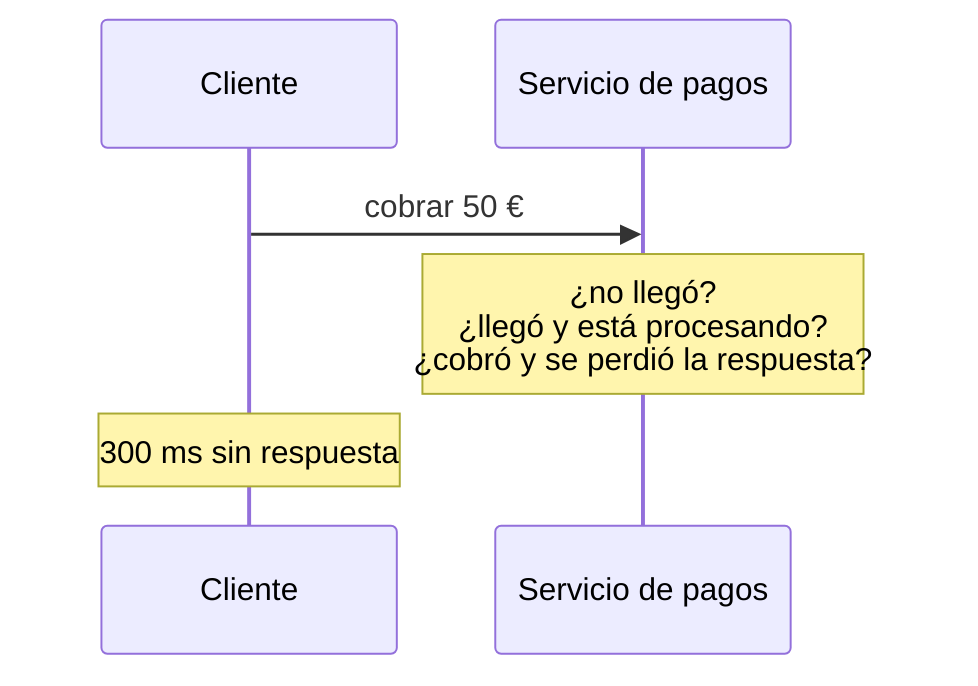
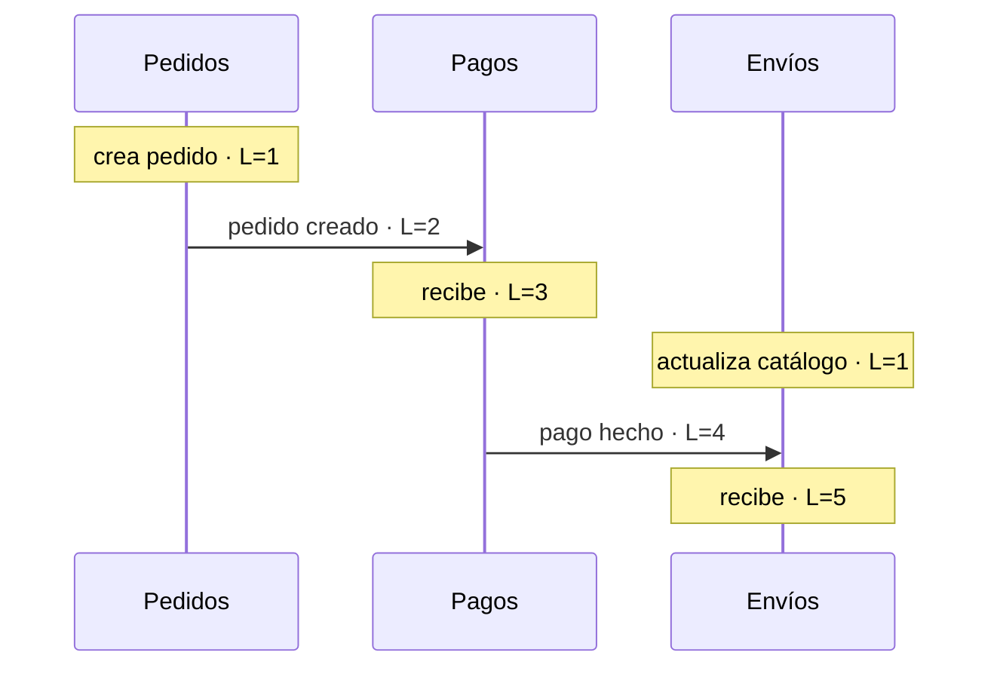
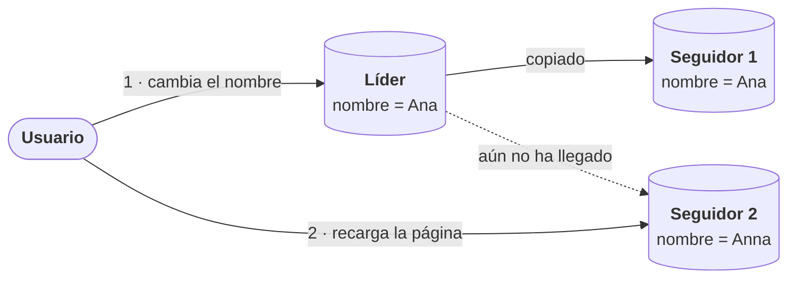
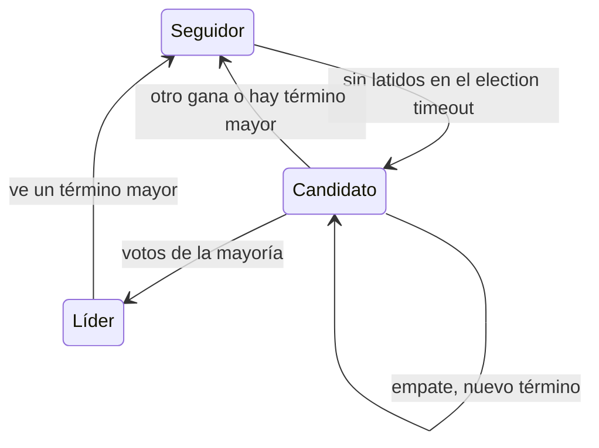
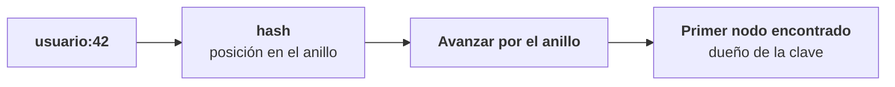

# titulo: Sistemas distribuidos


# Fallos parciales

## Objetivos de aprendizaje

- **1.1** Explicar qué hace distinto a un sistema distribuido: los fallos parciales.
- **1.2** Interpretar un timeout como «no sé qué pasó», no como «falló».
- **1.3** Distinguir las semánticas de entrega: como mucho una vez, al menos una vez y efecto de una sola vez.
- **1.4** Reconocer las suposiciones falsas sobre la red que causan errores.

Los resultados son de Python 3.12, con un cliente y un servidor en el mismo equipo. El tema de microservicios trata los timeouts, el interruptor y los reintentos con espera exponencial; aquí se ve por qué hacen falta.

## Lo que cambia al distribuir

En un solo proceso, una llamada a función o termina o el programa entero falla. Entre dos máquinas aparece algo nuevo: el **fallo parcial**. Una parte falla y el resto sigue, y quien espera no sabe qué ha pasado:



```nodos
C:
  titulo: Cliente
  texto: Solo ve silencio. Desde su lado, las tres situaciones son idénticas.
S:
  concepto: fallo-parcial
```

Un **timeout** no dice que la operación fallara. Dice que **no se sabe**.

## Reintentar sin saber

Un servidor de pagos que tarda 500 ms en responder y un cliente con timeout de 300 ms que reintenta hasta tres veces:

```text
  intento 1: sin respuesta en 300 ms, reintento
  intento 2: sin respuesta en 300 ms, reintento
  intento 3: sin respuesta en 300 ms, reintento
sin clave de idempotencia: el cliente no sabe si se cobró
  cargos registrados: 3
```

El servidor procesó las tres peticiones: **tres cargos** por una compra, y el cliente cree que ninguno salió bien. Con una **clave de idempotencia** que el cliente repite en cada intento, el servidor reconoce la repetición:

```text
con clave de idempotencia: el cliente no sabe si se cobró
  cargos registrados: 1
```

El cliente sigue sin saber el resultado, pero ya puede reintentar sin miedo y, más tarde, consultar el estado por esa misma clave.

## Semánticas de entrega

| Semántica | Cómo se consigue | Riesgo |
|---|---|---|
| **Como mucho una vez** | No reintentar | Operaciones perdidas |
| **Al menos una vez** | Reintentar hasta recibir confirmación | Duplicados, como los tres cargos |
| **Efecto de una sola vez** | Al menos una vez **más** un receptor idempotente | Hay que guardar las claves ya procesadas |

La entrega «exactamente una vez» por la red no existe: lo que se consigue es que el **efecto** ocurra una sola vez, deduplicando en el receptor. Es lo mismo que hacen los consumidores idempotentes de Kafka o el outbox (temas de mensajería y de arquitectura dirigida por eventos).

## Suposiciones falsas

Las «falacias de la computación distribuida», una lista clásica de Sun Microsystems de los años noventa, recogen lo que los programadores suponen sin darse cuenta:

| Suposición | Realidad |
|---|---|
| La red es fiable | Se pierden paquetes, se cortan conexiones |
| La latencia es cero | Cada llamada cuesta de microsegundos a cientos de milisegundos |
| El ancho de banda es infinito | Las respuestas grandes saturan enlaces |
| La red es segura | Hay que cifrar y autenticar (temas de TLS y seguridad) |
| La topología no cambia | Los contenedores aparecen y desaparecen con otras IP |
| Hay un solo administrador | Cada equipo cambia su parte |
| El transporte no cuesta | Serializar y enviar tiene coste en CPU y dinero |
| La red es homogénea | Conviven versiones, protocolos y hardware distintos |

Y los reintentos deben llevar **espera exponencial con variación aleatoria** (jitter), como explica la Builders' Library de AWS: si todos los clientes reintentan a la vez, convierten un fallo breve en una avalancha.

## Puntos clave

- Lo propio de un sistema distribuido es el fallo parcial: una parte falla y las demás no lo saben.
- Un timeout significa «no sé qué pasó»: la operación pudo hacerse.
- Reintentar sin idempotencia duplica: en la prueba, tres cargos por una compra.
- Con una clave de idempotencia repetida en cada intento, el servidor aplica la operación una sola vez.
- «Exactamente una vez» por la red no existe; se consigue el efecto de una sola vez con al menos una vez más deduplicación.
- Reintenta con espera exponencial y variación aleatoria para no provocar avalanchas.

## Referencias

- Amazon Builders' Library, [Timeouts, retries, and backoff with jitter](https://aws.amazon.com/builders-library/timeouts-retries-and-backoff-with-jitter/).

# Tiempo y orden

## Objetivos de aprendizaje

- **2.1** Distinguir el reloj de pared del reloj monótono y usar cada uno para lo suyo.
- **2.2** Explicar por qué «gana la última escritura» puede perder la escritura posterior.
- **2.3** Ordenar eventos con relojes de Lamport.
- **2.4** Reconocer cuándo hace falta algo más que un reloj lógico: relojes vectoriales o un único ordenador.

Las pruebas son de Python 3.12 en Linux, con simulaciones de varios procesos.

## Dos relojes

Python, como Java o Go, ofrece dos relojes muy distintos:

```text
time      implementation='clock_gettime(CLOCK_REALTIME)',  monotonic=False, adjustable=True
monotonic implementation='clock_gettime(CLOCK_MONOTONIC)', monotonic=True,  adjustable=False
```

| Reloj | Qué da | Para qué |
|---|---|---|
| **De pared** (`time.time()`, `Instant.now()`) | La hora del día | Mostrar fechas, registros |
| **Monótono** (`time.monotonic()`, `System.nanoTime()`) | Un contador que solo avanza | Medir duraciones y timeouts |

La documentación de Python avisa: `time()` puede devolver un valor **menor** que una llamada anterior si se atrasa el reloj del sistema, por ejemplo cuando NTP lo corrige. Un timeout calculado con el reloj de pared puede no vencer nunca, o vencer al instante. El monótono «no se ve afectado por los cambios del reloj del sistema», pero su origen no está definido: solo sirve para restar dos lecturas de la misma máquina.

## Relojes desajustados

Cada máquina tiene su reloj, y NTP los acerca, pero no los iguala: unos milisegundos de diferencia son normales, y más tras un problema de red. Muchas bases de datos resuelven las escrituras en conflicto con **«gana la última escritura»** (*last write wins*): se queda la de marca de tiempo mayor. Cassandra lo hace así, y su documentación pide sincronizar los relojes con NTP porque su corrección depende de ello.

Con el reloj de B atrasado 120 ms respecto al de A:

```text
A escribe precio=10; 50 ms después B escribe precio=12. Con «gana la marca más reciente» queda: precio=10
```

La escritura que de verdad fue posterior **se pierde sin error**: la marca de B (70 ms por detrás de la de A) parece más antigua.

## Relojes de Lamport

Leslie Lamport propuso en 1978 un reloj **lógico** que no mide tiempo, sino causalidad:

1. Cada proceso suma 1 a su contador en cada evento.
2. Al enviar un mensaje, adjunta su contador.
3. Al recibir, pone su contador en el máximo entre el suyo y el recibido, más 1.



```nodos
A:
  concepto: reloj-de-lamport
B:
  titulo: Salta al recibir
  texto: Su contador estaba en 0; al recibir L=2 pasa a 3, por encima de lo recibido.
C:
  titulo: Eventos concurrentes
  texto: «Actualiza catálogo» (L=1) no tiene relación con el pedido. Su número menor no significa que ocurriera antes en el tiempo real.
```

La salida de la simulación:

```text
A: crea pedido                  L=1
A: envía «pedido creado»        L=2
B: recibe «pedido creado»       L=3
B: envía «pago hecho»           L=4
C: actualiza catálogo           L=1
C: recibe «pago hecho»          L=5
```

La garantía va en un solo sentido: **si un evento causa otro, el primero tiene un número menor**. Al revés no: que C tenga L=1 en «actualiza catálogo» no dice si fue antes o después de «crea pedido»; son **concurrentes**.

## Cuando hace falta más

| Necesidad | Herramienta |
|---|---|
| Orden compatible con la causalidad | Reloj de Lamport |
| Saber si dos eventos son concurrentes, para detectar conflictos | **Reloj vectorial**: un contador por proceso. Lo usaba el Dynamo original |
| Un orden total que todos acepten | Un único **líder** que numera las operaciones, o consenso (lección 4) |
| Hora real con margen de error acotado | Relojes con incertidumbre explícita, como TrueTime de Google Spanner |

## Puntos clave

- Mide duraciones y timeouts con el reloj monótono; el de pared puede ir hacia atrás.
- Los relojes de distintas máquinas nunca coinciden del todo.
- «Gana la última escritura» con relojes desajustados puede perder la escritura posterior, sin error.
- Un reloj de Lamport garantiza que la causa tiene un número menor que el efecto.
- Un número de Lamport menor no implica que el evento fuera antes: puede ser concurrente.
- Para detectar conflictos hacen falta relojes vectoriales; para un orden total, un líder o consenso.

## Referencias

- Leslie Lamport, [Time, Clocks, and the Ordering of Events in a Distributed System](https://lamport.azurewebsites.net/pubs/time-clocks.pdf) (1978).
- Python, [time](https://docs.python.org/3/library/time.html).
- Apache Cassandra, [Dynamo](https://cassandra.apache.org/doc/latest/cassandra/architecture/dynamo.html).

# Replicación y quórums

## Objetivos de aprendizaje

- **3.1** Comparar la replicación con líder y la replicación sin líder.
- **3.2** Reconocer las anomalías del retraso de réplica: leer lo que no has escrito y lecturas que retroceden.
- **3.3** Calcular cuándo un quórum R + W > N evita las lecturas antiguas.
- **3.4** Distinguir una lectura linealizable de una serializable en etcd.

Las pruebas usan una simulación en Python de 3 réplicas y un clúster real de etcd 3.6 con 3 nodos. El tema de NoSQL trata los conjuntos de réplicas de MongoDB y CAP; aquí se ven los mecanismos de fondo.

## Con líder o sin líder

| Modelo | Cómo escribe | Ejemplos |
|---|---|---|
| **Con líder** (primario y seguidores) | Todas las escrituras van al líder, que las copia a los seguidores | PostgreSQL, MySQL, MongoDB, etcd |
| **Sin líder** | El cliente, o un coordinador, escribe en varias réplicas a la vez y lee de varias | Cassandra, el Dynamo de Amazon |

Con líder hay un único orden de escrituras, pero el líder es un punto que hay que sustituir si cae (lección 4). Sin líder, cualquier réplica acepta escrituras, y los conflictos se resuelven con marcas de tiempo o relojes vectoriales (lección 2).

## El retraso de réplica

Si los seguidores reciben los cambios **después** de confirmar la escritura (replicación asíncrona), leer de un seguidor puede devolver datos antiguos:



```nodos
U:
  titulo: Usuario
  texto: Corrige su nombre y, al recargar, ve el antiguo, aunque la escritura se confirmó.
L:
  titulo: Líder
  texto: Confirmó la escritura sin esperar a todos los seguidores.
S1:
  titulo: Seguidor al día
  texto: Ya tiene el cambio.
S2:
  titulo: Seguidor retrasado
  texto: Todavía no le ha llegado el cambio. Si el balanceador manda aquí la lectura, el usuario no ve lo que acaba de escribir.
```

| Anomalía | Qué ve el usuario | Remedio habitual |
|---|---|---|
| **No leer lo propio** | Escribe y, al recargar, no ve su cambio | Leer del líder durante un rato tras escribir, o lo que el propio usuario modifica |
| **Lecturas que retroceden** | Recarga dos veces y el dato va hacia atrás, porque cada lectura tocó un seguidor distinto | Que cada usuario lea siempre de la misma réplica |

## Quórums

En los sistemas sin líder, con **N** réplicas, cada escritura espera la confirmación de **W** y cada lectura consulta **R** y se queda con la versión más reciente. Simulando 10 000 escrituras con N = 3 y una lectura inmediata, antes de que la escritura llegue a las demás réplicas:

```text
W=1 R=1 W+R≤N → lecturas antiguas: 66.7%
W=2 R=1 W+R≤N → lecturas antiguas: 33.2%
W=1 R=2 W+R≤N → lecturas antiguas: 33.9%
W=2 R=2 W+R>N → lecturas antiguas: 0.0%
W=3 R=1 W+R>N → lecturas antiguas: 0.0%
```

Con **R + W > N**, las réplicas leídas y las escritas siempre comparten al menos una, así que la lectura ve la última versión. Es la regla del Dynamo de Amazon, y los niveles `QUORUM` de Cassandra son su versión: mayoría de escritura más mayoría de lectura. Elegir W y R reparte el coste: W = 3 hace lentas las escrituras y las bloquea si cae una réplica; R = 3 hace lo mismo con las lecturas.

Incluso con quórum hay casos límite, como una escritura que falla a medias o relojes desajustados con «gana la última escritura». Jepsen ha documentado muchos.

## Linealizable o serializable en etcd

etcd replica con líder y ofrece dos tipos de lectura. En un clúster de 3, se aísla un seguidor, se cambia `stock` de 5 a 0 en la mayoría y se lee del seguidor aislado:

```text
lectura serializable en el seguidor aislado:
5
lectura linealizable (por defecto) en el seguidor aislado:
Error: context deadline exceeded
```

| Lectura | Qué hace | Resultado en la prueba |
|---|---|---|
| **Linealizable** (por defecto) | Confirma con la mayoría que tiene lo último antes de responder | Falla: el nodo aislado no puede confirmarlo |
| **Serializable** (`--consistency=s`) | Responde con lo que tiene, sin preguntar | Responde rápido, pero un **dato antiguo**: 5 en lugar de 0 |

Al reconectar el seguidor, se puso al día en unos 3 segundos. La elección es la de CAP en pequeño: durante la partición, la lectura linealizable prefiere fallar a mentir, y la serializable prefiere responder aunque sea con algo antiguo.

## Puntos clave

- Con líder hay un orden único de escrituras; sin líder, cualquier réplica escribe y hay que resolver conflictos.
- La replicación asíncrona permite leer datos antiguos de un seguidor, aunque la escritura se confirmara.
- Para que un usuario vea lo que escribe, se lee del líder lo que acaba de modificar.
- Con R + W > N, toda lectura toca al menos una réplica con la última escritura; en la simulación, 0 % de lecturas antiguas.
- En etcd, la lectura linealizable consulta a la mayoría y falla si no puede; la serializable responde con lo que tiene, aunque sea antiguo.

## Referencias

- DeCandia y otros, [Dynamo: Amazon's Highly Available Key-value Store](https://www.allthingsdistributed.com/files/amazon-dynamo-sosp2007.pdf) (2007).
- Apache Cassandra, [Dynamo](https://cassandra.apache.org/doc/latest/cassandra/architecture/dynamo.html).
- etcd, [KV API guarantees](https://etcd.io/docs/v3.6/learning/api_guarantees/).
- Jepsen, [Consistency Models](https://jepsen.io/consistency).

# Consenso

## Objetivos de aprendizaje

- **4.1** Explicar cómo Raft elige un líder y confirma operaciones por mayoría.
- **4.2** Calcular cuántos fallos tolera un clúster según su tamaño.
- **4.3** Predecir qué hace un clúster de etcd ante la caída del líder, una partición o la pérdida de la mayoría.
- **4.4** Usar leases y tokens de fencing para que solo una instancia haga un trabajo.

Todas las pruebas son con un clúster de tres nodos de etcd 3.6.6 en Docker, provocando los fallos con `docker kill` y `docker network disconnect`.

## Para qué sirve el consenso

Muchos problemas se reducen a que varios nodos **acuerden algo** aunque alguno falle: quién es el líder, qué configuración está vigente, quién tiene un cerrojo, en qué orden van las operaciones. etcd, que guarda el estado de Kubernetes, resuelve eso con **Raft**.

## Raft en pocas reglas

1. Cada nodo es **seguidor**, **candidato** o **líder**. El tiempo se divide en **términos** numerados, con un líder como mucho por término.
2. El líder manda latidos (cada 100 ms en etcd). Si un seguidor no oye ninguno en el **election timeout** (1000 ms por defecto en etcd), se presenta como candidato en un término nuevo.
3. Gana quien obtiene los votos de la **mayoría**. Un nodo vota a un solo candidato por término.
4. El líder añade cada escritura a su registro y la copia a los seguidores. La escritura se **confirma** cuando la tiene la mayoría.



```nodos
Seguidor:
  titulo: Seguidor
  texto: Recibe el registro del líder y vota en las elecciones.
Candidato:
  titulo: Candidato
  texto: Sube el término y pide votos. Necesita la mayoría del clúster, no de los nodos que ve.
Lider:
  concepto: raft
```

## Mayoría y tamaño del clúster

La mayoría de N nodos es N/2 + 1 (división entera):

| Nodos | Mayoría | Fallos tolerados |
|---|---|---|
| 1 | 1 | 0 |
| 3 | 2 | 1 |
| 4 | 3 | 1 |
| 5 | 3 | 2 |

Un cuarto nodo **no tolera más fallos** que tres, y hay un nodo más que puede fallar. Por eso etcd recomienda un número impar de miembros.

## Tres fallos provocados

**La caída del líder.** Matando el líder con SIGKILL, las escrituras volvieron a aceptarse a los **1188 ms**: el election timeout más la elección. Con `docker stop`, que manda SIGTERM, fueron **411 ms**, porque etcd traspasa el liderazgo antes de apagarse. Durante la elección no se aceptan escrituras.

**Una partición que aísla al líder.** Con el líder `e2` desconectado de la red:

```text
  e1:2379  líder=false  term=3
  e3:2379  líder=true   term=3
--- escribir en el antiguo líder aislado:
Error: context deadline exceeded
--- escribir en la mayoría:
OK
--- reconecto
saldo
200
```

Los dos nodos con mayoría eligieron a `e3` en el término 3. El antiguo líder no pudo confirmar nada, porque solo se tenía a sí mismo: **no hay dos líderes que acepten escrituras** (*split brain*). Al reconectar, recibió el valor escrito en la mayoría.

**La pérdida de la mayoría.** Con dos de tres nodos parados:

```text
put pedido:3 creado                    → Error: etcdserver: request timed out
get pedido:1                           → Error: context deadline exceeded
get pedido:1 --consistency=s           → creado
```

El nodo superviviente no acepta escrituras ni lecturas linealizables; solo responde lecturas serializables, posiblemente antiguas (lección 3). Elige consistencia: prefiere no responder a responder algo que la mayoría podría contradecir.

## Leases y tokens de fencing

Una aplicación con varias instancias que debe facturar **una sola vez** puede usar etcd para elegir quién lo hace. Se concede un **lease** con caducidad y se escribe una clave asociada a él:

```text
lease 625fa1fbe36baf05 de 5 s
create_revision (token): 3
tras 7 s sin renovar, líneas de get: 0
put lider/facturacion instancia-B → nuevo create_revision: 5
```

Si la instancia A deja de renovar el lease, porque cayó o se quedó aislada, la clave desaparece y B la toma. Pero queda un problema, que Martin Kleppmann describe: A pudo quedarse **congelada**, por ejemplo en una pausa larga del recolector de basura, y al despertar **cree que sigue siendo la dueña**.

La solución es el **token de fencing**: un número que crece con cada concesión. La `create_revision` de etcd sirve: 3 para A, 5 para B. El recurso protegido (la base de datos de facturas) recuerda el último token que ha visto y **rechaza los menores**. Cuando A despierta y escribe con el 3, se rechaza, porque ya vio el 5.

## Puntos clave

- Raft elige un líder por mayoría en cada término, y una escritura se confirma cuando la tiene la mayoría.
- Un clúster de N nodos tolera la caída de la minoría: 3 nodos toleran 1, y 5 toleran 2.
- Un número par de nodos no tolera más fallos que el impar anterior.
- Al matar el líder de etcd, las escrituras volvieron en unos 1,2 s, el election timeout de 1 s más la elección.
- En una partición solo el lado con mayoría escribe; el antiguo líder aislado no puede confirmar nada.
- Sin mayoría, etcd no acepta escrituras ni lecturas linealizables.
- Un lease caduca si no se renueva; un token de fencing impide que un antiguo dueño congelado escriba.

## Referencias

- Diego Ongaro y John Ousterhout, [In Search of an Understandable Consensus Algorithm](https://raft.github.io/raft.pdf), y [raft.github.io](https://raft.github.io/).
- etcd, [Failure modes](https://etcd.io/docs/v3.6/op-guide/failures/), [FAQ](https://etcd.io/docs/v3.6/faq/) y [Tuning](https://etcd.io/docs/v3.6/tuning/).
- Martin Kleppmann, [How to do distributed locking](https://martin.kleppmann.com/2016/02/08/how-to-do-distributed-locking.html).

# Particionado

## Objetivos de aprendizaje

- **5.1** Distinguir el particionado por rangos del particionado por hash.
- **5.2** Medir cuántas claves se mueven al añadir un nodo con `hash % N` y con hashing consistente.
- **5.3** Explicar para qué sirven los nodos virtuales.
- **5.4** Elegir la clave de partición para evitar particiones calientes.

Las pruebas son una simulación en Python con 100 000 claves y nodos de 4 a 5.

## Repartir los datos

Replicar copia **los mismos datos** en varios nodos; **particionar** (o *sharding*) reparte datos **distintos** entre nodos, para que quepan más o se atiendan más peticiones. Se suelen combinar: cada partición tiene sus réplicas.

| Forma | Cómo asigna | Ventaja | Riesgo |
|---|---|---|---|
| **Por rangos** | `A–F` al nodo 1, `G–M` al nodo 2… | Consultas por rango eficientes | Puntos calientes: si la clave es una fecha, todas las escrituras de hoy van al mismo nodo |
| **Por hash** | El hash de la clave decide el nodo | Reparto uniforme | Las consultas por rango tocan todos los nodos |

## hash % N

La forma ingenua de repartir por hash es `nodo = hash(clave) % N`. Funciona hasta que cambia N. Al pasar de 4 nodos a 5:

```text
hash % N: se mueven 80.2% de las claves
```

Cuatro de cada cinco claves cambian de nodo: hay que mover casi todos los datos, o en una caché, perder casi todos los aciertos de golpe.

## Hashing consistente

Los nodos y las claves se colocan en un **anillo** de valores de hash, y cada clave pertenece al primer nodo que encuentra avanzando por el anillo:



```nodos
K:
  titulo: Clave
  texto: La clave de partición, por ejemplo el identificador del usuario.
H:
  titulo: Hash
  texto: Lleva la clave a una posición del anillo. Los nodos también tienen sus posiciones.
A:
  concepto: hashing-consistente
N:
  titulo: Dueño
  texto: Al añadir un nodo, solo cambian de dueño las claves del tramo que el nuevo ocupa.
```

Al añadir un nodo, solo se mueven las claves del tramo que ocupa el nuevo:

```text
hashing consistente (100 nodos virtuales): se mueven 21.8%
```

Lo ideal al pasar de 4 a 5 nodos es mover 1/5 de las claves, el 20 %, que es lo que le toca al nodo nuevo. Cassandra usa este esquema con **tokens** en el anillo, y su documentación lo contrasta con el reparto ingenuo, que «puede invalidar casi todas las asignaciones».

## Nodos virtuales

Con un solo punto por nodo, el azar del hash deja tramos muy desiguales:

```text
con 1 punto por nodo:  {'n0': 22595, 'n1': 17529, 'n2': 9907, 'n3': 8514, 'n4': 41455}
con 100 por nodo:      {'n0': 19978, 'n1': 18500, 'n2': 19066, 'n3': 20687, 'n4': 21769}
```

Con un punto, `n4` tenía casi cinco veces más claves que `n3`. Con 100 **nodos virtuales** por nodo físico, todos quedan cerca de 20 000. Además, cuando un nodo cae, sus tramos se reparten entre muchos nodos y no recaen todos en su vecino. A un nodo más potente se le pueden dar más nodos virtuales.

## La clave de partición

El reparto uniforme de claves no garantiza un reparto uniforme de **carga**:

- **Clave con poca variedad:** particionar los pedidos por país deja España en un nodo saturado y Andorra en otro casi vacío.
- **Clave caliente:** si un usuario famoso recibe millones de lecturas, su partición se satura aunque haya pocas claves. Se le puede añadir un sufijo aleatorio y repartirlo en varias, a costa de leer de todas.
- **Consultas que cruzan particiones:** si se consulta a menudo por algo que no es la clave, cada consulta toca todos los nodos.

Es la misma decisión que la clave de los mensajes en Kafka o la clave de partición en un tema de NoSQL: se elige pensando en **cómo se accede** a los datos.

## Puntos clave

- Replicar copia los mismos datos; particionar reparte datos distintos. Se combinan.
- Por rangos favorece las consultas por rango, pero crea puntos calientes con claves secuenciales.
- Con `hash % N`, añadir un nodo a 4 movió el 80 % de las claves.
- Con hashing consistente se movió el 21,8 %, cerca del 20 % ideal.
- Los nodos virtuales equilibran el reparto: con un punto por nodo, uno tenía casi cinco veces más claves que otro.
- Elige la clave de partición por cómo se accede a los datos y vigila las claves calientes.

## Referencias

- DeCandia y otros, [Dynamo: Amazon's Highly Available Key-value Store](https://www.allthingsdistributed.com/files/amazon-dynamo-sosp2007.pdf) (2007).
- Apache Cassandra, [Dynamo](https://cassandra.apache.org/doc/latest/cassandra/architecture/dynamo.html).
