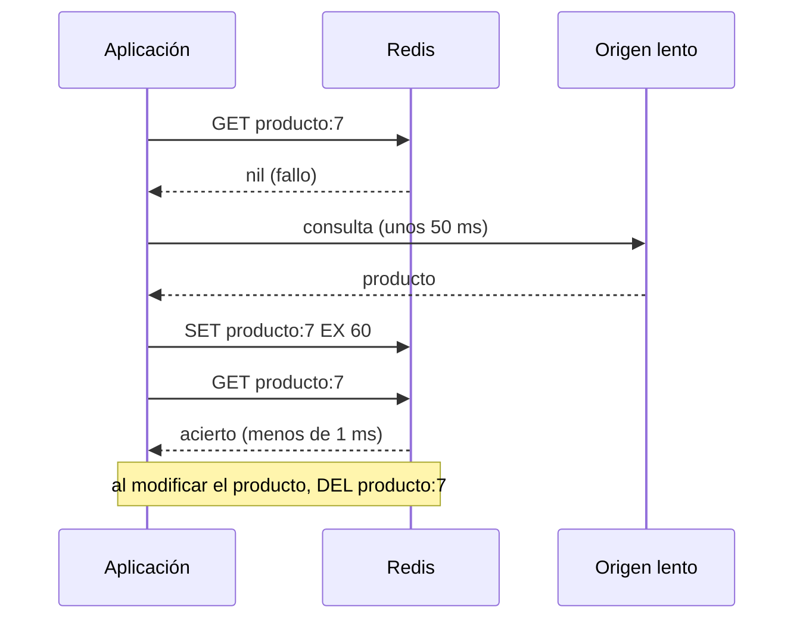
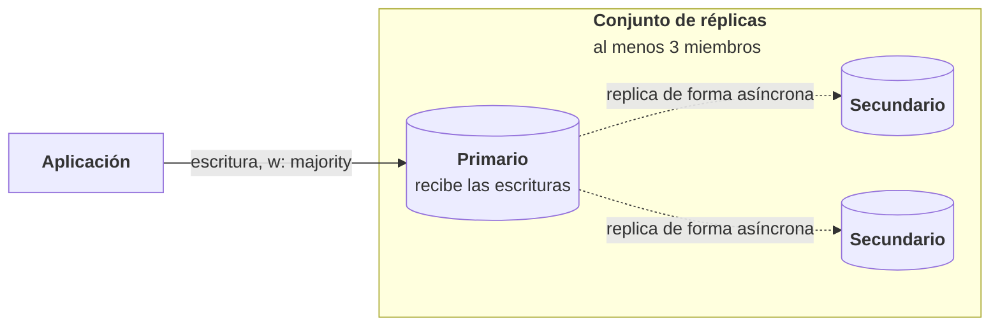

# titulo: Bases de datos NoSQL


# Familias NoSQL

## Objetivos de aprendizaje

- **1.1** Distinguir las cuatro familias NoSQL principales.
- **1.2** Decidir cuándo una base NoSQL encaja mejor que una relacional.
- **1.3** Explicar la persistencia políglota.

Los ejemplos del tema se han ejecutado con **MongoDB 9.0.8** (con 200 000 pedidos generados) y **Redis 8.10.3**, desde Python con pymongo 4.20 y redis-py 8.1.

## Cuatro familias

| Familia | Modelo | Ejemplos | Encaja con |
|---|---|---|---|
| **Documentos** | Documentos anidados (tipo JSON) con campos consultables | MongoDB, Couchbase | Entidades que se leen enteras: un pedido con sus líneas, un perfil, un catálogo con atributos variables |
| **Clave-valor** | Una clave y un valor (o una estructura) | Redis, Valkey, DynamoDB | Cachés, sesiones, contadores, colas, rankings |
| **Columna ancha** | Filas con muchas columnas, repartidas por una clave de partición | Cassandra, ScyllaDB | Escrituras masivas y series temporales con accesos conocidos |
| **Grafos** | Nodos y relaciones con propiedades | Neo4j | Relaciones profundas: redes sociales, recomendaciones, detección de fraude |

«NoSQL» describe lo que **no** son (relacionales) más que lo que son. Cada familia resuelve un problema distinto, y comparten poco más.

## ¿Relacional o NoSQL?

La pregunta correcta no es «cuál es mejor», sino **qué accesos** tendrá la aplicación:

- **Relacional** (PostgreSQL) es la opción por defecto: consultas que no conoces de antemano, joins, transacciones entre muchas tablas, integridad con claves foráneas. Además, PostgreSQL guarda y consulta JSON (`jsonb`) con índices.
- **Documentos** cuando los datos son **jerárquicos** y se leen juntos, el esquema varía entre registros y quieres repartir los datos entre servidores (*sharding*).
- **Clave-valor** cuando necesitas **latencia de microsegundos** sobre accesos por clave, o estructuras como contadores atómicos o conjuntos ordenados.
- **Columna ancha** con volúmenes enormes de escritura y consultas **conocidas de antemano** (se diseña una tabla por consulta).
- **Grafos** cuando las preguntas son sobre **caminos**: «amigos de amigos que compraron esto».

Un error común es elegir NoSQL «porque escala» para un sistema que cabe holgadamente en un PostgreSQL, y perder joins y transacciones a cambio de nada.

## Persistencia políglota

Un mismo sistema puede usar varias: PostgreSQL para pedidos y facturación, Redis para sesiones y caché, un motor de búsqueda para el catálogo. Es la **persistencia políglota**. Cada base añadida es una pieza más que operar, vigilar, copiar y mantener sincronizada: que cada una se justifique.

## Puntos clave

- Documentos, clave-valor, columna ancha y grafos resuelven problemas distintos.
- Elige por los patrones de acceso; la relacional es la opción por defecto.
- NoSQL suele ganar en escala horizontal o en un modelo concreto, y pierde joins o transacciones generales.
- Persistencia políglota: cada base, con su motivo, porque cada una cuesta operarla.

## Referencias

- Martin Fowler, [Polyglot Persistence](https://martinfowler.com/bliki/PolyglotPersistence.html).
- MongoDB, [Documents](https://www.mongodb.com/docs/manual/core/document/).
- Redis, [Data types](https://redis.io/docs/latest/develop/data-types/).
- Apache Cassandra, [Dynamo](https://cassandra.apache.org/doc/latest/cassandra/architecture/dynamo.html).
- Neo4j, [What is a graph database](https://neo4j.com/docs/getting-started/graph-database/).

# Modelado de documentos

## Objetivos de aprendizaje

- **2.1** Modelar según los patrones de acceso.
- **2.2** Decidir entre embeber y referenciar.
- **2.3** Validar el esquema de una colección.
- **2.4** Agregar y unir datos con la tubería de agregación.

## Modelar por accesos

En relacional se normaliza primero y se consulta después. En documentos se empieza por la pregunta: **¿qué se lee y se escribe junto?** Un pedido del laboratorio:

```json
{
  "_id": 1,
  "cliente_id": 4242,
  "estado": "pagado",
  "fecha": "2026-03-14T10:20:00Z",
  "total": 33.71,
  "lineas": [
    {"producto": "p37", "cantidad": 2},
    {"producto": "p75", "cantidad": 1}
  ]
}
```

Las líneas van **dentro** del pedido: se crean con él, se leen con él y no tienen sentido sin él. Una sola lectura trae todo, sin joins.

## Embeber o referenciar

| Embeber | Referenciar |
|---|---|
| Relación «contiene» (pedido → líneas) | Entidades con vida propia (cliente, producto) |
| Se lee junto casi siempre | Se lee por separado a menudo |
| Pocos elementos, con límite | Crece sin límite (los comentarios de un vídeo viral) |
| Cambia poco o se actualiza junto | Se actualiza a menudo y desde muchos sitios |

Un documento de MongoDB debe ser **menor de 16 MiB**: una lista que crece sin límite acabará rompiéndolo, y antes de eso hará lentas las escrituras.

Embeber es **desnormalizar**: si se copia el nombre del producto en cada línea, cambiarlo exige actualizar muchos pedidos. A veces es justo lo que se quiere (el pedido conserva el nombre y el precio **del momento de la compra**); otras, es mejor referenciar.

Una ventaja importante: una actualización de **un solo documento es atómica**. En el laboratorio, añadir una línea y sumar su importe en la misma operación:

```python
db.pedidos.update_one({"_id": 1}, {"$push": {"lineas": {"producto": "p9", "cantidad": 1}},
                                   "$inc": {"total": 9.5}})
# total: 33.71 → 43.21, líneas: 2 → 3
```

Modelar para que cada operación toque un solo documento evita muchas transacciones (MongoDB las admite entre documentos, pero son más caras).

## Validación de esquema

«Sin esquema» no significa «sin reglas». MongoDB valida con JSON Schema:

```python
db.create_collection("clientes", validator={"$jsonSchema": {
    "bsonType": "object", "required": ["nombre", "email"],
    "properties": {"nombre": {"bsonType": "string"},
                   "email": {"bsonType": "string", "pattern": "^.+@.+$"}},
}})
db.clientes.insert_one({"_id": 2, "nombre": "Luis"})
# WriteError: Document failed validation
```

El esquema siempre existe: si no lo controla la base, lo arrastra el código que lee los datos.

## Agregación

La **tubería de agregación** encadena etapas. Los tres productos más vendidos en pedidos pagados:

```python
db.pedidos.aggregate([
    {"$match": {"estado": "pagado"}},
    {"$unwind": "$lineas"},
    {"$group": {"_id": "$lineas.producto", "unidades": {"$sum": "$lineas.cantidad"}}},
    {"$sort": {"unidades": -1}},
    {"$limit": 3},
])
# [{'_id': 'p37', 'unidades': 1772}, {'_id': 'p75', 'unidades': 1760}, {'_id': 'p28', 'unidades': 1749}]  (199 ms)
```

Y `$lookup` une con otra colección, como un join:

```python
{"$lookup": {"from": "clientes", "localField": "cliente_id", "foreignField": "_id", "as": "cliente"}}
# [{'_id': 1, 'total': 33.71, 'cliente': [{'nombre': 'Ana'}]}]
```

Existe, pero si tus consultas principales necesitan `$lookup` constantemente, probablemente el modelo (o la elección de base) no encaja con tus accesos.

## Puntos clave

- Modela por patrones de acceso: lo que se lee y se escribe junto, junto.
- Embebe lo que se contiene y está acotado; referencia lo que tiene vida propia o crece sin límite (máximo 16 MiB).
- La actualización de un documento es atómica: aprovéchalo.
- Valida el esquema en la base con JSON Schema.
- La agregación transforma y agrupa; abusar de `$lookup` indica un modelo que no encaja.

## Referencias

- MongoDB, [Data modeling](https://www.mongodb.com/docs/manual/data-modeling/).
- MongoDB, [Embedded data](https://www.mongodb.com/docs/manual/data-modeling/embedding/) y [References](https://www.mongodb.com/docs/manual/data-modeling/referencing/).
- MongoDB, [Schema validation](https://www.mongodb.com/docs/manual/core/schema-validation/).
- MongoDB, [Aggregation operations](https://www.mongodb.com/docs/manual/aggregation/).

# Índices en MongoDB

## Objetivos de aprendizaje

- **3.1** Leer un plan de ejecución con `explain`.
- **3.2** Diseñar índices compuestos con la regla ESR.
- **3.3** Entender la regla del prefijo y el coste de los índices.

## Leer un plan

Consulta del laboratorio, sobre 200 000 pedidos: los pedidos pagados de un cliente, del más reciente al más antiguo.

```python
db.pedidos.find({"cliente_id": 4242, "estado": "pagado"}).sort("fecha", -1).limit(20).explain()
```

`explain()` devuelve el plan ganador y cuánto trabajo hizo. Sin índices:

```text
SORT <- COLLSCAN | examinados: 200000 docs, 0 claves | 48 ms
```

- **COLLSCAN**: recorrió **toda** la colección.
- **SORT**: ordenó en memoria después.
- Leyó 200 000 documentos para devolver 7.

## Índices

Con un índice sobre `cliente_id`:

```text
SORT <- FETCH <- IXSCAN | examinados: 9 docs, 9 claves | 0 ms
```

**IXSCAN** recorre el índice y solo trae (**FETCH**) los 9 pedidos del cliente. Todavía filtra el estado y ordena en memoria, pero sobre 9 documentos.

## La regla ESR

Para índices compuestos, MongoDB recomienda ordenar los campos así:

1. **E**quality: los campos de **igualdad** (`cliente_id`, `estado`).
2. **S**ort: los de **ordenación** (`fecha`).
3. **R**ange: los de **rango** (`total > 100`), al final.

```python
db.pedidos.create_index([("cliente_id", 1), ("estado", 1), ("fecha", -1)])
```

```text
LIMIT <- FETCH <- IXSCAN | examinados: 7 docs, 7 claves | 1 ms
```

Ahora examina **exactamente** los 7 pedidos que devuelve y **desaparece el SORT**: el índice ya los entrega ordenados por fecha.

## El prefijo

Un índice compuesto sirve para consultas que usan sus **campos iniciales**. El índice `(cliente_id, estado, fecha)` vale para `cliente_id`, para `cliente_id + estado` y para los tres. Pero **no** para `estado` solo:

```text
find({"estado": "pagado"}).sort("fecha", -1)
SORT <- COLLSCAN | examinados: 200000 docs, 0 claves | 49 ms
```

Igual que una guía telefónica ordenada por apellido y nombre no ayuda a buscar por nombre. Si esa consulta importa, necesita su propio índice.

## El coste de los índices

Cada índice acelera lecturas y **frena escrituras**: cada inserción o actualización debe actualizar todos los índices afectados, y ocupan memoria. Indexa para las **consultas reales y frecuentes**, revisa los que no se usan (`$indexStats`) y comprueba los planes con `explain`, no a ojo.

## Puntos clave

- `explain` muestra el plan: COLLSCAN recorre todo; IXSCAN usa un índice; SORT ordena en memoria.
- Sin índice: 200 000 documentos examinados para devolver 7; con el índice adecuado, 7.
- ESR: igualdad, luego ordenación, luego rango. Bien ordenado, el índice elimina el SORT.
- Un índice compuesto solo sirve para consultas sobre su prefijo.
- Cada índice frena las escrituras: crea los que justifiquen las consultas reales.

## Referencias

- MongoDB, [Explain results](https://www.mongodb.com/docs/manual/reference/explain-results/).
- MongoDB, [Compound indexes](https://www.mongodb.com/docs/manual/core/indexes/index-types/index-compound/).
- MongoDB, [The ESR (Equality, Sort, Range) guideline](https://www.mongodb.com/docs/manual/tutorial/equality-sort-range-guideline/).

# Redis

## Objetivos de aprendizaje

- **4.1** Elegir la estructura de datos de Redis adecuada.
- **4.2** Usar operaciones atómicas en lugar de leer y escribir.
- **4.3** Implementar una caché con el patrón cache-aside y caducidad.
- **4.4** Conocer la persistencia y la política de memoria por defecto.

## Estructuras

**Redis** guarda claves cuyo valor es una **estructura de datos** en memoria, con operaciones específicas:

| Estructura | Uso típico |
|---|---|
| Cadena | Caché de un valor, contador (`INCR`) |
| Hash | Un objeto con campos (una sesión) |
| Lista | Cola sencilla |
| Conjunto | Elementos únicos (usuarios conectados) |
| Conjunto ordenado | Ranking por puntuación |
| Stream | Registro de eventos con grupos de consumidores |

Desde 2024 existe **Valkey**, una bifurcación comunitaria compatible, mantenida en la Linux Foundation.

## Operaciones atómicas

Contar visitas leyendo, sumando y escribiendo, con 8 hilos que hacen 1 000 incrementos cada uno:

```python
v = int(r.get("visitas"))
r.set("visitas", v + 1)          # GET + SET
r.incr("visitas")                # INCR
```

```text
8 hilos x 1000 incrementos → GET+SET: 1645 | INCR: 8000
```

Con GET+SET se **perdieron 6 355 incrementos**: dos hilos leen el mismo valor y los dos escriben el mismo resultado. `INCR` lo hace **dentro** de Redis en un paso, sin carrera. Redis ofrece muchas operaciones así (`INCRBY`, `SETNX`, `ZINCRBY`, `LPUSH`) y scripts en Lua o funciones para combinar varias de forma atómica.

## Caducidad

Una clave puede tener **TTL**:

```python
r.set("sesion:abc", "ana", ex=2)
# TTL inicial: 2 | existe: 1
# tras 2,2 s existe: 0 | TTL: -2      (-2: la clave no existe)
```

Ideal para sesiones, códigos de verificación o límites por ventana de tiempo.

## Cache-aside

```python
def obtener(pid):
    clave = f"producto:{pid}"
    if (v := r.get(clave)) is not None:
        return v                          # acierto
    v = producto_lento(pid)               # fallo: al origen (50 ms simulados)
    r.set(clave, v, ex=60)                # guardar con caducidad
    return v
```

```text
obtener(7) desde origen: 53.2 ms
obtener(7) desde caché: 0.6 ms
obtener(7) desde caché: 0.2 ms
tras invalidar, desde origen: 51.6 ms
```

Al **modificar** el producto, se borra su clave (`r.delete("producto:7")`) y la siguiente lectura vuelve al origen. Cuestiones a decidir:



```nodos
APP:
  concepto: cache-aside
R:
  concepto: redis
BD:
  titulo: Origen
  texto: La base de datos o el servicio lento. En la prueba, 53,2 ms la primera vez y 51,6 ms tras invalidar, frente a 0,6 y 0,2 ms desde la caché.
```

- **Caducidad** siempre, aunque se invalide: limita el daño de una invalidación olvidada.
- La caché puede servir datos **algo antiguos**: úsala donde eso se tolere.
- Si una clave muy pedida caduca, muchas peticiones van a la vez al origen (*estampida*): se mitiga con caducidades con variación aleatoria o con un bloqueo para que solo una la regenere.

## Otros usos

```python
r.zadd("ranking", {"ana": 120, "luis": 340, "eva": 210, "juan": 90})
r.zincrby("ranking", 200, "ana")
r.zrange("ranking", 0, 2, desc=True, withscores=True)
# [('luis', 340.0), ('ana', 320.0), ('eva', 210.0)]
```

Un **limitador de peticiones** de ventana fija, 5 por segundo: `INCR` sobre una clave por usuario y segundo, con caducidad. Siete peticiones seguidas dieron `[True, True, True, True, True, False, False]`.

## Persistencia y memoria

La configuración por defecto del contenedor oficial de Redis 8.10:

```text
save: 3600 1 300 100 60 10000      appendonly: no
maxmemory: 0                       maxmemory-policy: noeviction
```

- **Persistencia**: solo instantáneas periódicas (RDB); si se cae entre dos, se pierden las últimas escrituras. Para más durabilidad, `appendonly yes` (AOF).
- **Memoria**: sin límite y sin desalojo. Como caché, conviene fijar `maxmemory` y una política como `allkeys-lru`, para que descarte las claves menos usadas en vez de rechazar escrituras.

Redis es una buena caché y un buen almacén auxiliar; para datos que no se pueden perder, la fuente de verdad suele ser otra base.

## Puntos clave

- Elige la estructura: cadenas, hashes, listas, conjuntos, conjuntos ordenados, streams.
- Operaciones atómicas en Redis: GET+SET perdió 6 355 de 8 000 incrementos; INCR, ninguno.
- TTL para sesiones, códigos y ventanas de tiempo.
- Cache-aside: de 53 ms a menos de 1 ms; invalida al modificar y pon siempre caducidad.
- Por defecto, instantáneas periódicas y memoria sin límite: configúralo según el uso.

## Referencias

- Redis, [Data types](https://redis.io/docs/latest/develop/data-types/) y [Sorted sets](https://redis.io/docs/latest/develop/data-types/sorted-sets/).
- Redis, [INCR](https://redis.io/docs/latest/commands/incr/) y [EXPIRE](https://redis.io/docs/latest/commands/expire/).
- Redis, [Persistence](https://redis.io/docs/latest/operate/oss_and_stack/management/persistence/) y [Key eviction](https://redis.io/docs/latest/develop/reference/eviction/).
- Redis, [Patterns](https://redis.io/docs/latest/develop/use/patterns/).
- [Valkey](https://valkey.io/).

# Consistencia y replicación

## Objetivos de aprendizaje

- **5.1** Explicar cómo funciona un conjunto de réplicas.
- **5.2** Elegir el nivel de confirmación de las escrituras y el origen de las lecturas.
- **5.3** Razonar sobre consistencia eventual y el teorema CAP.

## Conjuntos de réplicas

En MongoDB, un **conjunto de réplicas** son varios servidores con los mismos datos:

- Un **primario** recibe todas las escrituras.
- Los **secundarios** copian sus operaciones de forma **asíncrona**.
- Si el primario deja de comunicarse más de `electionTimeoutMillis` (**10 s** por defecto), un secundario convoca una elección. Según la documentación, la mediana hasta tener un nuevo primario no suele superar los 12 s.

El laboratorio usó un conjunto de un solo miembro (`--replSet rs0`), suficiente para las transacciones y los flujos de cambios; en producción se usan al menos **tres**, para que haya mayoría tras perder uno.



```nodos
CLI:
  titulo: Aplicación
  texto: Con w majority, la escritura se confirma cuando la mayoría de miembros la tiene en su diario. Con w 1 bastaría el primario, y podría perderse si cae antes de replicarla.
  seccion: 05-consistencia-y-replicacion/teoria#confirmación-de-escrituras
RS:
  concepto: replica-set
PRI:
  titulo: Primario
  texto: El único que acepta escrituras. Si deja de comunicarse más de 10 s (electionTimeoutMillis), los secundarios eligen otro.
S1:
  titulo: Secundario
  texto: Copia las operaciones del primario con algo de retraso. Leer de él puede devolver datos algo antiguos.
  seccion: 05-consistencia-y-replicacion/teoria#origen-de-las-lecturas
S2:
  titulo: Secundario
  texto: Con tres miembros, perder uno aún deja mayoría para elegir primario y confirmar escrituras.
```

## Confirmación de escrituras

El **write concern** indica cuándo se considera hecha una escritura:

| Valor | Confirmación | Riesgo |
|---|---|---|
| `w: 1` | Cuando la escribe el primario | Si el primario cae antes de replicarla, puede perderse |
| `w: "majority"` | Cuando la mayoría de miembros la tiene en su diario | Más latencia; no se pierde tras un cambio de primario |

Según la documentación, el valor **implícito por defecto** es `w: "majority"` en la mayoría de despliegues.

## Origen de las lecturas

La **read preference** decide a qué miembro se lee. Por defecto, `primary`. Leer de los secundarios reparte la carga, pero la documentación advierte que **todos los modos salvo `primary` pueden devolver datos antiguos**, porque la replicación es asíncrona.

Ejemplo del problema: un usuario cambia su dirección (escritura en el primario) y la página siguiente la lee de un secundario que aún no la tiene: ve la dirección antigua. Para estos casos se lee del primario o se usan **sesiones causalmente consistentes**, que garantizan leer lo propio.

## Consistencia eventual y CAP

Muchas bases distribuidas ofrecen **consistencia eventual**: si dejan de llegar escrituras, todas las réplicas acabarán iguales, pero mientras tanto una lectura puede devolver un valor antiguo (Werner Vogels, 2008).

El **teorema CAP** dice que, ante una **partición de red**, un sistema distribuido debe elegir entre **consistencia** (rechazar operaciones para no dar datos incoherentes) y **disponibilidad** (responder aunque los datos puedan no estar al día). No es una elección para siempre: muchas bases permiten elegir **por operación**, como MongoDB con el write concern, la read preference y el read concern, o Cassandra con su nivel de consistencia.

Preguntas para decidir:

- ¿Qué pasa si el usuario ve un dato de hace dos segundos? Un contador de «me gusta», nada; un saldo bancario, mucho.
- ¿Qué es peor, una respuesta antigua o un error?

## Puntos clave

- Primario para escrituras, secundarios que replican de forma asíncrona y elección automática si el primario cae.
- `w: "majority"` (por defecto) evita perder escrituras confirmadas tras un cambio de primario.
- Leer de secundarios puede devolver datos antiguos; para leer lo propio, primario o sesiones causales.
- Consistencia eventual: las réplicas convergen, pero no al instante.
- CAP: ante una partición, consistencia o disponibilidad; muchas bases permiten elegir por operación.

## Referencias

- MongoDB, [Replication](https://www.mongodb.com/docs/manual/replication/).
- MongoDB, [Write concern](https://www.mongodb.com/docs/manual/reference/write-concern/) y [Read concern](https://www.mongodb.com/docs/manual/reference/read-concern/).
- MongoDB, [Read preference](https://www.mongodb.com/docs/manual/core/read-preference/).
- Werner Vogels, [Eventually Consistent](https://www.allthingsdistributed.com/2008/12/eventually_consistent.html).
