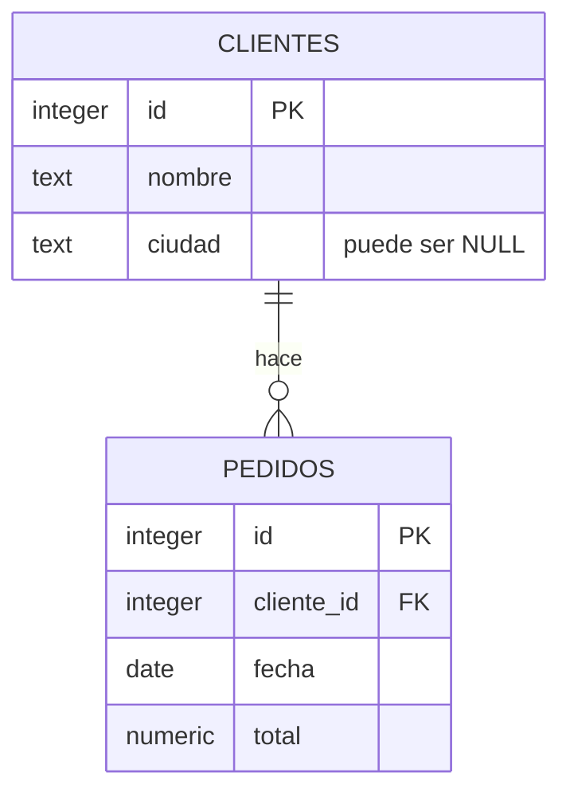
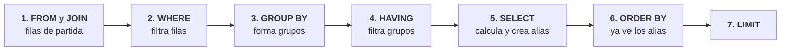
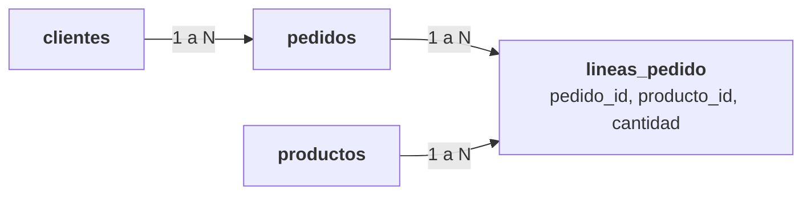

# titulo: SQL y modelado relacional


# El modelo relacional

## Objetivos de aprendizaje

- **1.1** Explicar el modelo relacional y sus elementos: tablas, filas, columnas y claves.
- **1.2** Definir claves primarias y foráneas, y entender la integridad referencial.
- **1.3** Usar restricciones para que la base de datos proteja los datos.
- **1.4** Elegir tipos de datos adecuados, en especial para importes.

## Codd y el modelo relacional

En 1970, Edgar F. Codd, investigador de IBM, publicó *A Relational Model of Data for Large Shared Data Banks*. Su propuesta: organizar los datos en **relaciones** (lo que hoy llamamos tablas) y consultarlos con operaciones sobre conjuntos, **sin** que el programa tenga que saber cómo se guardan físicamente. SQL nació poco después como lenguaje para ese modelo, y hoy lo hablan PostgreSQL, MySQL, Oracle, SQL Server o SQLite.

| Término del modelo | Término habitual |
|---|---|
| Relación | Tabla |
| Tupla | Fila |
| Atributo | Columna |
| Dominio | Tipo de dato |

## Claves

```sql
CREATE TABLE clientes (
    id     integer GENERATED ALWAYS AS IDENTITY PRIMARY KEY,
    nombre text NOT NULL,
    ciudad text
);

CREATE TABLE pedidos (
    id         integer GENERATED ALWAYS AS IDENTITY PRIMARY KEY,
    cliente_id integer NOT NULL REFERENCES clientes(id),
    fecha      date NOT NULL,
    total      numeric(10,2) NOT NULL CHECK (total >= 0)
);
```

- La **clave primaria** (`PRIMARY KEY`) identifica cada fila de forma única y no admite NULL. Aquí es un número generado por la base de datos (`GENERATED ALWAYS AS IDENTITY`): una **clave subrogada**, sin significado de negocio, que no cambia aunque cambien los datos.
- La **clave foránea** (`REFERENCES`) relaciona cada pedido con su cliente. La base de datos garantiza la **integridad referencial**: no deja guardar un pedido de un cliente inexistente.

## Restricciones: la base de datos como última línea de defensa

Las validaciones de la aplicación se pueden saltar (un *script*, otra aplicación, un error). Las **restricciones** las aplica la base de datos a cualquier escritura:

| Restricción | Garantiza |
|---|---|
| `NOT NULL` | Que el valor existe |
| `UNIQUE` | Que no hay duplicados (por ejemplo, el correo de un usuario) |
| `CHECK (total >= 0)` | Una condición sobre la fila |
| `PRIMARY KEY` | `UNIQUE` + `NOT NULL` |
| `REFERENCES` | Que el valor existe en la tabla referenciada |

Comprobado en PostgreSQL 17: insertar un pedido con `cliente_id = 99` falla con `violates foreign key constraint`, y uno con `total = -5` falla con `violates check constraint`.

Un detalle curioso de esa prueba: el pedido rechazado **consumió** un número de la secuencia, y el siguiente pedido recibió un `id` saltándose uno. Las claves generadas **no garantizan números consecutivos**: no las uses como número de factura si la ley exige numeración correlativa.

## Tipos de datos

| Dato | Tipo recomendado | Evitar |
|---|---|---|
| Importes de dinero | `numeric(10,2)` (decimal exacto) | `real` o `double precision`: son binarios y no representan exactamente 0,10 |
| Fechas | `date`; con hora, `timestamptz` | Texto |
| Textos | `text` o `varchar(n)` si hay un máximo de negocio | — |
| Verdadero/falso | `boolean` | Enteros 0/1 o textos «S»/«N» |

## Puntos clave

- Codd propuso el modelo relacional en 1970: tablas, filas y columnas consultadas como conjuntos.
- La clave primaria identifica cada fila; una clave subrogada no tiene significado de negocio y no cambia.
- La clave foránea mantiene la integridad referencial entre tablas.
- Las restricciones protegen los datos frente a cualquier escritura, no solo las de tu aplicación.
- Las secuencias pueden tener huecos.
- Usa `numeric` para el dinero, nunca tipos de coma flotante.

## Referencias

- Wikipedia, [Relational model](https://en.wikipedia.org/wiki/Relational_model) y [Edgar F. Codd](https://en.wikipedia.org/wiki/Edgar_F._Codd).
- PostgreSQL, [Constraints](https://www.postgresql.org/docs/current/ddl-constraints.html).
- PostgreSQL, [Identity columns](https://www.postgresql.org/docs/current/ddl-identity-columns.html).
- PostgreSQL, [Numeric types](https://www.postgresql.org/docs/current/datatype-numeric.html).

# Consultas

## Objetivos de aprendizaje

- **2.1** Combinar tablas con INNER JOIN y LEFT JOIN.
- **2.2** Agregar con GROUP BY y filtrar grupos con HAVING.
- **2.3** Explicar el orden lógico en que se evalúa una consulta.
- **2.4** Manejar correctamente los valores NULL.

## Los datos del ejemplo

| clientes.id | nombre | ciudad |
|---|---|---|
| 1 | Ana | Madrid |
| 2 | Luis | Sevilla |
| 3 | Marta | NULL |
| 4 | Pablo | Madrid |

| pedidos.id | cliente_id | fecha | total |
|---|---|---|---|
| 1 | 1 | 2026-10-01 | 120.00 |
| 2 | 1 | 2026-10-15 | 80.00 |
| 3 | 2 | 2026-10-03 | 45.50 |
| 4 | 4 | 2026-11-02 | 300.00 |

Todos los resultados de esta lección se han obtenido ejecutando las consultas en PostgreSQL 17.



```nodos
CLIENTES:
  titulo: clientes
  texto: Cuatro filas. Marta no tiene ciudad (NULL) y no tiene pedidos, dos casos que cambian los resultados de los JOIN y de las agregaciones.
PEDIDOS:
  concepto: clave-foranea
```

## JOIN

```sql
SELECT c.nombre, p.total
FROM clientes c
JOIN pedidos p ON p.cliente_id = c.id;
```

`JOIN` (o `INNER JOIN`) devuelve solo las parejas que cumplen la condición: Ana aparece dos veces (dos pedidos), y **Marta no aparece**, porque no tiene pedidos.

`LEFT JOIN` conserva todas las filas de la tabla de la izquierda; si no hay pareja, las columnas de la derecha salen a NULL. Es la forma de encontrar «los que no tienen»:

```sql
SELECT c.nombre
FROM clientes c
LEFT JOIN pedidos p ON p.cliente_id = c.id
WHERE p.id IS NULL;          -- Marta
```

## Agregar

```sql
SELECT c.nombre, count(*) AS n, sum(p.total) AS gastado
FROM clientes c
JOIN pedidos p ON p.cliente_id = c.id
GROUP BY c.nombre
HAVING sum(p.total) > 100
ORDER BY gastado DESC;
-- Pablo | 1 | 300.00
-- Ana   | 2 | 200.00
```

- `GROUP BY` forma un grupo por cliente; las funciones de agregado (`count`, `sum`, `avg`) resumen cada grupo.
- `WHERE` filtra **filas** antes de agrupar; `HAVING` filtra **grupos** después.

Para contar pedidos incluyendo a quien no tiene ninguno, combina `LEFT JOIN` con `count(p.id)`, no `count(*)`: `count(columna)` ignora los NULL, así que Marta sale con 0. Con `count(*)` saldría con 1, porque cuenta la fila de NULL que añade el LEFT JOIN.

## Orden lógico de evaluación

Se escribe en un orden, pero se evalúa en otro:

| Orden de escritura | Orden lógico |
|---|---|
| `SELECT` | 1. `FROM` y `JOIN` |
| `FROM` / `JOIN` | 2. `WHERE` |
| `WHERE` | 3. `GROUP BY` |
| `GROUP BY` | 4. `HAVING` |
| `HAVING` | 5. `SELECT` |
| `ORDER BY` | 6. `ORDER BY` |
| `LIMIT` | 7. `LIMIT` |

Esto explica errores habituales: no puedes usar en `WHERE` un alias definido en `SELECT` (todavía no existe), ni una función de agregado (todavía no hay grupos; para eso está `HAVING`). En cambio, `ORDER BY` sí ve los alias.



```nodos
F:
  concepto: join
W:
  titulo: WHERE
  texto: Aún no existen los alias del SELECT ni los grupos, así que aquí no se pueden usar ni alias ni funciones de agregado.
G:
  concepto: agregacion
H:
  titulo: HAVING
  texto: Filtra grupos ya formados. Es donde va una condición sobre COUNT o SUM.
S:
  titulo: SELECT
  texto: Se escribe primero, pero se evalúa en quinto lugar. Aquí nacen los alias.
O:
  titulo: ORDER BY
  texto: Va después del SELECT, por eso sí puede usar sus alias.
L:
  titulo: LIMIT
  texto: Lo último. Recorta el resultado ya ordenado.
```

## NULL: lógica de tres valores

NULL significa «desconocido». Cualquier comparación con NULL da **desconocido**, que `WHERE` trata como falso:

```sql
SELECT NULL = NULL;                         -- NULL (desconocido), no true
SELECT nombre FROM clientes WHERE ciudad <> 'Madrid';   -- solo Luis
```

La segunda consulta **no devuelve a Marta**, aunque su ciudad no es Madrid: `NULL <> 'Madrid'` es desconocido. Para incluirla hay que decirlo: `WHERE ciudad <> 'Madrid' OR ciudad IS NULL` (o `ciudad IS DISTINCT FROM 'Madrid'`).

| Expresión | Resultado |
|---|---|
| `count(*)` en clientes | 4 (cuenta filas) |
| `count(ciudad)` en clientes | 3 (ignora NULL) |
| `NULL IS NULL` | true |

## Puntos clave

- `INNER JOIN` devuelve solo las parejas; `LEFT JOIN` conserva las filas de la izquierda sin pareja.
- `LEFT JOIN … WHERE derecha.id IS NULL` encuentra lo que no tiene relación.
- `WHERE` filtra filas antes de agrupar; `HAVING` filtra grupos después.
- El orden lógico es FROM, WHERE, GROUP BY, HAVING, SELECT, ORDER BY, LIMIT.
- Toda comparación con NULL da desconocido: usa `IS NULL` o `IS DISTINCT FROM`.
- `count(*)` cuenta filas; `count(columna)` ignora los NULL.

## Referencias

- PostgreSQL, [Joins between tables](https://www.postgresql.org/docs/current/tutorial-join.html).
- PostgreSQL, [Table expressions](https://www.postgresql.org/docs/current/queries-table-expressions.html).
- PostgreSQL, [Comparison functions and operators](https://www.postgresql.org/docs/current/functions-comparison.html).
- PostgreSQL, [Aggregate functions](https://www.postgresql.org/docs/current/functions-aggregate.html).

# Normalización y modelado

## Objetivos de aprendizaje

- **3.1** Representar relaciones uno a muchos y muchos a muchos.
- **3.2** Identificar las anomalías que causa la redundancia.
- **3.3** Aplicar la primera, segunda y tercera forma normal.
- **3.4** Decidir cuándo desnormalizar.

## Cardinalidades

| Relación | Ejemplo | Cómo se modela |
|---|---|---|
| Uno a muchos | Un cliente tiene muchos pedidos | Clave foránea en el lado «muchos» (`pedidos.cliente_id`) |
| Muchos a muchos | Un pedido tiene muchos productos y un producto está en muchos pedidos | **Tabla intermedia** (`lineas_pedido`) con dos claves foráneas |
| Uno a uno | Un usuario y su perfil fiscal | Clave foránea única, o la misma clave primaria en ambas tablas |



```nodos
C:
  titulo: clientes
  texto: Cada cliente aparece una sola vez.
P:
  titulo: pedidos
  texto: Cada pedido apunta a su cliente con una clave foránea.
L:
  titulo: Tabla intermedia
  texto: Resuelve la relación muchos a muchos entre pedidos y productos, y guarda los datos de la relación, como la cantidad o el precio aplicado.
PR:
  titulo: productos
  texto: El catálogo, con un solo registro por producto.
```

## El problema de la redundancia

Imagina una única tabla con todo:

| pedido | fecha | cliente | ciudad_cliente | producto | precio |
|---|---|---|---|---|---|
| 1 | 2026-10-01 | Ana | Madrid | Libro | 20 |
| 1 | 2026-10-01 | Ana | Madrid | Lámpara | 35 |
| 2 | 2026-10-15 | Ana | Madrid | Libro | 20 |

La ciudad de Ana y el precio del libro se repiten. Eso causa **anomalías**:

- **De actualización:** si Ana se muda, hay que cambiar varias filas; si se olvida una, los datos se contradicen.
- **De inserción:** no se puede dar de alta un producto que todavía no se ha vendido.
- **De borrado:** al borrar el último pedido de Ana, se pierde que existe Ana.

## Las tres primeras formas normales

Codd definió la primera forma normal en 1970, y la segunda y la tercera en 1971. Cada una exige la anterior:

| Forma normal | Regla | Se incumple si… |
|---|---|---|
| **1FN** | Cada celda tiene un valor atómico; no hay grupos repetidos | Una columna `telefonos` guarda «600…, 611…», o hay columnas `producto1`, `producto2`… |
| **2FN** | Cada columna depende de la clave **completa**, no de una parte | En `lineas_pedido(pedido_id, producto_id, cantidad, nombre_producto)`, `nombre_producto` depende solo de `producto_id` |
| **3FN** | Las columnas que no son clave no dependen de otras que no son clave | En `clientes(id, codigo_postal, ciudad)`, la ciudad depende del código postal, no del cliente |

Una forma de recordarlo: cada dato depende «de la clave, de toda la clave y de nada más que la clave».

## Desnormalizar con criterio

Normalizar elimina redundancia, pero puede obligar a muchos JOIN en las consultas más frecuentes. A veces se **desnormaliza** a propósito:

| Caso | Por qué está justificado |
|---|---|
| Guardar en la línea del pedido el **precio aplicado** | No es redundancia: es un dato histórico. Si mañana cambia el precio del catálogo, el pedido debe conservar el que se cobró |
| Guardar el total del pedido calculado | Evita sumar las líneas en cada listado, a cambio de mantenerlo coherente |
| Tablas de informes o vistas materializadas | Las lecturas analíticas no deben cargar la base de datos operativa |

La regla: **normaliza por defecto y desnormaliza cuando haya un motivo medido**, sabiendo quién mantiene la copia coherente.

## Puntos clave

- Uno a muchos: clave foránea en el lado «muchos». Muchos a muchos: tabla intermedia.
- La redundancia causa anomalías de actualización, inserción y borrado.
- 1FN: valores atómicos. 2FN: dependencia de la clave completa. 3FN: sin dependencias entre columnas que no son clave.
- Guardar el precio aplicado en el pedido no es redundancia, es historia.
- Se desnormaliza por un motivo medido y con un responsable de la coherencia.

## Referencias

- Wikipedia, [Database normalization](https://en.wikipedia.org/wiki/Database_normalization).
- PostgreSQL, [Constraints](https://www.postgresql.org/docs/current/ddl-constraints.html) (claves foráneas).

# Índices

## Objetivos de aprendizaje

- **4.1** Explicar qué es un índice y qué coste tiene.
- **4.2** Leer un plan de ejecución con EXPLAIN.
- **4.3** Diseñar índices de varias columnas según las consultas.
- **4.4** Reconocer cuándo un índice no se aprovecha.

## Qué es un índice

Sin índice, para encontrar los pedidos de un cliente la base de datos **recorre toda la tabla** (*sequential scan*). Un **índice**, normalmente un **árbol B** (*B-tree*), mantiene los valores de una o varias columnas ordenados y con un puntero a cada fila, de modo que la búsqueda es logarítmica en lugar de lineal.

No sale gratis:

- Ocupa espacio.
- Cada `INSERT`, `UPDATE` o `DELETE` tiene que actualizar **todos** los índices de la tabla.

Por eso no se indexan todas las columnas: se indexan las que usan las consultas importantes. Las claves primarias y las restricciones `UNIQUE` crean su índice automáticamente; las **claves foráneas no** en PostgreSQL, y suele convenir indexarlas.

## EXPLAIN

`EXPLAIN` muestra cómo piensa ejecutar el motor una consulta. Con una tabla `ventas` de 200 000 filas, en PostgreSQL 17:

```sql
EXPLAIN SELECT * FROM ventas WHERE cliente_id = 42;
-- Seq Scan on ventas  (cost=0.00..3780.00 rows=199 width=17)
--   Filter: (cliente_id = 42)

CREATE INDEX ventas_cliente_fecha ON ventas (cliente_id, fecha);

EXPLAIN SELECT * FROM ventas WHERE cliente_id = 42;
-- Bitmap Heap Scan on ventas  (cost=5.84..537.33 rows=199 width=17)
--   ->  Bitmap Index Scan on ventas_cliente_fecha  (cost=0.00..5.79 rows=199 width=0)
--         Index Cond: (cliente_id = 42)
```

El coste estimado baja de 3780 a unos 537. `EXPLAIN ANALYZE` además ejecuta la consulta y muestra los tiempos reales.

## Índices de varias columnas

El orden de las columnas importa. La documentación de PostgreSQL lo resume así: un índice de árbol B de varias columnas puede usarse con condiciones sobre cualquier subconjunto de ellas, pero **es más eficiente cuando hay condiciones sobre las primeras columnas (las de la izquierda)**.

En la prueba, con el índice `(cliente_id, fecha)` y una consulta que filtra **solo por `fecha`**, PostgreSQL 17 usó el índice, pero recorriéndolo entero: el coste de esa parte pasó de unos 6 a unos 2176. Algunas versiones y motores aplican además una optimización de **salto** (*skip scan*) que reduce ese recorrido. Pero la regla práctica se mantiene: **pon primero las columnas que filtras por igualdad en las consultas más frecuentes**.

| Consulta | ¿Aprovecha bien `(cliente_id, fecha)`? |
|---|---|
| `WHERE cliente_id = 42` | Sí |
| `WHERE cliente_id = 42 AND fecha >= '2026-03-01'` | Sí, las dos columnas |
| `WHERE fecha = '2026-03-01'` | Peor: recorre el índice entero (o depende del *skip scan*) |

## Cuándo no se usa un índice

- **Funciones u operaciones sobre la columna.** `WHERE cliente_id + 0 = 42` o `WHERE lower(email) = …` no pueden usar un índice normal sobre la columna: en la prueba, PostgreSQL volvió a recorrer la tabla. La solución es reescribir la condición o crear un **índice sobre la expresión** (`CREATE INDEX ON usuarios (lower(email))`).
- **Condiciones poco selectivas.** `WHERE cliente_id > 10` devuelve casi todas las filas (198 026 de 200 000), y recorrer la tabla es más barato que saltar del índice a cada fila: el planificador eligió *Seq Scan*. La **selectividad** decide.
- **Tipos que no coinciden**, o patrones como `LIKE '%texto'` con el comodín al principio.

## Puntos clave

- Un índice (normalmente un árbol B) evita recorrer la tabla, pero ocupa espacio y encarece las escrituras.
- Las claves primarias y los `UNIQUE` crean índice; en PostgreSQL, las claves foráneas no.
- `EXPLAIN` muestra el plan; `EXPLAIN ANALYZE` lo ejecuta y mide.
- En un índice de varias columnas, el orden importa: primero las columnas filtradas por igualdad.
- Las funciones sobre la columna y las condiciones poco selectivas suelen impedir que se use el índice.

## Referencias

- PostgreSQL, [Index types](https://www.postgresql.org/docs/current/indexes-types.html).
- PostgreSQL, [Multicolumn indexes](https://www.postgresql.org/docs/current/indexes-multicolumn.html).
- PostgreSQL, [Indexes on expressions](https://www.postgresql.org/docs/current/indexes-expressional.html).
- PostgreSQL, [Using EXPLAIN](https://www.postgresql.org/docs/current/using-explain.html).

# SQL avanzado

## Objetivos de aprendizaje

- **5.1** Simplificar consultas complejas con CTE (WITH).
- **5.2** Calcular acumulados y rankings con funciones de ventana.
- **5.3** Insertar o actualizar en una sola orden (upsert).
- **5.4** Elegir entre JOIN, subconsultas y EXISTS.

Las consultas de esta lección se han ejecutado en PostgreSQL 17 con los datos de la lección de consultas.

## CTE: consultas con nombre

Una **CTE** (*Common Table Expression*) define con `WITH` una consulta auxiliar con nombre que se usa como una tabla:

```sql
WITH gasto AS (
    SELECT cliente_id, sum(total) AS total
    FROM pedidos
    GROUP BY cliente_id
)
SELECT c.nombre, g.total
FROM gasto g
JOIN clientes c ON c.id = g.cliente_id
WHERE g.total > (SELECT avg(total) FROM gasto);
-- Ana   | 200.00
-- Pablo | 300.00      (la media de gasto es 181,83)
```

Las CTE hacen legible lo que con subconsultas anidadas sería difícil de seguir. Con `WITH RECURSIVE` permiten recorrer jerarquías (categorías, organigramas).

## Funciones de ventana

Una **función de ventana** calcula un valor para cada fila a partir de un grupo de filas relacionadas, **sin agruparlas** (a diferencia de `GROUP BY`, que devuelve una fila por grupo):

```sql
SELECT c.nombre, p.fecha, p.total,
       sum(p.total) OVER (PARTITION BY c.id ORDER BY p.fecha) AS acumulado,
       rank()       OVER (ORDER BY p.total DESC)               AS puesto
FROM clientes c
JOIN pedidos p ON p.cliente_id = c.id
ORDER BY puesto;
```

| nombre | fecha | total | acumulado | puesto |
|---|---|---|---|---|
| Pablo | 2026-11-02 | 300.00 | 300.00 | 1 |
| Ana | 2026-10-01 | 120.00 | 120.00 | 2 |
| Ana | 2026-10-15 | 80.00 | 200.00 | 3 |
| Luis | 2026-10-03 | 45.50 | 45.50 | 4 |

- `PARTITION BY` divide las filas en grupos (por cliente) sin juntarlas.
- `ORDER BY` dentro de `OVER` define el orden: con `sum`, da un **total acumulado**.
- Otras funciones útiles: `row_number()`, `rank()`, `lag()` y `lead()` (fila anterior y siguiente).

## Upsert

Insertar, o actualizar si ya existe, en una sola orden **atómica**:

```sql
INSERT INTO stock (producto, unidades) VALUES ('libro', 3)
ON CONFLICT (producto)
DO UPDATE SET unidades = stock.unidades + EXCLUDED.unidades;
-- si había 5, queda 8
```

`EXCLUDED` es la fila que se intentaba insertar. Hacerlo en dos pasos (consultar y luego insertar o actualizar) tiene una **condición de carrera**: dos peticiones simultáneas pueden ver «no existe» e intentar insertar las dos.

## JOIN, subconsulta o EXISTS

| Pregunta | Forma natural |
|---|---|
| Datos de las dos tablas | `JOIN` |
| «Clientes que tienen algún pedido» | `WHERE EXISTS (SELECT 1 FROM pedidos p WHERE p.cliente_id = c.id)` |
| «Clientes que no tienen pedidos» | `NOT EXISTS (…)` o `LEFT JOIN … IS NULL` |
| Comparar con un valor calculado | Subconsulta escalar: `total > (SELECT avg(total) FROM pedidos)` |

Cuidado con `NOT IN` y los NULL: si la subconsulta devuelve algún NULL, `x NOT IN (…)` nunca es verdadero, por la lógica de tres valores. `NOT EXISTS` no tiene ese problema.

## Puntos clave

- `WITH` da nombre a consultas auxiliares y hace legibles las complejas; `WITH RECURSIVE` recorre jerarquías.
- Las funciones de ventana calculan por fila sobre un grupo, sin agrupar: acumulados, rankings, fila anterior.
- `INSERT … ON CONFLICT DO UPDATE` es un upsert atómico, sin condiciones de carrera.
- `EXISTS` responde «¿tiene alguno?»; prefiere `NOT EXISTS` a `NOT IN` cuando puede haber NULL.

## Referencias

- PostgreSQL, [WITH queries](https://www.postgresql.org/docs/current/queries-with.html).
- PostgreSQL, [Window functions](https://www.postgresql.org/docs/current/tutorial-window.html).
- PostgreSQL, [INSERT](https://www.postgresql.org/docs/current/sql-insert.html) (`ON CONFLICT`).
- PostgreSQL, [Subquery expressions](https://www.postgresql.org/docs/current/functions-subquery.html).
