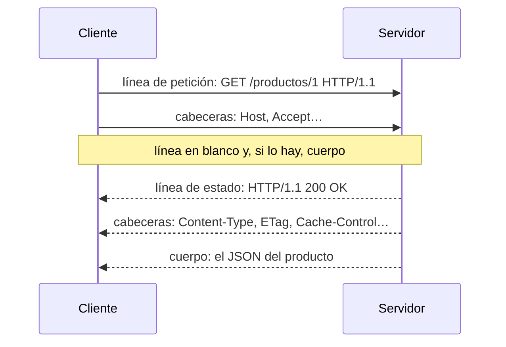
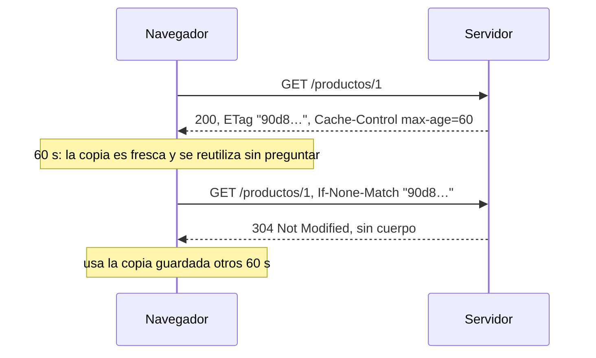
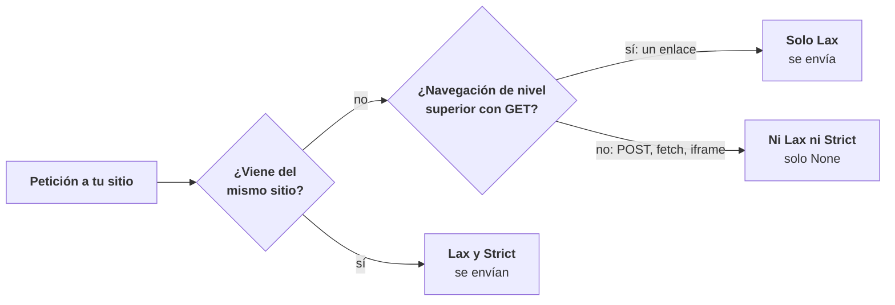
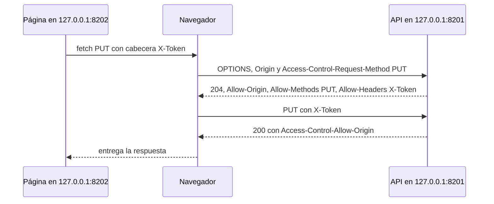
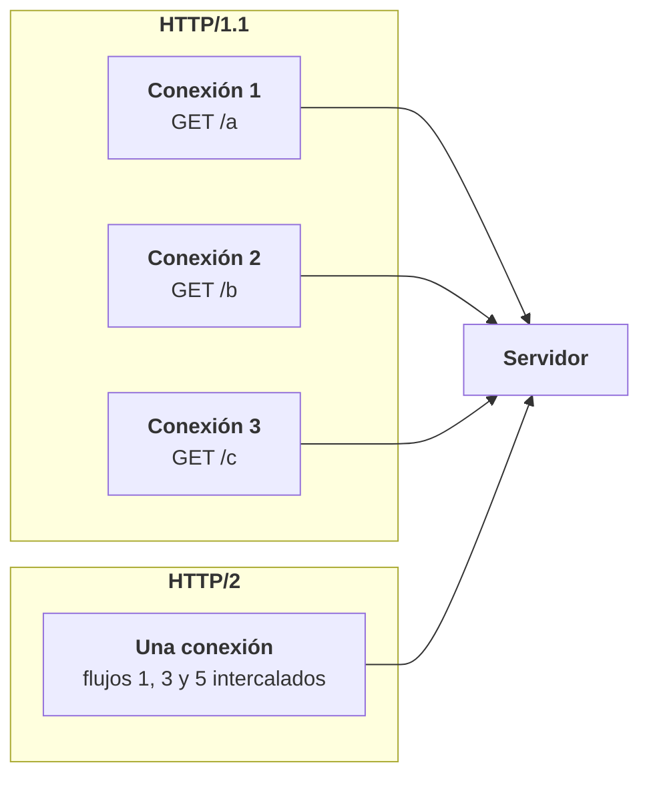
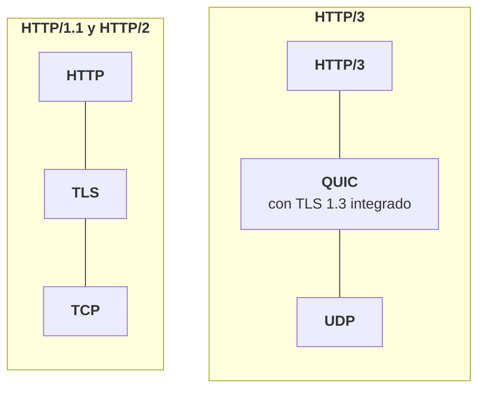

# titulo: HTTP y la web


# Peticiones y respuestas

## Objetivos de aprendizaje

- **1.1** Describir las partes de una petición y de una respuesta HTTP.
- **1.2** Elegir el método según su semántica: seguro, idempotente o ninguno de los dos.
- **1.3** Interpretar los códigos de estado por su clase y distinguir los más habituales.
- **1.4** Inspeccionar el tráfico HTTP con curl.

Todo lo que se muestra aquí se ha comprobado con curl 8.18 contra un pequeño servidor escrito con la biblioteca estándar de Python. La semántica de HTTP (métodos, códigos y cabeceras) se define en el **RFC 9110** y es la misma en HTTP/1.1, HTTP/2 y HTTP/3. Lo que cambia entre versiones es cómo viajan los mensajes (lección 5).

## Un intercambio completo

HTTP es un protocolo de **petición y respuesta**: el cliente pide y el servidor contesta. Con `curl -v` se ve el intercambio en HTTP/1.1, donde los mensajes son texto:

```text
> GET /productos/1 HTTP/1.1
> Host: 127.0.0.1:8201
> User-Agent: curl/8.18.0
> Accept: */*
>
< HTTP/1.1 200 OK
< Content-Type: application/json
< ETag: "90d8299fa0d86f5d"
< Cache-Control: max-age=60
< Content-Length: 47
<
{"id": 1, "nombre": "Bicicleta", "precio": 300}
```



```nodos
C:
  titulo: Cliente
  texto: Un navegador, curl u otro servicio. Indica el método, el recurso y, en HTTP/1.1, el host, que es obligatorio.
S:
  concepto: http
```

| Parte | En la petición | En la respuesta |
|---|---|---|
| Primera línea | Método, destino y versión | Versión, código de estado y frase |
| Cabeceras | `Host`, `Accept`, `Authorization`, `Cookie`… | `Content-Type`, `Cache-Control`, `Set-Cookie`… |
| Cuerpo | Opcional: los datos de un POST o un PUT | La representación del recurso, si la hay |

Cada petición es **independiente**: HTTP no tiene estado. Para recordar quién es el usuario entre peticiones hacen falta cookies o tokens (lección 3).

## Métodos

El método dice qué se pide hacer con el recurso. El RFC 9110 define dos propiedades que importan en la práctica:

- **Seguro:** de solo lectura. El cliente no pide ningún cambio.
- **Idempotente:** repetir la petición tiene el mismo efecto que hacerla una vez. Un cliente puede reintentarla si no sabe si llegó.

| Método | Uso | Seguro | Idempotente |
|---|---|---|---|
| `GET` | Obtener una representación | Sí | Sí |
| `HEAD` | Como GET, pero solo las cabeceras | Sí | Sí |
| `OPTIONS` | Qué admite el recurso | Sí | Sí |
| `POST` | Procesar datos: crear, enviar un formulario… | No | No |
| `PUT` | Crear o sustituir el recurso entero | No | Sí |
| `DELETE` | Borrar el recurso | No | Sí |
| `PATCH` | Modificar parte del recurso (RFC 5789) | No | No, en general |

`DELETE` es idempotente aunque la segunda llamada devuelva otro código: lo que cuenta es el **efecto** en el servidor, que tras la primera ya está borrado. `POST`, en cambio, puede crear un pedido nuevo en cada intento; por eso un pago o un pedido necesitan una clave de idempotencia propia si se quieren reintentar.

Un `GET` que cambia estado (`/borrar?id=3`) rompe el contrato: los navegadores lo precargan, los rastreadores lo siguen y las cachés lo repiten.

## Códigos de estado

La primera cifra da la **clase**. Un cliente que no conoce un código concreto lo trata como el `x00` de su clase.

| Clase | Significado | Ejemplos |
|---|---|---|
| 1xx | Informativo | `100 Continue` |
| 2xx | Éxito | `200 OK`, `201 Created`, `204 No Content` |
| 3xx | Redirección | `301`, `302`, `304 Not Modified`, `307`, `308` |
| 4xx | Error del cliente | `400`, `401`, `403`, `404`, `405`, `409`, `429` |
| 5xx | Error del servidor | `500`, `502`, `503`, `504` |

Respuestas reales del servidor de prueba:

```text
POST /productos  {"nombre":"Casco","precio":40}  →  201 Created, Location: /productos/2
POST /productos  no es json                      →  400, {"error":"JSON no valido"}
GET  /productos/9                                →  404, {"error":"no existe"}
PUT  /productos/1                                →  405 Method Not Allowed, Allow: GET, HEAD
DELETE /productos/2                              →  204 No Content
GET  /antigua                                    →  301 Moved Permanently, Location: /productos/1
```

Parejas que se confunden a menudo:

| Pareja | Diferencia |
|---|---|
| `401` y `403` | `401`: no hay credenciales válidas (el servidor debe indicar cómo autenticarse con `WWW-Authenticate`). `403`: se sabe quién eres, pero no tienes permiso |
| `301`/`302` y `308`/`307` | Las cuatro redirigen. `308` y `307` prohíben cambiar el método; con `301` y `302` los clientes pueden pasar un POST a GET |
| `400` y `422` | `400`: la petición está mal formada. `422`: se entiende, pero su contenido no es válido |
| `500` y `503` | `500`: error inesperado. `503`: el servidor no puede atender ahora, a menudo con `Retry-After` |

## Inspeccionar con curl

| Opción | Qué hace |
|---|---|
| `-v` | Muestra la petición (`>`) y la respuesta (`<`) con sus cabeceras |
| `-i` | Incluye las cabeceras de la respuesta en la salida |
| `-I` | Hace un `HEAD`: solo cabeceras |
| `-X MÉTODO` | Cambia el método de la petición |
| `-d datos` | Envía un cuerpo, y por defecto usa POST |
| `-H 'Cabecera: valor'` | Añade una cabecera |
| `-L` | Sigue las redirecciones |
| `-w '%{http_code}'` | Imprime datos de la transferencia, como el código |

Una trampa comprobada: `curl -X HEAD url` **se queda esperando**. Cambia la palabra del método, pero curl sigue esperando el cuerpo que anuncia `Content-Length`, y un HEAD nunca lo trae. El manual de curl lo advierte: para un HEAD se usa `-I`.

## Puntos clave

- Una petición tiene método, destino, cabeceras y cuerpo opcional; una respuesta, código de estado, cabeceras y cuerpo.
- HTTP no tiene estado: cada petición se entiende sola.
- Los métodos seguros solo leen. Los idempotentes se pueden repetir sin cambiar el resultado: GET, HEAD, OPTIONS, PUT y DELETE, pero no POST.
- Un GET nunca debe cambiar estado.
- La primera cifra del código da la clase: 2xx éxito, 3xx redirección, 4xx error del cliente y 5xx error del servidor.
- 401 es «no sé quién eres» y 403 es «sé quién eres y no puedes».
- `curl -v` muestra el intercambio completo; para un HEAD se usa `-I`, no `-X HEAD`.

## Referencias

- IETF, [RFC 9110: HTTP Semantics](https://www.rfc-editor.org/rfc/rfc9110) (métodos, propiedades y códigos de estado).
- IETF, [RFC 9112: HTTP/1.1](https://www.rfc-editor.org/rfc/rfc9112) (formato de los mensajes).
- MDN, [HTTP response status codes](https://developer.mozilla.org/en-US/docs/Web/HTTP/Reference/Status).
- curl, [manual de curl](https://curl.se/docs/manpage.html).

# Cabeceras y caché

## Objetivos de aprendizaje

- **2.1** Usar las cabeceras de representación y de negociación: Content-Type, Accept y la compresión.
- **2.2** Controlar la caché con Cache-Control y distinguir max-age, no-cache, no-store, private y public.
- **2.3** Revalidar una respuesta con ETag o Last-Modified y entender el 304.
- **2.4** Saber qué hace Vary y por qué importa en las cachés compartidas.

La caché se define en el **RFC 9111**, y las peticiones condicionales, en el RFC 9110. Los resultados son de curl 8.18 y de Chromium contra el servidor de prueba de la lección anterior.

## Representación y negociación

Un recurso puede tener varias **representaciones** (JSON o HTML, en español o en inglés, comprimida o no). Las cabeceras dicen cuál se pide y cuál se envía:

| Cabecera | Quién la envía | Para qué |
|---|---|---|
| `Content-Type` | Quien envía un cuerpo | Formato del cuerpo: `application/json`, `text/html; charset=utf-8` |
| `Accept` | Cliente | Formatos que acepta, con preferencia opcional (`q=0.8`) |
| `Accept-Encoding` / `Content-Encoding` | Cliente / servidor | Compresión aceptada y usada: `gzip`, `br`, `zstd` |
| `Accept-Language` / `Content-Language` | Cliente / servidor | Idioma pedido y servido |
| `Content-Length` | Quien envía un cuerpo | Tamaño del cuerpo en bytes |

Un error habitual es enviar JSON sin `Content-Type: application/json`: muchos servidores no lo interpretan como JSON y responden 400 o 415 (*Unsupported Media Type*).

## Cache-Control

Guardar una respuesta y reutilizarla ahorra viajes y carga. La cabecera **`Cache-Control`** de la respuesta dice cómo:

| Directiva | Significado |
|---|---|
| `max-age=60` | La respuesta es **fresca** durante 60 segundos: se puede reutilizar sin preguntar |
| `no-cache` | Se puede guardar, pero hay que **revalidarla** con el servidor antes de cada uso |
| `no-store` | No se debe guardar en ninguna caché |
| `private` | Solo la caché del propio usuario (el navegador); no un proxy o una CDN |
| `public` | Cualquier caché puede guardarla, incluidas las compartidas |
| `s-maxage=300` | Como `max-age`, pero solo para las cachés compartidas |
| `must-revalidate` | Una vez caducada, no se puede servir sin revalidar, ni siquiera si el servidor no responde |

La confusión más frecuente es `no-cache` frente a `no-store`. **`no-cache` no impide guardar**: obliga a preguntar antes de reutilizar. Para datos sensibles (una página con datos bancarios) la directiva correcta es `no-store`.

En Chromium, con `Cache-Control: max-age=60` en `/productos/1`:

```text
1.º fetch                        → llega al servidor
2.º fetch, dentro de max-age     → no llega: lo sirve la caché del navegador
3.º fetch con cache: 'no-cache'  → llega con If-None-Match; el servidor responde 304
4.º fetch con cache: 'no-store'  → llega sin condiciones; respuesta completa
```

Los cuatro devolvieron 200 a JavaScript: cuando el servidor contesta 304, el navegador entrega la copia que tenía.

## Revalidar: ETag, Last-Modified y 304

Cuando una respuesta deja de ser fresca, no hace falta descargarla otra vez si no ha cambiado. El cliente hace una **petición condicional** con el validador que recibió:

| Validador en la respuesta | Condición en la petición | Comparación |
|---|---|---|
| `ETag: "90d8299fa0d86f5d"` | `If-None-Match: "90d8299fa0d86f5d"` | ¿Sigue siendo la misma versión? |
| `Last-Modified: Sat, 21 Nov 2026 00:50:19 GMT` | `If-Modified-Since: …` | ¿Ha cambiado desde esa fecha? |

Si no ha cambiado, el servidor responde **304 Not Modified sin cuerpo**:

```text
GET /productos/1  If-None-Match: "90d8299fa0d86f5d"  →  304 Not Modified, Content-Length: 0
GET /productos/1  If-None-Match: "otro"              →  200 OK, con el producto
```



```nodos
N:
  concepto: peticion-condicional
S:
  concepto: etag
```

El ETag es preferible a la fecha: `Last-Modified` tiene precisión de segundos y un fichero puede cambiar dos veces en el mismo segundo. Un ETag que empieza por `W/` es **débil**: indica equivalencia, no igualdad byte a byte (por ejemplo, la misma página comprimida de dos formas).

## Vary y las cachés compartidas

Entre el navegador y el servidor puede haber **cachés compartidas**: un proxy inverso, una CDN. Guardan una respuesta y la sirven a muchos usuarios. La cabecera **`Vary`** les dice qué cabeceras de la petición cambian la respuesta:

```text
Vary: Accept-Encoding
```

Con ella, la caché guarda una copia comprimida con `br` y otra sin comprimir, y sirve a cada cliente la que pidió. Sin `Vary`, podría entregar la versión comprimida a un cliente que no sabe descomprimirla.

Dos riesgos al diseñar la caché:

- Una respuesta con datos de un usuario no debe acabar en una caché compartida: marca `private` (o `no-store`).
- `Vary: Cookie` o `Vary: User-Agent` producen casi una copia por usuario y anulan el beneficio de la caché.

## Puntos clave

- `Content-Type` dice qué se envía; `Accept`, qué se acepta.
- `max-age` da un tiempo de frescura en el que la copia se usa sin preguntar.
- `no-cache` permite guardar, pero obliga a revalidar; `no-store` prohíbe guardar.
- `private` excluye las cachés compartidas; úsalo con cualquier respuesta que dependa del usuario.
- Una petición condicional con `If-None-Match` o `If-Modified-Since` recibe 304 sin cuerpo si nada ha cambiado.
- El ETag es más preciso que `Last-Modified`.
- `Vary` indica qué cabeceras de la petición cambian la respuesta, para que una caché compartida no mezcle versiones.

## Referencias

- IETF, [RFC 9111: HTTP Caching](https://www.rfc-editor.org/rfc/rfc9111).
- IETF, [RFC 9110: HTTP Semantics](https://www.rfc-editor.org/rfc/rfc9110), secciones 8.8 (validadores) y 13 (peticiones condicionales).
- MDN, [HTTP caching](https://developer.mozilla.org/en-US/docs/Web/HTTP/Guides/Caching).

# Cookies y sesiones

## Objetivos de aprendizaje

- **3.1** Explicar cómo las cookies dan estado a un protocolo que no lo tiene.
- **3.2** Configurar los atributos de una cookie: Domain, Path, Expires y Max-Age, Secure y HttpOnly.
- **3.3** Elegir el valor de SameSite y predecir cuándo envía el navegador la cookie.
- **3.4** Comparar una sesión con cookie y un token en la cabecera Authorization.

Las cookies se definen en el **RFC 6265**. El atributo `SameSite` y los prefijos de nombre vienen de su revisión, **rfc6265bis**: a noviembre de 2026 el IETF ya la ha aprobado y espera número de RFC en la cola del RFC Editor, y los navegadores ya la aplican. Los resultados son de Chromium contra el servidor de prueba.

## Estado sobre un protocolo sin estado

HTTP no recuerda nada entre peticiones. La cookie lo resuelve así:

1. El servidor responde con `Set-Cookie: sesion=abc123; Path=/; HttpOnly; SameSite=Lax`.
2. El navegador la guarda.
3. En las peticiones siguientes al mismo sitio, la reenvía: `Cookie: sesion=abc123`.

Con eso el servidor reconoce al usuario: busca `abc123` en su almacén de sesiones. El valor debe ser **aleatorio e imposible de adivinar**, y no debe contener datos que el usuario pueda cambiar (como `rol=admin`).

## Atributos

| Atributo | Efecto |
|---|---|
| `Expires=fecha` / `Max-Age=segundos` | Cuándo caduca. Sin ninguno de los dos es una **cookie de sesión**: se borra al cerrar el navegador |
| `Domain=tienda.example` | La envía también a los subdominios. Sin `Domain`, solo al host exacto que la creó, que es lo más restrictivo |
| `Path=/` | Solo en las rutas que empiezan así. No es una barrera de seguridad |
| `Secure` | Solo por HTTPS |
| `HttpOnly` | JavaScript no la ve en `document.cookie`, aunque se sigue enviando en las peticiones |
| `SameSite=Strict\|Lax\|None` | Si se envía en peticiones que vienen de otro sitio (ver abajo) |

`HttpOnly` comprobado: con `sesion` marcada como `HttpOnly` y `estricta` sin marcar, `document.cookie` en la página del sitio devolvió solo `"estricta=1"`, aunque el servidor recibió las dos. Si un atacante consigue ejecutar JavaScript en la página (XSS), no puede leer la cookie de sesión.

Los **prefijos** de rfc6265bis añaden garantías que el navegador comprueba: una cookie `__Host-sesion` solo se acepta con `Secure`, `Path=/` y sin `Domain`, así que no puede fijarla un subdominio.

## SameSite

Un **sitio** es el esquema más el dominio registrable: `https://tienda.example` y `https://api.tienda.example` son del mismo sitio, aunque de distinto origen (lección 4). En la prueba se usaron `127.0.0.1` y `localhost`, que son sitios distintos.

| Valor | Se envía desde otro sitio |
|---|---|
| `Strict` | No. Ni siquiera al seguir un enlace |
| `Lax` | Solo en navegaciones de nivel superior con métodos seguros (seguir un enlace con GET) |
| `None` | Sí, siempre. Exige `Secure` |

El servidor fijó `sesion` con `SameSite=Lax` y `estricta` con `SameSite=Strict`. Lo que recibió en cada caso:

```text
desde el mismo sitio, GET               →  sesion=abc123; estricta=1
desde otro sitio, siguiendo un enlace   →  sesion=abc123
desde otro sitio, formulario POST       →  sin cookie
desde otro sitio, fetch con credentials →  sin cookie
```



```nodos
P:
  titulo: Petición
  texto: El navegador decide qué cookies adjunta según de dónde parte la petición y de qué tipo es.
MS:
  titulo: ¿Mismo sitio?
  texto: Mismo esquema y mismo dominio registrable. Dos subdominios del mismo dominio son el mismo sitio.
NAV:
  concepto: samesite
TODAS:
  titulo: Mismo sitio
  texto: Viajan las cookies Strict y las Lax.
LAX:
  titulo: Enlace desde otro sitio
  texto: El usuario llega a tu web con su sesión iniciada (Lax), pero sin las cookies Strict.
NING:
  titulo: POST o petición en segundo plano
  texto: "Es el caso de un ataque CSRF: el formulario POST de la prueba llegó al servidor sin cookie, así que no pudo actuar en nombre del usuario."
```

`Lax` es un buen punto de partida para la cookie de sesión: el usuario que llega por un enlace sigue identificado y un formulario de otro sitio no puede actuar en su nombre (**CSRF**). Chromium trata como `Lax` las cookies sin `SameSite`, pero no todos los navegadores lo hacen: indícalo de forma explícita. `SameSite` no sustituye a un token anti-CSRF en los formularios importantes; es una capa más.

## Cookie o token

| | Sesión con cookie | Token en `Authorization: Bearer …` |
|---|---|---|
| Quién lo envía | El navegador, solo | El código del cliente, de forma explícita |
| Riesgo de CSRF | Sí, por eso existe `SameSite` | No: el navegador no añade la cabecera por su cuenta |
| Riesgo si hay XSS | Con `HttpOnly`, el script no la lee, aunque puede hacer peticiones | Si el token está en `localStorage`, el script lo lee y lo roba |
| Revocar | Borrar la sesión en el servidor | Difícil si el token es autocontenido (JWT) y largo |
| Uso típico | Aplicaciones web con servidor propio | APIs consumidas por otros servicios o aplicaciones móviles |

Para una aplicación web clásica, una cookie `HttpOnly; Secure; SameSite=Lax` con un identificador aleatorio es la opción más sencilla y segura. Los flujos de tokens se ven en el tema de OAuth 2.0 y OpenID Connect.

## Puntos clave

- `Set-Cookie` pide guardar una cookie; el navegador la devuelve en `Cookie`.
- El valor de una cookie de sesión debe ser aleatorio, nunca datos que el usuario pueda manipular.
- Sin `Expires` ni `Max-Age`, la cookie desaparece al cerrar el navegador.
- `Secure` la limita a HTTPS; `HttpOnly` la oculta a JavaScript.
- `SameSite=Lax` la envía al seguir un enlace desde otro sitio, pero no en un POST ni en un fetch desde otro sitio; `Strict`, nunca desde otro sitio; `None` exige `Secure`.
- Sin `Domain`, la cookie es solo del host exacto; con `Domain`, también de sus subdominios.
- Las cookies dan riesgo de CSRF; los tokens en `localStorage`, de robo por XSS.

## Referencias

- IETF, [RFC 6265: HTTP State Management Mechanism](https://www.rfc-editor.org/rfc/rfc6265).
- IETF, [Cookies: HTTP State Management Mechanism (rfc6265bis)](https://datatracker.ietf.org/doc/draft-ietf-httpbis-rfc6265bis/).
- MDN, [Set-Cookie](https://developer.mozilla.org/en-US/docs/Web/HTTP/Reference/Headers/Set-Cookie) y [Using HTTP cookies](https://developer.mozilla.org/en-US/docs/Web/HTTP/Guides/Cookies).
- web.dev, [SameSite cookies explained](https://web.dev/articles/samesite-cookies-explained).

# El origen y CORS

## Objetivos de aprendizaje

- **4.1** Determinar si dos URL son del mismo origen y qué impide la política del mismo origen.
- **4.2** Distinguir una petición simple de una que necesita verificación previa.
- **4.3** Configurar las cabeceras CORS del servidor.
- **4.4** Explicar qué protege CORS y qué no.

CORS se define en el **estándar Fetch** del WHATWG. Todos los resultados son de Chromium sin interfaz: una página en `http://127.0.0.1:8202` hace peticiones a una API en `http://127.0.0.1:8201`. El registro del servidor muestra qué peticiones llegaron.

## El origen

El **origen** de una URL es la terna **esquema + host + puerto**:

| URL comparada con `https://tienda.example` | ¿Mismo origen? | Motivo |
|---|---|---|
| `https://tienda.example/pedidos` | Sí | Solo cambia la ruta |
| `http://tienda.example` | No | Otro esquema |
| `https://api.tienda.example` | No | Otro host, aunque sea un subdominio |
| `https://tienda.example:8443` | No | Otro puerto |

La **política del mismo origen** impide que el JavaScript de una página **lea** las respuestas de otro origen. Sin ella, cualquier web que visitaras podría hacer `fetch` a tu banco, donde tienes la sesión iniciada, y leer tus movimientos.

Fíjate en el verbo: la política impide **leer**, no **enviar**. Una página puede mandar peticiones a otros orígenes desde siempre (formularios, imágenes, scripts). Por eso el origen y el sitio (el de `SameSite`, lección 3) son dos ideas distintas que protegen cosas distintas.

## CORS: el servidor da permiso

**CORS** (*Cross-Origin Resource Sharing*) es la forma en que un servidor dice al navegador «este otro origen puede leer mis respuestas». La cabecera básica:

```text
Access-Control-Allow-Origin: http://127.0.0.1:8202
```

Primera prueba, dos `GET` desde la página:

```text
GET /productos/1   (sin cabeceras CORS)                  →  TypeError: Failed to fetch
GET /cors          (con Access-Control-Allow-Origin)     →  200 {"ok":true}
```

En los dos casos **la petición llegó al servidor**. En el primero, el navegador recibió la respuesta y no la entregó al script; la consola mostró «*has been blocked by CORS policy: No 'Access-Control-Allow-Origin' header is present*».

## Peticiones simples y verificación previa

Hay peticiones que una página podía hacer antes de que existiera CORS, como un formulario. Para esas, el navegador envía la petición y luego decide si el script puede leer la respuesta. Son las **peticiones simples**:

- método `GET`, `HEAD` o `POST`;
- solo cabeceras de una lista segura, como `Accept`, `Accept-Language`, `Content-Language` o `Content-Type`;
- y, si hay `Content-Type`, solo `application/x-www-form-urlencoded`, `multipart/form-data` o `text/plain`.

Todo lo demás (un `PUT`, un `DELETE`, una cabecera propia como `X-Token`, un `POST` con `application/json`) necesita una **verificación previa** (*preflight*): antes de la petición real, el navegador pregunta con `OPTIONS`.



```nodos
JS:
  concepto: politica-mismo-origen
N:
  concepto: preflight
API:
  concepto: cors
```

Lo que llegó al servidor en cada caso:

| Caso | Peticiones recibidas | Resultado en la página |
|---|---|---|
| PUT con `X-Token`, el preflight no da permiso | Solo `OPTIONS` | Error. El `PUT` **no se envió** |
| PUT con `X-Token`, el preflight da permiso, la respuesta sin CORS | `OPTIONS` y `PUT` | Error, aunque el `PUT` **se ejecutó** |
| PUT con `X-Token`, preflight y respuesta con CORS | `OPTIONS` y `PUT` | `200 {"actualizado":true}` |
| POST con `Content-Type: text/plain` (simple) | `POST`, sin preflight | Error al leer, pero el `POST` **se ejecutó** |

## Las cabeceras del servidor

| Cabecera | En qué respuesta | Para qué |
|---|---|---|
| `Access-Control-Allow-Origin` | Preflight y respuesta real | El origen permitido, o `*` |
| `Access-Control-Allow-Methods` | Preflight | Métodos permitidos además de los simples |
| `Access-Control-Allow-Headers` | Preflight | Cabeceras de petición permitidas |
| `Access-Control-Max-Age` | Preflight | Cuántos segundos puede reutilizar el navegador este permiso |
| `Access-Control-Allow-Credentials: true` | Preflight y respuesta real | Permite enviar cookies y leer la respuesta con ellas |
| `Access-Control-Expose-Headers` | Respuesta real | Cabeceras de la respuesta que el script puede leer |

Con credenciales (cookies), `Access-Control-Allow-Origin` **no puede ser `*`**: tiene que ser el origen concreto. Un servidor que copia cualquier `Origin` que recibe en `Allow-Origin` junto con `Allow-Credentials: true` desactiva la protección para todo el mundo. Usa una **lista de orígenes permitidos**.

## Lo que CORS no protege

- **No protege el servidor.** Las peticiones simples se ejecutan antes de que el navegador mire las cabeceras: el `POST` con `text/plain` de la prueba llegó y se ejecutó. La autorización se decide en el servidor, para cada petición.
- **No es una defensa contra CSRF.** Un formulario de otro sitio puede enviar un POST a tu aplicación; contra eso están `SameSite` y los tokens anti-CSRF.
- **Solo lo aplican los navegadores.** curl, Postman o un servidor ignoran CORS por completo.

CORS **relaja** la política del mismo origen para que tu propio *frontend* pueda leer tu API desde otro origen. No añade seguridad a la API.

## Puntos clave

- Origen es esquema, host y puerto; un subdominio es otro origen.
- La política del mismo origen impide leer respuestas de otro origen, no enviar peticiones.
- Las peticiones simples se envían directamente; las demás, solo si la verificación previa `OPTIONS` las permite.
- La respuesta real también necesita `Access-Control-Allow-Origin`, o el script no la puede leer aunque se haya ejecutado.
- Con cookies, `Allow-Origin` no puede ser `*` y nunca debe copiar el `Origin` recibido sin comprobarlo.
- CORS no protege la API ni evita CSRF: la autorización va en el servidor.

## Referencias

- WHATWG, [Fetch Standard: CORS protocol](https://fetch.spec.whatwg.org/#http-cors-protocol).
- MDN, [Cross-Origin Resource Sharing (CORS)](https://developer.mozilla.org/en-US/docs/Web/HTTP/Guides/CORS).
- MDN, [Same-origin policy](https://developer.mozilla.org/en-US/docs/Web/Security/Same-origin_policy).

# HTTP/2 y HTTP/3

## Objetivos de aprendizaje

- **5.1** Explicar las limitaciones de HTTP/1.1 con muchas peticiones.
- **5.2** Describir cómo multiplexa HTTP/2 y cómo se negocia con ALPN.
- **5.3** Explicar qué resuelve HTTP/3 al cambiar TCP por QUIC.
- **5.4** Saber qué cambia y qué no para quien desarrolla una aplicación.

Las tres versiones comparten la **misma semántica** (RFC 9110): métodos, códigos, cabeceras y caché no cambian. Cambia cómo viajan los mensajes. Las pruebas usan curl 8.18 contra un nginx 1.27 local con TLS, y contra sitios públicos para ver cómo anuncian HTTP/3.

## HTTP/1.1: una petición cada vez

En HTTP/1.1 (RFC 9112) los mensajes son texto y, en una conexión, las respuestas llegan **en orden**: hasta que no termina una, no empieza la siguiente. Si una respuesta es lenta, las de detrás esperan (**bloqueo de cabeza de línea**). Para cargar en paralelo, el cliente abre **varias conexiones**, cada una con su saludo TCP y TLS.

Tres peticiones en paralelo con curl:

```text
HTTP/1.1:  3 conexiones TCP+TLS
HTTP/2:    1 conexión, con los flujos 1, 3 y 5
```

## HTTP/2: flujos en una conexión

HTTP/2 (RFC 9113) cambia el formato, no el significado:

- Los mensajes se parten en **tramas binarias**.
- Cada petición y su respuesta forman un **flujo** (*stream*) con su número. Los flujos se **intercalan** en la misma conexión: una respuesta lenta no frena a las demás. Los que abre el cliente llevan números impares, como los 1, 3 y 5 de la prueba.
- Las cabeceras se comprimen con **HPACK** (RFC 7541), que evita repetir en cada petición las mismas cabeceras largas.



```nodos
H1:
  titulo: HTTP/1.1
  texto: Una respuesta detrás de otra en cada conexión. Para ir en paralelo hacen falta varias conexiones, cada una con su saludo TCP y TLS.
C1:
  titulo: Una conexión por petición en curso
  texto: En la prueba, curl abrió tres conexiones para tres peticiones paralelas.
C2:
  titulo: Conexión 2
  texto: Otro saludo TCP y TLS.
C3:
  titulo: Conexión 3
  texto: Y otro más.
H2:
  concepto: http2
UNA:
  titulo: Multiplexación
  texto: Las tramas de varios flujos se intercalan en una sola conexión. Los flujos que abre el cliente llevan números impares.
SRV:
  titulo: Servidor
  texto: El mismo nginx en los dos casos. Lo que cambia es el protocolo que se negocia con ALPN.
```

### Negociación con ALPN

Los navegadores solo usan HTTP/2 sobre **TLS**. Durante el saludo TLS, la extensión **ALPN** (RFC 7301) acuerda el protocolo:

```text
* ALPN: curl offers h2,http/1.1
* ALPN: server accepted h2
* using HTTP/2
> GET / HTTP/2
< HTTP/2 200
```

Con `--http1.1`, curl solo ofreció `http/1.1` y el servidor la aceptó. En claro, sin TLS, `curl --http2` intentó el mecanismo antiguo `Upgrade: h2c`, que el RFC 9113 declara obsoleto, y nginx respondió en HTTP/1.1.

Por su diseño, algunas técnicas de HTTP/1.1 sobran con HTTP/2. **Repartir los recursos entre varios dominios** (*domain sharding*) obliga a abrir varias conexiones y pierde la ventaja de una sola. **Juntar muchos ficheros en uno** para ahorrar peticiones hace que, al cambiar uno, haya que volver a descargarlos todos. Y el **server push**, que permitía al servidor enviar recursos sin que se pidieran, lo retiró Chromium en 2022.

## HTTP/3: QUIC en lugar de TCP

HTTP/2 elimina el bloqueo entre peticiones, pero todos sus flujos viajan en **una conexión TCP**. TCP entrega los bytes en orden: si se pierde un paquete, **todos** los flujos esperan a que se retransmita. Es el bloqueo de cabeza de línea, ahora en el transporte.

HTTP/3 (RFC 9114) va sobre **QUIC** (RFC 9000), un transporte sobre **UDP**:

| | HTTP/2 | HTTP/3 |
|---|---|---|
| Transporte | TCP | QUIC sobre UDP |
| Cifrado | TLS encima de TCP | TLS 1.3 integrado en QUIC |
| Paquete perdido | Frena todos los flujos | Solo frena su flujo |
| Saludo inicial | TCP y después TLS | Uno solo, combinado |
| Cambio de red (wifi a datos) | La conexión se rompe | Puede continuar, porque QUIC identifica la conexión por un ID y no por la IP |



```nodos
PILA2:
  titulo: Sobre TCP
  texto: TCP entrega los bytes en orden. Un paquete perdido detiene todo lo que viaja detrás, aunque sea de otro flujo.
A2:
  titulo: HTTP/1.1 o HTTP/2
  texto: La misma semántica que HTTP/3.
T2:
  titulo: TLS
  texto: Una capa aparte sobre TCP, con su propio saludo.
TCP:
  titulo: TCP
  texto: Transporte fiable y ordenado. Se ve en el tema de TCP/IP, DNS y TLS.
PILA3:
  concepto: http3
A3:
  titulo: HTTP/3
  texto: Cada flujo HTTP va en un flujo QUIC independiente.
Q:
  titulo: QUIC
  texto: Fiabilidad y control de congestión por flujo, y cifrado integrado. Una pérdida solo frena al flujo afectado.
UDP:
  titulo: UDP
  texto: Transporte mínimo, sin orden ni fiabilidad; QUIC añade lo que hace falta. Algunas redes corporativas bloquean UDP, y el navegador vuelve a HTTP/2.
```

El navegador no sabe de antemano si un servidor habla HTTP/3. El servidor lo anuncia, por ejemplo con **`Alt-Svc`** en una respuesta HTTP/2. Dos sitios públicos, consultados con HTTP/2:

```text
www.cloudflare.com   alt-svc: h3=":443"; ma=86400
www.google.com       alt-svc: h3=":443"; ma=2592000,h3-29=":443"; ma=2592000
```

`h3=":443"` significa «también hablo HTTP/3 en el puerto 443», y `ma`, durante cuántos segundos vale el anuncio. Si UDP está bloqueado, el navegador sigue con HTTP/2.

## Qué cambia para el desarrollador

- **Nada en la semántica:** el mismo código de servidor sirve en las tres versiones. Lo normal es que el proxy o la CDN de delante hablen HTTP/2 y HTTP/3 con los clientes, y HTTP/1.1 o HTTP/2 con la aplicación.
- **Cabeceras en minúscula:** en HTTP/2 y HTTP/3 los nombres de cabecera van en minúscula (`alt-svc`, no `Alt-Svc`). Compara siempre sin distinguir mayúsculas, como manda HTTP.
- **Los trucos de HTTP/1.1 sobran:** varios dominios o ficheros gigantes para ahorrar conexiones ya no compensan.
- **HTTPS por delante:** HTTP/2 en los navegadores y HTTP/3 siempre exigen TLS.

## Puntos clave

- HTTP/1.1, HTTP/2 y HTTP/3 comparten semántica; cambia el formato y el transporte.
- HTTP/1.1 atiende una respuesta cada vez por conexión, y por eso los clientes abren varias.
- HTTP/2 intercala flujos en una sola conexión y comprime las cabeceras con HPACK; en la prueba, tres peticiones usaron una conexión con los flujos 1, 3 y 5.
- ALPN acuerda `h2` o `http/1.1` durante el saludo TLS.
- Sobre TCP, un paquete perdido frena todos los flujos; HTTP/3 lo evita con QUIC sobre UDP.
- QUIC integra TLS 1.3 y puede sobrevivir a un cambio de red.
- Un servidor anuncia HTTP/3 con `Alt-Svc: h3=":443"`, y el navegador vuelve a HTTP/2 si UDP no pasa.

## Referencias

- IETF, [RFC 9113: HTTP/2](https://www.rfc-editor.org/rfc/rfc9113).
- IETF, [RFC 9114: HTTP/3](https://www.rfc-editor.org/rfc/rfc9114).
- IETF, [RFC 9000: QUIC](https://www.rfc-editor.org/rfc/rfc9000).
- IETF, [RFC 7301: TLS Application-Layer Protocol Negotiation](https://www.rfc-editor.org/rfc/rfc7301).
- IETF, [RFC 7838: HTTP Alternative Services](https://www.rfc-editor.org/rfc/rfc7838.html).
