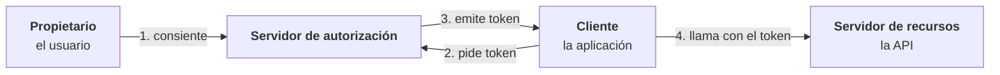
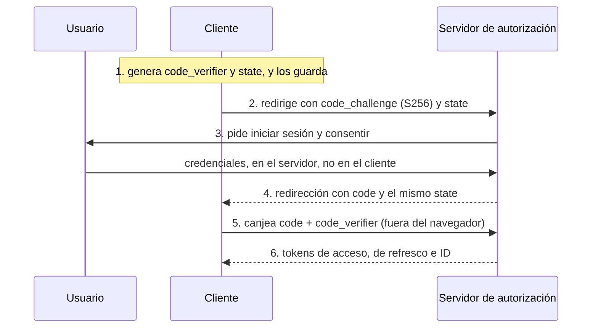

# titulo: OAuth 2.0 y OpenID Connect


# Delegar el acceso sin dar la contraseña

## Objetivos de aprendizaje

- **1.1** Explicar el problema que resuelve OAuth 2.0.
- **1.2** Identificar los cuatro roles de OAuth 2.0.
- **1.3** Distinguir autorización (OAuth) de autenticación (OpenID Connect).
- **1.4** Distinguir clientes públicos y confidenciales.

## El problema

Una aplicación de facturación quiere leer tus pedidos de una tienda online. La solución ingenua, darle tu usuario y contraseña de la tienda, tiene problemas graves:

- La aplicación puede hacer **todo** lo que tú puedes, no solo leer pedidos.
- No puedes **retirar el acceso** a esa aplicación sin cambiar la contraseña para todas.
- Si la aplicación sufre una fuga, se filtra **tu contraseña**.

**OAuth 2.0** (RFC 6749, 2012) resuelve esto con **tokens**: credenciales limitadas en alcance (*scope*) y en tiempo, que emite un servidor de confianza y que se pueden revocar, sin que la aplicación vea nunca tu contraseña.

## Los cuatro roles

| Rol | Qué es | En el ejemplo |
|---|---|---|
| **Propietario del recurso** | Quien puede conceder el acceso, normalmente el usuario | Tú |
| **Cliente** | La aplicación que quiere acceder | La aplicación de facturación |
| **Servidor de autorización** | Autentica al usuario, pide su consentimiento y emite los tokens | El proveedor de identidad (Keycloak, Microsoft Entra ID…) |
| **Servidor de recursos** | La API que guarda los datos y acepta tokens | La API de pedidos de la tienda |



```nodos
U:
  titulo: Propietario del recurso
  texto: Concede el acceso. Introduce su contraseña solo en el servidor de autorización, nunca en el cliente.
AS:
  concepto: servidor-de-autorizacion
C:
  concepto: cliente-oauth
RS:
  concepto: servidor-de-recursos
```

## Autorización no es autenticación

OAuth 2.0 responde a **«¿qué puede hacer esta aplicación?»** (autorización). No está diseñado para responder **«¿quién es este usuario?»** (autenticación): un token de acceso es para la API y su formato no está definido por OAuth.

Para iniciar sesión con un proveedor («Entrar con…»), se usa **OpenID Connect** (OIDC), una capa sobre OAuth 2.0 que añade un **ID token** con la identidad del usuario. Hoy, casi todos los servidores de autorización hablan los dos protocolos.

## Clientes públicos y confidenciales

| Tipo | Puede guardar un secreto | Ejemplos |
|---|---|---|
| **Confidencial** | Sí: el secreto está en un servidor que el usuario no controla | Un *backend*, un servicio que llama a otro servicio |
| **Público** | No: cualquier secreto incluido en el código se puede extraer | Una aplicación de página única (SPA) en el navegador, una aplicación móvil o de escritorio |

Un cliente público **no debe tener secreto**: se protege con otras medidas, sobre todo **PKCE** (lección siguiente).

## Puntos clave

- OAuth 2.0 (RFC 6749) delega un acceso limitado con tokens, sin dar la contraseña al cliente.
- Cuatro roles: propietario del recurso, cliente, servidor de autorización y servidor de recursos.
- OAuth autoriza; OpenID Connect autentica, con un ID token.
- Los clientes confidenciales pueden guardar un secreto; los públicos (SPA, móviles) no.

## Referencias

- IETF, [RFC 6749: The OAuth 2.0 Authorization Framework](https://www.rfc-editor.org/rfc/rfc6749).
- OpenID Foundation, [OpenID Connect Core 1.0](https://openid.net/specs/openid-connect-core-1_0.html).
- [oauth.net/2](https://oauth.net/2/).

# El flujo de código con PKCE

## Objetivos de aprendizaje

- **2.1** Describir paso a paso el flujo de código de autorización.
- **2.2** Explicar cómo PKCE protege el código y calcular un `code_challenge`.
- **2.3** Usar `state` y validar la URI de redirección.
- **2.4** Explicar qué ocurre si se reutiliza un código.

Todo lo que se describe aquí se ha comprobado contra **Keycloak 26.4**, con un cliente público `web-tienda` que exige PKCE con S256.

## El flujo



```nodos
U:
  titulo: Usuario
  texto: Escribe su contraseña en el servidor de autorización, nunca en el cliente.
C:
  concepto: pkce
  texto: Genera un code_verifier aleatorio y un state para cada petición. Al recibir el código, comprueba que el state coincide y lo canjea con el code_verifier original.
AS:
  concepto: servidor-de-autorizacion
```

1. El cliente genera un `code_verifier` aleatorio y un `state`.
2. Redirige el navegador al servidor de autorización con `response_type=code`, `client_id`, `redirect_uri`, `scope`, `state` y el **`code_challenge`** (el resumen del verificador).
3. El usuario inicia sesión **en el servidor de autorización** y da su consentimiento.
4. El servidor redirige a la `redirect_uri` con un **código** de un solo uso y el `state`.
5. El cliente comprueba el `state` y canjea el código en el **endpoint de tokens**, enviando el **`code_verifier`**.
6. El servidor comprueba que el verificador corresponde al resumen y devuelve los tokens.

## PKCE

**PKCE** (RFC 7636, *Proof Key for Code Exchange*) evita que un código interceptado sirva a un atacante:

```python
import base64, hashlib, secrets

verifier = base64.urlsafe_b64encode(secrets.token_bytes(32)).rstrip(b"=").decode()
challenge = base64.urlsafe_b64encode(hashlib.sha256(verifier.encode()).digest()).rstrip(b"=").decode()
```

El `code_challenge` viaja por el navegador (puede verse); el `code_verifier` solo se envía en el canje directo. Quien robe el código no puede canjearlo sin el verificador. Usa siempre el método **S256**; `plain` envía el verificador tal cual y solo existe por compatibilidad.

Comprobado en Keycloak:

| Prueba | Resultado |
|---|---|
| Pedir el código sin `code_challenge` a un cliente que exige PKCE | Redirección con `error=invalid_request`: falta `code_challenge_method` |
| Canjear el código con un verificador incorrecto | `invalid_grant`: *PKCE verification failed: Invalid code verifier* |
| Canjear con el verificador correcto | Se obtienen `access_token`, `refresh_token` e `id_token` |

El **RFC 9700** (buenas prácticas de seguridad de OAuth, enero de 2025) establece que los **clientes públicos deben usar PKCE**, y lo recomienda también para los confidenciales.

## State y URI de redirección

- **`state`** es un valor aleatorio que el cliente envía y comprueba a la vuelta. Protege contra la falsificación de peticiones (CSRF): impide que un atacante haga que tu sesión acepte un código suyo. PKCE también protege contra esto si el servidor lo soporta, y en OpenID Connect lo hace el `nonce`.
- **`redirect_uri`** debe coincidir **exactamente** con una registrada en el servidor. Comodines o coincidencias parciales permiten que un atacante desvíe el código a un dominio suyo.

## Un código, un uso

El código es de un solo uso y dura poco (segundos o minutos). El RFC 6749 dice que, si se usa más de una vez, el servidor debe rechazarlo y **debería revocar** los tokens ya emitidos con él. Keycloak lo hace: tras un segundo canje (`invalid_grant: Code not valid`), la introspección del token que se había obtenido con ese código pasó de `active: true` a `active: false`. Así, si un atacante consigue usar un código robado, el usuario legítimo pierde también su sesión y el problema se detecta.

## Puntos clave

- Flujo de código: redirección al servidor, inicio de sesión, código en la redirección y canje en el endpoint de tokens.
- PKCE liga el código a quien lo pidió: `code_challenge = BASE64URL(SHA256(code_verifier))`. Usa S256.
- El RFC 9700 obliga a usar PKCE en los clientes públicos.
- `state` protege contra CSRF y la `redirect_uri` debe coincidir exactamente.
- El código es de un solo uso; reutilizarlo hace que se revoquen los tokens emitidos con él.

## Referencias

- IETF, [RFC 7636: PKCE](https://www.rfc-editor.org/rfc/rfc7636).
- IETF, [RFC 9700: Best Current Practice for OAuth 2.0 Security](https://www.rfc-editor.org/rfc/rfc9700).
- IETF, [RFC 6749](https://www.rfc-editor.org/rfc/rfc6749), sección 4.1 (código de autorización).

# Otros flujos y los que ya no se usan

## Objetivos de aprendizaje

- **3.1** Usar las credenciales de cliente para la comunicación de servicio a servicio.
- **3.2** Renovar el acceso con refresh tokens y su rotación.
- **3.3** Conocer el flujo de dispositivo para equipos sin teclado.
- **3.4** Explicar por qué no se deben usar el flujo implícito ni el de contraseña.

## Credenciales de cliente: servicio a servicio

Cuando **no hay usuario** (un servicio de pedidos que llama a la API de inventario), el cliente pide un token **en su propio nombre**, autenticándose con su identificador y su secreto:

```bash
curl -d grant_type=client_credentials \
     -d client_id=servicio-pedidos \
     -d client_secret=secreto-de-prueba \
     http://127.0.0.1:18180/realms/tienda/protocol/openid-connect/token
```

Solo para clientes **confidenciales**. En Keycloak, la respuesta incluyó `access_token` con una validez de 300 segundos y **ningún `refresh_token`**: cuando caduca, el servicio simplemente pide otro. Si el secreto puede sustituirse por algo más fuerte, mejor: autenticación con certificados (mTLS) o con una aserción JWT firmada.

## Refresh tokens

Los tokens de acceso duran poco (en la prueba, 300 segundos), para limitar el daño si se filtran. Para no pedir al usuario que vuelva a iniciar sesión, el cliente usa un **refresh token**:

```text
POST /token
grant_type=refresh_token&client_id=web-tienda&refresh_token=…
```

En la prueba, cada renovación devolvió un **refresh token nuevo**. Que el servidor invalide el anterior al usarlo (**rotación**) permite detectar el robo: si el refresh token antiguo vuelve a usarse, alguien lo copió. El RFC 9700 exige que los refresh tokens de los **clientes públicos** estén ligados al cliente que los recibió (*sender-constrained*) o usen rotación. En Keycloak, invalidar el anterior es una opción del realm que hay que activar.

## Flujo de dispositivo

Para televisores, consolas o herramientas de línea de comandos sin navegador cómodo (RFC 8628): el dispositivo muestra un código corto y una URL; el usuario la abre en el móvil, inicia sesión e introduce el código, mientras el dispositivo pregunta periódicamente si ya tiene token.

## Los que ya no se deben usar

| Flujo | Qué hacía | Por qué no | Sustituto |
|---|---|---|---|
| **Implícito** (`response_type=token`) | Devolvía el token directamente en la URL de redirección | El token queda expuesto en el navegador e historiales, y no se puede ligar al cliente. El RFC 9700 dice que los clientes **no deberían** usarlo | Flujo de código con PKCE |
| **Contraseña del propietario** (`grant_type=password`) | El cliente recogía el usuario y la contraseña y los enviaba al servidor | El cliente ve la contraseña, justo lo que OAuth quería evitar, e impide la autenticación multifactor. El RFC 9700 dice que **no debe** usarse | Flujo de código con PKCE |

Que un servidor los anuncie no significa que haya que usarlos: el documento de descubrimiento de Keycloak los lista en `grant_types_supported`, pero cada cliente decide si los permite. En la prueba, el cliente `web-tienda` los tenía desactivados y una petición con `grant_type=password` recibió `unauthorized_client: Client not allowed for direct access grants`.

## Puntos clave

- Credenciales de cliente: servicio a servicio, sin usuario, solo con clientes confidenciales.
- Los tokens de acceso duran poco; los refresh tokens permiten renovarlos sin volver a iniciar sesión.
- La rotación de refresh tokens permite detectar robos; el RFC 9700 la exige (o la vinculación al cliente) en los clientes públicos.
- El flujo de dispositivo sirve para equipos sin navegador cómodo.
- No uses el flujo implícito ni el de contraseña; desactívalos en los clientes.

## Referencias

- IETF, [RFC 6749](https://www.rfc-editor.org/rfc/rfc6749), secciones 4.4 (credenciales de cliente) y 6 (refresh tokens).
- IETF, [RFC 8628: Device Authorization Grant](https://www.rfc-editor.org/rfc/rfc8628).
- IETF, [RFC 9700](https://www.rfc-editor.org/rfc/rfc9700), secciones 2.1.2 y 2.4.

# Tokens y JWT

## Objetivos de aprendizaje

- **4.1** Describir la estructura de un JWT y qué garantiza su firma.
- **4.2** Validar un token de acceso en una API: firma, emisor, audiencia y caducidad.
- **4.3** Comparar la validación local (JWKS) con la introspección.
- **4.4** Enviar y guardar tokens de forma segura.

## Anatomía de un JWT

Un **JWT** (*JSON Web Token*, RFC 7519) son tres partes en base64url separadas por puntos: `cabecera.carga.firma`.

Cabecera de un token de acceso de Keycloak:

```json
{"alg": "RS256", "typ": "JWT", "kid": "mikwo6dIu3EYJJVus_lWHaweJVL6RlQDqjZx9ZEQyGM"}
```

Parte de su carga (*claims*); las fechas se muestran con valores de ejemplo:

```json
{
  "iss": "http://127.0.0.1:18180/realms/tienda",
  "aud": "account",
  "azp": "web-tienda",
  "scope": "openid email profile",
  "realm_access": {"roles": ["cliente", "offline_access", "uma_authorization", "default-roles-tienda"]},
  "exp": 1795043234, "iat": 1795042934
}
```

| Claim | Significado |
|---|---|
| `iss` | Emisor: qué servidor de autorización lo firmó |
| `sub` | Sujeto: identificador estable del usuario (o del cliente) |
| `aud` | Audiencia: para qué API está pensado |
| `exp`, `iat` | Caducidad y emisión, en segundos desde 1970 (aquí, 300 segundos de diferencia) |
| `azp` | Cliente al que se emitió |
| `scope` | Permisos concedidos |

**Firmado no es cifrado.** Cualquiera que tenga el token puede decodificar la carga con base64 y leerla. No pongas datos sensibles en un JWT. La firma garantiza que **nadie lo ha modificado**: en la prueba, al cambiar los roles de la carga a `admin` y reenviar el token con la firma original, Keycloak respondió **401**.

## Validar un token en la API

Una API que recibe `Authorization: Bearer <token>` debe comprobar, como mínimo:

1. **La firma**, con la clave pública del emisor. El servidor publica sus claves en el **JWKS** (`jwks_uri`); el `kid` de la cabecera dice cuál usar. En la prueba, el JWKS de Keycloak tenía una clave `RS256` para firmar (`use: sig`) y otra para cifrar.
2. **El algoritmo esperado.** Fija en la API los algoritmos que aceptas (por ejemplo, RS256). No te fíes del `alg` que dice el propio token: el RFC 8725 recoge ataques que aprovechan esa confianza, como aceptar `none`.
3. **`iss`**: es el emisor de confianza.
4. **`aud`**: el token está pensado para esta API. Si no se comprueba, un token emitido para otra API también entraría.
5. **`exp`** (y `nbf` si existe): no ha caducado, con un pequeño margen para desfases de reloj.
6. **Los permisos** (`scope`, roles) necesarios para la operación concreta.

Los frameworks lo hacen por ti con la configuración adecuada (en Spring Security, `spring.security.oauth2.resourceserver.jwt.issuer-uri`), pero hay que configurar la audiencia y los permisos.

## Validación local o introspección

| | Validación local (JWT + JWKS) | Introspección (RFC 7662) |
|---|---|---|
| Cómo | La API comprueba la firma con la clave pública | La API pregunta al servidor si el token está activo |
| Coste | Sin llamada de red por petición (las claves se guardan en caché) | Una llamada por petición (o caché) |
| Revocación | No se entera hasta que el token caduca | Se entera al instante |
| Tokens opacos | No sirven | Sí sirven |

Por eso los tokens de acceso duran poco: con validación local, un token revocado sigue siendo aceptado hasta su caducidad. En la prueba, la introspección de un token válido devolvió `active: true`, con el usuario y el cliente; tras revocarlo, `active: false`.

## Enviar y guardar tokens

- Envía el token en la cabecera `Authorization: Bearer …` (RFC 6750), **nunca en la URL**: las URL quedan en historiales, registros y la cabecera `Referer`.
- Usa siempre **HTTPS**: un token de portador (*bearer*) lo puede usar quien lo tenga.
- En el navegador, guardar tokens en `localStorage` los expone a cualquier script inyectado (XSS). Para aplicaciones web, un patrón cada vez más recomendado es el ***backend for frontend*** (BFF): el servidor guarda los tokens y el navegador solo tiene una cookie de sesión `HttpOnly`.

## Puntos clave

- Un JWT es `cabecera.carga.firma` en base64url: cualquiera lee la carga, nadie la modifica sin invalidar la firma.
- La API valida la firma (con el JWKS), el algoritmo, `iss`, `aud`, `exp` y los permisos.
- Validar localmente es rápido, pero no detecta revocaciones; la introspección sí, a cambio de una llamada.
- Tokens en la cabecera `Authorization`, nunca en la URL, y siempre sobre HTTPS.
- En la web, evita guardar tokens en `localStorage`; considera un BFF.

## Referencias

- IETF, [RFC 7519: JSON Web Token](https://www.rfc-editor.org/rfc/rfc7519).
- IETF, [RFC 8725: JWT Best Current Practices](https://www.rfc-editor.org/rfc/rfc8725).
- IETF, [RFC 7517: JSON Web Key](https://www.rfc-editor.org/rfc/rfc7517).
- IETF, [RFC 6750: Bearer Token Usage](https://www.rfc-editor.org/rfc/rfc6750).
- IETF, [RFC 7662: Token Introspection](https://www.rfc-editor.org/rfc/rfc7662).

# OpenID Connect

## Objetivos de aprendizaje

- **5.1** Explicar qué añade OpenID Connect a OAuth 2.0.
- **5.2** Distinguir el ID token del token de acceso.
- **5.3** Validar un ID token, incluido el `nonce`.
- **5.4** Usar el descubrimiento y el endpoint userinfo.

## Qué añade

**OpenID Connect** (OIDC) es una capa de identidad sobre OAuth 2.0. Con el mismo flujo de código, añadiendo el scope **`openid`**, el cliente recibe además un **ID token**: un JWT que le dice **quién** ha iniciado sesión, **cuándo** y **ante qué proveedor**. Otros scopes estándar piden más datos del usuario: `profile` (nombre), `email`, `address` y `phone`.

## ID token frente a token de acceso

| | ID token | Token de acceso |
|---|---|---|
| Para quién | El **cliente** | La **API** (servidor de recursos) |
| Responde a | ¿Quién es el usuario? | ¿Qué puede hacer este cliente? |
| `aud` en la prueba | `web-tienda` (el cliente) | `account` (una API) |
| Formato | Siempre JWT | Depende del proveedor |
| ¿Se envía a las API? | **No** | Sí |

ID token de la prueba con Keycloak:

```json
{
  "iss": "http://127.0.0.1:18180/realms/tienda",
  "aud": "web-tienda",
  "sub": "b936297f-7cd7-4905-aa05-bc913d297070",
  "nonce": "AlhBQxOT-A2NMD2gF7FP6Q",
  "email": "ana@example.com",
  "name": "Ana García",
  "azp": "web-tienda"
}
```

Para identificar al usuario de forma estable, usa **`iss` + `sub`**, no el correo: el correo puede cambiar o reasignarse.

## Validar el ID token

Además de la firma, `iss` y `exp`, el cliente comprueba:

- **`aud`** contiene su propio `client_id`.
- **`nonce`** es el valor aleatorio que el cliente envió en la petición de autorización. Así se asegura de que el token se emitió para **esta** petición y no se está reutilizando uno capturado en otra (ataque de repetición). En la prueba, el `nonce` del ID token coincidía con el enviado.

## Descubrimiento y userinfo

Cada proveedor publica su configuración en una URL fija, `/.well-known/openid-configuration`: el emisor, los endpoints (autorización, tokens, userinfo, JWKS), los flujos y los métodos de PKCE que soporta. Las bibliotecas cliente solo necesitan la URL del emisor y descubren el resto. En Keycloak:

```text
http://127.0.0.1:18180/realms/tienda/.well-known/openid-configuration
```

El endpoint **userinfo** devuelve los datos del usuario a quien presenta un token de acceso válido. En la prueba devolvió `sub`, `name`, `preferred_username`, `given_name`, `family_name`, `email` y `email_verified`.

## Iniciar y cerrar sesión

- **Inicio de sesión único (SSO):** si el usuario ya tiene sesión en el proveedor, la siguiente aplicación que le pida autenticarse recibe un código sin que tenga que volver a escribir la contraseña.
- **Cierre de sesión:** cerrar la sesión de la aplicación no cierra la del proveedor. OIDC define cómo pedirlo (*RP-Initiated Logout*) y cómo avisar a otras aplicaciones (*back-channel logout*).

## Puntos clave

- OIDC es identidad sobre OAuth 2.0: el scope `openid` añade un ID token.
- El ID token es para el cliente; el token de acceso, para la API. No envíes el ID token a las API.
- Identifica al usuario con `iss` + `sub`, no con el correo.
- Valida el ID token: firma, `iss`, `aud` (tu cliente), `exp` y `nonce`.
- `/.well-known/openid-configuration` publica los endpoints; userinfo devuelve los datos del usuario.

## Referencias

- OpenID Foundation, [OpenID Connect Core 1.0](https://openid.net/specs/openid-connect-core-1_0.html).
- OpenID Foundation, [OpenID Connect Discovery 1.0](https://openid.net/specs/openid-connect-discovery-1_0.html).
- Keycloak, [Server Administration Guide](https://www.keycloak.org/docs/latest/server_admin/index.html).
