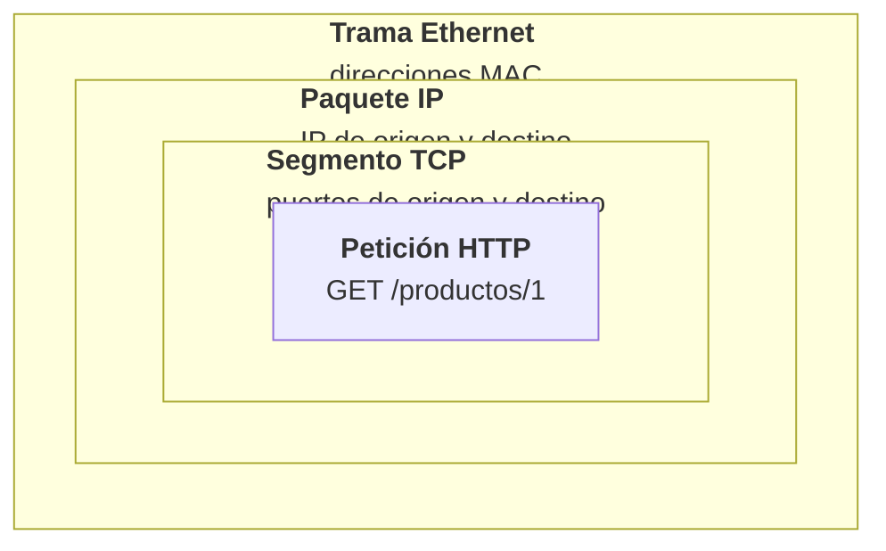
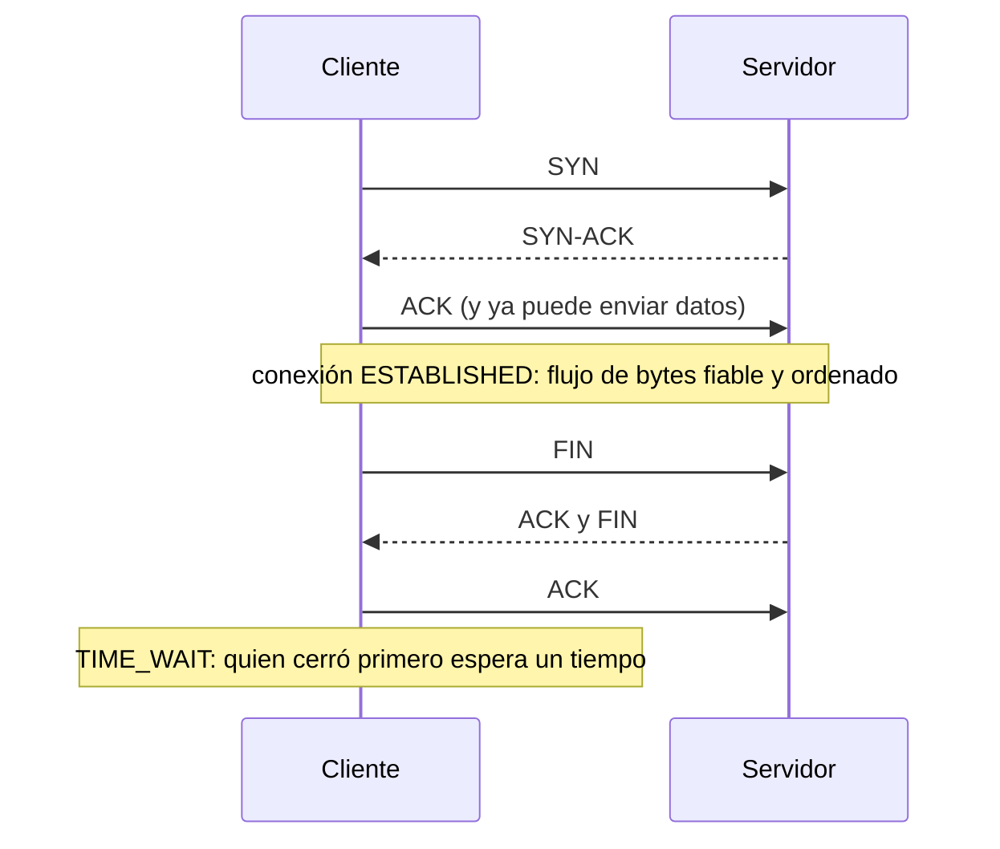
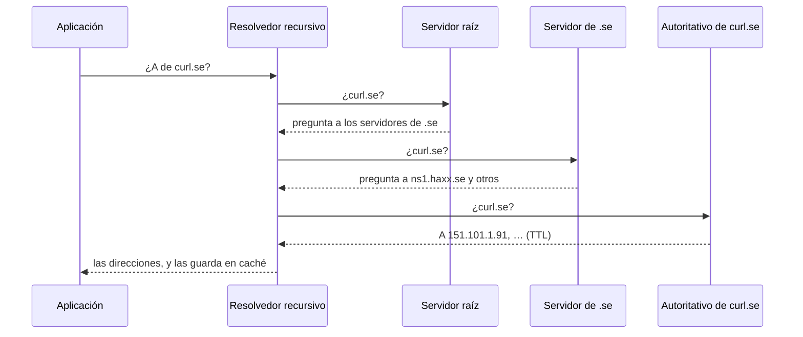
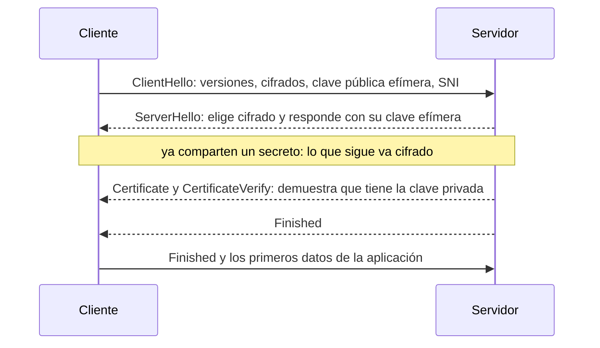
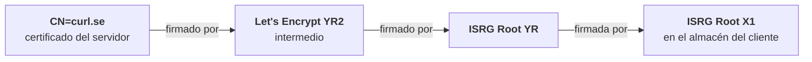
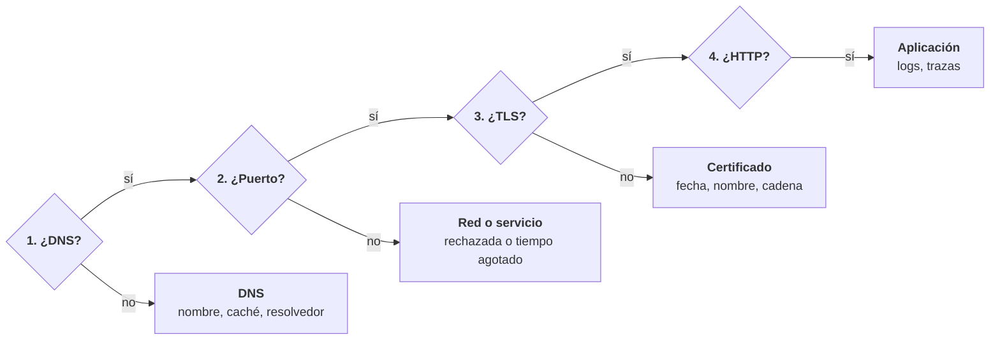

# titulo: TCP/IP, DNS y TLS


# Capas y direcciones

## Objetivos de aprendizaje

- **1.1** Describir las capas del modelo TCP/IP y cómo se encapsulan los datos.
- **1.2** Leer direcciones IPv4 e IPv6 y redes en notación CIDR.
- **1.3** Reconocer los rangos especiales: privados, loopback, enlace local y NAT de operador.
- **1.4** Explicar qué es un puerto y qué hace el NAT de un router.

Los cálculos de redes se han hecho con el módulo `ipaddress` de Python, y los datos del sistema, en un Linux con núcleo 7.0.

## Capas

Cada capa resuelve un problema y se apoya en la de debajo. El modelo de Internet (RFC 1122) tiene cuatro:

| Capa | Qué resuelve | Ejemplos |
|---|---|---|
| Aplicación | Lo que quiere hacer el programa | HTTP, DNS, SSH |
| Transporte | Entre qué procesos y con qué garantías | TCP, UDP, QUIC |
| Internet | Cómo llega un paquete de un equipo a otro a través de varias redes | IP (v4 y v6), ICMP |
| Enlace | Cómo viaja entre dos equipos de la misma red | Ethernet, wifi |

Al enviar, cada capa **encapsula** lo que recibe de arriba: añade su cabecera y lo pasa abajo. El receptor lo desenvuelve en orden inverso.



```nodos
ETH:
  titulo: Enlace
  texto: Lleva la trama hasta el siguiente equipo de la red local, como el router. En cada salto se envuelve en una trama nueva.
IPV:
  concepto: direccion-ip
SEG:
  concepto: puerto
APP:
  concepto: modelo-tcp-ip
```

Un router solo mira hasta la capa de internet: lee la IP de destino y decide por dónde reenviar. No necesita entender HTTP.

## Direcciones y CIDR

Una **dirección IPv4** tiene 32 bits, escritos como cuatro números de 0 a 255: `192.168.1.10`. Una **IPv6** tiene 128 bits en grupos hexadecimales, y `::` abrevia una racha de ceros: `2a04:4e42:600::347` es una de las direcciones IPv6 de `curl.se`.

La **notación CIDR** indica una red: la dirección y cuántos bits iniciales son fijos.

| Red | Bits fijos | Direcciones | Rango |
|---|---|---|---|
| `192.168.1.0/24` | 24 | 256 | 192.168.1.0 a 192.168.1.255 |
| `192.168.1.0/26` | 26 | 64 | 192.168.1.0 a 192.168.1.63 |
| `10.1.2.0/23` | 23 | 512 | 10.1.2.0 a 10.1.3.255 (máscara 255.255.254.0) |
| `10.0.0.0/8` | 8 | 16 777 216 | 10.0.0.0 a 10.255.255.255 |

Cada bit menos en el prefijo duplica el tamaño de la red: hay 2^(32 − prefijo) direcciones. `192.168.1.141` pertenece a `192.168.1.0/24`; `192.168.2.5`, no. Las reglas de cortafuegos, las listas de IP permitidas y las redes de contenedores se escriben así.

## Rangos especiales

| Rango | Para qué | Norma |
|---|---|---|
| `10.0.0.0/8`, `172.16.0.0/12`, `192.168.0.0/16` | Redes privadas: no se enrutan en Internet | RFC 1918 |
| `127.0.0.0/8` y `::1` | Loopback: el propio equipo | RFC 1122, RFC 4291 |
| `169.254.0.0/16` y `fe80::/10` | Enlace local: solo la red física, sin router | RFC 3927, RFC 4291 |
| `100.64.0.0/10` | NAT de operador (CGNAT), entre el cliente y su proveedor | RFC 6598 |
| `fc00::/7` | Direcciones locales únicas de IPv6, el equivalente a las privadas | RFC 4193 |

Dos ejemplos que aparecen en otros temas: `169.254.169.254` es la dirección de enlace local de los servicios de metadatos de la nube (el objetivo típico de un SSRF), y `172.22.0.0/24` es una red privada que Docker crea para los contenedores. El rango `100.64.0.0/10` no es privado ni global: Python lo clasificó así, con `is_private` e `is_global` en falso.

## Puertos y NAT

La IP lleva el paquete al equipo; el **puerto** (16 bits, de 0 a 65535) lo lleva al proceso. Una conexión TCP queda identificada por la cuaterna **IP y puerto de origen, IP y puerto de destino**:

| Tipo de puerto | Rango | Ejemplo |
|---|---|---|
| Bien conocidos | 0 a 1023 | 22 (SSH), 53 (DNS), 80 (HTTP), 443 (HTTPS) |
| Registrados | 1024 a 49151 | 5432 (PostgreSQL), 8080 |
| Efímeros (en este Linux) | 32768 a 60999 | Los que elige el cliente para su lado de la conexión |

El rango efímero se lee en `/proc/sys/net/ipv4/ip_local_port_range`.

Un router doméstico hace **NAT**: los equipos de la red privada salen a Internet con la única IP pública del router, que anota cada conexión (IP y puerto internos frente a su puerto público) para devolver las respuestas. Consecuencias:

- Desde fuera no se puede iniciar una conexión hacia un equipo interno, salvo que el router **redirija un puerto**.
- Con CGNAT hay un segundo NAT en el operador, y ni siquiera redirigir puertos en casa basta para recibir conexiones.
- IPv6 tiene direcciones de sobra para no necesitar NAT. Ahí, lo que filtra las conexiones entrantes es el cortafuegos.

## Puntos clave

- Aplicación, transporte, internet y enlace: cada capa encapsula a la de arriba.
- Un router decide con la IP de destino; no mira la aplicación.
- IPv4 tiene 32 bits e IPv6, 128.
- En CIDR, `/24` son 256 direcciones y cada bit menos duplica la red.
- Los rangos privados (`10/8`, `172.16/12`, `192.168/16`) no se enrutan en Internet.
- `127.0.0.1` es el propio equipo; `169.254.0.0/16`, el enlace local; `100.64.0.0/10`, el NAT del operador.
- Un puerto identifica el proceso; una conexión TCP, la cuaterna de IP y puertos de los dos extremos.
- Con NAT, las conexiones entrantes necesitan redirigir un puerto.

## Referencias

- IETF, [RFC 1122: Requirements for Internet Hosts](https://www.rfc-editor.org/rfc/rfc1122.html).
- IETF, [RFC 4632: Classless Inter-domain Routing](https://www.rfc-editor.org/rfc/rfc4632.html).
- IETF, [RFC 1918: Address Allocation for Private Internets](https://www.rfc-editor.org/rfc/rfc1918.html) y [RFC 6598: Shared Address Space](https://www.rfc-editor.org/rfc/rfc6598.html).
- IETF, [RFC 4193: Unique Local IPv6 Unicast Addresses](https://www.rfc-editor.org/rfc/rfc4193.html).
- Python, [ipaddress](https://docs.python.org/3/library/ipaddress.html).

# TCP y UDP

## Objetivos de aprendizaje

- **2.1** Describir cómo se abre y se cierra una conexión TCP y lo que cuesta.
- **2.2** Explicar qué garantiza TCP: fiabilidad, orden, control de flujo y de congestión.
- **2.3** Distinguir «conexión rechazada» de «tiempo de espera agotado».
- **2.4** Elegir entre TCP y UDP.

TCP se define en el **RFC 9293** y UDP en el **RFC 768**. Las pruebas usan curl, `ss` y sockets de Python en Linux.

## Abrir y cerrar una conexión

TCP abre una conexión con un **saludo en tres pasos**:



```nodos
C:
  concepto: saludo-tcp
S:
  concepto: tcp
```

El saludo cuesta **un viaje de ida y vuelta** (RTT) antes de enviar el primer byte. Con TLS 1.3 encima, un saludo completo añade otro (lección 4). Por eso reutilizar conexiones (*keep-alive*, HTTP/2) ahorra tanto. curl muestra los tiempos acumulados de cada fase. Dos peticiones a `https://curl.se/`:

```text
dns=0.0017  tcp=0.0059  tls=0.0157  primer_byte=0.0663  total=0.0665
dns=0.0015  tcp=0.0061  tls=0.0129  primer_byte=0.0184  total=0.0203
```

La conexión TCP costó unos 4 ms tras resolver el nombre, y TLS, otros 7 a 10 ms. Se obtiene con `curl -w '%{time_connect} %{time_appconnect}…'`.

Al cerrar, el extremo que envía el primer `FIN` queda en **`TIME_WAIT`** un tiempo, para que los paquetes retrasados no se mezclen con una conexión nueva entre los mismos puertos. Tras una petición con curl al servidor de prueba, `ss` lo mostró en el lado de curl, que cerró primero:

```text
$ ss -tan state time-wait '( dport = :8201 )'
Local Address:Port   Peer Address:Port
127.0.0.1:45882      127.0.0.1:8201
```

Un cliente que abre y cierra miles de conexiones por segundo puede quedarse sin puertos efímeros libres. La solución es **reutilizar conexiones** con un *pool*.

## Lo que garantiza TCP

| Garantía | Cómo |
|---|---|
| **Entrega fiable** | Cada byte se numera; el receptor confirma (ACK) y el emisor retransmite lo que no se confirma |
| **Orden** | El receptor reordena por número de secuencia antes de entregar a la aplicación |
| **Control de flujo** | El receptor anuncia cuánto puede aceptar (ventana) para no desbordarse |
| **Control de congestión** | El emisor reduce el ritmo si detecta pérdidas, para no saturar la red |

TCP entrega un **flujo de bytes**, no mensajes. Si envías dos mensajes de 100 bytes, el otro extremo puede leer 150 y luego 50. Los protocolos de aplicación marcan dónde acaba cada mensaje, como hace HTTP con `Content-Length`.

## Rechazada o sin respuesta

Dos fallos distintos al conectar, con mensajes distintos:

```text
$ curl http://127.0.0.1:9/
curl: (7) Failed to connect to 127.0.0.1 port 9 after 0 ms: Could not connect to server

$ curl --connect-timeout 3 http://10.255.255.1/
curl: (28) Connection timed out after 3002 milliseconds
```

| Síntoma | Qué pasa | Causas típicas |
|---|---|---|
| **Rechazada**, al instante | El equipo responde con `RST`: no hay nadie escuchando en ese puerto | El servicio está caído, escucha en otro puerto o solo en `127.0.0.1` |
| **Tiempo agotado**, tras esperar | Nadie responde al `SYN` | Un cortafuegos descarta el paquete, la IP no existe o no hay ruta |

Saber cuál de los dos ocurre ahorra mucho tiempo: el primero dice «llego al equipo, pero no hay servicio»; el segundo, «no llego» o «algo me descarta». Con `ss -ltn` se ven los puertos en escucha y en qué dirección: `127.0.0.1:8201` solo acepta conexiones del propio equipo, y `0.0.0.0:8201`, de cualquier interfaz.

## UDP

UDP envía **datagramas** sueltos: sin saludo, sin confirmaciones, sin orden. Cada datagrama llega entero o no llega. Enviar a un puerto UDP cerrado con Python **no dio ningún error**:

```text
sendto a un puerto UDP cerrado: 4 bytes enviados, sin error
recv en un socket UDP conectado: ConnectionRefusedError [Errno 111] Connection refused
```

El equipo de destino contestó con un mensaje ICMP de «puerto inaccesible», y el sistema solo lo comunicó en una operación posterior sobre el socket conectado. Con UDP, la aplicación decide qué hacer si algo se pierde.

| | TCP | UDP |
|---|---|---|
| Conexión | Saludo en tres pasos | Ninguna |
| Fiabilidad y orden | Sí | No |
| Unidad | Flujo de bytes | Datagrama |
| Coste inicial | Un RTT | Ninguno |
| Usos | HTTP/1.1 y HTTP/2, SSH, bases de datos | DNS, vídeo y voz en tiempo real, QUIC (HTTP/3) |

QUIC demuestra que UDP no es «el protocolo poco fiable»: es una base mínima sobre la que construir otro transporte con sus propias garantías.

## Puntos clave

- El saludo SYN, SYN-ACK y ACK cuesta un viaje de ida y vuelta, y un saludo completo de TLS 1.3, otro: reutiliza las conexiones.
- TCP entrega un flujo de bytes fiable y ordenado, con control de flujo y de congestión; no conserva los límites de los mensajes.
- Quien cierra primero queda en TIME_WAIT; miles de conexiones cortas pueden agotar los puertos efímeros.
- «Conexión rechazada» llega al instante: no hay nadie escuchando. «Tiempo agotado» es que nadie responde: cortafuegos, ruta o IP inexistente.
- `ss -ltn` muestra qué puertos escuchan y en qué dirección.
- UDP no tiene conexión, confirmaciones ni orden; lo usan DNS y QUIC.

## Referencias

- IETF, [RFC 9293: Transmission Control Protocol](https://www.rfc-editor.org/rfc/rfc9293.html).
- IETF, [RFC 768: User Datagram Protocol](https://www.rfc-editor.org/rfc/rfc768.html).
- Linux, [ss(8)](https://man7.org/linux/man-pages/man8/ss.8.html).
- Everything curl, [--write-out](https://everything.curl.dev/usingcurl/verbose/writeout.html).

# DNS

## Objetivos de aprendizaje

- **3.1** Describir cómo se resuelve un nombre, desde la raíz hasta el servidor autoritativo.
- **3.2** Reconocer los tipos de registro más habituales y cuándo usar cada uno.
- **3.3** Explicar el TTL y sus consecuencias al cambiar un registro.
- **3.4** Consultar el DNS con dig e interpretar la respuesta.

El DNS se define en los **RFC 1034 y 1035**. Las consultas se hicieron con dig 9.20 contra el resolvedor local del sistema y contra un resolvedor público.

## De la raíz al servidor autoritativo

El DNS es una **base de datos distribuida y jerárquica**. Nadie tiene todos los nombres: cada nivel sabe a quién **delegar** el siguiente.



```nodos
APP:
  titulo: Aplicación
  texto: Pregunta a través del sistema operativo. No hace la resolución completa.
R:
  concepto: resolvedor
RAIZ:
  titulo: Servidores raíz
  texto: Trece nombres, de a.root-servers.net a m.root-servers.net, cada uno servido por muchas máquinas repartidas por el mundo. Solo saben quién gestiona cada dominio de primer nivel.
TLD:
  titulo: Dominio de primer nivel
  texto: Los servidores de .se saben qué servidores son autoritativos para curl.se.
AUT:
  concepto: dns
```

`dig +trace` hace ese recorrido y muestra cada respuesta:

```text
.        NS  a.root-servers.net. … m.root-servers.net.     (13 nombres)
se.      NS  a.ns.se.  b.ns.se. …                          (desde g.root-servers.net, 37 ms)
curl.se. NS  ns1.haxx.se.  nx1.named.se. …                 (desde x.ns.se, 56 ms)
curl.se. A   151.101.1.91  151.101.65.91 …                 (desde nx3.named.se, 61 ms)
```

En el uso normal, la aplicación no hace este recorrido: pregunta al **resolvedor recursivo** (el del router, el del proveedor o uno público), que lo hace por ella y **guarda las respuestas en caché**. La mayoría de las consultas se resuelven en milisegundos desde esa caché: la primera petición de la lección anterior tardó 1,7 ms en resolver `curl.se`.

## Tipos de registro

| Tipo | Contiene | Ejemplo real |
|---|---|---|
| `A` | Dirección IPv4 | `curl.se. A 151.101.1.91` (y tres más) |
| `AAAA` | Dirección IPv6 | `curl.se. AAAA 2a04:4e42:600::347` |
| `CNAME` | Alias: «este nombre es otro» | `www.github.com. CNAME github.com.` |
| `MX` | Servidores de correo, con prioridad | `gmail.com. MX 5 gmail-smtp-in.l.google.com.` |
| `NS` | Servidores autoritativos del dominio | `es. NS h.nic.es.` |
| `TXT` | Texto libre: verificaciones, SPF, DKIM | `curl.se. TXT "v=spf1 -all"` |
| `HTTPS` / `SVCB` | Parámetros de conexión, como los protocolos admitidos (RFC 9460) | `cloudflare.com. HTTPS 1 . alpn="h3,h2" ipv4hint=…` |

Detalles que causan errores:

- Un nombre con `CNAME` **no puede tener otros registros**. Por eso el dominio raíz de una zona (`tienda.example`) no puede ser un CNAME, ya que necesita sus `NS`; muchos proveedores ofrecen alias propios para ese caso.
- Varios `A` para el mismo nombre reparten el tráfico, pero no comprueban si cada IP está viva.
- En `MX`, el número **menor** tiene **más** prioridad.

## TTL y caché

Cada registro lleva un **TTL**: los segundos durante los que se puede guardar en caché. Consultando dos veces seguidas a un resolvedor público, el TTL bajó:

```text
www.wikipedia.org.  86336  IN  CNAME  dyna.wikimedia.org.
www.wikipedia.org.  86334  IN  CNAME  dyna.wikimedia.org.
```

El resolvedor devuelve lo que le queda de vida a su copia. Consecuencias:

- **Un TTL alto** ahorra consultas, pero un cambio tarda en verse: los resolvedores siguen sirviendo el valor antiguo hasta que caduca.
- **Antes de una migración**, baja el TTL con antelación (al menos el TTL antiguo) y súbelo cuando todo esté estable.
- Las respuestas negativas (`NXDOMAIN`, el nombre no existe) también se guardan en caché, con un TTL que fija la zona.

## Consultar con dig

| Comando | Para qué |
|---|---|
| `dig curl.se` | Registros A, con secciones de pregunta, respuesta y estadísticas |
| `dig curl.se AAAA` / `MX` / `TXT` | Otro tipo de registro |
| `dig +short curl.se` | Solo los datos |
| `dig +noall +answer curl.se` | Solo la sección de respuesta, con TTL |
| `dig @1.1.1.1 curl.se` | Preguntar a un resolvedor concreto |
| `dig +trace curl.se` | Recorrer la delegación desde la raíz |

El estado de la cabecera dice qué ha pasado: `NOERROR` (hay respuesta, aunque pueda estar vacía para ese tipo), `NXDOMAIN` (el nombre no existe) o `SERVFAIL` (el resolvedor no pudo obtener la respuesta). Para un nombre inventado:

```text
;; ->>HEADER<<- opcode: QUERY, status: NXDOMAIN
```

Si una aplicación «no encuentra» un servidor, compara lo que devuelve tu resolvedor con lo que devuelve el autoritativo (`dig @ns1.haxx.se curl.se`). Si difieren, es caché.

## Puntos clave

- El DNS es jerárquico: raíz, dominio de primer nivel y servidor autoritativo, cada uno delegando en el siguiente.
- El resolvedor recursivo hace el recorrido por el cliente y guarda las respuestas durante su TTL.
- A es IPv4, AAAA IPv6, CNAME un alias, MX el correo y NS la delegación.
- Un nombre con CNAME no puede tener otros registros; el dominio raíz de una zona no puede ser CNAME.
- Baja el TTL antes de cambiar un registro importante.
- `NXDOMAIN` es «no existe»; `SERVFAIL`, «no he podido averiguarlo».
- `dig +trace` muestra la delegación completa y `dig @servidor`, lo que responde uno concreto.

## Referencias

- IETF, [RFC 1034: Domain Names, Concepts and Facilities](https://www.rfc-editor.org/rfc/rfc1034.html).
- IETF, [RFC 1035: Domain Names, Implementation and Specification](https://www.rfc-editor.org/rfc/rfc1035.html).
- IETF, [RFC 9460: SVCB and HTTPS Resource Records](https://www.rfc-editor.org/rfc/rfc9460.html).
- IANA, [Root Servers](https://www.iana.org/domains/root/servers).
- ISC, [páginas de manual de BIND 9, incluida dig](https://bind9.readthedocs.io/en/latest/manpages.html).

# TLS y certificados

## Objetivos de aprendizaje

- **4.1** Explicar qué protege TLS y cómo es el saludo de TLS 1.3.
- **4.2** Describir un certificado y cómo se valida su cadena de confianza.
- **4.3** Diagnosticar los errores de certificado más habituales.
- **4.4** Explicar SNI y la renovación automática de certificados.

TLS 1.3 se define en el **RFC 8446** y los certificados X.509, en el **RFC 5280**. Las pruebas usan `openssl s_client` 3.5 y curl contra `curl.se` y contra los sitios de prueba de `badssl.com`, preparados con certificados defectuosos a propósito.

## Qué protege TLS

| Propiedad | Qué evita |
|---|---|
| **Confidencialidad** | Que alguien en la red lea el tráfico |
| **Integridad** | Que lo modifique sin que se note |
| **Autenticación del servidor** | Que otro se haga pasar por él, gracias al certificado |

TLS **no** oculta a qué IP te conectas, y el nombre del sitio suele viajar en claro en el saludo (SNI, al final de la lección).

## El saludo de TLS 1.3



```nodos
C:
  titulo: Cliente
  texto: Comprueba la cadena del certificado, el nombre y las fechas antes de enviar sus datos.
S:
  concepto: tls
```

TLS 1.3 completa el saludo en **un viaje de ida y vuelta**, y el certificado ya viaja cifrado. Con `curl.se`:

```text
Protocol version: TLSv1.3
Ciphersuite: TLS_AES_128_GCM_SHA256
Peer certificate: CN=curl.se
Verification: OK
Negotiated TLS1.3 group: X25519MLKEM768
```

El grupo `X25519MLKEM768` es un **intercambio híbrido poscuántico**: combina X25519 con ML-KEM, para que el tráfico grabado hoy no se pueda descifrar con un futuro ordenador cuántico. OpenSSL 3.5 lo negocia por defecto si el servidor lo admite.

## Certificados y cadena de confianza

El certificado vincula una **clave pública** con unos **nombres**, durante un **periodo**, con la **firma** de una autoridad de certificación (CA):

```text
subject=CN=curl.se
issuer=C=US, O=Let's Encrypt, CN=YR2
notBefore=Oct  3 13:48:01 2026 GMT
notAfter=Jan  1 13:48:00 2027 GMT
X509v3 Subject Alternative Name: DNS:curl.se
```

Los nombres válidos son los de **Subject Alternative Name** (SAN); el `CN` ya no se usa para validar. El cliente acepta el certificado si puede construir una **cadena** de firmas hasta una raíz de su almacén de confianza:



```nodos
HOJA:
  concepto: certificado
INT:
  titulo: Certificado intermedio
  texto: La raíz no firma directamente los certificados de los sitios; lo hacen intermedios. El servidor debe enviar la cadena completa, no solo su certificado.
RAIZ:
  titulo: Raíz nueva, con firma cruzada
  texto: Una raíz reciente, firmada también por la antigua ISRG Root X1. Así la aceptan los clientes que todavía solo tienen X1 en su almacén.
X1:
  concepto: autoridad-certificacion
```

La cadena que envió `curl.se` tenía tres certificados: el suyo, el intermedio YR2 y la raíz YR firmada por ISRG Root X1, que es la que el sistema tiene como de confianza.

## Errores habituales

Con curl contra los sitios de prueba:

| Sitio | Error | Causa |
|---|---|---|
| `expired.badssl.com` | `certificate has expired (10)` | `notAfter` ya pasó |
| `self-signed.badssl.com` | `self-signed certificate (18)` | Lo firma él mismo; no hay cadena hasta una raíz |
| `untrusted-root.badssl.com` | `self-signed certificate in certificate chain (19)` | La cadena acaba en una raíz que el cliente no tiene |
| `wrong.host.badssl.com` | `no alternative certificate subject name matches target hostname` | El nombre no está en el SAN |

En los cuatro casos curl termina con el código 60. Con `-k` (`--insecure`), la petición al certificado autofirmado devolvió **200**: curl deja de validar y cualquiera en medio podría suplantar al servidor. `-k` sirve para una prueba puntual en local, nunca en un script o en producción. Para un certificado propio de pruebas, la opción correcta es indicar su CA con `--cacert`, como se hizo en el tema de HTTP.

Otro error frecuente en servidores propios es enviar **solo** el certificado del sitio, sin el intermedio. Algunos clientes lo completan por su cuenta y otros fallan, así que parece un problema que «solo le pasa a algunos».

## SNI y renovación

Una misma IP sirve muchos sitios con certificados distintos. El cliente indica a cuál quiere llegar con la extensión **SNI** del `ClientHello`. Conectando a una IP de `curl.se` sin enviar SNI, el servidor de su CDN devolvió un certificado por defecto, que no sirve:

```text
$ openssl s_client -connect 151.101.1.91:443 -noservername
subject=CN=n.sni-347-default.ssl.fastly.net
```

Los certificados de Let's Encrypt duran **90 días** (el de `curl.se`, del 3 de octubre al 1 de enero) y se renuevan solos con el protocolo **ACME**. El CA/Browser Forum aprobó en 2025 reducir la validez máxima de los certificados públicos de 398 días a **47**, en etapas entre marzo de 2026 y marzo de 2029. Renovar a mano deja de ser viable: hay que automatizarlo y vigilar las fechas de caducidad.

## Puntos clave

- TLS da confidencialidad, integridad y autenticación del servidor; no oculta la IP de destino.
- TLS 1.3 completa el saludo en un viaje de ida y vuelta y cifra el certificado.
- Los nombres válidos de un certificado están en el SAN.
- El cliente valida la cadena hasta una raíz de confianza, las fechas y el nombre; el servidor debe enviar los intermedios.
- `-k` desactiva toda la validación; para certificados propios, usa `--cacert`.
- SNI permite servir muchos sitios desde una IP; sin él, se recibe un certificado por defecto.
- Los certificados duran cada vez menos (47 días como máximo desde 2029): automatiza la renovación con ACME.

## Referencias

- IETF, [RFC 8446: TLS 1.3](https://www.rfc-editor.org/rfc/rfc8446.html).
- IETF, [RFC 5280: certificados X.509](https://www.rfc-editor.org/rfc/rfc5280.html).
- IETF, [RFC 6066: extensiones de TLS, incluida SNI](https://www.rfc-editor.org/rfc/rfc6066.html).
- Let's Encrypt, [Chains of Trust](https://letsencrypt.org/certificates/).
- CA/Browser Forum, [Ballot SC081v3](https://cabforum.org/2025/04/11/ballot-sc081v3-introduce-schedule-of-reducing-validity-and-data-reuse-periods/).
- OpenSSL, [openssl-s_client](https://docs.openssl.org/3.5/man1/openssl-s_client/).

# Diagnosticar fallos de red

## Objetivos de aprendizaje

- **5.1** Aplicar un método por capas para localizar un fallo de conexión.
- **5.2** Elegir la herramienta adecuada para cada comprobación.
- **5.3** Interpretar los resultados de ping, tracepath y mtr sin sacar conclusiones falsas.
- **5.4** Reconocer el síntoma de los fallos más comunes: DNS, cortafuegos, servicio caído, certificado y aplicación.

Las herramientas son las del sistema: dig 9.20, ping, tracepath, mtr, nc, ss, openssl 3.5 y curl 8.18, en Linux.

## Un método por capas

«No funciona» puede ser cualquier cosa. Se avanza de abajo arriba y cada paso descarta una capa:



```nodos
D:
  titulo: ¿Resuelve el nombre?
  texto: Con dig. Si no resuelve, el fallo es de DNS y no tiene sentido mirar más arriba.
P:
  titulo: ¿Abre el puerto?
  texto: Distingue el rechazo inmediato (nadie escucha) del tiempo agotado (cortafuegos, ruta o IP que no responde). Es la comprobación que más información da.
  seccion: 02-tcp-y-udp/teoria#rechazada-o-sin-respuesta
T:
  concepto: tls
H:
  titulo: ¿Responde bien HTTP?
  texto: Con curl -v se ven la petición, el código y las cabeceras. Un 502 o 504 suele venir de un proxy que no llega a la aplicación.
FD:
  titulo: Fallo de DNS
  texto: NXDOMAIN, SERVFAIL o una IP antigua en caché. Compara tu resolvedor con el autoritativo.
  seccion: 03-dns/teoria#consultar-con-dig
FP:
  concepto: puerto
FT:
  concepto: certificado
OK:
  titulo: La red está bien
  texto: Si se llega a este punto, el problema está en la aplicación o en sus dependencias.
```

Pasos concretos para `https://curl.se/`:

```text
$ dig +short curl.se
151.101.1.91 …                                     → 1. el nombre resuelve
$ nc -vz -w 3 curl.se 443
Connection to curl.se (151.101.1.91) 443 port [tcp/https] succeeded!
                                                    → 2. el puerto abre
$ openssl s_client -connect curl.se:443 -servername curl.se -brief
Verification: OK                                    → 3. TLS valida
$ curl -sv https://curl.se/ -o /dev/null
< HTTP/2 200                                        → 4. HTTP responde
```

Si el paso 2 falla, el mensaje dice mucho: `nc` contra un puerto cerrado de este equipo respondió `Connection refused` al instante, mientras que contra una IP que no responde se agota el tiempo.

## La herramienta para cada pregunta

| Pregunta | Herramienta |
|---|---|
| ¿Qué IP tiene el nombre? ¿Qué devuelve cada servidor? | `dig`, `dig @servidor`, `dig +trace` |
| ¿Hay conectividad básica y cuánta latencia? | `ping` |
| ¿Por dónde va el tráfico y dónde se pierde? | `tracepath`, `mtr` |
| ¿Está abierto ese puerto? | `nc -vz host puerto`, `curl -v` |
| ¿Qué escucha en mi equipo, y en qué dirección? | `ss -ltnp` |
| ¿Cómo es el certificado y la cadena? | `openssl s_client -showcerts` |
| ¿Cuánto tarda cada fase? | `curl -w '%{time_namelookup} %{time_connect} %{time_appconnect} %{time_starttransfer}'` |

## Interpretar ping, tracepath y mtr

`ping` mide el viaje de ida y vuelta con ICMP. A `curl.se`, desde este equipo:

```text
3 packets transmitted, 3 received, 0% packet loss
rtt min/avg/max/mdev = 4.655/5.266/5.656/0.437 ms
```

Cuidado con las conclusiones:

- **Que ping falle no prueba que el servidor esté caído.** Muchos cortafuegos descartan ICMP. Comprueba el puerto real con `nc` o `curl`.
- **Que ping funcione no prueba que el servicio funcione.** El equipo responde, pero el proceso puede estar caído.

`tracepath` y `mtr` muestran los saltos (routers) del camino. En la prueba, el primer salto (el router de casa) y varios de los últimos mostraron `no reply`, y aun así el destino respondía:

```text
 1:  no reply
 2:  … 6.716ms          (router del operador)
 3:  10.14.…  7.310ms   (red interna del operador, con IP privada)
 …
 5:  no reply
```

Un salto sin respuesta suele ser un router que no contesta a estas sondas o les da poca prioridad, no una avería. `mtr` muestra además la pérdida de cada salto. Solo preocupa una pérdida que **empieza en un salto y continúa en todos los siguientes** hasta el destino.

## Síntomas habituales

| Síntoma | Causa probable | Siguiente paso |
|---|---|---|
| `Could not resolve host` | El nombre no existe o el resolvedor falla | `dig nombre`, `dig @1.1.1.1 nombre` |
| Funciona desde un sitio y desde otro no, tras cambiar DNS | Caché con el valor antiguo | Compara con `dig @autoritativo`; espera al TTL |
| `Connection refused` al instante | No hay servicio en ese puerto o escucha solo en `127.0.0.1` | `ss -ltnp` en el servidor |
| `Connection timed out` | Cortafuegos, grupo de seguridad o ruta | Reglas de cortafuegos; prueba desde la misma red |
| Error de certificado (código 60 de curl) | Caducado, nombre incorrecto o falta el intermedio | `openssl s_client -showcerts` |
| 502 o 504 de un proxy | El proxy no llega a la aplicación o esta tarda demasiado | Logs del proxy y de la aplicación |
| Lento solo la primera vez | DNS lento o saludos TCP y TLS | `curl -w` con los tiempos de cada fase |

## Puntos clave

- Diagnostica por capas: nombre, puerto, TLS y HTTP. Cada paso que funciona descarta una capa.
- La prueba del puerto (rechazo inmediato o tiempo agotado) es la que más información da.
- Que ping falle no prueba que el servidor esté caído, porque ICMP se filtra a menudo; prueba el puerto real.
- En tracepath y mtr, los saltos sin respuesta son normales; preocupa la pérdida que sigue hasta el destino.
- `ss -ltnp` en el servidor dice qué escucha y en qué dirección.
- `curl -w` separa el tiempo de DNS, TCP, TLS y servidor.

## Referencias

- Linux, [ping(8)](https://man7.org/linux/man-pages/man8/ping.8.html), [tracepath(8)](https://man7.org/linux/man-pages/man8/tracepath.8.html) y [ss(8)](https://man7.org/linux/man-pages/man8/ss.8.html).
- OpenBSD, [nc(1)](https://man.openbsd.org/nc.1), la versión de netcat de Debian y Ubuntu.
- ISC, [páginas de manual de BIND 9, incluida dig](https://bind9.readthedocs.io/en/latest/manpages.html).
- OpenSSL, [openssl-s_client](https://docs.openssl.org/3.5/man1/openssl-s_client/).
- Everything curl, [--write-out](https://everything.curl.dev/usingcurl/verbose/writeout.html).
