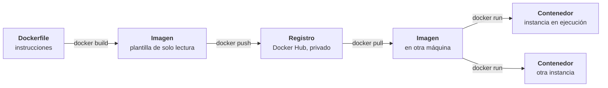
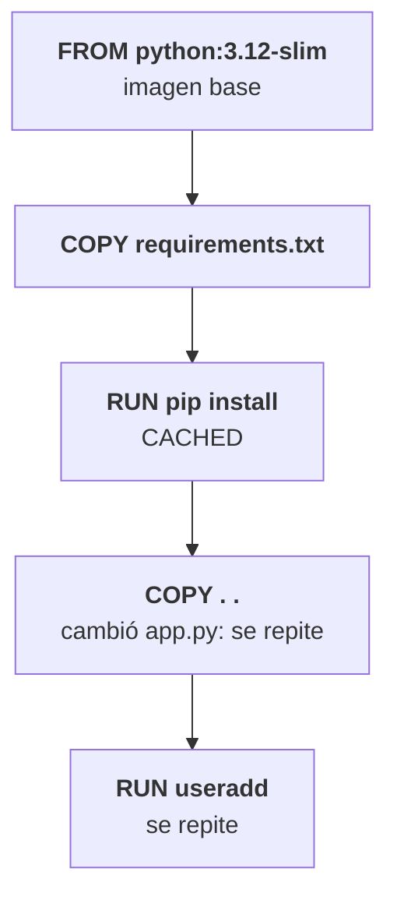
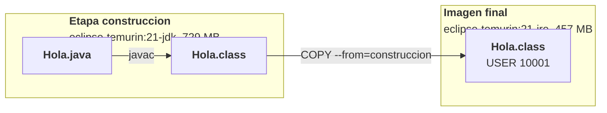

# titulo: Contenedores y Docker


# Qué es un contenedor

## Objetivos de aprendizaje

- **1.1** Explicar qué es un contenedor y qué problema resuelve.
- **1.2** Comparar contenedores y máquinas virtuales.
- **1.3** Identificar las funciones del núcleo Linux en las que se basan (namespaces y cgroups).
- **1.4** Distinguir imagen, contenedor y registro, y situar el estándar OCI.

## El problema: «en mi máquina funciona»

Una aplicación necesita algo más que su código: una versión concreta del lenguaje, bibliotecas del sistema, variables de configuración. Cuando el entorno de producción no coincide con el de desarrollo, aparecen errores que nadie reproduce. Un **contenedor** empaqueta la aplicación **con todo lo que necesita** para ejecutarse, de modo que se comporta igual en el portátil, en la integración continua y en producción.

## Contenedor frente a máquina virtual

| | Máquina virtual | Contenedor |
|---|---|---|
| Qué virtualiza | Un ordenador completo, con su propio núcleo | Solo el espacio de usuario; **comparte el núcleo** del anfitrión |
| Arranque | Minutos (arranca un sistema operativo) | Segundos o menos (arranca un proceso) |
| Tamaño | Gigabytes | De megabytes a cientos de megabytes |
| Aislamiento | Fuerte: un hipervisor separa los núcleos | Menor: un fallo del núcleo afecta a todos los contenedores |
| Sistema operativo | Cualquiera sobre el hipervisor | Contenedores Linux sobre núcleo Linux (en Windows y macOS, Docker usa una VM Linux ligera) |

No son excluyentes: en la nube, lo habitual es ejecutar contenedores **dentro** de máquinas virtuales.

## Cómo aísla Linux un proceso

Un contenedor no es un objeto mágico del núcleo: es un **proceso normal** al que se le aplican dos funciones de Linux:

- **Namespaces** (espacios de nombres): dan al proceso su propia vista de un recurso global. Con el *namespace* de procesos ve su propio árbol, donde él es el **PID 1**; con el de red, sus propias interfaces e IP; con el de montaje, su propio sistema de ficheros; también hay *namespaces* de usuarios, de nombre de máquina y de comunicación entre procesos.
- **cgroups** (grupos de control): limitan y miden los recursos que puede usar (CPU, memoria, E/S). `docker run --memory 512m` crea un límite con cgroups.

Puedes comprobarlo: dentro de un contenedor, `ps` muestra solo sus procesos, y el primero tiene el PID 1.

## Imagen, contenedor y registro



```nodos
DF:
  concepto: dockerfile
IMG:
  concepto: imagen
REG:
  concepto: registro
IMG2:
  titulo: La misma imagen en otra máquina
  texto: Al descargarla se obtiene exactamente el mismo contenido, identificado por su digest.
C1:
  concepto: contenedor
C2:
  titulo: Varias instancias
  texto: De una imagen se crean tantos contenedores como se quiera; cada uno tiene su propia capa escribible.
```

- La **imagen** es una plantilla de **solo lectura**, formada por capas.
- El **contenedor** es una instancia en ejecución de una imagen, con una **capa escribible** propia encima. Lo que escribe se pierde al eliminarlo, salvo que use volúmenes.
- El **registro** almacena y distribuye imágenes (Docker Hub o uno privado).

Una analogía útil: la imagen es la clase y el contenedor, el objeto.

## Un estándar abierto: OCI

La **Open Container Initiative** (OCI) define los estándares del formato de imagen, de la ejecución y de la distribución. Gracias a ella, una imagen construida con Docker se puede ejecutar con Podman, containerd o Kubernetes. «Docker» es una herramienta; los contenedores no dependen de ella.

## Puntos clave

- Un contenedor empaqueta la aplicación con sus dependencias para que se ejecute igual en cualquier sitio.
- Comparte el núcleo del anfitrión: es más ligero que una máquina virtual, pero aísla menos.
- Se basa en dos funciones de Linux: los namespaces (aislamiento) y los cgroups (límites de recursos).
- La imagen es una plantilla de solo lectura; el contenedor, una instancia con una capa escribible; el registro, el almacén de imágenes.
- La OCI estandariza imágenes y ejecución, así que no dependen de una sola herramienta.

## Referencias

- Docker, [What is a container?](https://docs.docker.com/learn/content/what-is-a-container/).
- Linux, [namespaces(7)](https://man7.org/linux/man-pages/man7/namespaces.7.html) y [cgroups(7)](https://man7.org/linux/man-pages/man7/cgroups.7.html).
- [Open Container Initiative](https://opencontainers.org/).

# Imágenes y Dockerfile

## Objetivos de aprendizaje

- **2.1** Escribir un Dockerfile con las instrucciones básicas.
- **2.2** Explicar las capas y ordenar las instrucciones para aprovechar la caché.
- **2.3** Distinguir CMD y ENTRYPOINT, y la forma exec de la forma shell.
- **2.4** Controlar el contexto de construcción con .dockerignore.

## Un Dockerfile completo

Este Dockerfile empaqueta un pequeño servidor HTTP en Python:

```dockerfile
FROM python:3.12-slim
WORKDIR /app
COPY requirements.txt .
RUN pip install --no-cache-dir -r requirements.txt
COPY . .
RUN useradd --system --uid 10001 app
USER app
EXPOSE 8000
CMD ["python", "app.py"]
```

| Instrucción | Qué hace |
|---|---|
| `FROM` | Imagen base de la que se parte |
| `WORKDIR` | Directorio de trabajo para las instrucciones siguientes y para el contenedor |
| `COPY` | Copia ficheros del contexto de construcción a la imagen |
| `RUN` | Ejecuta un comando **al construir** y guarda el resultado como una capa |
| `USER` | Usuario con el que se ejecutan las instrucciones siguientes y el contenedor |
| `EXPOSE` | **Documenta** el puerto en el que escucha la aplicación; no lo publica |
| `ENV` / `ARG` | Variables de entorno de la imagen (también en ejecución) / variables solo de construcción |
| `CMD` | Comando por defecto **al ejecutar** el contenedor |

Se construye y se ejecuta con:

```bash
docker build -t demo-hola:1 .
docker run --rm -p 127.0.0.1:18080:8000 demo-hola:1
curl http://127.0.0.1:18080/     # hola
```

## Capas y caché

Cada `RUN`, `COPY` o `ADD` crea una **capa**. Al reconstruir, Docker reutiliza la capa de la caché si la instrucción y sus entradas no han cambiado; **en cuanto una capa cambia, todas las siguientes se reconstruyen**.

Por eso el orden importa. En el ejemplo, `requirements.txt` se copia y se instala **antes** de copiar el resto del código. Al cambiar solo `app.py`, la reconstrucción reutiliza la capa de `pip install` (aparece como `CACHED`) y solo repite el `COPY . .`. Si se copiara todo primero, cada cambio de código reinstalaría las dependencias.



```nodos
B:
  titulo: Imagen base
  texto: Lo que menos cambia, abajo del todo.
R:
  titulo: Solo el fichero de dependencias
  texto: Se copia antes que el código para que su capa no dependa de app.py.
P:
  concepto: capa
C:
  titulo: La capa que cambió
  texto: En cuanto una capa cambia, todas las siguientes se reconstruyen. Por eso el código va después de instalar las dependencias.
U:
  titulo: Capas siguientes
  texto: Se repiten porque están encima de una capa que cambió, aunque su instrucción sea la misma.
```

Regla práctica: **de lo que menos cambia a lo que más cambia**.

## CMD y ENTRYPOINT

- `CMD` es el comando **por defecto**: los argumentos de `docker run imagen …` lo **sustituyen** por completo.
- `ENTRYPOINT` es el ejecutable fijo; los argumentos de `docker run` se **añaden** a él, y `CMD` aporta los argumentos por defecto.

```dockerfile
ENTRYPOINT ["echo", "hola"]
CMD ["mundo"]
```

`docker run demo-ep` imprime `hola mundo`; `docker run demo-ep a todos` imprime `hola a todos`.

## Forma exec y forma shell

| Forma | Ejemplo | Qué ejecuta |
|---|---|---|
| **Exec** (recomendada) | `CMD ["python", "app.py"]` | El programa directamente |
| **Shell** | `CMD python app.py` | `/bin/sh -c "python app.py"` |

Con la forma shell, el proceso principal (PID 1) puede ser el propio `sh`, que **no reenvía las señales** al programa. Al hacer `docker stop`, Docker envía SIGTERM, espera 10 segundos por defecto y, si el contenedor sigue vivo, lo mata con SIGKILL: la aplicación no tiene ocasión de terminar ordenadamente.

Hay un segundo detalle: en Linux, el **PID 1 no recibe la acción por defecto de SIGTERM** si no instala un manejador. Un programa que no maneja la señal tarda también esos 10 segundos aunque use la forma exec. Las soluciones son manejar SIGTERM en la aplicación (los frameworks web suelen hacerlo) o arrancar el contenedor con `docker run --init`, que pone un proceso *init* mínimo como PID 1 que sí reenvía las señales.

## El contexto y .dockerignore

`docker build .` envía al constructor **todo el directorio** (el contexto). Un `.dockerignore` excluye lo que no debe ir: `.git`, entornos virtuales, bases de datos locales y, sobre todo, **ficheros con secretos** como `.env`, que de otro modo podrían acabar dentro de la imagen con un `COPY . .`.

```text
.git
.venv
__pycache__
*.db
.env
```

## Puntos clave

- Un Dockerfile describe la imagen: `FROM`, `WORKDIR`, `COPY`, `RUN`, `USER`, `EXPOSE`, `CMD`.
- `RUN` actúa al construir; `CMD`, al ejecutar. `EXPOSE` documenta, no publica.
- Cada capa que cambia invalida las siguientes: ordena de lo que menos cambia a lo que más.
- `CMD` se sustituye con los argumentos de `docker run`; a `ENTRYPOINT` se le añaden.
- Usa la forma exec, y maneja SIGTERM o usa `--init` para que el contenedor pare a tiempo.
- `.dockerignore` reduce el contexto y evita meter secretos en la imagen.

## Referencias

- Docker, [Dockerfile reference](https://docs.docker.com/reference/dockerfile/).
- Docker, [Docker build cache](https://docs.docker.com/build/cache/).
- Docker, [Build context](https://docs.docker.com/build/concepts/context/).
- Docker, [docker container run](https://docs.docker.com/reference/cli/docker/container/run/) (opción `--init`).

# Buenas prácticas de imágenes

## Objetivos de aprendizaje

- **3.1** Reducir el tamaño de la imagen con construcciones multietapa e imágenes base ligeras.
- **3.2** Ejecutar como usuario sin privilegios y minimizar la superficie de ataque.
- **3.3** Fijar versiones de la imagen base y de las dependencias.
- **3.4** Manejar secretos de construcción sin dejarlos en la imagen.

## Construcción multietapa

Para compilar hacen falta herramientas (un JDK, un compilador de Go, `node_modules` de desarrollo) que **no** hacen falta para ejecutar. Una construcción **multietapa** usa una etapa para compilar y otra, más ligera, en la que solo se copia el resultado:

```dockerfile
# Etapa 1: compilar con el JDK completo
FROM eclipse-temurin:21-jdk AS construccion
WORKDIR /src
COPY Hola.java .
RUN javac Hola.java

# Etapa 2: ejecutar solo con el JRE
FROM eclipse-temurin:21-jre
WORKDIR /app
COPY --from=construccion /src/Hola.class .
USER 10001
CMD ["java", "Hola"]
```

Al construirlo en esta máquina, la imagen final ocupó **457 MB**, frente a los **729 MB** de la imagen del JDK que habría hecho falta sin etapas. Los tamaños exactos cambian con cada versión, pero la diferencia se mantiene: la imagen final **no lleva el compilador**, así que pesa menos, se descarga antes y ofrece menos herramientas a un atacante.



```nodos
E1:
  concepto: multietapa
SRC:
  titulo: Código fuente
  texto: Solo hace falta para compilar.
CLS:
  titulo: Resultado de compilar
  texto: Lo único que pasa a la imagen final.
E2:
  titulo: Imagen final
  texto: Solo el JRE y el resultado. No lleva el compilador, así que pesa menos, se descarga antes y ofrece menos herramientas a un atacante.
RUN:
  titulo: Lo que se ejecuta
  texto: Con un usuario sin privilegios.
  seccion: 03-buenas-practicas-de-imagenes/teoria#usuario-sin-privilegios
```

## Imágenes base

| Base | Tamaño orientativo | Cuándo |
|---|---|---|
| Completa (`python:3.12`, `eclipse-temurin:21-jdk`) | Cientos de MB | Etapas de construcción, depuración |
| *Slim* (`python:3.12-slim`) | Bastante menor | Opción por defecto para ejecutar |
| Alpine (`alpine:3.20`) | Unos pocos MB | Binarios estáticos; ojo, usa musl en lugar de glibc y algunas bibliotecas se comportan distinto |
| *Distroless* o `scratch` | Mínimo | Binarios autocontenidos; sin shell, más difíciles de depurar |

## Usuario sin privilegios

Por defecto, el proceso de un contenedor se ejecuta como **root** dentro de él. Si un atacante aprovecha una vulnerabilidad de la aplicación, tendrá root en el contenedor y estará más cerca de escapar al anfitrión. Crea un usuario y cámbiate a él:

```dockerfile
RUN useradd --system --uid 10001 app
USER app
```

Al ejecutar, refuerza el aislamiento con opciones de `docker run` (o sus equivalentes en Compose): `--read-only` (sistema de ficheros de solo lectura), `--cap-drop ALL` (sin capacidades del núcleo) y `--security-opt no-new-privileges`.

## Versiones fijas

| Práctica | Problema que evita |
|---|---|
| `FROM python:3.12-slim` en lugar de `python:latest` | Que una construcción futura use otra versión mayor y rompa la aplicación |
| Fijar por *digest* (`python:3.12-slim@sha256:…`) cuando importa la reproducibilidad exacta | Que la misma etiqueta apunte a otra imagen tras una actualización |
| Dependencias con versión (`requests==2.32.3`) | Que cada construcción instale versiones distintas |

Fijar no significa olvidarse: hay que **reconstruir periódicamente** para incorporar parches de seguridad de la imagen base.

## Secretos de construcción

Si la construcción necesita un secreto (un *token* para descargar dependencias privadas), **no** lo pases con `ARG` ni `ENV`: quedaría grabado en las capas o en el historial de la imagen (`docker history`). BuildKit permite montarlo solo durante el `RUN` que lo necesita:

```dockerfile
RUN --mount=type=secret,id=token \
    TOKEN=$(cat /run/secrets/token) pip install --index-url "https://$TOKEN@pypi.empresa.com/simple" paquete
```

```bash
docker build --secret id=token,src=./token.txt .
```

Los secretos **de ejecución** (contraseñas de base de datos) tampoco van en la imagen: se pasan al arrancar el contenedor con variables de entorno o con ficheros montados.

## Puntos clave

- Multietapa: se compila en una etapa y la imagen final solo lleva lo necesario para ejecutar.
- Las bases *slim* son un buen punto de partida; Alpine y *distroless* reducen más con sus pegas.
- No ejecutes como root: crea un usuario y usa `USER`; refuerza con solo lectura y sin capacidades.
- Fija la versión de la base y de las dependencias, y reconstruye para recibir parches.
- Los secretos nunca van en `ARG`, `ENV` ni en capas: usa `--mount=type=secret` al construir.

## Referencias

- Docker, [Multi-stage builds](https://docs.docker.com/build/building/multi-stage/).
- Docker, [Building best practices](https://docs.docker.com/build/building/best-practices/).
- Docker, [Build secrets](https://docs.docker.com/build/building/secrets/).

# Ejecutar contenedores

## Objetivos de aprendizaje

- **4.1** Publicar puertos y entender a qué interfaces se exponen.
- **4.2** Persistir datos con volúmenes y montajes enlazados.
- **4.3** Conectar contenedores con redes propias y resolución por nombre.
- **4.4** Configurar con variables de entorno y limitar recursos.

## Puertos

El contenedor tiene su propia red. Para llegar a él desde el anfitrión, hay que **publicar** un puerto:

```bash
docker run -d -p 127.0.0.1:18080:8000 demo-hola:1
#              ^ IP del anfitrión  ^ puerto del anfitrión : puerto del contenedor
```

Si se omite la IP (`-p 18080:8000`), Docker publica en **todas las interfaces** (`0.0.0.0`), y el servicio queda accesible desde la red. Además, Docker gestiona sus propias reglas de cortafuegos, así que un puerto publicado así puede quedar expuesto **aunque** el cortafuegos del anfitrión (por ejemplo, ufw) no lo permita. Para servicios internos, publica en `127.0.0.1` y pon un proxy delante.

## Datos: la capa escribible es efímera

Lo que el contenedor escribe en su sistema de ficheros desaparece al eliminarlo. Para conservar datos:

| | Volumen | Montaje enlazado (*bind mount*) |
|---|---|---|
| Qué es | Almacenamiento gestionado por Docker | Una carpeta o fichero del anfitrión |
| Sintaxis | `-v datos:/var/lib/postgresql/data` | `-v ./config.yml:/app/config.yml:ro` |
| Uso típico | Bases de datos, ficheros subidos | Código en desarrollo, configuración |
| Depende de la estructura del anfitrión | No | Sí |

Comprobado: un contenedor escribe en un volumen y se elimina; otro contenedor nuevo monta el mismo volumen y lee el fichero. El volumen sobrevive a los contenedores hasta que se borra con `docker volume rm`.

## Redes y resolución por nombre

Dos contenedores que tienen que hablar entre sí (una aplicación y su base de datos) deben estar en la misma red. Hay una diferencia importante:

- En la red **bridge por defecto**, los contenedores **no** se encuentran por nombre.
- En una **red definida por el usuario**, Docker ofrece **DNS interno**: cada contenedor resuelve a los demás por su nombre.

```bash
docker network create mi-red
docker run -d --name bd --network mi-red postgres:16
docker run -d --name app --network mi-red -e DB_HOST=bd mi-app:1   # «bd» se resuelve
```

Por eso la aplicación se configura con el **nombre** del otro contenedor, nunca con su IP, que cambia en cada arranque.

## Configuración y recursos

- **Variables de entorno:** `-e DB_HOST=bd` o `--env-file .env`. Es la forma estándar de configurar un contenedor según el entorno (la misma imagen en pruebas y en producción). El fichero `.env` no se sube a Git.
- **Límites:** `--memory 512m` y `--cpus 1.5` usan cgroups. Sin límites, un contenedor puede agotar la memoria del anfitrión.
- **Reinicio:** `--restart unless-stopped` vuelve a arrancar el contenedor si se cae o si se reinicia el anfitrión.

## Comandos del día a día

| Comando | Para qué |
|---|---|
| `docker ps` / `docker ps -a` | Contenedores en marcha / todos |
| `docker logs -f nombre` | Ver la salida del contenedor |
| `docker exec -it nombre sh` | Abrir un shell dentro de un contenedor en marcha |
| `docker stop` / `docker rm` | Parar / eliminar |
| `docker run --rm …` | Eliminar el contenedor automáticamente al terminar |

## Puntos clave

- `-p IP:puerto_anfitrión:puerto_contenedor`; sin IP, se publica en todas las interfaces y puede saltarse el cortafuegos del anfitrión.
- La capa escribible es efímera: los datos persistentes van en volúmenes.
- Los volúmenes los gestiona Docker; los montajes enlazados dependen de las carpetas del anfitrión.
- En una red propia, los contenedores se resuelven por nombre; en la bridge por defecto, no.
- La configuración entra por variables de entorno y los recursos se limitan con `--memory` y `--cpus`.

## Referencias

- Docker, [Volumes](https://docs.docker.com/engine/storage/volumes/) y [Bind mounts](https://docs.docker.com/engine/storage/bind-mounts/).
- Docker, [Networking overview](https://docs.docker.com/engine/network/) y [Bridge network driver](https://docs.docker.com/engine/network/drivers/bridge/).
- Docker, [Running containers](https://docs.docker.com/engine/containers/run/).
- Docker, [Packet filtering and firewalls](https://docs.docker.com/engine/network/packet-filtering-firewalls/) (Docker y ufw).

# Docker Compose

## Objetivos de aprendizaje

- **5.1** Describir una aplicación de varios servicios en un fichero `compose.yaml`.
- **5.2** Usar la red y los volúmenes que crea Compose.
- **5.3** Ordenar el arranque con `depends_on` y comprobaciones de salud.
- **5.4** Manejar el ciclo de vida con los comandos de Compose.

## Un fichero en lugar de cinco comandos

Una aplicación real tiene varias piezas: la web, una caché, una base de datos. Con `docker run` habría que crear la red, el volumen y cada contenedor con sus opciones, en orden. **Docker Compose** lo describe todo en un fichero YAML y lo levanta con un solo comando:

```yaml
services:
  web:
    image: demo-hola:1
    ports:
      - "127.0.0.1:18082:8000"
    depends_on:
      cache:
        condition: service_healthy
  cache:
    image: redis:7-alpine
    healthcheck:
      test: ["CMD", "redis-cli", "ping"]
      interval: 2s
      retries: 10
    volumes:
      - datos:/data

volumes:
  datos:
```

## Lo que Compose hace por ti

- **Una red por proyecto.** Todos los servicios se conectan a una red propia y se resuelven **por el nombre del servicio**. Desde `web`, el nombre `cache` resuelve a la IP del contenedor de Redis (comprobado al escribir esta lección).
- **Volúmenes con nombre.** `datos` se crea una vez y persiste entre `down` y `up`, salvo que se borre explícitamente.
- **Nombres predecibles.** Los recursos llevan el nombre del proyecto como prefijo (`democomp-web-1`, `democomp_default`), así que varios proyectos conviven sin chocar.

## Orden de arranque y salud

`depends_on` sin más solo garantiza que el contenedor de la dependencia **se ha creado y arrancado**, no que esté **listo** para recibir peticiones. Una base de datos puede tardar varios segundos en aceptar conexiones. Con `condition: service_healthy`, Compose espera a que la comprobación de salud (`healthcheck`) de la dependencia pase:

| `condition` | Espera a que la dependencia… |
|---|---|
| `service_started` (por defecto) | Haya arrancado |
| `service_healthy` | Pase su `healthcheck` |
| `service_completed_successfully` | Termine con éxito (útil para migraciones) |

Aun así, la aplicación debería **tolerar** que la dependencia no esté disponible un momento (reintentos), porque en producción puede caerse y volver en cualquier momento.

## Ciclo de vida

| Comando | Qué hace |
|---|---|
| `docker compose up -d` | Crea y arranca todo en segundo plano (`--wait` espera a que estén sanos) |
| `docker compose ps` | Estado de los servicios |
| `docker compose logs -f web` | Salida de un servicio |
| `docker compose exec web sh` | Shell en un servicio en marcha |
| `docker compose up -d --build` | Reconstruye las imágenes con `build:` y recrea lo que cambió |
| `docker compose down` | Para y elimina contenedores y red; **conserva los volúmenes** |
| `docker compose down -v` | Además, **borra los volúmenes** (¡y sus datos!) |

## Configuración y secretos

Compose lee automáticamente un fichero `.env` junto al `compose.yaml` para sustituir variables (`${PUERTO:-8000}`), y `env_file:` pasa variables a un servicio. Ese `.env` no se sube al repositorio; se acompaña de un `.env.example` sin valores reales.

## Puntos clave

- `compose.yaml` describe servicios, redes y volúmenes; `docker compose up` lo levanta todo.
- Compose crea una red por proyecto en la que los servicios se resuelven por su nombre.
- `depends_on` sin condición no espera a que la dependencia esté lista; usa `service_healthy` con un `healthcheck`.
- `down` conserva los volúmenes; `down -v` los borra.
- La configuración va en `.env` (fuera de Git) y `env_file`.

## Referencias

- Docker, [Docker Compose](https://docs.docker.com/compose/).
- Docker, [Compose file reference](https://docs.docker.com/reference/compose-file/) y [services](https://docs.docker.com/reference/compose-file/services/).
- Docker, [Control startup order](https://docs.docker.com/compose/how-tos/startup-order/).
