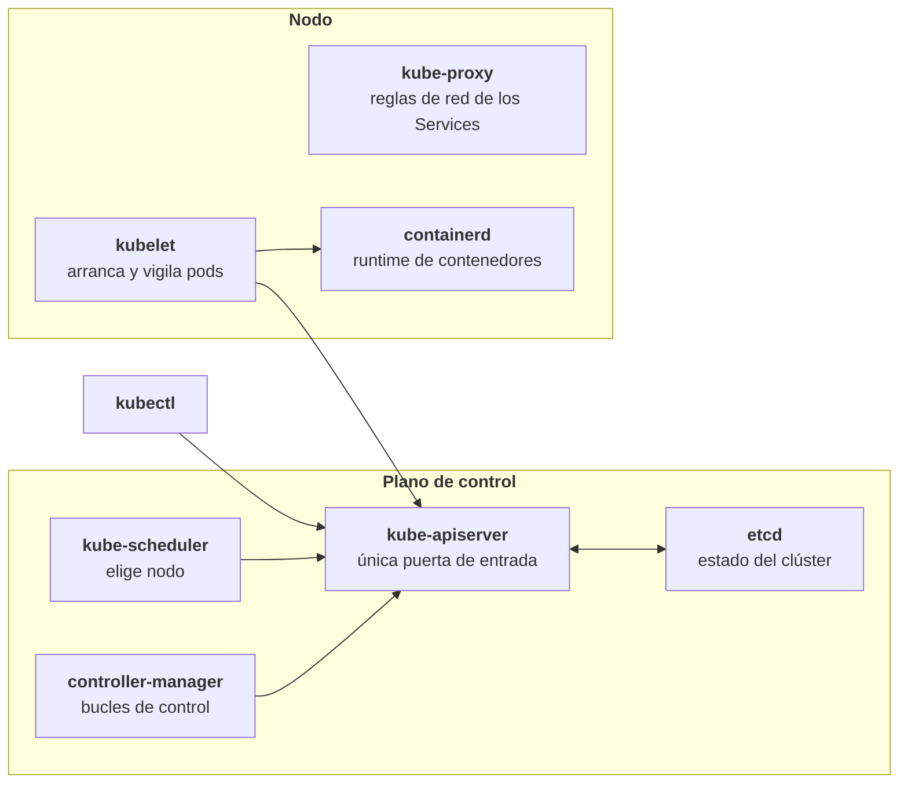
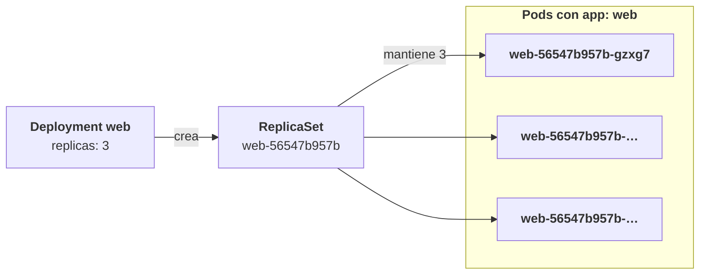
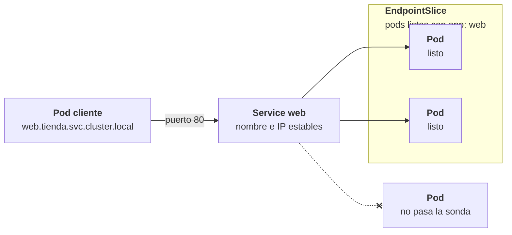

# titulo: Kubernetes


# Qué es Kubernetes y cómo está hecho

## Objetivos de aprendizaje

- **1.1** Explicar qué problema resuelve un orquestador de contenedores.
- **1.2** Describir el modelo de estado deseado y los bucles de control.
- **1.3** Identificar los componentes del plano de control y de los nodos.
- **1.4** Trabajar con manifiestos de forma declarativa.

## Por qué hace falta un orquestador

Docker ejecuta contenedores en **una** máquina. En producción hay que ejecutar muchos contenedores en **varias** máquinas y resolver preguntas que Docker no responde:

- ¿En qué máquina se ejecuta cada contenedor, según los recursos libres?
- ¿Quién vuelve a arrancar un contenedor que se cae, o los de una máquina que se apaga?
- ¿Cómo se actualiza una versión sin cortar el servicio?
- ¿Cómo se encuentran los servicios entre sí si sus contenedores cambian de máquina e IP?

**Kubernetes** (abreviado **K8s**: la K, ocho letras y la s) responde a todo eso. Google lo liberó como código abierto en 2014, a partir de su experiencia ejecutando cargas de producción; su nombre viene del griego «timonel».

## Estado deseado y bucles de control

La idea central es **declarativa**: no le dices a Kubernetes «arranca tres contenedores», sino «quiero que haya tres réplicas de esto». Lo escribes en un **manifiesto** YAML y lo envías al clúster:

```yaml
apiVersion: apps/v1
kind: Deployment
metadata:
  name: web
spec:
  replicas: 3
  # … plantilla del pod …
```

A partir de ahí, unos **controladores** comparan sin parar el **estado real** con el **deseado** y actúan para acercarlos. Es un **bucle de control**, como un termostato: si hay dos réplicas y quieres tres, crea una; si un nodo cae y se pierden pods, los vuelve a crear en otro. Al preparar esta lección, se borró a mano un pod de un Deployment de tres réplicas y, en segundos, apareció otro con un nombre nuevo.

## Arquitectura



```nodos
CP:
  titulo: Plano de control
  texto: Toma las decisiones globales del clúster (qué se ejecuta y dónde) y guarda su estado.
API:
  titulo: kube-apiserver
  texto: Expone la API de Kubernetes. Todos los componentes y kubectl hablan con ella; es el único que habla con etcd.
ETCD:
  concepto: etcd
SCH:
  titulo: kube-scheduler
  texto: Asigna cada pod nuevo a un nodo, teniendo en cuenta los recursos pedidos y las restricciones.
CM:
  concepto: estado-deseado
  titulo: kube-controller-manager
N1:
  titulo: Nodo
  texto: Máquina (física o virtual) donde se ejecutan los pods.
KL:
  concepto: kubelet
KP:
  titulo: kube-proxy
  texto: Mantiene en cada nodo las reglas de red que hacen funcionar los Services.
RT:
  titulo: Runtime de contenedores
  texto: Ejecuta los contenedores. Kubernetes usa runtimes compatibles con CRI, como containerd; las imágenes construidas con Docker funcionan porque siguen el estándar OCI.
U:
  concepto: kubectl
```

| Componente | Dónde | Función |
|---|---|---|
| `kube-apiserver` | Plano de control | La API: única puerta de entrada al clúster |
| `etcd` | Plano de control | Base de datos clave-valor con todo el estado |
| `kube-scheduler` | Plano de control | Decide en qué nodo va cada pod |
| `kube-controller-manager` | Plano de control | Ejecuta los bucles de control (réplicas, nodos…) |
| `kubelet` | Cada nodo | Arranca los contenedores de los pods del nodo y vigila su salud |
| `kube-proxy` | Cada nodo | Reglas de red para los Services |
| Runtime (containerd) | Cada nodo | Ejecuta los contenedores |

## Trabajar de forma declarativa

| Comando | Estilo | Comentario |
|---|---|---|
| `kubectl apply -f web.yaml` | Declarativo | Recomendado: el manifiesto, versionado en Git, es la fuente de verdad |
| `kubectl create deployment …`, `kubectl scale …` | Imperativo | Útil para probar; los cambios no quedan en ningún fichero |

Si cambias el clúster a mano y luego aplicas el manifiesto, el manifiesto gana y tu cambio se pierde. Llevar los manifiestos a Git y aplicar desde ahí (lo que se llama **GitOps**) hace los cambios revisables y repetibles.

Para practicar en local hay herramientas como **kind**, que crea un clúster dentro de contenedores Docker. Es la que se usó para comprobar los ejemplos de este tema (Kubernetes 1.37).

## Puntos clave

- Kubernetes orquesta contenedores en varias máquinas: planifica, reinicia, actualiza y conecta.
- Se declara el estado deseado; los controladores reconcilian continuamente el estado real.
- El plano de control (API, etcd, planificador y controladores) decide; los nodos (kubelet, kube-proxy, runtime) ejecutan.
- Todo pasa por el kube-apiserver; etcd guarda el estado.
- Trabaja de forma declarativa con `kubectl apply` y manifiestos en Git.

## Referencias

- Kubernetes, [Overview](https://kubernetes.io/docs/concepts/overview/).
- Kubernetes, [Components](https://kubernetes.io/docs/concepts/overview/components/).
- Kubernetes, [Controllers](https://kubernetes.io/docs/concepts/architecture/controller/).
- [kind](https://kind.sigs.k8s.io/).

# Pods y Deployments

## Objetivos de aprendizaje

- **2.1** Explicar qué es un pod y por qué no se crean pods sueltos.
- **2.2** Usar etiquetas y selectores para relacionar objetos.
- **2.3** Escribir un Deployment y escalarlo.
- **2.4** Actualizar de forma progresiva y volver atrás.

## El pod

Un **pod** es la unidad mínima de Kubernetes: **uno o varios contenedores** que comparten la misma IP y pueden compartir volúmenes, y que siempre se ejecutan juntos en el mismo nodo. Lo habitual es **un contenedor por pod**; varios solo cuando están muy acoplados (por ejemplo, un *sidecar* que recoge los registros de la aplicación).

Los pods son **efímeros**: si su nodo cae, no se «mueven», se pierden. Por eso casi nunca se crean pods sueltos, sino con un controlador que los vuelva a crear: un **Deployment** para aplicaciones sin estado.

## Etiquetas y selectores

Las **etiquetas** son pares clave-valor que se ponen a los objetos (`app: web`). Los **selectores** eligen objetos por sus etiquetas. Así se relacionan sin referencias directas:

- El Deployment gestiona los pods que coinciden con su `selector`.
- El Service envía tráfico a los pods que coinciden con el suyo.

## Un Deployment

```yaml
apiVersion: apps/v1
kind: Deployment
metadata:
  name: web
  namespace: tienda
spec:
  replicas: 3
  selector:
    matchLabels:
      app: web            # gestiona los pods con esta etiqueta…
  template:
    metadata:
      labels:
        app: web          # …y los crea con ella
    spec:
      containers:
        - name: web
          image: nginx:1.27-alpine
          ports:
            - containerPort: 80
```

El `selector` y las etiquetas de la `template` **deben coincidir**. El Deployment no crea los pods directamente: crea un **ReplicaSet**, que mantiene el número de réplicas. Por eso los pods tienen nombres como `web-56547b957b-gzxg7`: Deployment, ReplicaSet (un *hash* de la plantilla) y un sufijo aleatorio.



```nodos
D:
  concepto: deployment
RS:
  concepto: replicaset
PODS:
  concepto: etiqueta-k8s
P1:
  titulo: Un pod
  texto: Su nombre une el del Deployment, el hash de la plantilla del ReplicaSet y un sufijo aleatorio.
P2:
  concepto: pod
P3:
  titulo: Pod de reemplazo
  texto: Si un pod falla o se borra, el ReplicaSet crea otro para volver a 3.
```

```bash
kubectl apply -f web.yaml
kubectl -n tienda rollout status deploy/web
kubectl -n tienda get pods
kubectl -n tienda scale deploy/web --replicas=5   # (mejor, cambiar replicas en el manifiesto)
```

## Actualizaciones progresivas

Al cambiar la plantilla (por ejemplo, la imagen), el Deployment crea un **ReplicaSet nuevo** y va sustituyendo pods poco a poco. La estrategia por defecto es `RollingUpdate`, con `maxSurge: 25%` (pods de más que puede haber durante la actualización) y `maxUnavailable: 25%` (pods que pueden faltar).

```bash
kubectl -n tienda set image deploy/web web=nginx:1.28-alpine
kubectl -n tienda rollout status deploy/web
```

Qué pasa si la versión nueva está rota, comprobado con una imagen inexistente (`nginx:no-existe`): el pod nuevo se queda en `ImagePullBackOff` y **los tres pods de la versión anterior siguen en marcha**. La actualización se detiene y el servicio no se corta. Para volver atrás:

```bash
kubectl -n tienda rollout undo deploy/web
```

`rollout undo` recupera la plantilla anterior, pero **no** cambia el manifiesto: kubectl avisa de que la anotación de la última configuración aplicada queda desactualizada. Lo recomendable es corregir el manifiesto en Git y volver a aplicarlo.

## Puntos clave

- Un pod agrupa contenedores que comparten IP y se ejecutan juntos; lo normal es uno por pod.
- Los pods son efímeros: se gestionan con controladores como Deployment.
- Las etiquetas y los selectores relacionan Deployments, pods y Services.
- Un Deployment crea un ReplicaSet que mantiene las réplicas.
- La actualización progresiva sustituye pods poco a poco; si la versión nueva falla, la anterior sigue sirviendo.
- `rollout undo` vuelve atrás, pero el manifiesto en Git debe reflejar el estado final.

## Referencias

- Kubernetes, [Pods](https://kubernetes.io/docs/concepts/workloads/pods/).
- Kubernetes, [Deployments](https://kubernetes.io/docs/concepts/workloads/controllers/deployment/).
- Kubernetes, [Labels and Selectors](https://kubernetes.io/docs/concepts/overview/working-with-objects/labels/).

# Services y acceso

## Objetivos de aprendizaje

- **3.1** Explicar por qué hace falta un Service delante de los pods.
- **3.2** Elegir el tipo de Service: ClusterIP, NodePort o LoadBalancer.
- **3.3** Resolver un Service por DNS dentro del clúster.
- **3.4** Exponer aplicaciones HTTP con Ingress o la Gateway API.

## El problema: los pods cambian

Cada pod tiene su IP, pero los pods se crean y se destruyen continuamente (actualizaciones, fallos, escalado). Ningún cliente puede depender de esas IP. Un **Service** da un **nombre y una IP estables** a un grupo de pods, elegidos por etiquetas, y reparte el tráfico entre ellos:

```yaml
apiVersion: v1
kind: Service
metadata:
  name: web
  namespace: tienda
spec:
  selector:
    app: web          # pods con esta etiqueta
  ports:
    - port: 80        # puerto del Service
      targetPort: 80  # puerto del contenedor
```

Kubernetes mantiene la lista de pods del Service en objetos **EndpointSlice**. Solo reciben tráfico los pods **listos** (los que pasan su sonda de disponibilidad; ver la lección siguiente).



```nodos
CLI:
  titulo: Cliente dentro del clúster
  texto: Usa el nombre DNS del Service. Desde el mismo namespace basta con «web».
  seccion: 03-services-y-acceso/teoria#dns-interno
SVC:
  concepto: service
EPS:
  titulo: EndpointSlice
  texto: La lista de pods del Service, que Kubernetes mantiene al día mientras los pods se crean y se destruyen.
P1:
  concepto: pod
P2:
  titulo: Pod listo
  texto: Pasa su sonda de disponibilidad, así que recibe tráfico.
P3:
  concepto: sonda
```

## Tipos de Service

| Tipo | Accesible desde | Uso típico |
|---|---|---|
| `ClusterIP` (por defecto) | Solo dentro del clúster | Comunicación entre servicios internos |
| `NodePort` | Un puerto (30000–32767 por defecto) en cada nodo | Pruebas, entornos sin balanceador |
| `LoadBalancer` | Un balanceador externo que crea el proveedor de nube | Exponer un servicio a Internet en la nube |
| `ExternalName` | Alias DNS de un nombre externo | Apuntar a un servicio fuera del clúster |

## DNS interno

Cada Service recibe un nombre DNS con la forma `<servicio>.<namespace>.svc.cluster.local`. Desde un pod del mismo namespace basta con el nombre corto (`web`). Al preparar la lección, desde un pod temporal:

```bash
kubectl -n tienda run cliente --image=alpine:3.20 --restart=Never --rm -i -- \
  wget -qO- http://web.tienda.svc.cluster.local/
# devuelve la página de bienvenida de nginx, servida por uno de los pods
```

## Ingress y Gateway API

Para HTTP, tener un `LoadBalancer` por servicio es caro. Un **Ingress** define reglas por nombre de host y ruta hacia distintos Services detrás de un único punto de entrada:

```yaml
apiVersion: networking.k8s.io/v1
kind: Ingress
metadata:
  name: tienda
  namespace: tienda
spec:
  rules:
    - host: tienda.example.com
      http:
        paths:
          - path: /
            pathType: Prefix
            backend:
              service:
                name: web
                port:
                  number: 80
```

Un Ingress **no hace nada por sí solo**: necesita un **controlador de Ingress** instalado en el clúster (por ejemplo, el de NGINX o Traefik) que lea esas reglas y configure el proxy. La **Gateway API** es su sucesora, más expresiva y con roles separados (quien gestiona la infraestructura y quien define las rutas). El proyecto Kubernetes recomienda Gateway en lugar de Ingress: la API de Ingress está **congelada**, es decir, sigue disponible y estable y no hay planes de retirarla, pero ya no recibe cambios.

## Puntos clave

- Un Service da nombre e IP estables a un conjunto cambiante de pods, elegidos por etiquetas.
- Solo los pods listos reciben tráfico; la lista vive en EndpointSlices.
- ClusterIP es interno; NodePort abre un puerto en los nodos; LoadBalancer crea un balanceador externo.
- El DNS interno resuelve `<servicio>.<namespace>.svc.cluster.local`, o solo `<servicio>` en el mismo namespace.
- Ingress enruta HTTP por host y ruta y necesita un controlador; su API está congelada y se recomienda la Gateway API.

## Referencias

- Kubernetes, [Service](https://kubernetes.io/docs/concepts/services-networking/service/).
- Kubernetes, [Ingress](https://kubernetes.io/docs/concepts/services-networking/ingress/).
- Kubernetes, [Gateway API](https://kubernetes.io/docs/concepts/services-networking/gateway/).

# Configuración, recursos y sondas

## Objetivos de aprendizaje

- **4.1** Inyectar configuración con ConfigMaps y datos sensibles con Secrets.
- **4.2** Entender los límites de seguridad de los Secrets.
- **4.3** Fijar requests y limits, y reconocer un OOMKilled.
- **4.4** Configurar sondas de disponibilidad, de vida y de arranque.
- **4.5** Organizar recursos con namespaces.

## ConfigMap y Secret

La imagen es la misma en todos los entornos; lo que cambia se inyecta con:

```yaml
apiVersion: v1
kind: ConfigMap
metadata:
  name: web-config
  namespace: tienda
data:
  MENSAJE: "Hola desde Kubernetes"
---
apiVersion: v1
kind: Secret
metadata:
  name: web-secreto
  namespace: tienda
type: Opaque
stringData:
  CLAVE_API: "no-la-subas-a-git"
```

En el contenedor, se cargan como variables de entorno (también se pueden montar como ficheros):

```yaml
envFrom:
  - configMapRef:
      name: web-config
  - secretRef:
      name: web-secreto
```

## Lo que un Secret no es

Los valores de un Secret se guardan en **base64**, que es una **codificación, no un cifrado**: `kubectl get secret web-secreto -o jsonpath='{.data.CLAVE_API}'` devuelve `bm8tbGEtc3ViYXMtYS1naXQ=`, y `base64 -d` lo descifra sin clave. Según la documentación de Kubernetes, por defecto los Secrets se guardan **sin cifrar en etcd**, y cualquiera que pueda crear pods en un namespace puede leer sus Secrets.

| Medida | Para qué |
|---|---|
| Cifrado en reposo de etcd | Que una copia de etcd no exponga los Secrets |
| RBAC restrictivo | Limitar quién puede leer Secrets o crear pods |
| No guardar Secrets en Git en claro | Usar herramientas como Sealed Secrets o SOPS, o un gestor externo de secretos |

## Recursos: requests y limits

```yaml
resources:
  requests:
    cpu: 50m        # 0,05 CPU
    memory: 32Mi
  limits:
    memory: 64Mi
```

- Los **requests** son lo que el contenedor pide. El **planificador** los usa para elegir un nodo con hueco.
- Los **limits** son el máximo. Si un contenedor supera su límite de **memoria**, el núcleo lo mata: aparece como **`OOMKilled`**. Comprobado con un pod limitado a 64 MiB que intentaba reservar 200 MiB. Si supera el límite de **CPU**, no muere: se le **frena** (*throttling*).

Sin requests, el planificador no sabe cuánto ocupa cada pod y puede saturar un nodo; sin límite de memoria, un pod con una fuga puede afectar a todo el nodo.

## Sondas

El kubelet comprueba la salud de los contenedores con tres tipos de **sonda**:

| Sonda | Pregunta | Si falla |
|---|---|---|
| `readinessProbe` (disponibilidad) | ¿Puede atender tráfico ahora? | Se saca del Service; **no** se reinicia |
| `livenessProbe` (vida) | ¿Sigue vivo o se ha bloqueado? | Se **reinicia** el contenedor |
| `startupProbe` (arranque) | ¿Ha terminado de arrancar? | Mientras no pase, las otras dos no se evalúan |

```yaml
readinessProbe:
  httpGet:
    path: /
    port: 80
  periodSeconds: 5
livenessProbe:
  httpGet:
    path: /
    port: 80
  periodSeconds: 10
```

Un error habitual es usar como sonda de vida algo que depende de otros servicios (la base de datos): si la base de datos cae, Kubernetes reinicia todos los pods sin necesidad, lo que no arregla nada. La sonda de vida debe comprobar **solo el propio proceso**.

## Namespaces

Un **namespace** agrupa recursos (`tienda`, `pagos`, `staging`). Los nombres son únicos dentro de cada uno, y sobre ellos se aplican permisos (RBAC) y cuotas. No aíslan la red por sí solos: para eso están las *NetworkPolicies*.

## Puntos clave

- ConfigMap para configuración, Secret para datos sensibles; se inyectan como variables o ficheros.
- base64 no es cifrado: los Secrets van sin cifrar en etcd salvo que se configure el cifrado en reposo.
- Requests para planificar; limits como máximo. Superar el límite de memoria da OOMKilled; el de CPU, *throttling*.
- La sonda de disponibilidad saca del tráfico; la de vida reinicia; la de arranque protege los arranques lentos.
- La sonda de vida no debe depender de otros servicios.
- Los namespaces organizan y permiten aplicar permisos y cuotas.

## Referencias

- Kubernetes, [ConfigMaps](https://kubernetes.io/docs/concepts/configuration/configmap/) y [Secrets](https://kubernetes.io/docs/concepts/configuration/secret/).
- Kubernetes, [Good practices for Kubernetes Secrets](https://kubernetes.io/docs/concepts/security/secrets-good-practices/).
- Kubernetes, [Resource Management for Pods and Containers](https://kubernetes.io/docs/concepts/configuration/manage-resources-containers/).
- Kubernetes, [Liveness, Readiness, and Startup Probes](https://kubernetes.io/docs/concepts/configuration/liveness-readiness-startup-probes/).
- Kubernetes, [Namespaces](https://kubernetes.io/docs/concepts/overview/working-with-objects/namespaces/).

# Estado y escalado

## Objetivos de aprendizaje

- **5.1** Pedir almacenamiento persistente con PersistentVolumeClaims.
- **5.2** Elegir entre Deployment y StatefulSet.
- **5.3** Escalar automáticamente con el HorizontalPodAutoscaler.
- **5.4** Diagnosticar problemas habituales con kubectl.

## Almacenamiento persistente

Los volúmenes normales de un pod viven y mueren con él. Para datos que deben sobrevivir, un pod pide almacenamiento con una **PersistentVolumeClaim** (PVC):

```yaml
apiVersion: v1
kind: PersistentVolumeClaim
metadata:
  name: datos-bd
spec:
  accessModes: ["ReadWriteOnce"]
  resources:
    requests:
      storage: 10Gi
```

Kubernetes la vincula a un **PersistentVolume** (PV). En la nube, una **StorageClass** crea el disco automáticamente (aprovisionamiento dinámico). El pod monta la PVC sin saber qué disco hay detrás.

## Deployment o StatefulSet

| | Deployment | StatefulSet |
|---|---|---|
| Para | Aplicaciones sin estado (APIs, webs) | Aplicaciones con estado (bases de datos, colas) |
| Nombre de los pods | Aleatorio (`web-56547b957b-gzxg7`) | Estable y ordenado (`bd-0`, `bd-1`) |
| Almacenamiento | Compartido o ninguno | Una PVC **propia por pod** (`volumeClaimTemplates`) |
| Orden | Todos a la vez | Arranque y parada en orden |

Que exista StatefulSet no significa que haya que llevar todas las bases de datos a Kubernetes: un servicio gestionado del proveedor de nube suele ser más sencillo de operar.

## Escalado automático

El **HorizontalPodAutoscaler** (HPA) ajusta el número de réplicas de un Deployment según una métrica:

```yaml
apiVersion: autoscaling/v2
kind: HorizontalPodAutoscaler
metadata:
  name: web
spec:
  scaleTargetRef:
    apiVersion: apps/v1
    kind: Deployment
    name: web
  minReplicas: 2
  maxReplicas: 10
  metrics:
    - type: Resource
      resource:
        name: cpu
        target:
          type: Utilization
          averageUtilization: 70
```

Dos condiciones para que funcione: el clúster necesita un servidor de métricas (como *metrics-server*), y los contenedores deben declarar **requests** de CPU, porque la utilización se calcula como porcentaje de lo pedido. Si un HPA gestiona las réplicas, conviene quitar `replicas` del manifiesto del Deployment, para que `kubectl apply` no las reinicie.

## Diagnóstico con kubectl

| Síntoma | Qué mirar |
|---|---|
| Pod en `Pending` | `kubectl describe pod`: eventos del planificador (no hay recursos, PVC sin vincular) |
| `ImagePullBackOff` | Nombre o etiqueta de la imagen, credenciales del registro |
| `CrashLoopBackOff` | `kubectl logs pod --previous`: la salida del contenedor que falló |
| `OOMKilled` | Límite de memoria demasiado bajo o fuga de memoria |
| El Service no responde | `kubectl get endpointslices`: ¿coincide el selector? ¿hay pods listos? |

`kubectl describe` y `kubectl get events` cuentan casi siempre qué ha pasado.

## Puntos clave

- Los datos persistentes van en PersistentVolumeClaims, que se vinculan a PersistentVolumes, a menudo creados por una StorageClass.
- Deployment para aplicaciones sin estado; StatefulSet para las que necesitan identidad y almacenamiento propios.
- El HPA escala según métricas; necesita un servidor de métricas y requests de CPU.
- Pending, ImagePullBackOff, CrashLoopBackOff y OOMKilled se diagnostican con describe, logs y events.

## Referencias

- Kubernetes, [Persistent Volumes](https://kubernetes.io/docs/concepts/storage/persistent-volumes/).
- Kubernetes, [StatefulSets](https://kubernetes.io/docs/concepts/workloads/controllers/statefulset/).
- Kubernetes, [Horizontal Pod Autoscaling](https://kubernetes.io/docs/tasks/run-application/horizontal-pod-autoscale/).
