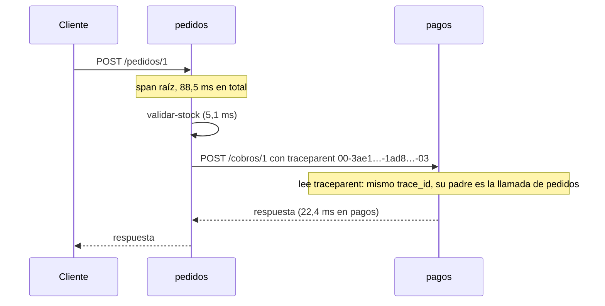
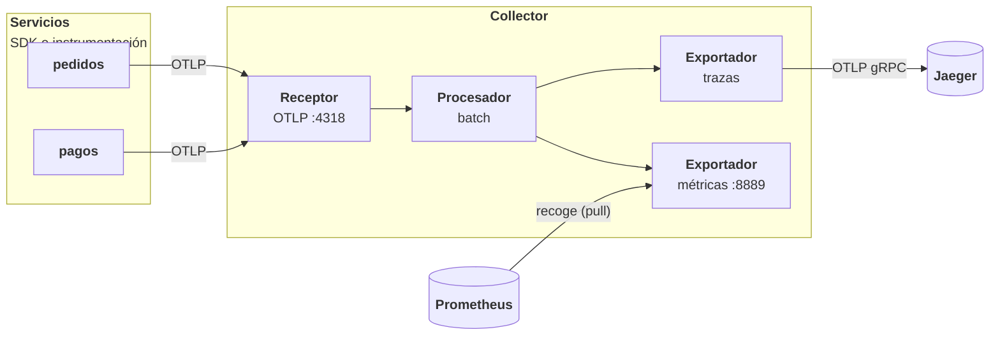

# Observabilidad: logs, métricas y trazas


# Por qué observar

## Objetivos de aprendizaje

- **1.1** Distinguir monitorización de observabilidad.
- **1.2** Describir las tres señales: logs, métricas y trazas.
- **1.3** Elegir qué medir con las señales doradas y los métodos RED y USE.
- **1.4** Definir SLI y SLO.

Los ejemplos del tema salen de un laboratorio con dos servicios Python (`pedidos` llama a `pagos`) instrumentados con OpenTelemetry 1.45, un Collector 0.165, Jaeger 2.23 y Prometheus 3.16. `pagos` tarda 0,8 s en los pedidos múltiplos de 10 y falla con 502 en los múltiplos de 7.

## Monitorizar y observar

**Monitorizar** es vigilar lo que ya sabes que puede fallar: «avísame si la CPU pasa del 90 %». **Observar** es poder responder preguntas **nuevas** sin desplegar código: «¿por qué solo los pedidos con Bizum de clientes de Canarias tardan 3 segundos desde las 10:40?».

Con una aplicación de un solo proceso basta un depurador. Con diez servicios, colas y bases de datos, la única forma de entender un fallo es que el sistema **emita** suficiente información para reconstruir qué pasó.

## Las tres señales

| Señal | Qué es | Responde a |
|---|---|---|
| **Logs** | Eventos sueltos con su contexto | ¿Qué pasó exactamente en este pedido? |
| **Métricas** | Números agregados en el tiempo | ¿Cuántos errores por segundo? ¿Va a peor? |
| **Trazas** | El recorrido de una petición por los servicios | ¿Dónde se fueron los 900 ms de esta petición? |

Se complementan. La métrica avisa («la tasa de error es del 14 %»), la traza localiza («falla la llamada de `pedidos` a `pagos`») y el log explica («banco no disponible»). Para pasar de una a otra hace falta un **identificador común**, el `trace_id` (lección siguiente).

## Qué medir

**Las cuatro señales doradas** del libro de SRE de Google, para un servicio de cara al usuario:

- **Latencia**: cuánto tardan las peticiones, separando las correctas de las fallidas.
- **Tráfico**: cuánta demanda hay (peticiones por segundo).
- **Errores**: qué proporción falla.
- **Saturación**: cuánto de lleno está el recurso más limitado.

Dos atajos que se usan a menudo:

- **RED**, para servicios: *Rate* (tasa), *Errors* (errores) y *Duration* (duración).
- **USE**, para recursos (CPU, memoria, disco, red): *Utilization*, *Saturation* y *Errors*.

En el laboratorio, la tasa de error de `pedidos` fue **0,14**, justo 1 de cada 7, como se había programado.

## SLI y SLO

- Un **SLI** (*Service Level Indicator*) mide el servicio **tal como lo percibe el usuario**: proporción de peticiones correctas, o que responden en menos de 300 ms.
- Un **SLO** (*Service Level Objective*) es el objetivo para ese indicador: «el 99,9 % de las peticiones correctas en 30 días».

Lo que queda entre el SLO y el 100 % es el **presupuesto de error**: mientras queda, se puede arriesgar (desplegar más a menudo); si se agota, toca dedicarse a la fiabilidad. Las **alertas** deberían saltar por lo que afecta al SLO, no por cada síntoma interno: una CPU al 95 % sin usuarios afectados no merece despertar a nadie.

## Puntos clave

- Monitorizar vigila lo previsto; observar permite responder preguntas nuevas.
- Logs, métricas y trazas se complementan; el `trace_id` las une.
- Señales doradas: latencia, tráfico, errores y saturación. RED para servicios, USE para recursos.
- El SLI mide lo que percibe el usuario; el SLO fija el objetivo; el resto es presupuesto de error.
- Alerta por síntomas que afectan al usuario, no por causas internas.

## Referencias

- OpenTelemetry, [Observability primer](https://opentelemetry.io/docs/concepts/observability-primer/).
- Google SRE, [Monitoring distributed systems](https://sre.google/sre-book/monitoring-distributed-systems/).
- Google SRE, [Service level objectives](https://sre.google/sre-book/service-level-objectives/).
- Grafana, [The RED method](https://grafana.com/blog/2018/08/02/the-red-method-how-to-instrument-your-services/).
- Brendan Gregg, [The USE method](https://www.brendangregg.com/usemethod.html).

# Logs estructurados

## Objetivos de aprendizaje

- **2.1** Escribir logs estructurados en JSON.
- **2.2** Correlacionar los logs con las trazas mediante el `trace_id`.
- **2.3** Elegir niveles y saber qué no registrar.

## De texto libre a campos

Un log de texto libre se lee bien, pero se filtra mal:

```text
2026-11-19 17:02:31 INFO Pedido 7 no cobrado (502)
```

¿Cómo se buscan todos los fallos del banco de la última hora, agrupados por código? Con expresiones regulares frágiles. Un **log estructurado** es un objeto con **campos**:

```json
{"nivel": "INFO", "servicio": "pedidos", "mensaje": "cobro fallido", "pedido": 7, "estado_http": 502,
 "trace_id": "bee2b1f2500d70b04171492a420d94b5", "span_id": "bd382abbef2548fe"}
```

Ahora el sistema de logs (Loki, Elasticsearch, OpenSearch…) filtra por `servicio="pedidos" and estado_http=502` y agrupa por cualquier campo. El **mensaje** es fijo («cobro fallido») y los datos variables van en **campos**, no dentro del texto.

## Correlación con las trazas

Cada línea del laboratorio lleva el `trace_id` y el `span_id` de la traza en curso, leídos del contexto de OpenTelemetry:

```python
ctx = trace.get_current_span().get_span_context()
if ctx.is_valid:
    campos["trace_id"] = format(ctx.trace_id, "032x")
    campos["span_id"] = format(ctx.span_id, "016x")
```

Lo importante: los logs de **los dos servicios** de una misma petición comparten `trace_id`:

```json
{"servicio": "pedidos", "mensaje": "pedido creado", "pedido": 1, "trace_id": "3ae12b4c1f6aa1a62d850bd79cfd5be3", ...}
{"servicio": "pagos", "mensaje": "cobro recibido", "pedido": 1, "trace_id": "3ae12b4c1f6aa1a62d850bd79cfd5be3", ...}
```

Desde una traza lenta se llega a sus logs, y desde un log de error, a la traza completa. Los SDK de OpenTelemetry también pueden enviar los logs por OTLP con ese contexto ya incluido.

## Niveles y contenido

| Nivel | Para |
|---|---|
| `ERROR` | Algo falló y requiere atención |
| `WARNING` | Algo raro que el sistema ha superado (un reintento) |
| `INFO` | Hechos de negocio relevantes: pedido creado, cobro rechazado |
| `DEBUG` | Detalle para desarrollo; normalmente desactivado en producción |

**Nunca** registres contraseñas, tokens, números de tarjeta completos ni datos personales innecesarios: los logs se copian, se guardan meses y los lee mucha gente. Enmascara (`**** 1111`) o no los incluyas.

Registrar **todo** tampoco es gratis: el volumen cuesta dinero y entierra lo importante. Para contar cosas («cuántos pedidos por minuto»), usa una **métrica**, no un log por evento.

## Puntos clave

- Mensaje fijo y datos en campos: los logs en JSON se filtran y agregan.
- Incluye `trace_id` y `span_id` para saltar entre logs y trazas, también entre servicios.
- Niveles con criterio; `DEBUG` desactivado en producción.
- Nada de secretos ni datos personales innecesarios.
- Para contar, métricas; los logs son para el detalle.

## Referencias

- OpenTelemetry, [Logs](https://opentelemetry.io/docs/concepts/signals/logs/).
- OpenTelemetry, [Context propagation](https://opentelemetry.io/docs/concepts/context-propagation/).

# Métricas con Prometheus

## Objetivos de aprendizaje

- **3.1** Elegir el tipo de métrica: contador, medidor o histograma.
- **3.2** Controlar la cardinalidad de las etiquetas.
- **3.3** Consultar con PromQL: `rate` y `histogram_quantile`.
- **3.4** Ajustar los límites de los histogramas a la unidad medida.

## Tipos de métrica

| Tipo | Comportamiento | Ejemplo |
|---|---|---|
| **Contador** | Solo crece (o vuelve a cero al reiniciar) | Pedidos creados, errores |
| **Medidor** (*gauge*) | Sube y baja | Peticiones en curso, memoria usada |
| **Histograma** | Cuenta observaciones por intervalos (*buckets*) | Duración de las peticiones |

En el laboratorio, con el SDK de OpenTelemetry:

```python
pedidos_creados = meter.create_counter("pedidos.creados", unit="{pedido}")
duracion_cobro = meter.create_histogram("pedidos.cobro.duracion", unit="s")

pedidos_creados.add(1, {"canal": "web"})
duracion_cobro.record(segundos, {"resultado": "ok"})
```

Al exportarlas a Prometheus, los nombres se adaptan a sus convenciones: `pedidos_creados_total` (los contadores acaban en `_total`) y `pedidos_cobro_duracion_seconds_bucket`, `_sum` y `_count` (la unidad va en el nombre).

## Etiquetas y cardinalidad

Cada combinación distinta de valores de etiquetas es una **serie temporal** aparte. `resultado="ok"|"error"` crea dos series: bien. Una etiqueta con el **id del pedido** o del usuario crearía una serie por pedido: millones de series, memoria disparada y consultas lentas. La documentación de Prometheus lo advierte expresamente: no uses etiquetas con muchos valores posibles. Ese detalle va en logs y trazas.

## PromQL

Un contador por sí solo («26 pedidos desde que arrancó») dice poco. Lo útil es el **ritmo**:

```promql
sum(rate(pedidos_creados_total[1m]))
```

`rate` calcula el aumento por segundo en la ventana de 1 minuto y tiene en cuenta los reinicios. En el laboratorio dio **3,6 pedidos por segundo**.

La **tasa de error** de `pedidos`:

```promql
sum(rate(http_server_duration_milliseconds_count{exported_job="pedidos", http_status_code=~"5.."}[1m]))
/ sum(rate(http_server_duration_milliseconds_count{exported_job="pedidos"}[1m]))
```

Resultado: **0,14**, uno de cada siete. (La etiqueta es `exported_job` porque Prometheus recoge las métricas del Collector, cuyo `job` es `collector`, y conserva el original con ese nombre.)

Los **percentiles** salen del histograma:

```promql
histogram_quantile(0.99, sum by (le, resultado) (rate(pedidos_cobro_duracion_seconds_bucket[1m])))
```

## La trampa de los buckets

La primera vez, la consulta devolvió un p50 de **2,5 s** y un p99 de **4,95 s**, imposibles para cobros de entre 20 y 800 ms. La causa: los límites por defecto del SDK de Python son `0, 5, 10, 25, 50, 75, 100, 250, 500, 750, 1000…`, pensados para **milisegundos**. Medido en segundos, todo caía en el primer *bucket* (0 a 5), y `histogram_quantile` interpola dentro de él.

Con límites ajustados a segundos:

```python
duracion_cobro = meter.create_histogram(
    "pedidos.cobro.duracion", unit="s",
    explicit_bucket_boundaries_advisory=[0.01, 0.025, 0.05, 0.1, 0.25, 0.5, 1, 2.5],
)
```

el resultado fue un **p50 de 0,039 s** y un **p99 de 0,951 s**, coherente con el 10 % de cobros lentos. Un percentil solo es tan preciso como los *buckets* que lo rodean: ponlos donde están tus valores y tus objetivos (por ejemplo, en 0,3 s si el SLO es «menos de 300 ms»).

## Puntos clave

- Contador para lo que se acumula, medidor para lo que sube y baja, histograma para duraciones y tamaños.
- Etiquetas de pocos valores; ids de usuario o de pedido nunca como etiqueta.
- `rate` da el ritmo de un contador; `histogram_quantile`, los percentiles.
- Los límites de los buckets deben corresponder a la unidad: los de por defecto, en segundos, dieron un p99 de 4,95 s en vez de 0,95 s.

## Referencias

- Prometheus, [Metric types](https://prometheus.io/docs/concepts/metric_types/).
- Prometheus, [Metric and label naming](https://prometheus.io/docs/practices/naming/).
- Prometheus, [Histograms and summaries](https://prometheus.io/docs/practices/histograms/).
- Prometheus, [Query functions](https://prometheus.io/docs/prometheus/latest/querying/functions/).
- OpenTelemetry, [Metrics](https://opentelemetry.io/docs/concepts/signals/metrics/).

# Trazas distribuidas

## Objetivos de aprendizaje

- **4.1** Describir una traza como un árbol de spans.
- **4.2** Explicar cómo se propaga el contexto entre servicios con `traceparent`.
- **4.3** Añadir spans y atributos propios, y marcar errores.
- **4.4** Decidir cómo muestrear.

## Spans

Una **traza** es el recorrido de una petición. Se compone de **spans**: unidades de trabajo con nombre, inicio, duración, atributos, estado y un **padre**. La traza del pedido 1, consultada en la API de Jaeger (sin los spans internos de envío):

```text
pedidos: POST /pedidos/{pedido}          +0.0 ms   88.5 ms
  pedidos: validar-stock                 +1.1 ms    5.1 ms
  pedidos: POST                         +37.8 ms   48.4 ms
    pagos: POST /cobros/{pedido}        +62.8 ms   22.4 ms
```

De un vistazo: la petición tardó 88,5 ms, el cobro en `pagos` 22,4 ms, y casi 25 ms se fueron entre que `pedidos` envió la llamada y `pagos` empezó a procesarla. Esa clase de hueco es imposible de ver con logs o métricas.

## Propagación del contexto

¿Cómo sabe `pagos` que su span es hijo de uno de `pedidos`? El cliente HTTP instrumentado añade la cabecera **`traceparent`** del estándar **W3C Trace Context**, y `pagos` la lee al recibir la petición. La que recibió en el laboratorio:

```text
traceparent: 00-3ae12b4c1f6aa1a62d850bd79cfd5be3-1ad850544f8588b1-03
             │  │                                │                └ indicadores
             │  │                                └ span padre (la llamada de pedidos)
             │  └ trace_id, el mismo en los dos servicios
             └ versión
```

En los indicadores, el bit `01` significa **muestreada** y el `02` que el `trace_id` es aleatorio (nivel 2 del estándar); `03` son los dos. Si un servicio intermedio no propaga la cabecera, la traza **se rompe** en dos. Las colas de mensajes también deben llevarla, en las cabeceras del mensaje.



```nodos
CLI:
  titulo: Cliente
  texto: Inicia la petición. Si no envía traceparent, pedidos crea una traza nueva.
PED:
  concepto: span
PAG:
  concepto: traceparent
```

## Spans y atributos propios

La instrumentación automática crea los spans de HTTP. Los pasos internos importantes se añaden a mano:

```python
with tracer.start_as_current_span("validar-stock") as span:
    span.set_attribute("pedido.id", pedido)
    ...
```

Aquí, **sí** se pueden poner identificadores (a diferencia de las etiquetas de métricas): son datos de una petición concreta.

Cuando algo falla, se marca el **estado de error**. En el pedido 14 (múltiplo de 7), los tres spans del recorrido acabaron en error, en los dos servicios:

```text
pedidos  POST /pedidos/{pedido}   ERROR  502
pedidos  POST                     ERROR  502
pagos    POST /cobros/{pedido}    ERROR  502
```

Así se buscan en Jaeger todas las trazas con errores y se ve dónde empezó el fallo.

## Muestreo

Guardar todas las trazas de un servicio con mucho tráfico es caro. El **muestreo** guarda una parte:

| Tipo | Cuándo decide | Ventaja | Inconveniente |
|---|---|---|---|
| **Head** (al empezar) | En el primer servicio, por ejemplo el 10 % | Barato; los siguientes respetan la decisión del indicador | Descarta errores y lentitudes al azar |
| **Tail** (al terminar) | En el Collector, con la traza completa | Guarda todas las trazas con error o lentas | Necesita retener las trazas en memoria hasta decidir |

Lo habitual es `ParentBased`: cada servicio respeta la decisión que llega en `traceparent`, para no guardar trazas a medias.

## Puntos clave

- Una traza es un árbol de spans con un `trace_id` común; muestra dónde se va el tiempo.
- `traceparent` (W3C) lleva el contexto entre servicios; si alguien no lo propaga, la traza se rompe.
- Añade spans y atributos para los pasos importantes, y marca el estado de error.
- El muestreo head es barato; el tail guarda lo interesante a costa de memoria en el Collector.

## Referencias

- OpenTelemetry, [Traces](https://opentelemetry.io/docs/concepts/signals/traces/).
- OpenTelemetry, [Context propagation](https://opentelemetry.io/docs/concepts/context-propagation/).
- OpenTelemetry, [Sampling](https://opentelemetry.io/docs/concepts/sampling/).
- W3C, [Trace Context Level 2](https://www.w3.org/TR/trace-context-2/).
- Jaeger, [Documentación](https://www.jaegertracing.io/docs/latest/).

# OpenTelemetry y el Collector

## Objetivos de aprendizaje

- **5.1** Describir las piezas de OpenTelemetry: API, SDK, instrumentación y OTLP.
- **5.2** Configurar el SDK en un servicio.
- **5.3** Configurar las tuberías del Collector.
- **5.4** Usar las convenciones semánticas.

## Las piezas

**OpenTelemetry** es un estándar abierto para generar y enviar trazas, métricas y logs **sin atarse a un proveedor**:

| Pieza | Qué es |
|---|---|
| **API** | Lo que usa el código para crear spans y métricas |
| **SDK** | La implementación: muestreo, lotes, exportadores |
| **Instrumentación** | Bibliotecas que crean spans y métricas de frameworks (FastAPI, httpx, JDBC…) sin tocar el código; también hay agentes «sin código» |
| **OTLP** | El protocolo para enviar la telemetría, por gRPC o HTTP |
| **Collector** | Servicio que recibe, procesa y reenvía |

Si mañana cambias Jaeger por otro sistema, solo cambia el exportador del Collector; el código de los servicios no se toca.

## El SDK en un servicio

```python
recurso = Resource.create({"service.name": servicio, "deployment.environment.name": "laboratorio"})

trazas = TracerProvider(resource=recurso)
trazas.add_span_processor(BatchSpanProcessor(OTLPSpanExporter(endpoint=f"{COLECTOR}/v1/traces")))
trace.set_tracer_provider(trazas)

lector = PeriodicExportingMetricReader(OTLPMetricExporter(endpoint=f"{COLECTOR}/v1/metrics"))
metrics.set_meter_provider(MeterProvider(resource=recurso, metric_readers=[lector]))

FastAPIInstrumentor.instrument_app(app)
HTTPXClientInstrumentor().instrument()
```

- El **recurso** identifica quién emite: `service.name` es lo que Jaeger muestra en la lista de servicios.
- `BatchSpanProcessor` envía en lotes, en segundo plano, sin frenar las peticiones.
- Las dos líneas de instrumentación crearon todos los spans HTTP y las métricas `http_server_*` del laboratorio.

## El Collector

El Collector se configura con **tuberías**: receptores → procesadores → exportadores, una por señal. La del laboratorio:

```yaml
receivers:
  otlp:
    protocols:
      http:
        endpoint: 0.0.0.0:4318
processors:
  batch: {}
exporters:
  otlp_grpc/jaeger:
    endpoint: jaeger:4317
    tls:
      insecure: true
  prometheus:
    endpoint: 0.0.0.0:8889
service:
  pipelines:
    traces:
      receivers: [otlp]
      processors: [batch]
      exporters: [otlp_grpc/jaeger]
    metrics:
      receivers: [otlp]
      processors: [batch]
      exporters: [prometheus]
```

- Las trazas van a Jaeger por OTLP.
- Las métricas se exponen en `:8889` para que Prometheus las recoja (modelo *pull*).
- Los **procesadores** son el sitio para lo que no debe ir en cada servicio: lotes, filtrar datos sensibles, añadir atributos, muestreo tail.



```nodos
SRV:
  concepto: opentelemetry
S1:
  titulo: Servicio pedidos
  texto: Envía su telemetría a un sitio cercano y se olvida. No sabe si detrás hay Jaeger u otra cosa.
S2:
  titulo: Servicio pagos
  texto: Igual que pedidos. Cambiar de proveedor no obliga a tocar su código.
COL:
  concepto: collector
REC:
  titulo: Receptor
  texto: Recibe OTLP por HTTP en el puerto 4318.
PRO:
  titulo: Procesadores
  texto: El sitio para lo que no debe repetirse en cada servicio, como los lotes, el filtrado de datos sensibles, los atributos añadidos o el muestreo tail.
EXT:
  titulo: Exportador de trazas
  texto: Las envía a Jaeger por OTLP gRPC.
EXM:
  titulo: Exportador de métricas
  texto: Las expone en el puerto 8889 para que Prometheus las recoja.
J:
  titulo: Jaeger
  texto: Almacena y muestra las trazas.
P:
  titulo: Prometheus
  texto: Recoge las métricas con su modelo pull.
```

Ventajas de poner un Collector en medio: los servicios envían a un sitio cercano y se olvidan, los reintentos y el almacenamiento temporal los hace el Collector, y cambiar de destino es cambiar su configuración.

## Convenciones semánticas

Las **convenciones semánticas** fijan los nombres de atributos y métricas comunes (`service.name`, `http.request.method`, `http.response.status_code`, `http.server.request.duration`), para que cualquier herramienta los entienda igual. Para lo propio, usa un espacio de nombres (`pedido.id`, `pedidos.creados`).

Ojo: las instrumentaciones se van actualizando. La de FastAPI 0.66b2 del laboratorio todavía emitía las métricas con los nombres antiguos (`http_server_duration_milliseconds` y la etiqueta `http_status_code`). Comprueba los nombres reales antes de escribir consultas y paneles.

## Puntos clave

- OpenTelemetry separa API, SDK, instrumentación, protocolo (OTLP) y Collector, sin atarse a un proveedor.
- El recurso (`service.name`) identifica al emisor; la instrumentación automática cubre HTTP y bases de datos.
- El Collector encadena receptores, procesadores y exportadores por señal.
- Las convenciones semánticas unifican nombres, pero comprueba los que emite tu versión.

## Referencias

- OpenTelemetry, [Signals](https://opentelemetry.io/docs/concepts/signals/) y [OTLP](https://opentelemetry.io/docs/specs/otlp/).
- OpenTelemetry, [Python](https://opentelemetry.io/docs/languages/python/) y [Zero-code instrumentation](https://opentelemetry.io/docs/concepts/instrumentation/zero-code/).
- OpenTelemetry, [Collector](https://opentelemetry.io/docs/collector/) y [Configuration](https://opentelemetry.io/docs/collector/configuration/).
- OpenTelemetry, [Semantic conventions](https://opentelemetry.io/docs/concepts/semantic-conventions/).
