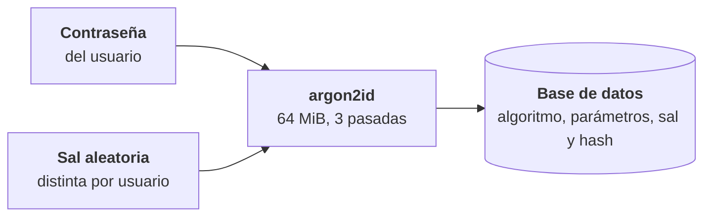
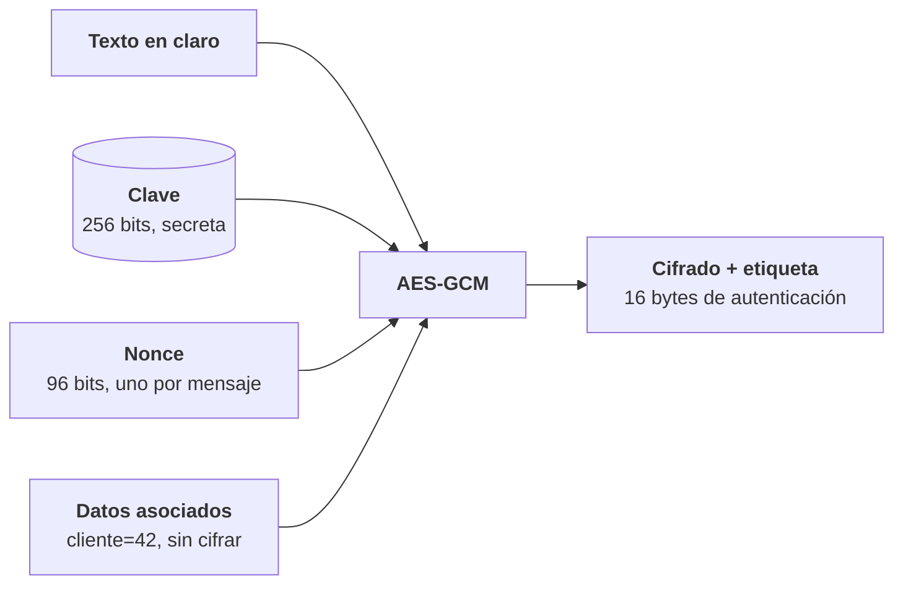
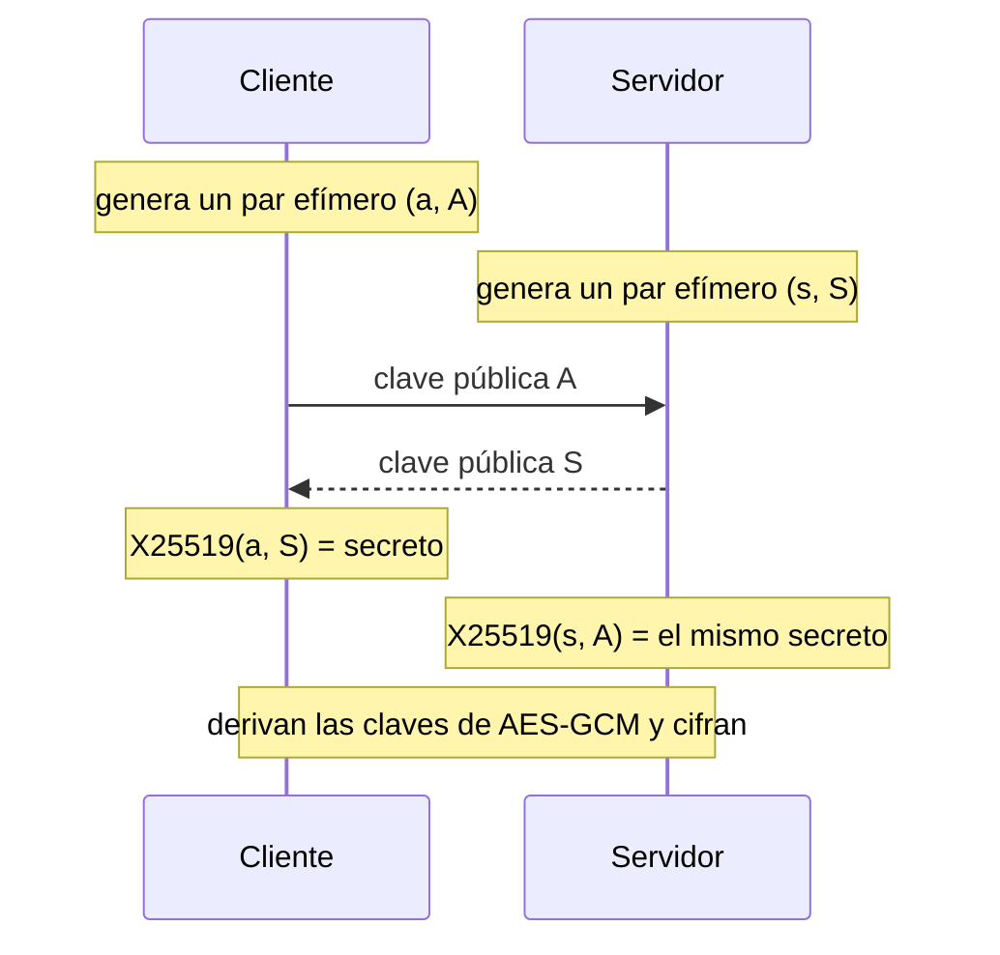
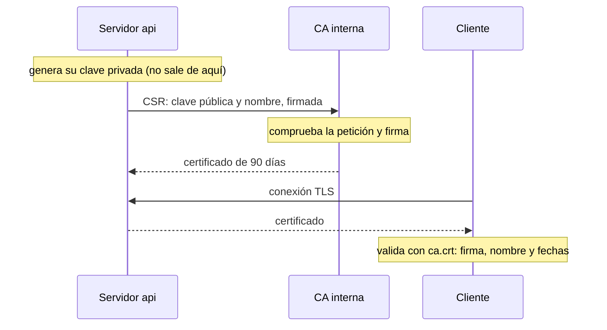
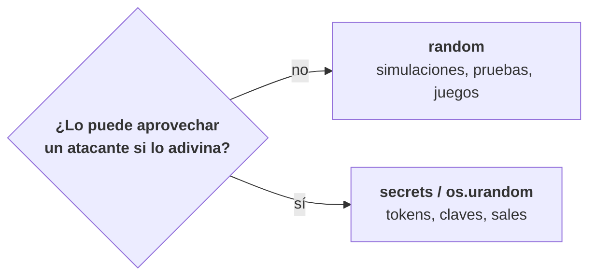

# titulo: Criptografía aplicada


# Hash y contraseñas

## Objetivos de aprendizaje

- **1.1** Explicar qué garantiza una función hash criptográfica y para qué se usa.
- **1.2** Explicar por qué un hash rápido no sirve para guardar contraseñas.
- **1.3** Guardar contraseñas con argon2id, sal y los parámetros recomendados.
- **1.4** Conocer las alternativas (scrypt, bcrypt, PBKDF2) y sus límites.

Los resultados son de Python 3.12 con `hashlib`, argon2-cffi 25.1 y bcrypt 5.0, en un equipo de sobremesa. Las cifras de velocidad dependen del equipo; lo que importa es la proporción.

## Funciones hash

Una **función hash criptográfica** convierte cualquier dato en un **resumen** de tamaño fijo, 256 bits en SHA-256. Propiedades:

| Propiedad | Significado |
|---|---|
| Determinista | La misma entrada da el mismo resumen |
| Unidireccional | A partir del resumen no se puede obtener la entrada |
| Resistente a colisiones | Es inviable encontrar dos entradas con el mismo resumen |
| Efecto avalancha | Un cambio mínimo cambia el resumen por completo |

```text
b'hola'   b221d9dbb083a7f33428d7c2a3c3198ae925614d70210e28716ccaa7cd4ddb79
b'hola.'  3b952738efe124f6b34181cb9e608432741ab05df195462dc98b26f50f9ef217
b'Hola'   e633f4fc79badea1dc5db970cf397c8248bac47cc3acf9915ba60b5d76b0e88f
bits distintos entre hola y hola.: 125 de 256
```

Añadir un punto cambió casi la mitad de los bits, como se espera de un buen hash. Se usa para comprobar la integridad de un fichero descargado, identificar contenido (los objetos de Git, la caché de Docker) y como pieza de firmas y HMAC.

**MD5 y SHA-1 están rotos** frente a colisiones: no se usan para nada de seguridad. SHA-256, SHA-512 y SHA-3 son las opciones actuales.

## Por qué un hash rápido no sirve para contraseñas

Si una base de datos se filtra, el atacante prueba contraseñas candidatas (diccionarios, combinaciones) y compara sus hashes con los robados. Cuantos más hashes calcule por segundo, antes las encuentra. En la prueba:

```text
SHA-256:  2 116 052 hashes por segundo, en un solo hilo de Python
argon2id: 85 ms por hash, unos 12 por segundo
```

SHA-256 está diseñado para ser rápido, y una tarjeta gráfica calcula muchísimos más que un hilo de Python. Para contraseñas hace falta lo contrario: una función **lenta a propósito** y que necesite **mucha memoria**, para que el ataque no se pueda acelerar con hardware barato. Es la diferencia entre probar millones de contraseñas por segundo y probar decenas.

## argon2id

**argon2id** ganó en 2015 la Password Hashing Competition y se define en el RFC 9106. La OWASP recomienda como **mínimo** 19 MiB de memoria, 2 iteraciones y 1 hilo. Los valores por defecto de argon2-cffi son más altos:

```text
parámetros por defecto: 3 pasadas, 65536 KiB, 4 hilos
$argon2id$v=19$m=65536,t=3,p=4$CkW8wWGx6IQ10lUmzib3fg$tmZOjCWnowmdOrbuMJh0zY8db0CJLTONIPT1tYWorSE
```



```nodos
PW:
  titulo: Contraseña
  texto: Nunca se guarda ni se escribe en los registros. Solo se usa para calcular el hash.
SAL:
  concepto: sal
A2:
  concepto: hash-de-contrasenas
BD:
  titulo: Lo que se guarda
  texto: Una sola cadena con todo lo necesario para verificar, incluidos el algoritmo y los parámetros. Así se pueden endurecer los parámetros más adelante y volver a calcular el hash al iniciar sesión.
```

La cadena guarda el algoritmo, los parámetros, la **sal** y el resultado. La sal es aleatoria y distinta en cada hash: dos usuarios con la misma contraseña tienen hashes distintos, y las tablas precalculadas no sirven.

```text
dos hashes de «contrasena»: …fwlCboyuF2AWAfVYL8YkdZqjZLESvY | …ood4vL+Ykdw7QrkVZygQ625VGGfsZM
verifica bien: True
verifica mal: VerifyMismatchError
```

Con Spring Security, `Argon2PasswordEncoder` hace lo mismo en Java. Nunca escribas tu propio esquema de hash de contraseñas.

## Alternativas y sus límites

| Algoritmo | Cuándo | Recomendación de OWASP |
|---|---|---|
| **argon2id** | Primera opción | 19 MiB, 2 iteraciones, 1 hilo como mínimo |
| **scrypt** | Si no hay argon2id | Coste de CPU y memoria 2^17, bloque 8, paralelismo 1 |
| **bcrypt** | Sistemas existentes | Factor de trabajo 10 o más; límite de 72 bytes |
| **PBKDF2** | Si se exige FIPS-140 | 600 000 iteraciones con HMAC-SHA-256 |

El **límite de 72 bytes de bcrypt** es un detalle peligroso: las versiones anteriores truncaban en silencio, así que dos contraseñas largas que empezaran igual daban el mismo hash. bcrypt 5.0 ya lo rechaza:

```text
bcrypt con más de 72 bytes: password cannot be longer than 72 bytes, truncate manually if necessary
```

## Puntos clave

- Un hash criptográfico es determinista, unidireccional, resistente a colisiones y con efecto avalancha.
- MD5 y SHA-1 están rotos; usa SHA-256 o superior para integridad.
- Un hash rápido como SHA-256 no protege contraseñas: millones de pruebas por segundo frente a decenas con argon2id.
- Guarda contraseñas con argon2id, con al menos 19 MiB, 2 iteraciones y 1 hilo, y una sal por contraseña.
- La cadena resultante incluye algoritmo, parámetros y sal; permite endurecer los parámetros sin migrar a la fuerza.
- bcrypt solo para sistemas existentes, con su límite de 72 bytes; PBKDF2 si se exige FIPS.

## Referencias

- OWASP, [Password Storage Cheat Sheet](https://cheatsheetseries.owasp.org/cheatsheets/Password_Storage_Cheat_Sheet.html).
- IETF, [RFC 9106: Argon2](https://www.rfc-editor.org/rfc/rfc9106.html).
- NIST, [FIPS 180-4: Secure Hash Standard](https://csrc.nist.gov/pubs/fips/180-4/upd1/final).

# Cifrado simétrico

## Objetivos de aprendizaje

- **2.1** Cifrar y descifrar con un algoritmo de cifrado autenticado (AES-GCM).
- **2.2** Explicar qué aporta la autenticación y qué son los datos asociados.
- **2.3** Evitar los dos errores clásicos: reutilizar el nonce y usar el modo ECB.
- **2.4** Derivar y guardar claves sin inventar nada.

Las pruebas usan la biblioteca `cryptography` 50.0 de Python. La regla de todo el tema es **no implementar algoritmos propios**: se usan las construcciones de alto nivel de una biblioteca revisada.

## Cifrado autenticado

En el cifrado **simétrico**, la misma clave cifra y descifra. El algoritmo por defecto hoy es **AES-GCM**, o ChaCha20-Poly1305 en equipos sin aceleración de AES. Los dos son de **cifrado autenticado** (AEAD): además de ocultar el contenido, detectan cualquier modificación.

```python
from cryptography.hazmat.primitives.ciphers.aead import AESGCM
import os

clave = AESGCM.generate_key(bit_length=256)
aes = AESGCM(clave)
nonce = os.urandom(12)                          # 96 bits, nuevo para cada mensaje
cifrado = aes.encrypt(nonce, b"tarjeta 4111 1111 1111 1111", b"cliente=42")
aes.decrypt(nonce, cifrado, b"cliente=42")      # b'tarjeta 4111 1111 1111 1111'
```

```text
longitud: texto 27 | cifrado 43 (16 bytes más de etiqueta)
descifrar con un bit cambiado        → InvalidTag
descifrar con otros datos asociados  → InvalidTag
```



```nodos
T:
  titulo: Texto en claro
  texto: Lo que se quiere proteger.
K:
  titulo: Clave
  texto: Secreta, aleatoria y de 256 bits. Se guarda fuera del código y de la base de datos que protege.
  seccion: 05-aleatoriedad-y-secretos/teoria#gestionar-los-secretos
N:
  concepto: nonce
AD:
  titulo: Datos asociados
  texto: No se cifran, pero quedan autenticados. Si cambian, el descifrado falla. Sirven para atar el cifrado a su contexto, como el cliente al que pertenece.
G:
  concepto: cifrado-autenticado
C:
  titulo: Resultado
  texto: Se guarda junto con el nonce, que no es secreto.
```

El nonce **no es secreto**: se guarda junto al cifrado. Lo que no puede hacerse es **repetirlo** con la misma clave.

## Autenticación y datos asociados

Sin autenticación, un atacante puede cambiar bits del cifrado y cambiar el texto descifrado sin que nadie se entere. Con AES-GCM, la **etiqueta** de 16 bytes lo detecta: un solo bit cambiado dio `InvalidTag`.

Los **datos asociados** (*AAD*) no se cifran, pero entran en la etiqueta. Si un campo cifrado de la fila del cliente 42 se copia a la fila del cliente 43, al descifrarlo con `cliente=43` como datos asociados falla. Así el cifrado queda atado a su contexto.

## Dos errores clásicos

**Reutilizar el nonce.** AES-GCM cifra combinando el texto con un flujo que depende de la clave y del nonce. Con el mismo nonce y la misma clave, los dos mensajes usan el mismo flujo:

```text
p1 = "transferir 100 EUR a Ana "
p2 = "transferir 900 EUR a Luis"
c1 XOR c2 == p1 XOR p2: True
quien conoce p1 obtiene p2: b'transferir 900 EUR a Luis'
```

Además, con un nonce repetido en GCM, un atacante puede llegar a falsificar etiquetas. Con nonces aleatorios de 96 bits, el NIST limita a 2^32 los mensajes por clave para que la probabilidad de repetir sea despreciable; más allá, hay que rotar la clave.

**El modo ECB.** Cifra cada bloque de 16 bytes por separado, así que bloques iguales dan resultados iguales. Con tres bloques idénticos y uno distinto:

```text
ECB: ['19ecd638', '19ecd638', '19ecd638', '5fc2663a']
GCM: ['107ec2b6', '81a69536', 'ab29aba1', '88f2b45b']
```

ECB revela qué partes de los datos se repiten, y por eso una imagen cifrada con ECB sigue dejando ver su silueta. No hay ningún caso de uso en que convenga.

## Claves

- **Genera las claves al azar** con la biblioteca (`AESGCM.generate_key`) o con un generador criptográfico (lección 5). Una contraseña no es una clave.
- **Si partes de una contraseña**, deriva la clave con una función lenta como argon2id o scrypt (lección 1). Si partes de otro secreto ya aleatorio, usa **HKDF** (RFC 5869) para obtener claves distintas para cada uso.
- **Separa la clave de los datos**: si la clave está en la misma base de datos que lo cifrado, quien roba una roba la otra (lección 5).

## Puntos clave

- Usa cifrado autenticado: AES-GCM o ChaCha20-Poly1305, desde una biblioteca revisada.
- La etiqueta detecta cualquier modificación; los datos asociados atan el cifrado a su contexto.
- El nonce no es secreto, pero no se repite nunca con la misma clave: la repetición revela los mensajes.
- Con nonces aleatorios de 96 bits, rota la clave antes de 2^32 mensajes.
- No uses ECB: bloques iguales dan cifrados iguales.
- Genera las claves al azar; deriva con argon2id o scrypt si partes de una contraseña, y con HKDF si partes de otro secreto.

## Referencias

- cryptography, [Authenticated encryption](https://cryptography.io/en/latest/hazmat/primitives/aead/).
- NIST, [SP 800-38D: Galois/Counter Mode](https://csrc.nist.gov/pubs/sp/800/38/d/final).
- IETF, [RFC 5869: HKDF](https://www.rfc-editor.org/rfc/rfc5869.html).
- OWASP, [Cryptographic Storage Cheat Sheet](https://cheatsheetseries.owasp.org/cheatsheets/Cryptographic_Storage_Cheat_Sheet.html).

# Claves públicas y firmas

## Objetivos de aprendizaje

- **3.1** Explicar qué permite un par de claves: firmar, acordar un secreto y cifrar para alguien.
- **3.2** Firmar y verificar con Ed25519, y distinguir una firma de un HMAC.
- **3.3** Explicar cómo dos partes acuerdan una clave con X25519, como hace TLS.
- **3.4** Validar un JWT sin caer en las trampas conocidas.

Las pruebas usan `cryptography` 50.0 y PyJWT 2.15 en Python 3.12.

## Un par de claves

En la criptografía de **clave pública** cada parte tiene una **clave privada**, que nunca sale de su equipo, y una **pública**, que se reparte sin problema:

| Uso | Con la privada | Con la pública |
|---|---|---|
| **Firmar** | Quien firma | Cualquiera comprueba la firma |
| **Acordar un secreto** | Cada parte combina la suya… | …con la pública de la otra, y obtienen el mismo secreto |
| **Cifrar para alguien** | El destinatario descifra | Cualquiera cifra para él |

En la práctica casi nunca se cifran datos directamente con la pública: se **acuerda o se envía una clave simétrica** y con ella se cifran los datos con AES-GCM (lección 2). Es lo que se llama **cifrado híbrido**.

## Firmas: Ed25519

```text
firma de 64 bytes; clave pública de 32 bytes
verifica el original: OK
verifica el modificado: InvalidSignature
```

El mensaje firmado era `{"pedido":"cd0aa425","importe":60}`. Cambiar `60` por `6` invalidó la firma. Una firma demuestra **quién** firmó y que **nada ha cambiado**, y cualquiera puede comprobarla sin poder firmar.

**Ed25519** (RFC 8032) es la opción recomendada para firmas nuevas: rápida, con claves pequeñas y con menos formas de usarla mal que RSA o ECDSA.

### Firma o HMAC

Un **HMAC** (RFC 2104) también autentica un mensaje, pero con una **clave compartida**:

| | Firma (Ed25519, RSA) | HMAC (HMAC-SHA-256) |
|---|---|---|
| Claves | Privada para firmar, pública para verificar | La misma clave secreta en los dos lados |
| Quién puede verificar | Cualquiera | Solo quien tiene la clave |
| Quién puede crear | Solo el dueño de la privada | Cualquiera que pueda verificar |
| Uso típico | Actualizaciones de software, JWT entre organizaciones | Webhooks, JWT dentro de un mismo servicio |

Al comprobar un HMAC se usa una comparación en **tiempo constante** (`hmac.compare_digest`); un `==` normal puede delatar, por lo que tarda, cuántos caracteres coinciden.

## Acordar una clave: X25519

Dos partes que no comparten nada pueden obtener el mismo secreto intercambiando solo sus claves públicas:

```text
secreto compartido igual en los dos lados: True 32 bytes
```



```nodos
A:
  concepto: intercambio-de-claves
S:
  titulo: Servidor
  texto: En TLS, además firma el saludo con la clave de su certificado, para que el cliente sepa que habla con él y no con un intermediario.
  seccion: 04-certificados-y-pki/teoria#qué-es-un-certificado
```

Es lo que hace TLS 1.3 en cada conexión, y por eso, si alguien roba más tarde la clave del certificado, no puede descifrar las conexiones grabadas: las claves eran efímeras. En el tema de TCP/IP, la conexión a `curl.se` negoció `X25519MLKEM768`, que combina X25519 con ML-KEM (FIPS 203), un algoritmo resistente a ordenadores cuánticos.

## JWT

Un **JWT** tiene tres partes en Base64URL separadas por puntos: cabecera, carga y firma. **La carga se lee sin ninguna clave**:

```text
cabecera: {'alg': 'HS256', 'typ': 'JWT'} | carga: {'sub': 'ana', 'rol': 'cliente'} ← se lee sin la clave
```

No pongas en un JWT nada que no deba leer quien lo tenga. La firma solo impide **modificarlo**. Las trampas conocidas, recogidas en el RFC 8725:

| Trampa | Qué pasa | Defensa |
|---|---|---|
| `alg: none` | Un token sin firma que dice «no hace falta comprobar» | Fijar la lista de algoritmos admitidos |
| Confusión de algoritmos | Un token HS256 firmado con la clave **pública** RSA del servidor, que el servidor acepta como HMAC | Fijar el algoritmo esperado para cada clave |
| Secreto HS256 débil | Se adivina por fuerza bruta a partir de un token | Secretos aleatorios de al menos 256 bits |
| No validar `exp`, `aud`, `iss` | Tokens caducados o emitidos para otra API | Validar todas las afirmaciones |

PyJWT obliga a indicar los algoritmos. Con un token falso con `alg: none` y `rol: admin`:

```text
decode con algorithms=['HS256']: InvalidAlgorithmError - The specified alg value is not allowed
decode sin indicar algorithms:   DecodeError - It is required that you pass in a value for the "algorithms" argument
```

## Puntos clave

- La privada firma y descifra; la pública verifica y cifra. Para datos se usa cifrado híbrido.
- Ed25519 es la opción por defecto para firmar: firmas de 64 bytes y claves públicas de 32.
- Un HMAC usa una clave compartida: verifica quien puede crear; compáralo en tiempo constante.
- X25519 acuerda un secreto con claves públicas efímeras; TLS 1.3 lo hace en cada conexión.
- La carga de un JWT se lee sin clave; la firma solo impide modificarla.
- Al validar un JWT, fija los algoritmos admitidos y comprueba `exp`, `aud` e `iss`.

## Referencias

- IETF, [RFC 8032: EdDSA](https://www.rfc-editor.org/rfc/rfc8032.html) y [RFC 7748: X25519](https://www.rfc-editor.org/rfc/rfc7748.html).
- IETF, [RFC 2104: HMAC](https://www.rfc-editor.org/rfc/rfc2104.html).
- IETF, [RFC 8725: JWT Best Current Practices](https://www.rfc-editor.org/rfc/rfc8725.html).
- NIST, [FIPS 203: ML-KEM](https://csrc.nist.gov/pubs/fips/203/final).
- [PyJWT](https://pyjwt.readthedocs.io/en/stable/).

# Certificados y PKI

## Objetivos de aprendizaje

- **4.1** Explicar qué es un certificado y qué vincula.
- **4.2** Crear una CA interna, una solicitud de firma (CSR) y un certificado de servidor.
- **4.3** Verificar un certificado y diagnosticar los errores de cadena y de nombre.
- **4.4** Saber cuándo usar TLS mutuo y cómo se gestionan la revocación y la caducidad.

Las pruebas usan OpenSSL 3.5. El tema de TCP/IP, DNS y TLS mostró los certificados públicos de Let's Encrypt; aquí se crea una CA propia para servicios internos.

## Qué es un certificado

Una clave pública por sí sola no dice de quién es. Un **certificado X.509** vincula una clave pública con unos **nombres**, durante un **periodo**, y lo firma una **autoridad de certificación** (CA). Quien confía en la CA puede confiar en ese vínculo.

```text
issuer=CN=CA interna de la tienda
subject=CN=api.tienda.internal
X509v3 Subject Alternative Name: DNS:api.tienda.internal
X509v3 Basic Constraints: CA:FALSE
X509v3 Extended Key Usage: TLS Web Server Authentication
```

| Campo | Para qué |
|---|---|
| Subject Alternative Name | Los nombres para los que vale; es lo que se comprueba |
| Basic Constraints `CA:FALSE` | Este certificado no puede firmar otros |
| Extended Key Usage | Para qué se puede usar: autenticar un servidor, un cliente… |
| Validez | Desde y hasta cuándo |

## Una CA interna

Para servicios internos (`api.tienda.internal`) no hace falta una CA pública: basta una propia en la que confíen tus clientes.



```nodos
SRV:
  titulo: Servidor
  texto: Genera su clave privada y la guarda con permisos 600. Solo envía la CSR.
CA:
  concepto: csr
CLI:
  titulo: Cliente
  texto: Tiene ca.crt como CA de confianza. Sin ella, el certificado no se valida.
```

Los pasos con OpenSSL, con claves de curva elíptica P-256:

```bash
# 1. La CA: clave y certificado autofirmado, marcado como CA
openssl req -x509 -new -newkey ec -pkeyopt ec_paramgen_curve:P-256 -nodes \
  -keyout ca.key -out ca.crt -days 3650 -subj "/CN=CA interna de la tienda" \
  -addext "basicConstraints=critical,CA:TRUE" -addext "keyUsage=critical,keyCertSign,cRLSign"

# 2. El servidor: su clave y una solicitud de firma (CSR)
openssl req -new -newkey ec -pkeyopt ec_paramgen_curve:P-256 -nodes \
  -keyout api.key -out api.csr -subj "/CN=api.tienda.internal"

# 3. La CA firma la CSR, con el nombre en el SAN, para 90 días
openssl x509 -req -in api.csr -CA ca.crt -CAkey ca.key -CAcreateserial \
  -out api.crt -days 90 -extfile ext.cnf
```

`ext.cnf` contiene `subjectAltName=DNS:api.tienda.internal`, `basicConstraints=CA:FALSE`, `keyUsage=digitalSignature` y `extendedKeyUsage=serverAuth`. La clave del servidor quedó con permisos `600`.

La **clave de la CA** es lo más delicado: quien la tenga puede emitir certificados para cualquier nombre interno. Se guarda fuera de los servidores, idealmente en un HSM o un servicio de gestión de claves.

## Verificar y diagnosticar

```text
$ openssl verify -CAfile ca.crt api.crt
api.crt: OK
$ openssl verify api.crt
error 20 at 0 depth lookup: unable to get local issuer certificate
$ openssl verify -CAfile ca.crt -verify_hostname otra.tienda.internal api.crt
error 62 at 0 depth lookup: hostname mismatch
```

| Error | Causa | Solución |
|---|---|---|
| 20, *unable to get local issuer certificate* | El cliente no tiene la CA, o falta un intermedio en la cadena | Instalar la CA en el cliente; enviar la cadena completa |
| 62, *hostname mismatch* | El nombre no está en el SAN | Emitir el certificado con el nombre correcto |
| 10, *certificate has expired* | Caducado | Renovar, y automatizar la renovación |

## TLS mutuo, revocación y caducidad

En TLS normal, solo el servidor presenta certificado. En **TLS mutuo** (mTLS), también el cliente, y el servidor lo valida con su CA: se usa para autenticar servicios entre sí sin contraseñas. Las mallas de servicios (*service mesh*) lo aplican de forma automática entre todos los pods.

Si una clave privada se filtra, hay que **revocar** su certificado: las CA publican listas de revocación (CRL) y responden consultas OCSP. En la práctica, los clientes no siempre las consultan, y por eso la tendencia es acortar la vida de los certificados: con 90 días, o 47 desde 2029 para los públicos, un certificado robado deja de servir pronto. Eso solo funciona con **renovación automática**.

## Puntos clave

- Un certificado vincula una clave pública con unos nombres (SAN), un periodo y la firma de una CA.
- `CA:FALSE` impide que un certificado de servidor firme otros.
- La clave privada no sale del servidor: a la CA se envía una CSR.
- Para servicios internos basta una CA propia; su clave es lo más delicado del sistema.
- Error 20: falta la CA o un intermedio. Error 62: el nombre no está en el SAN.
- TLS mutuo autentica también al cliente; la vida corta de los certificados exige renovarlos de forma automática.

## Referencias

- OpenSSL, [openssl-req](https://docs.openssl.org/3.5/man1/openssl-req/) y [openssl-verify](https://docs.openssl.org/3.5/man1/openssl-verify/).
- IETF, [RFC 5280: certificados X.509](https://www.rfc-editor.org/rfc/rfc5280.html).

# Aleatoriedad y secretos

## Objetivos de aprendizaje

- **5.1** Distinguir un generador aleatorio criptográfico de uno que no lo es.
- **5.2** Generar tokens, claves e identificadores seguros.
- **5.3** Guardar y repartir los secretos de una aplicación fuera del código.
- **5.4** Responder a un secreto filtrado: rotar, revocar y revisar.

Las pruebas usan Python 3.12. Gran parte de los fallos reales de criptografía no están en los algoritmos, sino en cómo se generan y se guardan las claves.

## Aleatorio no es impredecible

El módulo `random` de Python usa el algoritmo **Mersenne Twister**: rápido y con buenas propiedades estadísticas para simulaciones, pero **predecible**. Su estado interno se reconstruye a partir de 624 salidas de 32 bits. En la prueba, tras observar 624 números de un generador con semilla desconocida:

```text
tras observar 624 salidas, las 5 siguientes coinciden: True
token «aleatorio» de la víctima: 8583649615601854702 | predicción: 8583649615601854702
```

Un atacante que vea suficientes valores (identificadores, códigos de invitación) puede predecir el siguiente token de recuperación de contraseña. La documentación de Python lo advierte: los generadores de `random` **no deben usarse para seguridad**; para eso está el módulo `secrets`.



```nodos
Q:
  titulo: La pregunta
  texto: Si alguien gana algo adivinando el valor (un token, una clave, un identificador de sesión), hace falta un generador criptográfico.
R:
  titulo: random
  texto: Mersenne Twister. Reproducible con una semilla, lo que es útil en pruebas, pero predecible a partir de sus salidas.
S:
  concepto: csprng
```

## Generar bien

| Necesidad | En Python |
|---|---|
| Token para una URL (recuperar contraseña, invitación) | `secrets.token_urlsafe(32)` |
| Token en hexadecimal | `secrets.token_hex(32)` |
| Clave de 256 bits | `os.urandom(32)`, o `AESGCM.generate_key(256)` |
| Comparar tokens | `secrets.compare_digest(a, b)` |
| Identificador no secuencial | `uuid.uuid4()` |

`secrets.token_urlsafe(32)` usa 32 bytes aleatorios (256 bits) y los codifica en 43 caracteres, como `U3vJnDNO3BDmAtMQHNzmimPqOyEMHsiTqvpC5e2iOH0`. En Java, el equivalente es `SecureRandom`.

Un UUID v4 es aleatorio, pero no se diseñó como secreto. Para un token de seguridad usa `secrets`.

## Gestionar los secretos

Un **secreto** es cualquier dato que da acceso: contraseñas de bases de datos, claves de API, claves de cifrado, certificados privados. Dónde guardarlo:

| Lugar | Valoración |
|---|---|
| En el código o en el repositorio | **Nunca.** Queda en la historia de Git aunque se borre después |
| Variables de entorno desde un `.env` con permisos 600, fuera de Git | Aceptable en un servidor pequeño; cuidado con los volcados y los registros |
| Gestor de secretos (Vault, el de la nube, secretos de Kubernetes cifrados) | Lo recomendable: acceso por identidad, auditoría y rotación |

Prácticas de la hoja de ayuda de la OWASP:

- **Mínimo privilegio:** cada servicio, solo los secretos que necesita.
- **Rotación:** cambiar los secretos de forma periódica, y de inmediato si se sospecha una filtración. Mejor aún, credenciales temporales que caducan solas.
- **Auditoría:** saber quién leyó qué secreto y cuándo.
- **Separar las claves de los datos:** con el **cifrado de sobre**, cada dato se cifra con su propia clave y esa clave se cifra con una clave maestra que vive en un servicio de gestión de claves y nunca sale de él.
- **No registrarlos:** ni en los registros de la aplicación, ni en los mensajes de error, ni en la salida de la CI.

## Si un secreto se filtra

Un secreto subido a un repositorio, incluso uno privado o durante unos minutos, se da por **comprometido**. Borrar el commit no basta: puede haberse clonado, y hay servicios que rastrean los repositorios públicos en busca de claves. El orden:

1. **Revocar o rotar** el secreto, para que deje de funcionar. Es lo primero.
2. **Revisar los registros** del servicio afectado por si se usó.
3. **Limpiar** la historia del repositorio si procede, sabiendo que no sustituye a lo anterior.
4. **Prevenir:** análisis de secretos en la CI y en la forja. GitHub analiza los repositorios en busca de secretos conocidos, y su protección de push puede bloquear un push que los contenga.

## Puntos clave

- `random` es predecible: 624 salidas bastaron para predecir las siguientes.
- Para tokens, claves y sales usa `secrets` u `os.urandom` (en Java, `SecureRandom`).
- `secrets.token_urlsafe(32)` da 256 bits; compara tokens con `compare_digest`.
- Nunca guardes secretos en el código ni en el repositorio; usa un gestor con mínimo privilegio, auditoría y rotación.
- El cifrado de sobre separa las claves de los datos.
- Ante una filtración, lo primero es revocar o rotar, no borrar el commit.

## Referencias

- Python, [secrets](https://docs.python.org/3/library/secrets.html) y [random](https://docs.python.org/3/library/random.html).
- OWASP, [Secrets Management Cheat Sheet](https://cheatsheetseries.owasp.org/cheatsheets/Secrets_Management_Cheat_Sheet.html).
- GitHub Docs, [Secret scanning](https://docs.github.com/en/code-security/concepts/secret-security/secret-scanning).
