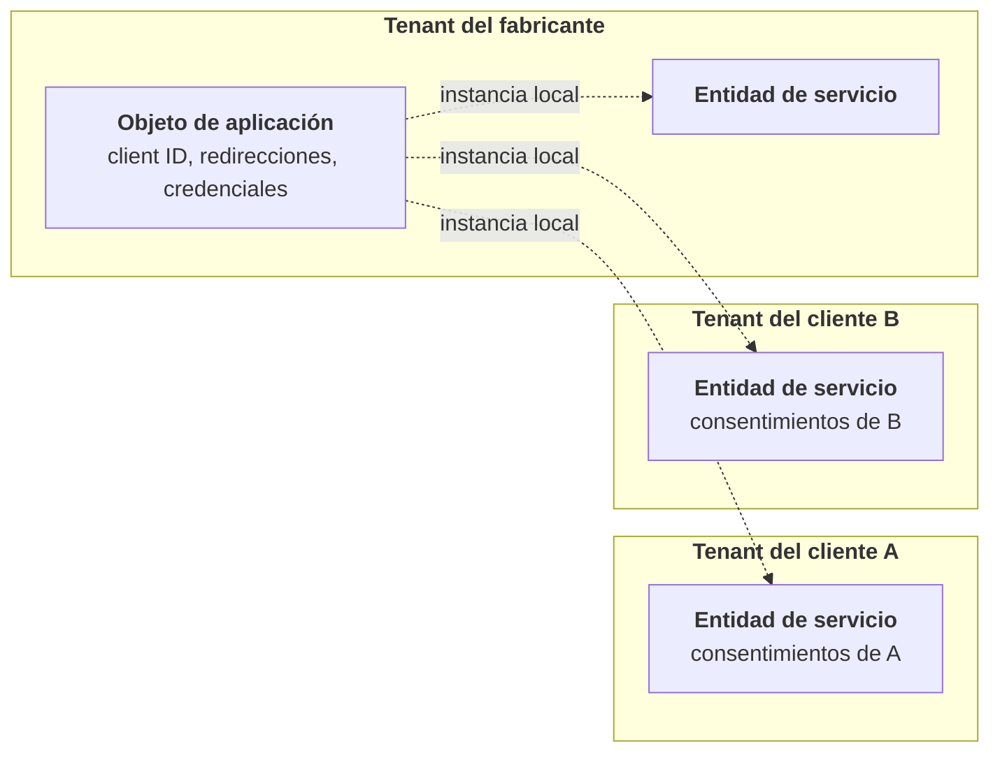
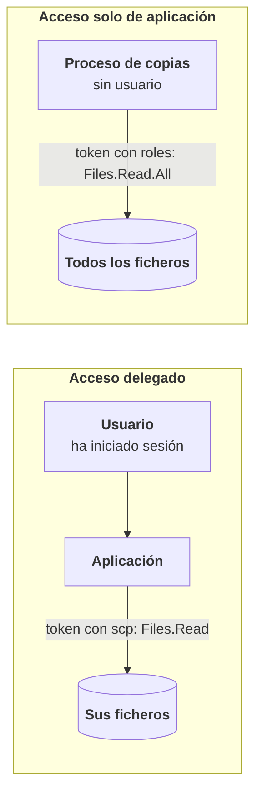
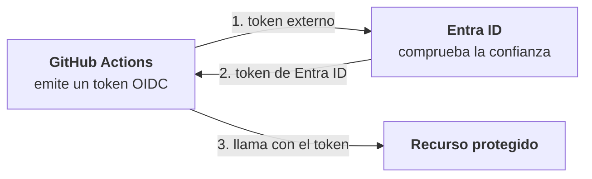

# titulo: Microsoft Entra ID para desarrolladores


# Tenants y endpoints

## Objetivos de aprendizaje

- **1.1** Situar Microsoft Entra ID y su relación con Azure AD.
- **1.2** Explicar qué es un tenant y elegir entre aplicaciones de un solo tenant o multitenant.
- **1.3** Localizar los endpoints de OpenID Connect de un tenant.

Este tema se centra en lo que necesita quien **desarrolla** aplicaciones que usan Entra ID. El resto de Azure se estudia en otra aplicación. Todo lo que se afirma está contrastado con la documentación de Microsoft Learn y con el documento de descubrimiento público de Entra ID.

## De Azure AD a Entra ID

**Microsoft Entra ID** es el servicio de identidad en la nube de Microsoft. Hasta 2023 se llamaba **Azure Active Directory** (Azure AD). Microsoft lo renombró para reflejar que no es solo de Azure y para evitar la confusión con el Active Directory local de Windows Server. Lo importante para un desarrollador: **las URL de inicio de sesión, las API, los cmdlets de PowerShell y las bibliotecas MSAL no cambiaron**. Verás «Azure AD» en mucha documentación y en código antiguo; es lo mismo.

Para un desarrollador, Entra ID es un **servidor de autorización OAuth 2.0 y proveedor de OpenID Connect**: lo aprendido en el tema de OAuth se aplica tal cual.

## Tenants

Un **tenant** es la instancia de Entra ID de una organización: sus usuarios, grupos y aplicaciones. Se identifica con un GUID, el **tenant ID**, que aparece en el claim `tid` de los tokens.

Al registrar una aplicación se elige quién puede iniciar sesión en ella:

| Opción | Tipo | Quién puede iniciar sesión |
|---|---|---|
| Cuentas de este directorio | **Un solo tenant** | Usuarios e invitados del tenant donde se registra (el tenant de origen). Para aplicaciones internas |
| Cuentas de cualquier directorio de Microsoft Entra | **Multitenant** | Cuentas de trabajo o escuela de cualquier organización |
| Cualquier directorio y cuentas personales de Microsoft | Multitenant | Además, cuentas personales (Outlook, Xbox…) |

Una aplicación multitenant que guarda datos debe comprobar siempre que el `tid` del token coincide con el tenant al que pertenecen los datos: la documentación lo plantea como el primer paso para no mezclar datos de organizaciones distintas.

## Endpoints

Entra ID publica su configuración en el documento de descubrimiento de OpenID Connect. Para un tenant concreto:

```text
https://login.microsoftonline.com/{tenant-id}/v2.0/.well-known/openid-configuration
```

En lugar del GUID del tenant se pueden usar alias: `common` (cualquier cuenta), `organizations` (solo cuentas de trabajo o escuela) y `consumers` (solo cuentas personales). Al consultar el documento público de `common` se obtiene:

| Campo | Valor |
|---|---|
| `issuer` | `https://login.microsoftonline.com/{tenantid}/v2.0` (una plantilla: el emisor real lleva el GUID del tenant del usuario) |
| `authorization_endpoint` | `https://login.microsoftonline.com/common/oauth2/v2.0/authorize` |
| `token_endpoint` | `https://login.microsoftonline.com/common/oauth2/v2.0/token` |
| `jwks_uri` | `https://login.microsoftonline.com/common/discovery/v2.0/keys` |

Que el emisor sea una plantilla tiene una consecuencia: una API multitenant no puede configurar un único `issuer` fijo; debe validar que el emisor tiene esa forma y que el `tid` está entre los tenants que acepta.

## Puntos clave

- Microsoft Entra ID es el nuevo nombre de Azure AD (2023); URL, API y MSAL no cambiaron.
- Para un desarrollador es un proveedor de OAuth 2.0 y OpenID Connect.
- Un tenant es la instancia de una organización y se identifica con el `tid`.
- Las aplicaciones son de un solo tenant (internas) o multitenant; estas deben validar el `tid`.
- Los endpoints están en `login.microsoftonline.com/{tenant}/v2.0`, con los alias `common`, `organizations` y `consumers`.

## Referencias

- Microsoft Learn, [New name for Azure Active Directory](https://learn.microsoft.com/en-us/entra/fundamentals/new-name).
- Microsoft Learn, [Microsoft identity platform overview](https://learn.microsoft.com/en-us/entra/identity-platform/v2-overview).
- Microsoft Learn, [Single and multitenant apps](https://learn.microsoft.com/en-us/entra/identity-platform/single-and-multi-tenant-apps).
- Microsoft Learn, [OpenID Connect on the Microsoft identity platform](https://learn.microsoft.com/en-us/entra/identity-platform/v2-protocols-oidc).

# Registro de aplicaciones

## Objetivos de aprendizaje

- **2.1** Distinguir el objeto de aplicación de la entidad de servicio.
- **2.2** Registrar una aplicación con su plataforma y sus URI de redirección.
- **2.3** Exponer una API con su identificador y sus scopes.
- **2.4** Aplicar las buenas prácticas de Microsoft al registro.

## Objeto de aplicación y entidad de servicio

Al registrar una aplicación en Entra ID aparecen **dos** objetos:

| Objeto | Qué es | Cuántos hay |
|---|---|---|
| **Objeto de aplicación** (*app registration*) | La definición **global** de la aplicación: client ID, URI de redirección, credenciales, permisos que pide, API que expone | Uno, en el tenant de origen |
| **Entidad de servicio** (*service principal*, en el portal «aplicación empresarial») | La **instancia local** de la aplicación en un tenant: quién puede usarla y qué permisos se le han concedido allí | Una **en cada tenant** donde se usa la aplicación |

En una aplicación de un solo tenant, ambos están en el mismo sitio y es fácil confundirlos. En una multitenant se ve la diferencia: el objeto de aplicación vive en el tenant del fabricante, y cada cliente que la usa tiene su propia entidad de servicio, con sus consentimientos y asignaciones. Las **identidades administradas** también son un tipo especial de entidad de servicio.



```nodos
FAB:
  concepto: tenant
APP:
  concepto: registro-de-aplicacion
SP0:
  concepto: service-principal
C1:
  titulo: Tenant del cliente A
  texto: Usa la aplicación multitenant del fabricante.
SP1:
  titulo: Entidad de servicio en A
  texto: Decide quién de A puede usar la aplicación y qué permisos se le han concedido en A.
C2:
  titulo: Tenant del cliente B
  texto: Otro cliente, con sus propios consentimientos y asignaciones.
SP2:
  titulo: Entidad de servicio en B
  texto: Independiente de la de A.
```

## Registrar una aplicación

| Paso | Qué decides |
|---|---|
| Nombre y tipos de cuenta | Un solo tenant o multitenant (lección anterior) |
| Plataforma | **SPA**, **Web** (con *backend* y secreto), **Móvil y escritorio**. Cambia cómo se aplica el flujo |
| URI de redirección | A dónde vuelve el código de autorización |
| Credenciales | Solo para clientes confidenciales (lección 4) |
| Permisos de API | Qué API llama y con qué permisos (lección 3) |

El resultado clave es el **identificador de cliente** (*client ID* o *application ID*), un GUID único global que es el `client_id` de OAuth.

## URI de redirección

La documentación de Microsoft recomienda:

- **No usar comodines** (`https://*.contoso.com`): el RFC 6749 exige que la URI de redirección sea absoluta, y los comodines tienen implicaciones de seguridad.
- **No usar esquemas inseguros** como `http` (salvo la dirección local en desarrollo) ni URN.
- **Mantener la lista corta** y quitar las que no se usen.
- **Conservar la propiedad** de los dominios de todas las URI: si un dominio caduca y otro lo registra, puede recibir los códigos.
- Usar **registros separados para desarrollo y producción**, para no dejar URI de `localhost` en producción.

También recomienda no usar el **flujo implícito**: en el registro hay casillas para emitir tokens con él, que deben quedarse desactivadas; el flujo de código cubre esos casos.

## Exponer una API

Si la aplicación es una **API**, en su registro se define:

- El **URI de identificador de aplicación** (*Application ID URI*), normalmente `api://{client-id}`.
- Los **scopes** que ofrece para los permisos delegados, por ejemplo `api://{client-id}/Pedidos.Read`.
- Los **roles de aplicación** que reconoce (lección 3).

Los clientes piden tokens para esa API usando sus scopes, y en el token resultante el `aud` es el client ID de la API.

## Puntos clave

- El objeto de aplicación es la definición global; la entidad de servicio, su instancia en cada tenant.
- Se registra la plataforma (SPA, Web, Móvil y escritorio) y las URI de redirección exactas.
- Sin comodines, sin `http` (salvo en local), lista corta, dominios bajo tu control y registros distintos por entorno.
- Deja desactivado el flujo implícito; usa el flujo de código.
- Una API expone su URI de identificador, sus scopes y sus roles.

## Referencias

- Microsoft Learn, [Application and service principal objects](https://learn.microsoft.com/en-us/entra/identity-platform/app-objects-and-service-principals).
- Microsoft Learn, [Register an application](https://learn.microsoft.com/en-us/entra/identity-platform/quickstart-register-app).
- Microsoft Learn, [Redirect URI best practices and limitations](https://learn.microsoft.com/en-us/entra/identity-platform/reply-url).
- Microsoft Learn, [Security best practices for application properties](https://learn.microsoft.com/en-us/entra/identity-platform/security-best-practices-for-app-registration).

# Permisos, consentimiento y roles

## Objetivos de aprendizaje

- **3.1** Distinguir el acceso delegado del acceso solo de aplicación.
- **3.2** Explicar el consentimiento de usuario y de administrador.
- **3.3** Pedir tokens de aplicación con el scope `/.default`.
- **3.4** Autorizar con roles de aplicación.

## Dos formas de acceder

| | Acceso delegado | Acceso solo de aplicación |
|---|---|---|
| Quién actúa | La aplicación, **en nombre de un usuario** que ha iniciado sesión | La aplicación, **por sí misma**, sin usuario |
| Permisos | **Delegados** | **De aplicación** (también llamados roles de aplicación) |
| Alcance | Solo lo que el usuario podría hacer | Todo lo que cubra el permiso |
| Claim en el token | `scp` (scopes) | `roles` |
| Ejemplo | Una aplicación lee **tus** ficheros con `Files.Read` | Un proceso de copias lee **todos** los ficheros con el permiso de aplicación `Files.Read.All` |

El acceso delegado exige que estén autorizados **tanto la aplicación como el usuario**. El de aplicación es más potente y, por eso, más delicado.



```nodos
DEL:
  concepto: permiso-delegado
U:
  titulo: Usuario
  texto: Tienen que estar autorizados tanto la aplicación como el usuario.
A1:
  titulo: Aplicación en nombre del usuario
  texto: Solo puede hacer lo que el usuario podría hacer.
R1:
  titulo: Alcance limitado
  texto: Los ficheros del usuario.
APLI:
  concepto: permiso-de-aplicacion
A2:
  titulo: Aplicación por sí misma
  texto: Actúa sin usuario, por ejemplo un proceso en segundo plano.
R2:
  titulo: Alcance total
  texto: Todo lo que cubra el permiso. Más potente y, por eso, más delicado.
```

## Consentimiento

Para usar un permiso, la aplicación necesita **consentimiento**:

- **De usuario:** al iniciar sesión, si nadie ha concedido antes esos permisos, el usuario ve una pantalla que los enumera y decide.
- **De administrador:** los **permisos de aplicación** y muchos permisos delegados de alto privilegio solo los puede conceder un administrador, para él o para toda la organización.

Una API puede además **preautorizar** a ciertos clientes de confianza, de modo que sus usuarios no vean la pantalla de consentimiento para esos scopes.

## El scope /.default

En el flujo de **credenciales de cliente** no hay usuario a quien preguntar, así que no se piden scopes concretos. Se pide `/.default` del recurso:

```text
scope=https://graph.microsoft.com/.default
```

Significa: «dame un token con todos los permisos de aplicación que ya tengo concedidos para este recurso». Todos los scopes de una petición deben ser **del mismo recurso**; mezclar recursos produce un error.

## Roles de aplicación

Los **roles de aplicación** se definen en el registro de la API (por ejemplo, `Pedidos.Gestor` y `Pedidos.Lector`) y se **asignan** a usuarios, a **grupos** o a entidades de servicio de otras aplicaciones. Cuando alguien con un rol inicia sesión, Entra ID incluye el claim **`roles`** en el token, y la API decide con él:

```json
{
  "aud": "3f2a7c1e-…",
  "roles": ["Pedidos.Lector"],
  "scp": "Pedidos.Read"
}
```

| Para | Usa |
|---|---|
| Qué puede hacer **la aplicación cliente** en nombre del usuario | `scp` (permisos delegados) |
| Qué puede hacer **el usuario** (o un servicio) en tu API | `roles` (roles de aplicación) |

Asignar roles a **grupos** en lugar de a cada persona simplifica la gestión, igual que en Keycloak.

## Puntos clave

- Delegado: la aplicación actúa en nombre de un usuario y no puede más que él; claim `scp`.
- Solo de aplicación: actúa por sí misma; claim `roles`; requiere consentimiento de administrador.
- El consentimiento lo da el usuario o, para permisos de alto privilegio y de aplicación, un administrador.
- En credenciales de cliente se pide `https://recurso/.default`, y todos los scopes deben ser del mismo recurso.
- Los roles de aplicación se definen en la API, se asignan a usuarios, grupos o servicios y llegan en `roles`.

## Referencias

- Microsoft Learn, [Overview of permissions and consent](https://learn.microsoft.com/en-us/entra/identity-platform/permissions-consent-overview).
- Microsoft Learn, [Client credentials flow](https://learn.microsoft.com/en-us/entra/identity-platform/v2-oauth2-client-creds-grant-flow).
- Microsoft Learn, [Add app roles and get them from a token](https://learn.microsoft.com/en-us/entra/identity-platform/howto-add-app-roles-in-apps).

# Credenciales sin secretos

## Objetivos de aprendizaje

- **4.1** Ordenar las credenciales de una aplicación de la más a la menos segura, según Microsoft.
- **4.2** Usar identidades administradas cuando la aplicación se ejecuta en Azure.
- **4.3** Usar la federación de identidades de carga de trabajo fuera de Azure (GitHub Actions, Kubernetes).
- **4.4** Gestionar certificados cuando no hay otra opción.

## El problema de los secretos

Un cliente confidencial necesita demostrar quién es al pedir tokens. La forma más cómoda es un **secreto de cliente** (una contraseña de la aplicación), pero Microsoft la desaconseja en sus buenas prácticas: los secretos **se gestionan mal y se filtran con facilidad** (en repositorios, registros o ficheros de configuración), y además **caducan**, lo que provoca caídas si nadie los renueva a tiempo.

La recomendación oficial, por orden de preferencia:

| Preferencia | Credencial | Cuándo |
|---|---|---|
| 1 | **Identidad administrada** | La aplicación se ejecuta en Azure. Microsoft la considera la opción más segura y no requiere gestionar credenciales |
| 2 | **Federación de identidades de carga de trabajo** | La aplicación se ejecuta fuera de Azure con un proveedor que emite sus propios tokens (GitHub Actions, Kubernetes, Google Cloud) |
| 3 | **Certificado** | No hay ninguna de las anteriores. Guardado en un almacén seguro como Azure Key Vault |
| — | Secreto de cliente | Microsoft recomienda no usarlo |

## Identidades administradas

Una **identidad administrada** es una entidad de servicio especial que Azure gestiona para un recurso (una máquina virtual, una aplicación de App Service, una función). El código pide tokens a Azure sin guardar ninguna credencial: Azure las crea, las rota y las protege.

| Tipo | Ciclo de vida | Uso |
|---|---|---|
| **Asignada por el sistema** | Va ligada al recurso: al borrar el recurso, Azure borra la identidad. Solo ese recurso puede usarla | Un recurso con permisos propios |
| **Asignada por el usuario** | Es un recurso independiente que se asigna a uno o varios recursos | Varios recursos que comparten los mismos permisos, o identidades que deben sobrevivir al recurso |

## Federación de identidades de carga de trabajo

Fuera de Azure no hay identidades administradas, pero muchas plataformas ya emiten **tokens propios** para sus cargas de trabajo: GitHub Actions da un token OIDC a cada ejecución, Kubernetes a cada cuenta de servicio. Con la **federación de identidades de carga de trabajo**, un registro de aplicación (o una identidad administrada asignada por el usuario) se configura para **confiar** en los tokens de ese proveedor externo, con condiciones como el repositorio y la rama.

La carga de trabajo presenta su token externo a Entra ID y recibe un token de acceso de Entra ID. **No hay ningún secreto que guardar en GitHub** ni que rotar.



```nodos
GH:
  titulo: Carga de trabajo externa
  texto: Una ejecución de GitHub Actions, un pod de Kubernetes o un servicio en otra nube, que ya tiene un token emitido por su plataforma.
EN:
  concepto: workload-identity-federation
R:
  titulo: Recurso protegido por Entra ID
  texto: Una API propia, Microsoft Graph o un recurso de Azure.
```

## Certificados

Si no hay otra opción, un **certificado** es preferible a un secreto: la clave privada nunca viaja; la aplicación firma una aserción (un JWT) con ella. Microsoft recomienda guardarlo en un almacén seguro como **Azure Key Vault** y usar certificados de una autoridad de confianza.

## Puntos clave

- Microsoft desaconseja los secretos de cliente: se filtran con facilidad y caducan.
- En Azure, usa identidades administradas: son la opción más segura y sin credenciales que gestionar.
- Las asignadas por el sistema viven y mueren con su recurso; las asignadas por el usuario son independientes y compartibles.
- Fuera de Azure, la federación de identidades de carga de trabajo cambia el token de la plataforma (GitHub, Kubernetes) por uno de Entra ID, sin secretos.
- Si no queda otra, certificado en un almacén seguro, nunca un secreto en el código.

## Referencias

- Microsoft Learn, [Security best practices for application properties](https://learn.microsoft.com/en-us/entra/identity-platform/security-best-practices-for-app-registration).
- Microsoft Learn, [Managed identities for Azure resources](https://learn.microsoft.com/en-us/entra/identity/managed-identities-azure-resources/overview).
- Microsoft Learn, [Workload identity federation](https://learn.microsoft.com/en-us/entra/workload-id/workload-identity-federation).
- Microsoft Learn, [Client credentials flow](https://learn.microsoft.com/en-us/entra/identity-platform/v2-oauth2-client-creds-grant-flow).

# Tokens y APIs

## Objetivos de aprendizaje

- **5.1** Identificar a usuarios y tenants con los claims correctos (`oid`, `sub`, `tid`).
- **5.2** Validar en una API los tokens de acceso de Entra ID.
- **5.3** Configurar la versión de los tokens de acceso de una API.
- **5.4** Obtener tokens desde las aplicaciones con MSAL.

## Claims para identificar

| Claim | Qué es | Particularidad |
|---|---|---|
| `oid` | Identificador inmutable del usuario o de la entidad de servicio en el tenant | **Igual para todas las aplicaciones** del tenant. Sirve como clave en tus tablas |
| `sub` | Sujeto del token | Es **por pareja**: el mismo usuario tiene un `sub` distinto en cada aplicación (cada client ID) |
| `tid` | Tenant del usuario | Imprescindible en aplicaciones multitenant |
| `azp` | Client ID de la aplicación que pidió el token | Solo en tokens v2.0 (sustituye a `appid` de v1.0) |
| `scp` / `roles` | Permisos delegados / roles de aplicación | Lección 3 |
| `name`, `preferred_username` | Datos para mostrar | Pueden cambiar: **no** los uses para decidir permisos |

Si dos aplicaciones tuyas necesitan reconocer al mismo usuario, usa **`oid` + `tid`**; con `sub` no coincidirían.

## Validar en la API

La documentación de Microsoft establece:

- **Solo la API valida el token de acceso.** El cliente no debe hacerlo: el token es para la API, no para él.
- La API solo acepta tokens cuyo **`aud`** sea ella misma. En tokens v2.0, `aud` es **siempre el client ID de la API**. Aceptar tokens emitidos para otro recurso es el problema del «delegado confundido» (*confused deputy*).
- Valida la **firma** y el **emisor** con los valores del documento de descubrimiento, y el **`tid`** contra los tenants que admites.
- Los tokens de **Microsoft Graph** tienen un formato propio y **no se pueden validar** con estas reglas: si tu código intenta validarlos, está validando el token equivocado.

Con Spring Boot, la configuración es la misma que con cualquier proveedor OIDC (tema de Keycloak), cambiando el emisor:

```yaml
spring:
  security:
    oauth2:
      resourceserver:
        jwt:
          issuer-uri: https://login.microsoftonline.com/{tenant-id}/v2.0
          audiences: {client-id-de-la-api}
```

Los roles de aplicación llegan en el claim `roles` y los permisos delegados en `scp`, así que el conversor de autoridades debe leer esos claims.

## La versión del token

Hay tokens de acceso **v1.0** y **v2.0**, con claims y emisores distintos (el claim `ver` lo indica). La versión **no** la elige el cliente, sino la **API**, con la propiedad `requestedAccessTokenVersion` del manifiesto de su registro:

| Valor | Tokens de acceso emitidos |
|---|---|
| `null` o `1` | v1.0 |
| `2` | v2.0 |

Si configuras tu API con el emisor `…/v2.0` pero no cambias esta propiedad, recibirá tokens v1.0 y los rechazará por emisor no válido. Para APIs nuevas, pon `requestedAccessTokenVersion` a `2`.

## Obtener tokens con MSAL

Los clientes no implementan los flujos a mano: usan **MSAL** (*Microsoft Authentication Library*), que gestiona los flujos, la caché y la renovación de tokens. Hay versiones para .NET, Java, Python, JavaScript (navegador, Node, React y Angular), Android e iOS/macOS. Con PKCE, `state` y `nonce` incluidos, MSAL aplica de serie lo visto en el tema de OAuth.

## Puntos clave

- Usa `oid` + `tid` para identificar usuarios entre aplicaciones; `sub` cambia por aplicación.
- No uses `name` ni `preferred_username` para decidir permisos.
- Solo la API valida el token de acceso; acepta solo los que tienen su client ID como `aud`.
- Los tokens de Microsoft Graph no se validan con estas reglas.
- La API elige la versión del token con `requestedAccessTokenVersion`; pon `2` en APIs nuevas.
- Obtén tokens con MSAL en lugar de implementar los flujos a mano.

## Referencias

- Microsoft Learn, [Access token claims reference](https://learn.microsoft.com/en-us/entra/identity-platform/access-token-claims-reference).
- Microsoft Learn, [Access tokens](https://learn.microsoft.com/en-us/entra/identity-platform/access-tokens).
- Microsoft Learn, [Secure applications and APIs by validating claims](https://learn.microsoft.com/en-us/entra/identity-platform/claims-validation).
- Microsoft Learn, [Overview of MSAL](https://learn.microsoft.com/en-us/entra/identity-platform/msal-overview).
