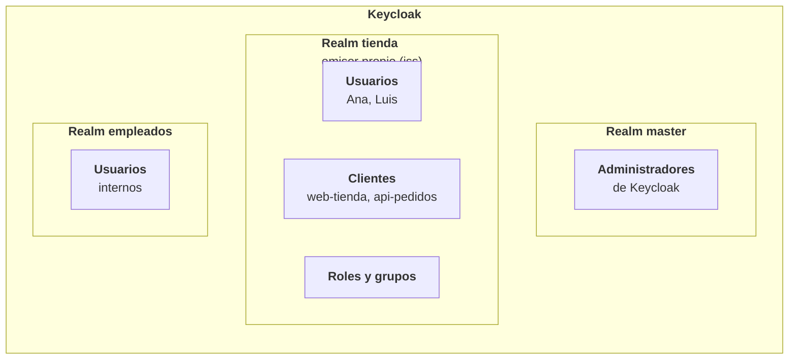
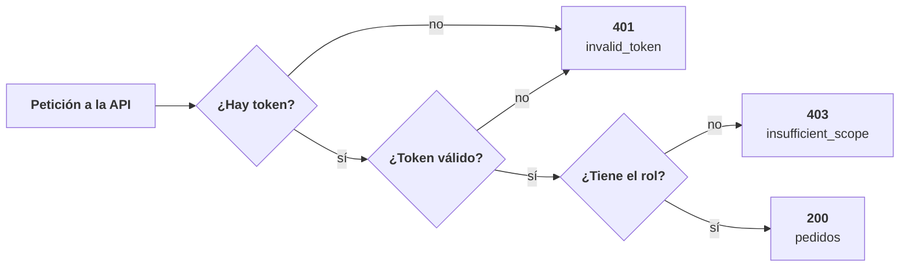

# titulo: Keycloak


# Conceptos de Keycloak

## Objetivos de aprendizaje

- **1.1** Situar Keycloak como proveedor de identidad.
- **1.2** Organizar la configuración en realms y entender el papel del realm master.
- **1.3** Distinguir usuarios, grupos, roles de realm y roles de cliente.
- **1.4** Arrancar Keycloak en local para practicar.

## Qué es

**Keycloak** es un servidor de identidad y accesos (*IAM*) de código abierto. Implementa **OpenID Connect**, **OAuth 2.0** y **SAML 2.0**, así que hace el papel de **servidor de autorización** del tema anterior: muestra la pantalla de inicio de sesión, gestiona usuarios y emite tokens. Además ofrece inicio de sesión único (SSO), segundo factor, inicio con proveedores externos y conexión a directorios LDAP.

Los ejemplos de este tema se han probado con **Keycloak 26.4**.

## Arrancarlo en local

```bash
docker run --rm -p 127.0.0.1:18180:8080 \
  -e KC_BOOTSTRAP_ADMIN_USERNAME=admin -e KC_BOOTSTRAP_ADMIN_PASSWORD=admin \
  quay.io/keycloak/keycloak:26.4 start-dev
```

`start-dev` arranca en **modo de desarrollo**: HTTP habilitado y una base de datos de ficheros solo para pruebas. La consola de administración queda en `http://127.0.0.1:18180/admin`. La lección 5 explica qué cambia en producción.

## Realms

Un **realm** es un espacio **aislado**: sus usuarios, clientes, roles y configuración no se ven desde otros realms. Cada realm es un emisor distinto (`iss`), con su propio documento de descubrimiento:

```text
http://127.0.0.1:18180/realms/tienda/.well-known/openid-configuration
```

| Realm | Para qué |
|---|---|
| `master` | **Solo** para administrar Keycloak (los administradores) |
| `tienda`, `empleados`… | Uno por cada conjunto de usuarios y aplicaciones que deba estar separado |

No metas a los usuarios de tus aplicaciones en `master`: un fallo de configuración les daría acceso a la administración.



```nodos
KC:
  concepto: keycloak
M:
  titulo: Realm master
  texto: Solo para administrar Keycloak. No metas aquí a los usuarios de tus aplicaciones, porque un fallo de configuración les daría acceso a la administración.
ADM:
  titulo: Administradores
  texto: Las únicas cuentas que deberían vivir en master.
T:
  concepto: realm
US:
  titulo: Usuarios de la tienda
  texto: Solo existen en este realm. Desde otro realm no se ven.
CL:
  concepto: cliente-keycloak
RO:
  titulo: Roles y grupos
  texto: Roles de realm y de cliente, y grupos que reúnen usuarios y les dan roles. Todo vive dentro del realm.
  seccion: 01-conceptos/teoria#usuarios-grupos-y-roles
E:
  titulo: Otro realm
  texto: Un conjunto de usuarios y aplicaciones que debe estar separado, con su propio documento de descubrimiento.
UE:
  titulo: Usuarios internos
  texto: Aislados de los de la tienda.
```

## Usuarios, grupos y roles

| Elemento | Qué es | En la prueba |
|---|---|---|
| **Usuario** | Una persona (o cuenta) que inicia sesión | `ana`, `luis` |
| **Rol de realm** | Permiso global del realm | `cliente` |
| **Rol de cliente** | Permiso definido dentro de un cliente concreto, normalmente la API que lo comprueba | `leer-pedidos` del cliente `api-pedidos` |
| **Grupo** | Conjunto de usuarios que hereda roles y atributos | `atencion-al-cliente`, con el rol `leer-pedidos` |

Asignar roles a **grupos** en lugar de a cada usuario hace la gestión manejable: al añadir a Ana al grupo `atencion-al-cliente`, su token incluyó el rol `leer-pedidos` sin asignárselo directamente.

En el token de acceso, cada tipo de rol aparece en un sitio distinto:

```json
{
  "realm_access": {"roles": ["cliente", "offline_access", "uma_authorization", "default-roles-tienda"]},
  "resource_access": {
    "api-pedidos": {"roles": ["leer-pedidos"]},
    "account": {"roles": ["manage-account", "manage-account-links", "view-profile"]}
  }
}
```

Los roles `offline_access`, `uma_authorization` y los del cliente `account` los asigna Keycloak por defecto a los usuarios nuevos (a través de `default-roles-tienda`).

## Puntos clave

- Keycloak es un servidor de identidad de código abierto que implementa OIDC, OAuth 2.0 y SAML.
- Un realm aísla usuarios, clientes y roles; cada realm es un emisor distinto.
- El realm master es solo para administrar Keycloak.
- Los roles de realm van en `realm_access.roles`; los de cliente, en `resource_access.<cliente>.roles`.
- Asigna roles a grupos y usuarios a grupos.

## Referencias

- Keycloak, [Documentation](https://www.keycloak.org/documentation).
- Keycloak, [Getting started with Docker](https://www.keycloak.org/getting-started/getting-started-docker).
- Keycloak, [Server Administration Guide](https://www.keycloak.org/docs/latest/server_admin/index.html).

# Clientes, mapeadores y tokens

## Objetivos de aprendizaje

- **2.1** Registrar clientes públicos, confidenciales y de servicio con los flujos justos.
- **2.2** Exigir PKCE y restringir las URI de redirección.
- **2.3** Añadir la audiencia de una API al token con un mapeador.
- **2.4** Ajustar la duración de los tokens y la rotación de refresh tokens.

## Tipos de cliente

En la prueba se registraron tres clientes, cada uno con solo lo que necesita:

| Cliente | Tipo | Flujos habilitados | Para qué |
|---|---|---|---|
| `web-tienda` | Público | Código de autorización (*standard flow*) con PKCE S256 | La SPA donde inician sesión los usuarios |
| `servicio-pedidos` | Confidencial, con cuenta de servicio | Credenciales de cliente | Un servicio que llama a otros sin usuario |
| `api-pedidos` | Confidencial, sin flujos | Ninguno | Representa a la API: define sus roles y su audiencia |

Las opciones relevantes de cada cliente:

| Opción en la consola | Qué controla |
|---|---|
| *Client authentication* | Si es confidencial (con secreto) o público |
| *Standard flow* | Flujo de código de autorización |
| *Direct access grants* | Flujo de contraseña del propietario. **Desactívalo**: el RFC 9700 lo prohíbe |
| *Service accounts* | Credenciales de cliente |
| *Valid redirect URIs* | URI de redirección permitidas. Exactas, sin comodines |
| *Proof Key for Code Exchange Code Challenge Method*, en los ajustes avanzados (atributo `pkce.code.challenge.method`) | Exigir PKCE y con qué método (S256) |

Con PKCE exigido, una petición sin `code_challenge` recibió `invalid_request`; con el flujo de contraseña desactivado, `grant_type=password` recibió `unauthorized_client`.

## La audiencia: el mapeador más olvidado

Por defecto, el token de acceso de Keycloak tenía `"aud": "account"`, la API de la cuenta del usuario. Una API que valide la audiencia (como debe) rechazaría ese token. Para que el token sea **para `api-pedidos`**, se añade al cliente `web-tienda` un **mapeador de audiencia**:

```json
{
  "name": "audiencia-api-pedidos",
  "protocol": "openid-connect",
  "protocolMapper": "oidc-audience-mapper",
  "config": {
    "included.client.audience": "api-pedidos",
    "access.token.claim": "true",
    "id.token.claim": "false"
  }
}
```

Después, el token de Ana tenía `"aud": ["api-pedidos", "account"]`. Los **mapeadores** también sirven para añadir grupos, atributos del usuario o claims fijos. Se pueden poner en el cliente o en un **client scope** reutilizable entre varios clientes.

## Duración de los tokens

Algunos valores de un realm recién creado en Keycloak 26.4, leídos con la API de administración:

| Ajuste | Valor por defecto | Qué controla |
|---|---|---|
| `accessTokenLifespan` | 300 s | Vida del token de acceso |
| `ssoSessionIdleTimeout` | 1800 s | Sesión inactiva antes de cerrarse |
| `revokeRefreshToken` | `false` | Si cada refresh token deja de valer al usarse (rotación estricta) |

Con `revokeRefreshToken` en `false`, cada renovación entrega un refresh token nuevo, pero **el anterior sigue valiendo**. Para clientes públicos, el RFC 9700 pide rotación o vincular el token al cliente, así que conviene activarlo.

## Puntos clave

- Registra cada aplicación como el tipo de cliente que es, con solo los flujos que usa.
- Desactiva *Direct access grants*; exige PKCE S256 en los clientes públicos; usa URI de redirección exactas.
- Representa cada API como un cliente con sus roles.
- Sin un mapeador de audiencia, el token no va dirigido a tu API y una validación correcta lo rechaza.
- Los tokens de acceso duran 300 s por defecto; activa `revokeRefreshToken` para la rotación estricta.

## Referencias

- Keycloak, [Server Administration Guide](https://www.keycloak.org/docs/latest/server_admin/index.html): clientes, mapeadores y [audiencia](https://www.keycloak.org/docs/latest/server_admin/index.html#_audience).
- Keycloak, [Securing applications with OIDC](https://www.keycloak.org/securing-apps/oidc-layers).
- IETF, [RFC 9700](https://www.rfc-editor.org/rfc/rfc9700).

# Usuarios y autenticación

## Objetivos de aprendizaje

- **3.1** Gestionar el ciclo de vida de los usuarios con acciones requeridas y políticas de contraseña.
- **3.2** Añadir un segundo factor de autenticación.
- **3.3** Delegar el inicio de sesión en proveedores externos (intermediación de identidad).
- **3.4** Conectar un directorio LDAP o Active Directory (federación de usuarios).

## Ciclo de vida del usuario

Los usuarios se crean en la consola, con la API de administración, por registro propio (si el realm lo permite) o llegan de un proveedor externo o un directorio. Herramientas del día a día:

| Herramienta | Para qué |
|---|---|
| **Acciones requeridas** (*required actions*) | Obligar en el siguiente inicio de sesión a verificar el correo, cambiar la contraseña, configurar el segundo factor o aceptar condiciones |
| **Contraseña temporal** | Al crear un usuario, la contraseña puede marcarse como temporal: deberá cambiarla al entrar |
| **Políticas de contraseña** | Longitud mínima, historial, bloqueo de las más comunes; se configuran por realm |
| **Protección contra fuerza bruta** | Bloqueo temporal tras varios intentos fallidos |
| **Atributos** | Datos adicionales del usuario que se pueden llevar a los tokens con mapeadores |

En la prueba, el usuario se creó con `"temporary": false` en sus credenciales; con `true`, Keycloak le habría pedido cambiarla al primer inicio de sesión.

## Segundo factor

Keycloak permite exigir un **segundo factor**: códigos de un solo uso (OTP) con una aplicación como FreeOTP o Google Authenticator, o claves WebAuthn y *passkeys*. Se activa:

- para **un usuario**, con la acción requerida *Configure OTP*;
- para **todo el realm**, haciendo obligatorio el paso OTP en el **flujo de autenticación** del navegador.

Los **flujos de autenticación** de Keycloak son configurables: definen qué pasos sigue un inicio de sesión (formulario, OTP, condiciones por rol o por cliente) y en qué orden.

## Intermediación de identidad

Con la **intermediación de identidad** (*identity brokering*), el usuario inicia sesión en Keycloak **con otro proveedor**: Google, GitHub, Microsoft Entra ID u otro Keycloak, por OIDC o SAML. Keycloak hace de cliente de ese proveedor y emite **sus propios tokens** a tus aplicaciones, que no tienen que integrarse con cada proveedor por separado.

Casos típicos: «Entrar con Google» en una tienda, o que los empleados entren con su cuenta corporativa de Entra ID a aplicaciones gestionadas en Keycloak. Con los **mapeadores del proveedor** se importan atributos o se asignan roles según los datos que llegan.

## Federación de usuarios

La **federación de usuarios** conecta Keycloak a un directorio existente, como **LDAP** o **Active Directory**, sin migrar las cuentas: Keycloak valida las contraseñas contra el directorio y puede importar o sincronizar los usuarios y sus grupos. El directorio sigue siendo la fuente de verdad, y Keycloak añade OIDC, SSO y segundo factor encima.

| | Intermediación de identidad | Federación de usuarios |
|---|---|---|
| Con qué se conecta | Otro **proveedor de identidad** (OIDC, SAML) | Un **directorio** (LDAP, Active Directory) |
| Quién muestra la pantalla de inicio de sesión | El proveedor externo | Keycloak |
| Quién comprueba la contraseña | El proveedor externo | El directorio, a través de Keycloak |

## Puntos clave

- Las acciones requeridas fuerzan pasos en el siguiente inicio de sesión: verificar correo, cambiar contraseña, configurar OTP.
- Configura políticas de contraseña y protección contra fuerza bruta en cada realm.
- El segundo factor (OTP, WebAuthn) se exige por usuario o en el flujo de autenticación del realm.
- La intermediación de identidad delega el inicio de sesión en otro proveedor; Keycloak emite sus propios tokens.
- La federación conecta un directorio LDAP o Active Directory sin migrar usuarios.

## Referencias

- Keycloak, [Server Administration Guide](https://www.keycloak.org/docs/latest/server_admin/index.html): usuarios, flujos de autenticación, OTP y WebAuthn.
- Keycloak, [Identity brokering](https://www.keycloak.org/docs/latest/server_admin/index.html#_identity_broker).
- Keycloak, [User storage federation](https://www.keycloak.org/docs/latest/server_admin/index.html#_user-storage-federation).

# Proteger una API Spring Boot

## Objetivos de aprendizaje

- **4.1** Configurar una API Spring Boot como servidor de recursos de Keycloak.
- **4.2** Validar el emisor y la audiencia de los tokens.
- **4.3** Convertir los roles de Keycloak en autoridades de Spring Security.
- **4.4** Interpretar las respuestas 401 y 403.

El código de esta lección se ha compilado con Spring Boot 3.4 y Java 21, y se ha probado contra Keycloak 26.4 con los usuarios y clientes de las lecciones anteriores.

## Dependencia y configuración

```xml
<dependency>
  <groupId>org.springframework.boot</groupId>
  <artifactId>spring-boot-starter-oauth2-resource-server</artifactId>
</dependency>
```

```yaml
spring:
  security:
    oauth2:
      resourceserver:
        jwt:
          issuer-uri: http://127.0.0.1:18180/realms/tienda
          audiences: api-pedidos
```

Con `issuer-uri`, Spring descarga el documento de descubrimiento del realm, obtiene el `jwks_uri` y valida la **firma**, el **emisor** y la **caducidad** de cada token. Con `audiences`, valida además el **`aud`**. No necesitas ninguna biblioteca específica de Keycloak: es OIDC estándar.

## Roles de Keycloak como autoridades de Spring

Spring Security, por defecto, convierte el claim `scope` en autoridades `SCOPE_…`. Los roles de Keycloak están en otros claims, así que hay que decirle dónde mirar:

```java
@Bean
SecurityFilterChain seguridad(HttpSecurity http) throws Exception {
    http.authorizeHttpRequests(a -> a
                    .requestMatchers("/pedidos").hasRole("leer-pedidos")
                    .anyRequest().authenticated())
            .oauth2ResourceServer(o -> o.jwt(Customizer.withDefaults()));
    return http.build();
}

// Keycloak pone los roles de cliente en resource_access.<cliente>.roles
@Bean
JwtAuthenticationConverter jwtAuthenticationConverter() {
    var conversor = new JwtAuthenticationConverter();
    conversor.setJwtGrantedAuthoritiesConverter(ApiPedidos::rolesDeCliente);
    return conversor;
}

@SuppressWarnings("unchecked")
static Collection<GrantedAuthority> rolesDeCliente(Jwt jwt) {
    Map<String, Object> accesos = jwt.getClaimAsMap("resource_access");
    if (accesos == null || !(accesos.get("api-pedidos") instanceof Map<?, ?> api)) {
        return List.of();
    }
    List<String> roles = (List<String>) api.get("roles");
    return roles == null ? List.of()
            : roles.stream().map(r -> (GrantedAuthority) new SimpleGrantedAuthority("ROLE_" + r)).toList();
}
```

`hasRole("leer-pedidos")` busca la autoridad `ROLE_leer-pedidos`; por eso el conversor añade el prefijo `ROLE_`. Se leen los roles **del cliente de la API** (`api-pedidos`) y no los de realm, para que cada API defina sus propios permisos.

## Resultados de la prueba

| Petición | Respuesta |
|---|---|
| Sin token | **401** |
| Token de Ana (audiencia `api-pedidos`, rol `leer-pedidos` por su grupo) | **200** `["pedido-1","pedido-2"]` |
| Token de Luis (audiencia correcta, sin el rol) | **403** `insufficient_scope` |
| Token de `servicio-pedidos` (audiencia `account`) | **401** `invalid_token`: *The aud claim is not valid* |
| ID token de Ana en lugar del token de acceso | **401** `invalid_token`: audiencia no válida |

- **401** (*Unauthorized*): no hay token o no es válido (firma, emisor, caducidad, audiencia). La cabecera `WWW-Authenticate: Bearer error="invalid_token"` explica el motivo.
- **403** (*Forbidden*): el token es válido, pero no tiene los permisos que pide la operación (`insufficient_scope`).



```nodos
PET:
  titulo: Petición
  texto: Llega a la API Spring con o sin cabecera Authorization Bearer.
T1:
  titulo: ¿Hay token?
  texto: Sin token, 401.
T2:
  titulo: Validación del token
  texto: Se comprueban la firma, el emisor, la caducidad y la audiencia. El ID token de Ana y el token de servicio-pedidos (audiencia account) fallaron aquí, con 401 y «The aud claim is not valid».
  seccion: 02-clientes-roles-y-tokens/teoria#la-audiencia-el-mapeador-más-olvidado
T3:
  titulo: ¿Tiene el rol leer-pedidos?
  texto: Rol del cliente api-pedidos, leído de resource_access y convertido en la autoridad ROLE_leer-pedidos.
R401:
  titulo: 401 Unauthorized
  texto: No hay token o no es válido. La cabecera WWW-Authenticate explica el motivo.
R403:
  titulo: 403 Forbidden
  texto: El token es válido pero no tiene los permisos. Le pasó a Luis, que no tenía el rol.
R200:
  titulo: 200 OK
  texto: El token de Ana, con la audiencia api-pedidos y el rol heredado de su grupo.
```

## Dónde va cada decisión

En una arquitectura hexagonal, el adaptador de entrada (Spring Security en el controlador) **autentica** y traduce la identidad (`sub`, roles) a datos propios. Las reglas finas («solo puede ver **sus** pedidos») se comprueban dentro, en el caso de uso o el dominio, para que se apliquen entre por donde entre la petición.

## Puntos clave

- `spring-boot-starter-oauth2-resource-server` con `issuer-uri` valida firma, emisor y caducidad usando el descubrimiento del realm.
- Añade `audiences` para validar que el token es para tu API.
- Convierte `resource_access.<api>.roles` en autoridades `ROLE_…` con un `JwtAuthenticationConverter`.
- 401: token ausente o inválido. 403: token válido sin permisos suficientes.
- Las reglas de negocio sobre quién puede hacer qué van dentro de la aplicación, no solo en el filtro.

## Referencias

- Spring Security, [OAuth 2.0 Resource Server JWT](https://docs.spring.io/spring-security/reference/servlet/oauth2/resource-server/jwt.html).
- Keycloak, [Securing applications with OIDC](https://www.keycloak.org/securing-apps/oidc-layers).
- IETF, [RFC 6750](https://www.rfc-editor.org/rfc/rfc6750), sección 3.1 (códigos de error).

# Operar Keycloak

## Objetivos de aprendizaje

- **5.1** Distinguir el modo de desarrollo del de producción.
- **5.2** Configurar la base de datos, el nombre de host y el proxy.
- **5.3** Versionar la configuración con exportación e importación de realms o con la API de administración.
- **5.4** Aplicar las prácticas de seguridad básicas al operar Keycloak.

## Desarrollo frente a producción

| | `start-dev` | `start` |
|---|---|---|
| HTTP | Habilitado | Deshabilitado por defecto: exige HTTPS o un proxy que termine TLS |
| Nombre de host | Resolución no estricta | Hay que configurarlo (`--hostname`) |
| Base de datos | `dev-file`, solo para pruebas | Una base de datos real (PostgreSQL, MySQL, MariaDB, Oracle, SQL Server) |
| Caché | Local | Distribuida, para varios nodos |

La documentación de Keycloak es clara: la base de datos `dev-file` **no es adecuada para producción** y debe sustituirse antes de desplegar.

## Configuración típica de producción

```bash
bin/kc.sh start \
  --db=postgres --db-url=jdbc:postgresql://bd:5432/keycloak \
  --db-username=keycloak --db-password=… \
  --hostname=https://login.example.com \
  --http-enabled=true --proxy-headers=xforwarded
```

- **Base de datos:** todo el estado (realms, usuarios, sesiones persistentes) vive ahí; haz copias de seguridad como de cualquier base de datos crítica.
- **Nombre de host:** debe ser la URL pública, porque forma parte del emisor (`iss`) de los tokens. Si cambia, las API dejarán de aceptar los tokens.
- **Proxy inverso:** si Keycloak está detrás de un proxy (Traefik, NGINX) que termina TLS, se le indica que confíe en sus cabeceras con `--proxy-headers`, y el tráfico entre el proxy y Keycloak puede ir por HTTP dentro de una red privada.
- **Configuración por variables:** cada opción tiene su variable de entorno (`KC_DB`, `KC_HOSTNAME`…), cómodo en contenedores.

## La configuración como código

Configurar a mano en la consola no es repetible. Dos formas de versionar la configuración:

- **Exportar e importar realms:** `kc.sh export --realm tienda --file tienda.json` genera un JSON con la configuración del realm. Al arrancar con `--import-realm`, Keycloak importa los ficheros `.json` de su directorio `data/import`. Útil para entornos de prueba reproducibles.
- **API de administración:** todo lo que hace la consola se puede hacer con la API REST (es lo que se usó en este tema para crear realm, clientes, roles, grupos y mapeadores) o con herramientas que la usan, como proveedores de Terraform.

Ojo: una exportación puede incluir **secretos de clientes** y, según las opciones, **usuarios con sus credenciales**. Trátala como información sensible.

## Prácticas de seguridad

- No uses el realm `master` para las aplicaciones y protege su consola: idealmente, accesible solo desde la red de administración.
- Crea administradores con nombre propio y retira la cuenta inicial (`KC_BOOTSTRAP_ADMIN_*` es solo para el arranque).
- Mantén Keycloak **actualizado**: es una pieza crítica de seguridad y publica correcciones con frecuencia.
- Revisa los clientes: sin flujos innecesarios, con URI de redirección exactas y secretos rotados.
- Vigila los registros y los eventos de inicio de sesión (Keycloak puede guardar eventos de usuario y de administración).

## Puntos clave

- `start-dev` es solo para pruebas; producción usa `start`, HTTPS o un proxy, un nombre de host y una base de datos real.
- La base de datos `dev-file` no es apta para producción.
- El nombre de host forma parte del emisor de los tokens: no lo cambies a la ligera.
- Versiona la configuración con exportación e importación o con la API de administración; las exportaciones pueden llevar secretos.
- Protege el realm master, retira el administrador inicial y mantén Keycloak actualizado.

## Referencias

- Keycloak, [Configuring Keycloak](https://www.keycloak.org/server/configuration).
- Keycloak, [Configuring Keycloak for production](https://www.keycloak.org/server/configuration-production).
- Keycloak, [Configuring the database](https://www.keycloak.org/server/db) y [Configuring the hostname](https://www.keycloak.org/server/hostname).
- Keycloak, [Importing and exporting realms](https://www.keycloak.org/server/importExport).
