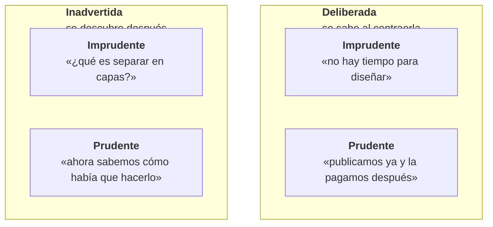
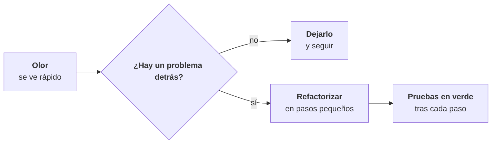
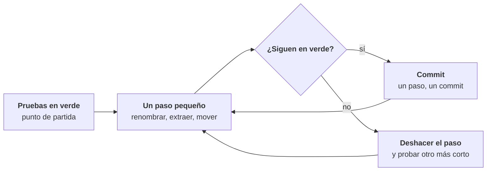
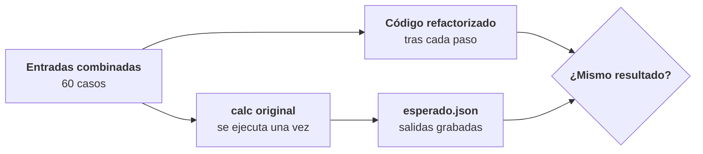
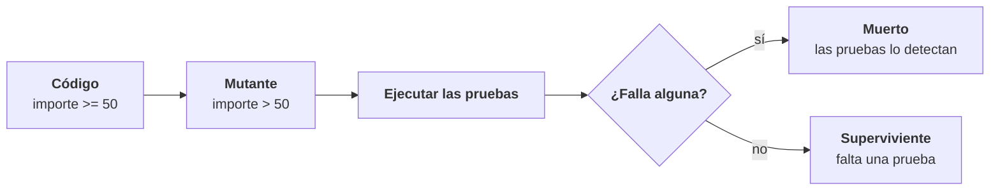

# titulo: Código limpio y refactorización


# Qué es código limpio

## Objetivos de aprendizaje

- **1.1** Explicar por qué la calidad interna del código se mide por lo que cuesta entenderlo y cambiarlo.
- **1.2** Elegir nombres que revelen la intención y sustituir números mágicos por constantes con nombre.
- **1.3** Escribir funciones pequeñas que hacen una sola cosa a un mismo nivel de abstracción.
- **1.4** Distinguir los cuatro tipos de deuda técnica y decidir cuándo pagarla.

Todo el tema trabaja sobre la misma función de pedidos, comprobada con Python 3.12, ruff 0.17.6, radon 6.0.1 y pytest 9.2.

## Para qué sirve el código limpio

Al ordenador le da igual cómo se llamen las variables: el código limpio y el sucio dan el mismo resultado. La diferencia la paga **quien tiene que cambiarlo**. Martin Fowler lo explica con la **deuda técnica**: si con un código claro una función nueva costaría cuatro días y con el actual cuesta seis, esos dos días son los **intereses** de la deuda, y se pagan en cada cambio.

Por eso el código limpio no es un estilo ni una cuestión de gusto. Es una propiedad que se mide por lo que cuesta **leerlo**, **entenderlo** y **cambiarlo sin romperlo**.

## El punto de partida

Esta es la función heredada que se limpia a lo largo del tema. Calcula el total de un pedido: IVA según el tipo de producto, descuento para clientes VIP y gastos de envío.

```python
def calc(p, c, t):
    # calcula el total
    tot = 0
    for i in p:
        if i["tipo"] == "libro":
            tot = tot + i["precio"] * i["cant"] * 1.04
        elif i["tipo"] == "comida":
            tot = tot + i["precio"] * i["cant"] * 1.10
        else:
            tot = tot + i["precio"] * i["cant"] * 1.21
    if c != None:
        if c["vip"] == True:
            if tot > 100:
                tot = tot * 0.9
            else:
                tot = tot * 0.95
        if c["pais"] != "ES":
            if t == 1:
                tot = tot + 15
            else:
                tot = tot + 25
        else:
            if t == 1:
                tot = tot + 5
            else:
                if tot < 50:
                    tot = tot + 3.5
    return round(tot, 2)
```

Funciona, pero obliga a deducir demasiado. ¿Qué son `p`, `c` y `t`? ¿Qué significa `t == 1`? ¿Por qué 1.04, y por qué 50?

## Nombres que revelan la intención

Un buen nombre responde a **para qué sirve** algo, sin que haga falta leer cómo se usa.

| Antes | Después | Qué se gana |
|---|---|---|
| `calc(p, c, t)` | `total_pedido(lineas, cliente, tipo_envio)` | Se sabe qué calcula y qué recibe sin leer el cuerpo |
| `tot` | `importe` | Una palabra del negocio |
| `i` | `linea` | `i` sugiere un índice, y es una línea del pedido |
| `t == 1` | `tipo_envio == URGENTE` | El 1 tenía un significado que solo estaba en la cabeza del autor |
| `1.04`, `1.10`, `1.21` | `IVA = {"libro": 1.04, "comida": 1.10}` y `IVA_GENERAL = 1.21` | Los tipos de IVA tienen nombre y están en un solo sitio |
| `50`, `100` | `ENVIO_GRATIS_DESDE`, `VIP_DESCUENTO_MAYOR_DESDE` | El límite dice qué regla aplica |

Un literal sin nombre cuyo significado hay que adivinar es un **número mágico**. No todos los literales lo son: en la versión final quedan `15`, `25` o `0.95` dentro de `gastos_de_envio` y `descuento_vip`, donde el nombre de la función ya dice qué son. Sustituirlo por una constante tiene una ventaja más: cuando cambie el IVA, se cambia en un único sitio.

Dos detalles de estilo vienen de PEP 8, la guía de estilo de Python: las funciones y variables en `minusculas_con_guiones` y las constantes de módulo en `MAYUSCULAS_CON_GUIONES`.

**Comentarios.** `# calcula el total` repite lo que ya dice el nombre (o debería decirlo). Un buen comentario explica **por qué**, que es lo que el código no puede contar. En la versión final queda uno:

```python
calc = total_pedido  # nombre antiguo, mientras se migran las llamadas
```

| Situación | Opción |
|---|---|
| Un nombre necesita un comentario para entenderse | Cambia el nombre |
| Un literal con significado de negocio | Constante con nombre |
| Una variable de dos líneas de alcance | Un nombre corto basta |
| Una decisión rara pero intencionada (un límite legal, un fallo de otra biblioteca) | Comentario que explique por qué |

## Funciones pequeñas que hacen una cosa

`calc` toma **tres decisiones distintas**: el IVA de cada línea, el descuento VIP y los gastos de envío. Las mezcla en 28 líneas, con hasta cinco niveles de sangría. Separadas en funciones con nombre, la función principal se lee como un resumen:

```python
def total_pedido(lineas, cliente, tipo_envio):
    importe = subtotal_con_iva(lineas)
    if cliente is None:
        return round(importe, 2)
    if cliente["vip"]:
        importe = descuento_vip(importe)
    importe += gastos_de_envio(importe, cliente["pais"], tipo_envio)
    return round(importe, 2)
```

Cada línea está al **mismo nivel de abstracción**: habla de subtotales, descuentos y envíos, no de multiplicar precios por cantidades. Quien quiera el detalle del envío entra en `gastos_de_envio`; quien no, no lo necesita.

| Situación | Opción |
|---|---|
| Un bloque necesita un comentario para decir qué hace | Extráelo a una función con ese nombre |
| La función mezcla detalles de bajo nivel con pasos de alto nivel | Separa los pasos |
| La función es corta y se lee de corrido | Déjala; trocearla más no aporta |
| La función extraída necesitaría un nombre como `paso2` o `auxiliar` | No es una idea propia: no la extraigas |

## Deuda técnica

No toda la deuda es igual. Fowler la clasifica en un cuadrante según dos preguntas: ¿se sabía que se contraía? ¿fue una decisión sensata?



```nodos
DEL:
  titulo: Deuda deliberada
  texto: El equipo sabe que la contrae y decide hacerlo.
DI:
  titulo: Deliberada e imprudente
  texto: Se sabe hacerlo bien pero se elige «rápido y sucio» pensando que no hay tiempo. Casi siempre sale más caro, porque los intereses empiezan a pagarse enseguida.
DP:
  concepto: deuda-tecnica
INA:
  titulo: Deuda inadvertida
  texto: El equipo no sabía que la estaba contrayendo.
II:
  titulo: Inadvertida e imprudente
  texto: El equipo no conoce las prácticas de diseño y acumula deuda sin darse cuenta. Se combate con formación y revisión de código.
IP:
  titulo: Inadvertida y prudente
  texto: Ocurre incluso a los buenos equipos. Al terminar entienden mejor el problema y ven cómo debería haber sido el diseño.
```

La deuda **prudente** puede tener sentido. Publicar antes y pagar después es una decisión de negocio razonable si se paga de verdad. Además, no toda la deuda merece pagarse. Según Fowler, la de una zona que casi nadie toca puede no compensar, porque sus intereses son pequeños. La que conviene pagar primero es la del código que **se cambia a menudo**.

| Situación | Opción |
|---|---|
| Código que se toca cada semana y cuesta entender | Pagar la deuda: refactorizar al pasar por él |
| Código estable que nadie toca | Dejarlo como está |
| Plazo real e inamovible | Deuda deliberada y prudente, anotada para pagarla después |
| «No hay tiempo para hacerlo bien» como norma | Deuda imprudente: el retraso llega en el siguiente cambio |

## Puntos clave

- El código limpio se mide por lo que cuesta entenderlo y cambiarlo, no por el gusto de quien lo escribe.
- La deuda técnica se paga en intereses: el esfuerzo extra de cada cambio sobre código confuso.
- Un buen nombre dice para qué sirve algo; si necesita un comentario para entenderse, cambia el nombre.
- Los números mágicos se sustituyen por constantes con nombre, que además quedan en un solo sitio.
- Los comentarios explican por qué, no qué.
- Una función hace una cosa y se lee a un mismo nivel de abstracción; la principal queda como un resumen.
- La deuda puede ser deliberada o inadvertida, y prudente o imprudente; conviene pagar primero la del código que más se toca.

## Referencias

- Martin Fowler, [Technical Debt](https://martinfowler.com/bliki/TechnicalDebt.html) y [Technical Debt Quadrant](https://martinfowler.com/bliki/TechnicalDebtQuadrant.html).
- Refactoring.com, [Replace Magic Literal](https://refactoring.com/catalog/replaceMagicLiteral.html).
- Python, [PEP 8: Style Guide for Python Code](https://peps.python.org/pep-0008/).

# Olores de código

## Objetivos de aprendizaje

- **2.1** Definir qué es un olor de código y explicar por qué es una señal y no un error.
- **2.2** Reconocer los olores más frecuentes en una función.
- **2.3** Detectar olores con las reglas de ruff y saber qué no detecta.
- **2.4** Asociar cada olor con la refactorización que lo corrige.

## Qué es un olor

Un **olor de código** es, según Martin Fowler, «una indicación superficial que suele corresponder a un problema más profundo del sistema». El término lo acuñó Kent Beck mientras ayudaba a Fowler con su libro *Refactoring*.

La definición tiene dos matices:

- Un olor **se ve rápido**: una función de cien líneas, un nombre de una letra, el mismo cálculo copiado tres veces. No hace falta entender el programa para notarlo.
- Un olor **no es un error**. Es una invitación a mirar más de cerca. A veces hay un problema detrás, y a veces la función larga es la forma más clara de escribir ese código.



```nodos
OL:
  concepto: olor-de-codigo
DEC:
  titulo: Mirar más de cerca
  texto: El olor es una pista. Hay que comprobar si de verdad dificulta entender o cambiar el código.
DEJ:
  titulo: Dejarlo
  texto: Una función larga que se lee de corrido, o un número que solo se usa una vez y se entiende por el contexto, pueden quedarse como están.
REF:
  concepto: refactorizacion
  seccion: 03-refactorizar-con-seguridad/teoria
PRU:
  titulo: Pruebas en verde
  texto: Sin pruebas que comprueben el comportamiento, refactorizar es arriesgado. Con código heredado, primero van las pruebas de caracterización.
  seccion: 04-codigo-heredado/teoria
```

## Los olores de calc

Volviendo a la función de la lección 1, se ven casi todos los olores habituales:

| Olor | Cómo se ve | En calc |
|---|---|---|
| Nombres crípticos | Hay que leer el cuerpo para saber qué es cada cosa | `p`, `c`, `t`, `tot`, `i` |
| Números mágicos | Literales con significado de negocio sin nombre | `1.04`, `1.10`, `1.21`, `100`, `50`, `t == 1` |
| Código duplicado | La misma expresión repetida con pequeñas variaciones | `tot = tot + i["precio"] * i["cant"] * …`, tres veces |
| Condicionales anidados | Varios niveles de `if` y `else` dentro de otros | Hasta cinco niveles de sangría en el cálculo del envío |
| Función larga | Hace varias cosas a la vez | IVA, descuento VIP y envío en 28 líneas |
| Comentario que tapa | El comentario dice lo que debería decir el nombre | `# calcula el total` |
| Obsesión por primitivos | Conceptos del negocio como tipos básicos | El cliente es un diccionario, el tipo de envío un entero y el dinero un `float` |

Fuera de `calc` hay otros olores frecuentes:

| Olor | Cómo se ve |
|---|---|
| Lista larga de parámetros | `crear_pedido(cliente, calle, numero, ciudad, cp, pais, urgente, nota)` |
| Envidia de características | Una función usa más los datos de otro objeto que los suyos |
| Clase grande | Una clase con decenas de métodos y atributos sin relación entre sí |

**El dinero en `float`.** `0.1 + 0.2` da `0.30000000000000004` en Python, y en importes eso acaba en céntimos de diferencia. Para dinero se usa `Decimal`. Pero cambiar `float` por `Decimal` en `calc` puede cambiar algún resultado redondeado: eso **no es una refactorización**, es un arreglo, y va en un paso aparte con sus propias pruebas. En este tema se mantiene el `float` para no cambiar el comportamiento.

## Lo que ve ruff y lo que no

ruff es un *linter* de Python que reúne reglas de varias herramientas. Con ruff 0.17.6, las reglas de complejidad y de comparaciones **no están activadas por defecto**: con la configuración por defecto, `ruff check` sobre `calc` responde `All checks passed!`. Activándolas:

```text
$ ruff check --output-format concise --select E711,E712,C901,PLR0912,PLR2004 pedidos_original.py
pedidos_original.py:1:5: C901 `calc` is too complex (11 > 10)
pedidos_original.py:1:5: PLR0912 Too many branches (15 > 12)
pedidos_original.py:11:13: E711 Comparison to `None` should be `cond is not None`
pedidos_original.py:12:12: E712 Avoid equality comparisons to `True`; use `c["vip"]:` for truth checks
pedidos_original.py:13:22: PLR2004 Magic value used in comparison, consider replacing `100` with a constant variable
pedidos_original.py:26:26: PLR2004 Magic value used in comparison, consider replacing `50` with a constant variable
Found 6 errors.
2 unsafe fixes available with `--fix --unsafe-fixes`.
```

| Regla | Qué detecta | Umbral por defecto |
|---|---|---|
| C901 | Complejidad ciclomática alta (lección 5) | 10 |
| PLR0912 | Demasiadas ramas | 12 |
| PLR2004 | Números mágicos **en comparaciones** | Ignora 0, 1, -1, 0.0, 1.0, -1.0, `""` y `"__main__"`, y por defecto cualquier cadena o *bytes* (`allow-magic-value-types`) |
| E711 | Comparar con `None` usando `==` o `!=` | — |
| E712 | Comparar con `True` o `False` usando `==` | — |

Igual de importante es lo que **no** ve:

- No avisa de `1.04` ni de `1.21`, porque no están en una comparación.
- No avisa de `t == 1`, porque el 1 está en la lista de valores que ignora, ni de `"ES"`, porque por defecto ignora las cadenas.
- No sabe que `p` y `c` son malos nombres, ni que hay código duplicado, ni que la función mezcla tres decisiones.

Un *linter* encuentra olores mecánicos. Los que dependen del significado los encuentra una persona que lee el código.

## De cada olor a su refactorización

El catálogo de Fowler da a cada olor una o varias refactorizaciones con nombre:

| Olor | Refactorización |
|---|---|
| Función larga, comentario que tapa | Extraer función (*Extract Function*) |
| Condicionales anidados | Sustituir condicionales anidados por cláusulas de guarda (*Replace Nested Conditional with Guard Clauses*) |
| Números mágicos | Sustituir el literal mágico (*Replace Magic Literal*) por una constante |
| Lista larga de parámetros | Introducir un objeto parámetro (*Introduce Parameter Object*) |
| Obsesión por primitivos | Sustituir el primitivo por un objeto (*Replace Primitive with Object*) |
| Envidia de características | Mover la función (*Move Function*) a donde están los datos |
| Código duplicado | Extraer función, o una tabla si solo cambian los datos |

En `calc`, la duplicación del IVA desaparece con una tabla: `IVA.get(linea["tipo"], IVA_GENERAL)` sustituye a los tres `if`. Cómo se aplican estas refactorizaciones sin romper nada es el tema de la lección 3.

## Puntos clave

- Un olor es una señal superficial que suele apuntar a un problema más profundo; no es un error.
- Ante un olor, se mira si hay un problema real; a veces lo mejor es dejar el código como está.
- calc tiene nombres crípticos, números mágicos, duplicación, condicionales anidados y obsesión por primitivos.
- Cambiar float por Decimal arregla un problema, pero cambia el comportamiento: no es una refactorización.
- En ruff 0.17.6, las reglas de complejidad, números mágicos y comparaciones con None o True hay que activarlas.
- PLR2004 solo mira comparaciones e ignora valores comunes como 0 y 1.
- Un linter no detecta malos nombres ni responsabilidades mezcladas.
- Cada olor tiene refactorizaciones con nombre en el catálogo de Fowler.

## Referencias

- Martin Fowler, [Code Smell](https://martinfowler.com/bliki/CodeSmell.html).
- Refactoring.com, [catálogo de refactorizaciones](https://refactoring.com/catalog/): [Extract Function](https://refactoring.com/catalog/extractFunction.html), [Replace Nested Conditional with Guard Clauses](https://refactoring.com/catalog/replaceNestedConditionalWithGuardClauses.html), [Introduce Parameter Object](https://refactoring.com/catalog/introduceParameterObject.html), [Replace Primitive with Object](https://refactoring.com/catalog/replacePrimitiveWithObject.html) y [Move Function](https://refactoring.com/catalog/moveFunction.html).
- ruff, reglas [complex-structure (C901)](https://docs.astral.sh/ruff/rules/complex-structure/), [too-many-branches (PLR0912)](https://docs.astral.sh/ruff/rules/too-many-branches/), [magic-value-comparison (PLR2004)](https://docs.astral.sh/ruff/rules/magic-value-comparison/), [none-comparison (E711)](https://docs.astral.sh/ruff/rules/none-comparison/) y [true-false-comparison (E712)](https://docs.astral.sh/ruff/rules/true-false-comparison/).

# Refactorizar con seguridad

## Objetivos de aprendizaje

- **3.1** Definir refactorización y distinguirla de corregir un fallo, añadir funcionalidad o reescribir.
- **3.2** Refactorizar en pasos pequeños, con las pruebas en verde después de cada uno.
- **3.3** Aplicar Extraer función y Sustituir condicionales anidados por cláusulas de guarda.
- **3.4** Decidir cuándo refactorizar: antes de un cambio, al pasar por el código o nunca.

Los pasos de esta lección se comprobaron con la prueba de caracterización de 60 casos que se construye en la lección 4.

## Qué es refactorizar

Martin Fowler da dos definiciones:

- **Refactorización** (sustantivo): un cambio en la estructura interna del software para hacerlo más fácil de entender y más barato de modificar, **sin cambiar su comportamiento observable**.
- **Refactorizar** (verbo): reestructurar el software aplicando una serie de refactorizaciones sin cambiar su comportamiento observable.

La clave es la última parte. Si cualquier pedido da el mismo total antes y después, es una refactorización. Si cambia un solo céntimo, es otra cosa.

| Cambio | ¿Cambia el comportamiento? | Qué es |
|---|---|---|
| Renombrar `tot` a `importe` | No | Refactorización |
| Corregir que los clientes VIP no paguen más envío que los demás | Sí, a propósito | Arreglo de un fallo |
| Añadir el envío a Portugal | Sí, a propósito | Funcionalidad nueva |
| Tirar `calc` y escribirla desde cero | Puede, sin querer | Reescritura |

Kent Beck lo describe como llevar **dos sombreros**: con uno se añade funcionalidad y con el otro se refactoriza, pero no a la vez. Si se mezclan y una prueba falla, no se sabe cuál de los dos cambios la ha roto.

## Pasos pequeños con las pruebas en verde

Una refactorización grande se hace como una serie de pasos pequeños. Después de **cada** paso se ejecutan las pruebas:



```nodos
V:
  titulo: Pruebas en verde
  texto: Sin pruebas que comprueben el comportamiento no se puede saber si un paso lo ha cambiado. En código heredado, primero se escriben pruebas de caracterización.
  seccion: 04-codigo-heredado/teoria
P:
  concepto: refactorizacion
E:
  titulo: Ejecutar las pruebas
  texto: Tras cada paso, no al final. Así, si algo falla, el culpable es el último paso, que es pequeño.
C:
  titulo: Commit
  texto: Cada paso que deja las pruebas en verde es un punto seguro al que volver.
D:
  titulo: Deshacer
  texto: Volver al último verde y repetir con un paso más pequeño suele ser más rápido que depurar un paso grande.
```

Con pasos pequeños, si una prueba se pone en rojo, el fallo está en las pocas líneas que se acaban de cambiar.

## La refactorización de calc en tres pasos

**Paso 1: corregir las comparaciones.** `c != None` pasa a `c is not None`, y `c["vip"] == True` pasa a `c["vip"]`. Son los avisos E711 y E712 de ruff.

Ojo: ruff marca los dos arreglos como inseguros (*unsafe fix*: «may change runtime behavior»). `c["vip"] == True` y `c["vip"]` solo son equivalentes si `vip` es siempre un booleano. Con `vip = "sí"`, la primera da `False` y la segunda trata el valor como cierto. Los 60 casos usan booleanos y pasan, pero **la prueba solo protege los casos que contiene**.

**Paso 2: extraer el subtotal.** Los tres `if` del IVA pasan a una tabla, y el bucle a una función con nombre (*Extract Function*):

```python
IVA = {"libro": 1.04, "comida": 1.10}
IVA_GENERAL = 1.21


def subtotal_con_iva(lineas):
    return sum(
        linea["precio"] * linea["cant"] * IVA.get(linea["tipo"], IVA_GENERAL)
        for linea in lineas
    )


def calc(p, c, t):
    tot = subtotal_con_iva(p)
    if c is not None:
        ...  # el resto, sin cambios
```

**Paso 3: extraer el descuento y el envío, con cláusulas de guarda y nombres nuevos.** El envío era el bloque más anidado:

```python
# Antes: dentro de calc
        if c["pais"] != "ES":
            if t == 1:
                tot = tot + 15
            else:
                tot = tot + 25
        else:
            if t == 1:
                tot = tot + 5
            else:
                if tot < 50:
                    tot = tot + 3.5
```

```python
# Después
def gastos_de_envio(importe, pais, tipo_envio):
    urgente = tipo_envio == URGENTE
    if pais != "ES":
        return 15 if urgente else 25
    if urgente:
        return 5
    return 0 if importe >= ENVIO_GRATIS_DESDE else 3.5
```

Una **cláusula de guarda** atiende un caso especial al principio y sale con `return`. Lo que queda debajo ya no necesita `else`, y el caso normal se lee sin sangría. `total_pedido`, con la estructura que se vio en la lección 1, queda como resumen de los tres pasos.

| | Antes | Después |
|---|---|---|
| Funciones | 1 | 4 |
| Complejidad media (radon) | 11 | 3 |
| Casos que pasan tras cada paso | 60 de 60 | 60 de 60 |

## El arreglo que no era una refactorización

Una tentación habitual es «simplificar» el envío con una tabla:

```python
ENVIOS = {("ES", 1): 5, ("ES", 2): 3.5, ("FR", 1): 15, ("FR", 2): 25}


def calc(lineas, cliente, tipo_envio):
    importe = subtotal_con_iva(lineas)
    if cliente is None:
        return round(importe, 2)
    if cliente["vip"]:
        importe = descuento_vip(importe)
    return round(importe + ENVIOS[(cliente["pais"], tipo_envio)], 2)
```

Parece más limpio, pero **cambia el comportamiento** y la prueba de caracterización lo detecta: **4 de los 60 casos fallan**. Olvida que el envío estándar nacional es gratis desde 50 €. Además, con un país distinto de ES y FR daría `KeyError`, cuando el original cobraba la tarifa internacional. Ningún caso de la prueba usa otro país, así que eso **no lo detecta**.

## Cuándo refactorizar

Fowler llama **refactorización oportunista** a limpiar el código al pasar por él, siguiendo la **regla del campamento**: dejar el código mejor de como se encontró. Si todo el equipo lo hace, la base de código mejora a diario sin proyectos de limpieza aparte.

| Situación | Opción |
|---|---|
| Vas a añadir una función y el código actual lo pone difícil | Refactorizar primero y después hacer el cambio, que ya es fácil |
| Acabas de entender un trozo confuso al arreglar un fallo | Dejarlo más claro: un nombre, una extracción |
| Código sin pruebas | Antes de tocarlo, pruebas de caracterización (lección 4) |
| Código estable que nadie va a tocar | Dejarlo |
| La refactorización tardaría semanas | Hacerla por partes, cada una con las pruebas en verde; o sustituir el sistema poco a poco (lección 4) |

## Puntos clave

- Refactorizar es cambiar la estructura sin cambiar el comportamiento observable.
- Corregir un fallo o añadir una función cambia el comportamiento: va en un paso distinto del de refactorizar.
- Se refactoriza en pasos pequeños, ejecutando las pruebas tras cada uno; si fallan, se deshace el último paso.
- Extraer función da nombre a un bloque; las cláusulas de guarda aplanan los condicionales anidados.
- Las pruebas solo protegen los casos que contienen: ni el cambio de E712 con valores no booleanos ni el KeyError de la tabla aparecen en los 60 casos.
- La tabla de envíos falló 4 de 60 casos: parecía una simplificación y era un cambio de comportamiento.
- La regla del campamento propone refactorizar al pasar por el código, no en proyectos aparte.

## Referencias

- Martin Fowler, [Definition Of Refactoring](https://martinfowler.com/bliki/DefinitionOfRefactoring.html) y [Opportunistic Refactoring](https://martinfowler.com/bliki/OpportunisticRefactoring.html).
- Refactoring.com, [Extract Function](https://refactoring.com/catalog/extractFunction.html) y [Replace Nested Conditional with Guard Clauses](https://refactoring.com/catalog/replaceNestedConditionalWithGuardClauses.html).
- ruff, [none-comparison (E711)](https://docs.astral.sh/ruff/rules/none-comparison/) y [true-false-comparison (E712)](https://docs.astral.sh/ruff/rules/true-false-comparison/).

# Código heredado: pruebas de caracterización y costuras

## Objetivos de aprendizaje

- **4.1** Explicar qué es código heredado y por qué cambiarlo sin pruebas es arriesgado.
- **4.2** Escribir una prueba de caracterización que grabe el comportamiento actual.
- **4.3** Reconocer los límites de una prueba de caracterización.
- **4.4** Usar costuras para probar y sustituir código heredado poco a poco.

## Qué es código heredado

Michael Feathers, en *Working Effectively with Legacy Code*, define el código heredado como **código sin pruebas**. No importa su edad: una función escrita ayer sin pruebas ya es heredada, porque nada avisa si un cambio rompe lo que hace.

`calc` es heredada en ese sentido. No tiene pruebas, nadie ha escrito sus reglas y su comportamiento exacto solo está en el propio código. Para refactorizarla con la red de la lección 3, primero hace falta **una prueba que diga qué hace hoy**.

## La prueba de caracterización

Una **prueba de caracterización** (también llamada *golden master*) describe el comportamiento **real** del código, sea correcto o no. El término es de Feathers. No pregunta qué debería hacer `calc`, sino qué hace, y avisa si eso cambia.



```nodos
CASOS:
  titulo: Entradas combinadas
  texto: Seis listas de líneas, cinco clientes (ninguno, VIP o no, España o Francia) y dos tipos de envío. Todas las combinaciones dan 60 casos.
ORIG:
  titulo: El código actual
  texto: Se ejecuta una vez, antes de tocar nada, para grabar lo que hace.
ESP:
  concepto: prueba-de-caracterizacion
NUEVO:
  titulo: El código que se refactoriza
  texto: Tras cada paso pequeño se ejecuta con las mismas entradas.
CMP:
  titulo: Comparar
  texto: Cualquier diferencia es un cambio de comportamiento. La tabla de envíos de la lección 3 dio 4 diferencias.
  seccion: 03-refactorizar-con-seguridad/teoria#el-arreglo-que-no-era-una-refactorización
```

Se hace en tres pasos.

**1. Elegir las entradas.** Se combinan valores que recorran las ramas del código: tipos de producto, importes por encima y por debajo de los límites, clientes de cada tipo y los dos envíos.

```python
import itertools

LINEAS = [
    [],
    [{"tipo": "libro", "precio": 20, "cant": 1}],
    [{"tipo": "comida", "precio": 8.5, "cant": 3}],
    [{"tipo": "otro", "precio": 30, "cant": 2}, {"tipo": "libro", "precio": 12, "cant": 4}],
    [{"tipo": "otro", "precio": 99.99, "cant": 1}],
    [{"tipo": "comida", "precio": 40, "cant": 1}],
]
CLIENTES = [None] + [{"vip": v, "pais": p} for v in (True, False) for p in ("ES", "FR")]
ENVIOS = [1, 2]


def todos():
    return list(itertools.product(range(len(LINEAS)), range(len(CLIENTES)), ENVIOS))
```

**2. Grabar lo que hace el código actual**, una sola vez y antes de cambiar nada:

```python
import json
from casos import todos, LINEAS, CLIENTES
from pedidos_original import calc

with open("esperado.json", "w") as f:
    json.dump([[l, c, t, calc(LINEAS[l], CLIENTES[c], t)] for l, c, t in todos()], f)
```

**3. Comparar** en una prueba parametrizada de pytest, que ejecuta un caso por cada combinación grabada:

```python
import json
import pytest
from casos import LINEAS, CLIENTES
import pedidos


@pytest.mark.parametrize("l,c,t,esperado", json.load(open("esperado.json")))
def test_mismo_resultado(l, c, t, esperado):
    assert pedidos.calc(LINEAS[l], CLIENTES[c], t) == esperado
```

El resultado son 60 pruebas en verde, y es la red con la que se dieron los tres pasos de la lección 3. Con `coverage --branch`, ejecutan el 100 % de las líneas y de las ramas de la versión refactorizada.

## Sus límites

**Graba los fallos como si fueran reglas.** En `calc`, el descuento VIP se aplica **antes** de mirar si el envío es gratis. Con una línea de 43 € de tipo general (52,03 € con IVA):

```text
VIP     52,03 × 0,95 = 49,43 → no llega a 50 → +3,50 de envío → 52,93
no VIP  52,03 → llega a 50 → envío gratis            → 52,03
```

El cliente VIP paga 0,90 € **más** que el que no lo es. ¿Es un fallo o una regla? El código no lo dice: hay que preguntarlo a negocio. Si es un fallo, se corrige **después** de refactorizar y en un paso aparte, cambiando lo esperado a propósito.

**Solo protege los casos que contiene.** Ningún caso de los 60 cae en esa franja, así que la prueba no protege ese comportamiento. Tampoco hay ningún país distinto de ES y FR (el `KeyError` de la lección 3), ni importes justo en 50 o en 100. Una cobertura del 100 % solo dice que cada línea se ejecutó, no que se comprobaran sus límites. La lección 5 lo mide con mutaciones.

**Es una prueba de transición.** Dice *qué* hace el código, no *por qué*. Cuando las reglas se entienden, se sustituye poco a poco por pruebas con nombre, como `test_envio_estandar_gratis_desde_50`.

| Situación | Opción |
|---|---|
| Código sin pruebas que hay que refactorizar | Prueba de caracterización antes de tocarlo |
| Comportamiento sospechoso que aparece al grabar | Anotarlo, preguntarlo y no corregirlo durante la refactorización |
| Reglas ya entendidas | Pruebas unitarias con nombre, sobre todo en los límites |
| Salidas que cambian en cada ejecución (fechas, identificadores) | Fijarlas o excluirlas antes de grabar |

## Costuras

Una **costura** (*seam*), otro término de Feathers, es un lugar donde se puede **cambiar el comportamiento del programa sin editar el código en ese punto**. Sirve para romper dependencias al probar, para observar qué pasa y para desviar llamadas a código nuevo.

En Python, una costura muy común es el nombre de módulo. `total_pedido` llama a `gastos_de_envio` buscándolo en el módulo `pedidos`, así que una prueba puede sustituirlo con `monkeypatch` de pytest sin tocar `total_pedido`:

```python
import pedidos


def test_envio_sustituido(monkeypatch):
    monkeypatch.setattr(pedidos, "gastos_de_envio", lambda importe, pais, tipo_envio: 7)
    linea = {"tipo": "libro", "precio": 20, "cant": 1}
    assert pedidos.total_pedido([linea], {"vip": False, "pais": "ES"}, 2) == 27.8
```

Otras costuras habituales:

| Costura | Cómo se usa |
|---|---|
| Parámetro | La dependencia (un reloj, un cliente HTTP) se recibe en lugar de crearse dentro, y la prueba pasa un doble |
| Nombre de módulo | `monkeypatch.setattr` sustituye una función o una clase durante la prueba |
| Alias | `calc = total_pedido` mantiene el nombre antiguo mientras se migran las llamadas |
| Interfaz | Con inyección de dependencias, se cambia la implementación sin tocar a quien la usa |

## Sustituir poco a poco

Cuando lo heredado es un sistema entero, reescribirlo de una vez es arriesgado: durante meses no se entrega nada y el sistema nuevo tiene que igualar todo lo que hacía el viejo antes de servir. Fowler propone la **higuera estranguladora** (*Strangler Fig*): poner una costura delante del sistema antiguo, desviar una funcionalidad cada vez al código nuevo y retirar el antiguo cuando ya no recibe nada. La inversión y los resultados llegan de forma gradual y visible.

## Puntos clave

- Para Feathers, código heredado es código sin pruebas, sea antiguo o no.
- La prueba de caracterización graba lo que el código hace hoy y avisa si cambia; no dice si es correcto.
- Se construye combinando entradas, grabando las salidas del código actual y comparándolas tras cada paso.
- Los 60 casos de calc cubren el 100 % de líneas y ramas, y aun así no protegen los límites ni otros países.
- calc cobra más envío a un VIP de 52,03 € que a un cliente normal: un posible fallo que se pregunta y se corrige en un paso aparte.
- Una costura permite cambiar el comportamiento sin editar ese punto: un parámetro, un nombre de módulo, un alias o una interfaz.
- La higuera estranguladora sustituye un sistema heredado poco a poco en lugar de reescribirlo de una vez.

## Referencias

- Wikipedia, [Characterization test](https://en.wikipedia.org/wiki/Characterization_test).
- Martin Fowler, [Legacy Seam](https://martinfowler.com/bliki/LegacySeam.html) y [Strangler Fig](https://martinfowler.com/bliki/StranglerFigApplication.html).
- pytest, [How to monkeypatch/mock modules and environments](https://docs.pytest.org/en/stable/how-to/monkeypatch.html) y [How to parametrize fixtures and test functions](https://docs.pytest.org/en/stable/how-to/parametrize.html).
- coverage.py, [Branch coverage measurement](https://coverage.readthedocs.io/en/latest/branch.html).

# Medir y automatizar: ruff, radon y mutación

## Objetivos de aprendizaje

- **5.1** Calcular e interpretar la complejidad ciclomática y el índice de mantenibilidad que da radon.
- **5.2** Configurar ruff para que avise de complejidad, ramas y números mágicos en cada cambio.
- **5.3** Explicar las pruebas de mutación y usarlas para encontrar huecos en las pruebas.
- **5.4** Valorar qué dicen y qué no dicen las métricas y la cobertura.

## Complejidad ciclomática

La **complejidad ciclomática** (de McCabe) cuenta los caminos independientes de una función: **uno más el número de puntos de decisión** (`if`, `elif`, bucles, operadores lógicos…). Cada camino es un caso que hay que entender y, en principio, probar.

En `calc` hay diez puntos de decisión: el `for`, el `if` y el `elif` del IVA, y siete `if` más en el descuento y el envío. Su complejidad es 11. radon la calcula así:

```text
$ radon cc -s pedidos_original.py
pedidos_original.py
    F 1:0 calc - C (11)

$ radon cc -s -a pedidos.py
pedidos.py
    F 19:0 gastos_de_envio - A (5)
    F 28:0 total_pedido - A (3)
    F 8:0 subtotal_con_iva - A (2)
    F 15:0 descuento_vip - A (2)

4 blocks (classes, functions, methods) analyzed.
Average complexity: A (3.0)
```

| Complejidad | Rango de radon | Riesgo según radon |
|---|---|---|
| 1–5 | A | Bajo: bloque simple |
| 6–10 | B | Bajo: bien estructurado |
| 11–20 | C | Moderado: algo complejo |
| 21–30 | D | Más que moderado |
| 31–40 | E | Alto: alarmante |
| 41 o más | F | Muy alto: propenso a errores |

La complejidad **total** no desaparece. Las reglas de negocio siguen ahí, repartidas en funciones. Lo que baja es la de cada función, que es lo que hay que tener en la cabeza para entenderla o probarla.

## El índice de mantenibilidad

radon también calcula el **índice de mantenibilidad**, de 0 a 100, que combina el volumen de Halstead, la complejidad ciclomática, las líneas de código y el porcentaje de comentarios:

```text
$ radon mi -s pedidos_original.py pedidos.py
pedidos_original.py - A (60.54)
pedidos.py - A (64.43)
```

| Índice | Rango | Mantenibilidad |
|---|---|---|
| 20–100 | A | Muy alta |
| 10–19 | B | Media |
| 0–9 | C | Extremadamente baja |

Las dos versiones tienen rango A, y la mejora es de 60,5 a 64,4. Para el índice, `calc` ya era «muy mantenible». Es una señal gruesa, útil para comparar módulos grandes o ver tendencias. No sirve para juzgar una función concreta.

## ruff en cada cambio

Medir a mano una vez no evita que la complejidad vuelva. Lo que funciona es que el *linter* avise **en cada cambio**: en el editor, en un *hook* de pre-commit y en la integración continua. En ruff 0.17.6 esas reglas no están activas por defecto, así que se activan en `pyproject.toml`:

```toml
[tool.ruff.lint]
extend-select = ["E711", "E712", "C901", "PLR0912", "PLR2004"]

[tool.ruff.lint.mccabe]
max-complexity = 10
```

`extend-select` añade reglas a las que vienen por defecto, en lugar de sustituirlas como haría `select`. Con esta configuración:

```text
$ ruff check --output-format concise pedidos_original.py
pedidos_original.py:1:5: C901 `calc` is too complex (11 > 10)
pedidos_original.py:1:5: PLR0912 Too many branches (15 > 12)
...
Found 6 errors.

$ ruff check pedidos.py
All checks passed!
```

El umbral de 10 es el valor por defecto de `max-complexity`. Bajarlo a 5 avisaría antes; subirlo para que pase el código actual anula la regla. Si una función concreta tiene un motivo real para ser compleja, es mejor marcarla con `# noqa: C901` y un comentario que diga por qué que relajar la regla para todo el proyecto.

## Pruebas de mutación

La cobertura dice qué líneas se ejecutaron, no si las pruebas comprobaron lo que hacen. Las **pruebas de mutación** miden eso: introducen un fallo pequeño en el código (un **mutante**) y ejecutan las pruebas. Si alguna falla, el mutante **muere**. Si todas pasan, el mutante **sobrevive** y señala un comportamiento que nadie comprueba.



```nodos
COD:
  titulo: El código
  texto: La condición del envío gratis en gastos_de_envio.
MUT:
  concepto: mutante
PRU:
  titulo: Ejecutar las pruebas
  texto: Las mismas pruebas, sin cambiar nada, contra el código mutado.
DEC:
  concepto: prueba-de-mutacion
MUE:
  titulo: Mutante muerto
  texto: Alguna prueba detecta el cambio. Es lo que se quiere.
VIV:
  titulo: Mutante superviviente
  texto: Ninguna prueba nota el cambio. En el laboratorio, este sobrevivió a los 60 casos de caracterización con un 100 % de cobertura.
```

En el laboratorio se aplicaron cuatro mutaciones a mano sobre la versión refactorizada:

| Mutación | Caracterización (60 casos) | Pruebas de los límites (2) |
|---|---|---|
| `importe >= 50` → `importe > 50` | Sobrevive: pasan las 60 | Muere: 1 falla |
| `importe > 100` → `importe >= 100` | Sobrevive: pasan las 60 | Muere: 1 falla |
| Envío urgente nacional de 5 a 6 | Muere: fallan 12 | Sobrevive |
| IVA de la comida de 1.10 a 1.21 | Muere: fallan 20 | Sobrevive |

Los mutantes de los límites sobreviven porque ningún caso tiene un importe de exactamente 50 o 100. Las pruebas que los matan son unitarias, con nombre y justo en el límite:

```python
from pedidos import descuento_vip, gastos_de_envio


def test_envio_estandar_gratis_desde_50():
    assert gastos_de_envio(50, "ES", 2) == 0
    assert gastos_de_envio(49.99, "ES", 2) == 3.5


def test_descuento_mayor_solo_por_encima_de_100():
    assert descuento_vip(100) == 95
    assert round(descuento_vip(100.01), 2) == 90.01
```

Las dos clases de prueba se complementan. La caracterización detecta los cambios en las tarifas y los tipos; las de los límites, los cambios de `>` por `>=`.

**Herramientas.** Hacerlo a mano sirve para entender la idea. Las herramientas generan los mutantes y los ejecutan solas: **mutmut** en Python (`pip install mutmut` y `mutmut run`, que lanza pytest) y **PIT** en Java. Ejecutan las pruebas una vez por mutante, así que son lentas en proyectos grandes. Lo habitual es aplicarlas a los módulos críticos, o solo a los ficheros que cambian, y no en cada commit de todo el proyecto.

## Lo que dicen y no dicen las métricas

| Métrica | Qué dice | Qué no dice |
|---|---|---|
| Complejidad ciclomática | Cuántos caminos tiene una función | Si los nombres son buenos o si la función mezcla responsabilidades |
| Índice de mantenibilidad | Una tendencia gruesa del módulo | Si una función concreta es fácil de cambiar: calc saca un A |
| Cobertura | Qué líneas y ramas se ejecutaron | Si se comprobaron sus resultados y sus límites |
| Mutantes supervivientes | Qué cambios no detectan las pruebas | Si el comportamiento es el correcto |

Una métrica es una alarma, no un objetivo. Si el objetivo es «complejidad ≤ 10», se puede cumplir partiendo una función en `paso1` y `paso2` sin que nadie la entienda mejor.

## Puntos clave

- La complejidad ciclomática es uno más el número de puntos de decisión; calc tiene 11 y la versión refactorizada, una media de 3.
- radon clasifica la complejidad de A (1–5) a F (41 o más).
- El índice de mantenibilidad de radon dio A a las dos versiones (60,5 y 64,4): es una señal gruesa.
- ruff solo vigila la complejidad y los números mágicos si se activan sus reglas en pyproject.toml; extend-select las añade a las de por defecto.
- Una prueba de mutación introduce un fallo pequeño; si ninguna prueba falla, el mutante sobrevive y señala un hueco.
- Con un 100 % de cobertura, los mutantes de los límites sobrevivieron a la caracterización y murieron con dos pruebas unitarias en los límites.
- mutmut (Python) y PIT (Java) automatizan las mutaciones; son lentas y se aplican a lo crítico.
- Las métricas son alarmas: convertirlas en objetivo invita a cumplirlas sin mejorar el código.

## Referencias

- radon, [Command-line usage](https://radon.readthedocs.io/en/latest/commandline.html) y [API](https://radon.readthedocs.io/en/latest/api.html).
- ruff, [complex-structure (C901)](https://docs.astral.sh/ruff/rules/complex-structure/), [too-many-branches (PLR0912)](https://docs.astral.sh/ruff/rules/too-many-branches/) y [Settings](https://docs.astral.sh/ruff/settings/).
- Wikipedia, [Cyclomatic complexity](https://en.wikipedia.org/wiki/Cyclomatic_complexity).
- PIT, [pitest.org](https://pitest.org/), y [mutmut](https://mutmut.readthedocs.io/en/latest/).
- coverage.py, [Branch coverage measurement](https://coverage.readthedocs.io/en/latest/branch.html).
