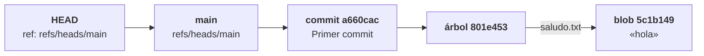
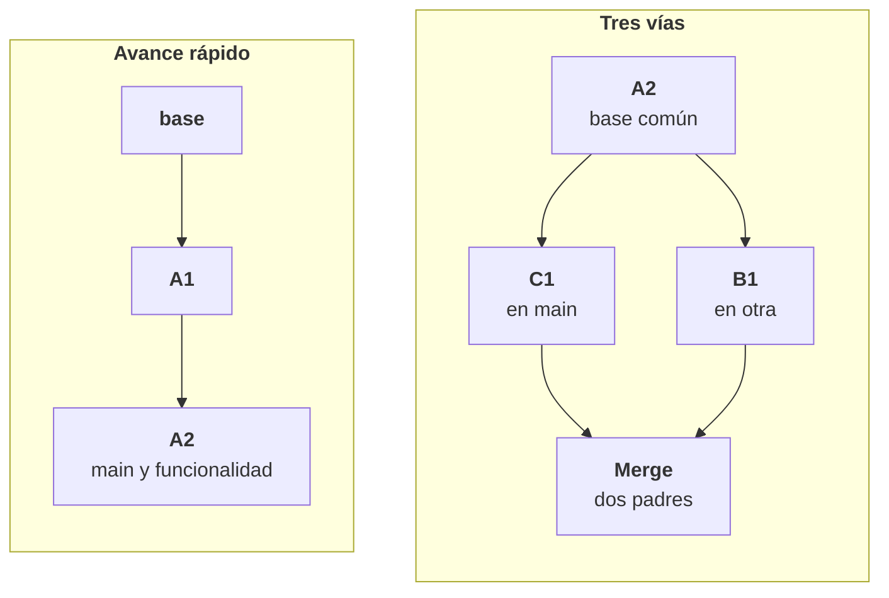
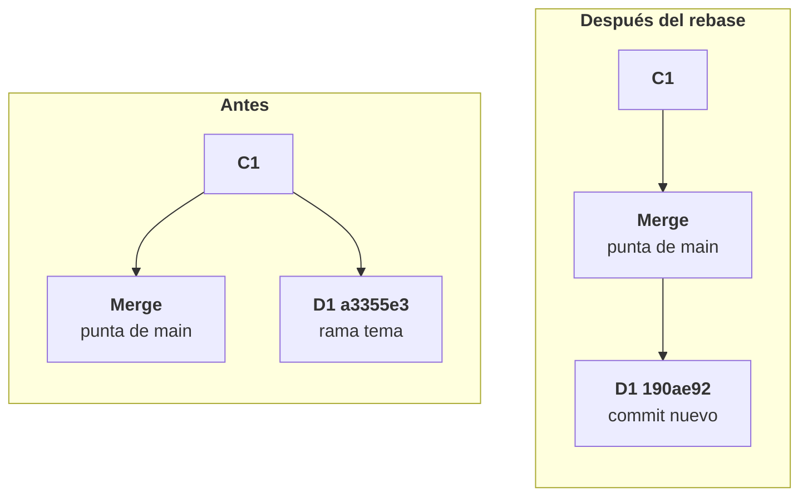
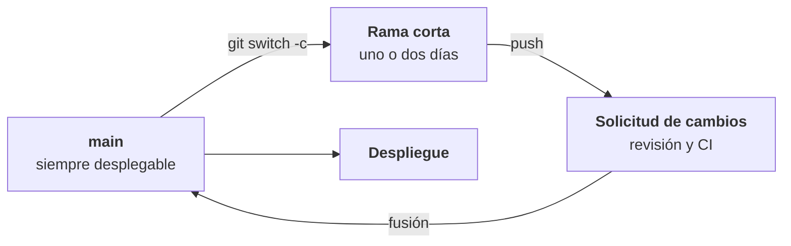
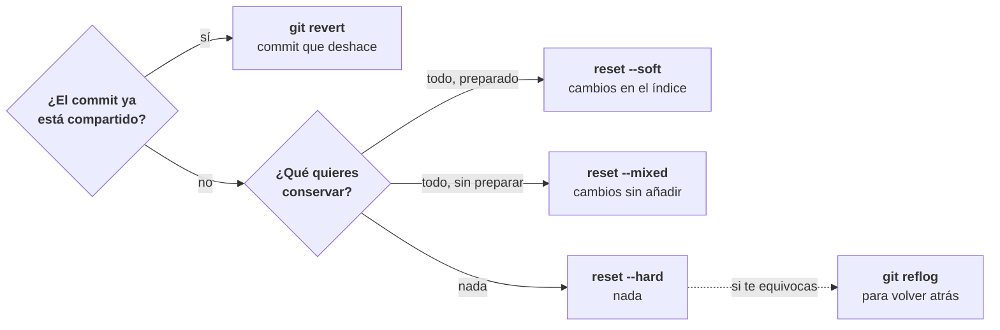

# titulo: Git en profundidad


# El modelo de objetos

## Objetivos de aprendizaje

- **1.1** Describir los objetos de Git (blob, árbol y commit) y cómo se identifican por su hash.
- **1.2** Explicar qué es una rama y qué es HEAD.
- **1.3** Seguir el recorrido de un cambio: directorio de trabajo, índice y repositorio.
- **1.4** Inspeccionar el repositorio con cat-file, rev-parse y log.

Todo se ha comprobado con Git 2.53 en un repositorio de prueba. Con `GIT_AUTHOR_DATE` y `GIT_COMMITTER_DATE` fijas, los hashes de los commits salen siempre iguales.

## Git guarda instantáneas, no diferencias

Git es, por dentro, un **almacén de objetos** direccionado por contenido: cada objeto se guarda con el hash de lo que contiene. Hay cuatro tipos; los tres que importan a diario son:

| Objeto | Qué contiene |
|---|---|
| **Blob** | El contenido de un fichero, sin su nombre |
| **Árbol** (*tree*) | Un directorio: nombres, permisos y el hash de cada blob o subárbol |
| **Commit** | Un árbol (la instantánea completa), sus padres, el autor, el confirmador y el mensaje |

El cuarto es la **etiqueta anotada**, que apunta a un commit con su propio mensaje y firma.

El hash depende solo del contenido. El texto `hola` seguido de un salto de línea da siempre el mismo identificador, en cualquier repositorio:

```text
$ echo "hola" | git hash-object --stdin
5c1b14949828006ed75a3e8858957f86a2f7e2eb
```

Tras el primer commit, `git cat-file` muestra la cadena completa:

```text
$ git cat-file -p HEAD
tree 801e45332eddf6a31000c9c885c163b5590a9110
author Ana <ana@example.com> 1795251600 +0100
committer Ana <ana@example.com> 1795251600 +0100

Primer commit

$ git cat-file -p HEAD^{tree}
100644 blob 5c1b14949828006ed75a3e8858957f86a2f7e2eb    saludo.txt
```



```nodos
HEAD:
  concepto: head
MAIN:
  concepto: referencia-git
C:
  concepto: commit-git
T:
  concepto: tree
B:
  concepto: blob
```

Consecuencias del diseño:

- **Un commit es una instantánea completa**, no una lista de cambios. El diff se calcula al vuelo comparando dos árboles.
- **Los ficheros iguales no ocupan dos veces**: comparten blob.
- **Cambiar cualquier cosa de un commit** (mensaje, fecha, padre) cambia su hash, y por tanto el de todos sus descendientes. Eso hace la historia verificable y explica por qué reescribirla crea commits nuevos (lección 3).

Git usa SHA-1 por defecto (`git rev-parse --show-object-format` lo dice). Existe un formato con SHA-256, pensado como sucesor: `git init --object-format=sha256` crea un repositorio cuyos identificadores tienen 64 caracteres. Cada repositorio usa uno de los dos, así que antes de adoptarlo comprueba que lo admiten tus herramientas y tu forja.

## Ramas y HEAD

Una **rama** es un fichero con el hash de un commit. Nada más:

```text
$ cat .git/refs/heads/main
a660cac1a4e9e92c510c459bcd610d830a1a49e9
$ cat .git/HEAD
ref: refs/heads/main
```

Por eso crear una rama es instantáneo y no copia nada. Al hacer un commit, Git crea el objeto y mueve la rama a la que apunta `HEAD`.

**HEAD** dice qué tienes desplegado. Si apunta a una rama, los commits nuevos la hacen avanzar. Si apunta directamente a un commit (por ejemplo, tras `git switch --detach a660cac`), HEAD queda **separado**: puedes hacer commits, pero ninguna rama los recoge, y al cambiar de rama solo te queda el reflog para encontrarlos (lección 5).

## Tres lugares

| Lugar | Qué es | Comando que mueve hacia él |
|---|---|---|
| **Directorio de trabajo** | Los ficheros que editas | `git restore` (desde el índice) |
| **Índice** | La instantánea que se prepara para el próximo commit | `git add` |
| **Repositorio** | Los objetos y referencias de `.git` | `git commit` |

`git add` no se limita a «marcar» un fichero. En la prueba, justo después de `git add saludo.txt` y antes de ningún commit, el blob ya estaba en `.git/objects/5c/1b1494…`. Por eso lo que añadiste al índice se puede recuperar aunque después pierdas el fichero.

## Inspeccionar

| Comando | Para qué |
|---|---|
| `git cat-file -t <hash>` / `-p <hash>` | Tipo y contenido de un objeto |
| `git rev-parse HEAD`, `git rev-parse main~2` | Convertir un nombre en hash |
| `git log --oneline --graph --all` | La historia como grafo |
| `git show <commit>` | El commit y su diff con el padre |
| `git count-objects -v` | Cuántos objetos sueltos hay |

`HEAD~2` es el abuelo siguiendo el primer padre, y `HEAD^2`, el segundo padre de un commit de fusión.

## Puntos clave

- Git es un almacén de objetos identificados por el hash de su contenido: blob, árbol, commit y etiqueta.
- Un commit es una instantánea completa con sus padres; el diff se calcula al comparar.
- Cambiar cualquier dato de un commit cambia su hash y el de toda su descendencia.
- Una rama es un fichero con un hash, y crearla no copia nada.
- HEAD apunta a la rama actual; si apunta a un commit, está separado.
- `git add` ya guarda el contenido como blob en el repositorio.
- `cat-file`, `rev-parse` y `log --graph` permiten ver todo esto.

## Referencias

- Pro Git, [Git Internals: Git Objects](https://git-scm.com/book/en/v2/Git-Internals-Git-Objects).
- Pro Git, [Branches in a Nutshell](https://git-scm.com/book/en/v2/Git-Branching-Branches-in-a-Nutshell).
- Git, [gitglossary](https://git-scm.com/docs/gitglossary) y [git-cat-file](https://git-scm.com/docs/git-cat-file).
- Git, [hash-function-transition](https://git-scm.com/docs/hash-function-transition).

# Ramas y fusiones

## Objetivos de aprendizaje

- **2.1** Crear y cambiar de rama, y explicar qué ocurre en cada caso.
- **2.2** Distinguir una fusión por avance rápido de una fusión de tres vías.
- **2.3** Resolver un conflicto de fusión.
- **2.4** Elegir entre fusionar con `--no-ff`, con avance rápido o aplastando los commits.

Todo se ha comprobado con Git 2.53 en repositorios de prueba. Los mensajes de Git aparecen en español porque es el idioma del sistema.

## Crear y cambiar de rama

| Comando | Qué hace |
|---|---|
| `git switch -c tema` | Crea la rama `tema` en el commit actual y cambia a ella |
| `git switch main` | Cambia a `main`: mueve HEAD y actualiza el directorio de trabajo |
| `git switch -c tema origin/tema` | Crea una rama local que sigue a una remota |
| `git branch -d tema` | Borra la rama si ya está fusionada; `-D` la borra aunque no lo esté |

`git switch` (desde Git 2.23) separa lo que antes hacía `git checkout`, que también restauraba ficheros. Si tienes cambios sin guardar que chocan con la otra rama, Git no cambia; los guardas con un commit o con `git stash` (lección 5).

## Avance rápido o tres vías



```nodos
FF:
  concepto: fast-forward
F0:
  titulo: Base
  texto: El último commit de main antes de crear la rama.
F1:
  titulo: A1
  texto: Primer commit de la rama funcionalidad.
F2:
  titulo: Avance rápido
  texto: main no tenía commits propios, así que la fusión solo movió su referencia de a660cac a ee2d2e3.
TV:
  concepto: merge-commit
T0:
  titulo: Ancestro común
  texto: Git compara las dos puntas con este commit para saber qué cambió cada lado. Lo da git merge-base.
T1:
  titulo: Cambio en main
  texto: main avanzó por su cuenta mientras se trabajaba en la otra rama.
T2:
  titulo: Cambio en la rama
  texto: El trabajo de la rama otra.
M:
  titulo: Commit de fusión
  texto: Tiene dos padres. En la prueba, git cat-file -p HEAD mostró dos líneas parent.
```

Las dos situaciones, tal como las mostró Git:

```text
$ git merge funcionalidad
Actualizando a660cac..ee2d2e3
Fast-forward

$ git merge --no-edit otra
*   37b7b62 Merge branch 'otra'
|\
| * 50b725a B1
* | 18659dc C1
|/
* ee2d2e3 A2
```

- **Avance rápido:** la rama destino no tiene commits propios desde que se separaron. Git solo mueve la referencia; no hay commit nuevo.
- **Tres vías:** las dos ramas han avanzado. Git busca el **ancestro común**, calcula qué cambió cada lado y crea un **commit de fusión** con dos padres.

## Conflictos

Si las dos ramas cambian las mismas líneas, Git no puede decidir. En la prueba, `main` subió el precio a 11 y la rama `subida`, a 12:

```text
$ git merge subida
CONFLICTO (contenido): Conflicto de fusión en tarifa.txt

$ cat tarifa.txt
<<<<<<< HEAD
precio = 11
=======
precio = 12
>>>>>>> subida
```

Para resolverlo:

1. Edita el fichero y deja el contenido correcto, sin las marcas.
2. `git add tarifa.txt` para marcarlo como resuelto (`git status` lo mostraba como `UU`).
3. `git commit` para completar la fusión.

Si prefieres empezar de nuevo, `git merge --abort` deja todo como estaba antes; en la prueba, `git status` quedó vacío. Un conflicto no es un error: es Git pidiéndote una decisión que no puede tomar. Las ramas cortas y los commits pequeños hacen que haya menos y que sean más fáciles.

## Cómo integrar

| Opción | Resultado | Cuándo |
|---|---|---|
| Avance rápido | Historia lineal, sin rastro de la rama | Cambios pequeños que ya están al día |
| `git merge --no-ff` | Siempre un commit de fusión que agrupa la rama | Quieres ver en la historia qué commits fueron juntos |
| Fusión aplastada (`--squash`) | Un único commit con todos los cambios | La historia de la rama tiene commits de «arreglo» que no aportan |
| Rebase y avance rápido | Historia lineal con todos los commits | Equipos que prefieren una historia lineal (lección 3) |

Con `--no-ff`, Git creó un commit de fusión aunque se podía avanzar rápido:

```text
*   f1a016e Merge branch 'mini'
|\
| * 074b750 mini
|/
```

Ninguna es la correcta en general. Lo importante es que el equipo elija una y la aplique de forma coherente, por ejemplo con la configuración de las solicitudes de cambios de la forja.

## Puntos clave

- Una rama nueva es una referencia nueva; `git switch` mueve HEAD y actualiza los ficheros.
- Si la rama destino no ha avanzado, la fusión es un avance rápido y no crea commit.
- Si las dos han avanzado, Git fusiona a tres vías desde el ancestro común y crea un commit con dos padres.
- Un conflicto aparece cuando los dos lados cambian lo mismo: se edita, se hace `git add` y se confirma.
- `git merge --abort` deshace una fusión a medias.
- `--no-ff`, `--squash` y rebase dan historias distintas; el equipo elige una.

## Referencias

- Git, [git-merge](https://git-scm.com/docs/git-merge) y [git-switch](https://git-scm.com/docs/git-switch).
- Pro Git, [Branches in a Nutshell](https://git-scm.com/book/en/v2/Git-Branching-Branches-in-a-Nutshell).

# Reescribir la historia

## Objetivos de aprendizaje

- **3.1** Explicar qué hace un rebase y por qué cambia los hashes.
- **3.2** Ordenar una rama antes de integrarla con amend, fixup y rebase interactivo.
- **3.3** Aplicar la regla de oro: no reescribir commits que otros ya usan.
- **3.4** Publicar una rama reescrita sin borrar el trabajo de otros, con `--force-with-lease` y `--force-if-includes`.

Todo se ha comprobado con Git 2.53, incluido un remoto local con dos clones, uno de Ana y otro de Luis.

## Rebase

`git rebase main` toma los commits de tu rama que no están en `main` y los **vuelve a aplicar** sobre la punta de `main`, uno a uno. Como cambia el padre de cada commit, cada uno es un **objeto nuevo con otro hash**:

```text
antes   = a3355e3e4b331299c0699d387e380b4af62afe4b   D1, sobre C1
después = 190ae92604cab0f8b055ee027d83db4d9f1c146f   D1, sobre la punta de main
```



```nodos
ANTES:
  titulo: Antes
  texto: La rama tema salía de C1, un commit anterior a la punta de main.
A0:
  titulo: C1
  texto: Base original de la rama.
A1:
  titulo: Punta de main
  texto: main había avanzado con una fusión.
AD:
  titulo: D1 original
  texto: Sigue en el repositorio, recuperable con el reflog, pero ninguna rama lo apunta tras el rebase.
DESP:
  concepto: rebase
B0:
  titulo: C1
  texto: Igual que antes.
B1:
  titulo: Punta de main
  texto: La nueva base de la rama.
BD:
  titulo: D1 nuevo
  texto: El mismo cambio, con otro padre y por tanto otro hash. Para Git es otro commit.
```

El resultado es una historia **lineal**, sin commits de fusión, que se lee como si hubieras empezado tu trabajo después de lo último de `main`. El precio es que esos commits ya no son los que tenías.

`git pull --rebase` hace lo mismo con la rama remota: en lugar de crear un commit de fusión cada vez que actualizas, coloca tus commits locales encima de los que han llegado.

## Ordenar una rama antes de integrarla

| Herramienta | Para qué |
|---|---|
| `git commit --amend` | Rehacer el último commit: añadir un fichero olvidado o corregir el mensaje |
| `git commit --fixup=<commit>` | Crear un commit «arreglo de…» para fundirlo después con otro |
| `git rebase -i main` | Reordenar, fundir (`squash`, `fixup`), reescribir mensajes (`reword`) o quitar (`drop`) commits |
| `git rebase -i --autosquash main` | Lo mismo, colocando cada `fixup!` detrás de su commit |

Un caso real: después de «Añade IVA» se corrige un error de «Añade total». Con `--fixup`, la rama quedó así:

```text
54e365d fixup! Añade total
948d5ad Añade IVA
c1074b6 Añade total
```

Tras `git rebase -i --autosquash`, el arreglo se fundió en su commit:

```text
8b3cfd8 Añade IVA
c6ba96a Añade total
```

Quien revise la rama verá dos commits con sentido, no un «arreglo» suelto. Fíjate en que los dos hashes han cambiado.

## La regla de oro

Reescribir crea commits nuevos y abandona los antiguos. Si **otra persona** ya tiene los antiguos (porque los subiste a una rama compartida), su historia y la tuya divergen, y al integrarlas aparecen commits duplicados o trabajo perdido.

| Situación | ¿Reescribir? |
|---|---|
| Commits solo en tu equipo | Sí, con libertad |
| Rama tuya subida para una solicitud de cambios, que nadie más usa | Sí, con `--force-with-lease` y avisando si hay revisores |
| `main` o cualquier rama compartida | No. Para deshacer, `git revert` (lección 5) |

## Publicar una rama reescrita sin pisar a nadie

Tras un rebase, `git push` se rechaza, porque el remoto tiene commits que tu rama ya no contiene. `git push --force` lo sustituye todo, **incluido** lo que haya subido otra persona entretanto.

La prueba: Luis sube un commit a `main`; Ana, que no lo ha traído, quiere forzar el suyo.

```text
$ git push origin main
 ! [rejected]  main -> main (fetch first)

$ git push --force-with-lease origin main
 ! [rejected]  main -> main (stale info)
```

`--force-with-lease` solo fuerza si la rama remota sigue donde Ana la vio por última vez. Como Luis la había movido, lo rechazó. Pero después Ana hizo un `git fetch` **sin integrar** lo de Luis:

```text
$ git fetch
$ git push --force-with-lease origin main
 + 1fcae23...4ad925c main -> main (forced update)      ← el commit de Luis desapareció del remoto
```

El `fetch` actualizó la referencia `origin/main`, y para `--force-with-lease` eso cuenta como «ya lo he visto». Por eso existe **`--force-if-includes`**: además exige que tu rama **contenga** lo que trajiste. Repitiendo la situación:

```text
$ git fetch
$ git push --force-with-lease --force-if-includes origin main
 ! [rejected]  main -> main (remote ref updated since checkout)
```

Para usarlo siempre: `git config --global push.useForceIfIncludes true`, y forzar solo con `--force-with-lease`.

## Puntos clave

- Un rebase vuelve a aplicar tus commits sobre otra base: son commits nuevos con otros hashes.
- `--amend`, `--fixup` y `rebase -i --autosquash` dejan una rama limpia antes de revisarla.
- No reescribas commits que otros ya tienen; en ramas compartidas, deshaz con `git revert`.
- `git push --force` puede borrar el trabajo de otros.
- `--force-with-lease` protege, salvo que hayas hecho `fetch` sin integrar; en ese caso solo protege `--force-if-includes`.
- Configura `push.useForceIfIncludes` y no uses nunca `--force` a secas.

## Referencias

- Git, [git-rebase](https://git-scm.com/docs/git-rebase).
- Git, [git-push](https://git-scm.com/docs/git-push), opciones `--force-with-lease` y `--force-if-includes`.
- Git, [git-commit](https://git-scm.com/docs/git-commit), opciones `--amend` y `--fixup`.

# Trabajo en equipo

## Objetivos de aprendizaje

- **4.1** Comparar los flujos de ramas más usados: desarrollo basado en el tronco, GitHub flow y Git Flow.
- **4.2** Preparar una buena solicitud de cambios: commits pequeños y con sentido.
- **4.3** Escribir mensajes de commit útiles, con Conventional Commits.
- **4.4** Proteger la rama principal con las reglas de la forja.

Esta lección no tiene laboratorio propio: recoge lo que dicen las fuentes de cada flujo y cómo trabaja este mismo repositorio.

## Tres flujos

| Flujo | Ramas | Cuándo encaja |
|---|---|---|
| **Desarrollo basado en el tronco** | Una rama principal; ramas de pocos días o ninguna | Entrega continua, equipos con buena integración continua |
| **GitHub flow** | `main` siempre desplegable; una rama por cambio, que entra con una solicitud de cambios | La mayoría de aplicaciones web y servicios |
| **Git Flow** | `main`, `develop`, ramas de funcionalidad, de versión y de corrección urgente | Software con varias versiones publicadas que mantener a la vez |

**Desarrollo basado en el tronco.** Su web lo define como un modelo en el que se colabora en una sola rama, el tronco, resistiendo la presión de crear otras ramas de larga duración. Si se usan ramas de funcionalidad, su regla clave es la duración: **un par de días como mucho**. Más tiempo, y la rama se convierte en lo que el modelo quiere evitar.

**GitHub flow.** Los pasos de la documentación de GitHub son crear una rama, hacer cambios, abrir una solicitud de cambios, atender los comentarios de la revisión, fusionarla y borrar la rama.

**Git Flow.** Su autor, Vincent Driessen, añadió en 2020 una nota a su artículo de 2010: el modelo se había tratado como un estándar o una panacea, y para las aplicaciones web, que se entregan de forma continua, recomienda un flujo más sencillo como GitHub flow. Git Flow sigue teniendo sentido si mantienes varias versiones publicadas a la vez.



```nodos
MAIN:
  concepto: trunk-based-git
RAMA:
  titulo: Rama de vida corta
  texto: Cuanto más dura una rama, más diverge de main y más conflictos acumula. La web de desarrollo basado en el tronco habla de un par de días como mucho.
PR:
  titulo: Solicitud de cambios
  texto: Revisión de otra persona y comprobaciones automáticas antes de entrar en main.
DESP:
  titulo: Despliegue
  texto: Si main está siempre desplegable, cada fusión se puede publicar.
```

## Una buena solicitud de cambios

Quien revisa tiene que poder entenderla:

- **Pequeña:** un cambio con un propósito. Varios cambios sin relación van en solicitudes separadas.
- **Commits con sentido:** cada uno compila y deja las pruebas en verde, y se puede leer por separado. Los «arreglo», «otro intento» o «ahora sí» se funden antes de pedir revisión (lección 3).
- **Al día con `main`:** con rebase o con una fusión, según la regla del equipo.
- **Descripción:** qué cambia, por qué y cómo se ha probado.

## Mensajes de commit

Un buen mensaje explica **qué** y **por qué**; el cómo ya está en el diff. **Conventional Commits** (versión 1.0.0) añade una estructura que pueden leer las herramientas:

```text
<tipo>[ámbito opcional]: <descripción>

[cuerpo opcional]

[notas al pie opcionales]
```

| Tipo | Uso |
|---|---|
| `feat` | Funcionalidad nueva (en versionado semántico, sube la versión menor) |
| `fix` | Corrección de un error (sube el parche) |
| `docs`, `test`, `ci`, `refactor`… | Otros cambios, que la especificación permite |
| `!` o la nota `BREAKING CHANGE:` | Cambio incompatible (sube la versión mayor) |

Este repositorio los usa con el tema o el componente como ámbito: `feat(consola): diagramas con estilo editorial y tipos nuevos` o `fix(seguridad-web): distractores sin términos absolutos`.

## Proteger la rama principal

Las forjas permiten reglas sobre `main`. En GitHub, las **ramas protegidas** pueden exigir, entre otras cosas:

| Regla | Para qué |
|---|---|
| Revisiones de la solicitud de cambios antes de fusionar | Que otra persona lo vea |
| Comprobaciones de estado antes de fusionar | Que la CI pase |
| Historia lineal | Sin commits de fusión, si el equipo usa rebase o fusiones aplastadas |
| Commits firmados | Verificar la autoría |
| No permitir pushes forzados | Que nadie reescriba la historia compartida |

Así, la regla de oro de la lección 3 deja de depender de la memoria de cada uno.

## Puntos clave

- Desarrollo basado en el tronco: una rama principal y ramas de un par de días como mucho.
- GitHub flow: `main` desplegable y una rama con su solicitud de cambios para cada cambio.
- Git Flow encaja con varias versiones publicadas; su autor recomienda algo más sencillo para entrega continua.
- Solicitudes pequeñas, con commits que se entienden solos y una descripción del porqué.
- Conventional Commits: `tipo(ámbito): descripción`, con `feat`, `fix` y `!` para lo incompatible.
- Protege `main`: revisiones, CI obligatoria y sin pushes forzados.

## Referencias

- [Trunk Based Development](https://trunkbaseddevelopment.com/).
- GitHub Docs, [GitHub flow](https://docs.github.com/en/get-started/using-github/github-flow) y [About protected branches](https://docs.github.com/en/repositories/configuring-branches-and-merges-in-your-repository/managing-protected-branches/about-protected-branches).
- Vincent Driessen, [A successful Git branching model](https://nvie.com/posts/a-successful-git-branching-model/), con la nota de 2020.
- [Conventional Commits 1.0.0](https://www.conventionalcommits.org/en/v1.0.0/).

# Recuperar errores

## Objetivos de aprendizaje

- **5.1** Deshacer cambios con `restore` y `reset`, sabiendo qué hace cada modo de `reset`.
- **5.2** Deshacer un commit ya compartido con `revert`.
- **5.3** Recuperar commits «perdidos» con el reflog.
- **5.4** Encontrar el commit que introdujo un fallo con `bisect`, y apartar trabajo con `stash`.

Todo se ha comprobado con Git 2.53 en repositorios de prueba.

## Qué herramienta para cada error



```nodos
Q:
  titulo: ¿Compartido?
  texto: Si otros ya tienen el commit, reescribir la historia les crea problemas.
  seccion: 03-reescribir-la-historia/teoria#la-regla-de-oro
R:
  concepto: revert
L:
  titulo: Solo en tu equipo
  texto: Puedes mover la rama con reset. El modo decide qué pasa con el índice y con los ficheros.
S:
  titulo: reset --soft
  texto: Mueve la rama; los cambios del commit deshecho quedan preparados en el índice, listos para otro commit.
M:
  titulo: reset --mixed
  texto: El modo por defecto. Mueve la rama y vacía el índice; los cambios quedan en los ficheros, sin añadir.
H:
  titulo: reset --hard
  texto: Mueve la rama y deja el índice y los ficheros igual que el commit. Lo que no estaba confirmado se pierde.
RL:
  concepto: reflog
```

## reset y restore

`git reset` **mueve la rama** a otro commit. Tras dos commits que escriben `1` y `2` en un fichero, `git reset HEAD~1` en sus tres modos dejó:

| Modo | HEAD | `git status` | Contenido del fichero |
|---|---|---|---|
| `--soft` | `uno` | `M` en la primera columna (preparado) | `1, 2` |
| `--mixed` | `uno` | `M` en la segunda columna (sin preparar) | `1, 2` |
| `--hard` | `uno` | limpio | `1` |

`git restore` trabaja con **ficheros**, no con commits:

| Comando | Qué hace |
|---|---|
| `git restore fichero` | Descarta los cambios del directorio de trabajo; vuelve a la versión del índice |
| `git restore --staged fichero` | Saca el fichero del índice sin tocar tus cambios |
| `git restore --source=HEAD~2 fichero` | Trae la versión de un commit concreto |

`reset --hard` y `restore fichero` borran cambios no confirmados que **Git no puede recuperar**, porque nunca llegaron al repositorio. Antes de usarlos, `git stash` o un commit temporal.

## revert: deshacer sin reescribir

En una rama compartida no se mueve la historia hacia atrás. `git revert` crea un **commit nuevo** con el cambio inverso:

```text
$ git revert --no-edit HEAD
33afa54 Revert "dos"
3e64517 dos
371ec8b uno
```

El fichero volvió a contener solo `1`, y nadie tiene que reescribir nada: el próximo `pull` trae el commit de reversión como cualquier otro.

## El reflog

El **reflog** registra cada movimiento de HEAD y de las ramas en tu repositorio. Tras un `reset --hard` de dos commits, ahí seguía el commit «perdido»:

```text
$ git reset --hard HEAD~2
$ git reflog -3
ee2d2e3 HEAD@{0}: reset: moving to HEAD~2
37b7b62 HEAD@{1}: checkout: moving from tema to main
190ae92 HEAD@{2}: rebase (finish): returning to refs/heads/tema
$ git reset --hard 37b7b62        # de vuelta donde estaba
```

Sirve tras un rebase que salió mal, una rama borrada o commits hechos con HEAD separado. Dos límites:

- Es **local**: no se sube con push y cada clon tiene el suyo.
- **Caduca**: por defecto, las entradas se borran a los 90 días, y a los 30 si su commit ya no es alcanzable desde la rama. Después, la recolección de basura elimina los objetos.

## bisect y stash

`git bisect` hace una **búsqueda binaria** en la historia. Le dices un commit bueno y uno malo, y va desplegando el del medio. Con `git bisect run`, un comando decide en cada paso: código 0 es bueno y de 1 a 127 (salvo 125, que significa «sáltalo») es malo.

En una rama de 8 commits en la que el sexto introducía un fichero `estado.txt` con un fallo:

```text
$ git bisect start HEAD <commit bueno>
$ git bisect run sh -c '! test -f estado.txt'
[34de21e] cambio 4
[af2e8e1] cambio 6
[adece84] cambio 5
af2e8e114558ca251668180a62b35c2e3d342395 is the first bad commit
$ git bisect reset
```

Tres pruebas para 8 commits. Con 1000 commits bastarían unas 10. Lo que hace falta es una prueba automática que diga si un commit está bien.

`git stash` **aparta** los cambios sin confirmar y deja el directorio limpio, por ejemplo para cambiar de rama un momento:

```text
$ git stash             # el directorio queda limpio
$ git stash list
stash@{0}: WIP on main: 33afa54 Revert "dos"
$ git stash pop         # los cambios vuelven
```

Úsalo para interrupciones cortas. Para algo que vas a retomar mañana, un commit en una rama es más fácil de encontrar.

## Puntos clave

- `reset` mueve la rama: `--soft` deja los cambios preparados, `--mixed` sin preparar y `--hard` los descarta.
- `restore` trabaja con ficheros: descarta cambios o los saca del índice.
- Lo que nunca se confirmó ni se añadió no se puede recuperar; guárdalo antes con `stash` o con un commit.
- En ramas compartidas se deshace con `revert`, que añade un commit inverso.
- El reflog guarda por dónde ha pasado HEAD; es local y caduca a los 90 días (30 para lo inalcanzable).
- `git bisect run` encuentra el commit culpable con unas pocas pruebas automáticas.

## Referencias

- Git, [git-reset](https://git-scm.com/docs/git-reset), [git-restore](https://git-scm.com/docs/git-restore) y [git-revert](https://git-scm.com/docs/git-revert).
- Git, [git-reflog](https://git-scm.com/docs/git-reflog) y [git-gc](https://git-scm.com/docs/git-gc).
- Git, [git-bisect](https://git-scm.com/docs/git-bisect) y [git-stash](https://git-scm.com/docs/git-stash).
