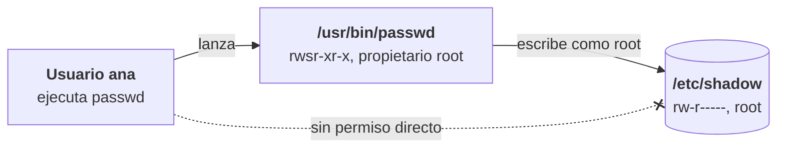
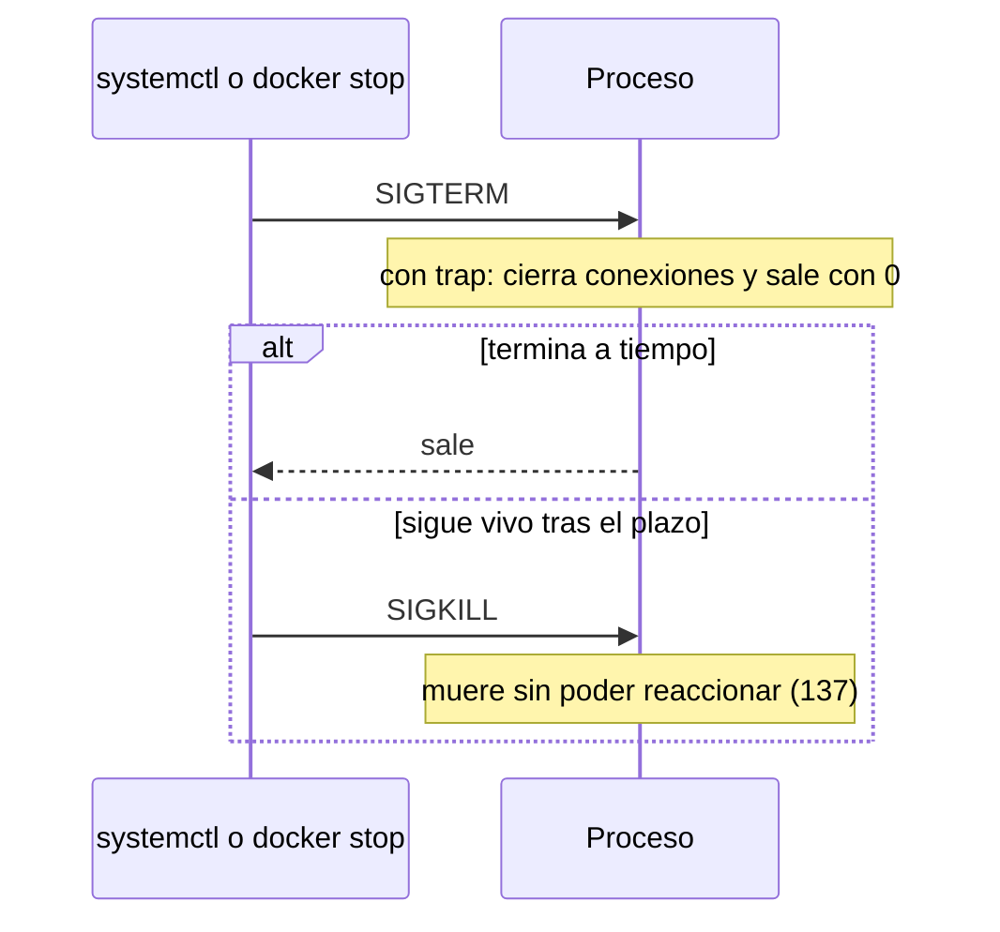
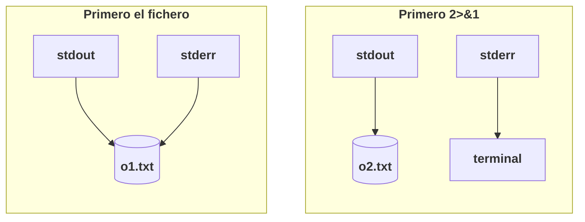
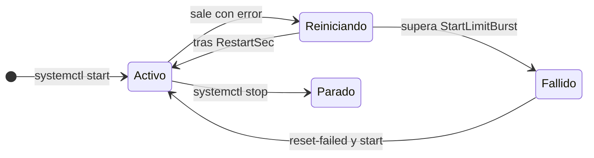

# titulo: Linux y shell para desarrolladores


# Ficheros y permisos

## Objetivos de aprendizaje

- **1.1** Orientarse en la jerarquía de directorios de Linux.
- **1.2** Leer y cambiar permisos en notación simbólica y octal.
- **1.3** Explicar umask y por qué un fichero nuevo nace con unos permisos concretos.
- **1.4** Reconocer los permisos especiales: setuid y el bit pegajoso de `/tmp`.

Todo se ha comprobado en Ubuntu 26.04 con bash 5.3. Los mensajes del sistema aparecen en español porque es el idioma configurado.

## Dónde está cada cosa

La **jerarquía estándar de ficheros** (FHS) fija para qué sirve cada directorio:

| Directorio | Contenido |
|---|---|
| `/etc` | Configuración del sistema y de los servicios |
| `/usr/bin`, `/usr/lib` | Programas y bibliotecas instalados por el sistema de paquetes |
| `/usr/local` | Lo que instalas a mano, fuera de los paquetes |
| `/var` | Datos que cambian: registros (`/var/log`), colas, bases de datos |
| `/tmp` | Temporales, compartidos por todos los usuarios |
| `/home/usuario` | Los datos de cada usuario |
| `/opt` | Paquetes de terceros completos |
| `/proc`, `/sys` | Ficheros virtuales con información del núcleo y de los procesos |

En Linux «todo es un fichero»: `/proc/self/status` muestra el estado del proceso que lo lee, y `/dev/null` descarta lo que se le escribe.

## Permisos

Cada fichero tiene un **propietario**, un **grupo** y tres juegos de permisos: para el propietario (u), el grupo (g) y el resto (o).

```text
-rw-r----- 1 root shadow 1355 … /etc/shadow
│└┬┘└┬┘└┬┘
│ │  │  └ resto: nada
│ │  └ grupo shadow: leer
│ └ propietario root: leer y escribir
└ tipo: - fichero, d directorio, l enlace simbólico
```

| Permiso | En un fichero | En un directorio |
|---|---|---|
| `r` (4) | Leer el contenido | Listar los nombres |
| `w` (2) | Modificarlo | Crear, borrar y renombrar entradas |
| `x` (1) | Ejecutarlo | Entrar y acceder a lo que contiene |

En **octal**, cada juego suma sus valores: `rwx` = 7, `r-x` = 5, `r--` = 4. `640` es `rw-r-----`.

```bash
chmod u+x despliega.sh     # simbólico: añade ejecución al propietario
chmod 640 config.yml       # octal: rw-r-----
chown app:app datos/       # cambia propietario y grupo (normalmente requiere root)
```

Un script sin permiso de ejecución, en la prueba:

```text
$ ./s.sh
./s.sh: Permiso denegado
$ chmod u+x s.sh && ./s.sh
hola
```

Para **borrar** un fichero lo que cuenta es el permiso de escritura del **directorio**, no del fichero: borrar es quitar una entrada del directorio.

## umask

Los ficheros nuevos no nacen con todos los permisos: el proceso tiene una **umask** que les quita bits. Los ficheros parten de 666 y los directorios de 777:

| umask | Fichero nuevo | Directorio nuevo |
|---|---|---|
| `022` (la habitual) | `644` `rw-r--r--` | `755` `rwxr-xr-x` |
| `077` | `600` `rw-------` | `700` `rwx------` |

Es lo que se obtuvo en la prueba creando ficheros con cada umask. Para ficheros con secretos, como un `.env`, se crea el fichero con `umask 077` activo o se aplica `chmod 600` justo después.

## Permisos especiales

| Permiso | Ejemplo real | Efecto |
|---|---|---|
| **setuid** (`s` en el propietario, 4000) | `/usr/bin/passwd`: `-rwsr-xr-x`, 4755 | Se ejecuta con la identidad del propietario (root), así un usuario normal puede cambiar su contraseña en `/etc/shadow` |
| **setgid** (`s` en el grupo, 2000) | Directorios compartidos | Los ficheros nuevos heredan el grupo del directorio |
| **Bit pegajoso** (`t`, 1000) | `/tmp`: `drwxrwxrwt`, 1777 | Todos pueden crear, pero cada uno solo borra lo suyo |



```nodos
U:
  titulo: Usuario normal
  texto: No puede leer ni escribir /etc/shadow, donde están los resúmenes de las contraseñas.
P:
  concepto: setuid
S:
  concepto: permisos-unix
```

Un programa setuid de root es un riesgo: cualquier fallo en él da privilegios de root. Por eso son muy pocos y están muy revisados. Nunca se pone setuid a un script propio.

## Puntos clave

- `/etc` es configuración, `/var` datos que cambian, `/usr` programas del sistema y `/tmp` temporales compartidos.
- Permisos `rwx` para propietario, grupo y resto; en octal, 4 + 2 + 1.
- En un directorio, `x` permite entrar y `w` crear o borrar entradas; borrar depende del directorio, no del fichero.
- La umask quita permisos a lo nuevo: con 022 salen 644 y 755; con 077, 600 y 700.
- setuid ejecuta con la identidad del propietario (`passwd`); el bit pegajoso de `/tmp` impide borrar lo ajeno.
- Para secretos: `chmod 600`, o crear el fichero con `umask 077`.

## Referencias

- Linux Foundation, [Filesystem Hierarchy Standard 3.0](https://refspecs.linuxfoundation.org/FHS_3.0/fhs/index.html).
- Linux, [chmod(1)](https://man7.org/linux/man-pages/man1/chmod.1.html) y [umask(2)](https://man7.org/linux/man-pages/man2/umask.2.html).

# Procesos y señales

## Objetivos de aprendizaje

- **2.1** Describir un proceso: PID, padre, estado y descriptores.
- **2.2** Usar las señales para parar un proceso, y saber cuándo usar SIGTERM y cuándo SIGKILL.
- **2.3** Capturar SIGTERM con `trap` para cerrar limpiamente.
- **2.4** Interpretar los códigos de salida, incluidos los de un proceso terminado por una señal.

Todo se ha comprobado con bash 5.3 en Ubuntu 26.04.

## Procesos

Un **proceso** es un programa en ejecución. Tiene un **PID**, un proceso padre (**PPID**), un usuario, un estado y sus ficheros abiertos. `ps` los muestra:

```text
$ sleep 5 & ps -o pid,ppid,stat,cmd -p $!
    PID    PPID STAT CMD
2184940 2184929 S    sleep 5
```

`S` es *dormido* (esperando algo, como un temporizador o una lectura), `R` en ejecución, `Z` *zombi* (terminado, pero su padre aún no ha recogido su código) y `T` detenido. Toda esa información sale de `/proc/PID`; `/proc/self` es el propio proceso que la lee:

```text
$ grep -E '^(Name|State|PPid)' /proc/self/status
Name:   cat
State:  R (running)
PPid:   2184929
```

| Comando | Para qué |
|---|---|
| `ps aux`, `ps -ef` | Todos los procesos |
| `pgrep -a nombre` | Buscar por nombre |
| `top`, `htop` | Consumo en tiempo real |
| `comando &`, `jobs`, `fg` | Lanzar en segundo plano y recuperarlo |
| `$!` | PID del último proceso lanzado en segundo plano |

## Señales

Una **señal** es un aviso que el núcleo entrega a un proceso. Las más usadas:

| Señal | Número | Uso | ¿Se puede capturar? |
|---|---|---|---|
| `SIGTERM` | 15 | Petición de terminar; la que envía `kill` por defecto | Sí |
| `SIGINT` | 2 | Ctrl+C en la terminal | Sí |
| `SIGHUP` | 1 | Se cerró la terminal; muchos servicios la usan para recargar la configuración | Sí |
| `SIGKILL` | 9 | Matar en el acto | **No** |

El orden correcto para parar un proceso es **primero SIGTERM**, darle unos segundos para que cierre conexiones y guarde lo pendiente, y **solo si no termina, SIGKILL**. Es lo que hacen `systemctl stop` y `docker stop` (10 segundos de espera por defecto).



```nodos
G:
  titulo: Quien para el proceso
  texto: Envía SIGTERM, espera un plazo y, si hace falta, SIGKILL. En Docker el plazo por defecto es de 10 segundos.
P:
  concepto: senal
```

## Cerrar limpiamente con trap

Un servicio en bash que captura SIGTERM:

```bash
#!/usr/bin/env bash
trap 'echo "SIGTERM recibido: cierro conexiones y salgo"; exit 0' TERM
echo "servicio en marcha, PID $$"
while true; do sleep 0.2; done
```

Al enviarle `kill -TERM`, en la prueba:

```text
servicio en marcha, PID 2184931
SIGTERM recibido: cierro conexiones y salgo
código tras SIGTERM con trap: 0
```

En un contenedor, el proceso principal es el **PID 1** de su espacio de nombres, y a ese proceso solo le llegan las señales para las que ha instalado un manejador, salvo SIGKILL y SIGSTOP. Si la aplicación no captura SIGTERM, no termina y acaba recibiendo SIGKILL tras el plazo. Por eso conviene la forma *exec* del `CMD` en el Dockerfile (tema de contenedores) y que la aplicación trate SIGTERM.

## Códigos de salida

Todo proceso termina con un **código de salida**: 0 es éxito y cualquier otro valor, fallo. La shell lo deja en `$?`. Si el proceso muere por una señal, la shell informa **128 más el número de la señal**:

```text
sleep tras SIGTERM, sin trap:  143   (128 + 15)
sleep tras SIGKILL:            137   (128 + 9)
```

Un 137 en un contenedor suele significar que lo ha matado el sistema por **falta de memoria** (OOM) o un `docker kill`; un 143, que se paró de forma ordenada.

Algunos programas usan códigos distintos de 1 con significado propio: `grep` devuelve 1 si no encuentra coincidencias y 2 si hay un error. En la prueba, `grep -q zzz /etc/hostname` devolvió 1.

## Puntos clave

- Un proceso tiene PID, padre, estado y descriptores; `/proc/PID` lo describe y `ps` lo muestra.
- SIGTERM pide terminar y se puede capturar; SIGKILL mata sin aviso y no se puede capturar.
- Para parar algo: SIGTERM, un plazo y solo después SIGKILL.
- `trap '…' TERM` permite cerrar limpiamente; el PID 1 de un contenedor debe tratar SIGTERM.
- 0 es éxito; muerto por señal es 128 más la señal: 143 por SIGTERM, 137 por SIGKILL.
- Lee el código de cada programa: `grep` devuelve 1 cuando no encuentra nada.

## Referencias

- Linux, [signal(7)](https://man7.org/linux/man-pages/man7/signal.7.html), [pid_namespaces(7)](https://man7.org/linux/man-pages/man7/pid_namespaces.7.html), [proc(5)](https://man7.org/linux/man-pages/man5/proc.5.html) y [ps(1)](https://man7.org/linux/man-pages/man1/ps.1.html).
- Bash, [Bash Reference Manual: Exit Status](https://tiswww.case.edu/php/chet/bash/bashref.html#Exit-Status).

# Redirecciones y tuberías

## Objetivos de aprendizaje

- **3.1** Redirigir la entrada, la salida y los errores, y entender por qué importa el orden.
- **3.2** Combinar comandos con tuberías para analizar datos.
- **3.3** Saber qué código devuelve una tubería y usar `pipefail` y `PIPESTATUS`.
- **3.4** Usar `xargs` y la sustitución de comandos con cuidado.

Todo se ha comprobado con bash 5.3.

## Tres flujos

Todo proceso empieza con tres **descriptores de fichero**:

| Número | Nombre | Por defecto |
|---|---|---|
| 0 | Entrada estándar (*stdin*) | El teclado |
| 1 | Salida estándar (*stdout*) | La terminal |
| 2 | Salida de errores (*stderr*) | La terminal |

Separar los datos (1) de los errores (2) permite procesar la salida sin que los mensajes de error se cuelen.

| Redirección | Efecto |
|---|---|
| `cmd > f` | stdout a `f`, sobrescribiendo |
| `cmd >> f` | stdout a `f`, añadiendo al final |
| `cmd 2> errores.log` | stderr a un fichero |
| `cmd > f 2>&1` | stdout y stderr al mismo fichero |
| `cmd &> f` | Lo mismo, abreviado en bash |
| `cmd < datos.txt` | stdin desde un fichero |
| `cmd 2>/dev/null` | Descartar los errores |

## El orden importa

Las redirecciones se aplican **de izquierda a derecha**, y `2>&1` significa «2 apunta a donde apunta 1 **ahora**». Con `ls` sobre un directorio que no existe y otro que sí:

```text
$ ls /noexiste . > o1.txt 2>&1
→ en o1.txt: el error y el listado

$ ls /noexiste . 2>&1 > o2.txt
→ el error sale por la terminal (o por la tubería), y en o2.txt solo está el listado
```

En el segundo caso, cuando se procesa `2>&1`, la salida estándar aún es la terminal, así que stderr se queda ahí; después stdout se redirige al fichero.



```nodos
BIEN:
  titulo: Primero el fichero
  texto: stdout ya apunta a o1.txt cuando se procesa 2>&1, así que los errores van al mismo sitio.
B1:
  concepto: descriptor
B2:
  titulo: stderr
  texto: Sigue a stdout al fichero.
BF:
  titulo: o1.txt
  texto: Contiene el error y el listado.
MAL:
  titulo: Primero 2>&1
  texto: Cuando se procesa 2>&1, stdout aún es la terminal; después se redirige solo stdout.
M1:
  titulo: stdout
  texto: Va al fichero.
M2:
  titulo: stderr
  texto: Se queda en la terminal, porque copió el destino de stdout antes de que cambiara.
MF:
  titulo: o2.txt
  texto: Solo contiene el listado.
MT:
  titulo: Terminal
  texto: Aquí acaban los errores, que se pierden si se esperaba encontrarlos en el fichero.
```

## Tuberías

Una **tubería** (`|`) conecta la salida estándar de un comando con la entrada del siguiente. Cada comando hace una cosa y se combinan. Para contar los códigos de estado de un registro de acceso:

```text
$ cat acceso.log
GET /a 200
GET /b 404
POST /a 200
GET /a 500
GET /c 404

$ awk '{print $3}' acceso.log | sort | uniq -c | sort -rn
      2 404
      2 200
      1 500
```

| Herramienta | Para qué |
|---|---|
| `grep patrón` | Filtrar líneas |
| `awk '{print $3}'` | Extraer columnas, calcular |
| `sed 's/a/b/'` | Sustituir texto |
| `sort`, `uniq -c` | Ordenar y contar repeticiones (`uniq` solo junta líneas consecutivas, por eso va tras `sort`) |
| `head`, `tail -f` | Las primeras o las últimas líneas; seguir un fichero que crece |
| `cut`, `tr`, `wc -l` | Cortar campos, cambiar caracteres, contar líneas |

## El código de una tubería

El código de salida de una tubería es el del **último comando**. Un fallo en medio pasa inadvertido:

```text
$ false | true;  echo $?
0
$ set -o pipefail
$ false | true;  echo $?
1
$ false | true | (exit 3);  echo "${PIPESTATUS[@]}"
1 0 3
```

Con **`set -o pipefail`**, la tubería falla si falla cualquier comando. `PIPESTATUS` guarda el código de cada uno. Ojo con `grep` al final de una tubería: devuelve 1 si no encuentra nada, que con `pipefail` cuenta como fallo.

## xargs y sustitución de comandos

- `$(comando)` sustituye la salida del comando en la línea: `fecha=$(date +%F)`.
- `xargs` convierte líneas de su entrada en argumentos de otro comando: `find . -name '*.tmp' -print0 | xargs -0 rm`.

Los nombres de fichero pueden tener espacios e incluso saltos de línea. Por eso, con `find` se usa `-print0` y con `xargs`, `-0`: separan con el carácter nulo, que no puede aparecer en un nombre. Las comillas se tratan en la lección siguiente.

## Puntos clave

- 0 es stdin, 1 stdout y 2 stderr; separar datos y errores permite procesar la salida.
- Las redirecciones se aplican de izquierda a derecha: `> f 2>&1` junta los dos en el fichero; `2>&1 > f`, no.
- Las tuberías conectan stdout con stdin; `sort | uniq -c` cuenta repeticiones.
- El código de una tubería es el del último comando; usa `set -o pipefail` y, si hace falta, `PIPESTATUS`.
- Con nombres de fichero, `find -print0 | xargs -0` evita los problemas con espacios.

## Referencias

- Bash, [Bash Reference Manual: Redirections](https://tiswww.case.edu/php/chet/bash/bashref.html#Redirections) y [Pipelines](https://tiswww.case.edu/php/chet/bash/bashref.html#Pipelines).
- Linux, [bash(1)](https://man7.org/linux/man-pages/man1/bash.1.html).

# Scripts robustos

## Objetivos de aprendizaje

- **4.1** Poner comillas a las variables y entender por qué `"$@"` no es lo mismo que `$*`.
- **4.2** Usar `set -euo pipefail` sabiendo dónde no protege.
- **4.3** Limpiar los recursos con `trap … EXIT` y crear temporales con `mktemp`.
- **4.4** Revisar los scripts con ShellCheck.

Todo se ha comprobado con bash 5.3 y ShellCheck 0.11.

## Comillas

Una variable sin comillas se **parte por los espacios** y sus trozos se interpretan como patrones. En un directorio con los ficheros `mi`, `informe.txt` y `mi informe.txt`:

```text
$ f="mi informe.txt"
$ ls -1 $f
informe.txt
mi
$ ls -1 "$f"
mi informe.txt
```

Sin comillas, `ls` recibió dos argumentos y mostró **otros dos ficheros**. Con `rm` en lugar de `ls`, habría borrado lo que no debía. La regla: **comillas dobles siempre** alrededor de las variables y las sustituciones (`"$f"`, `"$(date)"`), salvo que quieras partir a propósito.

Lo mismo con los argumentos del script. Con dos argumentos, `"mi informe.txt"` y `otro`:

```text
con "$@": 2 argumentos
con $*:   3 argumentos
```

`"$@"` reenvía los argumentos tal cual llegaron; `$*` sin comillas los vuelve a partir.

## set -euo pipefail

| Opción | Efecto |
|---|---|
| `-e` (*errexit*) | Termina el script si un comando falla |
| `-u` (*nounset*) | Error al usar una variable no definida: `NO_DEFINIDA: variable sin asignar` |
| `-o pipefail` | Una tubería falla si falla cualquiera de sus comandos |

Son una buena primera línea, pero `set -e` **tiene excepciones**: no actúa en un comando dentro de un `if`, de un `while`, ni a la izquierda de `&&` o `||`. Y la excepción **se extiende a todo lo que se ejecuta dentro**, incluidas las funciones:

```bash
#!/usr/bin/env bash
set -euo pipefail
falla() { false; echo "sigue tras false dentro de la función"; }
if falla; then echo "el if dio verdadero"; fi
falla && echo "...y tras &&"
echo "llegó al final"
```

```text
sigue tras false dentro de la función
el if dio verdadero
sigue tras false dentro de la función
...y tras &&
llegó al final
exit=0
```

El `false` de la función no detuvo nada, porque la función se llamó dentro de un `if` y antes de `&&`. Para comprobar errores dentro de una función que se usa así, hay que hacerlo de forma explícita (`false || return 1`).

## Limpiar con trap y mktemp

`mktemp` crea un fichero o directorio temporal con un nombre único e impredecible, y `trap … EXIT` ejecuta código al salir, también si el script falla:

```bash
#!/usr/bin/env bash
set -euo pipefail
tmp=$(mktemp -d)
trap 'rm -rf "$tmp"; echo "limpieza hecha"' EXIT
echo "trabajando en $tmp"
false
```

```text
trabajando en /tmp/tmp.XXXX
limpieza hecha
exit=1
```

El script falló en `false`, pero la limpieza se ejecutó. Nunca uses nombres fijos en `/tmp` (`/tmp/datos.txt`): otro proceso u otro usuario pueden crearlos o leerlos.

## ShellCheck

**ShellCheck** analiza un script y señala los errores típicos. Sobre este script:

```bash
#!/usr/bin/env bash
destino=$1
rm -rf $destino/*
for f in $(ls *.log); do
  cat $f | grep ERROR
done
cd /var/app
```

```text
3:8: warning: Use "${var:?}" to ensure this never expands to /* . [SC2115]
3:8: note: Double quote to prevent globbing and word splitting. [SC2086]
4:10: error: Iterating over ls output is fragile. Use globs. [SC2045]
4:15: note: Use ./*glob* or -- *glob* so names with dashes won't become options. [SC2035]
5:7: note: Double quote to prevent globbing and word splitting. [SC2086]
7:1: warning: Use 'cd ... || exit' or 'cd ... || return' in case cd fails. [SC2164]
```

El primer aviso es el grave: si `$1` llega vacío, `rm -rf $destino/*` se convierte en `rm -rf /*`. Con `"${destino:?}"`, bash aborta si la variable está vacía o no definida. Una versión corregida:

```bash
#!/usr/bin/env bash
set -euo pipefail
destino=${1:?uso: limpiar.sh DIRECTORIO}
rm -rf "${destino:?}"/*
for f in ./*.log; do
  grep ERROR "$f" || true
done
cd /var/app || exit 1
```


```nodos
E:
  titulo: Escribir
  texto: Un script que crece más allá de unas decenas de líneas, o que maneja datos complejos, suele estar mejor en Python.
S:
  concepto: set-e
C:
  titulo: Comillas
  texto: Evitan que las variables se partan por los espacios o se expandan como patrones.
T:
  concepto: trap
SC:
  concepto: shellcheck
```

## Puntos clave

- Pon comillas dobles a las variables y sustituciones; sin ellas, se parten y se expanden.
- Usa `"$@"` para reenviar los argumentos tal cual.
- `set -euo pipefail` ayuda, pero `-e` no actúa dentro de un `if` ni antes de `&&` o `||`, ni en las funciones llamadas ahí.
- `mktemp` para temporales y `trap '…' EXIT` para limpiar aunque el script falle.
- `"${var:?}"` aborta si la variable está vacía: imprescindible antes de un `rm -rf`.
- Pasa ShellCheck a todos los scripts, mejor en la CI.

## Referencias

- Bash, [Bash Reference Manual: The Set Builtin](https://tiswww.case.edu/php/chet/bash/bashref.html#The-Set-Builtin) y [Shell Parameter Expansion](https://tiswww.case.edu/php/chet/bash/bashref.html#Shell-Parameter-Expansion).
- ShellCheck, [SC2086](https://www.shellcheck.net/wiki/SC2086) y [SC2115](https://www.shellcheck.net/wiki/SC2115).

# Servicios y registros

## Objetivos de aprendizaje

- **5.1** Escribir una unidad de systemd para un servicio y controlarlo con systemctl.
- **5.2** Configurar el reinicio automático y entender sus límites.
- **5.3** Consultar los registros con journalctl.
- **5.4** Diagnosticar problemas de disco y memoria, incluido un fichero borrado que sigue ocupando espacio.

Las pruebas usan systemd en Ubuntu 26.04, con una unidad **transitoria** de usuario creada con `systemd-run --user`, que no deja ficheros en el sistema.

## Una unidad de servicio

**systemd** arranca y vigila los servicios. Cada uno se describe en una **unidad**, un fichero `.service`:

```ini
[Unit]
Description=API de catálogo
After=network-online.target
Wants=network-online.target

[Service]
User=app
WorkingDirectory=/opt/catalogo
EnvironmentFile=/etc/catalogo/entorno
ExecStart=/usr/bin/java -jar /opt/catalogo/catalogo.jar
Restart=on-failure
RestartSec=5

[Install]
WantedBy=multi-user.target
```

| Directiva | Para qué |
|---|---|
| `User=` | No ejecutar como root |
| `EnvironmentFile=` | La configuración y los secretos, fuera de la unidad (con permisos 600) |
| `ExecStart=` | El proceso principal, con ruta absoluta |
| `Restart=on-failure` | Reiniciarlo si termina con error o lo mata una señal |
| `WantedBy=multi-user.target` | Arrancarlo con el sistema al hacer `enable` |

Las unidades del sistema van en `/etc/systemd/system/`, y las de un usuario, en `~/.config/systemd/user/`.

| Comando | Para qué |
|---|---|
| `systemctl daemon-reload` | Releer las unidades tras editarlas |
| `systemctl enable --now catalogo` | Activar al arranque y arrancar ya |
| `systemctl status catalogo` | Estado, PID y últimas líneas del registro |
| `systemctl restart` / `stop` | Reiniciar o parar (con SIGTERM y un plazo, lección 2) |
| `systemctl --user …` | Lo mismo con los servicios del usuario, sin root |

## Reinicios y su límite

Un servicio que falla al arrancar no debe reiniciarse sin fin. Con `Restart=on-failure`, `RestartSec=1` y un límite de 3 arranques en 30 segundos (`StartLimitBurst=3`, `StartLimitIntervalSec=30`), la unidad de prueba, que salía siempre con el código 3, hizo esto:

```text
arranco a las 02:41:11
curso-demo.service: Main process exited, code=exited, status=3/NOTIMPLEMENTED
curso-demo.service: Scheduled restart job, restart counter is at 1.
arranco a las 02:41:12
…
curso-demo.service: Scheduled restart job, restart counter is at 3.
curso-demo.service: Start request repeated too quickly.
curso-demo.service: Failed with result 'exit-code'.
```



```nodos
Activo:
  concepto: systemd
Reiniciando:
  titulo: Reiniciando
  texto: Restart=on-failure vuelve a arrancarlo tras RestartSec. La prueba se reinició tres veces, una por segundo.
Fallido:
  titulo: Fallido
  texto: Al superar el límite, systemd deja de intentarlo con «Start request repeated too quickly». Hay que corregir la causa, no subir el límite.
Parado:
  titulo: Parado
  texto: Con systemctl stop, systemd envía SIGTERM y, si no termina a tiempo, SIGKILL.
```

## Registros con journalctl

systemd recoge la salida estándar y de errores de cada servicio en el **journal**. No hace falta que la aplicación escriba ficheros de registro: basta con que escriba en stdout.

| Comando | Para qué |
|---|---|
| `journalctl -u catalogo` | Registros de una unidad |
| `journalctl -u catalogo -f` | Seguirlos en directo |
| `journalctl -u catalogo --since "1 hour ago"` | Desde un momento |
| `journalctl -u catalogo -p err` | Solo errores o peor |
| `journalctl -u catalogo -b` | Solo desde el último arranque |
| `journalctl -u catalogo -o cat` | Solo el mensaje, sin fecha ni equipo |
| `journalctl --user -u …` | Las unidades del usuario |

## Disco y memoria

| Pregunta | Comando |
|---|---|
| ¿Cuánto espacio queda en cada sistema de ficheros? | `df -h` |
| ¿Qué ocupa tanto en este directorio? | `du -sh * \| sort -h` |
| ¿Cuánta memoria hay libre? | `free -h` (mira la columna `available`) |
| ¿Qué ficheros tiene abiertos un proceso? | `lsof -p PID` |

Un caso que confunde: `df` dice que el disco está lleno, pero `du` no encuentra qué ocupa el espacio. Suele ser un fichero **borrado que un proceso sigue teniendo abierto**: el espacio no se libera hasta que lo cierra. En la prueba, con un fichero de 50 MB abierto por `tail -f`:

```text
$ rm grande.log
$ lsof -p PID | grep deleted
6r  52428800  …/grande.log (deleted)
```

Al terminar `tail`, el fichero desapareció del todo. Por eso, para vaciar un registro que un servicio tiene abierto, se trunca (`: > fichero.log`) en lugar de borrarlo, o se reinicia el servicio.

## Puntos clave

- Una unidad `.service` describe cómo arrancar el servicio: `User=`, `ExecStart=`, `Restart=` y `WantedBy=`.
- Tras editar una unidad, `daemon-reload`; para activarla al arranque, `enable --now`.
- `Restart=on-failure` reinicia, y `StartLimitBurst` evita un bucle de reinicios: ante «Start request repeated too quickly», corrige la causa.
- El journal recoge la salida de cada servicio: `journalctl -u nombre -f`, `--since`, `-p err`.
- `df -h`, `du -sh` y `free -h` responden a las preguntas básicas de disco y memoria.
- Si `df` y `du` no cuadran, busca ficheros borrados pero abiertos con `lsof`.

## Referencias

- systemd, [systemd.service](https://www.freedesktop.org/software/systemd/man/latest/systemd.service.html), [systemd.unit](https://www.freedesktop.org/software/systemd/man/latest/systemd.unit.html) y [systemd-run](https://www.freedesktop.org/software/systemd/man/latest/systemd-run.html).
- systemd, [journalctl](https://www.freedesktop.org/software/systemd/man/latest/journalctl.html).
- Linux, [df(1)](https://man7.org/linux/man-pages/man1/df.1.html) y [lsof(8)](https://man7.org/linux/man-pages/man8/lsof.8.html).
